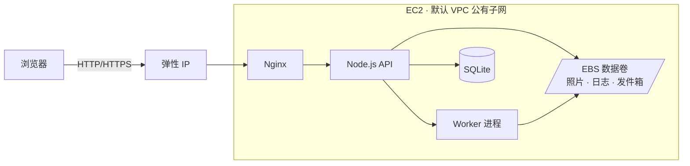

# CloudAlbum：一台 EC2 起步，逐个插上 AWS 服务的 SAA 实战项目

CloudAlbum 是一个云相册分享网站：注册登录、上传照片、自动生成缩略图和标签、浏览时间线、点赞评论、分享链接、通知和每日报告。

做这个网站是为了学 AWS。它面向准备 **AWS Certified Solutions Architect – Associate（SAA-C03）** 的学习者，按下面三个原则设计：

1. **只有一台 EC2 时，网站就能完整运行。** 所有功能先由 EC2 上的本地实现提供：照片存在 EBS 上，数据存在 SQLite 里，账号自己管理，缩略图在请求里同步生成。
2. **其他每个 AWS 服务都是一个可插拔模块。** 启用一个模块，对应的功能就从“EC2 本地实现”切换成“AWS 实现”。比如启用 S3，照片就从 EBS 搬到 S3；启用 Lambda，缩略图就交给 Lambda 生成。
3. **每次切换都能看到差别。** 网站会在响应头和页面上标出每个请求走了哪些服务。每个模块都配有一组“有它 vs 没有它”的对比实验，学员可以亲眼看到 CloudFront 命中缓存、SQS 削峰、Lambda 分担 EC2 负载的效果。

> **项目状态：设计阶段。** 目前仓库里是完整的设计文档和学习控制台的界面规格，应用代码和基础设施模板还没有实现。见下方的[路线图](#路线图)。

---

## 目录

- [为什么这样设计](#为什么这样设计)
- [用一张照片看懂：从 L0 到全量架构](#用一张照片看懂从-l0-到全量架构)
- [机能与 AWS 服务对照表](#机能与-aws-服务对照表)
- [重点对比实验](#重点对比实验)
- [学习路线](#学习路线)
- [学习控制台](#学习控制台)
- [规划中的使用方式](#规划中的使用方式)
- [技术栈与仓库结构](#技术栈与仓库结构)
- [文档导航](#文档导航)
- [费用与安全提醒](#费用与安全提醒)
- [路线图](#路线图)

---

## 为什么这样设计

很多 AWS 练习项目一上来就是“VPC + ALB + ASG + RDS + 一堆 Lambda”的全家桶。学员照着点完控制台，能跑起来，却说不清**每个服务到底解决了什么问题**。

SAA 考试恰恰考的是这个：给你一个场景，问你该选哪个服务，为什么。

CloudAlbum 反过来做：

| 传统练习项目 | CloudAlbum |
|---|---|
| 一开始就部署全部服务 | 从一台 EC2 开始，一次只加一个服务 |
| 服务之间强耦合，少一个就跑不起来 | 每个服务都能单独启用或关闭，依赖关系在启动时自动校验 |
| 只知道“这样配能用” | 每个服务都有“有它 vs 没有它”的对比实验和数据 |
| 进度靠自己记 | 学习控制台自动检测你完成了哪些配置 |
| 文档讲服务功能 | 文档讲每个服务对应的机能、替代方案和考点 |

本项目的设计原则：

- **EC2 是唯一必需的组件。** 默认 VPC 的公有子网，加上弹性 IP、一块独立的 EBS 数据卷，就构成完整的运行环境，这个状态叫 **L0**。
- **一个机能对应一个 AWS 主服务。** 例如“照片对象存储”对应 S3，“异步任务队列”对应 SQS，“边缘缓存”对应 CloudFront。
- **依赖显式声明。** 例如 Lambda 生成缩略图需要先启用 S3，因为 Lambda 读不到 EC2 的本地磁盘。不满足依赖时，应用拒绝启动并说明缺什么。
- **不静默降级。** AWS 服务出故障时，应用不会悄悄退回本地实现，以免学员误以为一切正常。
- **差异可观测。** 每个响应都带 `X-CloudAlbum-Path` 和 `Server-Timing` 头，标明这次请求经过了哪些模块、各花了多少时间。

---

## 用一张照片看懂：从 L0 到全量架构

**L0：只有一台 EC2**



上传一张照片时，响应头大致如下：

```
X-CloudAlbum-Path: storage=local;image-processing=inline;queue=sync;auth=local
Server-Timing: storage;dur=12, image;dur=480, db;dur=3
```

**逐步启用模块之后：同一个上传请求**

```
X-CloudAlbum-Path: entry=cloudfront>alb>nginx;storage=s3@cloudalbum-raw:presigned;
                   image-processing=lambda:queued;auth=cognito;cache=redis@elasticache:hit
Server-Timing: cdn;desc="Miss";dur=0, storage;dur=4, db;dur=2
```

缩略图不再拖慢上传接口，照片不再经过 EC2 的磁盘，用户身份交给 Cognito 管理。每一处变化都能在学习控制台的“请求路径”页面里看到。

全量架构（`l9-full` 档位）见 [docs/architecture.md](docs/architecture.md)。

---

## 机能与 AWS 服务对照表

一共 1 个基础模块加 39 个可插拔模块。每个模块的详细设计（本地实现、AWS 实现、依赖、对比实验、迁移、考点、费用）都在 `docs/modules/` 里。

### 基础

| 机能 | 本地实现 | AWS 服务 | Lab |
|---|---|---|---|
| 运行整个应用 | — | **Amazon EC2**（含 EBS、弹性 IP） | 0 |

### A 入口、网络与扩展 · [01-edge-network-scaling.md](docs/modules/01-edge-network-scaling.md)

| 机能 | 没有它时（L0） | 有了它 | Lab |
|---|---|---|---|
| 网络隔离 | 默认 VPC 公有子网 | **Amazon VPC**（自定义 VPC，私有子网，NAT，VPC 终端节点） | 14、20 |
| 内容分发与边缘缓存 | Nginx 直接提供页面和图片 | **Amazon CloudFront** | 5 |
| 域名解析 | 用弹性 IP 或 EC2 公网 DNS 访问 | **Amazon Route 53** | 6 |
| HTTPS 证书 | 自签名或 Let's Encrypt | **AWS Certificate Manager** | 6 |
| Web 应用防护 | Nginx 限速 + 黑名单 | **AWS WAF** | 7 |
| 负载均衡 | Nginx 单机（可本机多进程） | **Elastic Load Balancing（ALB）** | 19 |
| 弹性伸缩 | 单实例，手动运维 | **Amazon EC2 Auto Scaling** | 21 |

### B 身份与安全 · [02-identity-security.md](docs/modules/02-identity-security.md)

| 机能 | 没有它时（L0） | 有了它 | Lab |
|---|---|---|---|
| 访问 AWS 的凭证 | 不调用任何 AWS API | **AWS IAM**（实例角色） | 1 |
| 用户注册登录 | 本地账号（argon2id 哈希 + 自签 JWT） | **Amazon Cognito User Pool** | 8 |
| 终端用户直接访问 AWS 资源 | 应用签发的前缀上传令牌 | **Amazon Cognito Identity Pool** | 8 |
| 密码与密钥管理 | 权限受限的 `secrets.env` 文件 | **AWS Secrets Manager** | 13 |
| 集中配置与运行时开关 | 本地 `runtime.json` | **AWS Systems Manager Parameter Store** | 13 |
| 数据加密密钥 | 本地主密钥 | **AWS KMS** | 13 |

### C 数据与存储 · [03-data-storage.md](docs/modules/03-data-storage.md)

| 机能 | 没有它时（L0） | 有了它 | Lab |
|---|---|---|---|
| 照片对象存储 | EBS 上的本地目录 | **Amazon S3**（预签名 URL 直传） | 4 |
| 多实例共享文件系统 | 本地目录 | **Amazon EFS** | 21 |
| 关系数据库 | SQLite（可选：EC2 上自建 PostgreSQL） | **Amazon RDS for PostgreSQL** | 15 |
| 缓存 | 不缓存或进程内 LRU（可选：自建 Valkey） | **Amazon ElastiCache** | 16 |
| 点赞、评论、分享链接 | 关系数据库里的表 | **Amazon DynamoDB** | 17 |
| 备份 | cron + `sqlite .backup` | **AWS Backup** | 24 |
| 点击流采集与投递 | 事件写入 SQLite 表 | **Amazon Data Firehose**（辅助：S3、Athena） | 18 |

### D 计算、异步与通知 · [04-compute-async.md](docs/modules/04-compute-async.md)

| 机能 | 没有它时（L0） | 有了它 | Lab |
|---|---|---|---|
| 图片处理（缩略图） | 在上传请求里同步生成，或交给 EC2 上的 worker 进程 | **AWS Lambda** | 11 |
| 异步任务队列 | 同步执行，或进程内队列 | **Amazon SQS** | 10 |
| 通知扇出 | 站内通知表 | **Amazon SNS** | 9 |
| 邮件发送 | 本地发件箱（页面上可查看） | **Amazon SES** | 9 |
| 定时任务 | 进程内 node-cron | **Amazon EventBridge Scheduler** | 12 |
| 图片识别与审核 | EXIF 和基础属性标签 | **Amazon Rekognition** | 11 |
| 社交 API 托管 | Express 路由 | **Amazon API Gateway** | 17 |

### E 运维、监控与安全检测 · [05-ops-observability.md](docs/modules/05-ops-observability.md)

| 机能 | 没有它时（L0） | 有了它 | Lab |
|---|---|---|---|
| 运维登录 | SSH + 22 端口 | **AWS Systems Manager Session Manager** | 2 |
| 日志 | 本地文件 + logrotate | **Amazon CloudWatch Logs** | 3 |
| 指标、告警、仪表板 | 应用内置的指标存储和图表 | **Amazon CloudWatch** | 3 |
| 分布式链路追踪 | 请求 ID + `Server-Timing` | **AWS X-Ray** | 22 |
| AWS 操作审计 | 应用内审计日志表 | **AWS CloudTrail** | 23 |
| 威胁检测 | fail2ban | **Amazon GuardDuty** | 23 |

### F 治理、成本与交付 · [06-governance-cost.md](docs/modules/06-governance-cost.md)

| 机能 | 没有它时（L0） | 有了它 | Lab |
|---|---|---|---|
| 成本护栏 | 按已启用模块估算每小时费用 | **AWS Budgets**（辅助：Cost Explorer） | 1 |
| 配置合规检查 | 应用内的配置自检规则 | **AWS Config** | 25 |
| 漏洞扫描 | 系统安全公告检查 + 依赖审计 | **Amazon Inspector** | 25 |
| 数据库连接池 | 应用内连接池 | **Amazon RDS Proxy** | 15 |
| 流程编排 | worker 代码里的流程控制 | **AWS Step Functions** | 11 |
| 黄金镜像 | User Data 在启动时现场安装 | **EC2 Image Builder** | 21 |

---

## 重点对比实验

每个模块都有对比实验，脚本放在 `experiments/<module>/`。下面几项最能体现服务的价值：

| 服务 | 没有它 | 有了它 | 怎么看出差别 |
|---|---|---|---|
| **CloudFront** | 所有请求都由东京的 EC2 响应 | 静态资源和图片由边缘节点返回 | 响应头出现 `X-Cache: Hit from cloudfront`，`Age` 逐渐增大；从远端区域测，首字节时间从数百毫秒降到数十毫秒量级；EC2 出网流量明显下降 |
| **SQS** | 进程内队列，worker 重启时任务丢失 | 任务持久化在队列中，失败后进入死信队列 | 突发上传 200 张照片时比较接口响应时间；在处理途中重启 worker，统计丢失的任务数 |
| **Lambda** | 缩略图在上传请求里同步生成，占用 EC2 的 CPU | 上传立即返回，缩略图由 Lambda 异步生成 | 并发上传时比较 API 延迟和 EC2 CPU；在日志中看到冷启动的 `Init Duration` |
| **Cognito** | 注册、登录、找回密码、MFA 全部自己实现 | MFA、托管登录页、社交登录、账号锁定开箱即用 | 比较两种方式的代码量和安全责任；在令牌查看器里对比签发方和签名算法；做暴力登录实验，看各自的拦截效果 |
| **ElastiCache** | 每次都查数据库，或使用各进程独立的内存缓存 | 多实例共享 Redis 缓存 | 用请求头 `X-Compare-Bypass: cache` 对同一请求做 A/B；比较时间线 P95 和数据库查询次数；多进程时观察内存缓存的陈旧读 |
| **S3** | 照片经过 API 进程写到 EBS | 浏览器用预签名 URL 直传 S3 | 上传大文件时比较 API 的内存和带宽；故意写满磁盘，看两种方式的表现 |
| **RDS** | 单文件 SQLite | 托管 PostgreSQL，支持 Multi-AZ 和只读副本 | 演练故障转移；做时间点恢复；比较只读副本分流前后的延迟 |

能在同一个部署里切换对比的（CloudFront、ElastiCache、SQS、Lambda、RDS 只读副本），通过管理员专用的请求头 `X-Compare-Bypass` 做运行时 A/B；其他模块记录“启用前”和“启用后”两次测量结果，在学习控制台里并排比较。

---

## 学习路线

每个 Lab 启用一个（或一小组强相关的）模块，并完成对应的对比实验。每个 Lab 都可以从“L0 + 最小依赖”单独开始，不必按顺序做完前面的全部内容。

| Lab | 主题 | 启用的模块 |
|---|---|---|
| 0 | L0 基线：只有一台 EC2 | ec2 |
| 1 | 服务器的身份与成本护栏 | iam、cost |
| 2 | 不开 22 端口的运维登录 | shell-access |
| 3 | 日志、指标与告警 | logging、monitoring |
| 4 | 照片存进 S3 | storage |
| 5 | 边缘缓存 | cdn |
| 6 | 域名与受信 HTTPS（需要自己的域名，可跳过） | dns、tls |
| 7 | Web 应用防护 | waf |
| 8 | 用户身份 | auth、identity-pool |
| 9 | 邮件与通知扇出 | email、notification |
| 10 | 解耦 | queue |
| 11 | 照片流水线（扩展：Step Functions） | image-processing、tagging（workflow） |
| 12 | 定时任务 | scheduler |
| 13 | 数据保护与配置 | kms、secrets、config |
| 14 | 自定义 VPC（公有放置） | network |
| 15 | 关系数据库（扩展：RDS Proxy） | database（db-proxy） |
| 16 | 缓存 | cache |
| 17 | Serverless 社交功能 | social-store、social-api |
| 18 | 点击流分析 | analytics |
| 19 | 负载均衡 | load-balancer |
| 20 | 私有化：切换到私有子网 | network |
| 21 | 弹性伸缩与无状态设计（含 EFS 变体、黄金 AMI） | autoscaling、shared-fs、ami |
| 22 | 链路追踪 | tracing |
| 23 | 审计与威胁检测 | audit、threat-detection |
| 24 | 备份与灾备 | backup |
| 25 | 合规与漏洞扫描 | compliance、vuln-scan |

完整步骤、验收标准和清理方法见 [docs/labs.md](docs/labs.md)。

**预设档位**：如果不想逐个启用，可以直接套用 `profiles/` 下的档位文件，从 `l0-ec2` 逐级累加到 `l9-full`（全量架构）。中间各档依次为运维、边缘、身份、异步、安全、数据、Serverless 社交、高可用。另外还提供只开启点名对比模块的 `x-named-comparisons`，以及自动生成的单模块档位 `single/<id>`（L0 + 该模块 + 最小依赖）。

---

## 学习控制台

网站内置一个只有管理员能访问的**学习控制台**（`/console`），回答学员最关心的三个问题：**我做完了什么、下一步做什么、怎么做**。

- **完成情况自动判定。** 判定依据有五类：本地检查（实例元数据、进程、响应头）、模块健康探针、AWS 只读检查（通过只读 IAM 策略核对实际配置）、对比实验记录、手动确认。手动确认的结果在界面上与自动判定明显区分。之前通过的检查如果后来失败，会标记为“配置漂移”。
- **一步一步的配置指南。** 每个模块的指南写在 `guides/<module>.yaml` 里，包含控制台操作路径、CLI 命令、一键脚本、每一步的检查项、常见错误和 SAA 提示。每一步都有“运行检查”按钮。
- **课程路线为主，架构图为辅。** 主线是“Lab 路线图 → 当前 Lab → 步骤 → 检测 → 对比实验 → 考点小测”。另有一张实时点亮的架构图：已启用的服务亮起，连线来自真实的请求路径。
- **只有 EC2 也能用。** 进度存在应用自己的数据库里。还没配置 IAM 角色时，AWS 检查自动降级为手动确认，并告诉你去控制台哪里核对。
- **费用与清理。** 显示当前有哪些按小时计费的资源在运行，并提供清理清单。
- **首次启动向导。** 用一次性 setup token（存放在实例上，通过 SSH 或 Session Manager 读取）创建管理员，并对 L0 做一次体检。

界面规格见 [docs/ui-design.md](docs/ui-design.md)。可点击的原型正在制作，完成后放在 `docs/ui-prototype/`。

---

## 规划中的使用方式

> 以下命令描述的是实现完成后的使用方式，具体参数以实现为准。

```bash
# 1. 部署 L0：一台 EC2 + 数据卷 + 弹性 IP
scripts/module bootstrap --region ap-northeast-1

# 2. 浏览器打开 http://<弹性 IP>/console，按首次启动向导创建管理员

# 3. 逐个启用模块（自动部署 CloudFormation 栈、写配置、校验依赖、重启服务、运行健康探针）
scripts/module enable iam
scripts/module enable storage
scripts/module status

# 4. 运行对比实验
npm run exp -- storage --label before
npm run exp -- storage --label after

# 5. 关闭模块（必要时把数据迁回本地）
scripts/module disable storage

# 6. 练习结束后全部删除
scripts/teardown
```

---

## 技术栈与仓库结构

- **后端**：Node.js 22 LTS + TypeScript + Express，用 Knex 同时支持 SQLite 和 PostgreSQL
- **前端**：React + Vite
- **架构**：端口-适配器（Ports & Adapters）。每个模块定义一个接口，本地实现和 AWS 实现各写一个适配器。AWS SDK 只在启用模块时动态加载，L0 下完全不加载。
- **基础设施**：CloudFormation，一个模块一个栈（`infra/modules/<id>.yaml`）。栈之间不使用 Export/ImportValue，所以可以独立部署和删除。
- **默认区域**：`ap-northeast-1`（东京）。不建议使用中国区，那边服务不全，而且需要 ICP 备案。

规划中的主要目录：

```
.
├── modules/registry.yaml     # 模块注册表：开关、依赖、栈、探针、实验的唯一事实来源
├── profiles/                 # 预设档位（l0-ec2 … l9-full、single/<id>）
├── backend/src/
│   ├── ports/                # 每个模块的接口
│   ├── adapters/<module>/    # 本地实现与 AWS 实现
│   ├── rules/rules.ts        # 依赖与兼容性规则（启动时校验）
│   └── observability/        # X-CloudAlbum-Path、Server-Timing、本地指标
├── frontend/src/             # 相册应用 + 学习控制台
├── lambdas/                  # 缩略图、Cognito 触发器、社交 API
├── infra/modules/<id>.yaml   # 每个模块一个 CloudFormation 模板
├── guides/<module>.yaml      # 学习控制台的配置指南
├── experiments/<module>/     # 对比实验脚本
├── scripts/module            # 模块启停工具
└── docs/                     # 设计文档
```

完整的目录树见 [docs/modular-design.md](docs/modular-design.md) 第 11 节。

---

## 文档导航

| 文档 | 内容 |
|---|---|
| [docs/modular-design.md](docs/modular-design.md) | **总纲**：L0 基线、模块目录、端口接口、依赖规则、能力探针、对比实验框架、模块启停流程、预设档位 |
| [docs/modules/00-ec2-base.md](docs/modules/00-ec2-base.md) | EC2 基础模块契约：基础栈参数、引导脚本、Nginx 和 systemd 的扩展点 |
| [docs/modules/01-edge-network-scaling.md](docs/modules/01-edge-network-scaling.md) ～ [06-governance-cost.md](docs/modules/06-governance-cost.md) | 39 个模块的详细设计，按组分为 6 篇 |
| [docs/labs.md](docs/labs.md) | Lab 0～25 的步骤、对比实验、验收标准和清理方法 |
| [docs/architecture.md](docs/architecture.md) | 全量目标架构（`l9-full`） |
| [docs/saa-coverage.md](docs/saa-coverage.md) | SAA-C03 考试领域对照、易混概念、故障演练、典型考题 |
| [docs/ui-design.md](docs/ui-design.md) | 学习控制台的界面规格 |

---

## 费用与安全提醒

- **先设预算告警。** Lab 1 会启用 cost 模块（AWS Budgets）。在那之前，建议先在控制台手动建一个月度预算。
- **注意按小时计费的资源。** NAT Gateway、ALB、RDS、ElastiCache、Interface VPC Endpoint、运行中的 EC2，即使没人访问也在计费。学习控制台的“费用与清理”页会列出当前在运行的这类资源。
- **练完就关。** 每个模块都可以单独关闭，`scripts/teardown` 会删除全部资源。
- **使用独立的练习账号。** 建议给根账号开启 MFA，日常使用 IAM Identity Center 用户，不要在生产账号里练习。
- 本项目文档只说明计费维度，不给具体价格，价格以 [AWS 官方定价页](https://aws.amazon.com/pricing/) 为准。

---

## 路线图

- [x] 设计：总体架构、模块化设计、39 个模块的详细文档、学习路线、SAA 覆盖对照
- [x] 设计：学习控制台界面规格
- [ ] 学习控制台可点击原型
- [ ] 后端骨架：端口-适配器、配置校验、规则引擎、capabilities、可观测性头
- [ ] L0 完整实现，以及 `infra/modules/ec2.yaml` 和引导脚本
- [ ] 模块工具 `scripts/module` 和预设档位
- [ ] 按 Lab 顺序逐个实现模块的 AWS 适配器、CloudFormation 模板、配置指南和对比实验
- [ ] 学习控制台前端

---

## 许可证

尚未选择许可证。
