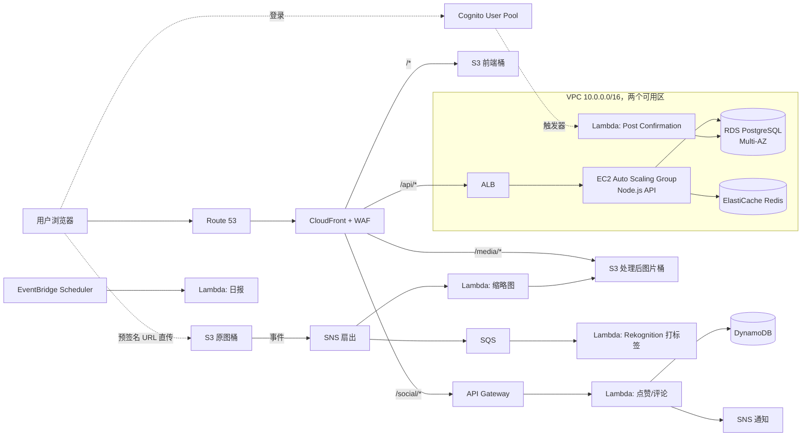

# CloudAlbum：面向 SAA 备考的 AWS 实战项目

CloudAlbum 是一个**云相册分享 Web 应用**：用户注册登录、上传照片、自动生成缩略图和 AI 标签、浏览相册时间线、点赞评论，以及管理员后台。

功能本身很简单，重点是**每个功能都对应一组 AWS SAA-C03 的核心考点**。整个项目按 12 个阶段（Lab）逐步搭建，从一个单台 EC2 开始，最后变成一套多可用区、半 Serverless、可观测、能做灾备的生产级架构。

## 为什么选“云相册”

| 功能 | 自然引出的 AWS 服务 |
|---|---|
| 注册 / 登录 / 管理员分组 | Cognito User Pool、Identity Pool、Lambda Trigger |
| 网站前端 | S3 静态托管、CloudFront、Route 53、ACM |
| 相册 API（主业务） | EC2、Launch Template、Auto Scaling、ALB |
| 用户 / 相册 / 照片数据 | RDS（Multi-AZ、只读副本）、Secrets Manager、ElastiCache |
| 上传照片 | S3 预签名 URL、S3 事件通知 |
| 缩略图、AI 标签 | Lambda（Layer、并发、DLQ）、SQS、Rekognition |
| 点赞 / 评论 | API Gateway + Lambda + DynamoDB |
| 消息通知 | SNS、EventBridge |
| 安全与运维 | IAM、KMS、WAF、CloudWatch、X-Ray、CloudTrail、Config |
| 高可用与灾备 | 多可用区、S3 跨区域复制、Route 53 故障转移、AWS Backup |

## 文档导航

| 文档 | 内容 |
|---|---|
| [docs/architecture.md](docs/architecture.md) | 总体架构、请求链路、数据模型、各服务设计细节 |
| [docs/labs.md](docs/labs.md) | 12 个阶段的动手实验：目标、步骤、考点、验收标准 |
| [docs/saa-coverage.md](docs/saa-coverage.md) | SAA 四大考试领域对照表、易混概念对比、故障演练清单 |

## 架构总览



## 技术栈

- **前端**：React + Vite + `aws-amplify`（只用它的 Auth 模块对接 Cognito）
- **主 API**：Node.js 20+ / Express，运行在 EC2（Amazon Linux 2023）上
- **Lambda**：Node.js 20+（缩略图用 `sharp` Layer）
- **基础设施即代码（IaC）**：先在控制台手动搭建，搞懂之后再用 CloudFormation（网络、计算、数据层）和 AWS SAM（Serverless 部分）重写
- **推荐区域**：`ap-northeast-1`（东京）或 `us-east-1`。不要用中国区（北京/宁夏），那边服务不全，而且需要 ICP 备案

## 计划中的目录结构

```
.
├── README.md
├── docs/                      # 设计文档与实验手册
├── frontend/                  # React 单页应用（SPA）
├── backend/                   # Express API（部署到 EC2）
├── lambdas/
│   ├── cognito-triggers/      # 注册前校验、确认后写库、令牌生成前加自定义声明
│   ├── image-thumbnail/       # S3 事件 -> 生成缩略图
│   ├── image-labeler/         # SQS -> Rekognition
│   ├── social-api/            # 点赞/评论（API Gateway）
│   └── daily-report/          # EventBridge 定时任务
├── infra/
│   ├── cloudformation/        # 01-network.yaml ... 按层拆分
│   └── sam/template.yaml      # Serverless 部分
└── scripts/                   # 部署、构建 AMI、一键销毁
```

## ⚠️ 费用提醒

以下资源**按小时计费，就算没人访问也在扣钱**：NAT Gateway、ALB、RDS、ElastiCache、Interface VPC Endpoint、运行中的 EC2。

1. 第 0 个 Lab 一定要先配置 **AWS Budgets 预算告警**。
2. 每次练习结束都运行 `scripts/teardown`，或者删除 CloudFormation 栈。
3. 全部组件同时运行时，每月大约 80～150 美元，主要花在 NAT GW、ALB、RDS Multi-AZ 和 ElastiCache 上。如果每次练完就删，总花费可以控制在 20～40 美元。具体以官方定价为准。
