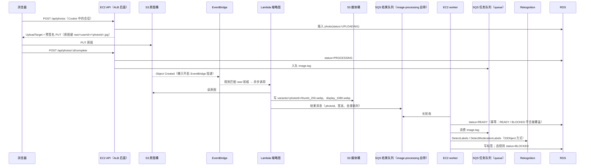

# 架构设计（`l9-full` 目标形态）

> **本文描述的是预设档位 `l9-full` 的目标形态**：Lab 0～24 全部完成、对应模块全部启用之后，CloudAlbum 在 AWS 上的样子。它不是项目的起点——起点是“只有一台 EC2”的 L0，每个 AWS 服务都是可以单独开关的模块。
>
> - 横切架构的**唯一权威契约**是 [modular-design.md](modular-design.md)（下称“总纲”）；各模块的实现细节在 `docs/modules/0N-<group>.md`。本文与它们不一致时，以总纲和模块文档为准。
> - 本文已按总纲附录 B 修正旧版设计：`users.id` 改为内部 UUID；S3 事件统一经 EventBridge；Lambda 不直接写库、经结果队列或 HMAC 回调回写；F2 改为首次请求时建档；定时任务经 Scheduler 投递到模块自带的 SQS 队列、由 worker 执行；social-api 分 proxy 与 lambda 两档；健康检查统一为 `/api/health/ready?scope=instance`；运行时统一为 Node.js 22。第 13 节列出全部差异。
> - 不写精确的性能数字和价格：性能只写方向与数量级，费用只写计费维度，以官方定价页为准。

---

## 0. 演进视角：从 L0 到 `l9-full`

### 0.1 起点：只有一台 EC2

L0 只部署 ec2 基础栈：默认 VPC 公有子网中的一台 Amazon Linux 2023 实例（`t4g.small` 或 `t3.small`）、一块独立的加密 gp3 数据卷、一个弹性 IP。Nginx 同时充当静态站点、反向代理、限速拦截与媒体发送；Node.js 进程 `cloudalbum-api` 与 `cloudalbum-worker` 内置了每个机能的**本地实现**——SQLite、本地文件存储、本地账号（argon2id + ES256 JWT）、sharp 缩略图、outbox 邮件、node-cron、本地指标库与本地告警评估器、fail2ban 等。L0 不需要 IAM 角色，应用进程不加载 AWS SDK，F1～F14 全部可用（总纲第 2 节、[00-ec2-base.md](modules/00-ec2-base.md#ec2)）。

从 L0 出发，每个 Lab 启用一两个模块：开关从本地实现切到 AWS 实现，同一份业务代码换一个适配器，差异由 `Server-Timing`、`X-CloudAlbum-Path`、`/api/capabilities` 与 `/lab` 对比实验呈现出来。

### 0.2 演进路线与档位

| 档位 | 本档新增模块 | 架构上的变化 | Lab |
|---|---|---|---|
| `l0-ec2` | （仅 ec2） | 单机、单点；数据、机密、本地配置都在独立数据卷上，实例可以随时替换 | 0 |
| `l0-plus-local-tiers` | （仍仅 ec2） | 本地档：进程内缓存、内存队列 + worker、EC2 自建 PostgreSQL / Valkey / PgBouncer、本机双进程、本地 span、Let's Encrypt——先在不花钱的前提下看清“架构模式”的作用 | 0 |
| `l1-ops` | iam、cost、shell-access、logging、monitoring | 应用第一次有 AWS 身份（实例角色临时凭证）；成本护栏就位；22 端口关闭、运维走 Session Manager；日志与告警离开实例 | 1～3 |
| `l2-edge` | storage、cdn、dns、tls、waf | 照片进 S3、浏览器直传；入口链从 `nginx` 变为 `cloudfront>waf>nginx`；受信 HTTPS 与域名 | 4～7 |
| `l3-identity` | auth、identity-pool、email、notification | 用户身份交给 Cognito；F14 改为 STS 临时凭证；邮件真正发出；通知经 SNS 扇出 | 8～9 |
| `l4-async` | queue、image-processing、tagging、scheduler | 异步任务进 SQS；缩略图在 Lambda；Rekognition 打标签与审核；定时任务由 EventBridge Scheduler 触发 | 10～12 |
| `l5-security` | kms、secrets、config | 客户托管密钥信封加密；机密进 Secrets Manager；运行时热键进 Parameter Store。**先于数据层**，使 RDS 创建时就用 CMK | 13 |
| `l6-data` | network（public）、database、cache、analytics；可选 db-proxy | 迁入分层自定义 VPC；元数据进 RDS；时间线进 ElastiCache；点击流经 Firehose 进 S3 / Athena。从这一档开始出现按小时计费的资源 | 14～16、18 |
| `l7-serverless-social` | social-store、social-api | 点赞评论进 DynamoDB，经 API Gateway + Lambda 提供，EC2 停机时社交功能仍可用 | 17 |
| `l8-ha` | load-balancer、autoscaling（network 切到 private）；可选 ami | ALB + ASG 跨两个 AZ；实例进入私有子网，外部扫描不到；可选黄金 AMI | 19～21 |
| **`l9-full`** | tracing、audit、threat-detection、backup；可选 compliance、vuln-scan | 端到端链路追踪、CloudTrail 审计、GuardDuty、跨区域备份——即本文描述的形态 | 22～24（25 可选） |

```mermaid
flowchart LR
  L0["l0-ec2<br/>一台 EC2"] --> LT["l0-plus-local-tiers<br/>本地档"]
  LT --> L1["l1-ops<br/>身份·成本·运维·可观测"]
  L1 --> L2["l2-edge<br/>S3·CloudFront·DNS·TLS·WAF"]
  L2 --> L3["l3-identity<br/>Cognito·SES·SNS"]
  L3 --> L4["l4-async<br/>SQS·Lambda·Rekognition·Scheduler"]
  L4 --> L5["l5-security<br/>KMS·Secrets·Parameter Store"]
  L5 --> L6["l6-data<br/>VPC(public)·RDS·ElastiCache·Firehose"]
  L6 --> L7["l7-serverless-social<br/>DynamoDB·API Gateway"]
  L7 --> L8["l8-ha<br/>ALB·ASG·VPC(private)"]
  L8 --> L9["l9-full<br/>X-Ray·CloudTrail·GuardDuty·Backup"]
```



几点说明：

- **每一档都可以回到 L0**：`scripts/module profile apply l0-ec2` 会按逆拓扑序禁用模块并把数据迁回本地实现（总纲 9.2、10.1）。
- **不必按顺序**：L0 + 任意单个模块（加最小硬依赖与凭证前置）都能独立运行（`profiles/single/<id>.env`，总纲 10.4）；变体 `x-named-comparisons` 在默认 VPC 中一次完成 Cognito、SQS、CloudFront、Lambda、ElastiCache、S3、RDS 七组对比。
- **`l9-full` 默认不包含的模块**：shared-fs（EFS，变体 `x-efs-asg` 用它代替 S3 作为多实例共享存储）、workflow（Step Functions，变体 `x-workflow`，与 `IMAGE_PROCESSOR=lambda` 互斥）、以及可选扩展 db-proxy、ami、compliance、vuln-scan（`profile apply l9-full --with-optional`）。本文在相关章节标注“可选”。
- **两个“只能早不能晚”的顺序**：kms 早于 RDS、EFS 的创建（只能在创建时加密）；network 换 VPC 时不能有已部署的 VPC 绑定资源（DEP-016）。所以 `l5-security` 在 `l6-data` 之前，network 在 `l6-data` 先以 public 放置迁入，`l8-ha` 再在同一 VPC 内切到 private。

---

## 1. 设计原则

1. **EC2 是唯一必需组件。** 每个机能都有能在单台 EC2 上运行的本地实现；其余每个 AWS 服务都是可插拔模块，开关的第一个取值永远是本地实现。
2. **一个机能对应一个主服务。** 每个模块恰好一个主 AWS 服务，辅助服务单独列出（总纲 2.8、3.2）。新增 AWS 服务必须有真实的业务理由和可观察的对比实验。
3. **依赖显式声明、启动时统一校验。** 依赖只写在 `modules/registry.yaml` 的 `requires` 中，规则只在 `backend/src/rules/rules.ts` 一张表里；配置错误拒绝启动（退出码 78），运行时故障不静默降级（权威端口返回 503，非权威端口标为 `degraded`）。
4. **混合架构。** 主业务跑在“EC2 + ALB + ASG + RDS”的传统三层上，社交功能用“API Gateway + Lambda + DynamoDB”的 Serverless 方式实现，缩略图用事件驱动的 Lambda——两种范式可以直接对比，这也是 SAA 最常考的取舍题。
5. **从单点到高可用逐步演进。** 先让它能跑，再做多可用区、解耦、私有化、灾备，每一步都能对比改造前后的差别。
6. **默认安全。** 最小权限（每个模块一条客户托管策略）、不在代码与 User Data 中写死密钥、全链路加密、私有子网、不开管理端口。
7. **数据里只存逻辑标识。** 数据库存对象键和内部 ID，不存桶名、URL、Cognito `sub` 主键；URL 在响应时由当前驱动生成，切换模块不需要改写业务数据。

---

## 2. 功能清单（`l9-full` 下的实现）

L0 下每个功能的本地实现与降级点见总纲 2.8；下表只写 `l9-full` 的形态。

| # | 功能 | `l9-full` 的实现 | 主模块 |
|---|---|---|---|
| F1 | 注册、邮箱验证、登录、找回密码、可选 MFA | Cognito User Pool；EC2 上的 BFF 用 HttpOnly Cookie 保存令牌；托管登录页（`COGNITO_LOGIN_MODE=managed`）；验证邮件经 SES 发出 | auth |
| F2 | 注册后自动建资料 | **首次已认证请求时 JIT 建档**（`UserDirectory.ensureUser`）：upsert `users` 行并写回 Cognito 自定义属性 `custom:app_uid`；Post Confirmation 触发器只是 database 启用后的可选增强（DEP-012） | auth |
| F3 | 邮箱域名白名单 | BFF 在调用 SignUp 之前按运行时配置 `allowedEmailDomains` 检查（Parameter Store 热键）；可选 Pre Sign-up 触发器 | auth、config |
| F4 | JWT 带套餐等级 | 可选 Pre Token Generation 触发器写入 `plan` 声明；App Client 的 `WriteAttributes` 不含 `custom:plan`，以 `users` 表为准 | auth |
| F5 | 相册、照片时间线 | EC2 上的 Express API，元数据在 RDS for PostgreSQL，时间线 cache-aside 缓存在 ElastiCache | database、cache |
| F6 | 上传照片 | `POST /api/photos` 返回 S3 预签名 PUT → 浏览器直传原图桶 → `POST /api/photos/:id/complete` | storage |
| F7 | 自动生成缩略图 | S3 → EventBridge → 缩略图 Lambda（异步调用）→ 衍生图写入媒体桶 → 经模块自带结果队列由 worker 回写状态 | image-processing |
| F8 | 自动打标签、内容审核 | 应用侧 TaggerPort：`image.tag` 任务经 SQS 由 worker 调用 Rekognition（`DetectLabels`、`DetectModerationLabels`），违规照片置为 `BLOCKED` | tagging |
| F9 | 点赞、评论 | API Gateway HTTP API（JWT 授权器）→ Lambda → DynamoDB 单表 | social-store、social-api |
| F10 | 新评论通知照片主人 | 站内信写本地表；站外通知一次 Publish 到 SNS，按 `userId` 订阅过滤策略扇出到邮件订阅与模块自带收件队列 | notification |
| F11 | 带有效期的分享链接 | 分享记录存 DynamoDB，`expireAt` 由 TTL 后台回收（读取时仍自行校验过期）；媒体用 S3 预签名 GET（可选 CloudFront 签名 URL） | social-store |
| F12 | 管理后台 `/admin` | **组合子功能**：ALB 的 `authenticate-cognito`（`/admin*` 先跳转登录，`/api/admin/*` 未认证直接拒绝）+ 应用层 RBAC 检查 `admin` 组；需要 load-balancer、auth(cognito) 与 HTTPS 监听器（DEP-011、DEP-017） | auth + load-balancer |
| F13 | 每日统计日报 | EventBridge Scheduler → scheduler 模块自带的 SQS tick 队列 → worker 生成 CSV，经 StoragePort 写入媒体桶 `reports/daily/`，经 SES 发给管理员 | scheduler |
| F14 | 直传、多文件、断点续传、按前缀授权 | Cognito Identity Pool 签发 STS 临时凭证，浏览器分片直传 identity-pool 自带的暂存桶 `private/<identityId>/…`；`complete` 时服务端校验后 `CopyObject` 导入原图桶 `raw/<userId>/<photoId>.<ext>` | identity-pool |

横切机能（网络、CDN、DNS、证书、WAF、负载均衡、伸缩、凭证、机密、配置、密钥、缓存、备份、点击流、队列、邮件、API 托管、运维登录、日志、指标、追踪、审计、威胁检测）在 `l9-full` 中的实现分布在第 3～12 节；本地实现与模块对照见总纲 2.8 的 X1～X30。

---

## 3. 请求链路

整个站点只用一个域名 `album.example.com`（Route 53 Alias → CloudFront）。CloudFront 绑定 us-east-1 的 ACM 证书，关联 CLOUDFRONT 范围的 WAF Web ACL（同样在 us-east-1），按路径分发：

| CloudFront 行为 | 源站 | 缓存策略 | 说明 |
|---|---|---|---|
| `/assets/*` | ALB → EC2 Nginx | Managed-CachingOptimized | 带内容哈希的 JS / CSS，长期缓存 |
| `/media/*` | S3 媒体桶（OAC） | 自定义 `cloudalbum-media`（缓存键只含 `exp`、`sig`） | CloudFront Function 去掉 `/media` 前缀；桶策略只授权 `variants/*`（`raw/`、`reports/` 永不经 CDN 暴露）。私有原图用 S3 预签名 GET，不经 CDN |
| `/api/public/*` | ALB → EC2 | 自定义 `cloudalbum-api-micro`（最大 60 秒，不含 Cookie） | 公共接口的秒级微缓存 |
| `/api/*` | ALB → EC2 | Managed-CachingDisabled + AllViewer | 转发 Cookie、`Authorization`、查询参数；认证接口永不缓存 |
| `/social/*`（可选） | API Gateway HTTP API | Managed-CachingDisabled + AllViewerExceptHostHeader | 默认前端按 capabilities 中的 `SOCIAL_API_BASE_URL` 直接访问 execute-api；加这条行为后可以同源访问 |
| 默认 `*` | ALB → EC2 Nginx | Managed-UseOriginCacheControlHeaders | SPA 由 EC2 上的 Nginx 提供（`index.html` 为 `no-cache`），深链接由 Nginx `try_files` 处理。**没有单独的前端 S3 桶** |

**源站保护**：ALB 在公有子网，实例在私有 app 子网、没有公网地址。CloudFront 回源带自定义头 `X-Origin-Verify`（逻辑名 `origin-verify`，值在 Secrets Manager），ALB 监听器规则校验它（`LB_ORIGIN_VERIFY=on`）；入口锁定后直接访问 ALB 域名被拒绝（SEC-002 监测绕过）。更彻底的可选方案是 **CloudFront VPC Origin + internal ALB**，ALB 根本没有公网入口（东京的 `apne1-az3` 不支持 VPC Origin，network 模块默认不选它）。

**入口链可见**：每个响应的 `X-CloudAlbum-Path` 带 `entry=cloudfront>waf>alb>nginx`、`inst=`、`az=`，以及本次请求调用过的模块段（如 `auth=cognito:managed;database=postgres@rds;cache=redis@elasticache:hit;storage=s3:presign`）；客户端 IP 与协议只在 Nginx 解析一次，Express 的 `trust proxy` 固定为 `loopback`（总纲 3.3、7.2）。

### 3.1 上传一张照片的完整流程



要点：

- **桶上只有一项事件配置**：原图桶的 `NotificationConfiguration` 只允许 `EventBridgeConfiguration: {EventBridgeEnabled: true}`（MUTEX-004）；每个消费者在**自己的栈**里建 EventBridge 规则并订阅 `Object Created`（包含 Copy，否则经 identity-pool `CopyObject` 导入的照片不会被处理）。旧设计中“S3 → Lambda 直连”到“S3 → SNS 扇出”的演进，本质上是在回避“同一桶、同一事件类型不能有前缀重叠的多个通知目标”；改用 EventBridge 后各模块互不耦合，SNS 扇出保留为 notification 模块中的对照实验。
- **Lambda 不直接写库**：缩略图 Lambda 不访问 RDS，结果经回写通道交给 EC2。启用 cdn 后 callback 回调会被源站校验挡住，所以 `l9-full` 固定 `IMAGE_RESULT_CHANNEL=queue`；没有 cdn 时也可以用 HMAC 签名的 `POST /internal/hooks/image-processed`。worker 的对账任务 `image.reconcile` 对 PROCESSING 超时的照片先检查衍生图是否已存在，作为兜底。这样 image-processing 不依赖 database，在 SQLite 下也能用。
- **失败路径**：异步调用最多重试 2 次、最大事件年龄 1 小时，最终失败进入模块自带的失败队列，worker 把对应照片标为 `FAILED`；永久错误（格式不支持）由函数直接回写 `FAILED`，不白白重试。
- **两条 trace**：api → SQS → worker 属于同一条 X-Ray trace；S3 事件不携带追踪上下文，缩略图 Lambda 是另一条 trace，两者用 `photo_id` 注解关联（第 11 节）。
- **编排的替代方案**（变体 `x-workflow`）：`WORKFLOW_DRIVER=stepfunctions` 时由 S3 → EventBridge 启动 Standard 状态机（缩略图任务 → 可选 Rekognition 步骤 → 结果队列），与 `IMAGE_PROCESSOR=lambda` 互斥（MUTEX-005）。默认的 `l9-full` 用事件驱动的“编舞”，变体用状态机“编排”，两者对比见 Lab 11 扩展。

---

## 4. 网络设计（network 模块，`private` 放置）

```
VPC 10.0.0.0/16（AZ 按 AZ ID 选择，默认 apne1-az1、apne1-az4）
├── AZ-1
│   ├── public-1   10.0.0.0/24    ALB、NAT Gateway
│   ├── app-1      10.0.10.0/24   EC2（ASG）、Interface Endpoint、VPC 内 Lambda 的 ENI
│   └── data-1     10.0.20.0/24   RDS 主库、ElastiCache、（变体）EFS 挂载目标
└── AZ-2
    ├── public-2   10.0.1.0/24    ALB 节点
    ├── app-2      10.0.11.0/24   EC2（ASG）
    └── data-2     10.0.21.0/24   RDS 备库（Multi-AZ）、ElastiCache 副本
```

| 组件 | `l9-full` 中的设计 | 对应考点 |
|---|---|---|
| Internet Gateway | 只挂在 public 子网的路由表上；public 子网 `MapPublicIpOnLaunch=true`（public 放置的实例在收到 `cfn-signal`、关联 EIP 之前靠它出网完成引导），app、data 子网为 `false` | 公有子网的定义（路由表指向 IGW）；自动分配公网 IPv4 与 EIP 的区别 |
| NAT | `NatMode=gateway`：学习环境默认 1 个，`HaNat=true` 时每个 AZ 一个；也可选 NAT 实例或完全不用 NAT、只用 Endpoint | NAT Gateway 与 NAT 实例；单 AZ NAT 的单点 |
| Gateway Endpoint | S3 与 DynamoDB，关联 app 与 data 路由表；删除 NAT 路由后仍可访问 | 免费；流量不经 NAT |
| Interface Endpoint | 可选 `ops`（ssm、ssmmessages、logs、monitoring、cloudformation）或 `all`（再加 secretsmanager、sqs、sns、sts、kms 等）；不用 NAT 时新实例的 `cfn-signal` 经 `cloudformation` 端点，发布包从工具链栈制品桶的镜像经 S3 Gateway Endpoint 下载 | PrivateLink；按端点 × AZ × 小时计费 |
| data 子网 | **没有默认路由**，只关联 Gateway Endpoint；NACL 只允许来自 app 子网的 5432 / 6379 / 2049，出站只允许到 app 子网的临时端口 | 安全组有状态、NACL 无状态 |
| 安全组 | 每个模块在自己的栈里建安全组，入站规则引用实例安全组（如 `sg-db` 只放行实例安全组的 5432）；需要给实例新增入站规则的模块建独立安全组，经基础栈参数 `ExtraSecurityGroupIds` 挂到实例上；network 不预建其他模块的安全组 | 安全组链；引用安全组与托管前缀列表 |
| 运维登录 | Session Manager（shell-access），安全组没有任何管理端口入站；可选 EC2 Instance Connect Endpoint | 堡垒机、Session Manager、EIC Endpoint 的对比 |
| VPC Flow Logs | VPC 级、自定义格式（含 `traffic-path`）、投递到 CloudWatch Logs | 排查 REJECT；不记录的流量类型 |

**为什么 L0 不在这里**：L0 使用默认 VPC 的公有子网，保证“只有一台 EC2 也能完整运行”。network 模块分两步引入自定义 VPC：`l6-data` 先以 `public` 放置迁入（实例仍在 public 子网、保留 EIP，但获得分层子网、Gateway Endpoint 与 Flow Logs），在此之后才创建 RDS、ElastiCache 等 VPC 绑定资源；`l8-ha` 再在同一个 VPC 内切到 `private`（不改变 `VpcId`，不触发 DEP-016），前提是已经有入口（ALB）、出网路径（NAT 或 Endpoint）与运维通道（Session Manager）（DEP-009）。实例迁移按“只读窗口 + 快照 → 卸卷 → 新子网替换实例 → 改挂数据卷 → 比对密钥指纹”的分阶段流程进行（总纲 9.2）。

---

## 5. 计算层：EC2 + ALB + Auto Scaling

**实例与镜像**

- **AMI**：默认 AL2023 公共 AMI，首次部署时把 SSM 公共参数解析出的 AMI ID 固定到 `/cloudalbum/<env>/ec2/image-id`（否则任意一次栈更新都可能悄悄换 AMI、替换实例）；启动时 `l0-bootstrap.sh` 现场安装 Node.js 22、Nginx 与发布包。**可选** ami 模块用 EC2 Image Builder 产出预装软件与发布包的黄金 AMI，经 SSM 参数注入启动模板，缩短扩容与实例刷新时间。
- **启动模板**：IMDSv2 强制、跳数 1；实例配置文件 `CloudAlbumAppRole`（iam 模块）；gp3 加密卷；安全组 = 实例安全组 + 各模块的附加安全组；`t4g.small`（arm64）或 `t3.small`。
- **进程**：systemd 管理 `nginx`、`cloudalbum-api`、`cloudalbum-worker`，以固定 uid/gid 2001 的 `cloudalbum` 用户运行，`UMask=0027`，配置错误时退出码 78 且不重启循环；nginx 用户属于 cloudalbum 组（D6）。

**Auto Scaling（autoscaling 模块，`DEPLOY_MODE=asg`）**

- `MinSize=2`、`DesiredCapacity=2`、`MaxSize=4`（实验值），子网为两个 AZ 的 app 子网；`HealthCheckType=ELB`，宽限期按实测的“启动 + 安装”时间设置。
- 伸缩策略：目标跟踪 `ASGAverageCPUUtilization=50`；可选 `ALBRequestCountPerTarget` 与预定操作；预测式伸缩只作了解。
- 可选混合实例策略：1 台按需基础容量，其余 Spot（`price-capacity-optimized`，开启 Capacity Rebalance）；混用 x86 与 arm64 时必须按实例类型覆盖启动模板。
- 生命周期钩子 `terminate-drain`：实例进入 `Terminating:Wait` 后 draining（`ready` 返回 503），在途请求与任务完成后再 `CompleteLifecycleAction`。
- 发布与配置变更都通过实例刷新完成（`MinHealthyPercentage=100`、`MaxHealthyPercentage=200`，先启后停）。
- **配置分发**：模块配置与共享机密打成“引导配置包”，存放在 SSM SecureString 参数 `/cloudalbum/<env>/bootstrap/bundle`，实例用实例角色读取（`SECRETS_ORIGIN=bundle` 或 `aws`）；不放进 User Data（User Data 可被 `DescribeInstanceAttribute` 读出）。

**ALB（load-balancer 模块，`LB_MODE=alb`）**

- 位于两个 AZ 的 public 子网；HTTPS 443 监听器使用 ALB 所在区域的 ACM 证书（tls 模块注入），HTTP 80 按 `$ca_proto` 跳转到 HTTPS。
- 目标组健康检查路径 **`/api/health/ready?scope=instance`**（只检查本实例：进程、配置、是否 draining、本机磁盘）。共享依赖（如 RDS）的故障由 `/api/health/ready` 与 capabilities 报告，不用于摘除目标——否则一次数据库故障会让所有实例被判不健康、被 ASG 反复替换。
- 注销延迟（连接耗尽）；跨区负载均衡默认开启。
- 规则：`/admin*` → `authenticate-cognito`（ALB 专用的机密 App Client）→ 应用；`/api/admin/*` 未认证时直接拒绝；组信息由应用经 auth 驱动校验 `x-amzn-oidc-accesstoken` 后读取（F12）。
- 访问日志写入 S3，或作为 vended logs 投递到 CloudWatch Logs（新能力，考试题库可能仍按“只能 S3”出题）。

**无状态**：会话靠 Cognito 令牌（HttpOnly Cookie）与 BFF，不依赖实例内存；缓存在 ElastiCache；照片在 S3；元数据在 RDS；社交数据在 DynamoDB；定时任务由 Scheduler + 队列保证“每个计划时刻只执行一次”。规则引擎的 ASG-001～014 在启动时拦住会破坏无状态的组合（例如多实例下的 SQLite、本地存储、进程内缓存、内存队列）。

---

## 6. 数据层

### 6.1 RDS for PostgreSQL（database 模块）

```sql
-- 节选示意，完整定义以 backend 的 Knex 迁移脚本为准
users   (id UUID PK,                          -- 内部 ID，与身份提供方解耦
         email, display_name, role, plan,
         auth_provider, auth_subject,         -- 'cognito' + Cognito sub，或 'local' + 本地 id
         token_version, mfa_secret_enc, identity_id, created_at)
albums  (id PK, owner_id FK → users.id, title, visibility, created_at)
photos  (id PK, album_id FK, owner_id FK,
         raw_key,                             -- 逻辑键 raw/<userId>/<photoId>.<ext>；衍生图键由 photoId 推导
         status,                              -- UPLOADING | PROCESSING | READY | FAILED | BLOCKED
         processed_by, processing_started_at, ready_at,
         location,                            -- 敏感字段，CryptoPort 信封加密（密文 ca1.*）
         created_at)
-- 另有：标签与审核结论（区分 basic / rekognition 来源）、notifications、outbox_emails、
--       job_runs、audit_log、system_meta（本地主密钥指纹）等
```

- **`users.id` 是内部 UUID**，另存 `auth_provider` + `auth_subject`。切换 auth 驱动（本地账号 ↔ Cognito）时所有外键都不用改写；Cognito 侧的 `custom:app_uid` 反向记录 `users.id`，供 social-api 的 Lambda 使用。
- **数据库里不存 URL、桶名、绝对路径**：媒体 URL 在响应时由当前驱动生成（本地签名 URL、S3 预签名 URL 或 CloudFront URL）。
- 部署：PostgreSQL 16，`db.t4g.micro` 起步；`MultiAz=true` 时同步复制、自动故障转移（备库不可读）；可选只读副本（`CreateReadReplica=true`），时间线读可经副本，管理员用 `X-Compare-Bypass: replica` 对比。
- 机密：secrets 已启用时使用 **RDS 托管主密码**（`ManageMasterUserPassword`，存于 Secrets Manager），`modules.d` 只写 `DB_PASSWORD_SECRET_ARN`。
- 备份：自动备份保留 7 天，可做时间点恢复（恢复为新实例）；同时由 AWS Backup 按 `Backup=true` 标签纳入计划并复制到大阪。
- 加密：KMS CMK，**只能在创建时指定**——这就是 kms（Lab 13）必须早于 database（Lab 15）的原因；`rds.force_ssl=1`，应用以 `sslmode=verify-full` 连接。
- **可选 RDS Proxy（db-proxy 模块）**：连接池化，数据库连接数不随进程数与实例数线性增长，并缩短故障转移时的写失败区间；凭证从 Secrets Manager 读取；本地档是 EC2 上的 PgBouncer。

### 6.2 ElastiCache（cache 模块）

- Valkey（或 Redis OSS），节点模式 `cache.t4g.micro`；`Replicas=1` 时 1 主 1 副本、Multi-AZ 自动故障转移；传输加密与静态加密开启。
- 缓存时间线 `feed:{userId}`，cache-aside；TTL 由运行时热键 `feedCacheTtlSec` 决定（Parameter Store 中改了立即生效，不重启）；失效用共享版本号；只缓存逻辑键与元数据，不缓存 URL。
- **fail-open**：缓存故障时按未命中处理、直接查库，状态为 `degraded`，路径头记 `cache=redis@elasticache:error-bypass`，用户侧错误率保持为 0。

### 6.3 DynamoDB（social-store 模块）

单表 `cloudalbum-<env>-social`，按需容量，开启 PITR，TTL 属性 `expireAt`：

| PK | SK | 属性 | 用途 |
|---|---|---|---|
| `PHOTO#<photoId>` | `LIKE#<userId>` | createdAt | 点赞；与计数器在同一个 `TransactWriteItems` 中，条件写入保证一人一赞 |
| `PHOTO#<photoId>` | `C#<commentUlid>` | userId, text, createdAt, `GSI1PK=USER#<userId>`, `GSI1SK=C#<ulid>` | 评论（ULID 使删除可以直接定位） |
| `PHOTO#<photoId>` | `COUNTER` | likes, comments | 计数器，原子 `ADD` |
| `PHOTO#<photoId>` | `META` | ownerId, visibility, status | 照片摘要：由 EC2 维护，供 social-api 的 Lambda 判断可见性与是否被拦截（权威数据仍在 RDS） |
| `SHARE#<token>` | `META` | photoId, expiresAt, `expireAt`（epoch 秒） | 分享链接；TTL 后台删除，读取时仍自行比较是否过期 |

- GSI1：“我的评论”。
- 高并发下单个计数项是热点，可能被限流——由此引出写分片计数器（实验见 Lab 17）。
- 照片删除时 `purgePhoto` 分页清理该照片的全部项。

### 6.4 S3 存储桶

| 桶 | 所属模块 | 用途 | 关键配置 |
|---|---|---|---|
| `cloudalbum-<env>-storage-raw-<acct>-<region>` | storage | 原图 | Block Public Access 全开、`BucketOwnerEnforced`；版本控制；SSE-KMS + Bucket Key（kms 注入）；**只开启 EventBridge 投递**；CORS 只允许有效入口来源的 PUT / GET / HEAD；生命周期：未完成分段上传 7 天中止、30 天转 Standard-IA、非当前版本 30 天过期；标签 `Backup=true` |
| `cloudalbum-<env>-storage-media-<acct>-<region>` | storage | 缩略图、展示图、日报 | 私有；存储类别保持 Standard（缩略图小于 128 KB，Intelligent-Tiering 对它们没有收益）；OAC 桶策略只授权 `variants/*`；可从原图重新生成，所以不打 `Backup=true` |
| `cloudalbum-<env>-upload-staging-<acct>` | identity-pool | F14 暂存 | 浏览器用 STS 临时凭证写 `private/<identityId>/`；CORS 含 DELETE 并暴露 ETag；1 天过期；不配置事件通知 |
| 事件桶 | analytics | 点击流（Firehose 投递，按 `dt` 分区） | Athena 工作组设扫描上限；生命周期长期低价保存 |
| 日志桶 | audit | CloudTrail 日志 | 日志文件完整性验证；可选对象锁（治理模式、短保留期）；生命周期只设过期 |
| ALB 访问日志桶 | load-balancer | ALB 访问日志（或改投 CloudWatch Logs） | 按区域的日志投递桶策略 |
| 工具链制品桶 | 工具链栈 `cloudalbum-<env>-toolchain` | Lambda 部署包、发布物 | 不是应用模块，应用从不读取 |

（可选）compliance 的 Config 交付桶。已经没有旧设计中的前端静态桶。

### 6.5 共享文件系统（变体 `x-efs-asg`）

`l9-full` 用 S3 作为多实例共享存储。变体 `x-efs-asg` 改用 EFS（`STORAGE_DRIVER=efs`，复用本地文件适配器、只换根目录），用于比较 EFS 与 S3：EFS 提供 POSIX 语义、不改代码即可跨实例共享，但小文件元数据操作明显变慢、单价更高；照片这种“一次写入、多次读取、经 HTTP 分发”的数据首选 S3。

---

## 7. 身份认证：Cognito

### 7.1 User Pool（auth 模块）

- 登录方式：邮箱；密码策略至少 8 位、包含大小写和数字；可选 TOTP MFA；功能层级 Essentials（Pre Token Generation 的 access token 定制需要它）。
- 用户组：`admin`、`member`，出现在令牌的 `cognito:groups` 声明中。
- **BFF 模式**：浏览器不直接持有 Cognito 令牌——EC2 上的 BFF 调用 Cognito（默认 `USER_PASSWORD_AUTH`，SRP 作为可选对比），把 access / refresh / ID 令牌写进 HttpOnly Cookie。BFF 的 App Client 是机密客户端，client secret 经 SecretsPort 读取（逻辑名 `cognito-client-secret`）。
- **托管登录**（`COGNITO_LOGIN_MODE=managed`）：授权码流程，`ManagedLoginVersion: 2`；回调地址需要受信 HTTPS（DEP-029），由 CloudFront 或 tls 提供；托管登录使用自定义域名时，ACM 证书必须在 us-east-1，且父域名要有 A 记录。
- ALB 专用 App Client（生成密钥，回调 `https://<域名>/oauth2/idpresponse`），与 BFF 客户端分开，供 F12 使用。
- `ReadAttributes` / `WriteAttributes` 显式设置，`WriteAttributes` 不含 `custom:plan`，防止用户用自己的令牌给自己升级套餐。
- 触发器（可选，`COGNITO_TRIGGERS=on`，代码用 `Code.ZipFile` 内联，不依赖任何 S3 桶）：Pre Sign-up（F3）、Pre Token Generation（F4）。**不部署 Post Confirmation**：F2 由 EC2 在首次已认证请求时 JIT 建档。
- **迁移**：从本地账号迁移时默认 `AUTH_MIGRATION=bulk`——`AdminCreateUser` 不发邀请、保留 `email_verified`，用户首次登录时走重置密码，不需要 Lambda；`lazy`（User Migration 触发器 + VPC 内 Lambda + `/internal/legacy-auth`）是可选变体；`AUTH_DUAL_STACK` 默认关闭，只在迁移窗口内开启。

### 7.2 令牌在各处怎么校验

| 入口 | 校验方式 |
|---|---|
| EC2 BFF（Express） | 用 JWKS 本地验签（缓存公钥），校验签名、过期、`token_use`、`client_id`；首次请求时 JIT 建档 |
| API Gateway HTTP API | 内置 **JWT 授权器**：issuer 为 User Pool，audience 为 App Client ID（JWT 授权器只支持 RSA 系列算法，所以只能与 auth=cognito 搭配，DEP-023）；跨域请求由前端把 `GET /api/auth/session` 取得的令牌放进 `Authorization` 头 |
| ALB `/admin*` | `authenticate-cognito` 动作（只能用于 HTTPS 监听器）；应用层再检查 `admin` 组 |

对照：L0 的本地认证签发 **ES256** JWT，公钥经 `GET /.well-known/jwks.json` 发布（同时发布当前与上一版本的 `kid`），访问令牌带 `tv` 声明，登出后立即失效；Cognito 的 access token 是无状态校验的，登出后在过期前仍然有效——这是有 / 无 Cognito 对比中的一个观察点。auth=local 时若要接 API Gateway 的 lambda 集成，用 Lambda 授权器读取本地 JWKS。

### 7.3 Identity Pool（identity-pool 模块）

已登录用户换取一组只能写自己前缀的 STS 临时凭证，浏览器用 lib-storage 分片直传暂存桶：

```json
{
  "Effect": "Allow",
  "Action": ["s3:PutObject", "s3:AbortMultipartUpload", "s3:ListMultipartUploadParts"],
  "Resource": "arn:aws:s3:::cloudalbum-<env>-upload-staging-<acct>/private/${cognito-identity.amazonaws.com:sub}/*"
}
```

（节选；完整策略以 identity-pool 模块文档为准。）`complete` 时服务端校验大小、类型与文件头，再 `CopyObject` 导入原图桶并删除暂存对象；未调用 `complete` 的对象由 1 天过期规则清理。使用 SSE-KMS 时，分片上传除了 `kms:GenerateDataKey` 还需要 `kms:Decrypt`。identity-pool 故障时退回 L0 的“应用自签前缀令牌”（非权威端口，路径头记 `identity-pool=cognito:error-fallback`）。预签名 URL、前缀令牌与 Identity Pool 临时凭证的取舍见 [saa-coverage.md](saa-coverage.md)。

---

## 8. Lambda 设计与配置

| 函数 | 所属模块 | 触发源 | 运行时 / 内存 / 超时 | 是否在 VPC 内 | 关键配置 |
|---|---|---|---|---|---|
| `cloudalbum-<env>-image-processing-thumbnail` | image-processing | EventBridge 规则（S3 Object Created，`raw/` 前缀）→ 异步调用；变体 buffer-queue 为 SQS 事件源映射 | `nodejs22.x` arm64；默认 1024MB（用 Power Tuning 在 1024～1769MB 之间找性价比）；30 秒 | 否 | sharp 按 linux-arm64 打包；异步重试 2 次、最大事件年龄 1 小时、失败目标为模块自带失败队列；结果经结果队列回写；`Tracing=Active` |
| `cloudalbum-<env>-social-api-handler` | social-api | API Gateway HTTP API（lambda 集成，`PayloadFormatVersion 2.0`） | `nodejs22.x` arm64；256MB；10 秒 | 否 | 指向别名 `live`，可做 90/10 加权发布；执行角色只能读写社交表；评论通知经 SNS（或 SQS） |
| Cognito 触发器（可选） | auth | Cognito User Pool | `nodejs22.x` arm64，`Code.ZipFile` 内联 | 否（lazy 变体的 User Migration 除外） | Pre Sign-up、Pre Token Generation；资源策略只允许本 User Pool 调用 |
| Secrets 轮换函数（可选，`SECRETS_ROTATION=on`） | secrets | Secrets Manager | 内联 | 轮换自建 PostgreSQL 密码时在 VPC 内（需要 Endpoint 或 NAT） | 调用 RotateSecret 还需要对轮换函数的 `lambda:InvokeFunction` |
| 缩略图任务（仅变体 `x-workflow`） | workflow | Step Functions Standard 状态机 | `nodejs22.x` arm64，复用 `packages/image-core` | 否 | `Retry` / `Catch` 声明在状态机定义里，失败执行可在 14 天内 redrive |

旧设计中的 `cognito-post-confirmation`（Lambda 写 RDS）、`image-labeler`（SQS → Lambda → Rekognition）与 `daily-report`（Scheduler → Lambda）已经取消：建档改为 JIT，打标签改为应用侧 TaggerPort，日报改为 Scheduler → tick 队列 → worker。核心功能因此不依赖“Lambda 访问数据库”这条网络路径。

**每个 Lambda 都要练到的配置项**：

1. 执行角色（函数能做什么）与资源策略（谁能调用函数，如 `events.amazonaws.com`、`cognito-idp.amazonaws.com`）的区别。
2. 内存与 CPU 成比例（约 1769MB 对应 1 个 vCPU）；arm64（Graviton）的性价比。
3. 并发：预留并发（同时是上限与保底，最多预留到“未预留并发 − 100”）、预置并发（消除冷启动、按时长计费）；新账号的并发配额可能较低。
4. 异步调用：重试次数、最大事件年龄、Destinations（成功 / 失败目标）与 DLQ 的区别；事件源映射的失败处理靠队列的 redrive 策略。
5. 冷启动与 `Init Duration`；托管运行时 zip 包的 INIT 阶段也计入计费时长。
6. VPC：放进 VPC 后访问 S3、SQS 需要 Gateway / Interface Endpoint 或 NAT；放进 VPC 的 Lambda 也是 DEP-016 所说的“VPC 绑定资源”。
7. 打包：zip（经工具链栈的制品桶）、Layer、容器镜像；Lambda 一律 `nodejs22.x`（Node.js 20 已于 2026-04-30 停止上游支持，D4）。
8. 版本与别名：别名加权分流做灰度发布。
9. 可观测性：主动追踪（X-Ray）、CloudWatch Logs 保留期、`Init Duration` 统计。
10. 了解但不必练：Function URL、SnapStart、Lambda@Edge 与 CloudFront Functions 的区别（本项目只在 `/media/*` 行为上用了一个 CloudFront Function）。

---

## 9. 消息与事件

| 组件 | 所属模块 | 用途 | 考点 |
|---|---|---|---|
| SQS `queue-jobs` + DLQ | queue | 应用任务（`image.tag`、`notify.fanout`、`email.send`、`analytics.flush` 等），worker 竞争消费；`maxReceiveCount=3`，DLQ 可 redrive | 可见性超时、长轮询、DLQ、至少一次投递与幂等（`processed_jobs`） |
| 模块自带的 SQS 队列 | image-processing、notification、email、scheduler、（变体）workflow | 失败 / 结果 / 缓冲队列、通知收件队列、邮件反馈队列、tick 队列 | 这些队列**不属于** queue 模块；`/lab` 的 queue 卡片单独列出，避免“没开 queue 也在用 SQS”的误解 |
| SNS 通知主题 | notification | F10：一次 Publish，按 `userId` 过滤策略扇出到邮件订阅；`audience=admin` 用于管理员广播；同时投递到模块自带收件队列 | 扇出、订阅过滤策略、邮件订阅需要确认、原始消息传递、订阅级 DLQ |
| SNS `ops-alarms` | monitoring | CloudWatch 告警动作 | 告警与实例解耦；加密主题需要 CMK 并授权 `cloudwatch.amazonaws.com` |
| SNS 安全发现 / 合规 / 预算主题 | threat-detection、（可选）compliance、cost | GuardDuty 发现、Config 合规变化经 EventBridge 送达；Budgets 预算告警 | EventBridge 原生推送，不经应用转发 |
| EventBridge（默认事件总线） | storage（只开投递）、image-processing、threat-detection、compliance | S3 Object Created 路由；安全与合规事件路由 | 事件模式、多个规则各自消费同一事件 |
| EventBridge Scheduler | scheduler | 8 个计划任务（`report.daily`、`share.cleanup`、`image.reconcile`、`outbox.retention`、`lab.compact`、`lab.heartbeat`、`analytics.retention`、`audit.retention`）投递到 tick 队列 | 与定时规则的区别、时区、灵活时间窗口、执行角色、重试与 DLQ、“单一调度器 + 队列” |
| SES | email | 事务性邮件（验证、重置、日报、通知）；配置集事件经 SNS → SQS 回流，自动抑制退信与投诉地址；可让 Cognito 经 SES 发信 | 身份验证、DKIM / SPF / DMARC、沙盒与生产访问 |
| Firehose | analytics | 点击流批量投递到 S3（按 `dt` 分区），Athena 查询 | Firehose、Kinesis Data Streams、SQS 的选型 |
| （变体）Step Functions | workflow | 把“缩略图 → 打标签 → 写回”编排成 Standard 状态机 | 编排与编舞、Standard 与 Express、`Retry` / `Catch`、redrive |

---

## 10. 安全

- **两类身份**：部署者身份（IAM Identity Center、CloudShell 或临时凭证，拥有 CloudFormation 与 IAM 权限，只在运维机上使用）；应用身份 `CloudAlbumAppRole`（实例配置文件，STS 临时凭证），**绝不**授予 `iam:*` 或 `cloudformation:*`。根账号开启 MFA 后不再日常使用。
- **最小权限随模块增减**：每个模块栈只输出一条客户托管策略 `cloudalbum-<env>-<id>`（业务所需最小权限 + 探针所需只读权限），由 `scripts/module` 附加到角色并记入 `state.json`；模块栈之间不使用 `Export` / `ImportValue`，不在模板中自行附加策略（D2）。全部模块启用时策略数会超过角色的托管策略配额，`scripts/module` 自动进入“打包模式”。长期访问密钥（`IAM_CREDENTIALS=keys`）只作为反面教材出现在 Lab 1。
- **IMDSv2** 强制、跳数 1，防 SSRF 读取实例角色凭证。
- **KMS**：一把客户托管密钥 `alias/cloudalbum`，`KMS_APPLY_TO=fields,ebs`（应用字段加密与数据卷换 CMK）；S3、Secrets Manager、RDS、EFS、ElastiCache、日志组等由 kms 的 `injects`（`target: "*"`）把 `KmsKeyArn` 注入所有声明了该参数的模块栈，RDS、EFS 在创建时就用 CMK（kms 排在数据层之前）。应用敏感字段用信封加密（加密上下文 `{app, purpose}`，行 ID 放进 AAD，数据密钥缓存）；S3 用 SSE-KMS + Bucket Key；密钥策略只保留根主体委托、密钥管理员与可选的 CloudFront 服务主体，其他角色在各自的 IAM 策略中授权。
- **Secrets Manager**：12 个逻辑名（`jwt-signing-key`、`upload-hmac-key`、`media-hmac-key`、`callback-hmac-key`、`internal-hmac-key`、`cookie-secret`、`local-master-key`、`db-password`、`redis-auth-token`、`origin-verify`、`cognito-client-secret`、`cloudfront-signing-key`），名称 `cloudalbum/<env>/<逻辑名>`；不重启轮换（AWSCURRENT / AWSPREVIOUS）。L0 时这些值只在数据卷上的 `secrets.env`（`root:cloudalbum 0640`）与 `keys/*.pem` 中，`modules.d` 永远不出现机密值（CFG-002）。
- **Parameter Store**：只管运行时业务热键（`/cloudalbum/<env>/runtime/*`：维护模式、只读、上传上限、邮箱域名白名单、缓存 TTL、日志级别、功能开关等），**不能**远程修改模块驱动（D7）；模块开关只由 `scripts/module` 写入。
- **WAF**（CloudFront 范围）：AWS 托管规则组（Common、SQLi、KnownBadInputs）+ 速率规则；IP 集合由实例上唯一的封禁列表 `denylist.conf` 同步；先 Count 调优再 Block。**Shield Standard** 默认开启，Shield Advanced 只作了解。
- **GuardDuty**：账号级、区域级 detector，分析 CloudTrail 管理事件、VPC 流日志、DNS 日志，发现经 EventBridge → SNS 通知，只告警不阻断；实例上的 fail2ban 与本地安全分析器继续运行，两者覆盖面互补。
- **CloudTrail**（audit 模块）：启用前先检测已有的多区域 / 组织 trail，存在则只读接入（避免收费的第二份管理事件副本）；原图桶记录 S3 写数据事件；日志文件完整性验证；可投递到 CloudWatch Logs 做指标过滤器告警。应用自己的 `audit_log` 表（带哈希链）记录最终用户操作，与 CloudTrail 的 AWS 身份互补。
- **可选**：AWS Config（compliance，托管规则如 `restricted-ssh`、`s3-bucket-ssl-requests-only`）与 Amazon Inspector（vuln-scan，EC2 与 Lambda 持续漏洞扫描），见 Lab 25。
- **传输加密**：全站 HTTPS（查看器 → CloudFront → ALB）；RDS `force_ssl`；ElastiCache TLS；S3 桶策略拒绝 `aws:SecureTransport=false`。
- **运维**：Session Manager，安全组没有任何管理端口入站；会话日志 + CloudTrail `StartSession` 构成审计链。

---

## 11. 可观测性

- **始终开启的本地观测**（与是否启用 CloudWatch 无关）：每个响应的 `Server-Timing` 与 `X-CloudAlbum-Path`；`/api/capabilities` 显示每个模块的驱动与状态；LabMetricsStore 记录延迟分布、端口调用、主机采样与源站卸载；`/lab` 对比实验室。
- **CloudWatch Logs**（logging）：进程内批量发送（本地文件照写），日志组保留 14 天；指标过滤器把错误数变成指标；Logs Insights 保存的查询；Lambda、VPC Flow Logs、会话日志同在 CloudWatch Logs。
- **CloudWatch 指标与告警**（monitoring）：应用指标经 PutMetricData 上报（维度白名单 route / module / driver / outcome / job，避免基数爆炸）；CloudWatch Agent 补内存与磁盘；告警包括应用 5XX 比例、心跳缺失（`TreatMissingData=breaching`，实例停止时照样触发）、状态检查（可挂 recover 动作）、RDS、SQS 最老消息年龄、Lambda 错误与限流；全部指向模块自带的 `ops-alarms` SNS 主题；仪表板 `CloudAlbum-<env>-Overview`。ASG 目标跟踪自动创建的告警不要手工修改。
- **X-Ray**（tracing）：OpenTelemetry 在进程启动时预加载，经本机 CloudWatch Agent 导出到 X-Ray；中央采样规则，改规则不重启。**能串成一条 trace 的**：api → SQS → worker（`JobEnvelope.traceparent` 续接）；**不能的**：上传 → S3 → EventBridge → 缩略图 Lambda（S3 事件不带追踪上下文），用 `photo_id` 注解关联。CloudFront 与 ALB 不产生 segment（ALB 只注入 `X-Amzn-Trace-Id`）；HTTP API 不支持 X-Ray 追踪。
- **成本可观测**（cost）：`/lab` 顶栏同时显示本地推导的“当前按小时计费资源与启用时长”和 AWS Budgets 的“本月实际 / 预测 / 预算上限”；Cost Explorer 按 `Project`、`Module` 标签查看费用分布。

---

## 12. 高可用与灾备

| 层 | 高可用（同一区域内） | 灾备（跨区域） |
|---|---|---|
| 入口 | CloudFront（全球边缘）+ ALB（两个 AZ） | Route 53 健康检查（`/api/health/ready?scope=instance`）+ 故障转移记录；HTTPS 场景用 CloudFront 源站组（只对 GET / HEAD / OPTIONS 生效） |
| 计算 | ASG 跨两个 AZ，ELB 健康检查自愈，实例刷新先启后停 | 同一套模块模板可在另一区域重新部署（未在本项目中常备） |
| 关系数据库 | RDS Multi-AZ 自动故障转移；可选 RDS Proxy 缩短写失败区间 | AWS Backup 恢复点复制到大阪；跨区域只读副本只作了解 |
| 缓存 | ElastiCache 1 主 1 副本 + Multi-AZ；应用侧 fail-open | 无（缓存不是权威数据） |
| 社交数据 | DynamoDB 本身多 AZ；PITR | AWS Backup 复制（需开启 DynamoDB 高级功能）；全局表只作了解 |
| 对象存储 | S3 跨多个 AZ；原图版本控制 | AWS Backup 复制；S3 跨区域复制只作了解（复制不等于备份） |
| 实例数据卷 | 独立数据卷 `DeleteOnTermination=false`；机密随卷走，实例可替换 | AWS Backup 按标签备份 EBS 并复制到大阪 |
| 备份管理 | AWS Backup 计划：东京时间每天一次，按 `Backup=true` 标签选择 EBS、RDS、DynamoDB、EFS、S3 | 复制到 `ap-northeast-3`；Vault Lock（governance 模式）防止恢复点被删除 |

四种灾备策略按 RTO / RPO 从长到短：**备份与恢复 → Pilot Light → Warm Standby → 多站点主动 / 主动**。本项目实现到“备份与恢复”，并在 Lab 24 用克隆环境做卷丢失演练、在大阪恢复 EBS 卷，实测 RPO 与 RTO；更高档位只在文档中比较其成本与恢复时间。同盘的本地备份（L0 的 systemd timer）保留作对照：它能应对“应用写坏了数据”，却会与数据卷一起丢失。

---

## 13. 与旧版设计的差异

按总纲附录 B 汇总（旧版是“全部模块从第一天就存在”的单体设计）：

| # | 旧设计 | `l9-full` 的设计 | 理由 |
|---|---|---|---|
| 1 | `users.id = cognito sub` | `users.id` 为内部 UUID，另存 `auth_provider` + `auth_subject`；Cognito 侧以 `custom:app_uid` 反向记录 | 切换 auth 驱动时外键不变 |
| 2 | S3 `ObjectCreated` → Lambda 直连，之后重构为 S3 → SNS 扇出 | 桶只开启 EventBridge 投递，每个消费者在自己的栈里建规则（MUTEX-004）；SNS 扇出保留为对照实验 | 模块独立，避免桶通知配置冲突 |
| 3 | Post Confirmation 触发器经 VPC 内 Lambda + RDS Proxy 写 RDS 建档 | 首次已认证请求时 JIT 建档；触发器只是 database 启用后的可选增强 | auth 不依赖 database |
| 4 | 缩略图 Lambda 直接更新 RDS | 经模块自带结果队列（或 HMAC 签名回调）回写 EC2，对账任务兜底 | image-processing 不依赖 database，SQLite 下也能用 |
| 5 | S3 → SQS → Lambda → Rekognition 打标签 | 应用侧 TaggerPort 经队列调用 Rekognition；状态机编排作为 workflow 模块（变体） | tagging 不依赖 storage、queue、Lambda |
| 6 | EventBridge Scheduler → Lambda 生成日报 | Scheduler → scheduler 自带的 SQS tick 队列 → worker | scheduler 不依赖 queue 模块，也不需要 Lambda 访问数据库 |
| 7 | ALB 健康检查 `/api/health` | ALB、ASG、Route 53 统一用 `/api/health/ready?scope=instance`；`/api/health/ready` 与 `/api/health/live` 供人和 capabilities 使用 | 区分“进程活着”“本实例可服务”“共享依赖可用” |
| 8 | 只有 Lambda 集成的社交 API | social-api 分 `proxy`（代理到 EC2）与 `lambda` 两档；JWT 授权器只与 Cognito 搭配 | 让“有无 API Gateway”可以单独对比 |
| 9 | `infra/cloudformation/` 分层模板 + SAM，层与层之间 `Export` / `ImportValue` | 每个模块一个 `infra/modules/<id>.yaml` 栈 + 工具链栈；禁止 `Export` / `ImportValue`，跨模块参数只由提供方声明 `injects` | 一个模块一个栈，可独立部署和删除 |
| 10 | EC2 从一开始就在自定义 VPC 的私有子网 | L0 在默认 VPC 公有子网；network 先以 public 放置迁入，`l8-ha` 再切 private | 满足“只有 EC2 也能完整运行” |
| 11 | Node.js 20 | Node.js 22 LTS（EC2 `nodejs22`、Lambda `nodejs22.x` arm64） | Node.js 20 已于 2026-04-30 停止上游支持 |
| 12 | SPA 放在独立的前端 S3 桶 | SPA 由 EC2 上的 Nginx 提供，CloudFront 缓存 `/assets/*`；媒体经 OAC 从 S3 媒体桶分发 | L0 下 Nginx 就是静态站点，cdn 模块只在前面加缓存 |
| 13 | SPA 公有客户端 + Amplify，令牌在浏览器中 | EC2 BFF + HttpOnly Cookie；机密 App Client；可选托管登录 | 令牌不暴露给页面脚本；同一套 BFF 兼容本地账号与 Cognito |
| 14 | 多区域 trail 在第一个 Lab 就创建 | audit 模块启用前检测已有 trail，存在则只读接入 | 避免收费的第二份管理事件副本 |
| 15 | X-Ray 验收“能看到 CloudFront → ALB → EC2 → RDS 完整链路” | CloudFront 与 ALB 不产生 segment；验收改为“api → SQS → worker 同一条 trace，Lambda 为独立 trace，用 `photo_id` 关联” | 与官方行为一致 |
| 16 | Pilot Light 跨区域环境 | AWS Backup 跨区域复制与恢复演练；Pilot Light 等只在文档中比较 | 先把“备份与恢复”做扎实，控制学习成本 |
| 17 | 本文是“全部模块都启用”的唯一形态 | 本文标注为 `l9-full` 档位的目标形态；L0 与各档位见第 0 节与总纲第 10 节 | 档位名统一为 `l0`～`l9`（D12） |

## 修订记录

### 2026-10-13 · 第 3 轮（审计修复）

- §4 组件表：public 子网改为 `MapPublicIpOnLaunch=true`（app、data 子网仍为 `false`），理由是基础栈的 EIP 在新实例发出 `cfn-signal` 后才关联，public 放置的实例引导期要靠自动分配的公网 IPv4 出网；Interface Endpoint 的 `ops` 档加入 `cloudformation`，并注明不用 NAT 时发布包从工具链栈制品桶的镜像下载（与 01#network、总纲 DEP-009 一致）。
- §10 KMS：`KMS_APPLY_TO` 改为 `fields,ebs`；其余资源由 kms 的 `injects`（`target: "*"`）注入 `KmsKeyArn`，RDS、EFS 创建时就用 CMK（与总纲 3.4、10.2 一致）。
