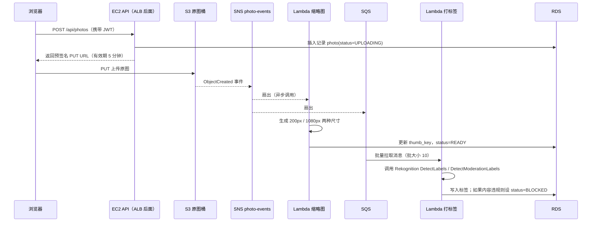

# 架构设计

## 1. 设计原则

1. **一个功能对应一组考点**：每加一个 AWS 服务，都要有真实的业务理由，不为了用而用。
2. **混合架构**：主业务跑在“EC2 + ASG + ALB + RDS”的传统三层架构上，周边功能用“Lambda + API Gateway + DynamoDB”的 Serverless 方式实现。这样两种方式可以直接对比，这也是 SAA 最常考的取舍题。
3. **从单点到高可用逐步演进**：先让它能跑起来，再做多可用区、解耦、灾备。每一步都能对比改造前后的差别。
4. **默认安全**：私有子网、最小权限 IAM、全链路加密、不在代码里写死密钥。

## 2. 功能清单

| # | 功能 | 实现方式 |
|---|---|---|
| F1 | 注册、邮箱验证、登录、找回密码、可选 MFA | Cognito User Pool + Managed Login（托管登录页）或 Amplify Auth |
| F2 | 注册成功后自动创建用户资料 | Cognito **Post Confirmation** 触发器 → Lambda（在 VPC 内）→ RDS Proxy → RDS |
| F3 | 只允许指定邮箱域名注册（可选） | Cognito **Pre Sign-up** 触发器 |
| F4 | JWT 里带上用户的套餐等级 | Cognito **Pre Token Generation** 触发器 |
| F5 | 创建相册、浏览照片时间线 | EC2 上的 Express API，数据存 RDS，热点数据缓存在 Redis |
| F6 | 上传照片 | 后端签发 **S3 预签名 PUT URL**，浏览器直接上传到 S3 |
| F7 | 自动生成缩略图 | S3 `ObjectCreated` 事件 → Lambda（sharp Layer） |
| F8 | 自动打标签、内容审核 | S3 事件 → SQS → Lambda → Rekognition |
| F9 | 点赞、评论 | API Gateway（HTTP API + JWT 授权器）→ Lambda → DynamoDB |
| F10 | 有新评论时通知照片主人 | Lambda → SNS 主题 → 邮件订阅 |
| F11 | 带有效期的分享链接 | CloudFront 签名 URL，或 S3 预签名 GET URL；分享记录存 DynamoDB，用 TTL 自动过期 |
| F12 | 管理后台 `/admin` | ALB 内置的 **authenticate-cognito** 动作，只允许 `admin` 组的用户访问 |
| F13 | 每日统计日报 | EventBridge Scheduler → Lambda → 生成 CSV 存入 S3，再发 SNS 通知 |
| F14 | 进阶：直接用 AWS 凭证上传 | Cognito **Identity Pool** + IAM 策略变量，把每个用户限制在自己的 S3 前缀下 |

## 3. 请求链路

整个站点只用一个域名 `album.example.com`，由 CloudFront 按路径分发到不同后端：

| CloudFront 路径规则 | 源站 | 缓存策略 | 说明 |
|---|---|---|---|
| `Default (*)` | S3 前端桶（OAC） | CachingOptimized | SPA 静态文件；403/404 重定向到 `/index.html` |
| `/media/*` | S3 处理后图片桶（OAC） | CachingOptimized | 缩略图、展示图 |
| `/api/*` | ALB | CachingDisabled，转发 `Authorization` 头 | 主业务 API |
| `/social/*` | API Gateway | CachingDisabled | 点赞、评论 |

**ALB 怎么防止被绕过**：ALB 的安全组只允许 CloudFront 托管前缀列表（`com.amazonaws.global.cloudfront.origin-facing`）的入站流量。另外 CloudFront 回源时带一个自定义头 `X-Origin-Verify`，ALB 监听器规则会检查这个头。更彻底的做法是改用 **内部 ALB + CloudFront VPC Origin**，ALB 根本不需要公网入口。两种方案在 Lab 7 都要做一遍。

### 上传一张照片的完整流程



> 演进过程：Lab 6 先做最简单的 **S3 → Lambda** 直连。到 Lab 8 加入打标签功能时会遇到一个问题：一个 S3 桶的同一种事件类型，不能配置两个前缀/后缀重叠的通知目标。所以要重构成上图的 **S3 → SNS → 多个订阅者（扇出）**，另一种做法是 **S3 → EventBridge**。这是常见考题。

## 4. 网络设计（VPC）

```
VPC 10.0.0.0/16
├── AZ-a
│   ├── public-a       10.0.0.0/24    ALB、NAT Gateway
│   ├── app-a          10.0.10.0/24   EC2（ASG）、Lambda ENI
│   └── data-a         10.0.20.0/24   RDS 主库、Redis
└── AZ-c
    ├── public-c       10.0.1.0/24
    ├── app-c          10.0.11.0/24
    └── data-c         10.0.21.0/24   RDS 备库、Redis 副本
```

| 组件 | 设计 | 对应考点 |
|---|---|---|
| Internet Gateway | 只挂在 public 子网的路由表上 | 公有子网和私有子网的定义 |
| NAT Gateway | 学习阶段只建 1 个（省钱），生产环境每个 AZ 一个 | NAT GW 和 NAT 实例的区别；单 AZ 的 NAT 会成为单点故障 |
| Gateway Endpoint | 为 S3 和 DynamoDB 各建一个 | 免费；流量不经过 NAT，省钱又安全 |
| Interface Endpoint | Secrets Manager、SSM（可选） | 按小时收费；底层是 PrivateLink |
| 安全组链 | `sg-alb` → `sg-app` → `sg-db`，入站规则引用上一层的安全组，而不是写 IP 段 | 安全组有状态，网络 ACL 无状态 |
| 网络 ACL | data 子网只允许来自 app 子网的 5432/6379 端口 | 无状态，要记得放行临时端口 |
| 运维登录 | 用 SSM Session Manager，**不建堡垒机，不开 22 端口** | 最小暴露面 |
| VPC Flow Logs | 输出到 CloudWatch Logs 或 S3 | 排查安全组/ACL 拒绝的流量 |

## 5. 计算层：EC2 + Auto Scaling + ALB

- **AMI**：基于 Amazon Linux 2023 制作“黄金镜像”（预装 Node.js 和 CloudWatch Agent）。应用代码在启动时通过 User Data 从 S3 拉取。进阶做法是用 EC2 Image Builder 自动构建镜像。
- **启动模板（Launch Template）**：使用 IMDSv2（强制要求 token）、实例配置文件 `CloudAlbumAppRole`、gp3 加密 EBS 卷。
- **ASG**：最小 2、期望 2、最大 6，分布在 2 个 AZ。
  - 目标跟踪策略：平均 CPU 50%；另加一条：每个目标的 ALB 请求数 = 500。
  - 预定扩缩容（练习用）：工作日 9 点扩到 3 台。
  - 健康检查类型选 **ELB**，宽限期 120 秒。
  - 混合实例策略：1 台按需实例作为基础，其余用 Spot（`t3.small`、`t3a.small`、`t4g.small`）。
  - 实例刷新（Instance Refresh）用来滚动发布新 AMI；生命周期钩子用来在实例终止前把日志刷到 S3。
- **ALB**：
  - 监听 HTTPS 443，证书来自 ACM（ALB 所在区域）。HTTP 80 重定向到 443。
  - 目标组健康检查路径 `/api/health`，开启连接耗尽（deregistration delay 30s）。
  - 规则：`/admin*` → authenticate-cognito → 管理端目标组；`/api/*` → 应用目标组。
  - 访问日志写入 S3 日志桶。
- **无状态应用**：不在服务端保存会话（只认 JWT），缓存放 Redis。任何一台实例被终止都不影响用户。

## 6. 数据层

### 6.1 RDS PostgreSQL（主业务数据）

```sql
users   (id UUID PK = cognito sub, email, display_name, plan, created_at)
albums  (id PK, owner_id FK, title, visibility, created_at)
photos  (id PK, album_id FK, owner_id FK, raw_key, thumb_key, display_key,
         status ENUM('UPLOADING','READY','BLOCKED'), labels JSONB, created_at)
```

- 部署方式：Multi-AZ（同步复制，自动故障转移），加 1 个只读副本，时间线查询走只读副本。
- 账密：主账号密码放在 **Secrets Manager**，开启自动轮换。EC2 和 Lambda 都在运行时读取，不写进代码。
- Lambda 连库：通过 **RDS Proxy**，避免大量并发 Lambda 把数据库连接数打满。
- 备份：自动备份保留 7 天，可做时间点恢复；手动快照**复制到另一个区域**用于灾备。
- 加密：KMS 客户托管密钥（CMK）。注意：加密只能在创建实例时开启，事后不能直接改（这是常考点）。

### 6.2 ElastiCache Redis

- 缓存热门时间线 `feed:{userId}`，TTL 60 秒，采用旁路缓存（cache-aside）模式。
- 1 主 1 副本，开启 Multi-AZ 自动故障转移。

### 6.3 DynamoDB（社交数据）

单表设计，表名 `CloudAlbumSocial`：

| PK | SK | 属性 | 用途 |
|---|---|---|---|
| `PHOTO#{id}` | `LIKE#{userId}` | createdAt | 点赞；条件写入保证一人只能赞一次 |
| `PHOTO#{id}` | `COMMENT#{ts}#{cid}` | userId, text | 按时间顺序的评论 |
| `PHOTO#{id}` | `COUNTER` | likes, comments | 计数器，用原子 `ADD` 更新 |
| `SHARE#{token}` | `META` | photoId, expireAt | 分享链接，用 **TTL** 自动删除 |

- GSI1：`userId` + `createdAt`，用来查询“我的评论”。
- 容量模式：先用按需模式（On-Demand），然后切换到预置模式 + Auto Scaling 对比两者。
- 开启 PITR（时间点恢复）。可选：DynamoDB Streams → Lambda，评论写入后触发通知。

### 6.4 S3 存储桶

| 桶 | 用途 | 关键配置 |
|---|---|---|
| `cloudalbum-web-{acct}` | 前端静态文件 | 阻止公有访问，只允许 CloudFront 通过 OAC 读取 |
| `cloudalbum-raw-{acct}` | 原图 | 开启版本控制；CORS 允许 PUT；SSE-KMS；生命周期：30 天转 Standard-IA，180 天转 Glacier Flexible Retrieval；跨区域复制（CRR）到灾备区域 |
| `cloudalbum-media-{acct}` | 缩略图、展示图 | Intelligent-Tiering；只允许 CloudFront OAC 访问 |
| `cloudalbum-logs-{acct}` | ALB/CloudFront/S3 访问日志、CloudTrail 日志 | 90 天后删除；可开启对象锁（Object Lock） |
| `cloudalbum-artifacts-{acct}` | 应用发布包、Lambda 部署包 | 开启版本控制 |

## 7. 身份认证：Cognito

### User Pool

- 登录方式：邮箱登录。密码策略：至少 8 位，包含大小写和数字。
- MFA：可选，支持 TOTP 验证器。
- 用户组：`admin`、`member`。组信息会出现在 ID Token 和 Access Token 的 `cognito:groups` 声明里。
- 自定义属性：`custom:plan`（套餐等级）。
- 应用客户端：`cloudalbum-spa`。**不生成客户端密钥**（SPA 无法安全保存密钥），使用授权码模式 + PKCE，回调地址配置为 CloudFront 域名。
- 托管登录页（Managed Login，原 Hosted UI）：可以配置自定义域名 `auth.example.com`。注意它要求 ACM 证书**必须在 us-east-1**。
- 可选：接入 Google 等社交身份提供商，体会身份联合（Federation）。

### Lambda 触发器

| 触发器 | Lambda 做什么 |
|---|---|
| Pre Sign-up | 检查邮箱域名是否在白名单中；可以自动确认测试账号 |
| Post Confirmation | 在 RDS 的 `users` 表插入一行；把用户加入 `member` 组 |
| Pre Token Generation | 往 Token 里加 `plan` 声明 |

### Token 在各处怎么验证

| 入口 | 验证方式 |
|---|---|
| EC2 Express API | 中间件使用 `aws-jwt-verify`，基于 JWKS 校验签名、过期时间、`token_use` 和 `client_id` |
| API Gateway HTTP API | 内置 **JWT 授权器**，issuer 填 User Pool 的地址，audience 填 App Client ID |
| ALB `/admin` | 监听器规则里的 `authenticate-cognito` 动作；然后应用层再检查 `admin` 组 |

### Identity Pool（Lab 3 的进阶练习）

已登录用户可以换到一组临时 AWS 凭证，用来直接调用 S3。对应 IAM 角色的策略如下：

```json
{
  "Effect": "Allow",
  "Action": ["s3:PutObject"],
  "Resource": "arn:aws:s3:::cloudalbum-raw-{acct}/private/${cognito-identity.amazonaws.com:sub}/*"
}
```

可以借这个练习对比“预签名 URL”和“Identity Pool 临时凭证”两种方案，见 [saa-coverage.md](saa-coverage.md)。

## 8. Lambda 设计与配置

| 函数 | 触发源 | 内存 / 超时 | 是否在 VPC 内 | 关键配置 |
|---|---|---|---|---|
| `cognito-post-confirmation` | Cognito | 256MB / 5s | 是（要访问 RDS Proxy） | 必须在 5 秒内返回，否则注册会失败 |
| `image-thumbnail` | S3 事件，Lab 8 后改为 SNS（都是异步调用） | 1024MB / 30s，`/tmp` 1GB | 否 | sharp Layer；arm64 架构；失败目标（on-failure destination）→ SQS DLQ；重试 2 次 |
| `image-labeler` | SQS（事件源映射） | 512MB / 60s | 否 | 批大小 10，批处理窗口 5s，启用**部分批处理失败响应**（`ReportBatchItemFailures`）；队列可见性超时 360s（≥ 函数超时的 6 倍）；队列配置 DLQ，最大接收次数 3 |
| `social-api` | API Gateway | 256MB / 10s | 否（通过公网端点访问 DynamoDB 即可） | 预留并发 50；用别名 `live` 做加权灰度发布（90/10） |
| `daily-report` | EventBridge Scheduler | 512MB / 300s | 是 | 每天 cron 定时执行；结果写 S3，然后发 SNS |

**每个 Lambda 都要练到的配置项**：

1. 执行角色：每个函数一个角色，只授予它需要的权限。资源策略：允许 S3/SNS/EventBridge 调用这个函数。
2. 环境变量（用 KMS 加密）；敏感信息放 Secrets Manager 或 Parameter Store，并使用 Lambda Extension 缓存。
3. 内存和 CPU 成正比：用 Lambda Power Tuning 找出性价比最高的内存配置。
4. VPC 配置：放进 VPC 后函数默认**无法访问公网**，需要 NAT Gateway 或 VPC 终端节点。
5. 并发：预留并发（同时是上限和保底）、预置并发（消除冷启动）、账号级默认上限（通常 1000）。
6. 异步调用：重试次数、最大事件存活时间、成功/失败目标（Destinations）和 DLQ 的区别。
7. 版本和别名：别名可以按权重分流做灰度发布；也可以配合 CodeDeploy 做金丝雀发布。
8. 可观测性：开启 X-Ray 主动追踪，使用 CloudWatch Logs 结构化日志，用 Lambda Insights 看资源使用情况。
9. 打包方式：zip、Layer、容器镜像（最大 10GB）三种对比。
10. 了解但不必练：Function URL、SnapStart、Lambda@Edge 和 CloudFront Functions 的区别。

## 9. 消息与事件

| 组件 | 用途 | 考点 |
|---|---|---|
| SQS 标准队列 `image-label-queue` + DLQ | 把打标签任务和上传解耦，起到削峰作用 | 可见性超时、长轮询、DLQ、标准队列和 FIFO 的区别 |
| SNS `photo-events` | S3 事件扇出给缩略图 Lambda 和打标签的 SQS 队列 | 扇出模式、订阅过滤策略 |
| SNS `notifications` | 评论通知邮件、CloudWatch 告警 | 邮件订阅需要收件人确认 |
| EventBridge | 定时任务；同时作为 S3 事件的另一种路由方式 | 规则 + 事件模式，以及 Scheduler |
| （可选）Step Functions | 把“上传 → 缩略图 → 审核 → 通知”编排成状态机 | 编排（Orchestration）和编舞（Choreography）的区别 |

## 10. 安全

- **IAM**：日常用 IAM Identity Center 用户，根账号开启 MFA 后锁起来不用；所有服务之间的访问都用角色；可选：用权限边界（Permission Boundary）限制开发者能创建的角色。
- **KMS**：一把客户托管密钥同时用于 S3、RDS、EBS、Secrets Manager。理解密钥策略和 IAM 策略之间的关系。
- **WAF**（挂在 CloudFront 上）：AWS 托管规则（Common、SQLi、KnownBadInputs），外加限速规则：同一 IP 每 5 分钟最多 1000 次请求。
- **Shield Standard**（默认开启），了解 Shield Advanced 多了什么。
- **GuardDuty、CloudTrail（多区域 trail 投递到日志桶）、AWS Config 规则**：如 `s3-bucket-public-read-prohibited`、`restricted-ssh`。
- **传输加密**：全站 HTTPS；RDS 强制 SSL；S3 桶策略拒绝 `aws:SecureTransport=false` 的请求。

## 11. 可观测性

- CloudWatch Agent：采集 EC2 的内存、磁盘指标，以及应用日志 → 日志组 `/cloudalbum/app`。
- 指标过滤器：从日志中统计 `ERROR` 次数，转成自定义指标并配置告警。
- 告警：ALB 5XX 比例、目标响应时间、RDS CPU 和可用存储、SQS 最老消息的存在时间、Lambda 错误和限流次数，统一发到 SNS。
- 仪表板：建一个 `CloudAlbum-Overview` 仪表板。
- X-Ray：Lambda 和 Express（使用 SDK 或 OpenTelemetry）都接入，可以看到完整的调用链。

## 12. 高可用与灾备

| 层 | 高可用（同一区域内） | 灾备（跨区域，选做） |
|---|---|---|
| 前端 | CloudFront + S3（本身就是多 AZ） | S3 CRR；CloudFront 源站组（Origin Group）自动故障转移 |
| 计算 | ASG 跨 2 个 AZ + ALB | 在灾备区域用 CloudFormation 栈集（StackSets）部署一套 **Pilot Light** 环境 |
| 数据库 | RDS Multi-AZ | 跨区域只读副本，故障时提升为主库；或使用 Aurora Global Database |
| DynamoDB | 本身就是多 AZ | 全局表（Global Tables） |
| DNS | — | Route 53 **故障转移路由** + 健康检查 |
| 备份 | AWS Backup 计划（RDS、DynamoDB、EBS） | 备份副本复制到灾备区域 |

四种灾备策略（备份恢复 → Pilot Light → Warm Standby → 多站点主动/主动），按 RTO/RPO 从长到短排列。本项目做到 Pilot Light 即可，其余在文档中对比分析。
