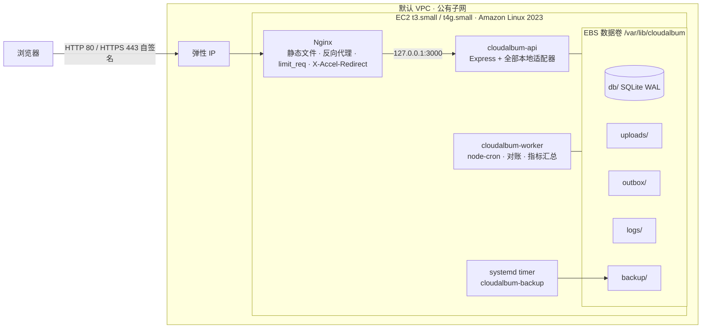
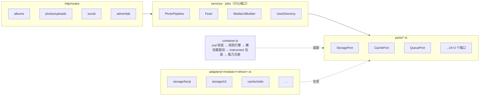
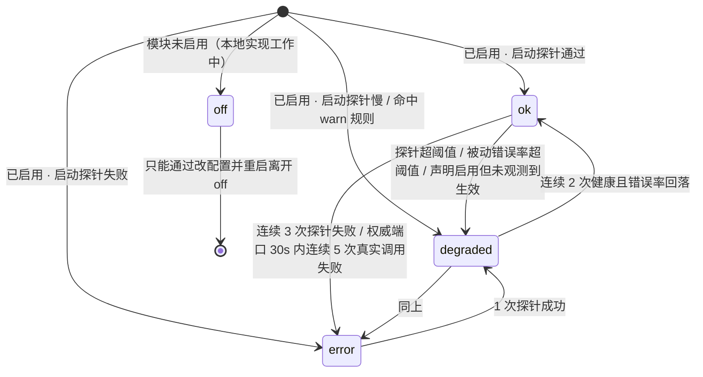
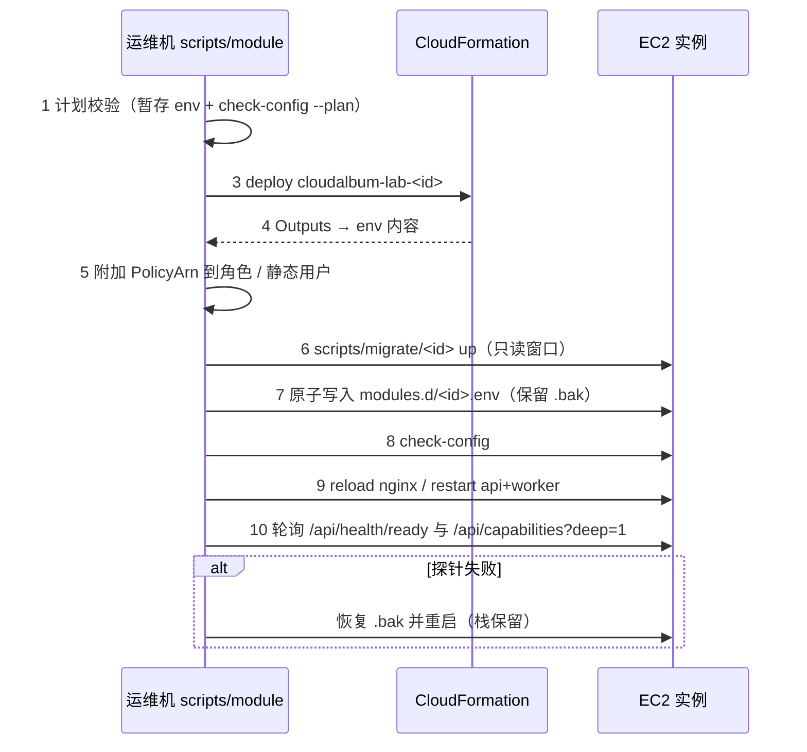

# 模块化设计：EC2 基线 + 可插拔 AWS 模块

> 本文是 CloudAlbum 的**横切架构总纲**。[architecture.md](architecture.md) 描述的是“全部模块都启用”时的目标形态（F1–F14）；本文描述的是**如何从一台 EC2 出发，把每个 AWS 服务做成可单独开关、可对比的模块**。
>
> 各模块的细节写在 `docs/modules/<id>.md`，它们必须挂在本文定义的框架上：端口接口、开关变量、依赖规则、能力注册、探针、CloudFormation 模板约定、迁移脚本约定、实验目录约定。模块文档可以**细化**本文，但不能推翻；确需调整，在模块文档开头的“与总纲的偏差”小节写明理由，并同步修改本文。

**阅读顺序建议**：第 1 节（原则）→ 第 2 节（L0 基线）→ 第 3 节（模块目录）→ 第 4～7 节（代码框架）→ 第 8～10 节（实验与启停）→ 第 11～12 节（仓库与前端）。

---

## 1. 设计目标与原则

### 1.1 目标

| # | 目标 | 可验证的验收标准 |
|---|---|---|
| G1 | **EC2 是唯一必需组件** | 只部署 `infra/modules/ec2.yaml` 一个栈（EC2 + EBS + 默认 VPC + 弹性 IP），F1–F14 全部可用（F14 以等价的本地签名直传代替，见 2.8）；应用进程在运行时**不加载 AWS SDK**、不发出任何 AWS API 调用 |
| G2 | **每个 AWS 服务都是可插拔模块** | `scripts/module enable <id>` 后对应机能切换为 AWS 实现；`disable` 后切回本地实现并迁回数据 |
| G3 | **一个机能 ↔ 一个主服务** | 第 3 节模块目录中每一行恰好一个主 AWS 服务；辅助服务单独列出 |
| G4 | **模块尽量独立** | L0 + 任意单个模块（硬依赖满足时）都能启动并通过健康探针；硬依赖在 `modules/registry.yaml` 中声明，启动时由规则引擎校验 |
| G5 | **差异可观测** | 每个响应带 `Server-Timing` 与 `X-CloudAlbum-Path`；`/lab` 页面能对每个模块做运行时 A/B 或“切换前 / 切换后”两次测量对比 |

### 1.2 原则

1. **EC2 是唯一必需组件。** 所有业务机能都必须有一个能在单台 EC2 上运行的本地实现。本地实现可以是降级版（例如没有 Rekognition 时只生成“基础属性标签”），但必须是**可用的**，不能是空壳或报错。
2. **本地实现优先。** 每个开关变量的第一个取值永远是本地实现，也是默认值。没有配置 = 本地实现 = L0。L0 的构建产物和运行时都不依赖 AWS SDK（AWS 适配器通过动态 `import()` 懒加载，L0 根本不会加载它们）。
3. **依赖显式声明。** 模块之间的依赖只能写在 `modules/registry.yaml`（单一事实来源）里，分为硬依赖（缺了就拒绝启动）、软依赖（缺了某个子功能关闭，并以警告提示）、互斥。代码里不允许出现“如果 S3 不可用就偷偷用本地磁盘”的隐式分支。
4. **不静默降级。** 两类故障分开处理：
   - **配置错误**（违反依赖、互斥、多实例安全规则）：拒绝启动，退出码 78，一次性列出全部错误和修复命令。
   - **运行时依赖故障**（AWS 服务超时、权限不足）：进程照常启动；**权威数据端口**（storage、database、social-store、auth、queue）直接返回 503 并把模块状态置为 `error`，绝不回退到本地实现（否则数据会分叉）；**非权威端口**（cache、logger、metrics、tracer、analytics、tagger）允许降级，但必须把状态置为 `degraded`、计数、并在 `X-CloudAlbum-Path` 中标出（如 `cache=redis:error-bypass`）。
5. **差异必须可观测。** 任何一次“切换”都必须能被看见：能力接口 `/api/capabilities` 显示每个模块的驱动与状态；每个响应的头部说明这次请求走了哪条路径；本地指标库（不依赖 CloudWatch）记录每条路径的延迟分布；前端徽章把“谁在提供这个功能”写在界面上。
6. **业务代码不认识 AWS。** 路由和领域服务只依赖端口接口（`backend/src/ports/*.ts`）；所有 AWS SDK 调用只能出现在 `backend/src/adapters/<module>/<driver>.ts` 和 `backend/src/modules/detectors/*.ts` 里（由 ESLint `no-restricted-imports` 强制）。
7. **数据里只存逻辑标识。** 数据库只存逻辑键（如存储键 `raw/<userId>/<photoId>.jpg`、内部用户 ID），不存绝对路径、桶名、URL、Cognito `sub` 作为主键。URL 在响应时由当前驱动生成，这样切换模块不需要改写业务数据。
8. **模块栈之间不互相 `ImportValue`。** 跨栈参数由 `scripts/module` 读取依赖栈的 Outputs 后以参数传入，任何模块栈都能独立删除（避免 CloudFormation 导出值被引用时无法删除的锁死问题）。

### 1.3 术语

| 术语 | 含义 |
|---|---|
| 模块（module） | 一个 AWS 主服务 + 它对应的机能 + 开关 + CloudFormation 栈 + 探针 + 迁移脚本 + 实验，id 见第 3 节 |
| 端口（port） | 一个机能的 TypeScript 接口，位于 `backend/src/ports/<port>.ts` |
| 适配器 / 驱动（adapter / driver） | 端口的一种实现，位于 `backend/src/adapters/<module>/<driver>.ts`；驱动名就是开关变量的取值 |
| 本地档（local tier） | 不需要任何 AWS 资源的驱动，如 `cache=memory`、`queue=memory`、`IMAGE_PROCESSOR=worker`、在 EC2 上自建的 PostgreSQL/Valkey。本地档用于把“架构模式的差异”和“托管服务的差异”拆开对比 |
| 感知器（detector） | 纯基础设施型模块没有适配器，应用通过感知器（请求头、IMDS、控制面 API）判断它是否在生效 |
| 档位（profile） | `profiles/*.env`，一组模块的组合，从 L0 逐级到全量 |

---

## 2. L0 基线：只有 EC2 时的完整运行形态

### 2.1 拓扑



L0 中**没有任何 AWS 托管服务参与请求处理**：没有 S3、没有 RDS、没有 Cognito、没有 IAM 角色（L0 不需要访问 AWS API）。

### 2.2 实例规格

| 项目 | 取值 | 说明 |
|---|---|---|
| AMI | Amazon Linux 2023 最新版（通过 SSM 公共参数 `/aws/service/ami-amazon-linux-latest/al2023-ami-kernel-default-<arch>` 解析） | CloudFormation 参数类型 `AWS::SSM::Parameter::Value<AWS::EC2::Image::Id>`；arch 为 `x86_64` 或 `arm64` |
| 实例类型 | `t3.small`（x86_64）或 `t4g.small`（arm64，Graviton） | 2 vCPU / 2 GiB。T 系列有 CPU 积分机制：sharp 生成缩略图的突发 CPU 会消耗积分，这本身就是 `image-processing` 模块的对比观察点 |
| IMDS | 强制 IMDSv2（`HttpTokens: required`），跳数限制 1；开启实例元数据标签（`InstanceMetadataTags: enabled`） | 标签读取用于感知 autoscaling（见 3.3） |
| 根卷 | gp3 20 GiB，加密（默认 `aws/ebs` 密钥） | OS、`/opt/cloudalbum` 程序、1 GiB swap 文件（防止 2 GiB 内存在构建 / 并发缩略图时 OOM） |
| 数据卷 | **独立** gp3 20 GiB，加密，`DeleteOnTermination: false`，挂载到 `/var/lib/cloudalbum` | 数据与系统盘分离：换实例类型、迁移到自定义 VPC（network 模块）时可以把数据卷卸下挂到新实例（同一 AZ） |
| 弹性 IP | 1 个，关联到实例 | 固定入口；`APP_BASE_URL` 默认为 `http://<EIP>` |
| IAM 实例配置文件 | **无**（L0 不访问 AWS API） | 由 `iam` 模块添加，见 3.2 |

### 2.3 默认 VPC 与安全组

L0 使用账号自带的默认 VPC 和某个 AZ 的默认公有子网（CloudFormation 参数 `SubnetId` 留空时由 `scripts/module` 自动选择 `ap-northeast-1a` 的默认子网）。

安全组 `cloudalbum-<env>-ec2-sg`：

| 方向 | 协议/端口 | 来源 | 说明 |
|---|---|---|---|
| 入站 | TCP 80 | `0.0.0.0/0`、`::/0` | HTTP |
| 入站 | TCP 443 | `0.0.0.0/0`、`::/0` | HTTPS（L0 为自签名证书，见 2.5） |
| 入站 | TCP 22 | 参数 `SshIngressCidr`（管理员公网 IP/32） | L0 的运维登录方式；启用 `shell-access` 模块后由 `scripts/module` 把该参数改为空，规则随之删除 |
| 出站 | 全部 | `0.0.0.0/0` | 安装软件包、Let's Encrypt（可选）、以后访问 AWS API |

其他模块需要从实例访问自己的资源时（例如 ElastiCache 安全组允许来自实例安全组的 6379），**在自己的栈里**创建引用 `InstanceSecurityGroupId` 的规则，不修改基础栈。

### 2.4 EBS 目录布局

```
/var/lib/cloudalbum/                 # 独立数据卷，属主 cloudalbum:cloudalbum，权限 750
├── db/
│   ├── cloudalbum.sqlite            # SQLite，journal_mode=WAL，busy_timeout=5000
│   ├── cloudalbum.sqlite-wal
│   └── cloudalbum.sqlite-shm
├── uploads/                         # StoragePort(local) 的根目录 STORAGE_LOCAL_ROOT
│   ├── raw/<userId>/<photoId>.<ext>          # 原图（逻辑键 raw/...）
│   ├── variants/<photoId>/thumb_200.webp     # 缩略图（逻辑键 variants/...）
│   ├── variants/<photoId>/display_1080.webp
│   └── reports/daily/<yyyy-mm-dd>.csv        # 日报（F13，同样走 StoragePort）
├── outbox/                          # EmailPort(outbox)：每封邮件一个 .eml，按日期分目录
│   └── <yyyy-mm-dd>/<messageId>.eml
├── logs/                            # LoggerPort(file) 与 Nginx JSON 访问日志，logrotate 每日轮转保留 14 天
│   ├── api.log  worker.log  audit.log
│   └── nginx-access.json
└── backup/                          # cloudalbum-backup.timer 的输出（与数据同卷——这正是 backup 模块要对比的单点问题）
    ├── sqlite/cloudalbum-<ts>.sqlite.gz
    └── uploads/manifest-<ts>.txt
```

- 运行时临时目录用 systemd 的 `RuntimeDirectory=cloudalbum`（`/run/cloudalbum`，放文件锁）和 `PrivateTmp=true`，不在数据卷上。
- 上传目录里的路径就是逻辑键：`STORAGE_LOCAL_ROOT + "/" + key`。切换到 S3 时键保持不变（见 9.3）。
- AL2023 默认没有安装 cronie，所以“基线 cron”统一用 **systemd timer** 实现（应用内的定时任务由 worker 进程里的 node-cron 负责，二者职责不同，见 2.7）。

### 2.5 Nginx 配置要点

L0 的 Nginx 同时承担 4 个角色：**静态站点**（CloudFront 的本地替代）、**反向代理**（ALB 的本地替代）、**限速与基础拦截**（WAF 的本地替代）、**媒体文件发送**（S3 + CloudFront 的本地替代）。

```nginx
# /etc/nginx/conf.d/cloudalbum.conf   （源文件：infra/nginx/cloudalbum.conf）

# JSON 访问日志：记录 CloudFront / ALB 注入的头，供感知器和 /lab 统计
log_format cloudalbum_json escape=json
  '{"ts":"$time_iso8601","rid":"$request_id","ip":"$remote_addr","xff":"$http_x_forwarded_for",'
  '"method":"$request_method","uri":"$uri","status":$status,"bytes":$body_bytes_sent,'
  '"rt":$request_time,"urt":"$upstream_response_time","cf_id":"$http_x_amz_cf_id",'
  '"via":"$http_via","alb_trace":"$http_x_amzn_trace_id","path":"$upstream_http_x_cloudalbum_path"}';

limit_req_zone $binary_remote_addr zone=ca_api:10m  rate=20r/s;
limit_req_zone $binary_remote_addr zone=ca_auth:10m rate=2r/s;
limit_req_status 429;

# WAF 的本地替代：极简特征拦截（演示用，不是真正的防护）
map $request_uri $ca_block {
    default 0;
    "~*(union(\s|%20|\+)+select|<script|%3cscript|\.\./|%2e%2e%2f)" 1;
}

upstream cloudalbum_api {
    server 127.0.0.1:3000;
    keepalive 32;
}

# 模块投放的 http 级片段，例如 load-balancer/cdn 写入的 realip-*.conf（set_real_ip_from ...）
include /etc/nginx/cloudalbum.d/*.conf;

server {
    listen 80 default_server;
    listen [::]:80 default_server;
    listen 443 ssl default_server;
    listen [::]:443 ssl default_server;
    http2 on;                               # nginx < 1.25.1 改写为 listen 443 ssl http2
    server_name _;
    server_tokens off;

    ssl_certificate     /etc/cloudalbum/tls/server.crt;   # User Data 生成的自签名证书；有域名时可换 certbot
    ssl_certificate_key /etc/cloudalbum/tls/server.key;
    ssl_protocols TLSv1.2 TLSv1.3;

    access_log /var/lib/cloudalbum/logs/nginx-access.json cloudalbum_json;
    client_max_body_size 30m;
    root /opt/cloudalbum/frontend/dist;

    if ($ca_block) { return 403; }

    # 1) SPA：带哈希的静态资源长缓存，index.html 不缓存
    location /assets/      { add_header Cache-Control "public, max-age=31536000, immutable"; try_files $uri =404; }
    location = /index.html { add_header Cache-Control "no-cache"; }
    location /             { try_files $uri $uri/ /index.html; }

    # 2) API：通用限速；认证接口单独更严格
    location /api/auth/          { limit_req zone=ca_auth burst=5 nodelay;  include /etc/nginx/cloudalbum_proxy.conf; }
    location /api/storage/upload { limit_req zone=ca_api burst=20 nodelay; proxy_request_buffering off;
                                   include /etc/nginx/cloudalbum_proxy.conf; }   # 本地签名直传，流式写盘
    location /api/               { limit_req zone=ca_api burst=40 nodelay; include /etc/nginx/cloudalbum_proxy.conf; }
    location /social/            { limit_req zone=ca_api burst=40 nodelay; include /etc/nginx/cloudalbum_proxy.conf; }

    # 3) 媒体：Node 校验签名与权限后返回 X-Accel-Redirect，由 Nginx 零拷贝发送文件
    location /media/ { include /etc/nginx/cloudalbum_proxy.conf; }
    location /_media_local/public/  { internal; alias /var/lib/cloudalbum/uploads/;
                                      add_header Cache-Control "public, max-age=86400"; }
    location /_media_local/private/ { internal; alias /var/lib/cloudalbum/uploads/;
                                      add_header Cache-Control "private, max-age=300"; }
    location /_media_efs/public/    { internal; alias /mnt/efs/cloudalbum/uploads/;   # 仅 shared-fs 启用后有效
                                      add_header Cache-Control "public, max-age=86400"; }
    location /_media_efs/private/   { internal; alias /mnt/efs/cloudalbum/uploads/;
                                      add_header Cache-Control "private, max-age=300"; }

    # 4) 仅本机可访问的 Prometheus 文本格式指标
    location = /metrics { allow 127.0.0.1; deny all; include /etc/nginx/cloudalbum_proxy.conf; }

    location ~ /\.(?!well-known) { deny all; }

    # 模块投放的 server 级片段（例如 cdn 的 X-Origin-Verify 校验、F12 的管理 IP 白名单）
    include /etc/nginx/cloudalbum.server.d/*.conf;
}
```

```nginx
# /etc/nginx/cloudalbum_proxy.conf
proxy_pass http://cloudalbum_api;
proxy_http_version 1.1;
proxy_set_header Connection "";
proxy_set_header Host $host;
proxy_set_header X-Real-IP $remote_addr;
proxy_set_header X-Forwarded-For $proxy_add_x_forwarded_for;
proxy_set_header X-Forwarded-Proto $scheme;      # ALB/CloudFront 在前面时由 realip 片段改写，见 3.3
proxy_set_header X-Request-Id $request_id;
proxy_read_timeout 60s;
```

**约定**：模块只能通过两个目录影响 Nginx——`/etc/nginx/cloudalbum.d/<id>-*.conf`（http 级片段）和 `/etc/nginx/cloudalbum.server.d/<id>-*.conf`（server 级片段，主配置在 server 块末尾 `include`）。模块不得改写主配置文件；`scripts/module` 写入片段后执行 `nginx -t && systemctl reload nginx`，失败则回滚片段。

### 2.6 systemd 单元

```ini
# /etc/systemd/system/cloudalbum-api.service
[Unit]
Description=CloudAlbum API (Express on :3000)
After=network-online.target
Wants=network-online.target
RequiresMountsFor=/var/lib/cloudalbum

[Service]
Type=simple
User=cloudalbum
Group=cloudalbum
WorkingDirectory=/opt/cloudalbum/backend
Environment=NODE_ENV=production
Environment=CLOUDALBUM_ROLE=api
Environment=CLOUDALBUM_ENV_DIR=/etc/cloudalbum
ExecStart=/usr/bin/node --enable-source-maps dist/server.js
Restart=on-failure
RestartSec=3
RestartPreventExitStatus=78          # 78 = EX_CONFIG：配置校验失败，不要无限重启
TimeoutStopSec=20
LimitNOFILE=65536
RuntimeDirectory=cloudalbum          # /run/cloudalbum：文件锁
RuntimeDirectoryPreserve=yes         # 两个单元共用，避免一个停止时删掉另一个的锁
NoNewPrivileges=true
PrivateTmp=true
ProtectSystem=strict
ProtectHome=true
ReadWritePaths=/var/lib/cloudalbum
ReadOnlyPaths=/etc/cloudalbum

[Install]
WantedBy=multi-user.target
```

```ini
# /etc/systemd/system/cloudalbum-worker.service（与 api 相同，仅以下几行不同）
Description=CloudAlbum Worker (scheduler / queue consumer / reconcilers)
Environment=CLOUDALBUM_ROLE=worker
ExecStart=/usr/bin/node --enable-source-maps dist/worker.js
```

```ini
# /etc/systemd/system/cloudalbum-backup.timer   （基线备份，backup 模块的对照组）
[Timer]
OnCalendar=*-*-* 03:30:00
RandomizedDelaySec=10m
Persistent=true
[Install]
WantedBy=timers.target
# 对应 cloudalbum-backup.service：Type=oneshot，执行 /opt/cloudalbum/scripts/local-backup.sh
#   sqlite3 db/cloudalbum.sqlite ".backup ..." + gzip；DB_DRIVER=postgres（自建）时改为 pg_dump；保留 7 天
```

两个进程的职责划分（随驱动变化）：

| 职责 | 由谁执行 |
|---|---|
| HTTP 请求、`inline` 图片处理、`sync` 队列任务 | api |
| `QUEUE_DRIVER=memory` 的消费者 | api 进程内（`worker_threads` 池，内存队列无法跨进程，这本身是对比点：重启即丢任务） |
| `QUEUE_DRIVER=sqs` 的消费者 | worker（可单独扩缩） |
| 定时任务（`SCHEDULER_DRIVER=cron` 的 node-cron；`eventbridge` 时轮询 tick 队列） | worker |
| 对账任务（`PROCESSING` 超时的照片、过期分享链接清理等，都是定时任务） | worker |
| 本地指标汇总写库 | 两个进程各自每 10 秒 flush |

**模块对 systemd 的扩展**只能用 drop-in：`/etc/systemd/system/cloudalbum-<api|worker>.service.d/50-<id>.conf`。例如 shared-fs 写入 `ReadWritePaths=/mnt/efs/cloudalbum` 与 `RequiresMountsFor=/mnt/efs/cloudalbum`。

### 2.7 User Data 安装脚本骨架

CloudFormation 的 User Data 只是一个很短的引导段（设置变量后执行发布包里的 `infra/userdata/l0-bootstrap.sh`），避免 `Fn::Sub` 与 Bash `${}` 冲突。L0 的发布包来自 GitHub Release（**不依赖 S3**）。

```bash
#!/bin/bash
# infra/userdata/l0-bootstrap.sh   —— 幂等：重复执行不会破坏已有数据
set -euo pipefail
exec > >(tee -a /var/log/cloudalbum-bootstrap.log) 2>&1
: "${APP_ARCHIVE_URL:?}" "${APP_PUBLIC_IP:?}" "${ADMIN_EMAIL:?}"   # 由 CFN 引导段 export

# 1. 系统包（包名以 AL2023 仓库为准；nodejs20 也可换成官方二进制）
dnf -y install nginx nodejs20 nodejs20-npm sqlite tar gzip openssl jq logrotate
# 可选：fail2ban（threat-detection 的基线）。AL2023 不支持 EPEL，能否直接安装以官方文档为准，
#       不可用时用 sshd MaxAuthTries + Nginx limit_req 代替，并在 /lab 标注。

# 2. swap（2 GiB 内存的保护）
[ -f /swapfile ] || { dd if=/dev/zero of=/swapfile bs=1M count=1024; chmod 600 /swapfile; mkswap /swapfile; }
grep -q '^/swapfile' /etc/fstab || echo '/swapfile none swap defaults 0 0' >> /etc/fstab; swapon -a

# 3. 数据卷：/dev/sdf（AL2023 的 udev 规则会为 NVMe 设备建立该符号链接）
for i in $(seq 1 30); do [ -e /dev/sdf ] && break; sleep 2; done
blkid /dev/sdf >/dev/null || mkfs.xfs -L cadata /dev/sdf
mkdir -p /var/lib/cloudalbum
grep -q 'LABEL=cadata' /etc/fstab || echo 'LABEL=cadata /var/lib/cloudalbum xfs defaults,nofail,noatime 0 2' >> /etc/fstab
mount -a

# 4. 用户与目录
id cloudalbum >/dev/null 2>&1 || useradd --system --home-dir /var/lib/cloudalbum --shell /sbin/nologin cloudalbum
install -d -o cloudalbum -g cloudalbum -m 750 /var/lib/cloudalbum/{db,uploads,outbox,logs,backup}
install -d -m 755 /etc/cloudalbum /etc/cloudalbum/modules.d /etc/cloudalbum/tls /opt/cloudalbum
install -d -m 755 /etc/nginx/cloudalbum.d /etc/nginx/cloudalbum.server.d

# 5. 应用（发布包按架构区分，内含 frontend/dist、backend/dist 与生产依赖，含 sharp 预编译二进制）
curl -fsSL "$APP_ARCHIVE_URL" -o /tmp/cloudalbum.tgz
tar xzf /tmp/cloudalbum.tgz -C /opt/cloudalbum --strip-components=1

# 6. 基础配置（只写 L0 默认值；模块配置由 scripts/module 写入 modules.d/）
[ -f /etc/cloudalbum/cloudalbum.env ] || cat > /etc/cloudalbum/cloudalbum.env <<EOF
APP_BASE_URL=http://${APP_PUBLIC_IP}
AWS_REGION=ap-northeast-1
DEPLOY_MODE=single
DB_DRIVER=sqlite
SQLITE_PATH=/var/lib/cloudalbum/db/cloudalbum.sqlite
STORAGE_DRIVER=local
STORAGE_LOCAL_ROOT=/var/lib/cloudalbum/uploads
EOF
# 其余开关全部缺省 = 本地实现

# 7. 本地密钥（只生成一次；SECRETS_ORIGIN=instance 会被多实例规则 ASG-007 拦截）
if [ ! -f /etc/cloudalbum/secrets.env ]; then
  ( umask 027; cat > /etc/cloudalbum/secrets.env <<EOF
SECRETS_ORIGIN=instance
JWT_SIGNING_KEY=$(openssl rand -base64 48)
UPLOAD_HMAC_KEY=$(openssl rand -base64 32)
MEDIA_HMAC_KEY=$(openssl rand -base64 32)
CALLBACK_HMAC_KEY=$(openssl rand -base64 32)
LOCAL_MASTER_KEY=$(openssl rand -base64 32)
EOF
  ); chgrp cloudalbum /etc/cloudalbum/secrets.env
fi

# 8. 自签名证书（tls 模块的对照组）
[ -f /etc/cloudalbum/tls/server.crt ] || openssl req -x509 -newkey rsa:2048 -nodes -days 825 \
  -subj "/CN=cloudalbum-l0" -addext "subjectAltName=IP:${APP_PUBLIC_IP}" \
  -keyout /etc/cloudalbum/tls/server.key -out /etc/cloudalbum/tls/server.crt

# 9. Nginx、systemd、logrotate
install -m 644 /opt/cloudalbum/infra/nginx/cloudalbum.conf       /etc/nginx/conf.d/cloudalbum.conf
install -m 644 /opt/cloudalbum/infra/nginx/cloudalbum_proxy.conf /etc/nginx/cloudalbum_proxy.conf
install -m 644 /opt/cloudalbum/infra/systemd/*.service /opt/cloudalbum/infra/systemd/*.timer /etc/systemd/system/
install -m 644 /opt/cloudalbum/infra/logrotate/cloudalbum /etc/logrotate.d/cloudalbum
nginx -t

# 10. 数据库迁移与初始管理员（初始密码只写入 root 可读文件，不进日志）
cd /opt/cloudalbum/backend
sudo -u cloudalbum CLOUDALBUM_ENV_DIR=/etc/cloudalbum node dist/cli.js db:migrate
[ -f /root/cloudalbum-admin.txt ] || ( umask 077; sudo -u cloudalbum CLOUDALBUM_ENV_DIR=/etc/cloudalbum \
  node dist/cli.js admin:create --email "$ADMIN_EMAIL" --print-password > /root/cloudalbum-admin.txt )

# 11. 启动并自检
systemctl daemon-reload
systemctl enable --now nginx cloudalbum-api cloudalbum-worker cloudalbum-backup.timer
for i in $(seq 1 30); do curl -fsS http://127.0.0.1/api/health/ready && break; sleep 2; done
curl -fsS http://127.0.0.1/api/capabilities | jq '.modules | map_values(.status)'
```

### 2.8 功能对照表：F1–F14 在 L0 与启用模块后

| # | 功能 | L0 本地实现（降级点） | 主模块 → 主 AWS 服务 | 相关模块（辅助） |
|---|---|---|---|---|
| F1 | 注册、邮箱验证、登录、找回密码、可选 MFA | `auth/local`：argon2id 哈希存 `users` 表；HS256 JWT（访问令牌 15 分钟 + 可吊销的刷新令牌）；验证码与重置链接经 EmailPort 写入 outbox，管理员在 `/admin/outbox` 可见（等价于“收到邮件”）；TOTP MFA（密钥经 CryptoPort 加密存储） | auth → **Amazon Cognito User Pool** | email、kms |
| F2 | 注册后自动建资料 | 注册事务内同时写 `users` 与默认相册 | auth → Cognito：首个已认证请求时 JIT 建档（`UserDirectory.ensureUser`）；Post Confirmation 触发器为可选增强 | database（触发器直写库时） |
| F3 | 邮箱域名白名单 | 注册处理器读取 ConfigPort 的 `allowedEmailDomains` | auth → Cognito Pre Sign-up 触发器（Lambda 由 auth 栈自带） | config |
| F4 | JWT 带套餐等级 | 本地签发时写入 `plan` 声明 | auth → Cognito Pre Token Generation 触发器 | — |
| F5 | 相册、照片时间线 | Express + Knex(SQLite)；`CACHE_DRIVER=none` 每次查库 | database → **Amazon RDS for PostgreSQL** | cache（时间线 cache-aside） |
| F6 | 上传照片 | StoragePort(local) 签发 HMAC 签名的上传 URL，浏览器 PUT 到 `/api/storage/upload`，Node 流式写 EBS。**前端流程与 S3 预签名完全一致** | storage → **Amazon S3**（预签名 PUT 直传） | shared-fs（EFS 方案）、kms、cdn |
| F7 | 自动生成缩略图 | `IMAGE_PROCESSOR=inline`：上传完成的请求内调用 sharp；本地档 `worker`：入队异步处理 | image-processing → **AWS Lambda** | storage（lambda 档硬依赖 s3）、queue（worker 档） |
| F8 | 自动打标签、内容审核 | `TAGGER_DRIVER=none`：只写 sharp 元数据得出的基础属性标签（方向、主色、分辨率档），审核结论恒为 `pass`，由管理员手工屏蔽 | tagging → **Amazon Rekognition** | queue |
| F9 | 点赞、评论 | Express `/social/*` + SocialStorePort(db)：`likes`（唯一约束一人一赞）、`comments`、`photo_counters` 表 | social-store → **Amazon DynamoDB** | social-api（API Gateway 托管入口） |
| F10 | 新评论通知照片主人 | NotifierPort(db)：写站内信 `notifications` 表，并同步调用 EmailPort | notification → **Amazon SNS**（主题 + 按 `userId` 的订阅过滤策略） | email |
| F11 | 带有效期的分享链接 | `share_links` 表 + `expires_at`，读取时校验；`share.cleanup` 定时清理；媒体 URL 用本地 HMAC 签名 | social-store → DynamoDB（TTL 自动过期） | storage（S3 预签名 GET）、cdn（CloudFront 签名 URL） |
| F12 | 管理后台 `/admin` | 应用层 RBAC（`users.role='admin'`），可选 Nginx `allow` 管理 IP | load-balancer → **Elastic Load Balancing（ALB `authenticate-cognito`）** | auth、tls、dns（缺一则该子功能关闭，规则 DEP-011） |
| F13 | 每日统计日报 | worker 内 node-cron（`report.daily`）→ CSV 经 StoragePort 写入 `reports/daily/` → EmailPort 发给管理员 | scheduler → **Amazon EventBridge Scheduler** | storage、notification、email |
| F14 | 用 AWS 临时凭证直传 | 本地无等价物：前端隐藏“凭证直传”入口并说明原因；上传退化为 F6 的签名 URL 方式（体验相同，安全模型不同） | identity-pool → **Amazon Cognito Identity Pool** | storage=s3、auth=cognito（硬依赖） |

F 表之外，其余模块对应的是**横切机能**（不属于某个业务功能，但同样有本地实现）：

| # | 横切机能 | L0 本地实现 | 模块 → 主 AWS 服务 |
|---|---|---|---|
| X1 | 网络隔离 | 默认 VPC 公有子网 + 安全组 | network → Amazon VPC |
| X2 | 内容分发与边缘缓存 | Nginx 直出 + `Cache-Control` | cdn → Amazon CloudFront |
| X3 | 域名解析 | `http://<EIP>` | dns → Amazon Route 53 |
| X4 | HTTPS 证书 | Nginx 自签名（有域名时可用 certbot） | tls → AWS Certificate Manager |
| X5 | Web 应用防护 | Nginx `limit_req` + `map` 特征拦截 | waf → AWS WAF |
| X6 | 弹性伸缩 | 单实例 | autoscaling → Amazon EC2 Auto Scaling |
| X7 | 访问 AWS 的凭证 | L0 不访问 AWS；启用 AWS 模块但未启用 iam 时为静态访问密钥 | iam → AWS IAM（实例配置文件角色） |
| X8 | 密码与密钥 | `/etc/cloudalbum/secrets.env` | secrets → AWS Secrets Manager |
| X9 | 集中配置与远程开关 | `/etc/cloudalbum/runtime.json` + 文件监听热加载 | config → SSM Parameter Store |
| X10 | 数据加密密钥 | `LOCAL_MASTER_KEY` + AES-256-GCM 信封加密 | kms → AWS KMS |
| X11 | 多实例共享文件 | 不需要（单实例本地盘） | shared-fs → Amazon EFS |
| X12 | 缓存 | `none`，本地档 `memory`（进程内 LRU） | cache → Amazon ElastiCache |
| X13 | 备份 | systemd timer + `sqlite .backup`（与数据同卷） | backup → AWS Backup |
| X14 | 点击流采集分析 | `click_events` 表 + SQL 报表 | analytics → Amazon Data Firehose（辅助 S3 + Athena） |
| X15 | 异步任务队列 | `sync`，本地档 `memory` | queue → Amazon SQS |
| X16 | 邮件发送 | outbox（`.eml` 文件 + `outbox_emails` 表） | email → Amazon SES |
| X17 | API 托管 | EC2 上的 Express 路由 | social-api → Amazon API Gateway |
| X18 | 运维登录 | SSH 22 + 密钥对 | shell-access → SSM Session Manager |
| X19 | 日志 | 文件 + logrotate | logging → Amazon CloudWatch Logs |
| X20 | 指标、告警、仪表板 | 本地指标库 + `/lab` 图表 | monitoring → Amazon CloudWatch |
| X21 | 分布式链路追踪 | 仅单跳 `Server-Timing` | tracing → AWS X-Ray |
| X22 | AWS API 操作审计 | 应用内 `audit_log` 表（只记录应用内操作） | audit → AWS CloudTrail |
| X23 | 威胁检测 | fail2ban（如可安装）+ Nginx 日志 | threat-detection → Amazon GuardDuty |

两张表合起来，**除 ec2 外每个模块恰好在一行里作为主服务出现**（auth 覆盖 F1–F4，social-store 覆盖 F9、F11，它们是同一机能的不同子功能）。

---

## 3. 模块目录

### 3.1 模块类型

原约定的“应用适配器型 / 纯基础设施型”两类保持不变，其中应用适配器型再细分两种，便于模块设计者判断自己要写什么代码：

| 类型 | 标记 | 应用侧要写什么 | 开关形态 | 例子 |
|---|---|---|---|---|
| 应用适配器型（端口） | **A** | 端口接口 + 本地驱动 + AWS 驱动 + 探针 | 枚举型 `<X>_DRIVER=local值|aws值` | storage、queue、auth |
| 应用适配器型（参数） | **A·P** | 不需要新端口；应用用一个 URL/ID 参数改变行为（改写 URL、下发前端配置、切换规则集） | 参数型：空字符串 = 本地 | cdn（`CDN_BASE_URL`）、social-api、identity-pool、autoscaling（`DEPLOY_MODE`） |
| 纯基础设施型 | **I** | 不需要切换代码；只写一个**感知器**（detector），让应用“看见”它 | 无开关；env 文件里只有 `MODULE_<ID>=on` 与资源标识 | network、tls、waf、load-balancer |

所有模块启用时都会写 `/etc/cloudalbum/modules.d/<id>.env`，第一行固定为 `MODULE_<ID>=on`（id 中的 `-` 换成 `_` 并大写，例如 `MODULE_LOAD_BALANCER=on`）。应用据此区分“**声明启用**”与“**观测到生效**”，二者不一致时状态为 `degraded`（见 3.3）。

### 3.2 模块总表

“硬依赖”一列只列模块级依赖；**所有调用 AWS API 的模块还隐含一个前置条件：AWS 凭证可用**（启用 iam 模块，或显式允许的静态密钥，见规则 CRED-001）。完整规则见第 5 节。

| 组 | id | 机能 | 主 AWS 服务 | 辅助服务 | 开关变量（首个取值 = 本地实现 = 默认） | 类型 | 硬依赖 | 文档 |
|---|---|---|---|---|---|---|---|---|
| 基础 | `ec2` | 运行整个应用 | Amazon EC2 | EBS、弹性 IP、默认 VPC | —（必需，不可禁用） | 基础 | — | 本文第 2 节 |
| A | `network` | 网络隔离 | Amazon VPC | NAT Gateway / VPC 端点（私有放置时） | —（`NETWORK_PLACEMENT=public|private` 仅供校验） | I | private 放置需 load-balancer | docs/modules/network.md |
| A | `cdn` | 内容分发与边缘缓存 | Amazon CloudFront | 响应头策略（Server-Timing） | `CDN_BASE_URL`（空 = EC2 直出） | A·P | — | docs/modules/cdn.md |
| A | `dns` | 域名解析 | Amazon Route 53 | — | `APP_BASE_URL`（默认 `http://<EIP>`） | I | —（前置：已有域名/托管区域） | docs/modules/dns.md |
| A | `tls` | HTTPS 证书 | AWS Certificate Manager | — | — | I | dns，且 cdn 或 load-balancer | docs/modules/tls.md |
| A | `waf` | Web 应用防护 | AWS WAF | — | — | I | cdn 或 load-balancer | docs/modules/waf.md |
| A | `load-balancer` | 负载均衡 | Elastic Load Balancing（ALB） | — | — | I | — | docs/modules/load-balancer.md |
| A | `autoscaling` | 弹性伸缩 | Amazon EC2 Auto Scaling | Launch Template、SSM 参数（引导配置包） | `DEPLOY_MODE=single|asg` | A·P | iam、load-balancer、database，storage 或 shared-fs | docs/modules/autoscaling.md |
| B | `iam` | 访问 AWS 的凭证 | AWS IAM（实例配置文件角色） | AWS STS | —（`AWS_CREDENTIALS_SOURCE=static|instance-profile` 仅供校验与展示） | I | — | docs/modules/iam.md |
| B | `auth` | 用户注册登录 | Amazon Cognito User Pool | Lambda（Pre Sign-up / Pre Token Generation 触发器） | `AUTH_DRIVER=local|cognito` | A | — | docs/modules/auth.md |
| B | `identity-pool` | 终端用户直接访问 AWS 资源 | Amazon Cognito Identity Pool | IAM 角色 | `IDENTITY_POOL_ID`（空 = 关闭） | A·P | auth（cognito）、storage（s3） | docs/modules/identity-pool.md |
| B | `secrets` | 密码与密钥管理 | AWS Secrets Manager | — | `SECRETS_DRIVER=env|secretsmanager` | A | — | docs/modules/secrets.md |
| B | `config` | 集中配置与远程开关 | SSM Parameter Store | — | `CONFIG_DRIVER=file|ssm` | A | — | docs/modules/config.md |
| B | `kms` | 数据加密密钥 | AWS KMS | — | `KMS_KEY_ID`（空 = 本地主密钥） | A | — | docs/modules/kms.md |
| C | `storage` | 照片对象存储 | Amazon S3 | EventBridge（桶级事件投递） | `STORAGE_DRIVER=local|s3`（`efs` 值归 shared-fs） | A | — | docs/modules/storage.md |
| C | `shared-fs` | 多实例共享文件系统 | Amazon EFS | — | `STORAGE_DRIVER=efs`（复用本地文件适配器，只换挂载路径） | A | —（与 storage 互斥） | docs/modules/shared-fs.md |
| C | `database` | 关系数据库 | Amazon RDS for PostgreSQL | — | `DB_DRIVER=sqlite|postgres`（+ `DB_HOST`；本地档：EC2 上自建 PostgreSQL） | A（Knex 方言） | — | docs/modules/database.md |
| C | `cache` | 缓存 | Amazon ElastiCache（Valkey / Redis OSS 引擎） | — | `CACHE_DRIVER=none|memory|redis`（本地档：memory、EC2 上自建 Valkey） | A | — | docs/modules/cache.md |
| C | `social-store` | 点赞、评论、分享链接存储 | Amazon DynamoDB | — | `SOCIAL_DRIVER=db|dynamodb` | A | — | docs/modules/social-store.md |
| C | `backup` | 备份 | AWS Backup | — | —（基线：systemd timer + `sqlite .backup`） | I | — | docs/modules/backup.md |
| C | `analytics` | 点击流采集分析 | Amazon Data Firehose | S3（落地桶）、Athena（查询）、Glue 数据目录 | `ANALYTICS_DRIVER=db|firehose` | A | — | docs/modules/analytics.md |
| D | `image-processing` | 图片处理（缩略图） | AWS Lambda | EventBridge 规则（S3 事件） | `IMAGE_PROCESSOR=inline|worker|lambda`（本地档：worker） | A | lambda 档需 storage（s3） | docs/modules/image-processing.md |
| D | `queue` | 异步任务队列 | Amazon SQS | DLQ | `QUEUE_DRIVER=sync|memory|sqs`（本地档：memory） | A | — | docs/modules/queue.md |
| D | `notification` | 通知扇出 | Amazon SNS | — | `NOTIFY_DRIVER=db|sns` | A | — | docs/modules/notification.md |
| D | `email` | 邮件发送 | Amazon SES | — | `EMAIL_DRIVER=outbox|ses` | A | —（前置：已验证发件身份） | docs/modules/email.md |
| D | `scheduler` | 定时任务 | Amazon EventBridge Scheduler | SQS（模块自带的 tick 队列） | `SCHEDULER_DRIVER=cron|eventbridge` | A | — | docs/modules/scheduler.md |
| D | `tagging` | 图片识别与审核 | Amazon Rekognition | — | `TAGGER_DRIVER=none|rekognition` | A | —（storage=local 时以字节方式调用） | docs/modules/tagging.md |
| D | `social-api` | API 托管 | Amazon API Gateway（HTTP API） | Lambda（lambda 集成档） | `SOCIAL_API_BASE_URL`（空 = EC2 上的 Express 路由） | A·P | proxy 集成：无；lambda 集成：social-store、auth | docs/modules/social-api.md |
| E | `shell-access` | 运维登录 | SSM Session Manager | — | — | I | iam | docs/modules/shell-access.md |
| E | `logging` | 日志 | Amazon CloudWatch Logs | — | `LOG_DRIVER=file|cloudwatch` | A | — | docs/modules/logging.md |
| E | `monitoring` | 指标、告警、仪表板 | Amazon CloudWatch | SNS（告警通知，模块自带主题） | `METRICS_DRIVER=local|cloudwatch` | A | — | docs/modules/monitoring.md |
| E | `tracing` | 分布式链路追踪 | AWS X-Ray | CloudWatch Agent / ADOT Collector（OTLP 接收） | `TRACING_DRIVER=none|xray` | A | — | docs/modules/tracing.md |
| E | `audit` | AWS API 操作审计 | AWS CloudTrail | S3（trail 日志桶，模块自带） | —（基线：应用内 `audit_log` 表） | I | — | docs/modules/audit.md |
| E | `threat-detection` | 威胁检测 | Amazon GuardDuty | — | —（基线：fail2ban） | I | — | docs/modules/threat-detection.md |

几个与 architecture.md 不同的**刻意决定**（模块文档必须遵守）：

1. **S3 事件统一经 EventBridge 路由。** storage 栈在桶上只打开 `EventBridgeConfiguration`，不写任何 `NotificationConfiguration`；image-processing、tagging 等消费者各自在**自己的栈**里建 EventBridge 规则。这样“同一桶同一事件类型不能有两个重叠通知目标”的冲突（Lab 8 考点）不会让模块互相耦合。SNS 扇出方案作为 notification 模块文档里的对照实验保留。
2. **scheduler 自带 tick 队列。** EventBridge Scheduler 的目标是 scheduler 栈自己的 SQS 队列，worker 轮询它执行任务，因此 scheduler 不依赖 queue 模块，也不需要 Lambda 访问 EC2 上的 SQLite。
3. **auth=cognito 时 F2 用 JIT 建档。** Post Confirmation 触发器需要从 Lambda 写库，只有 database 模块启用时才可选开启；auth 本身没有硬依赖。
4. **用户主键与身份解耦。** `users.id` 是内部 UUID，另有 `auth_provider` + `auth_subject`（Cognito `sub` 或本地 id）。这是对 architecture.md 中“`users.id = cognito sub`”的调整，理由：切换 auth 驱动时所有外键都不用改写。
5. **social-api 有两种集成档。** `proxy`（HTTP API 代理到 EC2 上的 `/social/*`，无依赖，适合单独对比“有无 API Gateway”）与 `lambda`（architecture.md 的目标形态，需要 social-store=dynamodb 与 auth=cognito，因为 JWT 授权器需要 JWKS，而本地 HS256 令牌没有 JWKS）。

### 3.3 纯基础设施型（及参数型）模块的感知

感知器位于 `backend/src/modules/detectors/<id>.ts`，统一实现 `Detector` 接口（见 4.2），输出与适配器探针相同的 `ProbeResult`。感知结论分三个置信度：`confirmed`（控制面 API 确认）、`observed`（最近请求的头部里观测到）、`inferred`（启发式推断，例如没有凭证时只能看 CIDR）。

| 模块 | 请求头感知（被动，统计最近 5 分钟请求） | IMDS / 本机感知 | 控制面感知（需凭证与只读权限） | “声明启用但未生效”的典型原因 |
|---|---|---|---|---|
| network | — | IMDS `network/interfaces/macs/<mac>/vpc-id`、`subnet-id`、`public-ipv4` 是否存在 | `ec2:DescribeVpcs` 的 `IsDefault` | 实例还在默认 VPC（network 需要重建实例，见 9.2） |
| cdn | `X-Amz-Cf-Id` 存在、`Via` 含 `CloudFront` 的请求占比；`X-Origin-Verify` 是否匹配 | — | `cloudfront:GetDistribution` 状态 | 用户仍直接访问 EIP；`CDN_BASE_URL` 未生效 |
| dns | `Host` 头是否等于 `APP_BASE_URL` 的主机名 | 本机解析该主机名，比较结果是否为 EIP / ALB / CloudFront | `route53:GetHostedZone`（可选） | 记录未传播；记录指向旧 IP |
| tls | 受信代理传来的 `X-Forwarded-Proto=https` 占比 | 从本机对 `APP_BASE_URL` 做 TLS 握手，读取证书颁发者（Amazon → ACM；自签名 → L0） | `acm:DescribeCertificate` 状态 | 证书仍在 `PENDING_VALIDATION`；CloudFront 证书不在 us-east-1 |
| waf | WAF 规则对放行请求追加的自定义请求头 `x-amzn-waf-cloudalbum: inspected`（WAF 自定义请求头会加 `x-amzn-waf-` 前缀，以官方文档为准） | — | `wafv2:GetWebACL`、被拦截计数（`wafv2:GetSampledRequests`） | Web ACL 未关联到 CloudFront/ALB |
| load-balancer | `X-Amzn-Trace-Id` 存在的请求占比；`User-Agent: ELB-HealthChecker/2.0` 健康检查 | — | `elasticloadbalancing:DescribeTargetHealth`（本实例） | 安全组仍对公网开放，用户绕过 ALB 访问 EIP（规则 SEC-002） |
| autoscaling | — | IMDS `autoscaling/target-lifecycle-state`；IMDS 实例标签 `aws:autoscaling:groupName`（是否暴露以官方文档为准） | `autoscaling:DescribeAutoScalingInstances` | `DEPLOY_MODE=asg` 但本实例不属于 ASG（例如基础实例） |
| iam | — | SDK 默认凭证链最终命中的来源（共享凭证文件 vs IMDS），凭证是否带过期时间 | `sts:GetCallerIdentity`：`assumed-role/CloudAlbumAppRole/i-…` 还是 `user/cloudalbum-app` | 静态密钥文件还在，优先级高于实例角色 |
| backup | — | 基线：`backup/` 下最新文件时间 | `backup:ListRecoveryPointsByResource`（数据卷 ARN）最近恢复点时间 | 资源未打 `Backup=true` 标签，未被备份计划选中 |
| shell-access | — | — | `ssm:DescribeInstanceInformation` 的 `PingStatus`；`ec2:DescribeSecurityGroups` 检查 22 端口 | 缺少 `AmazonSSMManagedInstanceCore` 权限；22 端口未关闭（SEC-003） |
| audit | — | 基线：`audit_log` 表 | `cloudtrail:GetTrailStatus`（`IsLogging`、最近投递时间）；`cloudtrail:LookupEvents` 列出本应用角色最近的 API 调用 | trail 未启用日志记录 |
| threat-detection | — | 基线：fail2ban 状态文件（由 root 定时器导出为 JSON） | `guardduty:GetDetector`、按严重程度统计 `ListFindings` | 检测器处于暂停状态 |
| social-api | HTTP API 集成用参数映射追加的请求头 `X-CloudAlbum-Via: apigw` | — | `apigateway:GET /apis/{id}` | 前端未使用 `SOCIAL_API_BASE_URL` |
| identity-pool | 上传完成时对象元数据 `x-amz-meta-upload-via: identity-pool` | — | `cognito-identity:DescribeIdentityPool` | 未登录用户角色/已登录角色未配置 |

**代理信任链自动计算**：Express 的 `trust proxy` 跳数 = Nginx(1) + load-balancer(1，若启用) + cdn(1，若 cdn 回源到 ALB 或 EC2)。由 container 根据 `MODULE_*` 标记计算，模块文档不得自行设置。Nginx 的 `set_real_ip_from` 片段由 load-balancer（VPC CIDR）和 cdn（CloudFront 回源前缀列表，由 `scripts/module` 生成）分别投放。

### 3.4 模块注册表：单一事实来源

`modules/registry.yaml` 是模块元数据的唯一来源，后端（构建时内联为 JSON）、`scripts/module`、实验运行器、前端 `/lab` 都读它。每个模块文档的“元数据”小节必须与这里一致。

```yaml
# modules/registry.yaml（节选）
version: 1
modules:
  storage:
    group: C
    function: 照片对象存储
    awsService: Amazon S3
    auxServices: [Amazon EventBridge]
    type: adapter                         # adapter | param | infra | base
    port: StoragePort
    switch:
      var: STORAGE_DRIVER
      values: [local, s3, efs]            # 第一个 = 本地实现 = 默认
      ownedValues: [s3]                   # 本模块负责的取值（efs 归 shared-fs）
      localTiers: []                      # 不需要 AWS 资源的中间档
    ownsEnv: [STORAGE_S3_]                # 本模块 env 文件只允许出现这些前缀（另加 MODULE_STORAGE 与开关变量）
    requires: []                          # 硬依赖：模块 id 或表达式，见第 5 节
    soft: [kms, cdn]                      # 软依赖：缺失时某些子功能关闭
    conflicts: [shared-fs]
    authoritative: true                   # 权威数据端口：运行时故障不降级
    multiInstanceSafe: { local: false, s3: true }
    bypass: []                            # 支持的 X-Compare-Bypass 键
    stacks:
      - { name: main, template: infra/modules/storage.yaml }
    secretParams: []
    migration: scripts/migrate/storage
    probe: { kind: active, method: "s3:HeadBucket", intervalSec: 30 }
    lab: { compare: before-after, experiments: [upload-burst, ebs-growth] }
    doc: docs/modules/storage.md

  cache:
    group: C
    function: 缓存
    awsService: Amazon ElastiCache
    type: adapter
    port: CachePort
    switch: { var: CACHE_DRIVER, values: [none, memory, redis], ownedValues: [redis], localTiers: [memory] }
    ownsEnv: [REDIS_]
    requires: []
    authoritative: false                  # 故障时按未命中处理并标记 degraded
    multiInstanceSafe: { none: true, memory: false, redis: true }
    bypass: [cache]
    stacks: [{ name: main, template: infra/modules/cache.yaml }]
    selfHosted: { driver: redis, installer: scripts/selfhost/valkey.sh }   # EC2 上自建的对照档
    probe: { kind: active, method: "PING + INFO replication", intervalSec: 15 }
    lab: { compare: runtime-ab, experiments: [feed-read] }
    doc: docs/modules/cache.md

  tls:
    group: A
    function: HTTPS 证书
    awsService: AWS Certificate Manager
    type: infra
    requires: ["dns", "cdn | load-balancer"]
    stacks:
      - { name: edge,     template: infra/modules/tls.yaml, region: us-east-1, when: cdn }  # CloudFront 证书必须在 us-east-1
      - { name: regional, template: infra/modules/tls.yaml, when: load-balancer }
    detector: detectors/tls.ts
    lab: { compare: before-after, experiments: [handshake] }
    doc: docs/modules/tls.md
```

---

## 4. 端口-适配器设计

### 4.1 总体结构



| 端口 | 文件 | 模块 | 驱动（`adapters/<module>/<driver>.ts`） | 权威数据 |
|---|---|---|---|---|
| StoragePort | `ports/storage.ts` | storage / shared-fs | `local`（shared-fs 的 `efs` 复用它）、`s3` | 是 |
| AuthPort | `ports/auth.ts` | auth | `local`、`cognito` | 是 |
| CachePort | `ports/cache.ts` | cache | `none`、`memory`、`redis` | 否 |
| QueuePort | `ports/queue.ts` | queue | `sync`、`memory`、`sqs` | 是 |
| ImageProcessorPort | `ports/image-processor.ts` | image-processing | `inline`、`worker`、`lambda` | 是 |
| NotifierPort | `ports/notifier.ts` | notification | `db`、`sns` | 否（站内信由核心写库，端口只负责站外扇出） |
| EmailPort | `ports/email.ts` | email | `outbox`、`ses` | 否 |
| SchedulerPort | `ports/scheduler.ts` | scheduler | `cron`、`eventbridge` | 否 |
| SocialStorePort | `ports/social-store.ts` | social-store | `db`、`dynamodb` | 是 |
| TaggerPort | `ports/tagger.ts` | tagging | `none`、`rekognition` | 否 |
| SecretsPort | `ports/secrets.ts` | secrets | `env`、`secretsmanager` | 是 |
| ConfigPort | `ports/config.ts` | config | `file`、`ssm` | 否（读取失败沿用最后一次快照） |
| LoggerPort | `ports/logger.ts` | logging | `file`、`cloudwatch` | 否 |
| MetricsPort | `ports/metrics.ts` | monitoring | `local`、`cloudwatch` | 否 |
| TracerPort | `ports/tracer.ts` | tracing | `none`、`xray` | 否 |
| AnalyticsPort | `ports/analytics.ts` | analytics | `db`、`firehose` | 否 |
| CryptoPort（新增） | `ports/crypto.ts` | kms | `local`、`kms` | 是 |
| LockPort（内部） | `ports/lock.ts` | 无（由 database/cache 派生） | `file`、`pg`、`redis` | — |

**新增两个端口的理由**：kms 模块需要一个“本地主密钥 vs KMS 信封加密”的应用切换点（加密 `users.mfa_secret` 等字段），所以补充 CryptoPort；多实例时进程内 cron 必须加锁，锁的实现取决于是否有共享的 PostgreSQL 或 Redis，所以补充内部 LockPort——它没有开关，由 container 按“postgres > redis > 文件锁”自动选择，并把 `scope` 交给规则引擎检查（ASG-006）。

**请求上下文不进端口签名。** 请求 ID、管理员身份、`X-Compare-Bypass`、路径记录器、计时器都放在 `AsyncLocalStorage`（`observability/request-context.ts`）里，由 container 给每个适配器套的 instrument 代理读取。端口方法因此保持纯业务签名，worker 与迁移脚本也能直接调用。

### 4.2 端口接口

```ts
// backend/src/ports/common.ts
export type ModuleId =
  | 'ec2' | 'network' | 'cdn' | 'dns' | 'tls' | 'waf' | 'load-balancer' | 'autoscaling'
  | 'iam' | 'auth' | 'identity-pool' | 'secrets' | 'config' | 'kms'
  | 'storage' | 'shared-fs' | 'database' | 'cache' | 'social-store' | 'backup' | 'analytics'
  | 'image-processing' | 'queue' | 'notification' | 'email' | 'scheduler' | 'tagging' | 'social-api'
  | 'shell-access' | 'logging' | 'monitoring' | 'tracing' | 'audit' | 'threat-detection';

export type ModuleStatus = 'off' | 'ok' | 'degraded' | 'error';
export type BypassKey = 'cache' | 'cdn' | 'queue' | 'image' | 'tagger' | 'tracing' | 'analytics';

export interface ProbeResult {
  status: Exclude<ModuleStatus, 'off'>;
  detail: string;                                   // 一行人类可读说明
  latencyMs?: number;
  confidence?: 'confirmed' | 'observed' | 'inferred';
  data?: Record<string, unknown>;                   // 仅管理员可见（ARN、端点、计数）
}

export interface AdapterMeta {
  readonly module: ModuleId;
  readonly driver: string;                          // = 开关变量的取值
  readonly awsService: string | null;               // 本地实现为 null
  readonly authoritative: boolean;                  // 权威数据端口：运行时故障不降级
}

/** 所有适配器的公共契约 */
export interface Adapter {
  readonly meta: AdapterMeta;
  init?(): Promise<void>;                           // 建连、预热；失败记为探针 error，不中断启动
  probe(opts?: { deep?: boolean }): Promise<ProbeResult>;
  close?(): Promise<void>;                          // SIGTERM 时优雅停机
}

/** 有数据的端口实现它，scripts/migrate 用“源驱动 → 目标驱动”的通用搬迁 */
export interface Migratable<TItem> {
  count(): Promise<number>;
  exportBatch(cursor?: string, limit?: number): Promise<{ items: TItem[]; next?: string }>;
  importBatch(items: TItem[]): Promise<{ written: number; skipped: number }>;   // 必须幂等
}

export interface Page<T> { items: T[]; next?: string }
```

```ts
// backend/src/ports/storage.ts
import type { Readable } from 'node:stream';
import type { Adapter, Migratable, Page } from './common.js';

export type Visibility = 'public' | 'private';
export interface ObjectInfo {
  key: string; size: number; contentType: string; etag?: string; lastModified: string;
  metadata?: Record<string, string>;
}
export interface UploadTarget {
  method: 'PUT';
  url: string;                       // local: /api/storage/upload?key=&exp=&sig=   s3: 预签名 URL
  headers: Record<string, string>;   // 浏览器必须原样携带（Content-Type、x-amz-meta-*）
  expiresAt: string;
}
export interface StoredObject { info: ObjectInfo; body: () => Promise<Readable> }

export interface StoragePort extends Adapter, Migratable<StoredObject> {
  createUploadTarget(input: {
    key: string; contentType: string; maxBytes: number; expiresInSec: number;
    metadata?: Record<string, string>;
  }): Promise<UploadTarget>;
  putObject(key: string, body: Buffer | Readable,
            opts: { contentType: string; cacheControl?: string; metadata?: Record<string, string> }): Promise<void>;
  getObject(key: string): Promise<{ info: ObjectInfo; body: Readable }>;
  headObject(key: string): Promise<ObjectInfo | null>;
  deleteObjects(keys: string[]): Promise<void>;
  list(prefix: string, cursor?: string): Promise<Page<ObjectInfo>>;
  /** 源站读取地址（local: 带 HMAC 的 /media/...；s3: 预签名 GET）。CDN 改写由 MediaUrlBuilder 负责，不在端口里 */
  createReadUrl(key: string, opts: { visibility: Visibility; expiresInSec: number }): Promise<string>;
  /** local/efs 返回 X-Accel-Redirect 内部路径；s3 返回 null（/media 路由改为 302 到 createReadUrl） */
  internalRedirectPath(key: string, visibility: Visibility): string | null;
}
```

```ts
// backend/src/ports/auth.ts
import type { Adapter, Migratable } from './common.js';

export interface Principal {
  provider: 'local' | 'cognito';
  subject: string;                   // 本地用户 id 或 Cognito sub；业务表用的是 users.id（内部 UUID）
  email: string;
  emailVerified: boolean;
  groups: string[];                  // 'admin' | 'member'
  plan: string;                      // F4
  expiresAt: number;
}
export interface TokenSet { accessToken: string; refreshToken: string; expiresIn: number; idToken?: string }
export type LoginResult = { kind: 'tokens'; tokens: TokenSet } | { kind: 'mfa_required'; challengeId: string };

export interface AuthPublicConfig {                 // 经 /api/capabilities 下发给前端
  driver: 'local' | 'cognito';
  userPoolId?: string; userPoolClientId?: string; region?: string; hostedUiDomain?: string;
  passwordPolicy: { minLength: number; requireUpper: boolean; requireDigit: boolean; requireSymbol: boolean };
  mfa: 'off' | 'optional' | 'required';
}

/** 只有本地驱动提供：注册、登录、找回密码等流程由 EC2 处理 */
export interface EmbeddedAuthFlows {
  register(input: { email: string; password: string; displayName: string }): Promise<{ subject: string; needsConfirmation: boolean }>;
  confirmRegistration(email: string, code: string): Promise<void>;
  resendCode(email: string): Promise<void>;
  login(email: string, password: string): Promise<LoginResult>;
  completeMfa(challengeId: string, totp: string): Promise<TokenSet>;
  refresh(refreshToken: string): Promise<TokenSet>;
  logout(refreshToken: string): Promise<void>;
  forgotPassword(email: string): Promise<void>;
  confirmForgotPassword(email: string, code: string, newPassword: string): Promise<void>;
  setupTotp(subject: string): Promise<{ otpauthUrl: string }>;
  verifyTotp(subject: string, code: string): Promise<void>;
}

/** 迁移时导出的身份；不含密码哈希——密码无法跨驱动迁移，迁移后统一走“重置密码” */
export interface ExportedIdentity {
  subject: string; email: string; emailVerified: boolean; groups: string[]; plan: string; mfaEnabled: boolean;
}

export interface AuthPort extends Adapter, Migratable<ExportedIdentity> {
  publicConfig(): AuthPublicConfig;
  /** 两种驱动都必须实现：校验签名、过期、token_use、client_id（cognito 用 aws-jwt-verify + JWKS 缓存） */
  verifyAccessToken(token: string): Promise<Principal>;
  /** null = 浏览器直接与 Cognito 交互（Amplify / Managed Login），EC2 不经手密码 */
  readonly flows: EmbeddedAuthFlows | null;
  adminSetGroups(subject: string, groups: string[]): Promise<void>;
  adminDisableUser(subject: string): Promise<void>;
}
```

```ts
// backend/src/ports/cache.ts
import type { Adapter } from './common.js';

export type CacheOutcome = 'hit' | 'miss' | 'bypass' | 'none' | 'error-bypass';

export interface CachePort extends Adapter {
  get<T>(key: string): Promise<{ value?: T; outcome: CacheOutcome }>;
  set<T>(key: string, value: T, ttlSec: number): Promise<void>;
  del(keys: string[]): Promise<void>;
  /** cache-aside 的标准入口：自动处理 X-Compare-Bypass，并把 outcome 记入 X-CloudAlbum-Path */
  wrap<T>(key: string, ttlSec: number, loader: () => Promise<T>): Promise<T>;
  /** 限速计数等；none/memory 为进程内计数（多实例下不准确，见规则 ASG-015） */
  incr(key: string, ttlSec: number): Promise<number>;
}
```

```ts
// backend/src/ports/queue.ts
import type { Adapter } from './common.js';

export type JobName = 'image.process' | 'image.tag' | 'notify.fanout' | 'email.send' | 'analytics.flush';
export interface JobEnvelope<P = unknown> {
  id: string; name: JobName; payload: P; attempt: number; enqueuedAt: string;
  traceparent?: string;              // W3C Trace Context，由 TracerPort 注入
  dedupKey?: string;
}
export type JobHandler<P = any> = (job: JobEnvelope<P>) => Promise<void>;

export interface QueuePort extends Adapter {
  /** 语义差异本身就是对比内容：sync 当场执行；memory 不持久、最多一次；sqs 持久、至少一次 */
  readonly semantics: {
    durable: boolean;
    consumer: 'inline' | 'api' | 'worker';
    delivery: 'inline' | 'at-most-once' | 'at-least-once';
  };
  bind(handlers: Partial<Record<JobName, JobHandler>>): void;      // sync 驱动入队即执行，必须先 bind
  enqueue<P>(name: JobName, payload: P,
             opts?: { delaySec?: number; dedupKey?: string }): Promise<{ jobId: string; mode: 'inline' | 'queued' }>;
  consume(opts: { concurrency: number; signal: AbortSignal }): Promise<void>;   // 阻塞直到 signal 终止
  stats(): Promise<{ depth: number; inFlight: number; dlqDepth?: number; oldestAgeSec?: number }>;
  drain(timeoutSec: number): Promise<{ remaining: number }>;        // 切换驱动前排空
}
```

```ts
// backend/src/ports/image-processor.ts
import type { Adapter } from './common.js';

export interface ImageJob { photoId: string; rawKey: string; ownerId: string }
export interface ImageMeta { width: number; height: number; format: string; dominantColor: string; takenAt?: string }
export interface ImageResult {
  photoId: string;
  variants: Array<{ name: 'thumb_200' | 'display_1080'; key: string; width: number; height: number; bytes: number }>;
  meta: ImageMeta;
  processedBy: { driver: 'inline' | 'worker' | 'lambda'; durationMs: number; coldStart?: boolean; host: string };
}

export interface ImageProcessorPort extends Adapter {
  readonly placement: 'inline' | 'worker' | 'lambda';
  /** inline: 当场处理；worker: queue.enqueue('image.process')；lambda: 由 S3→EventBridge→Lambda 触发，这里只登记“等待回调” */
  submit(job: ImageJob): Promise<{ mode: 'sync'; result: ImageResult } | { mode: 'async'; expectedBy: string }>;
  /** lambda 档：校验 HMAC 签名的回调（POST /internal/hooks/image-processed） */
  acceptCallback?(rawBody: Buffer, signature: string): Promise<ImageResult>;
  /** 对账：PROCESSING 超时的照片重新提交或标记 FAILED（scheduler 的 image.reconcile 调用） */
  reconcile(stuckBefore: Date): Promise<{ resubmitted: number; failed: number }>;
}
// 渲染核心在 packages/image-core（sharp），inline/worker 与 Lambda 共用同一份代码，保证对比公平。
```

```ts
// backend/src/ports/notifier.ts
import type { Adapter } from './common.js';

export interface NotificationEvent {
  type: 'comment.created' | 'like.created' | 'photo.blocked' | 'report.ready';
  recipientUserId: string; title: string; body: string; link?: string;
  data?: Record<string, string>;
}
export interface NotifierPort extends Adapter {
  /** 站内信始终由核心服务写入 notifications 表；端口只负责“站外渠道”扇出 */
  publish(evt: NotificationEvent): Promise<{ deliveryId: string; channels: Array<'email' | 'sns'> }>;
  /** sns 档：创建带过滤策略 {"userId":[id]} 的邮件订阅，需要收件人确认 */
  subscribeEmail(userId: string, address: string): Promise<{ pendingConfirmation: boolean }>;
  unsubscribe(userId: string): Promise<void>;
}
```

```ts
// backend/src/ports/email.ts
import type { Adapter } from './common.js';

export interface EmailMessage {
  to: string[]; subject: string; text: string; html?: string;
  category: 'verification' | 'password-reset' | 'notification' | 'report' | 'system';
  tags?: Record<string, string>;
}
export interface EmailPort extends Adapter {
  send(msg: EmailMessage): Promise<{ messageId: string; transport: 'outbox' | 'ses'; delivered: boolean }>;
  /** outbox：管理后台查看全部“发出”的邮件（含正文）；ses：只返回发送记录，不含正文 */
  listRecent(limit: number): Promise<Array<{ messageId: string; to: string[]; subject: string; category: string; at: string; status: string }>>;
}
```

```ts
// backend/src/ports/scheduler.ts
import type { Adapter } from './common.js';

export type ScheduledJobName = 'report.daily' | 'share.cleanup' | 'image.reconcile' | 'outbox.retention' | 'lab.compact';
export interface ScheduledJobDef {
  name: ScheduledJobName;
  cron: string;                      // 代码中的期望值；eventbridge 档由 CloudFormation 按同一表达式创建 Schedule
  timezone: string;                  // 默认 Asia/Tokyo
  singleton: boolean;                // true：同一时刻全集群只能执行一次（cron 档用 LockPort 保证）
  handler: (run: { scheduledAt: Date; runId: string }) => Promise<void>;
}
export interface JobRun {
  runId: string; name: ScheduledJobName; scheduledAt: string; startedAt: string; finishedAt?: string;
  status: 'running' | 'ok' | 'failed' | 'skipped-locked' | 'skipped-duplicate';
  host: string; trigger: 'cron' | 'eventbridge' | 'manual';
}
export interface SchedulerPort extends Adapter {
  register(defs: ScheduledJobDef[]): void;
  start(signal: AbortSignal): Promise<void>;            // 只在 worker 进程调用
  triggerNow(name: ScheduledJobName): Promise<JobRun>;  // 管理员手动触发
  listRuns(limit: number): Promise<JobRun[]>;           // 两种驱动都写 job_runs 表，/lab 可直接比较
  /** eventbridge 档：比对代码定义与云端 Schedule（只读；修改走 CloudFormation） */
  diffRemote?(): Promise<Array<{ name: ScheduledJobName; local: string; remote?: string; state?: string }>>;
}
// 幂等键 = (name, scheduledAt)：tick 队列至少一次投递，重复的 tick 记为 skipped-duplicate。
```

```ts
// backend/src/ports/social-store.ts
import type { Adapter, Migratable, Page } from './common.js';

export interface Comment { id: string; photoId: string; userId: string; text: string; createdAt: string }
export interface ShareLink { token: string; photoId: string; createdBy: string; createdAt: string; expiresAt: string }
export type SocialItem =
  | { kind: 'like'; photoId: string; userId: string; createdAt: string }
  | { kind: 'comment'; comment: Comment }
  | { kind: 'share'; share: ShareLink };

export interface SocialStorePort extends Adapter, Migratable<SocialItem> {
  like(photoId: string, userId: string): Promise<{ created: boolean; likes: number }>;     // 幂等：一人一赞
  unlike(photoId: string, userId: string): Promise<{ removed: boolean; likes: number }>;
  addComment(photoId: string, userId: string, text: string): Promise<Comment>;
  deleteComment(photoId: string, commentId: string, byUserId: string): Promise<void>;
  listComments(photoId: string, opts: { limit: number; cursor?: string }): Promise<Page<Comment>>;
  listCommentsByUser(userId: string, opts: { limit: number; cursor?: string }): Promise<Page<Comment>>;  // DynamoDB GSI1
  getCounters(photoIds: string[]): Promise<Record<string, { likes: number; comments: number }>>;
  likedBy(photoIds: string[], userId: string): Promise<Set<string>>;
  createShare(input: { photoId: string; createdBy: string; ttlSec: number }): Promise<ShareLink>;
  /** 必须自行比较 expiresAt：DynamoDB TTL 删除是后台异步的，过期项可能仍能读到（时延以官方文档为准） */
  resolveShare(token: string): Promise<ShareLink | null>;
  /** db：由 share.cleanup 定时调用；dynamodb：返回 0（交给 TTL） */
  purgeExpiredShares(): Promise<number>;
}
```

```ts
// backend/src/ports/tagger.ts
import type { Adapter } from './common.js';
import type { ImageMeta } from './image-processor.js';

export interface TagResult {
  labels: Array<{ name: string; confidence: number; source: 'basic' | 'rekognition' }>;
  moderation: { verdict: 'pass' | 'review' | 'block'; labels: Array<{ name: string; confidence: number }> };
  analyzedBy: { driver: 'none' | 'rekognition'; durationMs: number; input: 'metadata' | 's3-object' | 'bytes' };
}
export interface TaggerPort extends Adapter {
  /** none：只用 meta 生成基础属性标签，审核恒为 pass；
   *  rekognition：storage=s3 时传 S3Object 引用，否则读取字节后传 Bytes（大小上限以官方文档为准） */
  analyze(input: { photoId: string; storageKey: string; meta: ImageMeta; bytes: () => Promise<Buffer> }): Promise<TagResult>;
}
```

```ts
// backend/src/ports/secrets.ts
import type { Adapter } from './common.js';

export type SecretName =
  | 'jwt-signing-key' | 'upload-hmac-key' | 'media-hmac-key' | 'callback-hmac-key'
  | 'local-master-key' | 'db-password' | 'redis-auth-token' | 'origin-verify';

export interface SecretsPort extends Adapter {
  get(name: SecretName): Promise<string>;               // secretsmanager 档带 TTL 缓存（默认 300s）
  describe(name: SecretName): Promise<{
    source: 'env' | 'secretsmanager';
    origin: 'instance' | 'bundle' | 'aws';              // instance = 本机 User Data 生成（多实例不安全）
    version?: string; lastRotatedAt?: string;
  }>;
  onRotate(name: SecretName, cb: (next: string) => void): () => void;   // db-password 轮换后重建连接池
}
```

```ts
// backend/src/ports/config.ts
import type { Adapter } from './common.js';

/** 运行时配置（可热更新的业务开关），与“启动配置”（环境变量，含模块开关）严格区分 */
export interface RuntimeConfig {
  maintenanceMode: boolean;
  readOnly: boolean;                 // 数据迁移窗口使用
  maxUploadMb: number;
  allowedEmailDomains: string[];     // F3
  feedCacheTtlSec: number;
  labBypassEnabled: boolean;         // X-Compare-Bypass 总开关
  banner?: string;
  featureFlags: Record<string, boolean>;
}
export interface ConfigPort extends Adapter {
  current(): RuntimeConfig;          // 同步读内存快照，热路径零 I/O
  onChange(cb: (next: RuntimeConfig, changedKeys: string[], source: string) => void): () => void;
  refresh(): Promise<{ changedKeys: string[] }>;   // file：fs.watch 触发；ssm：每 30s GetParametersByPath
  describeSource(): { driver: 'file' | 'ssm'; location: string; lastLoadedAt: string; version?: string };
}
// file 档的 /etc/cloudalbum/runtime.json 对应用只读（改它要登录机器）；ssm 档在控制台/CLI 修改。
// “改一个开关要不要登录服务器”正是 config 模块的对比点。
```

```ts
// backend/src/ports/logger.ts
import type { Adapter } from './common.js';

export type LogLevel = 'debug' | 'info' | 'warn' | 'error';
export interface Logger {
  /** 自动附加 requestId、traceId、instanceId、role、X-CloudAlbum-Path */
  log(level: LogLevel, msg: string, fields?: Record<string, unknown>): void;
  debug(msg: string, fields?: Record<string, unknown>): void;
  info(msg: string, fields?: Record<string, unknown>): void;
  warn(msg: string, fields?: Record<string, unknown>): void;
  error(msg: string, fields?: Record<string, unknown>): void;
  child(bindings: Record<string, unknown>): Logger;
}
export interface LoggerPort extends Adapter, Logger {
  flush(): Promise<void>;
  /** cloudwatch 档：本地文件照写（兜底），远端批量发送；远端失败只增加 dropped/backlog，不阻塞请求 */
  stats(): { written: number; dropped: number; backlog: number; lastRemoteSuccessAt?: string };
}
```

```ts
// backend/src/ports/metrics.ts
import type { Adapter } from './common.js';

export type Dims = Partial<Record<'route' | 'module' | 'driver' | 'outcome' | 'job', string>>;  // 维度白名单，防止高基数
export interface MetricsPort extends Adapter {
  counter(name: string, value?: number, dims?: Dims): void;
  histogram(name: string, value: number, unit: 'ms' | 'bytes' | 'count', dims?: Dims): void;
  gauge(name: string, value: number, dims?: Dims): void;
  flush(): Promise<void>;
}
// local 档写入 LabMetricsStore（见 7.3）；cloudwatch 档 = local + 批量 PutMetricData。
// LabMetricsStore 永远开启，不受 METRICS_DRIVER 影响——没有 CloudWatch 也能做对比。
```

```ts
// backend/src/ports/tracer.ts
import type { Adapter } from './common.js';

type Attr = string | number | boolean;
export interface Span {
  readonly traceId: string; readonly spanId: string;
  setAttribute(k: string, v: Attr): void; recordError(e: unknown): void; end(): void;
}
export interface TracerPort extends Adapter {
  startSpan(name: string, opts?: { kind?: 'server' | 'client' | 'internal' | 'producer' | 'consumer'; attributes?: Record<string, Attr> }): Span;
  withSpan<T>(name: string, fn: (span: Span) => Promise<T>, attributes?: Record<string, Attr>): Promise<T>;
  currentTraceId(): string | undefined;          // xray 档为 X-Ray 格式（1-xxxxxxxx-...）
  inject(carrier: Record<string, string>): void; // 传播到 SQS 消息属性、Lambda 回调
  extract(carrier: Record<string, string>): void;
}
// none 档：span 为空操作；Server-Timing 由 instrument 代理独立生成，不依赖 TracerPort。
```

```ts
// backend/src/ports/analytics.ts
import type { Adapter } from './common.js';

export interface ClickEvent {
  ts: string; sessionId: string; userId?: string;
  type: 'page_view' | 'photo_view' | 'like' | 'comment' | 'share_open' | 'upload';
  path: string; photoId?: string; referrer?: string; uaFamily?: string; ipHash: string;   // 不存原始 IP
}
type Row = Record<string, string | number>;
export interface AnalyticsPort extends Adapter {
  track(events: ClickEvent[]): Promise<{ accepted: number; dropped: number }>;   // 非权威：失败丢弃并计数
  /** db：同步 SQL；firehose：提交 Athena 查询，返回 queryId（数据落地有缓冲延迟，以官方文档为准） */
  report(q: { from: string; to: string; groupBy: 'type' | 'day' | 'photo' }):
    Promise<{ mode: 'sync'; rows: Row[] } | { mode: 'async'; queryId: string }>;
  reportResult?(queryId: string): Promise<{ state: 'running' | 'succeeded' | 'failed'; rows?: Row[] }>;
}
```

```ts
// backend/src/ports/crypto.ts   （kms 模块）
import type { Adapter } from './common.js';

export interface EncryptedBlob { v: 1; keyRef: string; edk: string; iv: string; tag: string; ct: string }  // edk = 被主密钥加密的数据密钥
export interface CryptoPort extends Adapter {
  readonly keyRef: string;           // 'local:v1' 或 KMS 密钥 ARN
  /** 信封加密：local 用 LOCAL_MASTER_KEY 包裹随机数据密钥；kms 用 GenerateDataKey。context = KMS EncryptionContext / 本地 AAD */
  encrypt(plaintext: Buffer, context: Record<string, string>): Promise<EncryptedBlob>;
  decrypt(blob: EncryptedBlob, context: Record<string, string>): Promise<Buffer>;   // 按 blob.keyRef 选择解密方式，支持新旧并存
}
```

```ts
// backend/src/ports/lock.ts   （内部端口，无开关）
export interface Lease { readonly name: string; release(): Promise<void> }
export interface LockPort {
  readonly driver: 'file' | 'pg' | 'redis';
  readonly scope: 'host' | 'cluster';   // file(flock /run/cloudalbum) = host；pg advisory lock / redis SET NX PX = cluster
  tryAcquire(name: string, ttlSec: number): Promise<Lease | null>;
}
```

```ts
// backend/src/modules/detectors/types.ts   （纯基础设施型模块的感知器）
import type { IncomingHttpHeaders } from 'node:http';
import type { ModuleId, ProbeResult } from '../../ports/common.js';

export interface Detector {
  readonly module: ModuleId;
  /** 被动感知：每个请求调用一次，只能做 O(1) 计数，禁止 I/O */
  observe?(req: { headers: IncomingHttpHeaders; remoteAddr: string }): void;
  /** 主动感知：IMDS / 控制面只读 API；无凭证时降为 inferred */
  detect(opts: { deep?: boolean }): Promise<ProbeResult>;
}
```

### 4.3 数据库为什么不设独立端口

数据库通过 **Knex 方言切换**（`DB_DRIVER=sqlite` → `better-sqlite3`；`postgres` → `pg`），不设 `DatabasePort`：

1. **Knex 本身就是适配层。** 再包一层端口等于为每个驱动重写一遍仓储层，代码量翻倍，而两种实现 95% 以上相同。
2. **这个模块要对比的不是 API，而是运维属性。** SQLite 文件 → EC2 上自建 PostgreSQL → RDS，业务查询完全相同；差异在单写者锁、连接数、备份与时间点恢复、Multi-AZ 故障转移、只读副本。用同一份代码跑三档，测出来的差别才只属于“数据库”本身。
3. **接缝放在仓储层。** 所有 SQL 只允许出现在 `backend/src/repositories/*.ts`；方言差异（`jsonb` 与 `TEXT` 存 JSON、`ILIKE`、`RETURNING`、`onConflict().merge()`、时间类型）集中在 `db/dialect.ts` 的辅助函数里。
4. **迁移必须双方言可跑。** `db/migrations/*` 在 CI 中同时对 SQLite 与 PostgreSQL 执行，并跑同一套仓储测试。

数据库的 `ProbeResult` 由 `modules/database-probe.ts` 提供：`select 1` 延迟、服务器版本、主机分类（`*.rds.amazonaws.com` → RDS；回环地址 → 自建；文件 → SQLite），管理员深度探针再调用 `rds:DescribeDBInstances` 读取 Multi-AZ 与状态。

### 4.4 配置加载与 zod 校验

**两种配置严格区分**：

| | 启动配置（环境变量） | 运行时配置（ConfigPort） |
|---|---|---|
| 内容 | 模块开关、端点、资源标识、密钥引用 | 业务开关：维护模式、只读、上传上限、域名白名单、缓存 TTL、`labBypassEnabled` |
| 来源 | `/etc/cloudalbum/` 下的分层 env 文件 | `runtime.json`（file）或 Parameter Store `/cloudalbum/<env>/runtime/*`（ssm） |
| 生效 | 重启进程 | 热更新，不重启 |
| 谁来改 | `scripts/module` | 管理员 / 运维 |

启动配置按以下顺序分层加载（后者覆盖前者），由 `config/load-env.ts` 实现，不依赖 systemd 的 `EnvironmentFile`：

1. `/etc/cloudalbum/cloudalbum.env`：基础配置（User Data 写入）。
2. `/etc/cloudalbum/modules.d/*.env`：按文件名排序；**每个文件只能出现该模块在注册表 `ownsEnv` 中声明的键**，外加 `MODULE_<ID>` 和它拥有取值的开关变量（CFG-002）。两个模块文件定义同一个键 → 拒绝启动（CFG-003）。
3. `/etc/cloudalbum/secrets.env`（权限 640，属组 cloudalbum）。
4. `/etc/cloudalbum/local.override.env`（可选，仅供临时实验；存在即产生警告并在 `/lab` 顶部显示）。
5. systemd 单元的 `Environment=`（只有 `NODE_ENV`、`CLOUDALBUM_ROLE`、`CLOUDALBUM_ENV_DIR`）。

```ts
// backend/src/config/schema.ts
import { z } from 'zod';

const onOff = z.enum(['on', 'off']).transform((v) => v === 'on');
const optUrl = z.union([z.literal(''), z.string().url()]).default('');

/** 给每个“开关 + 子配置”的分段补上默认的本地取值，再交给判别联合 */
function section<T extends z.ZodTypeAny>(switchVar: string, localValue: string, schema: T) {
  return z.preprocess(
    (env) => ({ ...(env as Record<string, unknown>), [switchVar]: (env as any)[switchVar] || localValue }),
    schema,
  );
}

export const Core = z.object({
  CLOUDALBUM_ROLE: z.enum(['api', 'worker', 'cli']),
  AWS_REGION: z.string().default('ap-northeast-1'),
  APP_BASE_URL: z.string().url(),
  DEPLOY_MODE: z.enum(['single', 'asg']).default('single'),
  AWS_CREDENTIALS_SOURCE: z.enum(['static', 'instance-profile']).default('static'),
  CDN_BASE_URL: optUrl,                                 // cdn（参数型）
  SOCIAL_API_BASE_URL: optUrl,                          // social-api（参数型）
  IDENTITY_POOL_ID: z.union([z.literal(''), z.string().regex(/^[\w-]+:[0-9a-f-]{36}$/)]).default(''),
  KMS_KEY_ID: z.union([z.literal(''), z.string().regex(/^(arn:aws:kms:|alias\/)/)]).default(''),
  SECRETS_ORIGIN: z.enum(['instance', 'bundle', 'aws']).default('instance'),
  EXPOSE_PATH_HEADERS: z.enum(['all', 'admin', 'off']).default('all'),
  CLOUDALBUM_ALLOW_UNSAFE: z.string().default('')
    .transform((s) => s.split(',').map((x) => x.trim()).filter(Boolean)),
});

export const Storage = section('STORAGE_DRIVER', 'local', z.discriminatedUnion('STORAGE_DRIVER', [
  z.object({ STORAGE_DRIVER: z.literal('local'),
             STORAGE_LOCAL_ROOT: z.string().default('/var/lib/cloudalbum/uploads') }),
  z.object({ STORAGE_DRIVER: z.literal('efs'),
             STORAGE_LOCAL_ROOT: z.string().startsWith('/mnt/efs/'),
             EFS_FILE_SYSTEM_ID: z.string().regex(/^fs-[0-9a-f]+$/) }),
  z.object({ STORAGE_DRIVER: z.literal('s3'),
             STORAGE_S3_RAW_BUCKET: z.string().min(3),
             STORAGE_S3_MEDIA_BUCKET: z.string().min(3),
             STORAGE_S3_PRESIGN_TTL_SEC: z.coerce.number().int().min(60).max(3600).default(300) }),
]));

export const Auth = section('AUTH_DRIVER', 'local', z.discriminatedUnion('AUTH_DRIVER', [
  z.object({ AUTH_DRIVER: z.literal('local'),
             AUTH_ACCESS_TTL_SEC: z.coerce.number().int().default(900),
             AUTH_REFRESH_TTL_DAYS: z.coerce.number().int().default(7) }),
  z.object({ AUTH_DRIVER: z.literal('cognito'),
             COGNITO_USER_POOL_ID: z.string().regex(/^[a-z0-9-]+_[0-9A-Za-z]+$/),
             COGNITO_CLIENT_ID: z.string().min(1),
             COGNITO_DOMAIN: z.string().optional() }),
]));

export const Database = section('DB_DRIVER', 'sqlite', z.discriminatedUnion('DB_DRIVER', [
  z.object({ DB_DRIVER: z.literal('sqlite'),
             SQLITE_PATH: z.string().default('/var/lib/cloudalbum/db/cloudalbum.sqlite') }),
  z.object({ DB_DRIVER: z.literal('postgres'),
             DB_HOST: z.string().min(1), DB_PORT: z.coerce.number().default(5432),
             DB_NAME: z.string().default('cloudalbum'), DB_USER: z.string().min(1),
             DB_PASSWORD: z.string().optional(),            // 本地/未启用 secrets 时
             DB_PASSWORD_SECRET_ARN: z.string().optional(), // 启用 secrets 后
             DB_SSL: z.enum(['require', 'disable']).default('require'),
             DB_POOL_MAX: z.coerce.number().int().default(10) }),
])).superRefine((v: any, ctx) => {
  if (v.DB_DRIVER === 'postgres' && !v.DB_PASSWORD && !v.DB_PASSWORD_SECRET_ARN)
    ctx.addIssue({ code: 'custom', message: 'DB_PASSWORD 与 DB_PASSWORD_SECRET_ARN 至少提供一个' });
});

export const Cache = section('CACHE_DRIVER', 'none', z.discriminatedUnion('CACHE_DRIVER', [
  z.object({ CACHE_DRIVER: z.literal('none') }),
  z.object({ CACHE_DRIVER: z.literal('memory'), CACHE_MEMORY_MAX_ITEMS: z.coerce.number().default(5000) }),
  z.object({ CACHE_DRIVER: z.literal('redis'), REDIS_URL: z.string().regex(/^rediss?:\/\//), REDIS_TLS: onOff.default('on') }),
]));

export const Queue = section('QUEUE_DRIVER', 'sync', z.discriminatedUnion('QUEUE_DRIVER', [
  z.object({ QUEUE_DRIVER: z.literal('sync') }),
  z.object({ QUEUE_DRIVER: z.literal('memory'), QUEUE_MEMORY_CONCURRENCY: z.coerce.number().default(2) }),
  z.object({ QUEUE_DRIVER: z.literal('sqs'), SQS_QUEUE_URL: z.string().url(), SQS_DLQ_URL: z.string().url(),
             SQS_WAIT_TIME_SEC: z.coerce.number().min(0).max(20).default(20) }),
]));

export const Image = section('IMAGE_PROCESSOR', 'inline', z.discriminatedUnion('IMAGE_PROCESSOR', [
  z.object({ IMAGE_PROCESSOR: z.literal('inline') }),
  z.object({ IMAGE_PROCESSOR: z.literal('worker') }),
  z.object({ IMAGE_PROCESSOR: z.literal('lambda'), IMAGE_LAMBDA_FUNCTION: z.string().min(1),
             IMAGE_CALLBACK_URL: z.string().url() }),
]));

// Notify / Email / Scheduler / Social / Tagger / Secrets / Config / Log / Metrics / Tracing / Analytics 同理：
// 每段一个判别联合，第一个分支是本地实现；AWS 分支列出该模块 Outputs 映射来的变量。

export const SECTIONS = { core: Core, storage: Storage, auth: Auth, db: Database, cache: Cache,
                          queue: Queue, image: Image /* , ... */ } as const;
export type AppConfig = { [K in keyof typeof SECTIONS]: z.infer<(typeof SECTIONS)[K]> };

/** 一次性收集所有分段的错误，而不是遇到第一个就退出 */
export function parseConfig(env: Record<string, string | undefined>) {
  const config: Partial<AppConfig> = {};
  const errors: Array<{ section: string; path: string; message: string }> = [];
  for (const [name, schema] of Object.entries(SECTIONS)) {
    const r = (schema as z.ZodTypeAny).safeParse(env);
    if (r.success) (config as any)[name] = r.data;
    else for (const i of r.error.issues) errors.push({ section: name, path: i.path.join('.'), message: i.message });
  }
  return { config: errors.length ? undefined : (config as AppConfig), errors };
}
```

### 4.5 container.ts 装配

```ts
// backend/src/container.ts
import type { Knex } from 'knex';
import { loadEnvLayers } from './config/load-env.js';
import { parseConfig, type AppConfig } from './config/schema.js';
import { runRules, printConfigReport } from './rules/engine.js';
import { RULES } from './rules/rules.js';
import { REGISTRY, driverOf } from './modules/registry.js';
import { CapabilityRegistry } from './modules/capabilities.js';
import { DETECTORS } from './modules/detectors/index.js';
import { instrument } from './observability/instrument.js';
import { lazyAwsClients, type AwsClients } from './adapters/aws/clients.js';
import { createKnex, databaseProbe } from './db/knex.js';
import { pickLock } from './adapters/lock/index.js';
import type * as P from './ports/index.js';
import type { ModuleId } from './ports/common.js';

export interface Container {
  config: AppConfig; db: Knex; lock: P.LockPort; capabilities: CapabilityRegistry;
  storage: P.StoragePort; auth: P.AuthPort; cache: P.CachePort; queue: P.QueuePort;
  images: P.ImageProcessorPort; notifier: P.NotifierPort; email: P.EmailPort; scheduler: P.SchedulerPort;
  social: P.SocialStorePort; tagger: P.TaggerPort; secrets: P.SecretsPort; runtime: P.ConfigPort;
  crypto: P.CryptoPort; logger: P.LoggerPort; metrics: P.MetricsPort; tracer: P.TracerPort;
  analytics: P.AnalyticsPort;
  close(): Promise<void>;
}

interface Deps { cfg: AppConfig; aws: AwsClients; secrets?: P.SecretsPort; db?: Knex; logger?: P.Logger; lock?: P.LockPort }
type Factory = (d: Deps) => Promise<P.Adapter>;

/** 驱动工厂表：全部动态 import。L0 只会命中本地驱动，AWS SDK 永远不被加载。 */
const FACTORIES: Record<string, Factory> = {
  'secrets:env':            async (d) => new (await import('./adapters/secrets/env.js')).EnvSecrets(process.env),
  'secrets:secretsmanager': async (d) => new (await import('./adapters/secrets/secretsmanager.js')).SmSecrets(d.cfg, d.aws),
  'logging:file':           async (d) => new (await import('./adapters/logging/file.js')).FileLogger(d.cfg),
  'logging:cloudwatch':     async (d) => new (await import('./adapters/logging/cloudwatch.js')).CwLogger(d.cfg, d.aws),
  'storage:local':          async (d) => new (await import('./adapters/storage/local.js')).LocalStorage({
                              root: d.cfg.storage.STORAGE_LOCAL_ROOT, module: 'storage', driver: 'local',
                              awsService: null, redirectPrefix: '/_media_local', secrets: d.secrets! }),
  'shared-fs:efs':          async (d) => new (await import('./adapters/storage/local.js')).LocalStorage({
                              root: d.cfg.storage.STORAGE_LOCAL_ROOT, module: 'shared-fs', driver: 'efs',
                              awsService: 'Amazon EFS', redirectPrefix: '/_media_efs', requireMountType: 'nfs4',
                              secrets: d.secrets! }),   // 同一个类，只换根目录与元数据；探针会校验确实挂载了 NFS
  'storage:s3':             async (d) => new (await import('./adapters/storage/s3.js')).S3Storage(d.cfg.storage, d.aws),
  'cache:none':             async ()  => new (await import('./adapters/cache/none.js')).NoCache(),
  'cache:memory':           async (d) => new (await import('./adapters/cache/memory.js')).MemoryCache(d.cfg.cache),
  'cache:redis':            async (d) => new (await import('./adapters/cache/redis.js')).RedisCache(d.cfg.cache, d.secrets!),
  'queue:sync':             async ()  => new (await import('./adapters/queue/sync.js')).SyncQueue(),
  'queue:memory':           async (d) => new (await import('./adapters/queue/memory.js')).MemoryQueue(d.cfg.queue),
  'queue:sqs':              async (d) => new (await import('./adapters/queue/sqs.js')).SqsQueue(d.cfg.queue, d.aws),
  // ... auth、image-processing、notification、email、scheduler、social-store、tagging、config、kms、
  //     monitoring、tracing、analytics 的每个驱动各一行，命名规则 `<module>:<driver>`
};

async function make<T extends P.Adapter>(module: ModuleId, driver: string, d: Deps, caps: CapabilityRegistry,
                                         opts: { instrument: boolean } = { instrument: true }): Promise<T> {
  const factory = FACTORIES[`${module}:${driver}`];
  if (!factory) throw new Error(`未注册的驱动 ${module}:${driver}`);          // 不可能发生：zod 已校验取值
  const adapter = (await factory(d)) as T;
  await adapter.init?.().catch((e) => caps.reportFailure(module, e));         // 初始化失败 ≠ 拒绝启动
  caps.registerAdapter(module, adapter);
  return opts.instrument ? instrument(adapter, caps) : adapter;
}

export async function buildContainer(role: 'api' | 'worker' | 'cli'): Promise<Container> {
  // 1) 分层加载 + 键归属检查
  const layers = await loadEnvLayers(process.env.CLOUDALBUM_ENV_DIR ?? '/etc/cloudalbum', REGISTRY);
  // 2) 结构校验（zod）
  const parsed = parseConfig({ ...layers.merged, CLOUDALBUM_ROLE: role });
  // 3) 语义校验（规则引擎，第 5 节）
  const verdict = parsed.config ? runRules(RULES, { cfg: parsed.config, layers, role }) : { errors: [], warnings: [], overridden: [] };
  if (parsed.errors.length || verdict.errors.length) {
    printConfigReport(parsed.errors, verdict);   // 全部错误 + 每条的修复命令（如 scripts/module enable load-balancer）
    process.exit(78);                            // EX_CONFIG
  }
  const cfg = parsed.config!;

  const caps = new CapabilityRegistry(REGISTRY, cfg, verdict);
  const aws = lazyAwsClients({ region: cfg.core.AWS_REGION });   // 第一次用到某个客户端时才 import 对应 SDK 包
  const d: Deps = { cfg, aws };

  // 4) 有先后依赖的部分：密钥 → 日志 → 数据库 → 锁
  d.secrets = await make<P.SecretsPort>('secrets', driverOf(cfg, 'secrets'), d, caps);
  const logger = await make<P.LoggerPort>('logging', driverOf(cfg, 'logging'), d, caps, { instrument: false });
  d.logger = logger;
  d.db = await createKnex(cfg, d.secrets);                        // sqlite → better-sqlite3；postgres → pg
  caps.registerProbe('database', () => databaseProbe(d.db!, cfg));
  const cache = await make<P.CachePort>('cache', driverOf(cfg, 'cache'), d, caps);
  d.lock = pickLock(cfg, d.db, cache);                            // postgres > redis > 文件锁
  caps.setLockScope(d.lock.scope);

  // 5) 其余端口：彼此无构造期依赖，并行创建
  const [storage, auth, queue, notifier, email, social, tagger, runtime, crypto, metrics, tracer, analytics] =
    await Promise.all([
      make<P.StoragePort>(cfg.storage.STORAGE_DRIVER === 'efs' ? 'shared-fs' : 'storage', cfg.storage.STORAGE_DRIVER, d, caps),
      make<P.AuthPort>('auth', driverOf(cfg, 'auth'), d, caps),
      make<P.QueuePort>('queue', driverOf(cfg, 'queue'), d, caps),
      make<P.NotifierPort>('notification', driverOf(cfg, 'notification'), d, caps),
      make<P.EmailPort>('email', driverOf(cfg, 'email'), d, caps),
      make<P.SocialStorePort>('social-store', driverOf(cfg, 'social-store'), d, caps),
      make<P.TaggerPort>('tagging', driverOf(cfg, 'tagging'), d, caps),
      make<P.ConfigPort>('config', driverOf(cfg, 'config'), d, caps, { instrument: false }),
      make<P.CryptoPort>('kms', cfg.core.KMS_KEY_ID ? 'kms' : 'local', d, caps),
      make<P.MetricsPort>('monitoring', driverOf(cfg, 'monitoring'), d, caps, { instrument: false }),
      make<P.TracerPort>('tracing', driverOf(cfg, 'tracing'), d, caps, { instrument: false }),
      make<P.AnalyticsPort>('analytics', driverOf(cfg, 'analytics'), d, caps),
    ]);
  // image-processing 依赖 queue（worker 档）与 storage，scheduler 依赖 lock，所以放在后面
  const images = await make<P.ImageProcessorPort>('image-processing', cfg.image.IMAGE_PROCESSOR, { ...d, queue, storage } as any, caps);
  const scheduler = await make<P.SchedulerPort>('scheduler', driverOf(cfg, 'scheduler'), d, caps);

  // 6) 参数型与纯基础设施型模块：注册感知器
  for (const det of DETECTORS) caps.registerDetector(det.create(cfg, aws));

  // 7) 启动探针：并行、每个 2s 超时；结果只影响状态，不阻止启动（配置错误已在第 3 步拦截）
  await caps.probeAll({ timeoutMs: 2000 });
  caps.startProbeLoop({ intervalSec: 30, jitterSec: 5 });

  const c: Container = { config: cfg, db: d.db, lock: d.lock, capabilities: caps, storage, auth, cache, queue,
    images, notifier, email, scheduler, social, tagger, secrets: d.secrets, runtime, crypto, logger, metrics,
    tracer, analytics,
    async close() {
      caps.stopProbeLoop();
      await Promise.allSettled([queue.close?.(), cache.close?.(), analytics.close?.(), metrics.flush(), logger.flush()]);
      await d.db!.destroy();
    } };
  logger.info('container ready', { role, modules: caps.summary() });
  return c;
}
```

`server.ts` 与 `worker.ts` 都只调用 `buildContainer()`，区别在于：api 挂载 HTTP 路由并在 `QUEUE_DRIVER=memory` 时启动进程内消费者；worker 调用 `scheduler.start()`，在 `QUEUE_DRIVER=sqs` 时调用 `queue.consume()`。`cli.ts` 用同一个容器执行 `check-config`、`db:migrate`、`migrate-module`、`probe` 等命令。

---

## 5. 依赖与兼容性校验

### 5.1 规则引擎

规则引擎（`backend/src/rules/engine.ts`）在三个时刻运行，使用**同一份规则表**：

| 时刻 | 谁调用 | 输入 | 违规时 |
|---|---|---|---|
| 部署前（计划） | `scripts/module enable/disable` | 当前配置 + 将要写入的 env 文件（暂存目录） | 拒绝继续，打印缺失依赖；`--with-deps` 时按拓扑序自动启用依赖 |
| 进程启动 | `buildContainer()` / `cli check-config` | 实际加载的分层配置 | `error` 拒绝启动（退出码 78）；`warn` 照常启动并记入 capabilities |
| 运行中（每 60 秒） | 能力注册表的探针循环 | 配置 + 感知器观测结果 | 只产生 `warn`（例如 SEC-002 “用户绕过了 ALB”） |

依赖在注册表里用三种表达式书写，模块文档不得发明别的写法：

```yaml
# modules/registry.yaml（节选）
image-processing:
  requires:
    - when: { IMAGE_PROCESSOR: lambda }      # 驱动条件依赖
      need: ["STORAGE_DRIVER=s3"]
    - when: { IMAGE_PROCESSOR: worker }
      need: ["QUEUE_DRIVER!=sync"]
tls:
  requires: ["dns", "cdn | load-balancer"]   # 模块 id；“|” 表示任选其一
autoscaling:
  requires: ["iam", "load-balancer", "database", "storage | shared-fs"]
```

规则在代码中的形态：

```ts
// backend/src/rules/rules.ts（节选）
import type { Rule } from './engine.js';

export const RULES: Rule[] = [
  {
    id: 'ASG-004', category: 'ASG', severity: 'error', overridable: true, scope: 'startup',
    modules: ['cache', 'autoscaling'],
    check: ({ cfg }) => cfg.core.DEPLOY_MODE === 'asg' && cfg.cache.CACHE_DRIVER === 'memory',
    message: () => '多实例时进程内缓存各自为政：实例 A 更新数据后，实例 B 仍返回旧时间线',
    fix: 'scripts/module enable cache        # 或改回 CACHE_DRIVER=none',
  },
  {
    id: 'DEP-005', category: 'DEP', severity: 'error', overridable: false, scope: 'startup',
    modules: ['tls'],
    check: ({ on }) => on('tls') && (!on('dns') || !(on('cdn') || on('load-balancer'))),
    message: () => 'ACM 证书不能装到 EC2 上，必须由 CloudFront 或 ALB 终止 TLS，并且需要域名做 DNS 验证',
    fix: 'scripts/module enable dns && scripts/module enable cdn',
  },
  // ... 其余规则见 5.2
];
// on(id) = 该模块的 env 文件存在且 MODULE_<ID>=on；cfg = zod 解析后的配置；observed = 感知器结果（仅 runtime 规则可用）
```

### 5.2 完整规则表

“可覆盖”= 可以用 `CLOUDALBUM_ALLOW_UNSAFE=<规则ID,...>` 降级为警告，用于故意制造故障的教学实验（见 5.3）。“范围”：启动 = 启动时检查；部署 = 只由 `scripts/module` 检查（涉及云端资源状态）；运行 = 运行中由感知器结果触发。

**配置结构（CFG）**

| ID | 级别 | 可覆盖 | 范围 | 违规条件 | 说明 / 修复 |
|---|---|---|---|---|---|
| CFG-001 | error | 否 | 启动 | 开关取值不在注册表 `values` 中，或缺少该驱动必需的变量（zod 失败） | 重新执行 `scripts/module enable <id>` 生成完整 env |
| CFG-002 | error | 否 | 启动 | `modules.d/<id>.env` 出现了不在该模块 `ownsEnv` 中的键 | 模块不得改写别的模块的配置 |
| CFG-003 | error | 否 | 启动 | 同一个键在两个模块 env 文件中定义 | 同上；通常是模块文档设计冲突 |
| CFG-004 | error | 否 | 启动 | 半启用：`MODULE_<ID>=on` 但开关仍是本地值；或开关是该模块拥有的 AWS 值却没有 `MODULE_<ID>=on` | 手工改过 env；用 `scripts/module status <id> --repair` 修复 |
| CFG-005 | warn | — | 启动 | 存在 `local.override.env` | 临时实验文件，/lab 顶部常驻提示 |
| CFG-006 | warn | — | 启动 | env 中的 `MODULE_<ID>_VERSION` 与注册表版本不一致 | 模板已升级但栈未重新部署 |

**凭证（CRED）**

| ID | 级别 | 可覆盖 | 范围 | 违规条件 | 说明 / 修复 |
|---|---|---|---|---|---|
| CRED-001 | error | 否 | 启动 | 至少一个需要调用 AWS API 的模块已启用，但 `AWS_CREDENTIALS_SOURCE=static` 且共享凭证文件不存在；或 `instance-profile` 但 IMDS 中没有角色 | `scripts/module enable iam`（推荐），或 `scripts/module credentials --static`（显式选择反模式） |
| CRED-002 | warn | — | 启动 | `AWS_CREDENTIALS_SOURCE=static` | 长期访问密钥落盘；iam 卡片显示红色徽章 |
| CRED-003 | error | 否 | 启动 | 模块 env 中资源 ARN 的区域与 `AWS_REGION` 不同（tls 的 us-east-1 证书、cdn 例外） | 栈部署到了错误区域 |

**硬依赖（DEP）**

| ID | 级别 | 可覆盖 | 范围 | 违规条件 | 说明 / 修复 |
|---|---|---|---|---|---|
| DEP-001 | error | 否 | 启动 | shell-access 已启用但 iam 未启用 | Session Manager 需要实例角色（SSM Agent 不使用应用的静态密钥） |
| DEP-002 | error | 否 | 启动 | identity-pool 已启用，但 `AUTH_DRIVER≠cognito` 或 `STORAGE_DRIVER≠s3` | 临时凭证的身份来自 User Pool，授权目标是 S3 前缀 |
| DEP-003 | error | 否 | 启动 | `IMAGE_PROCESSOR=lambda` 且 `STORAGE_DRIVER≠s3` | Lambda 读不到 EC2 本地盘或 EFS（EFS 需 VPC Lambda，超出本模块范围） |
| DEP-004 | error | 否 | 启动 | `IMAGE_PROCESSOR=worker` 且 `QUEUE_DRIVER=sync` | 自相矛盾：sync 队列会把 worker 档退化成 inline，属于静默降级 |
| DEP-005 | error | 否 | 启动 | tls 已启用，但缺 dns，或 cdn 与 load-balancer 都没启用 | 见 5.1 示例 |
| DEP-006 | error | 否 | 启动 | waf 已启用，但 cdn 与 load-balancer 都没启用 | WAF 只能关联到 CloudFront、ALB 等资源（HTTP API 不支持，以官方文档为准） |
| DEP-007 | error | 否 | 启动 | `DEPLOY_MODE=asg`，但 iam 或 load-balancer 未启用 | ASG 实例启动时要用实例角色拉取引导配置包；流量要经 ALB 分发 |
| DEP-008 | error | 否 | 启动 | social-api 的集成档为 `lambda`，但 `SOCIAL_DRIVER≠dynamodb` 或 `AUTH_DRIVER≠cognito` | Lambda 访问不到 EC2 上的 SQLite；JWT 授权器需要 JWKS（本地 HS256 令牌没有） |
| DEP-009 | error | 否 | 部署 | network 的 `NETWORK_PLACEMENT=private`，但 load-balancer 未启用；或已启用 AWS 模块但没有 NAT / VPC 端点 | 私有子网的实例没有公网入口，也无法访问 AWS API |
| DEP-010 | error | 否 | 部署 | cdn 的 `MediaOrigin=s3`，但 `STORAGE_DRIVER≠s3` | 否则 `MediaOrigin=ec2` |
| DEP-011 | warn | — | 启动 | load-balancer 已启用，但 auth=cognito 或 tls 缺失 | F12 的 ALB `authenticate-cognito` 子功能关闭（需要 HTTPS 监听器和 User Pool），应用层 RBAC 照常 |
| DEP-012 | warn | — | 启动 | auth 的 Post Confirmation 触发器开关打开，但 database 未启用 | 触发器不部署，F2 退回 JIT 建档 |
| DEP-013 | warn | — | 启动 | auth=cognito 且 email=outbox | 提示：Cognito 自己发送验证码邮件，不经过 EmailPort，outbox 里看不到验证码——这本身就是对比点 |

**互斥（MUTEX）**

| ID | 级别 | 可覆盖 | 范围 | 违规条件 | 说明 / 修复 |
|---|---|---|---|---|---|
| MUTEX-001 | error | 否 | 启动 | storage 与 shared-fs 同时启用 | `STORAGE_DRIVER` 只能有一个值；先 `disable` 一个（含数据迁回） |
| MUTEX-002 | error | 否 | 启动 | database 已启用（RDS），但 `DB_DRIVER=sqlite` 或 `DB_HOST` 不是该 RDS 端点 | 自建 PostgreSQL（本地档）与 RDS 二选一 |
| MUTEX-003 | error | 否 | 启动 | cache 已启用（ElastiCache），但 `REDIS_URL` 指向本机 | 自建 Valkey（本地档）与 ElastiCache 二选一 |
| MUTEX-004 | error | 否 | 部署 | storage 桶上出现 `NotificationConfiguration` | 所有 S3 事件消费者必须用 EventBridge 规则（见 3.2 决定 1） |

**多实例安全（ASG，仅 `DEPLOY_MODE=asg` 时检查）**

| ID | 级别 | 可覆盖 | 违规条件 | 不处理会怎样 |
|---|---|---|---|---|
| ASG-001 | error | 是 | `STORAGE_DRIVER=local` | 照片只存在于上传时命中的那台实例，其他实例返回 404 |
| ASG-002 | error | 否 | `DB_DRIVER=sqlite` | 每台实例一个独立数据库，数据彻底分叉 |
| ASG-003 | error | 否 | `DB_DRIVER=postgres` 但 `DB_HOST` 是回环地址或本实例地址 | 同上（自建库在某台被伸缩的实例上） |
| ASG-004 | error | 是 | `CACHE_DRIVER=memory` | 各实例缓存不一致，用户刷新时看到新旧数据交替 |
| ASG-005 | error | 是 | `QUEUE_DRIVER=memory` | 实例缩容时队列中的任务随进程消失 |
| ASG-006 | error | 是 | `SCHEDULER_DRIVER=cron` 且 LockPort 的 `scope=host` | 每台实例各跑一次日报，管理员收到 N 封邮件 |
| ASG-007 | error | 是 | `AUTH_DRIVER=local` 且 `SECRETS_ORIGIN=instance` | 每台实例的 JWT 签名密钥不同，A 签发的令牌被 B 拒绝，用户随机掉线 |
| ASG-008 | error | 是 | 上传 / 媒体 / 回调 HMAC 密钥或 `LOCAL_MASTER_KEY` 的来源为 `instance`（且未用 KMS） | A 签发的上传 URL 在 B 上验签失败；A 加密的 MFA 密钥 B 解不开 |
| ASG-009 | warn | — | `LOG_DRIVER=file` | 日志分散在各实例，实例被终止后日志随数据卷一起消失 |
| ASG-010 | warn | — | `METRICS_DRIVER=local` | 原始样本按实例分散；分钟级汇总写入共享数据库，/lab 仍可用 |
| ASG-011 | warn | — | `EMAIL_DRIVER=outbox` | `.eml` 文件分散在各实例；`outbox_emails` 表是共享的 |
| ASG-012 | warn | — | `CONFIG_DRIVER=file` | 各实例的 `runtime.json` 可能不一致（配置漂移） |
| ASG-013 | warn | — | `CACHE_DRIVER≠redis` | 应用层限速计数按实例分别统计，实际限额 = 单实例限额 × 实例数 |

**安全提示（SEC）**

| ID | 级别 | 范围 | 违规条件 | 说明 |
|---|---|---|---|---|
| SEC-001 | warn | 启动 | cdn 已启用但 Nginx 未校验 `X-Origin-Verify` | 源站可被绕过；cdn 模块投放 server 级片段即可修复 |
| SEC-002 | warn | 运行 | load-balancer 已启用，但最近 5 分钟仍有不带 `X-Amzn-Trace-Id` 的公网请求，或实例安全组对 `0.0.0.0/0` 开放 80/443 | 用户绕过 ALB 直连 EIP |
| SEC-003 | warn | 运行 | shell-access 已启用但安全组仍开放 22 | 应把基础栈参数 `SshIngressCidr` 置空 |
| SEC-004 | warn | 启动 | `EXPOSE_PATH_HEADERS=all` 且 `APP_BASE_URL` 是 HTTPS 公网域名 | 路径头会暴露内部架构，建议改为 `admin` |
| SEC-005 | warn | 运行 | `AUTH_DRIVER=local` 且观测到经明文 HTTP 提交的 `/api/auth/*` 请求 | 前端显示“当前连接未加密”横幅；tls 模块的对照点 |

### 5.3 校验失败时的行为

1. **结构错误与 `error` 级规则：拒绝启动。** 进程打印全部问题（不是只打印第一个）后以退出码 78 退出；systemd 因 `RestartPreventExitStatus=78` 不会重启循环；Nginx 对 `/api/*` 返回 502，同时 Nginx 的静态错误页提示“配置校验失败，请在服务器上运行 `cloudalbum check-config`”。

   ```text
   $ sudo -u cloudalbum node dist/cli.js check-config
   FAIL 配置校验未通过：2 个错误，1 个警告
     [ERROR] ASG-002  DEPLOY_MODE=asg 时不能使用 DB_DRIVER=sqlite：每台实例各有一个 SQLite 文件，数据会分叉
             修复：scripts/module enable database
     [ERROR] DEP-007  autoscaling 需要 load-balancer
             修复：scripts/module enable load-balancer
     [WARN ] ASG-009  LOG_DRIVER=file：日志分散在各实例，实例终止后日志随之消失
             建议：scripts/module enable logging
   exit 78
   ```

2. **`warn` 级规则：照常启动，但必须可见。** 警告写入 `/api/capabilities` 的 `validation.warnings`；规则关联的模块状态至少为 `degraded`，`detail` 里写明规则 ID；`/lab` 顶部显示黄色横幅。
3. **显式覆盖（教学用）：** `CLOUDALBUM_ALLOW_UNSAFE=ASG-004,ASG-005` 只对“可覆盖”的规则生效，把它们降为警告并记入 `validation.overridden`；相关模块状态固定为 `degraded`，前端顶部显示红色“不安全实验模式”横幅。对不可覆盖的规则使用该变量本身会触发 CFG-001。典型用途：故意在 ASG 下用 memory 缓存，亲眼看到数据不一致，再启用 cache 模块对比。
4. **运行时依赖故障不是配置错误：** 不拒绝启动，按第 1.2 节原则 4 处理；`/api/health/live` 始终 200，`/api/health/ready` 在任一权威端口为 `error` 时返回 503（ALB 据此摘除实例）。

---

## 6. 能力注册与健康探针

### 6.1 `/api/capabilities`

- 无需登录即可访问（前端启动时就要知道登录方式、媒体域名等）；`Cache-Control: no-store`，带 `ETag`，前端每 60 秒或窗口重新获得焦点时刷新。
- 匿名与普通用户看到**精简视图**（驱动、服务、状态、一行 detail、`public` 字段）；管理员看到**完整视图**（`data` 中的 ARN、端点、计数，`probeHistory` 最近 20 次）。`?deep=1` 只对管理员有效，触发一次深度探针。
- 字段语义：`status` 是**这个模块（AWS 实现）**的状态，`off` = 模块未启用、正在使用本地实现；本地实现自身的健康放在 `localHealth`。这样“没开”与“开了但坏了”永远不会混淆。

```json
{
  "schemaVersion": 1,
  "generatedAt": "2026-10-13T05:12:30.120Z",
  "app": {
    "version": "1.0.0",
    "profile": "l3-data",
    "deployMode": "single",
    "region": "ap-northeast-1",
    "instance": { "id": "i-0123456789abcdef0", "az": "ap-northeast-1a", "type": "t4g.small", "role": "api" },
    "configHash": "sha256:9c1e7a…",
    "startedAt": "2026-10-13T05:01:02.004Z"
  },
  "validation": {
    "errors": [],
    "warnings": [{ "rule": "CRED-002", "modules": ["iam"], "message": "正在使用静态访问密钥" }],
    "overridden": []
  },
  "modules": {
    "ec2": {
      "driver": "single", "awsService": "Amazon EC2", "type": "base", "status": "ok",
      "detail": "t4g.small · ap-northeast-1a · 数据卷剩余 81%"
    },
    "storage": {
      "driver": "s3", "awsService": "Amazon S3", "type": "adapter", "status": "ok",
      "detail": "HeadBucket 200 ×2（raw / media）",
      "latencyMs": 18, "confidence": "confirmed",
      "since": "2026-10-13T05:01:03.900Z", "lastProbeAt": "2026-10-13T05:12:01.002Z",
      "switch": { "var": "STORAGE_DRIVER", "value": "s3", "localValue": "local" },
      "deps": { "requires": [], "satisfied": true },
      "bypass": []
    },
    "cache": {
      "driver": "redis", "awsService": "Amazon ElastiCache", "type": "adapter", "status": "degraded",
      "detail": "PING 正常；最近 1 分钟 3% 的请求超时，已按未命中处理",
      "latencyMs": 2, "bypass": ["cache"],
      "stats": { "hitRatio1m": 0.82, "errors1m": 14 }
    },
    "database": {
      "driver": "postgres", "awsService": "Amazon RDS for PostgreSQL", "type": "adapter", "status": "ok",
      "detail": "select 1 = 1.9ms · PostgreSQL 16 · 主机分类：rds"
    },
    "auth": {
      "driver": "local", "awsService": null, "type": "adapter", "status": "off", "localHealth": "ok",
      "detail": "本地账号（users 表 + HS256 JWT）",
      "public": { "driver": "local", "mfa": "optional",
                  "passwordPolicy": { "minLength": 8, "requireUpper": true, "requireDigit": true, "requireSymbol": false } }
    },
    "cdn": {
      "driver": "cloudfront", "awsService": "Amazon CloudFront", "type": "param", "status": "ok",
      "detail": "最近 5 分钟 97% 的 /media 回源请求带 X-Amz-Cf-Id", "confidence": "observed",
      "bypass": ["cdn"],
      "public": { "baseUrl": "https://d1234abcd.cloudfront.net" }
    },
    "load-balancer": {
      "driver": null, "awsService": "Elastic Load Balancing", "type": "infra", "status": "off",
      "detail": "未启用：请求直接到达 EC2 上的 Nginx"
    },
    "iam": {
      "driver": "static", "awsService": "AWS IAM", "type": "infra", "status": "off", "localHealth": "degraded",
      "detail": "调用者 user/cloudalbum-app（长期访问密钥，CRED-002）"
    },
    "social-api": {
      "driver": null, "awsService": "Amazon API Gateway", "type": "param", "status": "off",
      "detail": "点赞/评论由 EC2 上的 Express /social 路由提供",
      "public": { "baseUrl": "" }
    }
  },
  "features": {
    "F6.upload":        { "enabled": true,  "via": ["storage:s3"] },
    "F12.albAuth":      { "enabled": false, "reason": "需要 load-balancer + auth(cognito) + tls（DEP-011）" },
    "F14.directUpload": { "enabled": false, "reason": "需要 identity-pool 模块" }
  },
  "lab": { "bypassEnabled": true, "bypassKeys": ["cache", "cdn", "queue", "image", "tagger", "tracing", "analytics"] }
}
```

（示例为节选，实际响应包含全部 34 个模块。）

### 6.2 每个适配器的探针

约定：

- 常规探针每 30 秒一次（±5 秒抖动），超时 2 秒；深度探针只在管理员请求或 `scripts/module enable` 的健康检查阶段执行。
- **探针所需的只读权限必须包含在该模块栈输出的 `PolicyArn` 中**，否则探针会因 AccessDenied 报 `error`。
- 有免费只读接口的服务用“主动探针”；没有的（如 Rekognition）用“被动探针”：统计最近 5 分钟真实调用的成功率与延迟。
- 除主动探针外，instrument 代理把每次真实调用的成败也喂给状态机（被动信号），所以故障通常在下一次探针之前就能被发现。

| 模块 / 驱动 | 常规探针 | 深度探针 | `degraded` 判据 | `error` 判据 | 探针所需权限 |
|---|---|---|---|---|---|
| storage / `s3` | `HeadBucket`（raw、media 两个桶） | 写-读-删 `_probe/<instanceId>`；`GetBucketEncryption` | 延迟 > 1s；最近 1 分钟 5xx > 1% | 403/404；连续 3 次失败 | `s3:ListBucket`、`s3:GetEncryptionConfiguration` |
| storage / `local`，shared-fs / `efs` | 目录可写 + `statfs` 剩余空间；`efs` 额外检查 `/proc/mounts` 中该路径是 `nfs4` | 写-读-删临时文件 | 剩余空间 < 15% | 不可写；`efs` 未挂载（防止悄悄写到 EBS 上） | — |
| auth / `cognito` | `DescribeUserPool`；JWKS 缓存是否新鲜 | 拉取 JWKS | JWKS 刷新失败但缓存未过期 | User Pool 不存在 | `cognito-idp:DescribeUserPool` |
| identity-pool | `DescribeIdentityPool` | — | — | 不存在 / 无权限 | `cognito-identity:DescribeIdentityPool` |
| database（`postgres` 指向 RDS） | `select 1` | `rds:DescribeDBInstances`（状态、Multi-AZ、待处理维护） | 延迟 > 200ms；连接池排队 | 连接失败 | `rds:DescribeDBInstances` |
| cache / `redis` | `PING` | `INFO replication`、`INFO memory` | `PING` > 50ms；最近 1 分钟错误 > 1% | 连续 3 次失败 | 数据面无需 IAM（深度：`elasticache:DescribeReplicationGroups`） |
| queue / `sqs` | 主队列与 DLQ 的 `GetQueueAttributes` | — | DLQ 深度 > 0；最老消息 > 5 分钟 | 队列不存在 / 无权限 | `sqs:GetQueueAttributes` |
| image-processing / `lambda` | `GetFunctionConfiguration`（`State`、`LastUpdateStatus`）；S3 事件规则 `DescribeRule` 为 `ENABLED` | 最近回调延迟 p95 | 有照片 `PROCESSING` 超时 | 函数不存在；规则被禁用 | `lambda:GetFunctionConfiguration`、`events:DescribeRule` |
| notification / `sns` | `GetTopicAttributes`（已确认 / 待确认订阅数） | — | — | 主题不存在 | `sns:GetTopicAttributes` |
| email / `ses` | `GetAccount`（`SendingEnabled`、`ProductionAccessEnabled`）；`GetEmailIdentity`（发件身份已验证） | — | 处于沙箱（只能发给已验证地址，detail 标注） | `SendingEnabled=false`；发件身份未验证 | `ses:GetAccount`、`ses:GetEmailIdentity` |
| scheduler / `eventbridge` | 每个任务 `GetSchedule`（`State=ENABLED`）；tick 队列 `GetQueueAttributes` | `diffRemote()` 对比 cron 表达式 | 表达式与代码不一致 | 任务缺失或 `DISABLED` | `scheduler:GetSchedule`、`sqs:GetQueueAttributes` |
| tagging / `rekognition` | **被动**：最近 5 分钟真实调用成功率与延迟；启动时对内置 64px 图片调用一次 `DetectLabels`（`TAGGER_STARTUP_PROBE=off` 可关闭以免产生费用） | 同启动探针 | 成功率 < 99% | AccessDenied；连续失败 | `rekognition:DetectLabels`、`rekognition:DetectModerationLabels` |
| social-store / `dynamodb` | `DescribeTable`（`ACTIVE`）+ `DescribeTimeToLive` | — | TTL 未启用 | 表不存在 | `dynamodb:DescribeTable`、`dynamodb:DescribeTimeToLive` |
| social-api | `GET {SOCIAL_API_BASE_URL}/social/health`（经 API Gateway 绕一圈） | `apigateway:GET /apis/{id}` | 延迟 > 1s | 非 2xx | `apigateway:GET` |
| secrets / `secretsmanager` | `DescribeSecret`（不取值）+ 缓存年龄 | `GetSecretValue` 版本一致性 | 最近一次轮换失败 | 缓存过期且刷新失败 | `secretsmanager:DescribeSecret` |
| config / `ssm` | `GetParametersByPath` 计数 + 最后刷新时间 | — | 超过 2 个周期未刷新成功（沿用快照） | 首次加载失败 | `ssm:GetParametersByPath` |
| kms | `DescribeKey`（`KeyState=Enabled`） | `GenerateDataKey` + `Decrypt` 往返 | — | `Disabled` / `PendingDeletion` | `kms:DescribeKey` |
| logging / `cloudwatch` | 发送器状态（最近成功时间、积压量） | `DescribeLogStreams`（本实例日志流） | 积压 > 10000 条或 > 2 分钟未成功 | 日志组不存在 | `logs:DescribeLogStreams` |
| monitoring / `cloudwatch` | 最近一次 `PutMetricData` 成功时间 | `DescribeAlarms` 各状态数量 | 超过 2 个刷新周期未成功 | AccessDenied | `cloudwatch:DescribeAlarms` |
| tracing / `xray` | 本机 Collector 健康检查端点（127.0.0.1）+ 导出错误计数 | — | 导出错误率 > 1% | Collector 不可达 | 由 Collector 使用实例角色写入 X-Ray |
| analytics / `firehose` | `DescribeDeliveryStream`（`ACTIVE`） | 用 Athena 查询最近 1 小时事件数 | `FailedPutCount > 0` | 投递流不存在 | `firehose:DescribeDeliveryStream` |
| 本地驱动（outbox、cron、db、memory、none…） | 目录 / 表可读写、队列长度、最近一次任务结果 | — | 资源接近上限 | 不可写 | — |
| 纯基础设施型 / 参数型 | 见 3.3 感知器 | 控制面只读 API | 声明启用但未观测到生效 | 控制面确认资源不存在 | 各模块 PolicyArn 中的 `Describe*`/`Get*` |

### 6.3 状态机



- `off` 只由配置决定，运行中不会进入或离开；启用 / 禁用模块必然伴随重启。
- 进入 `error` 的速度快（被动信号立即生效），离开 `error` 必须先经过 `degraded`（滞回，防止状态抖动）。
- `CLOUDALBUM_ALLOW_UNSAFE` 覆盖的规则使相关模块**最好也只能是** `degraded`。
- 每次状态变化：写结构化日志 `capability.transition`、计数指标、写入 `capability_events` 表（供 `/lab` 画时间线），并通过 `GET /api/capabilities/stream`（SSE）推给已打开 `/lab` 的管理员。
- `/api/health/ready` = 所有权威端口不为 `error`；`/api/health/live` = 进程存活。ALB 目标组健康检查使用 `ready`。

---

## 7. 差异可观测性

所有头部都由 `observability/` 下的中间件和 instrument 代理统一生成，**模块代码不得自行拼写这两个头**，只能通过 `ctx.path.mark(module, outcome)` 报告结果。

### 7.1 `Server-Timing` 格式规范

遵循 W3C Server Timing 语法：`名称;dur=毫秒;desc="说明"`，多项以逗号分隔。

| 规则 | 约定 |
|---|---|
| 名称 | `total`（应用内总耗时，必有）、`app`（扣除端口调用后的业务代码耗时）、其余为**模块 id**（`database`、`cache`、`storage`、`auth`、`queue`、`image-processing`、`tagging`、`social-store`……） |
| `dur` | 毫秒，保留 1 位小数；同一模块在一次请求中多次调用时**累加** |
| `desc` | `驱动[@主机类别][:结果][ x次数]`，例如 `"postgres@rds x3"`、`"redis@elasticache:hit"`、`"s3:presign"` |
| 排序与数量 | `total` 在前，其余按耗时降序；最多 12 项，超出部分合并为 `other` |
| 跨域 | 响应带 `Timing-Allow-Origin: <APP_BASE_URL 与 CDN 域名>`，否则浏览器的 Resource Timing 拿不到 `serverTiming`；social-api 的跨域响应额外带 `Access-Control-Expose-Headers: Server-Timing, X-CloudAlbum-Path, X-CloudAlbum-Request-Id, X-CloudAlbum-Bypass` |
| CDN 叠加 | cdn 模块在 CloudFront 响应头策略中开启 Server-Timing，浏览器会额外看到 CloudFront 追加的 `cdn-*` 项（如是否命中缓存、POP；具体字段以官方文档为准）。应用自己的项与 CloudFront 的项共存，前端合并展示 |

```http
Server-Timing: total;dur=48.7, database;dur=21.3;desc="postgres@rds x3", app;dur=16.4,
               storage;dur=9.8;desc="s3:presign", cache;dur=1.2;desc="redis@elasticache:miss"
```

### 7.2 `X-CloudAlbum-Path` 格式规范

```abnf
X-CloudAlbum-Path = segment *( ";" segment )
segment           = key "=" value
key               = module-id / "entry" / "inst" / "az" / "bypass" / "more"
value             = driver [ "@" host-class ] [ ":" outcome ]      ; 小写字母、数字、"-"、">"、","
```

| 段 | 何时出现 | 取值 |
|---|---|---|
| `entry` | 总是 | 请求经过的入口链，由感知器根据请求头判定：`nginx`、`alb>nginx`、`cloudfront>nginx`、`cloudfront>waf>alb>nginx`、`apigw>nginx` |
| `inst` / `az` | 总是 | 实例 ID、可用区名（ASG 下用来观察请求被分到哪台） |
| 模块 id | 本次请求实际调用过的端口，按首次调用顺序 | 见下表 |
| `bypass` | 管理员使用 `X-Compare-Bypass` 时 | 被旁路的键，逗号分隔 |
| `more` | 头部超过 512 字节被截断时 | 被省略的段数 |

结果（outcome）词表由各模块文档定义，只能使用小写单词，常用的统一如下：

| 模块 | 示例取值 |
|---|---|
| cache | `none`、`memory:hit`、`redis@local:miss`、`redis@elasticache:hit`、`redis@elasticache:bypass`、`redis@elasticache:error-bypass` |
| database | `sqlite`、`postgres@local`、`postgres@rds` |
| storage / shared-fs | `local:accel`、`efs:accel`、`s3:presign`、`s3:redirect` |
| auth | `local:verify`、`cognito:verify`、`cognito:jwks-fetch` |
| queue | `sync:inline`、`memory:queued`、`sqs:queued`、`sqs:bypass-inline` |
| image-processing | `inline:sync`、`worker:async`、`lambda:async` |
| cdn | `cloudfront`（媒体 URL 被改写到 CDN）、`cloudfront:bypass`（管理员旁路，改写为源站 URL） |

与“统一约定”中示例 `auth=cognito;storage=s3;cache=hit` 的关系：本节是它的规范化细化——值统一以驱动名开头，所以 `cache=hit` 规范写法是 `cache=redis@elasticache:hit`；前端解析器同时兼容只有结果的简写。

```http
X-CloudAlbum-Path: entry=cloudfront>alb>nginx;inst=i-0abc12de34f567890;az=ap-northeast-1c;auth=cognito:verify;database=postgres@rds;cache=redis@elasticache:miss;storage=s3:presign
X-CloudAlbum-Request-Id: 01JA3K9V7Q4M2X8N5B6C0D1E2F
```

- 由 Nginx 直接返回的静态文件带 `X-CloudAlbum-Path: entry=nginx;static=nginx`（Nginx `add_header`）；媒体文件的路径头由 Node 在 `X-Accel-Redirect` 响应中设置，内部 location 中用 `add_header X-CloudAlbum-Path $upstream_http_x_cloudalbum_path` 透传（是否需要以实测为准）。
- 头部可见性由 `EXPOSE_PATH_HEADERS=all|admin|off` 控制，默认 `all`（训练项目，便于观察）；SEC-004 会在看起来像正式环境时提醒改为 `admin`。两个头都写入访问日志和 LabMetricsStore，不受可见性开关影响。

### 7.3 本地指标采集（LabMetricsStore）

LabMetricsStore（`observability/lab-metrics.ts`）在每个进程中**始终开启**，与 `METRICS_DRIVER` 无关；monitoring 模块启用后只是把同样的数据额外发一份到 CloudWatch。这保证“没有 CloudWatch 也能做对比”。

| 数据 | 采集方式 | 存放 |
|---|---|---|
| 请求记录 | 每个请求：时间、路由模板、方法、状态码、总耗时、**路径签名**（`X-CloudAlbum-Path` 去掉 `inst`/`az`）、各模块耗时、实验 runId/label | 内存环形缓冲（最近 5000 条，供路径追踪与最近请求列表） |
| 延迟分布 | 按（路由, 路径签名）维护对数分桶直方图（1ms～60s），算 p50/p95/p99 | 每 10 秒汇总写入 `lab_metric_rollups`（分钟粒度，含实例 ID）；SQLite 与 PostgreSQL 均可，ASG 下共享 |
| 端口调用 | instrument 代理记录每个（模块, 驱动, 方法）的次数、耗时、错误 | 同上 |
| 进程与主机 | 每 10 秒：进程 CPU、RSS、事件循环延迟（`perf_hooks.monitorEventLoopDelay`）、`loadavg`、`/proc/stat` 的 steal 时间、`/proc/net/dev` 收发字节数、数据卷用量 | `lab_host_samples` |
| 业务时延 | 照片 `created_at → ready_at`（缩略图就绪时间）、任务排队时间与执行时间（`job_runs`）、队列深度、缓存命中率 | 由仓储查询即时计算 |
| 源站卸载 | worker 增量读取 Nginx JSON 访问日志，按 `cf_id`/`alb_trace` 是否为空统计源站请求数与字节数 | `lab_origin_samples` |

- 网卡字节数是对比 storage（浏览器直传 S3 后 EC2 不再承载上传流量）与 cdn（边缘命中后源站流量下降）的关键本地指标。
- T 系列的 CPU 积分余额只能从 CloudWatch 获取；没有 monitoring 模块时用 CPU 使用率与 steal 时间作为近似，并在 `/lab` 上注明。
- 保留期：分钟级汇总 14 天；`lab.compact` 定时任务把 2 天前的数据压缩为小时级。
- 接口（仅管理员）：`GET /api/lab/metrics?from=&to=&route=&groupBy=path|driver|instance&run=`、`GET /api/lab/requests/recent?limit=200`；`GET /metrics` 输出 Prometheus 文本格式，仅允许本机访问。
- 实验归属：带 `X-Experiment-Run` 与 `X-Experiment-Label` 请求头（且携带管理员令牌）的请求，汇总时按 runId 单独成组，避免与正常流量混在一起。

### 7.4 前端的请求级“路径追踪”

1. **采集**：`frontend/src/api/client.ts` 包装 `fetch`，解析每个 API 响应的 `Server-Timing`、`X-CloudAlbum-Path`、`X-CloudAlbum-Request-Id`，连同浏览器侧耗时写入 `TraceStore`（最近 100 条）。图片与静态资源由 `PerformanceObserver({ type: 'resource' })` 采集，读取 `entry.serverTiming`（CloudFront 的 `cdn-*` 项也在这里）、`transferSize`、`responseStart - requestStart`。
2. **路径条**：页面底部可折叠的“路径追踪”抽屉（管理员默认可见；`EXPOSE_PATH_HEADERS=all` 时所有人可用 `?trace=1` 打开）。每行一个请求：方法、路由、状态、总耗时，后面是一串**路径芯片**——灰色 = 本地实现，橙色 = AWS 服务，绿色 = 缓存命中，红色 = 错误，紫色 = 管理员旁路。
3. **瀑布图**：点开一行，按“浏览器 → 边缘 → 入口链 → 各模块”画瀑布条：浏览器侧网络时间来自 Resource Timing，服务端各段来自 `Server-Timing`，边缘段来自 CloudFront 的 `cdn-*` 项。
4. **两两对比**：勾选两行（例如同一接口带与不带 `X-Compare-Bypass: cache`），并排显示各段耗时差。
5. **联动架构图**：鼠标悬停某个请求时，`/lab` 架构图上高亮这次请求经过的节点（见 8.1）。

---

## 8. 对比实验室（`/lab`）

### 8.1 页面信息架构

| 路由 | 内容 | 谁能用 |
|---|---|---|
| `/lab` | 顶栏（当前档位、部署模式、校验横幅）+ **架构图** + 按 A～E 分组的**模块卡片网格** | 登录用户只读；按钮仅管理员 |
| `/lab/m/:id` | 模块详情：状态时间线、开关与依赖、切换前后架构示意、实验列表、本模块历史结果 | 同上 |
| `/lab/results` | 全部实验结果列表，可勾选两条进入对比 | 管理员 |
| `/lab/compare?a=<runId>&b=<runId>` | 两次运行的并排对比：关键指标差值、分布图、capabilities 差异（哪些驱动变了） | 管理员 |
| `/lab/trace` | 全屏版路径追踪（7.4） | 管理员；`EXPOSE_PATH_HEADERS=all` 时所有人 |

**架构图**（`lab/ArchDiagram.tsx`，内联 SVG）：节点 = 34 个模块，按“入口 → 计算 → 数据 → 异步 → 运维”分层布局；节点颜色取自 capabilities（灰 = off/本地，橙 = ok，黄 = degraded，红 = error）；连线表示请求路径。最近一个请求的 `X-CloudAlbum-Path` 会以动画高亮经过的节点，鼠标悬停路径追踪中的任意请求时同样高亮。

**模块卡片**的内容全部来自 `modules/registry.yaml` 的 `lab` 段与 capabilities，模块设计者只需填注册表，不写前端代码：

```yaml
# modules/registry.yaml 中 cache 的 lab 段
lab:
  summary:
    local: "无缓存：每次时间线请求都查库（本地档 memory：进程内 LRU）"
    aws: "ElastiCache cache-aside，TTL 由 runtime 配置 feedCacheTtlSec 决定"
  compare: runtime-ab                 # runtime-ab | before-after | functional | fault
  keyMetrics:
    - "GET /api/feed 的 p50 / p95"
    - "每请求 database 调用次数"
    - "缓存命中率"
  hourlyBilled: true                  # 卡片上显示“按小时计费，练完记得 disable”（不写金额）
  diagram:                            # 切换前 / 切换后两张 Mermaid 小图
    before: "flowchart LR; API-->DB[(SQLite/RDS)]"
    after:  "flowchart LR; API-->C[(ElastiCache)]; API-.miss.->DB[(SQLite/RDS)]"
  experiments: [feed-read, cache-stampede]
```

卡片布局（从上到下）：标题（机能 + id + 类型标记 A / A·P / I）→ 状态徽章与驱动 → “本地实现 / AWS 实现”各一行 → 依赖芯片（绿 = 满足，红 = 缺失）→ 对比方式 → 最近一次结果的关键指标差值 → 按钮：**运行 A/B**（仅支持运行时 A/B 且模块已启用时出现）、**如何切换**（弹出 `scripts/module enable <id>` 命令、硬依赖、是否按小时计费）、**详情**。

### 8.2 实验框架

```
experiments/
├── package.json                 # "exp": "tsx _lib/runner.ts"，"exp:report": "tsx _lib/report.ts"
├── _lib/
│   ├── runner.ts                # 参数解析 → 前置断言 → 执行场景 → 收集服务端指标 → 写结果
│   ├── k6/common.js             # 取令牌、注入实验头、生成测试图片、A/B 交替
│   ├── collect.ts               # 拉取 /api/capabilities 快照与 /api/lab/metrics?run=
│   ├── report.ts                # 生成 Markdown + HTML 对比报告
│   └── schema/
│       ├── experiment.schema.json
│       └── result.schema.json
├── <module>/                    # 每个模块一个目录，目录名 = 模块 id
│   ├── experiment.json          # 实验清单（见下）
│   ├── <scenario>.k6.js         # k6 场景；不适合 k6 的用 <scenario>.ts（Node 脚本）
│   ├── faults/<name>.sh         # 可选：故障注入，例如 kill -9 worker、停掉 Valkey
│   └── README.md                # 手工步骤、观察点、预期（定性 + 数量级）
├── _results/<module>/<UTC时间>__<label>__<runId>.json     # 已加入 .gitignore
└── _reports/<module>/<UTC时间>.md|.html
```

```json
{
  "module": "queue",
  "id": "upload-burst",
  "title": "上传突发：sync / memory / sqs 的接口延迟与任务可靠性",
  "kind": "before-after",
  "requires": {
    "before": { "queue.driver": "sync" },
    "after":  { "queue.driver": "sqs", "queue.status": ["ok", "degraded"] }
  },
  "scenario": { "tool": "k6", "script": "upload-burst.k6.js", "vus": 10, "duration": "60s", "warmup": "10s" },
  "metrics": [
    "client.http_req_duration{route:/api/photos/complete}.p95",
    "server.route./api/photos/complete.p95",
    "server.port.queue.dur.p95",
    "biz.photo_time_to_ready.p95",
    "host.cpu.p95",
    "biz.jobs_lost"
  ],
  "faults": [{ "at": "30s", "script": "faults/kill-worker.sh", "onlyFor": ["after"] }],
  "expect": [
    { "metric": "server.route./api/photos/complete.p95", "direction": "down",
      "note": "接口不再等待缩略图生成，通常下降一个数量级（取决于图片大小与实例类型）" },
    { "metric": "biz.photo_time_to_ready.p95", "direction": "up-or-flat",
      "note": "异步后就绪时间可能略增（排队 + 轮询）" },
    { "metric": "biz.jobs_lost", "direction": "zero",
      "note": "SQS 在 worker 被杀后重新投递；memory 档做同样实验会丢任务" }
  ],
  "cleanup": "DELETE /api/lab/runs/{runId}/photos"
}
```

**运行器命令**：

```bash
npm run exp -- <module> --label before|after [--scenario <id>] [--target <url>] \
                        [--vus 10] [--duration 60s] [--repeat 3] [--ab] [--upload] [--force]
npm run exp:report -- <module> [--before latest|<file>] [--after latest|<file>] [--format md,html]
```

运行器的步骤：

1. 读取 `experiment.json`，确定目标地址（默认取 `.cloudalbum/state.json` 中的 `APP_BASE_URL`）与管理员令牌（`CLOUDALBUM_ADMIN_TOKEN`，或用 `npm run exp:login` 以实验专用管理员账号登录获取）。
2. 抓取管理员视图的 `/api/capabilities` 快照，校验 `requires[label]`。**不匹配就拒绝运行**（防止把“切换前”的结果标成 after）；`--force` 可强制运行，但结果里记 `forced: true`，报告中显著标注。
3. 生成 runId（ULID），`POST /api/lab/runs` 登记时间窗；所有请求带 `X-Experiment-Run` 与 `X-Experiment-Label`。
4. 预热（不计入结果）→ 执行场景；`--ab` 时 k6 交替发送带 / 不带 `X-Compare-Bypass` 的请求，标签分别为 `<label>:A`、`<label>:B`；`--repeat N` 重复 N 次，用于估计噪声带。
5. 按 `faults` 在指定时刻执行故障注入（经 ssh 或 SSM Run Command，取决于 shell-access 是否启用）。
6. 拉取服务端数据：`/api/lab/metrics?run=<runId>`（延迟分布、端口耗时、主机采样、源站卸载）与业务指标。
7. 写入 `_results/…json`；`--upload` 时再 `POST /api/lab/results`，存入 `lab_results` 表供 `/lab` 历史页使用。

**结果 JSON**（`experiments/_lib/schema/result.schema.json`）：

```json
{
  "schemaVersion": 1,
  "runId": "01JA3M2C8Y3T5Q6W7E8R9T0Y1U",
  "module": "queue",
  "experiment": "upload-burst",
  "label": "after",
  "forced": false,
  "startedAt": "2026-10-13T06:00:00Z",
  "finishedAt": "2026-10-13T06:01:12Z",
  "target": "https://album.example.com",
  "params": { "vus": 10, "duration": "60s", "repeat": 1, "ab": false },
  "environment": {
    "profile": "l5-async",
    "deployMode": "single",
    "instanceType": "t4g.small",
    "drivers": { "queue": "sqs", "image-processing": "worker", "storage": "s3", "database": "postgres@rds" },
    "capabilitiesHash": "sha256:41ad…"
  },
  "client": {
    "requests": 1840, "errors": 0,
    "latencyMs": { "/api/photos/complete": { "p50": 0, "p95": 0, "p99": 0 } }
  },
  "server": {
    "routes": { "/api/photos/complete": { "count": 1840, "p50": 0, "p95": 0, "errors": 0 } },
    "ports":  { "queue": { "calls": 1840, "p95": 0 }, "storage": { "calls": 3680, "p95": 0 } },
    "host":   { "cpuP95": 0, "eventLoopDelayP99": 0, "netRxBytes": 0, "netTxBytes": 0 },
    "business": { "photoTimeToReadyP95": 0, "jobsLost": 0, "dlqDepthMax": 0 }
  },
  "faults": [{ "at": "30s", "script": "faults/kill-worker.sh", "exitCode": 0 }],
  "notes": ""
}
```

（数值字段在此处用 0 占位，实际由运行器填写。）

**报告生成**：`exp:report` 取同一实验的 before 与 after（默认各取最新一次；有 `--repeat` 时取中位数并画出最小～最大区间），先检查二者可比（同一场景、参数、目标、实例类型），再输出：环境差异（哪些驱动变了）、关键指标对照表（绝对值、差值、比值）、分布图（内联 SVG）、按 `expect` 逐条给出“符合 / 不符合 / 差异小于噪声带无法判断”。报告只做方向性判断，不预设具体数值。

**核心对比实验一览**（各模块文档负责细化）：

| 模块 | 对比方式 | 主要场景 | 观察重点（定性） |
|---|---|---|---|
| auth（有/无 Cognito） | 切换前/后 + 功能对比 | 注册-验证-登录全流程；令牌校验压测 | 密码哈希是否还存在于本地库；登录跳转次数；`auth` 段耗时（首次拉取 JWKS 与缓存后的差别）；MFA、托管登录页等“白送”的能力 |
| queue（有/无 SQS） | 切换前/后 + 故障注入；`--ab` 用 `bypass=queue` 对比同步执行 | 上传突发；处理中途 `kill -9` worker | 接口延迟从“包含处理时间”变为“只含入队”；memory 档丢任务、SQS 重新投递；DLQ 中出现的毒消息 |
| cdn（有/无 CloudFront 缓存） | **运行时 A/B**（`bypass=cdn` 或直接请求源站 URL） | 从另一区域的机器批量拉取缩略图 | `cdn-*` 中的命中标记；源站请求数与 EC2 出站字节下降；首字节时间随地域的变化 |
| image-processing（有/无 Lambda） | 切换前/后；`--ab` 用 `bypass=image` 强制本机处理 | 上传突发 | EC2 CPU 峰值与 steal；上传接口延迟；缩略图就绪时间里的冷启动尾部 |
| cache（有/无 ElastiCache） | **运行时 A/B**（`bypass=cache`）；另做 none / memory / 自建 Valkey / ElastiCache 四档 | 时间线读压测；缓存击穿 | 命中路径与未命中路径的延迟分布；每请求 DB 调用次数；ASG 下 memory 档的不一致 |
| storage（有/无 S3） | 切换前/后 | 批量上传；数据卷增长 | EC2 网卡入站字节（直传后显著下降）；数据卷占用；上传路径中 `storage` 段从“写盘”变为“签名” |
| database（SQLite / 自建 PG / RDS） | 切换前/后，三档 | 并发写评论、时间线读 | SQLite 单写者锁下的 `SQLITE_BUSY`；网络往返带来的单查询延迟增加（毫秒级）；RDS 故障转移演练期间的中断时长 |

### 8.3 运行时 A/B 机制

**请求头**：`X-Compare-Bypass: <key>[,<key>...]`。被旁路的请求在响应中带 `X-CloudAlbum-Bypass: <keys>`，路径头中对应段的结果为 `bypass`，结果永远不会与正常请求混淆。

| 键 | 旁路后的行为 | 允许的路由 |
|---|---|---|
| `cache` | `CachePort.wrap` 跳过读与写，直接调用 loader | 读接口（`GET /api/feed`、`GET /api/albums/*`） |
| `cdn` | MediaUrlBuilder 返回源站 URL（EC2 签名 URL 或 S3 预签名 URL），不改写为 `CDN_BASE_URL` | 返回媒体 URL 的读接口 |
| `queue` | 本次请求入队的任务改为当场执行 | 上传完成、评论 |
| `image` | 无论 `IMAGE_PROCESSOR` 为何值，本次上传在 API 进程内同步处理（Lambda 随后到来的回调因照片已 READY 被幂等忽略） | `POST /api/photos/:id/complete` |
| `tagger` | 不调用 Rekognition，只生成基础标签 | 仅 `POST /api/lab/tagger/analyze`（实验专用端点，结果不落库） |
| `tracing` | 本次请求不导出 span（测量追踪开销） | 全部 |
| `analytics` | 本次请求不上报点击事件（测量采集开销） | 全部 |

不支持运行时 A/B 的模块（auth、storage、database、social-store、notification、email、scheduler、secrets、config、kms、logging、monitoring 及全部纯基础设施型）一律用“切换前 / 切换后”两次测量。原因：它们是权威数据或全局状态，同一部署里一半请求走 A、一半走 B 会造成数据分叉。另外 cdn 与 social-api 支持“**按 URL 的 A/B**”：两条路径同时在线（CloudFront 域名与源站地址、API Gateway 地址与 EC2 上的 `/social`），实验脚本直接分别请求即可，不需要旁路头。

**防滥用**：

1. **仅管理员**：`bypassGuard` 中间件要求 `Principal.groups` 含 `admin`；非管理员携带该头返回 `403 BYPASS_FORBIDDEN`（不是悄悄忽略，符合“不静默”原则）。`X-Experiment-*` 头同样只对管理员生效。
2. **总开关**：运行时配置 `labBypassEnabled`（ConfigPort，可热关闭）；`profiles/` 中标记为 `public-demo` 的档位默认关闭。
3. **白名单**：每个键只在上表列出的路由上有效；未知键或不允许的组合返回 `400`。
4. **限速与并发**：每个管理员每分钟最多 120 个旁路请求（`CachePort.incr` 计数，多实例下需 redis 才准确），每实例同时最多 4 个旁路请求在途——旁路缓存本质上是在放大数据库负载。
5. **不污染缓存**：旁路响应一律 `Cache-Control: private, no-store`；CloudFront 只在 `/api/*` 行为（不缓存）的源请求策略中转发 `X-Compare-Bypass`，`/media/*`、`/assets/*` 等可缓存行为既不转发它、也不把它放进缓存键，因此无法借它做缓存投毒。
6. **可审计**：每个旁路请求写入 `audit_log`（谁、哪些键、哪个路由、runId）。

---

## 9. 模块启停流程

### 9.1 `infra/modules/<id>.yaml` 模板约定

**命名**：栈名 `cloudalbum-<env>-<id>`（一个模块有多个栈时加后缀，如 `cloudalbum-lab-tls-edge`）；资源名前缀 `cloudalbum-<env>-<id>-`。基础栈就是 `infra/modules/ec2.yaml`（栈名 `cloudalbum-<env>-ec2`），不可禁用。

**参数**：

| 参数 | 是否必需 | 来源 | 说明 |
|---|---|---|---|
| `Env` | 必需 | `.cloudalbum/state.json` | 默认 `lab` |
| `ModuleVersion` | 必需 | 注册表 | 写入 Outputs，与 env 中的版本比对（CFG-006） |
| `VpcId`、`SubnetIds`、`InstanceSecurityGroupId`、`InstanceId` | 按需 | 基础栈 Outputs（network 启用时取 network 栈） | 由 `scripts/module` 解析后传入 |
| `KmsKeyArn` | 可选，默认 `''` | kms 栈 Outputs | 软依赖：模板里用 `Condition` 判断是否使用 CMK |
| 依赖模块的输出 | 按需 | 依赖栈 Outputs | 例如 identity-pool 需要 `UserPoolId` 与原图桶名 |
| `secretParams` 中的参数 | 按需 | `scripts/module` 现场生成 | `NoEcho: true`，例如 RDS 主密码 |

**跨栈引用**：禁止 `Export` / `Fn::ImportValue`（原则 8）。模板只通过参数获得别的栈的值。

**Outputs 命名**：

| 前缀 / 名称 | 用途 | 规则 |
|---|---|---|
| `ModuleId`、`ModuleVersion` | 必需 | — |
| `PolicyArn` | 应用或探针需要调用 AWS API 时必需 | 一个客户托管策略，含业务所需最小权限 **以及 6.2 所列探针权限**；模板**不得**自行附加到任何角色或用户（由 `scripts/module` 附加） |
| `Env<PascalCase>` | 写入 `modules.d/<id>.env` | 去掉 `Env` 前缀后按大小写边界拆词转为大写下划线：`EnvStorageS3RawBucket` → `STORAGE_S3_RAW_BUCKET`，`EnvCdnBaseUrl` → `CDN_BASE_URL`。缩写按单词写（`Url`、`Db`、`Sqs`），禁止 `EnvSQSQueueURL`。开关变量本身也由输出给出（如 `EnvCacheDriver = redis`） |
| `Info<Name>` | 仅展示 | 控制台链接、ARN 等，出现在 `scripts/module status` 和管理员视图的 `data` 中 |
| — | 禁止 | 任何密钥明文（Outputs 在控制台和 `DescribeStacks` 中可见），只能输出密钥的 ARN 或参数名 |

**标签**（栈级标签，会传播到大部分资源）：`Project=CloudAlbum`、`Env=<env>`、`Module=<id>`、`ModuleVersion=<ver>`、`ManagedBy=scripts/module`；承载数据的资源另加 `Backup=true`（backup 模块按标签选择资源）与 `DataClass=user-content|metadata|logs`。

**数据保护**：承载数据的资源（S3 桶、RDS、DynamoDB 表、EFS、KMS 密钥、日志组）一律 `DeletionPolicy: Retain` + `UpdateReplacePolicy: Retain`（RDS 用 `Snapshot`）。删除数据只能通过 `disable --purge`。

**不修改别人的资源**：模块栈只能创建“附加型”资源去引用别的栈的资源（例如在自己的安全组上写引用实例安全组的入站规则、在自己的栈里建监听 S3 事件的 EventBridge 规则）。需要改动基础栈时，只能通过注册表的 `baseParams` 声明基础栈参数（例如 shell-access 声明 `SshIngressCidr: ''`；load-balancer 声明 `PublicHttpIngress: closed` 与 `AlbSecurityGroupId`；network 声明 `VpcId`、`SubnetId`），由 `scripts/module` 更新基础栈。

**代码包**：带 Lambda 的模块（auth 的触发器、image-processing、social-api 的 lambda 集成档）用 `aws cloudformation package` 上传到**工具链栈** `cloudalbum-<env>-toolchain` 的制品桶（`scripts/module bootstrap` 创建）。工具链栈不是应用模块，应用从不读取它，L0 也不需要它。

```yaml
# infra/modules/cache.yaml（骨架）
AWSTemplateFormatVersion: '2010-09-09'
Description: CloudAlbum module "cache" - Amazon ElastiCache
Metadata:
  CloudAlbum: { module: cache, registryVersion: 1 }
Parameters:
  Env:                     { Type: String, Default: lab }
  ModuleVersion:           { Type: String }
  VpcId:                   { Type: 'AWS::EC2::VPC::Id' }
  SubnetIds:               { Type: 'List<AWS::EC2::Subnet::Id>' }
  InstanceSecurityGroupId: { Type: 'AWS::EC2::SecurityGroup::Id' }
  KmsKeyArn:               { Type: String, Default: '' }
Conditions:
  HasKms: !Not [!Equals [!Ref KmsKeyArn, '']]
Resources:
  CacheSecurityGroup:
    Type: AWS::EC2::SecurityGroup
    Properties:
      GroupDescription: !Sub 'cloudalbum-${Env}-cache'
      VpcId: !Ref VpcId
      SecurityGroupIngress:
        - { IpProtocol: tcp, FromPort: 6379, ToPort: 6379, SourceSecurityGroupId: !Ref InstanceSecurityGroupId }
  CacheSubnetGroup:
    Type: AWS::ElastiCache::SubnetGroup
    Properties: { Description: !Sub 'cloudalbum-${Env}-cache', SubnetIds: !Ref SubnetIds }
  ReplicationGroup:
    Type: AWS::ElastiCache::ReplicationGroup
    DeletionPolicy: Delete            # 缓存无权威数据，可直接删除
    Properties:
      ReplicationGroupDescription: !Sub 'cloudalbum-${Env}-cache'
      Engine: valkey                  # valkey 或 redis，可用引擎与节点类型以官方文档为准
      CacheNodeType: cache.t4g.micro
      NumCacheClusters: 1             # 单节点起步；Multi-AZ 对比实验时改为 2 并开启自动故障转移
      CacheSubnetGroupName: !Ref CacheSubnetGroup
      SecurityGroupIds: [!Ref CacheSecurityGroup]
      TransitEncryptionEnabled: true
      AtRestEncryptionEnabled: true
      KmsKeyId: !If [HasKms, !Ref KmsKeyArn, !Ref 'AWS::NoValue']
  AppPolicy:
    Type: AWS::IAM::ManagedPolicy
    Properties:
      PolicyDocument:
        Version: '2012-10-17'
        Statement:
          - { Effect: Allow, Action: ['elasticache:DescribeReplicationGroups'], Resource: '*' }   # 深度探针
Outputs:
  ModuleId:               { Value: cache }
  ModuleVersion:          { Value: !Ref ModuleVersion }
  PolicyArn:              { Value: !Ref AppPolicy }
  EnvCacheDriver:         { Value: redis }
  EnvRedisUrl:            { Value: !Sub 'rediss://${ReplicationGroup.PrimaryEndPoint.Address}:${ReplicationGroup.PrimaryEndPoint.Port}' }
  InfoReplicationGroupId: { Value: !Ref ReplicationGroup }
```

### 9.2 `scripts/module enable | disable | status <id>`

`scripts/module` 是一个 Bash 包装，实际逻辑在 `scripts/module-cli`（TypeScript）。它运行在**运维机**（自己的电脑或 CloudShell，使用有部署权限的管理员凭证），通过“投递通道”操作实例：L0 用 `ssh`；启用 shell-access 后自动改用 SSM Run Command——投递方式本身也体现了该模块的差异。本地状态保存在 `.cloudalbum/state.json`（环境名、区域、基础栈、实例 ID、投递通道、已启用模块、操作历史）。

在原有三个子命令之外，补充几个辅助子命令：`scripts/module bootstrap`（创建工具链栈）、`scripts/module credentials --static`（显式创建静态密钥用户，反模式演示）、`scripts/module profile apply <name>`（见第 10 节）。



**`enable <id>` 的完整步骤**

常用选项：`--driver <值>`（选择驱动，含本地档，如 `--driver memory`）、`--self-hosted`（database / cache 在 EC2 上自建，不部署栈）、`--with-deps`、`--migrate | --no-migrate`、`--param Key=Value`、`--dry-run`、`--yes`。

1. **计划校验**：读取注册表；在暂存目录合成“启用后的 env 集合”（Outputs 尚未产生的值用占位符），在实例上运行 `cloudalbum check-config --env-dir <暂存目录> --plan`。硬依赖不满足 → 列出缺失项并退出（退出码 2）；有 `--with-deps` → 按依赖图的拓扑序先启用依赖。本地档（`--driver memory`、`--self-hosted`）跳过第 3～5 步。
2. **确认**：显示是否按小时计费（只给提示与官方定价链接，不写金额）、是否会替换实例（network）、是否需要只读窗口迁移；`--yes` 跳过。
3. **部署栈**：组装参数（标准参数 + 基础栈 / 依赖栈 Outputs + 现场生成的 `secretParams`）；需要代码包的先 `package` 到工具链桶；执行 `aws cloudformation deploy --stack-name cloudalbum-<env>-<id> --capabilities CAPABILITY_NAMED_IAM --tags Project=CloudAlbum Env=<env> Module=<id> ... --no-fail-on-empty-changeset`；多区域栈依次部署。注册表声明了 `baseParams` 时，再更新基础栈参数。失败 → 退出码 3，栈按 CloudFormation 自身机制回滚。
4. **生成 env**：`MODULE_<ID>=on`、`MODULE_<ID>_VERSION=<ver>`、全部 `Env*` 输出转换后的变量；`secretParams` 的值在 secrets 模块未启用时直接写入 env，启用时只写 `*_SECRET_ARN`。校验所有键都属于该模块的 `ownsEnv`（与 CFG-002 同一套逻辑）。
5. **授权**：把 `PolicyArn` 附加到凭证主体——iam 已启用 → `CloudAlbumAppRole`；否则 → 静态密钥用户 `cloudalbum-app`（必须事先执行过 `credentials --static`，否则在第 1 步就因 CRED-001 失败）。附加关系记入状态文件，disable 时据此分离。
6. **数据迁移**（注册表声明了 `migration` 且本地有数据时）：执行 `scripts/migrate/<id>` 的 `plan` 并显示规模 → 打开只读（运行时配置 `readOnly=true`）→ `up` → `verify` → 关闭只读（规范见 9.3）。失败 → 退出码 4，不写 env，栈保留。
7. **投递配置**：把已有的 `modules.d/<id>.env` 备份为 `.bak`；用“写临时文件 + `mv`”原子写入新文件（`root:cloudalbum`，640）；投放注册表声明的 Nginx 片段与 systemd drop-in。`DEPLOY_MODE=asg` 时，同时更新 autoscaling 栈的引导配置包（SSM SecureString 参数）并触发 Instance Refresh。
8. **实例上校验**：`cloudalbum check-config`；失败 → 恢复 `.bak`、移除新片段，退出码 2。
9. **重启**：有 drop-in 时 `systemctl daemon-reload`；有 Nginx 片段时 `nginx -t && systemctl reload nginx`；然后 `systemctl restart cloudalbum-api cloudalbum-worker`。
10. **健康探针**：轮询 `/api/health/ready`（最长 60 秒），再以管理员令牌轮询 `/api/capabilities?deep=1`，直到该模块 `status` 为 `ok` 或 `degraded`（最长 120 秒；`degraded` 时打印 detail 作为提醒）。`error` 或超时 → 自动恢复 `.bak` 并重启，打印最后一次探针结果，退出码 5。
11. **收尾**：打印启用前后 capabilities 的差异（哪些模块的驱动或状态变了）、`/lab/m/<id>` 链接与推荐的实验命令（如 `npm run exp -- <id> --label after`）；更新 `.cloudalbum/state.json` 与实例上的 `/etc/cloudalbum/modules.state.json`。

**`disable <id>` 的完整步骤**

1. **反向依赖**：找出依赖它的已启用模块（例如禁用 storage 时，identity-pool 与 `IMAGE_PROCESSOR=lambda` 依赖它）→ 拒绝；`--cascade` 时按逆拓扑序先禁用它们。
2. **计划校验**：合成“禁用后的 env 集合”（删除该文件，开关回到本地值）运行 check-config。例如 ASG 模式下禁用 database 会命中 ASG-002 → 拒绝。
3. **数据迁回**：只读窗口内执行 `scripts/migrate/<id> down` → `verify`。不想迁回必须显式 `--abandon-data`（数据留在云端，资源因 Retain 不会被删除）。
4. **切回本地**：备份并删除 env 文件、Nginx 片段、drop-in；校验；重启；探针确认该模块为 `off` 且 `localHealth=ok`。失败则恢复 `.bak`。
5. **撤销授权与基础栈改动**：分离 `PolicyArn`；还原 `baseParams`（例如重新开放 22 端口需要 `--reopen-ssh` 显式确认）。
6. **删除栈**：无状态资源随栈删除；Retain 的数据资源打印清单并保留。`--purge` 只能在迁回 `verify` 通过后使用：清空并删除 S3 桶（含所有版本）、RDS 最终快照后删除、KMS 密钥进入计划删除（等待期以官方文档为准）。
7. **记录**：更新状态文件与历史。

**`status [<id>]`**

- 不带 id：一张表列出全部模块——类型、栈状态、env 文件是否存在、capabilities 状态与驱动、依赖是否满足、是否按小时计费。
- 带 id：栈状态（`--drift` 时执行漂移检测）、`Info*` 输出、env 文件内容（密钥值打码）、实例上 capabilities 条目与最近 20 次探针、已附加的策略、反向依赖、最近一次实验结果、建议的下一步。
- `--repair`：修复半启用（CFG-004）——以栈 Outputs 为准重写 env，或删除没有对应栈的孤儿 env。

退出码：0 成功；2 依赖 / 规则不满足；3 栈部署失败；4 迁移失败（已回滚）；5 健康探针失败（已回滚）。

### 9.3 数据迁移脚本约定 `scripts/migrate/<module>/`

```
scripts/migrate/
├── _lib/
│   ├── context.ts          # 同时实例化“源驱动”和“目标驱动”的适配器（复用 container 的工厂表）
│   ├── copy-via-ports.ts   # 对实现了 Migratable 的端口做通用分批复制
│   ├── checkpoint.ts       # 断点文件 /var/lib/cloudalbum/migrate/<module>.json
│   └── readonly.ts         # 打开 / 关闭运行时配置 readOnly
└── <module>/
    ├── manifest.json       # 方向、是否需要只读窗口、是否可逆、校验方式
    └── index.ts            # 导出 ModuleMigration
```

```ts
// scripts/migrate/_lib/types.ts
export interface MigrationContext<TPort> {
  module: ModuleId;
  direction: 'up' | 'down';          // up = 本地 → AWS；down = AWS → 本地
  source: TPort;                     // 例如 LocalStorage
  target: TPort;                     // 例如 S3Storage
  db: Knex;
  logger: Logger;
  checkpoint: CheckpointStore;
  dryRun: boolean;
  batchSize: number;                 // 默认 100
  concurrency: number;               // 默认 8
}
export interface MigrationReport { copied: number; skipped: number; failed: number; bytes?: number; durationMs: number }
export interface ModuleMigration<TPort = unknown> {
  plan(ctx: MigrationContext<TPort>): Promise<{ items: number; bytes?: number; notes: string[] }>;
  up(ctx: MigrationContext<TPort>): Promise<MigrationReport>;
  down(ctx: MigrationContext<TPort>): Promise<MigrationReport>;
  verify(ctx: MigrationContext<TPort>): Promise<{ ok: boolean; mismatches: Array<{ key: string; reason: string }> }>;
}
```

在实例上以 `cloudalbum` 用户执行：`node dist/cli.js migrate-module <id> up|down|verify [--dry-run] [--resume] [--prune-source]`；`scripts/module enable/disable` 会自动调用它。

**规则**：

1. **经端口搬迁**：源与目标都是端口实例。实现了 `Migratable` 的端口（storage、social-store、auth）直接用 `copyViaPorts()`；只有 database 例外（用 Knex 按表复制）。不写绕过端口的专用脚本，这样迁移逻辑与运行时逻辑一致。
2. **幂等、可续传**：每批完成后写断点；重复执行跳过已存在的目标项（`headObject`、条件写入）。
3. **只读窗口**：需要时打开 `readOnly`——写接口返回 `503` 与 `Retry-After`，读接口照常；关闭只读之前必须 `verify` 通过。
4. **不删源**：`up` 与 `down` 都只复制；只有 `verify` 通过后，显式 `--prune-source` 才删除源数据。
5. **逻辑键不变**：存储键、用户内部 ID、照片 ID 两边一致，业务表不需要改写（原则 7）。
6. **回滚语义**：切换前失败 → 直接放弃目标端的数据，env 不变；切换后想回退 → 必须执行 `down`，把切换后在 AWS 侧新产生的数据搬回本地，这正是 `disable` 的第 3 步。
7. **`--dry-run`** 只输出 `plan`（条目数、字节数、预计需要的只读时长的数量级）。

**各模块的迁移内容**：

| 模块 | `up`（本地 → AWS） | `down`（AWS → 本地，禁用时执行） | 注意事项 |
|---|---|---|---|
| storage | `uploads/` → S3：`raw/` 到原图桶，`variants/`、`reports/` 到媒体桶，键不变 | S3 → `uploads/` | 迁回前检查数据卷剩余空间 |
| shared-fs | `uploads/` → `/mnt/efs/cloudalbum/uploads/` | 反向 | 文件多时 EFS 写入较慢，数量级上明显慢于 EBS——这也是观察点 |
| database | 目标库执行 Knex 迁移 → 按外键顺序逐表批量复制（保留主键）→ 重置序列 → 行数与抽样校验 | PostgreSQL → SQLite | 推荐分两步：SQLite → 自建 PG（本地档）→ RDS |
| social-store | `likes`/`comments`/`share_links` → DynamoDB 单表（`BatchWriteItem`），计数器项重新计算 | 反向，计数器写入 `photo_counters` | 已过期的分享链接不迁移 |
| auth | 本地用户 → Cognito（`AdminCreateUser` 且不发送邀请邮件、保留 `email_verified`、同步组）；更新 `users.auth_provider/auth_subject` | Cognito 用户 → 本地账号 | **密码无法迁移**：迁移后用户首次登录走“重置密码”；Cognito 的用户迁移触发器（按需迁移）作为 auth 文档中的可选增强。所有刷新令牌失效，用户需重新登录 |
| secrets | `secrets.env` 中每个密钥 → Secrets Manager 中的一个密钥；env 改为 `*_SECRET_ARN`，`SECRETS_ORIGIN=aws` | 写回 `secrets.env`，`SECRETS_ORIGIN=instance` | JWT 签名密钥值保持不变，用户不会掉线 |
| config | `runtime.json` 每个键 → `/cloudalbum/<env>/runtime/<key>` | 反向 | — |
| kms | 用 CryptoPort 重新加密：本地主密钥解密 → KMS 信封加密；`EncryptedBlob.keyRef` 允许新旧并存，可分批进行 | 反向 | 解密时按 `keyRef` 选择方式，迁移过程中无需停写 |
| queue | 不迁移消息：切换前 `drain()` 排空 | 同 | 确认深度为 0 后再切换 |
| notification | 为已开启邮件通知的用户创建带过滤策略的 SNS 订阅（收件人需确认） | 删除订阅 | — |
| analytics | 默认不迁移历史；可选把 `click_events` 导出为 JSON Lines 上传到落地桶的 `backfill/` 前缀 | 不迁移 | 报告页注明数据起点 |
| image-processing、tagging | 无数据；可选 `--backfill` 用新驱动重新处理全部照片 | — | Rekognition 按调用计费，backfill 前提示 |
| email、scheduler、logging、monitoring、tracing | 无数据迁移（outbox、`job_runs`、本地日志保留原地） | — | — |
| network | **实例迁移**：停止实例 → 数据卷快照 → 更新基础栈参数在新子网创建实例 → 由快照建卷并挂载到 `/var/lib/cloudalbum` → 重新关联 EIP（私有放置则不需要 EIP） | 反向 | 实例 ID 会变；有停机，需提前告知 |
| 其他纯基础设施型 | 无应用数据 | — | backup 禁用时已有恢复点保留 |

---

## 10. 预设档位

### 10.1 档位文件格式

```bash
# profiles/l3-data.env
PROFILE_NAME=l3-data
PROFILE_EXTENDS=l2-edge                          # 继承上一档的全部模块
PROFILE_MODULES=storage,database,cache,kms,backup
PROFILE_DRIVERS=CACHE_DRIVER=redis               # 多值开关的取值；未列出的用模块默认 AWS 值
PROFILE_PARAMS=cdn.MediaOrigin=s3,database.MultiAZ=false
PROFILE_HOURLY_BILLED=database,cache             # 仅用于提示，不写金额
PROFILE_LAB_BYPASS=on
```

- `scripts/module profile apply <name> [--overlay <name>]`：计算目标模块集合与当前集合的差异，先按逆拓扑序禁用多余模块（含数据迁回），再按拓扑序启用缺少的模块（含数据迁移）；参数变化的已启用模块重新 `enable`（即栈更新）。`profile diff <name>` 只打印计划。
- 档位只是“模块集合 + 参数”的快捷方式，**不引入任何档位专属代码**；任何档位都能用逐个 `enable` 得到。
- 覆盖层 `profiles/overlay-public-demo.env`：`EXPOSE_PATH_HEADERS=admin`、`labBypassEnabled=false`，用于给别人演示时减少信息暴露。

### 10.2 档位列表（逐级累加）

| 档位文件 | 本档新增模块 | 关键开关取值 | 本档对比重点 |
|---|---|---|---|
| `l0-ec2.env` | （仅 ec2） | 全部默认（本地实现） | 完整功能在单机上可用；为每个实验先跑 `--label before` 建立基线；感受单点：停掉实例 = 全站不可用，数据卷损坏 = 数据与备份一起丢 |
| `l0-plus-local-tiers.env` | （仍仅 ec2） | `CACHE_DRIVER=memory`、`QUEUE_DRIVER=memory`、`IMAGE_PROCESSOR=worker`、`DB_DRIVER=postgres`（自建） | 把“架构模式”与“托管服务”拆开：缓存、异步、换数据库引擎各自带来的变化，先在不花钱的前提下看清；memory 队列在重启时丢任务 |
| `l1-ops.env` | iam、shell-access、secrets、config、logging、monitoring | `AWS_CREDENTIALS_SOURCE=instance-profile`、`SECRETS_DRIVER=secretsmanager`、`CONFIG_DRIVER=ssm`、`LOG_DRIVER=cloudwatch`、`METRICS_DRIVER=cloudwatch` | STS 调用者从 IAM 用户变为实例角色；22 端口关闭后用 Session Manager 登录；改业务开关不再需要登录机器；日志与指标在实例外可查，配置告警 |
| `l2-edge.env` | dns、tls、cdn、waf | `APP_BASE_URL=https://album.example.com`、`CDN_BASE_URL=https://…cloudfront.net`（`MediaOrigin=ec2`） | 入口链从 `nginx` 变为 `cloudfront>…>nginx`；缩略图 HIT/MISS 与源站流量下降；自签名证书换成 ACM；WAF 拦截与 Nginx 特征拦截的差异 |
| `l3-data.env` | storage、database、cache、kms、backup | `STORAGE_DRIVER=s3`、`DB_DRIVER=postgres`（RDS）、`CACHE_DRIVER=redis`、`KMS_KEY_ID=…`；cdn 改为 `MediaOrigin=s3` | EC2 网卡不再承载上传流量、数据卷不再增长；数据库多一次网络往返但获得托管备份与故障转移；缓存命中路径；备份不再与数据同卷 |
| `l4-identity.env` | auth、identity-pool、email | `AUTH_DRIVER=cognito`、`IDENTITY_POOL_ID=…`、`EMAIL_DRIVER=ses` | 本地库不再保存密码哈希；托管登录与 MFA；F14 凭证直传与 F6 签名 URL 的安全模型对比；SES 沙箱限制；Cognito 自己发验证邮件 |
| `l5-async.env` | queue、image-processing、tagging、notification、scheduler | `QUEUE_DRIVER=sqs`、`IMAGE_PROCESSOR=lambda`、`TAGGER_DRIVER=rekognition`、`NOTIFY_DRIVER=sns`、`SCHEDULER_DRIVER=eventbridge` | 上传接口延迟、EC2 CPU 峰值、Lambda 冷启动、`kill -9` worker 后任务是否丢失、DLQ、Rekognition 标签与审核、SNS 订阅过滤 |
| `l6-serverless-social.env` | social-store、social-api、analytics | `SOCIAL_DRIVER=dynamodb`、`SOCIAL_API_BASE_URL=https://…execute-api…`（lambda 集成）、`ANALYTICS_DRIVER=firehose` | 点赞评论完全不经过 EC2（停掉 EC2 后评论仍可用）；DynamoDB 条件写入与 TTL；Firehose 缓冲延迟与 Athena 查询 |
| `l7-full.env` | network（private）、load-balancer、autoscaling、tracing、audit、threat-detection | `DEPLOY_MODE=asg`、`TRACING_DRIVER=xray`；tls 增加区域证书；F12 ALB 认证生效 | 即 architecture.md 的目标架构：多实例与多可用区、终止实例不影响用户、端到端链路追踪、CloudTrail 审计、GuardDuty 发现 |
| `x-efs-asg.env`（变体） | iam、shared-fs、database、load-balancer、autoscaling | `STORAGE_DRIVER=efs`、`DEPLOY_MODE=asg` | 与 l7 对照：用 EFS 而不是 S3 解决多实例共享文件，比较延迟、吞吐与费用模型（定性） |

费用提示：从 l3 开始出现按小时计费的资源（RDS、ElastiCache），l7 又增加 ALB、NAT Gateway 等。每档练完建议 `scripts/module profile apply l0-ec2` 回到基线，或执行 `scripts/teardown`。

### 10.3 单模块模式

**定义**：L0 + 任意单个模块（加上它的最小硬依赖）都能启动、通过健康探针，并且能在 `/lab` 看到差异。这是对目标 G4 的验证方式：`profiles/single/<id>.env` 由注册表自动生成（`scripts/module profile gen-single`），每个文件 = `l0-ec2` + 该模块 + 最小依赖集合。

**前置条件（不属于模块依赖）**：

- 调用 AWS API 的模块需要凭证：推荐同时启用 iam；也可以用 `scripts/module credentials --static` 显式选择静态密钥（会触发 CRED-002 警告，这本身就是 iam 模块的对照组）。
- dns 需要你拥有一个域名与 Route 53 托管区域；email 需要一个已验证的发件身份。

**可以单独启用的模块**（L0 + 本模块即可）：network（public 放置）、cdn、dns、load-balancer、iam、auth、secrets、config、kms、storage、shared-fs、database、cache、social-store、backup、analytics、queue、notification、email、scheduler、tagging、social-api（proxy 集成档）、logging、monitoring、tracing、audit、threat-detection。

**不能单独启用的模块及其最小依赖集合**：

| 模块（档） | 最小依赖集合（除 ec2 外） | 原因 |
|---|---|---|
| tls | {dns, cdn} 或 {dns, load-balancer} | ACM 证书只能由 CloudFront / ALB 使用；签发需要域名做 DNS 验证（DEP-005） |
| waf | {cdn} 或 {load-balancer} | WAF 必须关联到 CloudFront 或 ALB（DEP-006） |
| shell-access | {iam} | Session Manager 依赖实例角色（DEP-001） |
| identity-pool | {auth, storage} | 身份来自 User Pool，授权目标是 S3 前缀（DEP-002） |
| image-processing（`lambda` 档） | {storage} | Lambda 只能从 S3 读原图（DEP-003）；本地档 `worker` 不需要 AWS，但需要 `QUEUE_DRIVER≠sync`（DEP-004） |
| social-api（`lambda` 集成档） | {social-store, auth} | Lambda 访问不到 SQLite；JWT 授权器需要 JWKS（DEP-008） |
| network（`private` 放置） | {load-balancer}，并在 network 栈参数中开启 NAT 或 VPC 端点 | 私有子网没有公网入口（DEP-009） |
| autoscaling | {iam, load-balancer, database, storage} 或 {iam, load-balancer, database, shared-fs} | DEP-007 与 ASG-001～008；密钥经引导配置包共享，`SECRETS_ORIGIN=bundle`，因此不强制 secrets |
| F12 的 ALB 认证（子功能，不是模块） | {load-balancer, auth, tls, dns} | 需要 HTTPS 监听器与 User Pool（DEP-011） |

**单模块冒烟矩阵**（建议在独立的沙箱账号中手动触发，避免持续计费）：对每个 `profiles/single/<id>.env` 依次执行“从 L0 启用 → 跑 `experiments/<id>` 中标记为 `smoke` 的场景 → 禁用 → 确认回到 L0 且数据完整”，结果汇总为一张表放进 `/lab/results`。

---

## 11. 代码仓库目录结构

本节取代 README“计划中的目录结构”。主要变化：`infra/cloudformation/` 与 `infra/sam/` 合并为按模块划分的 `infra/modules/`；新增 `modules/`（注册表）、`profiles/`、`experiments/`、`packages/`。

```
cloudalbum/
├── README.md
├── package.json                      # npm workspaces：backend、frontend、packages/*、lambdas/*、experiments、scripts/module-cli
├── tsconfig.base.json
├── .eslintrc.cjs                     # no-restricted-imports：@aws-sdk/* 只允许出现在 adapters/、modules/detectors/、scripts/、lambdas/
├── modules/
│   ├── registry.yaml                 # 单一事实来源：34 个模块的元数据、开关、依赖、栈、探针、迁移、实验、lab 卡片
│   └── registry.schema.json          # 注册表的 JSON Schema（CI 校验）
├── profiles/
│   ├── l0-ec2.env
│   ├── l0-plus-local-tiers.env
│   ├── l1-ops.env
│   ├── l2-edge.env
│   ├── l3-data.env
│   ├── l4-identity.env
│   ├── l5-async.env
│   ├── l6-serverless-social.env
│   ├── l7-full.env
│   ├── x-efs-asg.env
│   ├── overlay-public-demo.env
│   └── single/<id>.env               # 自动生成：L0 + 单模块 + 最小依赖
├── docs/
│   ├── architecture.md               # 全量目标架构
│   ├── modular-design.md             # 本文
│   ├── labs.md
│   ├── saa-coverage.md
│   └── modules/
│       ├── _template.md              # 模块文档模板（见附录 A）
│       └── <id>.md                   # 每个模块一篇，共 33 篇（ec2 在本文第 2 节）
├── packages/
│   ├── contracts/                    # 前后端共享：ModuleId、capabilities 类型、路径头解析器、Server-Timing 解析器
│   └── image-core/                   # sharp 渲染核心：inline / worker / Lambda 共用，保证对比公平
├── backend/
│   ├── package.json
│   ├── src/
│   │   ├── server.ts                 # api 进程入口
│   │   ├── worker.ts                 # worker 进程入口
│   │   ├── cli.ts                    # check-config | db:migrate | admin:create | migrate-module | probe
│   │   ├── container.ts
│   │   ├── config/
│   │   │   ├── load-env.ts           # 分层加载 + ownsEnv 归属检查（CFG-002/003）
│   │   │   └── schema.ts             # zod 分段校验
│   │   ├── rules/
│   │   │   ├── engine.ts             # 规则执行、覆盖（CLOUDALBUM_ALLOW_UNSAFE）、报告输出
│   │   │   └── rules.ts              # 第 5 节规则表
│   │   ├── modules/
│   │   │   ├── registry.ts           # 读取构建时内联的 registry.json
│   │   │   ├── capabilities.ts       # 能力注册表 + 状态机 + SSE 推送
│   │   │   ├── probe-loop.ts
│   │   │   ├── database-probe.ts
│   │   │   └── detectors/
│   │   │       ├── types.ts
│   │   │       ├── index.ts
│   │   │       ├── network.ts  cdn.ts  dns.ts  tls.ts  waf.ts  load-balancer.ts  autoscaling.ts
│   │   │       ├── iam.ts  identity-pool.ts  social-api.ts  backup.ts  shell-access.ts
│   │   │       └── audit.ts  threat-detection.ts  ec2.ts
│   │   ├── ports/
│   │   │   ├── index.ts  common.ts
│   │   │   ├── storage.ts  auth.ts  cache.ts  queue.ts  image-processor.ts  notifier.ts  email.ts
│   │   │   ├── scheduler.ts  social-store.ts  tagger.ts  secrets.ts  config.ts  crypto.ts
│   │   │   └── logger.ts  metrics.ts  tracer.ts  analytics.ts  lock.ts
│   │   ├── adapters/
│   │   │   ├── aws/clients.ts        # SDK v3 客户端懒加载工厂（L0 永不触发）
│   │   │   ├── storage/      local.ts (local + efs)   s3.ts
│   │   │   ├── auth/         local.ts   cognito.ts
│   │   │   ├── cache/        none.ts    memory.ts    redis.ts
│   │   │   ├── queue/        sync.ts    memory.ts    sqs.ts
│   │   │   ├── image-processing/  inline.ts  worker.ts  lambda.ts
│   │   │   ├── notification/ db.ts      sns.ts
│   │   │   ├── email/        outbox.ts  ses.ts
│   │   │   ├── scheduler/    cron.ts    eventbridge.ts
│   │   │   ├── social-store/ db.ts      dynamodb.ts
│   │   │   ├── tagging/      none.ts    rekognition.ts
│   │   │   ├── secrets/      env.ts     secretsmanager.ts
│   │   │   ├── config/       file.ts    ssm.ts
│   │   │   ├── kms/          local.ts   kms.ts
│   │   │   ├── logging/      file.ts    cloudwatch.ts
│   │   │   ├── monitoring/   local.ts   cloudwatch.ts
│   │   │   ├── tracing/      none.ts    xray.ts
│   │   │   ├── analytics/    db.ts      firehose.ts
│   │   │   └── lock/         index.ts   file.ts   pg.ts   redis.ts
│   │   ├── observability/
│   │   │   ├── request-context.ts    # AsyncLocalStorage
│   │   │   ├── instrument.ts         # 适配器代理：计时、路径记录、被动健康信号
│   │   │   ├── server-timing.ts
│   │   │   ├── path-header.ts
│   │   │   ├── bypass.ts             # X-Compare-Bypass 守卫、白名单、限速、审计
│   │   │   └── lab-metrics.ts        # LabMetricsStore
│   │   ├── db/
│   │   │   ├── knex.ts  dialect.ts
│   │   │   ├── migrations/           # 双方言可执行
│   │   │   └── seeds/
│   │   ├── repositories/             # 唯一允许写 SQL 的地方
│   │   │   ├── users.ts  albums.ts  photos.ts  notifications.ts  outbox.ts
│   │   │   ├── social-db.ts          # SocialStorePort(db) 使用的表
│   │   │   └── audit.ts  job-runs.ts  click-events.ts  lab.ts
│   │   ├── services/
│   │   │   ├── photo-pipeline.ts  feed.ts  media-url.ts  user-directory.ts
│   │   │   └── share.ts  report.ts  notifications.ts
│   │   ├── jobs/
│   │   │   ├── image-process.ts  image-tag.ts  notify-fanout.ts  email-send.ts
│   │   │   └── daily-report.ts  share-cleanup.ts  image-reconcile.ts  outbox-retention.ts  lab-compact.ts
│   │   └── http/
│   │       ├── app.ts
│   │       ├── middleware/  request-context.ts  auth.ts  admin.ts  rate-limit.ts  observability.ts  readonly.ts
│   │       └── routes/      auth.ts  albums.ts  photos.ts  uploads.ts  media.ts  social.ts  notifications.ts
│   │                        admin.ts  lab.ts  capabilities.ts  health.ts  internal-hooks.ts
│   └── test/
│       ├── unit/
│       ├── contract/<port>.contract.ts   # 同一套契约测试跑该端口的每个驱动（AWS 驱动用 LocalStack 或真实沙箱账号）
│       ├── rules/                        # 规则表的表驱动测试
│       └── dialect/                      # 仓储在 SQLite 与 PostgreSQL 上各跑一遍
├── frontend/
│   ├── index.html  vite.config.ts
│   └── src/
│       ├── main.tsx  App.tsx
│       ├── capabilities/  CapabilitiesProvider.tsx  useCapability.ts  Feature.tsx  ModuleBadge.tsx  badges.ts
│       ├── auth/          index.ts  LocalAuthProvider.tsx  CognitoAuthProvider.tsx（动态 import aws-amplify）
│       ├── api/           client.ts（捕获 Server-Timing / X-CloudAlbum-Path）  social.ts（按 SOCIAL_API_BASE_URL 选址）
│       ├── upload/        signedUrlUpload.ts  identityPoolUpload.ts（动态 import S3 客户端）
│       ├── trace/         TraceStore.ts  TraceDrawer.tsx  PathChips.tsx  Waterfall.tsx  resourceTiming.ts
│       ├── pages/         Feed.tsx  Album.tsx  Photo.tsx  Upload.tsx  Notifications.tsx  Share.tsx
│       │                  Login.tsx  Register.tsx  admin/（Users、Outbox、Jobs、Audit）
│       └── lab/           LabHome.tsx  ModuleCard.tsx  ModuleDetail.tsx  ArchDiagram.tsx
│                          AbRunner.tsx  Results.tsx  Compare.tsx  StatusTimeline.tsx
├── lambdas/
│   ├── image-thumbnail/              # image-processing=lambda：EventBridge(S3) → 渲染 → 写媒体桶 → HMAC 回调
│   ├── cognito-triggers/             # pre-signup、pre-token-generation、post-confirmation（可选）
│   └── social-api/                   # social-api 的 lambda 集成档（复用 SocialStorePort 的 dynamodb 驱动代码）
├── infra/
│   ├── modules/
│   │   ├── ec2.yaml                  # 基础栈（EC2、数据卷、EIP、安全组、User Data 引导段）
│   │   ├── <id>.yaml                 # 每个模块一个模板，共 33 个
│   │   ├── <id>/nginx/*.conf.tpl     # 可选：模块投放的 Nginx 片段模板
│   │   ├── <id>/systemd/*.conf       # 可选：systemd drop-in
│   │   └── toolchain.yaml            # 工具链栈（制品桶），不是应用模块
│   ├── nginx/        cloudalbum.conf  cloudalbum_proxy.conf
│   ├── systemd/      cloudalbum-api.service  cloudalbum-worker.service  cloudalbum-backup.service  cloudalbum-backup.timer
│   ├── logrotate/    cloudalbum
│   └── userdata/     l0-bootstrap.sh
├── scripts/
│   ├── module                        # Bash 包装 → node scripts/module-cli/dist/index.js
│   ├── module-cli/src/
│   │   ├── index.ts  enable.ts  disable.ts  status.ts  profile.ts  bootstrap.ts  credentials.ts
│   │   ├── plan.ts                   # 暂存 env + 远程 check-config --plan
│   │   ├── stack.ts  outputs.ts      # 部署、Outputs → env 转换
│   │   ├── policy.ts                 # PolicyArn 附加 / 分离
│   │   ├── deliver/  ssh.ts  ssm.ts  # 投递通道
│   │   ├── health.ts                 # 健康探针与回滚
│   │   └── state.ts                  # .cloudalbum/state.json
│   ├── migrate/
│   │   ├── _lib/  context.ts  copy-via-ports.ts  checkpoint.ts  readonly.ts  types.ts
│   │   └── <module>/  manifest.json  index.ts
│   ├── selfhost/     postgres.sh  valkey.sh     # 本地档：在 EC2 上自建
│   ├── local-backup.sh
│   ├── release                       # 按架构打发布包（x86_64 / arm64）
│   └── teardown
└── experiments/
    ├── package.json
    ├── _lib/  runner.ts  collect.ts  report.ts  k6/common.js  schema/
    ├── <module>/  experiment.json  *.k6.js | *.ts  faults/  README.md
    ├── _results/                     # .gitignore
    └── _reports/
```

---

## 12. 前端适配

### 12.1 原则

1. **构建产物与模块无关。** 前端不使用任何与模块相关的 Vite 构建期变量；Cognito 池 ID、CDN 域名、social-api 地址等全部来自运行时的 `/api/capabilities`。启用 / 禁用模块不需要重新构建前端。
2. **AWS 代码按需加载。** `aws-amplify/auth`（auth=cognito）与 S3 客户端（identity-pool）只通过动态 `import()` 加载。L0 的前端包里没有任何 AWS 代码，启用后多出来的体积可以在浏览器开发者工具里直接看到，也是 auth 卡片上的一个观察点。
3. **前端不猜。** 拿不到判断依据时显示“未知”，而不是默认显示某个服务（例如图片没有 `Timing-Allow-Origin` 时显示“由 CloudFront 提供 · 状态未知”）。
4. **徽章文案写在注册表里。** 模块设计者在 `modules/registry.yaml` 的 `lab.badges` 中填写文案，前端组件通用，不为单个模块写 UI 代码。

### 12.2 基于 capabilities 的功能开关

`CapabilitiesProvider` 在渲染路由前加载 capabilities（加载期间显示骨架屏），之后每 60 秒及窗口重新获得焦点时刷新；管理员在 `/lab` 页面时改用 SSE 实时接收状态变化。

```tsx
// frontend/src/capabilities/Feature.tsx
import type { ReactNode } from 'react';
import type { FeatureId } from '@cloudalbum/contracts';
import { useFeature } from './useCapability';

export function Feature({ id, children, fallback = null }: { id: FeatureId; children: ReactNode; fallback?: ReactNode }) {
  const f = useFeature(id);            // capabilities.features[id]
  if (!f) return null;                 // 尚未加载
  return <>{f.enabled ? children : fallback}</>;
}

// 用法：F14 只在 identity-pool 生效时出现，否则说明原因
<Feature id="F14.directUpload" fallback={<Hint>凭证直传需要 identity-pool 模块（当前使用签名 URL 上传）</Hint>}>
  <DirectUploadToggle />
</Feature>
```

| capabilities 中的条件 | 前端行为 |
|---|---|
| `auth.driver = local` | 显示内置的注册、登录、找回密码、MFA 表单；注册后提示“验证码已写入 outbox，由管理员在后台查看” |
| `auth.driver = cognito` | 登录按钮走 Amplify 表单或托管登录页（动态加载）；内置表单路由重定向到登录页 |
| `features["F14.directUpload"].enabled` | 上传页出现“用临时凭证直传 S3”选项 |
| 上传（任何 storage 驱动） | 统一按后端返回的 `UploadTarget`（URL + 头）执行 PUT，**没有驱动分支**；只有徽章不同 |
| `social-api.public.baseUrl` | `api/social.ts` 以它为基址；为空则用同源相对路径 `/social` |
| `notification.driver = sns` | 设置页出现“邮件通知（需要点击确认邮件）”与订阅状态 |
| `email.driver = outbox` | 管理后台出现 Outbox 页面（可查看邮件正文） |
| `analytics.driver = firehose` | 报表页显示“查询中（Athena）”并轮询；`db` 则同步显示 |
| `scheduler.driver` | 管理后台“定时任务”页显示触发来源（cron / eventbridge）与 `job_runs` |
| `validation.warnings` / `validation.overridden` 非空 | 页面顶部黄色 / 红色横幅（红色 = 不安全实验模式） |
| `app.deployMode = asg` | 页脚状态条显示每个请求命中的实例 ID 与 AZ |
| `lab.bypassEnabled` 且当前用户是管理员 | `/lab` 卡片上出现“运行 A/B”按钮 |

### 12.3 UI 徽章

徽章有两种数据来源：**全局徽章**来自 capabilities（这个功能现在由谁提供）；**请求级徽章**来自加载该数据的那次响应的 `X-CloudAlbum-Path`（这一次是否命中缓存、是否被旁路），图片则来自 Resource Timing。

```tsx
// frontend/src/capabilities/ModuleBadge.tsx
import type { ModuleId } from '@cloudalbum/contracts';
import { useCapability } from './useCapability';
import { badgeFor } from './badges';      // 文案由 registry.yaml 的 lab.badges 生成

const TONE = { local: 'gray', aws: 'orange', hit: 'green', degraded: 'yellow', error: 'red', bypass: 'purple', unknown: 'gray' } as const;

export function ModuleBadge({ module, outcome }: { module: ModuleId; outcome?: string }) {
  const cap = useCapability(module);
  if (!cap) return null;
  const { text, tone } = badgeFor(module, cap, outcome);   // 例如 ("cdn", cap, "hit") → "图片由 CloudFront 提供 · HIT"
  return (
    <a className={`badge badge-${TONE[tone]}`} href={`/lab/m/${module}`} title={`${cap.status} · ${cap.detail}`}>
      {text}
    </a>
  );
}
```

| 位置 | 本地实现时的文案 | AWS 实现时的文案 | 数据来源 |
|---|---|---|---|
| 缩略图角标 | 图片由 EC2 Nginx 直出 | 图片由 CloudFront 提供 · HIT / MISS / RefreshHit | 全局：cdn；请求级：Resource Timing 中 CloudFront 追加的 `cdn-*` 项（如 `cdn-cache-hit`，字段名以官方文档为准） |
| 照片详情 · 存储 | 存储于 EC2 本地磁盘（EBS）/ 存储于 Amazon EFS | 存储于 Amazon S3 | storage / shared-fs |
| 照片详情 · 缩略图 | 缩略图由 EC2 生成 · {durationMs} ms（inline / worker） | 缩略图由 AWS Lambda 生成 · {durationMs} ms · 冷启动 | `photo.processedBy`（随照片保存） |
| 照片详情 · 标签 | 基础属性标签（本地） | 标签来自 Amazon Rekognition | `labels[].source` |
| 登录页 | 本地账号（EC2） | 登录由 Amazon Cognito 提供 | auth |
| 上传按钮 | 上传到 EC2（签名 URL） | 直传 Amazon S3（预签名 URL）/ 直传 S3（Identity Pool 临时凭证） | storage、identity-pool |
| 时间线标题 | 时间线 · 未缓存 / 进程内缓存 · HIT | 时间线 · ElastiCache HIT / MISS | 请求级：`cache=` 段 |
| 评论区 | 评论存于 EC2 数据库 · 经 Express | 评论存于 DynamoDB · 经 API Gateway | social-store、social-api；请求级：`entry=` 段 |
| 通知设置 | 站内通知 + 本地 outbox 邮件 | 通知经 Amazon SNS 扇出 | notification |
| 管理后台 · 邮件 | 邮件未真正发出（本地 outbox） | 已通过 Amazon SES 发送（沙箱时加注“沙箱”） | email |
| 管理后台 · 数据库 | SQLite（EBS 文件）/ PostgreSQL（EC2 自建） | Amazon RDS for PostgreSQL · Multi-AZ 开 / 关 | database |
| 页脚状态条 | 入口：Nginx · i-0abc… · single | 入口：CloudFront → WAF → ALB → Nginx · i-0def… · ap-northeast-1c · ASG | 请求级：`entry=`、`inst=`、`az=` |

- 颜色只是辅助，徽章一定有文字（无障碍）；悬停显示状态与 detail，点击进入 `/lab/m/<id>`。
- 用户设置里有“显示架构徽章”开关；`overlay-public-demo` 覆盖层默认关闭它。
- 状态为 `degraded` / `error` 的模块，徽章颜色随之变为黄 / 红，并在文案后附“降级”或“故障”，与 capabilities 保持一致。

---

## 附录 A：模块文档模板（`docs/modules/_template.md`）

每篇 `docs/modules/<id>.md` 必须包含以下小节，顺序固定：

1. **元数据**：id、机能、主服务、辅助服务、类型（A / A·P / I）、开关变量与取值、`ownsEnv`、硬依赖 / 软依赖 / 互斥、多实例安全性、是否权威数据、支持的旁路键——必须与 `modules/registry.yaml` 一致。
2. **与总纲的偏差**：没有就写“无”；有则写明理由，并同步修改本文。
3. **本地实现（L0）**：行为、降级点、L0 下用户能看到什么。
4. **AWS 实现**：架构图、资源清单、关键配置、对应的 SAA 考点。
5. **端口实现要点**（纯基础设施型写“感知器要点”）：方法映射、错误分类（权威 / 非权威）、`X-CloudAlbum-Path` 结果词表。
6. **CloudFormation 模板**：参数、Outputs（`Env*` / `Info*` / `PolicyArn`）、`baseParams`、Nginx 片段与 systemd drop-in。
7. **探针**：常规 / 深度探针、`degraded` 与 `error` 判据、所需权限。
8. **数据迁移**：`up` / `down` / `verify` 的内容与注意事项。
9. **对比实验**：`experiments/<id>/` 中的实验清单、预期（定性 + 数量级）、故障注入。
10. **前端**：`lab.badges` 文案、受影响的功能开关。
11. **费用与清理**：是否按小时计费、禁用时保留哪些资源（不写金额，指向官方定价页）。

## 附录 B：对 architecture.md 与 README 的调整汇总

| # | 原设计 | 本文的调整 | 理由 |
|---|---|---|---|
| 1 | `users.id = cognito sub` | `users.id` 为内部 UUID，另存 `auth_provider` + `auth_subject` | 切换 auth 驱动时外键不变 |
| 2 | S3 → Lambda 直连（Lab 6）、S3 → SNS 扇出（Lab 8） | S3 → EventBridge，每个消费者模块自建规则；SNS 扇出保留为对照实验 | 模块独立，避免桶通知配置冲突 |
| 3 | Post Confirmation 触发器写 RDS 建档 | 默认 JIT 建档，触发器作为 database 启用后的可选增强 | auth 不依赖 database |
| 4 | Lambda 缩略图直接写 RDS | Lambda 通过 HMAC 签名回调 EC2 更新状态，另有对账任务兜底 | image-processing 不依赖 database，SQLite 下也能用 |
| 5 | S3 → SQS → Lambda → Rekognition 打标签 | 默认由应用侧 TaggerPort 调用 Rekognition；Lambda 打标签作为 tagging 文档中的变体 | tagging 不依赖 storage、queue、Lambda |
| 6 | EventBridge Scheduler → Lambda 生成日报 | Scheduler → 模块自带的 SQS tick 队列 → worker 生成日报 | scheduler 不依赖 queue 与 database 的网络可达性 |
| 7 | ALB 健康检查路径 `/api/health` | `/api/health/ready`（另有 `/api/health/live`） | 区分“进程活着”与“权威依赖可用” |
| 8 | 只有 Lambda 集成的社交 API | social-api 分 `proxy` 与 `lambda` 两种集成档 | 让“有无 API Gateway”可以单独对比 |
| 9 | `infra/cloudformation/` + `infra/sam/` | 按模块划分的 `infra/modules/<id>.yaml` + 工具链栈 | 一个模块一个栈，可独立部署和删除 |
| 10 | EC2 从一开始就在自定义 VPC 的私有子网 | L0 在默认 VPC 公有子网；自定义 VPC 由 network 模块引入 | 满足“只有 EC2 也能完整运行” |
