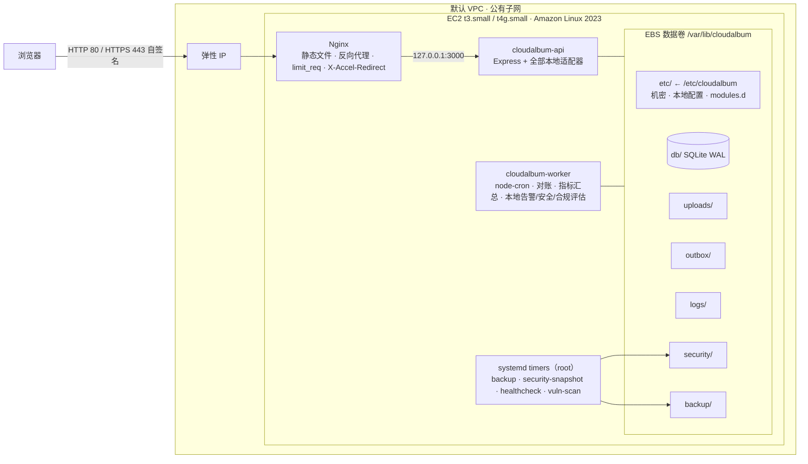
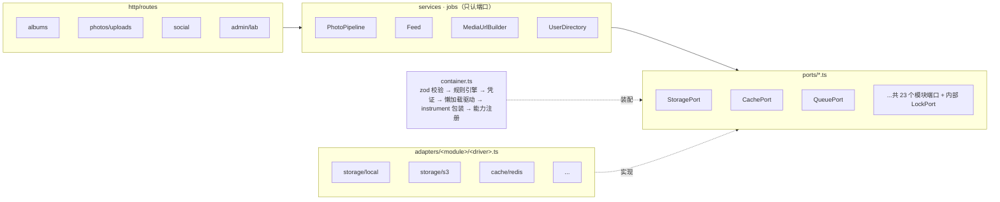
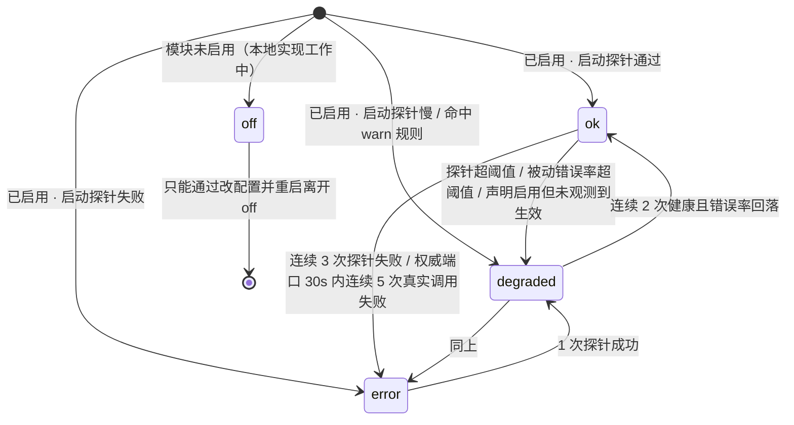
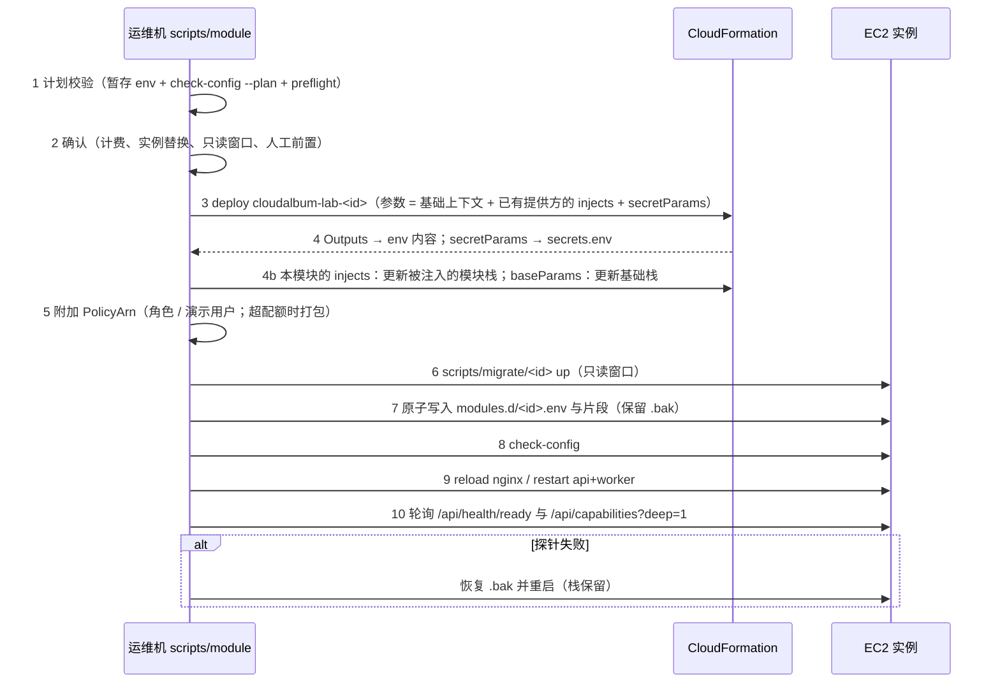

# 模块化设计：EC2 基线 + 可插拔 AWS 模块

> 本文是 CloudAlbum 的**横切架构总纲，也是唯一的权威契约**。[architecture.md](architecture.md) 描述的是 `l9-full` 档位（第 10 节）的目标形态（F1–F14）；本文描述的是**如何从一台 EC2 出发，把每个 AWS 服务做成可单独开关、可对比的模块**。
>
> 各模块的细节写在分组文档 `docs/modules/0N-<group>.md` 中（ec2 基础契约在 `00-ec2-base.md`，本轮新增的 6 个模块在 `06-governance-cost.md`），每个模块一个二级标题，作为锚点被 `modules/registry.yaml` 的 `doc` 字段引用（见 3.2、附录 A）。模块文档必须挂在本文定义的框架上：端口接口、开关变量、依赖规则、能力注册、探针、CloudFormation 模板约定、迁移脚本约定、实验目录约定。分组文档的“本组共同约定”可以**细化**本文，但不能推翻；发现需要调整的地方，先提交到本文（写入文末“修订记录”）再落地。**本文与分组文档、registry、其他文档不一致时，以本文为准。**

**阅读顺序建议**：第 1 节（原则与统一决策）→ 第 2 节（L0 基线）→ 第 3 节（模块目录与注册表）→ 第 4～7 节（代码框架）→ 第 8～10 节（实验、启停、档位）→ 第 11～12 节（仓库与前端）→ 文末修订记录。

---

## 1. 设计目标与原则

### 1.1 目标

| # | 目标 | 可验证的验收标准 |
|---|---|---|
| G1 | **EC2 是唯一必需组件** | 只部署 `infra/modules/ec2.yaml` 一个栈（EC2 + EBS + 默认 VPC + 弹性 IP），F1–F14 全部可用（F14 由“本地前缀上传令牌”实现，见 2.8）；应用进程在运行时**不加载 AWS SDK**、不发出任何 AWS API 调用（`IAM_CREDENTIALS=none`）；L0 冒烟测试（2.9）全部通过 |
| G2 | **每个 AWS 服务都是可插拔模块** | `scripts/module enable <id>` 后对应机能切换为 AWS 实现；`disable` 后切回本地实现并迁回数据 |
| G3 | **一个机能 ↔ 一个主服务** | 第 3 节模块目录中每一行恰好一个主 AWS 服务；辅助服务单独列出；同属一个服务家族的模块注明各自的子服务（3.2） |
| G4 | **模块尽量独立** | L0 + 任意单个模块（加最小硬依赖、凭证前置与人工前置）都能启动并通过健康探针；依赖只在 `modules/registry.yaml` 的 `requires` 中声明，启动时由 `rules.ts` 一张规则表统一校验（第 5 节） |
| G5 | **差异可观测** | 每个响应带 `Server-Timing` 与 `X-CloudAlbum-Path`；`/lab` 页面能对每个模块做运行时 A/B 或“切换前 / 切换后”两次测量对比 |

### 1.2 原则

1. **EC2 是唯一必需组件。** 所有业务机能都必须有一个能在单台 EC2 上运行的本地实现。本地实现可以是降级版（例如没有 Rekognition 时只生成“基础属性标签”），但必须是**可用的**，不能是空壳或报错。
2. **本地实现优先。** 每个开关变量的第一个取值永远是本地实现，也是默认值。没有配置 = 本地实现 = L0。L0 的构建产物和运行时都不依赖 AWS SDK（AWS 适配器通过动态 `import()` 懒加载，L0 根本不会加载它们）。
3. **依赖显式声明。** 模块之间的依赖只能用 `modules/registry.yaml`（单一事实来源）的 `requires` 表达式书写，分为硬依赖（缺了就拒绝启动）、软依赖（缺了某个子功能关闭，并以警告提示）、互斥；凭证前置（`credentials`）与人工前置（`prerequisites`）单独标注。全部规则只在 `backend/src/rules/rules.ts` 一张表里，使用第 5 节的统一编号。代码里不允许出现“如果 S3 不可用就偷偷用本地磁盘”的隐式分支，也不允许另设依赖校验文件（如 `deps.ts`）或抛出后“按上次可用配置装配”的回退逻辑。
4. **不静默降级。** 两类故障分开处理：
   - **配置错误**（违反依赖、互斥、多实例安全规则）：拒绝启动，**退出码一律 78**，一次性列出全部错误和修复命令。
   - **运行时依赖故障**（AWS 服务超时、权限不足）：进程照常启动；**权威端口**（storage/shared-fs、database、social-store、auth、queue、secrets、kms、image-processing，以及本轮新增的 workflow）直接返回 503 并把模块状态置为 `error`，绝不回退到本地实现（否则数据会分叉）；**非权威端口**（cache、notification、email、scheduler、tagging、config、logging、monitoring、tracing、analytics、cdn、blocklist(waf)、identity-pool，以及 instance-lifecycle(autoscaling)）允许降级，但必须把状态置为 `degraded`、计数、并在 `X-CloudAlbum-Path` 中标出（如 `cache=redis@elasticache:error-bypass`、`identity-pool=cognito:error-fallback`）。
5. **差异必须可观测。** 任何一次“切换”都必须能被看见：能力接口 `/api/capabilities` 显示每个模块的驱动与状态；每个响应的头部说明这次请求走了哪条路径；本地指标库（不依赖 CloudWatch）记录每条路径的延迟分布；前端徽章把“谁在提供这个功能”写在界面上。
6. **业务代码不认识 AWS。** 路由和领域服务只依赖端口接口（`backend/src/ports/*.ts`）；所有 AWS SDK 调用只能出现在 `backend/src/adapters/<module>/<driver>.ts` 和 `backend/src/modules/detectors/*.ts` 里（由 ESLint `no-restricted-imports` 强制）。
7. **数据里只存逻辑标识。** 数据库只存逻辑键（如存储键 `raw/<userId>/<photoId>.jpg`、内部用户 ID），不存绝对路径、桶名、URL、Cognito `sub` 作为主键。URL 在响应时由当前驱动生成，这样切换模块不需要改写业务数据。
8. **模块栈之间不 `Export`、不 `ImportValue`，模板不挂策略。** 模块栈只创建并输出 `PolicyArn`（客户托管策略），由 `scripts/module` 附加到 `CloudAlbumAppRole`（keys 模式下附加到演示用户），附加关系记入 `.cloudalbum/state.json`。跨模块参数只通过“提供方在 registry 中声明的 `injects`”传递（见 3.5、9.1），任何模块栈都能独立删除。

### 1.3 术语

| 术语 | 含义 |
|---|---|
| 模块（module） | 一个 AWS 主服务 + 它对应的机能 + 开关 + CloudFormation 栈 + 探针 + 迁移脚本 + 实验，id 见第 3 节 |
| 端口（port） | 一个机能的 TypeScript 接口，位于 `backend/src/ports/<port>.ts` |
| 适配器 / 驱动（adapter / driver） | 端口的一种实现，位于 `backend/src/adapters/<module>/<driver>.ts`；驱动名就是开关变量的取值 |
| 本地档（local tier） | 不需要任何 AWS 资源的驱动，如 `cache=memory`、`queue=memory`、`IMAGE_PROCESSOR=worker`、在 EC2 上自建的 PostgreSQL/Valkey。本地档用于把“架构模式的差异”和“托管服务的差异”拆开对比 |
| 感知器（detector） | 纯基础设施型模块没有适配器，应用通过感知器（请求头、IMDS、控制面 API）判断它是否在生效 |
| 声明型开关 | 纯基础设施型模块的开关（如 `TLS_MODE`、`WAF_MODE`），首个取值是本地实现；它不切换业务代码，只决定 Nginx 片段、感知器的预期结果与 capabilities 展示 |
| 凭证前置 | 模块调用 AWS API 所需的凭证，统一由 iam 模块提供（`IAM_CREDENTIALS=role\|keys`）；registry 字段 `credentials: required\|optional\|none` |
| 人工前置 | 无法自动满足的前提（拥有域名、SES 发件身份、确认订阅邮件、激活成本分配标签等）；registry 字段 `prerequisites` |
| 注入（injects） | 提供方模块在 registry 中声明“启用后用我的输出更新哪些模块栈的哪些参数”，是跨模块传参的唯一方式 |
| 档位（profile） | `profiles/*.env`，一组模块的组合，从 L0 逐级到全量（`l0-ec2` … `l9-full`，见第 10 节） |

### 1.4 统一决策（本轮拍板，全文据此执行）

| # | 决策 | 主要落点 |
|---|---|---|
| D1 | 凭证开关统一为 `IAM_CREDENTIALS=none\|role\|keys`：`none` 是 L0 的本地实现，`role`、`keys` 都由 iam 栈提供。删除 `AWS_CREDENTIALS_SOURCE` 与 `credentials --static`，改用 `scripts/module enable iam --mode keys`。registry 给每个模块标注 `credentials`。CRED-001：启用了调用 AWS API 的模块而 `IAM_CREDENTIALS=none` → error；CRED-002：`keys` → warn | 3.2、3.5、4.4、5.2、9.2 |
| D2 | 禁止 `Export` / `ImportValue`；模块栈只输出 `PolicyArn`，由 `scripts/module` 附加并记入 state.json；跨模块参数只用提供方声明的 `injects`；删除 `reconfigureOn` | 1.2-8、3.5、9.1、9.2 |
| D3 | 全部规则只写在 `backend/src/rules/rules.ts` 一张表；依赖只用 registry `requires` 表达式书写；统一编号（DEP-019～027 对应原 D01～D09，新增 DEP-028～031，DEP-008 废止，原 ASG-015 引用改为 ASG-013；本轮新模块的规则从 DEP-032、MUTEX-005 起编）。删除 `deps.ts`、`requireAwsCredentials()`、last-known-good 装配；配置错误一律退出码 78 | 第 5 节 |
| D4 | 运行时统一为 **Node.js 22 LTS**：EC2 安装 AL2023 的 `nodejs22`，Lambda 用 `nodejs22.x`（arm64）。理由：Node.js 20 已于 2026-04-30 停止上游支持，Lambda 的 Node 20 运行时也随之进入弃用流程（时间表以官方文档为准） | 2.7、9.1、附录 B |
| D5 | 机密值只放在 `/etc/cloudalbum/secrets.env`（`root:cloudalbum 0640`）与 `/etc/cloudalbum/keys/*.pem`；L0 的机密与本地配置实际存放在数据卷 `/var/lib/cloudalbum/etc`，`/etc/cloudalbum` 是指向它的符号链接；只有数据卷上也没有时才生成密钥。`modules.d` 只写 `*_SECRET_ARN` 或逻辑名，CFG-002 检查其中不得出现机密类键。**派生副本例外**（三类，均受 2.7 不变量 1 约束）：① 由 `hostSetup` 从上述两处渲染、只供 root 或某个服务读取的运行时副本（例如 cdn 的 `slot-origin-verify.inc`、db-proxy 本地档的 PgBouncer `userlist.txt`）——优先放在 `/run`（tmpfs），必须放在根卷时为 `0600`，必须能按重放契约重新生成，并被 leak-scan 列出；② TLS 私钥（`etc/tls/`、certbot 配置目录，root 0600，只给 Nginx 用）；③ 一次性凭证（如 ACME 的 EAB MAC Key）不落盘 | 2.4、2.7、4.4、5.2、9.2 |
| D6 | L0 权限修正：`cloudalbum` 用户固定 uid/gid 2001；`usermod -aG cloudalbum nginx`；服务单元 `UMask=0027`；L0 冒烟测试断言上传后 `GET /media/variants/...` 返回 200 | 2.4、2.6、2.7、2.9 |
| D7 | ConfigPort 只管运行时业务热键（`runtime.json` 或 `/cloudalbum/<env>/runtime/*`），不能远程修改模块驱动 | 4.2、4.4 |
| D8 | auth 迁移默认 `AUTH_MIGRATION=bulk`（AdminCreateUser 不发邀请，首次登录时重置密码，不需要 Lambda）；`lazy` 是可选变体；`AUTH_DUAL_STACK` 默认关闭。本地 JWT 统一为 **ES256 + JWKS** | 2.8、4.2、5.2、9.3 |
| D9 | 权威 / 非权威端口的划分、`X-CloudAlbum-Path` 语法、纯基础设施模块的声明型开关、端口文件名与驱动名，一律采用完整性评审的统一值 | 1.2-4、3.1、4.1、7.2 |
| D10 | 模块文档保持分组文件 `docs/modules/0N-<group>.md`，每个模块一个二级标题作为锚点；registry 的 `doc` 写成“文件#锚点”；新增 `00-ec2-base.md`（ec2 基础契约）与 `06-governance-cost.md`（本轮新增模块） | 3.2、附录 A |
| D11 | 新增 6 个模块：compliance（AWS Config）、vuln-scan（Amazon Inspector）、cost（AWS Budgets；辅助 Cost Explorer、成本分配标签）、db-proxy（Amazon RDS Proxy）、workflow（AWS Step Functions）、ami（EC2 Image Builder）。Lab 编排：cost 提前到 Lab 1 与 iam 一起做；db-proxy 是 Lab 15 的扩展；ami 是 Lab 21 的前置或扩展；workflow 是 Lab 11 的扩展；compliance 与 vuln-scan 放在 Lab 25。OpenSearch、Macie 只在 saa-coverage.md 中作为“可选扩展”提及，不建模块 | 2.8、3.2、5.2、第 10 节 |
| D12 | Lab 顺序与预设档位以完整性评审的 lab_order 与 presets 为准，再叠加 D11 的调整；档位名改为 `l0`～`l9`（旧名对照见 10.2） | 第 10 节 |
| D13 | ACM 的 ACME 端点已在 AWS 官方来源核实（What's New 2026-07 发布公告与 ACM 用户指南“ACME certificate automation”，核实日期 2026-10-13）：tls 保留“只有 L0 时经 ACME 端点签发证书装到 Nginx”的路径，但文档分“考试结论 / 2026 新能力”两栏，并保留回退分支：部署前探测结果由 `scripts/module` 写成 `TLS_ACME=on\|off`，DEP-005 的回退条件据此在启动时求值（3.2 决定 9、DEP-005） | 3.2、4.4、5.2、10.4 |
| D14 | 不编造精确的性能数字和价格：只写计费维度与数量级，指向官方定价页；新近事实注明核实日期；cost 模块只在学员自行抄录并注明出处的单价存在时显示金额（CFG-010）。文档语言为简体中文，技术名词保留英文 | 全文、5.2、06#cost |
| D15 | 本轮不修改 `docs/ui-design.md` 与 `docs/ui-prototype/`（由另一个流程处理）、`README.md`（由主设计者负责）；本文涉及它们的调整只记录在附录 B 与修订记录中 | 附录 B |
| D16 | **平台模式（ATL）**（第 4 轮新增）：CloudAlbum 在实验平台 ATL 中运行时打开平台模式——应用侧 `ATL_PLATFORM_MODE=on`（`/etc/cloudalbum/platform.env`），工具侧 `CLOUDALBUM_PLATFORM_MODE=1` 或 `--platform`。平台模式下 CloudAlbum 侧要实现的全部内容以 [docs/platform/06-cloudalbum-platform-mode.md](platform/06-cloudalbum-platform-mode.md)（以下称“06”）为**唯一清单**（条目编号 PM-xx）；本文各节末尾的“平台模式（ATL）”小节与模块文档的“12. 平台模式（ATL）”小节是它的摘要。**平台模式部分**与 06 不一致时以 06 为准；平台侧的名称（标签、路径、角色、会话名）以 docs/platform/01 §14 为准。独立模式（运维机上直接用 `scripts/module`）的行为不变，平台模式的改动只在开关打开时生效（少数两种模式都生效的改动在 06 中单独注明） | 2.5、2.7、2.9、3.5、4.4、5.4、6.1、7.3、8.2、9.1、9.2、10.4、§11、附录 A |

---

## 2. L0 基线：只有 EC2 时的完整运行形态

### 2.1 拓扑



L0 中**没有任何 AWS 托管服务参与请求处理**：没有 S3、没有 RDS、没有 Cognito、没有 IAM 角色（`IAM_CREDENTIALS=none`，L0 不需要访问 AWS API）。机密、本地配置与业务数据都在独立数据卷上，换实例、迁移 VPC、换 AMI 时随数据卷一起保留（2.4）。

ec2 基础栈的完整参数表、合并后的 `l0-bootstrap.sh`、Nginx 与 systemd 的全部 include 点和 drop-in 点、ec2 的 registry 条目、capabilities 与 `/lab` 卡片，写在 [docs/modules/00-ec2-base.md](modules/00-ec2-base.md)（ec2 基础契约）。本节只规定**不变量**：00-ec2-base.md 必须满足本节，二者冲突以本节为准。

### 2.2 实例规格

| 项目 | 取值 | 说明 |
|---|---|---|
| AMI | Amazon Linux 2023 最新版（通过 SSM 公共参数 `/aws/service/ami-amazon-linux-latest/al2023-ami-kernel-default-<arch>` 解析） | CloudFormation 参数类型 `AWS::SSM::Parameter::Value<AWS::EC2::Image::Id>`；arch 为 `x86_64` 或 `arm64` |
| 实例类型 | `t3.small`（x86_64）或 `t4g.small`（arm64，Graviton） | 2 vCPU / 2 GiB。T 系列有 CPU 积分机制：sharp 生成缩略图的突发 CPU 会消耗积分，这本身就是 `image-processing` 模块的对比观察点 |
| IMDS | 强制 IMDSv2（`HttpTokens: required`），跳数限制 1；开启实例元数据标签（`InstanceMetadataTags: enabled`） | 标签读取用于感知 autoscaling（见 3.3） |
| 根卷 | gp3 20 GiB，加密（默认 `aws/ebs` 密钥） | OS、`/opt/cloudalbum` 程序、1 GiB swap 文件（防止 2 GiB 内存在构建 / 并发缩略图时 OOM）。**根卷上不保存任何不可再生的状态**：丢失根卷 = 重新执行引导脚本即可恢复 |
| 数据卷 | **独立** gp3 20 GiB，加密，`DeleteOnTermination: false`，打 `Backup=true` 标签，挂载到 `/var/lib/cloudalbum` | 数据、机密与本地配置都在这里：换实例类型、换 AMI（ami 模块）、迁移到自定义 VPC（network 模块）、`scripts/module rebuild-instance` 时把数据卷卸下挂到新实例（同一 AZ；跨 AZ 用快照建卷） |
| 弹性 IP | 1 个，关联到实例（基础栈参数 `AssociateEip`） | 固定入口；`APP_BASE_URL` 默认为 `http://<EIP>` |
| IAM 实例配置文件 | **无**（L0 不访问 AWS API，`IAM_CREDENTIALS=none`） | 由 `iam` 模块添加（`role` 模式），见 3.2 |
| 运行时 | Node.js 22 LTS（AL2023 软件包 `nodejs22`）、Nginx、SQLite | 统一决策 D4；Lambda 侧同为 `nodejs22.x` |

### 2.3 默认 VPC 与安全组

L0 使用账号自带的默认 VPC 和某个 AZ 的默认公有子网（CloudFormation 参数 `SubnetId` 留空时由 `scripts/module` 自动选择 `ap-northeast-1a` 的默认子网）。

安全组 `cloudalbum-<env>-ec2-sg`：

| 方向 | 协议/端口 | 来源 | 说明 |
|---|---|---|---|
| 入站 | TCP 80 | 由参数 `PublicHttpIngress` 决定：`open` = `0.0.0.0/0`、`::/0`；`admin-ip` = `AdminIngressCidr`；`closed` = 无 | HTTP |
| 入站 | TCP 443 | 同上 | HTTPS（L0 为自签名证书，见 2.5） |
| 入站 | TCP 22 | 参数 `SshIngressCidr`（管理员公网 IP/32） | L0 的运维登录方式；启用 `shell-access`（`SHELL_ACCESS_MODE=ssm`）后由 `scripts/module` 把该参数改为空，规则随之删除 |
| 出站 | 全部 | `0.0.0.0/0` | 安装软件包、Let's Encrypt（可选）、以后访问 AWS API |

其他模块需要从实例访问自己的资源时（例如 ElastiCache 安全组允许来自实例安全组的 6379），**在自己的栈里**创建引用 `InstanceSecurityGroupId` 的规则，不修改基础安全组；需要给实例**新增入站规则**的模块（例如 cdn 的 8080 只放行 CloudFront 托管前缀列表），在自己的栈里建独立安全组，经基础栈参数 `ExtraSecurityGroupIds` 挂到实例上（托管前缀列表按权重计入安全组规则配额，放进基础安全组很快会超限，以官方文档为准）。

**基础栈参数（契约）**：模块只能通过 registry 的 `baseParams` 声明对下列参数的取值，由 `scripts/module` 更新基础栈；多个模块对同一参数有要求时取**最严格**的一级，禁用模块时重新计算。默认值、类型与校验写在 00-ec2-base.md。

| 参数 | L0 默认 | 声明方（baseParams） | 作用 |
|---|---|---|---|
| `InstanceType`、`Arch` | `t4g.small`、`arm64` | —（部署参数） | 实例规格与发布包架构 |
| `ImageId` | 首次部署时由 `scripts/module` 把 AL2023 SSM 公共参数**当时**解析出的 AMI ID 固定到自己的参数 `/cloudalbum/<env>/ec2/image-id`，再把该参数名传给 `ImageId` | ami（`AMI_SOURCE=golden` 时改为黄金 AMI 的参数名）；`rebuild-instance --ami latest` | `AWS::SSM::Parameter::Value<…>` 类型的参数在每次栈更新时都会重新解析，不固定的话 AWS 发布新 AMI 后任意一次参数更新都会顺带替换实例。换 AMI 只能显式走 9.2 的“替换实例的流程” |
| `InstanceSlot` | `A` | `rebuild-instance` | 基础栈有 `InstanceA` / `InstanceB` 两个实例槽位；切换槽位是“只换实例、不换配置”的唯一方式 |
| `VpcId`、`SubnetId` | 默认 VPC、自动选择的默认子网 | network | 迁入自定义 VPC / 切换放置 |
| `AssociateEip` | `true` | network（`private` 放置时 `false`） | 公网入口 |
| `PublicHttpIngress` + `AdminIngressCidr` | `open` | cdn（`CDN_DIRECT_ACCESS`）、load-balancer（`LB_LOCK_ORIGIN`）、network（`private` 隐含 `closed`） | 实例对公网的 80/443 暴露级别 |
| `SshIngressCidr`、`KeyName` | 管理员 IP/32、部署时指定的密钥对 | shell-access（置空） | SSH 运维通道 |
| `ExtraSecurityGroupIds` | 空 | cdn 等需要新增入站规则的模块（追加） | 附加安全组 |
| `AlbSecurityGroupId` | 空 | load-balancer | 放行 ALB 到实例 80 端口 |
| `DataVolumeAttach`、`DataVolumeId` | `true`、空（新建） | network、ami、`rebuild-instance`（分阶段迁移时临时置 `false`）；kms 换加密卷时写 `DataVolumeId` | 卸卷 / 改挂。数据卷经实例的 `Volumes` 属性挂载，是否挂卷同步写进实例标签 `CloudAlbumDataVolume=attach\|detach`，引导脚本经 IMDS 读取（**不放进 User Data**：改 User Data 会停止再启动实例，且不会重新执行）；`detach` 时新实例“只安装、不挂卷、不启动” |
| `DataVolumeAz`、`DataVolumeSizeGiB`、`DataVolumeKmsKeyId` | 实例所在 AZ、20、空 | —（部署参数；卷存在后不得修改，`preflight: ec2-volume-immutable`） | 数据卷属性；跨 AZ 或换密钥只能“快照 → 新卷 → 改 `DataVolumeId`” |
| `InstanceBackupTag` | `false` | backup（整机恢复变体 `BACKUP_WHOLE_INSTANCE=on` 时 `true`） | 是否给实例本身打 `Backup=true`（数据卷始终带该标签） |
| `InstanceProfileName` | 空 | iam（`role` 模式） | 关联实例配置文件（CloudFormation 对该属性的更新行为以官方文档为准；若需替换实例则走 `rebuild-instance`） |
| `DetailedMonitoring` | `false` | monitoring（可选） | EC2 详细监控 |

其余部署参数（`Env`、`ModuleVersion`、`RootVolumeSizeGiB`、`CpuCredits`、`HttpPutResponseHopLimit`，以及只在首次启动使用的 `AppArchiveUrl`、`AppArchiveSha256`、`AdminEmail`——例外：network `private` + `NatMode=none` 时，`AppArchiveUrl` 随替换实例一起改为工具链栈中的发布包镜像，见 2.7）与每个参数“是否会替换实例”的标注见 00-ec2-base.md。会替换实例的参数只能出现在 9.2 的分阶段流程中。

### 2.4 EBS 目录布局

```
/var/lib/cloudalbum/                 # 独立数据卷，属主 cloudalbum:cloudalbum（uid/gid 2001），目录 750、文件 640
│                                    # nginx 用户属于 cloudalbum 组，因此能读取媒体文件（X-Accel-Redirect 的前提）
├── etc/                             # /etc/cloudalbum 是指向本目录的符号链接；root:cloudalbum 750
│   ├── cloudalbum.env               # 基础配置：AWS_REGION、CLOUDALBUM_ENV=lab、APP_BASE_URL、DEPLOY_MODE（root:cloudalbum 640）
│   ├── secrets.env                  # 唯一的机密值文件（root:cloudalbum 0640），见 4.4 第 3 层
│   ├── keys/                        # 唯一的机密文件目录：jwt-es256.pem（+ jwt-es256.prev.pem）、可选 cloudfront-signing.pem（root:cloudalbum 0640）
│   ├── modules.d/<id>.env           # scripts/module 写入（root:cloudalbum 0640），只含 ownsEnv 键，不含任何机密值（CFG-002）
│   ├── tls/server.crt|key           # 当前生效的直连证书（自签名，或指向 Let's Encrypt / ACM ACME 证书）
│   ├── runtime.json                 # ConfigPort(file) 的运行时热键（D7）
│   ├── alerts.yaml                  # monitoring 本地告警评估器的规则
│   ├── cost-rates.yaml              # 可选：cost 本地估算用的单价，由学员从官方定价页抄录并注明日期（默认不存在 = 不显示金额）
│   ├── local.override.env           # 可选，临时实验（CFG-005）
│   └── modules.state.json           # 实例侧模块状态（scripts/module 维护）
├── db/
│   ├── cloudalbum.sqlite            # SQLite，journal_mode=WAL，busy_timeout=5000
│   ├── cloudalbum.sqlite-wal
│   └── cloudalbum.sqlite-shm
├── uploads/                         # StoragePort(local) 的根目录 STORAGE_LOCAL_ROOT
│   ├── .incoming/                   # 上传临时文件：与目标同一文件系统，写完 fsync 再 rename（避免跨文件系统 EXDEV）
│   ├── raw/<userId>/<photoId>.<ext>          # 原图（逻辑键 raw/...）
│   ├── variants/<photoId>/thumb_200.webp     # 缩略图（逻辑键 variants/...）
│   ├── variants/<photoId>/display_1080.webp
│   └── reports/daily/<yyyy-mm-dd>.csv        # 日报（F13，同样走 StoragePort）
├── outbox/                          # EmailPort(outbox)：每封邮件一个 .eml，按日期分目录
│   └── <yyyy-mm-dd>/<messageId>.eml
├── logs/                            # LoggerPort(file) 与 Nginx JSON 访问日志，logrotate 每日轮转保留 14 天
│   ├── api.log  worker.log  audit.log
│   ├── nginx-access.json
│   └── spans/                       # TRACING_DRIVER=local 的本地 span（保留 3 天）
├── security/                        # root:cloudalbum 2770（组可写 + setgid：BlocklistPort(nginx) 以 cloudalbum 身份“临时文件 + rename”更新 denylist）
│   ├── denylist.conf                # 唯一的 IP 封禁列表（geo $ca_denied），BlocklistPort(nginx) 与 fail2ban 共写，path 单元逐行校验后 reload
│   ├── snapshot.json                # root 安全快照（shell-access、threat-detection、compliance 共用）
│   └── vuln-scan.json               # vuln-scan 本地实现（dnf 安全公告 + npm audit）的结果
├── migrate/<module>.json            # 迁移断点
├── lab/                             # 实验目录（fs-bench、balloon 写满实验等的临时文件；不是业务数据，可随时清空）
└── backup/                          # cloudalbum-backup.timer 的输出（与数据同卷——这正是 backup 模块要对比的单点问题）
    ├── sqlite/cloudalbum-<ts>.sqlite.gz
    └── uploads/manifest-<ts>.txt
```

- **机密与本地配置随数据卷走（D5）**：引导脚本把 `/etc/cloudalbum` 建成指向 `/var/lib/cloudalbum/etc` 的符号链接；只有数据卷上也不存在时才生成密钥。这样 network 迁移、换 AMI、`rebuild-instance` 换实例后，`LOCAL_MASTER_KEY`、JWT 签名密钥、各 HMAC 密钥都不变，已加密的 `users.mfa_secret_enc` 仍能解开、会话不失效。首次启动时 `LOCAL_MASTER_KEY` 的指纹写入数据库 `system_meta` 表，此后每次启动比对，不一致即拒绝启动（CFG-007）。
- 运行时临时目录用 systemd 的 `RuntimeDirectory=cloudalbum`（`/run/cloudalbum`，放文件锁）；`PrivateTmp=true` 只给库函数用，上传文件一律落在 `uploads/.incoming/`。
- 上传目录里的路径就是逻辑键：`STORAGE_LOCAL_ROOT + "/" + key`。切换到 S3 时键保持不变（见 9.3）。
- AL2023 默认没有安装 cronie，所以“基线 cron”统一用 **systemd timer** 实现，`OnCalendar` 一律显式带时区 `Asia/Tokyo`（AL2023 默认 UTC）。应用内的定时任务由 worker 进程里的 node-cron 负责，二者职责不同，见 2.6。

### 2.5 Nginx 配置要点

L0 的 Nginx 同时承担 4 个角色：**静态站点**（CloudFront 的本地替代）、**反向代理**（ALB 的本地替代）、**限速与基础拦截**（WAF 的本地替代）、**媒体文件发送**（S3 + CloudFront 的本地替代）。完整配置文件见 00-ec2-base.md；这里规定结构与 include 点。

```nginx
# /etc/nginx/conf.d/cloudalbum.conf   （源文件：infra/nginx/cloudalbum.conf）

# JSON 访问日志：记录 CloudFront / ALB 注入的头，供感知器、fail2ban 与 /lab 统计（字段顺序是 fail2ban 过滤器的契约）
log_format cloudalbum_json escape=json
  '{"ts":"$time_iso8601","rid":"$request_id","ip":"$remote_addr","xff":"$http_x_forwarded_for",'
  '"method":"$request_method","uri":"$uri","status":$status,"bytes":$body_bytes_sent,'
  '"rt":$request_time,"urt":"$upstream_response_time","cf_id":"$http_x_amz_cf_id",'
  '"via":"$http_via","alb_trace":"$http_x_amzn_trace_id","path":"$upstream_http_x_cloudalbum_path"}';

limit_req_zone $binary_remote_addr zone=ca_api:10m  rate=20r/s;
limit_req_zone $binary_remote_addr zone=ca_auth:10m rate=2r/s;
limit_req_status 429;

# WAF 的本地替代：极简特征拦截（演示用，不是真正的防护）
map $request_uri $ca_block {
    default 0;
    "~*(union(\s|%20|\+)+select|<script|%3cscript|\.\./|%2e%2e%2f)" 1;
}

# 唯一的 IP 封禁列表：waf 基线（BlocklistPort=nginx）与 fail2ban 的 cloudalbum-denylist 动作都写这个文件
geo $ca_denied {
    default 0;
    include /var/lib/cloudalbum/security/denylist.conf;     # 每行 "<IP 或 CIDR> 1;"，path 单元逐行校验后 nginx -t && reload
}

upstream cloudalbum_api {
    include /etc/nginx/cloudalbum_upstream.conf;            # L0：server 127.0.0.1:3000；LB_LOCAL_WORKERS=2 时再加 3001
    keepalive 32;
}

# http 级片段：00-entry.conf（ec2 基础提供，用 map 计算 $ca_entry 与 $ca_proto）、
#              <id>-*.conf（模块投放，例如 realip、cdn 的整个 8080 server 块）
include /etc/nginx/cloudalbum.d/*.conf;

server {
    listen 80 default_server;
    listen [::]:80 default_server;
    listen 443 ssl default_server;
    listen [::]:443 ssl default_server;
    http2 on;                               # nginx < 1.25.1 改写为 listen 443 ssl http2
    server_name _;
    server_tokens off;

    ssl_certificate     /etc/cloudalbum/tls/server.crt;   # 自签名（L0）；TLS_MODE=letsencrypt|acm 时由 tls 模块改为指向受信证书
    ssl_certificate_key /etc/cloudalbum/tls/server.key;
    ssl_protocols TLSv1.2 TLSv1.3;

    access_log /var/lib/cloudalbum/logs/nginx-access.json cloudalbum_json;
    client_max_body_size 30m;
    root /opt/cloudalbum/frontend/dist;

    if ($ca_denied) { return 403; }
    if ($ca_block)  { return 403; }

    include /etc/nginx/cloudalbum_locations.conf;     # 全部 location：80/443 与 cdn 的 8080 监听器共用同一份
    include /etc/nginx/cloudalbum.server.d/*.conf;    # server 级片段：00-acme-challenge.conf（ec2 基础）、<id>-*.conf（模块）
}
```

```nginx
# /etc/nginx/cloudalbum_locations.conf   （ec2 基础提供；模块不得改写）

# 1) SPA：带哈希的静态资源长缓存，index.html 不缓存；静态文件的路径头只有 entry 段
location /assets/      { add_header Cache-Control "public, max-age=31536000, immutable";
                         add_header X-CloudAlbum-Path "entry=$ca_entry"; try_files $uri =404; }
location = /index.html { add_header Cache-Control "no-cache"; add_header X-CloudAlbum-Path "entry=$ca_entry"; }
location /             { try_files $uri $uri/ /index.html; }

# 2) API：通用限速；认证接口单独更严格
location /api/auth/          { limit_req zone=ca_auth burst=5 nodelay;  include /etc/nginx/cloudalbum_proxy.conf; }
location /api/storage/upload { limit_req zone=ca_api burst=20 nodelay; proxy_request_buffering off;
                               include /etc/nginx/cloudalbum_proxy.conf; }   # 本地签名直传与前缀令牌上传，流式写盘
location /api/               { limit_req zone=ca_api burst=40 nodelay; include /etc/nginx/cloudalbum_proxy.conf; }
location /social/            { limit_req zone=ca_api burst=40 nodelay; include /etc/nginx/cloudalbum_proxy.conf; }
location = /.well-known/jwks.json { include /etc/nginx/cloudalbum_proxy.conf; }   # auth=local 的 ES256 公钥（D8）

# 3) 媒体：Node 校验签名与权限后返回 X-Accel-Redirect，由 Nginx 零拷贝发送文件
#    前提：nginx worker 属于 cloudalbum 组，目录 750、文件 640（2.6 的 UMask=0027）
location /media/ { include /etc/nginx/cloudalbum_proxy.conf; }
location /_media_local/public/  { internal; alias /var/lib/cloudalbum/uploads/;
                                  add_header Cache-Control "public, max-age=86400"; }
location /_media_local/private/ { internal; alias /var/lib/cloudalbum/uploads/;
                                  add_header Cache-Control "private, max-age=300"; }
location /_media_efs/public/    { internal; alias /mnt/efs/cloudalbum/uploads/;   # 仅 shared-fs 启用后有效
                                  add_header Cache-Control "public, max-age=86400"; }
location /_media_efs/private/   { internal; alias /mnt/efs/cloudalbum/uploads/;
                                  add_header Cache-Control "private, max-age=300"; }

# 4) 内部端点：构建期按 registry 的 internalEndpoints 生成精确匹配的 location；其余 /internal/ 一律 404。
#    对应模块（或变体）未启用时 Node 返回 404；HMAC 在 Node 中校验，每个端点使用自己的逻辑密钥
location = /internal/hooks/image-processed { include /etc/nginx/cloudalbum_proxy.conf; }        # image-processing，公网可达 + HMAC
location = /internal/legacy-auth { include /etc/nginx/cloudalbum-vpc-cidr.inc; deny all;         # auth 的 lazy 迁移变体，只放行 VPC CIDR + HMAC
                                   include /etc/nginx/cloudalbum_proxy.conf; }
location ^~ /internal/ { return 404; }

# 5) 仅本机可访问的 Prometheus 文本格式指标
location = /metrics { allow 127.0.0.1; deny all; include /etc/nginx/cloudalbum_proxy.conf; }

location ~ /\.(?!well-known) { deny all; }
```

```nginx
# /etc/nginx/cloudalbum_proxy.conf
proxy_pass http://cloudalbum_api;
proxy_http_version 1.1;
proxy_set_header Connection "";
proxy_set_header Host $host;
proxy_set_header X-Forwarded-For $remote_addr;      # 已由 realip 解析为真实客户端地址，Node 只看到一个地址
proxy_set_header X-Forwarded-Proto $ca_proto;       # 00-entry.conf 按入口计算（直连 = $scheme，经 CloudFront/ALB 时取可信值）
proxy_set_header X-Request-Id $request_id;
proxy_read_timeout 60s;
```

**约定**：

1. **客户端 IP 与协议只在 Nginx 解析一次。** 信任哪些代理网段（`set_real_ip_from`）由 load-balancer（VPC CIDR）与 cdn（CloudFront origin-facing 网段，写在 8080 server 块内部）各自投放的片段决定；Express 的 `trust proxy` 固定为 `loopback`，模块文档不得自行设置。逐入口的 realip 表见 01 组“约定 3”。
2. **include 点（全部由 ec2 基础提供）**：`cloudalbum_locations.conf`、`cloudalbum_upstream.conf`（归 load-balancer 本地档改写）、`cloudalbum.d/00-entry.conf`、`cloudalbum.server.d/00-acme-challenge.conf`（`/.well-known/acme-challenge/`，供 Let's Encrypt HTTP-01）、`/var/lib/cloudalbum/security/denylist.conf`；另有 ec2 生成的数据文件 `/etc/nginx/cloudalbum-vpc-cidr.inc`（由 IMDS 的 VPC 网段渲染，network 迁移后自动更新）与 `cloudalbum.d/slot-*.inc` 槽位文件——`00-entry.conf` 里的 `map` 只能定义一次，模块（load-balancer、cdn 等）不能往里“追加”，只能填写 ec2 预留的槽位。8080 监听器与网段文件一律以 `.inc` 为扩展名，避免被 http 级通配符误引入。ec2 用发布包中的 `/etc/nginx/nginx.conf` 覆盖发行版默认文件（默认文件自带的 80 端口 server 块会与 `default_server` 冲突）。
3. 模块只能通过两个目录影响 Nginx——`/etc/nginx/cloudalbum.d/<id>-*.conf`（http 级片段）和 `/etc/nginx/cloudalbum.server.d/<id>-*.conf`（server 级片段，只作用于 80/443），外加改写上面明确归它所有的 include 文件。模块不得改写主配置与 `cloudalbum_locations.conf`；`scripts/module` 写入片段后执行 `nginx -t && systemctl reload nginx`，失败则回滚片段。

**平台模式（ATL）**（D16；规格以 06 为准）：

- **访问日志**（06 PM-18，两种模式都生效）：`cloudalbum_json` 在现有字段之后追加 `"args":"$ca_log_args","port":"$server_port","run":"$ca_log_run","probe":"$ca_probe"`，不改变 fail2ban 依赖的既有字段顺序。三个变量由 `00-entry.conf` 的 map 计算：查询串含签名、授权码等敏感参数时整段替换为 `[redacted]`；`run` 只记录格式合法的 `X-Experiment-Run`；带 `X-ATL-Probe-Token` 或 `X-ATL-Probe-Nonce` 的平台探测请求 `probe=1`。`cloudalbum_proxy.conf` 另加 `proxy_set_header X-CA-Received-XFF $http_x_forwarded_for;`，只供 `/api/lab/probe/echo` 回显。
- **本机请求不跳转**（06 PM-19）：`00-entry.conf` 新增 `$ca_https_redirect`，对回环地址与 `/.well-known/acme-challenge/` 为 0；tls 的 `TLS_FORCE_HTTPS` 跳转片段只能使用这个变量（检查与本机 CLI 以 `http://127.0.0.1/` 访问应用）。
- **CSP `frame-ancestors`**（06 PM-20）：平台模式下所有 HTML 响应带 `Content-Security-Policy: frame-ancestors 'self' <ATL_PLATFORM_ORIGIN>`，任何模式下都不发送 `X-Frame-Options`。值来自 ec2 的新槽位 `cloudalbum.d/slot-atl-frame-ancestors.inc`（由 `cloudalbum platform:apply-env` 渲染），经 `$ca_frame_csp` 在返回 HTML 的各个 location 中 `add_header … always`。

### 2.6 systemd 单元

```ini
# /etc/systemd/system/cloudalbum-api.service
# 说明：为便于阅读，本节的行尾注释在实际单元文件中必须写成独立的注释行（systemd 不支持行尾注释）
[Unit]
Description=CloudAlbum API (Express on :3000)
After=network-online.target
Wants=network-online.target
RequiresMountsFor=/var/lib/cloudalbum

[Service]
Type=simple
User=cloudalbum                      # uid/gid 固定为 2001（D6）：换实例、多实例、EFS 访问点时属主一致
Group=cloudalbum
UMask=0027                           # 新建文件 640、目录 750：nginx（cloudalbum 组）可读，其他用户不可读
WorkingDirectory=/opt/cloudalbum/backend
Environment=NODE_ENV=production
Environment=CLOUDALBUM_ROLE=api
Environment=CLOUDALBUM_ENV_DIR=/etc/cloudalbum
Environment=PORT=3000
ExecStart=/usr/bin/node --enable-source-maps dist/server.js
Restart=on-failure
RestartSec=3
RestartPreventExitStatus=78          # 78 = EX_CONFIG：配置校验失败，不要无限重启
TimeoutStopSec=20
LimitNOFILE=65536
RuntimeDirectory=cloudalbum          # /run/cloudalbum：文件锁
RuntimeDirectoryPreserve=yes         # 多个单元共用，避免一个停止时删掉另一个的锁
NoNewPrivileges=true
PrivateTmp=true
ProtectSystem=strict
ProtectHome=true
ReadWritePaths=/var/lib/cloudalbum
ReadOnlyPaths=/var/lib/cloudalbum/etc   # 机密与模块配置对应用只读（嵌套路径的覆盖顺序以 systemd 文档为准，00-ec2-base.md 给出验证命令）

[Install]
WantedBy=multi-user.target
```

```ini
# /etc/systemd/system/cloudalbum-worker.service（与 api 相同，仅以下几行不同）
Description=CloudAlbum Worker (scheduler / queue consumer / reconcilers / local evaluators)
Environment=CLOUDALBUM_ROLE=worker
ExecStart=/usr/bin/node --enable-source-maps dist/worker.js

# /etc/systemd/system/cloudalbum-api@.service（模板单元，L0 安装但不启用）
# load-balancer 的本地档 LB_LOCAL_WORKERS=2 启用 cloudalbum-api@3001，并改写 cloudalbum_upstream.conf；
# 与主单元相同，只是 Environment=PORT=%i
```

L0 自带的 root 定时器（全部 `OnCalendar` 带 `Asia/Tokyo` 时区或使用单调计时）：

| 单元 | 周期 | 作用 | 谁的对照组 |
|---|---|---|---|
| `cloudalbum-backup.timer` | 每天 03:30 Asia/Tokyo | `local-backup.sh`：`sqlite3 .backup` + gzip（`DB_DRIVER=postgres` 自建时改为 `pg_dump`）+ 上传清单，保留 7 天 | backup |
| `cloudalbum-security-snapshot.timer` | 每 2 分钟 | 以 root 采集监听端口、sshd 生效配置与登录记录、fail2ban 状态，写入 `security/snapshot.json`（root:cloudalbum 0640） | shell-access、threat-detection、compliance |
| `cloudalbum-healthcheck.timer` | 每 30 秒 | `GET /api/health/live` 失败时重启 api | load-balancer、autoscaling（自愈） |
| `cloudalbum-vuln-scan.timer` | 每天 | `dnf updateinfo list --security` + `npm audit --omit=dev`，结果写入 `security/vuln-scan.json` | vuln-scan |
| `cloudalbum-denylist.path` | 文件变化时 | 逐行校验 `security/denylist.conf`（只允许 `<IP/CIDR> 1;`）后 `nginx -t && reload` | waf、threat-detection |

**nginx 的加固 drop-in**：nginx worker 加入 cloudalbum 组后理论上能读组可读的机密文件，因此 L0 同时投放 `/etc/systemd/system/nginx.service.d/10-cloudalbum.conf`：`InaccessiblePaths=-/var/lib/cloudalbum/etc/secrets.env -/var/lib/cloudalbum/etc/keys`（TLS 私钥在 `etc/tls/`，不受影响），以及 `RequiresMountsFor=/var/lib/cloudalbum`（证书与 denylist 都在数据卷上，数据卷挂载前启动 Nginx 必然失败）。

**Node 运行时固定**：AL2023 的 `node` 是 alternatives 管理的名字（`nodejs22` 提供 `node-22`），引导脚本执行 `alternatives --set node /usr/bin/node-22`，单元文件里的 `/usr/bin/node` 因此不会随以后装进来的其他版本漂移（D4）。

两个进程的职责划分（随驱动变化）：

| 职责 | 由谁执行 |
|---|---|
| HTTP 请求、`inline` 图片处理、`sync` 队列任务 | api |
| `QUEUE_DRIVER=memory` 的消费者 | api 进程内（`worker_threads` 池，内存队列无法跨进程，这本身是对比点：重启即丢任务） |
| `QUEUE_DRIVER=sqs` 的消费者 | worker（可单独扩缩） |
| 定时任务（`SCHEDULER_DRIVER=cron` 的 node-cron；`eventbridge` 时轮询 tick 队列） | worker |
| 对账任务（`PROCESSING` 超时的照片、过期分享链接清理等，都是定时任务） | worker |
| 模块自带队列的消费：image-processing 结果队列（`IMAGE_RESULT_CHANNEL=queue`）、workflow 结果队列、notification 收件队列、email 反馈队列 | worker 内循环 |
| 本地告警评估器、本地安全分析器、compliance 本地自检器（读 `security/snapshot.json`） | worker 内循环 + LockPort 单例（不是定时任务，不进 ScheduledJobName） |
| 本地指标汇总写库 | 两个进程各自每 10 秒 flush |

**模块对 systemd 的扩展**只能用 drop-in：`/etc/systemd/system/cloudalbum-<api|worker>.service.d/50-<id>.conf`，在 registry 的 `systemdDropIns` 中声明（复数）。例如 shared-fs 写入 `ReadWritePaths=/mnt/efs/cloudalbum` 与 `RequiresMountsFor=/mnt/efs/cloudalbum`；tracing 写入 `Environment=NODE_OPTIONS=--import …/register.js`。模块不得改写 `ExecStart`。

### 2.7 User Data 安装脚本骨架

CloudFormation 的 User Data 只是一个很短的引导段（设置变量后执行发布包里的 `infra/userdata/l0-bootstrap.sh`），避免 `Fn::Sub` 与 Bash `${}` 冲突。L0 的发布包来自 GitHub Release（**不依赖 S3**）；唯一的例外是 network 的 `private` 放置且 `NatMode=none`（没有公网出口）：此时 `scripts/module` 在替换实例的同一次更新中把 `AppArchiveUrl` 改为工具链栈制品桶的 `s3://…/releases/<版本>/<架构>.tgz`，引导段用实例角色经 S3 Gateway Endpoint 下载（DEP-009，00-ec2-base.md 6.5）。脚本分两个阶段：`install`（装软件、装应用、装配置模板，不碰数据卷）与 `postattach`（挂数据卷、接上 `/etc/cloudalbum`、准备密钥、迁移、启动）。实例标签 `CloudAlbumDataVolume=detach`（对应基础栈参数 `DataVolumeAttach=false`）时只执行 `install`，新实例“只安装、不挂卷、不启动”，由 `scripts/module` 在改挂数据卷后通过投递通道执行 `cloudalbum-postattach`。User Data 引导段只把**非机密**的首次启动参数写进根卷上的 `/etc/cloudalbum-bootstrap/params.env`（root 0600），`postattach` 从这里读取；该文件只保存参数，不用于判断“是否已初始化”。下面是骨架，完整脚本以 00-ec2-base.md 为准，但必须保留这里的每一条不变量。

```bash
#!/bin/bash
# infra/userdata/l0-bootstrap.sh   —— 幂等：重复执行不会破坏已有数据
# 用法：l0-bootstrap.sh [all|install|postattach]
set -euo pipefail
exec > >(tee -a /var/log/cloudalbum-bootstrap.log) 2>&1
. /etc/cloudalbum-bootstrap/params.env            # APP_ARCHIVE_URL、APP_ARCHIVE_SHA256、ADMIN_EMAIL、APP_PUBLIC_IP（private 放置时为空）
PHASE="${1:-all}"; DATA=/var/lib/cloudalbum; ETC=$DATA/etc; CA_ID=2001

install_phase() {
  # 1. 系统包：Node.js 22 LTS（D4），包名以 AL2023 仓库为准。golden AMI（ami 模块）已预装时跳过
  if [ ! -f /opt/cloudalbum/.image-manifest.json ]; then
    dnf -y install nginx nodejs22 nodejs22-npm sqlite tar gzip openssl jq logrotate \
                   fail2ban-server fail2ban-systemd nftables      # fail2ban 来自 AL2023 核心仓库；装不上时退回 MaxAuthTries + limit_req 并在 /lab 标注
  fi
  alternatives --set node /usr/bin/node-22          # 默认 node 固定为 22，不随以后装进来的版本漂移
  # 2. swap（2 GiB 内存的保护）
  [ -f /swapfile ] || { dd if=/dev/zero of=/swapfile bs=1M count=1024; chmod 600 /swapfile; mkswap /swapfile; }
  grep -q '^/swapfile' /etc/fstab || echo '/swapfile none swap defaults 0 0' >> /etc/fstab; swapon -a
  # 3. 用户：固定 uid/gid（D6）；nginx 加入 cloudalbum 组以读取媒体文件（X-Accel-Redirect 的前提）
  getent group cloudalbum >/dev/null || groupadd --system --gid "$CA_ID" cloudalbum
  id cloudalbum >/dev/null 2>&1 || useradd --system --uid "$CA_ID" --gid "$CA_ID" \
      --home-dir "$DATA" --shell /sbin/nologin cloudalbum
  usermod -aG cloudalbum nginx
  # 4. 应用（发布包按架构区分，内含 frontend/dist、backend/dist 与生产依赖，含 sharp 预编译二进制；golden AMI 已内置时跳过）
  [ -f /opt/cloudalbum/.image-manifest.json ] || {
    curl -fsSL "$APP_ARCHIVE_URL" -o /tmp/cloudalbum.tgz
    echo "$APP_ARCHIVE_SHA256  /tmp/cloudalbum.tgz" | sha256sum -c -
    install -d -m 755 /opt/cloudalbum && tar xzf /tmp/cloudalbum.tgz -C /opt/cloudalbum --strip-components=1; }
  # 5. Nginx（主配置、locations、upstream、proxy、00-entry、00-acme-challenge）、systemd（api、worker、api@ 模板、
  #    timers、denylist.path、nginx 加固 drop-in）、logrotate、sshd 加固片段 /etc/ssh/sshd_config.d/40-cloudalbum.conf、
  #    /usr/local/lib/cloudalbum/{render-fail2ban.sh,security-snapshot.sh,vuln-scan.sh,run-hostsetup.sh}、cloudalbum-postattach；
  #    用发布包中的 /etc/nginx/nginx.conf 覆盖发行版默认文件
  /opt/cloudalbum/infra/install-host-files.sh
  install -d -m 755 /etc/nginx/cloudalbum.d /etc/nginx/cloudalbum.server.d
  systemctl daemon-reload
}

postattach_phase() {
  # 6. 数据卷：/dev/sdf（AL2023 的 udev 规则会为 NVMe 设备建立该符号链接）
  for i in $(seq 1 30); do [ -e /dev/sdf ] && break; sleep 2; done
  # 只有“没有可识别的文件系统、且前 1 MiB 全为 0”的设备才格式化，否则中止（防止误格式化有数据的卷）
  if ! blkid /dev/sdf >/dev/null; then
    cmp -s -n 1048576 /dev/sdf /dev/zero || { echo "数据卷不是空卷，拒绝格式化"; exit 1; }
    mkfs.xfs -L cadata /dev/sdf
  fi
  install -d /var/lib/cloudalbum
  grep -q 'LABEL=cadata' /etc/fstab || echo 'LABEL=cadata /var/lib/cloudalbum xfs defaults,nofail,noatime 0 2' >> /etc/fstab
  mount -a; mountpoint -q /var/lib/cloudalbum || { echo "数据卷未挂载"; exit 1; }
  # 7. 目录（目录 750；文件权限由服务单元的 UMask=0027 保证）
  install -d -o cloudalbum -g cloudalbum -m 750 "$DATA" \
      $DATA/{db,uploads,uploads/.incoming,outbox,logs,logs/spans,backup,migrate}
  install -d -o root -g cloudalbum -m 750 "$ETC" $ETC/{keys,modules.d,tls}
  install -d -o root -g cloudalbum -m 2770 $DATA/security
  [ -f $DATA/security/denylist.conf ] || install -o cloudalbum -g cloudalbum -m 640 /dev/null $DATA/security/denylist.conf
  # 8. /etc/cloudalbum → 数据卷（D5）。根卷上若有旧目录，先并入数据卷（不覆盖数据卷上已有文件）
  if [ ! -L /etc/cloudalbum ]; then
    [ -d /etc/cloudalbum ] && cp -an /etc/cloudalbum/. "$ETC"/ && rm -rf /etc/cloudalbum
    ln -s "$ETC" /etc/cloudalbum
  fi
  # 9. 基础配置（只写 L0 默认值；模块配置由 scripts/module 写入 modules.d/）
  [ -f $ETC/cloudalbum.env ] || install -o root -g cloudalbum -m 640 /dev/stdin $ETC/cloudalbum.env <<EOF
AWS_REGION=ap-northeast-1
CLOUDALBUM_ENV=lab
APP_BASE_URL=http://${APP_PUBLIC_IP}
DEPLOY_MODE=single
EOF
  # 其余开关全部缺省 = 本地实现（IAM_CREDENTIALS=none、STORAGE_DRIVER=local、DB_DRIVER=sqlite …）
  # 10. 本地机密：只有数据卷上也不存在时才生成（换实例、迁移、换 AMI 都不会重新生成）。
  #     数据卷已初始化（etc/.initialized 或已有数据库文件）却缺 secrets.env → 拒绝生成并中止（除非显式 --regenerate-secrets），
  #     防止“恢复时漏了 secrets.env”静默生成新密钥；SECRETS_ORIGIN=aws|bundle 时机密不在本机，也不生成
  if [ ! -f $ETC/secrets.env ]; then
    { [ -f $ETC/.initialized ] || [ -f $DATA/db/cloudalbum.sqlite ]; } && [ "${REGENERATE_SECRETS:-no}" != yes ] &&       { echo "数据卷已初始化但缺少 secrets.env：请从备份恢复（CFG-007）"; exit 78; }
    ( umask 027; cat > $ETC/secrets.env <<EOF
SECRETS_ORIGIN=instance
UPLOAD_HMAC_KEY=$(openssl rand -base64 32)
MEDIA_HMAC_KEY=$(openssl rand -base64 32)
CALLBACK_HMAC_KEY=$(openssl rand -base64 32)
INTERNAL_HMAC_KEY=$(openssl rand -base64 32)
COOKIE_SECRET=$(openssl rand -base64 32)
LOCAL_MASTER_KEY=$(openssl rand -base64 32)
JWT_SIGNING_KEY_FILE=/etc/cloudalbum/keys/jwt-es256.pem
EOF
    ); chgrp cloudalbum $ETC/secrets.env; touch $ETC/.initialized
  fi
  [ -f $ETC/keys/jwt-es256.pem ] || { ( umask 027
      openssl genpkey -algorithm EC -pkeyopt ec_paramgen_curve:P-256 -out $ETC/keys/jwt-es256.pem ); \
      chgrp cloudalbum $ETC/keys/jwt-es256.pem; }
  # 11. 自签名证书（tls 模块的对照组）
  [ -f $ETC/tls/server.crt ] || openssl req -x509 -newkey rsa:2048 -nodes -days 825 \
    -subj "/CN=cloudalbum-l0" -addext "subjectAltName=IP:${APP_PUBLIC_IP}" \
    -keyout $ETC/tls/server.key -out $ETC/tls/server.crt
  /usr/local/lib/cloudalbum/render-vpc-cidr.sh     # /etc/nginx/cloudalbum-vpc-cidr.inc ← IMDS 的 VPC 网段
  /usr/local/lib/cloudalbum/run-hostsetup.sh --all  # 重放契约：按 registry 拓扑序为所有已启用模块重新投放片段、drop-in、定时器
  /usr/local/lib/cloudalbum/render-fail2ban.sh
  nginx -t
  # 12. 数据库迁移、密钥指纹、初始管理员（幂等判断查数据库，不依赖根卷上的文件）
  cd /opt/cloudalbum/backend
  sudo -u cloudalbum CLOUDALBUM_ENV_DIR=/etc/cloudalbum node dist/cli.js db:migrate
  sudo -u cloudalbum CLOUDALBUM_ENV_DIR=/etc/cloudalbum node dist/cli.js keys:check-fingerprint   # 不一致 → 退出 78（CFG-007）
  pw=$(sudo -u cloudalbum CLOUDALBUM_ENV_DIR=/etc/cloudalbum node dist/cli.js admin:ensure \
         --email "$ADMIN_EMAIL" --print-password-if-created)
  [ -z "$pw" ] || ( umask 077; echo "$pw" > /root/cloudalbum-admin.txt )   # 只在本次真的新建了管理员时写入
  # 13. 启动并自检
  systemctl enable --now nginx fail2ban cloudalbum-api cloudalbum-worker cloudalbum-denylist.path \
    cloudalbum-backup.timer cloudalbum-security-snapshot.timer cloudalbum-healthcheck.timer cloudalbum-vuln-scan.timer
  for i in $(seq 1 30); do curl -fsS http://127.0.0.1/api/health/ready && break; sleep 2; done
  curl -fsS http://127.0.0.1/api/capabilities | jq '.modules | map_values(.status)'
}

case "$PHASE" in
  install)    install_phase ;;
  postattach) postattach_phase ;;
  all)        install_phase
              want=$(imds_get tags/instance/CloudAlbumDataVolume || echo attach)   # imds_get：脚本内的 IMDSv2 小函数（先取令牌再读）
              [ "$want" = attach ] && postattach_phase ;;
esac
```

不变量（00-ec2-base.md 与任何模块都不得破坏）：

1. 机密只在 `etc/secrets.env` 与 `etc/keys/*.pem`，二者都在数据卷上；生成前必须先确认数据卷已挂载且其上不存在（D5）。它们是机密的**唯一来源**；1.4 D5 列出的派生副本（hostSetup 渲染的运行时副本、TLS 私钥）不是来源：运行时副本优先放 `/run`，放在根卷时为 `0600`，任何时候都能由“发布包 + `modules.d` + `secrets.env`”重新生成（不变量 5），并由 leak-scan 列出；TLS 私钥只在数据卷 `etc/tls/` 与 certbot 配置目录（root 0600）。
2. 引导脚本不在根卷上留下判断“是否已初始化”的状态文件；幂等判断一律查数据卷或数据库。
3. `network` 迁移、`ami` 切换、`rebuild-instance` 前后，`scripts/module` 都执行 `cli.js keys:fingerprint` 并比对，不一致即中止并恢复旧实例（9.2、9.3）。
4. User Data 中不出现任何机密值（User Data 可以被 `DescribeInstanceAttribute` 读出），也不出现任何会变化的值（改 User Data 会停止再启动实例）；多实例时机密经 autoscaling 的引导配置包（SSM SecureString）分发。
5. **重放契约**：每个模块投放到主机上的产物（Nginx 片段、systemd drop-in、Agent 片段、定时器、软件包）都必须能由“发布包 + `modules.d/<id>.env` + `secrets.env`”重新生成；`postattach` 对所有已启用模块执行一次 `hostSetup apply`。否则实例被替换后，`modules.d` 仍声明模块已启用，而根卷上的片段已经丢失。
6. 只格式化“确认为空”的数据卷；数据卷未挂载时不得继续任何写数据卷或生成机密的步骤。

**平台模式（ATL）**（D16；规格以 06 为准）：

- **检查包随发布包分发**（06 PM-04，两种模式都安装）：发布包另含 `atl/bin/atl-check` 与 `atl/checks/<bundleDigest>/`；`install` 阶段由 `infra/host/install-atl-bundle.sh` 安装到 `/opt/atl/`（root 所有，只保留最近 3 个摘要目录），凡是装得上 CloudAlbum 的实例（包括 ASG 新实例与 golden AMI）都有检查包。`/opt/atl/`、`/etc/atl/`、`/var/lib/atl/` 与 `labuser` 属于平台，`hostSetup` 不得修改。
- **基础栈参数**（06 PM-05）：新增首次启动参数 `PlatformMode=off|on`（写入 `params.env` 的 `PLATFORM_MODE`，环境生命周期内不变）；平台模式下 `InstanceProfileName=CloudAlbumAppRole` 从首次部署起就设置（实例配置文件只含 `AmazonSSMManagedInstanceCore`，是平台的管理通道，应用仍是 `IAM_CREDENTIALS=none`），实例带资源级标签 `atl:role=lab-app`。
- **引导步骤的差异**：`PLATFORM_MODE=on` 时 `install` 阶段检查 SSM Agent 版本并在低于最低版本时升级（06 PM-06）；`postattach` 阶段**跳过**第 12 步的 `admin:ensure`，不写 `/root/cloudalbum-admin.txt`——管理员由运行器经 SSM 以 `cloudalbum admin:ensure --password-hash <argon2id PHC>` 创建，明文只在 SSM 参数 `/cloudalbum/<envName>/atl/app-admin-password` 中（06 PM-07）；平台配置 `platform.env` 与本机探测密钥由运行器随后经 SSM 写入（06 PM-02、PM-09）。
- 上述差异不改变本节的六条不变量：`platform.env` 不含机密；探测密钥 `etc/atl/probe.token` 与机密一样只在数据卷上，可由 `cloudalbum probe-token --init` 重新生成。

### 2.8 功能对照表：F1–F14 在 L0 与启用模块后

| # | 功能 | L0 本地实现（降级点） | 主模块 → 主 AWS 服务 | 相关模块（辅助） |
|---|---|---|---|---|
| F1 | 注册、邮箱验证、登录、找回密码、可选 MFA | `auth/local`：argon2id 哈希存 `users` 表；**ES256 JWT**（访问令牌 15 分钟，`AUTH_ACCESS_TTL_SEC=900`；可吊销的刷新令牌 30 天，`AUTH_REFRESH_TTL_DAYS=30`），公钥经 `GET /.well-known/jwks.json` 发布（同时发布当前与上一版本的 `kid`），私钥经 `SecretsPort('jwt-signing-key')` 读取；访问令牌带 `tv` 声明，登出后与 `users.token_version` 比对立即失效；验证码与重置链接经 EmailPort 写入 outbox——管理员在 `/admin/outbox` 可见，用户本人在 `/me/outbox` 只能看到发给自己的邮件（页面标注“本地实现，未真正发信”）；TOTP MFA（密钥经 CryptoPort 加密存储） | auth → **Amazon Cognito User Pool** | email、kms |
| F2 | 注册后自动建资料 | 注册事务内同时写 `users` 与默认相册 | auth → Cognito：首个已认证请求时 JIT 建档（`UserDirectory.ensureUser`）；Post Confirmation 触发器为可选增强 | database（触发器直写库时） |
| F3 | 邮箱域名白名单 | 注册处理器读取 ConfigPort 的 `allowedEmailDomains` | auth → Cognito Pre Sign-up 触发器（Lambda 由 auth 栈内联代码） | config |
| F4 | JWT 带套餐等级 | 本地签发时写入 `plan` 声明 | auth → Cognito Pre Token Generation 触发器（App Client 的 `WriteAttributes` 不含 `custom:plan`，以 `users` 表为准） | — |
| F5 | 相册、照片时间线 | Express + Knex(SQLite)；`CACHE_DRIVER=none` 每次查库 | database → **Amazon RDS for PostgreSQL** | cache（时间线 cache-aside）、db-proxy（连接池） |
| F6 | 上传照片 | `POST /api/photos` 返回 `UploadTarget`（L0：HMAC 签名的 `PUT /api/storage/upload?key&ct&max&exp&sig`，Node 流式写 EBS）→ 浏览器 PUT → `POST /api/photos/:id/complete`。**前端流程与 S3 预签名完全一致**；上传上限只用运行时配置 `maxUploadMb` | storage → **Amazon S3**（预签名 PUT 直传） | shared-fs（EFS 方案）、kms、cdn |
| F7 | 自动生成缩略图 | `IMAGE_PROCESSOR=inline`：`complete` 请求内调用 sharp（进程内信号量限并发）；本地档 `worker`：入队异步处理 | image-processing → **AWS Lambda** | storage（lambda 档硬依赖 s3）、queue（worker 档）、workflow（编排扩展） |
| F8 | 自动打标签、内容审核 | `TAGGER_DRIVER=none`：由 sharp 元数据与 EXIF 启发式得出基础属性标签（方向、主色、分辨率档），审核结论恒为 `pass`，由管理员手工屏蔽 | tagging → **Amazon Rekognition** | queue、workflow |
| F9 | 点赞、评论 | Express `/social/*` + SocialStorePort(db)：`likes`（唯一约束一人一赞）、`comments`、`photo_counters` 表 | social-store → **Amazon DynamoDB** | social-api（API Gateway 托管入口） |
| F10 | 新评论通知照片主人 | NotifierPort(db)：写站内信 `notifications` 表，并同步调用 EmailPort | notification → **Amazon SNS**（主题 + 按 `userId` 的订阅过滤策略） | email |
| F11 | 带有效期的分享链接 | `share_links` 表 + `expires_at`，读取时校验；`share.cleanup` 定时清理；媒体 URL 用本地 HMAC 签名 | social-store → DynamoDB（TTL 自动过期） | storage（S3 预签名 GET）、cdn（CloudFront 签名 URL） |
| F12 | 管理后台 `/admin` | 应用层 RBAC（`users.role='admin'`），可选 Nginx `allow` 管理 IP | **组合子功能**（不是任何模块的主机能）：auth(cognito) + load-balancer 组合出 ALB `authenticate-cognito`（`LB_ADMIN_AUTH=cognito`，还需 tls 提供 HTTPS 监听器） | 缺一则子功能关闭（DEP-011）；显式要求开启而缺依赖时报错（DEP-017） |
| F13 | 每日统计日报 | worker 内 node-cron（`report.daily`）→ CSV 经 StoragePort 写入 `reports/daily/` → EmailPort 发给管理员 | scheduler → **Amazon EventBridge Scheduler** | storage、notification、email |
| F14 | 直传、多文件、断点续传、按前缀授权 | **本地前缀上传令牌**：`POST /api/uploads/session` 由 `DirectUploadPort(none)` 签发一个短期 HMAC 令牌（`upload-hmac-key`），授权浏览器在 `raw/<userId>/` 前缀下多次 `PUT /api/storage/upload?key&uploadId&part`，令牌放在请求头 `Authorization: CA-Upload <令牌>`（不进 URL，因而不进访问日志）；`GET /api/storage/upload/parts?uploadId` 查询已收到的分片以便续传；storage=s3 时改为 `POST /api/uploads/parts:sign` 逐片换取预签名 `UploadPart` URL。浏览器持有的是**一个令牌**而不是单个 URL。完成时仍调用 `complete` 校验大小、类型与文件头 | identity-pool → **Amazon Cognito Identity Pool**（STS 临时凭证 + IAM 策略变量，分片直传模块自带的暂存桶 `private/<identityId>/<photoId>.<ext>`，`complete` 时服务端 `CopyObject` 导入 `raw/<userId>/<photoId>.<ext>`） | storage=s3、auth、iam（硬依赖，DEP-002） |

F14 的对比因此是“应用自签的前缀令牌 vs STS 临时凭证 + IAM 策略变量”，与 F6 的“逐文件签名 URL”可以清楚地区分开；identity-pool 启用后 `POST /api/uploads/session` 改为返回 STS 会话，浏览器经 `GET /api/uploads/credentials` 取得（并刷新）临时凭证。identity-pool 故障时 `POST /api/uploads/session` 退回 none 驱动的本地前缀令牌（不是退回 F6），路径头记为 `identity-pool=cognito:error-fallback`。

F 表之外，其余模块对应的是**横切机能**（不属于某个业务功能，但同样有本地实现）：

| # | 横切机能 | L0 本地实现 | 模块 → 主 AWS 服务 |
|---|---|---|---|
| X1 | 网络隔离 | 默认 VPC 公有子网 + 安全组（`NETWORK_PLACEMENT=default`） | network → Amazon VPC |
| X2 | 内容分发与边缘缓存 | Nginx 直出 + `Cache-Control` | cdn → Amazon CloudFront |
| X3 | 域名解析 | `http://<EIP>`（`DNS_PROVIDER=none`；本地档 `external` = 外部注册商 A 记录） | dns → Amazon Route 53 |
| X4 | HTTPS 证书 | Nginx 自签名（本地档 `TLS_MODE=letsencrypt`） | tls → AWS Certificate Manager |
| X5 | Web 应用防护 | Nginx `limit_req` + `map` 特征拦截 + `denylist.conf`（`WAF_MODE=nginx`） | waf → AWS WAF |
| X6 | 弹性伸缩 | 单实例（`DEPLOY_MODE=single`） | autoscaling → Amazon EC2 Auto Scaling |
| X7 | 服务器访问 AWS 的凭证 | 不访问 AWS（`IAM_CREDENTIALS=none`）；`keys` 是长期访问密钥的反面教材 | iam → AWS IAM（实例配置文件角色，`role`） |
| X8 | 密码与密钥 | `/etc/cloudalbum/secrets.env` + `keys/*.pem`（在数据卷上） | secrets → AWS Secrets Manager |
| X9 | 集中运行时配置（业务热键） | `/etc/cloudalbum/runtime.json` + 目录监听热加载 | config → SSM Parameter Store |
| X10 | 数据加密密钥 | `LOCAL_MASTER_KEY` + AES-256-GCM 信封加密（`KMS_KEY_ID` 为空 = local 驱动） | kms → AWS KMS |
| X11 | 多实例共享文件 | 不需要（单实例本地盘） | shared-fs → Amazon EFS |
| X12 | 缓存 | `none`，本地档 `memory`（进程内 LRU）与 EC2 自建 Valkey | cache → Amazon ElastiCache |
| X13 | 备份 | systemd timer + `sqlite .backup`（与数据同卷，`BACKUP_MODE=local`） | backup → AWS Backup |
| X14 | 点击流采集与投递 | `click_events` 表 + SQL 报表 | analytics → Amazon Data Firehose（辅助：S3 落地桶，Athena、Glue 负责分析） |
| X15 | 异步任务队列 | `sync`，本地档 `memory` | queue → Amazon SQS |
| X16 | 邮件发送 | outbox（`.eml` 文件 + `outbox_emails` 表） | email → Amazon SES |
| X17 | API 托管 | EC2 上的 Express 路由 | social-api → Amazon API Gateway |
| X18 | 运维登录 | SSH 22 + 密钥对（`SHELL_ACCESS_MODE=ssh`） | shell-access → SSM Session Manager |
| X19 | 日志 | 文件 + logrotate | logging → Amazon CloudWatch Logs |
| X20 | 指标、告警、仪表板 | 本地指标库 + 本地告警评估器 + `/lab` 图表 | monitoring → Amazon CloudWatch |
| X21 | 分布式链路追踪 | `none` 仅单跳 `Server-Timing`；本地档 `local` 记录本机 span 树 | tracing → AWS X-Ray |
| X22 | AWS API 操作审计 | 应用内 `audit_log` 表（只记录应用内操作；`AUDIT_MODE=app`） | audit → AWS CloudTrail |
| X23 | 威胁检测 | fail2ban（AL2023 核心仓库）+ Nginx 日志 + 本地安全分析器 | threat-detection → Amazon GuardDuty |
| X24 | 负载均衡 | Nginx 单机反向代理（`LB_MODE=nginx`；本地档 `LB_LOCAL_WORKERS=2` 本机两进程轮询） | load-balancer → Elastic Load Balancing（ALB） |
| X25 | 配置合规与漂移检测 | worker 内的本地自检器：读取 root 安全快照、sshd 与 Nginx 生效配置、`modules.d`，按规则表打分（只看得到本机） | compliance → AWS Config |
| X26 | 漏洞扫描 | root 定时器执行 `dnf updateinfo list --security` 与 `npm audit`，结果显示在 `/lab` | vuln-scan → Amazon Inspector |
| X27 | 费用护栏与告警 | 由 registry 的 `billing` 字段推导“当前计费资源清单 × 启用时长”；只有学员填写了 `cost-rates.yaml`（注明出处与日期）时才显示金额 | cost → AWS Budgets（辅助：Cost Explorer、成本分配标签） |
| X28 | 数据库连接池 | 应用内 Knex 连接池（`DB_PROXY_MODE=none`）；本地档 `pgbouncer`（EC2 上自建，需 `DB_DRIVER=postgres`） | db-proxy → Amazon RDS Proxy |
| X29 | 照片处理流程编排 | `PhotoPipeline` 在进程内按顺序编排，并写入 `job_runs`（`WORKFLOW_DRIVER=inline`） | workflow → AWS Step Functions |
| X30 | 启动镜像构建 | `l0-bootstrap.sh` 在启动时现场安装（`AMI_SOURCE=userdata`） | ami → EC2 Image Builder |

两张表合起来，**除 ec2 外每个模块恰好在一行里作为主服务出现**（auth 覆盖 F1–F4，social-store 覆盖 F9、F11，它们是同一机能的不同子功能；F12 是组合子功能，load-balancer 的主机能是 X24）。同一服务家族中的模块按子服务区分：auth（Cognito **User Pool**）与 identity-pool（Cognito **Identity Pool**）；shell-access（Systems Manager **Session Manager**）与 config（Systems Manager **Parameter Store**）；database（**RDS for PostgreSQL**）与 db-proxy（**RDS Proxy**）。EventBridge 规则在 storage、image-processing、compliance 等模块中只作为辅助服务出现，scheduler 的主服务是 **EventBridge Scheduler**。

### 2.9 L0 冒烟测试

`experiments/ec2/smoke.ts`（实验清单中标记为 `smoke`）是 L0 的验收标准，也是单模块冒烟矩阵（10.4）每一轮“回到 L0”后的复核。`scripts/module` 部署 ec2 栈、`rebuild-instance`、`profile apply l0-ec2` 后自动执行；任何一条失败即判定 L0 不可用：

1. `GET /api/health/ready` 返回 200；`GET /api/capabilities` 中除 ec2 外全部模块 `status=off` 且 `localHealth=ok`，`validation.errors` 为空。
2. 注册新用户 → `/me/outbox` 中出现验证邮件 → 完成验证并登录；`GET /.well-known/jwks.json` 返回 ES256 公钥。
3. `POST /api/photos` → 按 `UploadTarget` PUT 一张测试 JPEG → `POST /api/photos/:id/complete` → 照片状态为 `READY`。
4. **`GET /media/variants/<photoId>/thumb_200.webp` 返回 200**，`Content-Type: image/webp`，路径头含 `storage=local:accel`（断言 nginx 能读取数据卷上的文件，D6）。
5. F14：`POST /api/uploads/session` 申请前缀令牌，以请求头 `Authorization: CA-Upload <令牌>` 分两片上传第二张照片并 `complete` 成功；用该令牌写别人的前缀返回 403。
6. 点赞、评论、分享链接各一次；`POST /api/lab/runs` 后 `GET /api/lab/metrics?run=` 有数据。
7. 进程中没有加载任何 `@aws-sdk/*` 模块（`GET /api/lab/self-check` 报告已加载模块清单，仅管理员）。

**平台模式（ATL）**（D16；06 PM-08）：冒烟测试以 capabilities 的 `app.platform.mode` 判断模式，主机检查一律经 SSM 投递。00-ec2-base.md 9.1 的 S02 在平台模式下改为“基础栈中没有 `AWS::IAM::*`；实例配置文件为 `CloudAlbumAppRole`，角色上的托管策略只有 `AmazonSSMManagedInstanceCore`（终端录制开启时另有栈管理的 `atl-terminal-recording`）；`iam.driver=none`”，另增三项：`cloudalbum platform-status` 中平台配置有效、探测密钥存在、检查包摘要与发布包一致（S28）；本机带探测令牌请求 `/api/lab/probe/now` 为 200、不带为 401（S29）；HTML 响应带 `frame-ancestors`、没有 `X-Frame-Options`（S30）。第 1～7 条本身不变。

---

## 3. 模块目录

### 3.1 模块类型

“应用适配器型 / 纯基础设施型”两大类保持不变，应用适配器型再细分两种，便于模块设计者判断自己要写什么代码。**每个模块都有且只有一个开关，第一个取值是本地实现，也是默认值**（D9：纯基础设施型也有声明型开关）。

| 类型 | 标记 | 应用侧要写什么 | 开关形态 | 例子 |
|---|---|---|---|---|
| 应用适配器型（端口） | **A** | 端口接口 + 本地驱动 + AWS 驱动 + 探针；驱动 id 必须等于开关取值 | 枚举型 `<X>_DRIVER=本地值\|…\|AWS 值` | storage、queue、auth、iam、workflow；database、db-proxy 是 Knex 方言 / 连接目标的特例（4.3） |
| 应用适配器型（参数） | **A·P** | 应用用一个 URL/ID 参数改变行为（改写 URL、下发前端配置、切换部署形态）；需要调用 AWS API 的子功能放进一个小端口（CdnPort、DirectUploadPort、InstanceLifecyclePort） | 参数型：空字符串 = 本地 | cdn（`CDN_BASE_URL`）、social-api、identity-pool、autoscaling（`DEPLOY_MODE`） |
| 纯基础设施型 | **I** | 不切换业务代码；写一个**感知器**（detector）让应用“看见”它；需要调用 AWS API 的子功能同样放进小端口（如 waf 的 BlocklistPort） | **声明型开关**，第一个取值是本地实现：它决定 Nginx 片段、感知器的预期结果和 capabilities 展示，不改变业务代码路径 | network、dns、tls、waf、load-balancer、backup、shell-access、audit、threat-detection、compliance、vuln-scan、cost、ami |
| 基础 | **base** | — | 无（必需，不可禁用） | ec2 |

**`MODULE_<ID>=on` 的含义**：只表示“该模块的 AWS 实现已部署”，**只在开关取 AWS 值时写入** `/etc/cloudalbum/modules.d/<id>.env` 的第一行（id 中的 `-` 换成 `_` 并大写，例如 `MODULE_LOAD_BALANCER=on`）。本地档（例如 `TLS_MODE=letsencrypt`、`LB_LOCAL_WORKERS=2`、`CACHE_DRIVER=memory`、自建 PostgreSQL）也写入同一个 env 文件，但**不含** `MODULE_<ID>=on`；CFG-004 据此校验半启用，registry 的 `localTiers` 与 `selfHosted.match` 用来豁免本地档。应用据此区分“**声明启用**”与“**观测到生效**”，二者不一致时状态为 `degraded`（见 3.3）。

### 3.2 模块总表

共 **40 个模块**：ec2（基础）+ 39 个可插拔模块（原 33 个 + 本轮新增 6 个，D11）。“凭证”列即 registry 的 `credentials`：`required` = 开关取 AWS 值时必须 `IAM_CREDENTIALS≠none`（否则 CRED-001）；`optional` = 只有控制面展示、失效按钮等子功能需要凭证，缺失时这些子功能关闭并给出 CRED-004 警告；`none` = 不调用 AWS API。“硬依赖”列只列最小集合，完整条件见第 5 节规则表；“人工前置”见 10.4。文档列的简写：`00` = `docs/modules/00-ec2-base.md`、`01` = `01-edge-network-scaling.md`、`02` = `02-identity-security.md`、`03` = `03-data-storage.md`、`04` = `04-compute-async.md`、`05` = `05-ops-observability.md`、`06` = `06-governance-cost.md`；`#` 后是锚点（= 模块 id），registry 的 `doc` 字段写完整路径，例如 `docs/modules/03-data-storage.md#storage`。

| 组 | id | 机能 | 主 AWS 服务 | 辅助服务 | 开关（首个取值 = 本地实现 = 默认） | 类型 | 凭证 | 硬依赖（最小集合） | 文档 |
|---|---|---|---|---|---|---|---|---|---|
| 基础 | `ec2` | 运行整个应用 | Amazon EC2 | EBS、弹性 IP、默认 VPC | —（基础配置 `DEPLOY_MODE=single`） | base | none | — | 00#ec2 |
| A | `network` | 网络隔离 | Amazon VPC | NAT Gateway、VPC Endpoint、Flow Logs | `NETWORK_PLACEMENT=default\|public\|private` | I | optional | `public`：—；`private`：入口 + 出网 + 运维通道（DEP-009）；换 VPC 时不得有已部署的 VPC 绑定模块（DEP-016） | 01#network |
| A | `cdn` | 内容分发与边缘缓存 | Amazon CloudFront | CloudFront Functions、响应头策略 | `CDN_BASE_URL`（空 = EC2 直出） | A·P | optional（失效按钮） | —（源站类型条件：DEP-010、014、028、038、039） | 01#cdn |
| A | `dns` | 域名解析 | Amazon Route 53 | — | `DNS_PROVIDER=none\|external\|route53`（`APP_BASE_URL` 只由 dns 写入） | I | optional | —（人工前置：域名；目标类型条件：DEP-040、041） | 01#dns |
| A | `tls` | HTTPS 证书 | AWS Certificate Manager | —（Let's Encrypt 是本地档） | `TLS_MODE=selfsigned\|letsencrypt\|acm` | I | optional | 域名；`TLS_ACME=off`（ACME 端点不可用，或选择考试形态）时 {dns 或外部 DNS, cdn 或 load-balancer}（DEP-005） | 01#tls |
| A | `waf` | Web 应用防护 | AWS WAF | — | `WAF_MODE=nginx\|aws` | I | optional（IP 集合同步） | cdn 或 load-balancer（DEP-006） | 01#waf |
| A | `load-balancer` | 负载均衡 | Elastic Load Balancing（ALB） | — | `LB_MODE=nginx\|alb`（本地档 `LB_LOCAL_WORKERS=2`） | I | optional | —（子选项条件：DEP-017、042） | 01#load-balancer |
| A | `autoscaling` | 弹性伸缩 | Amazon EC2 Auto Scaling | 启动模板、SSM SecureString 引导配置包 | `DEPLOY_MODE=single\|asg` | A·P | required | iam(role)、load-balancer、database、storage 或 shared-fs（DEP-007、ASG-001～014） | 01#autoscaling |
| B | `iam` | 服务器访问 AWS 的凭证 | AWS IAM | AWS STS | `IAM_CREDENTIALS=none\|role\|keys` | A | —（它就是凭证提供方） | — | 02#iam |
| B | `auth` | 用户注册登录 | Amazon Cognito User Pool | Lambda 触发器（内联代码） | `AUTH_DRIVER=local\|cognito` | A | required | —（子选项条件：DEP-029、031） | 02#auth |
| B | `identity-pool` | 终端用户直传 AWS 资源 | Amazon Cognito Identity Pool | IAM 角色、模块自带暂存桶 | `IDENTITY_POOL_ID`（空 = 本地前缀令牌） | A·P | required | iam、storage(s3)、auth（DEP-002） | 02#identity-pool |
| B | `secrets` | 密码与密钥管理 | AWS Secrets Manager | Lambda 轮换函数（内联代码，可选） | `SECRETS_DRIVER=env\|secretsmanager` | A | required | — | 02#secrets |
| B | `config` | 集中运行时配置（业务热键） | AWS Systems Manager Parameter Store | — | `CONFIG_DRIVER=file\|ssm` | A | required | — | 02#config |
| B | `kms` | 数据加密密钥 | AWS KMS | — | `KMS_KEY_ID`（空 = 本地主密钥，local 驱动） | A | required | —（`orderBefore`：storage、database、shared-fs、secrets） | 02#kms |
| C | `storage` | 照片对象存储 | Amazon S3 | EventBridge（桶级事件投递） | `STORAGE_DRIVER=local\|s3`（`efs` 值归 shared-fs） | A | required | —（与 shared-fs 互斥，MUTEX-001） | 03#storage |
| C | `shared-fs` | 多实例共享文件系统 | Amazon EFS | — | `STORAGE_DRIVER=efs`（复用本地文件适配器，只换根目录） | A | optional（`IamAuth=true` 时 required） | —（与 storage 互斥） | 03#shared-fs |
| C | `database` | 关系数据库 | Amazon RDS for PostgreSQL | — | `DB_DRIVER=sqlite\|postgres`（+ `DB_HOST`；本地档：EC2 自建 PostgreSQL） | A（Knex 方言） | optional（深度探针） | — | 03#database |
| C | `cache` | 缓存 | Amazon ElastiCache（Valkey / Redis OSS） | — | `CACHE_DRIVER=none\|memory\|redis`（本地档：memory、EC2 自建 Valkey） | A | optional（深度探针） | — | 03#cache |
| C | `social-store` | 点赞、评论、分享链接存储 | Amazon DynamoDB | — | `SOCIAL_DRIVER=db\|dynamodb` | A | required | — | 03#social-store |
| C | `backup` | 备份 | AWS Backup | — | `BACKUP_MODE=local\|aws` | I | optional | —（前置：区域资源类型 opt-in、灾备区域备份库） | 03#backup |
| C | `analytics` | 点击流采集与投递 | Amazon Data Firehose | S3（模块自带事件桶）、Athena、Glue Data Catalog | `ANALYTICS_DRIVER=db\|firehose` | A | required | — | 03#analytics |
| D | `image-processing` | 图片处理（缩略图） | AWS Lambda | EventBridge 规则、模块自带 SQS（失败、结果、缓冲） | `IMAGE_PROCESSOR=inline\|worker\|lambda`（本地档 worker） | A | required（lambda 档） | worker 档：`QUEUE_DRIVER≠sync`（DEP-004）；lambda 档：iam、storage(s3)、可用的回写通道（DEP-003、019～021） | 04#image-processing |
| D | `queue` | 异步任务队列 | Amazon SQS | DLQ | `QUEUE_DRIVER=sync\|memory\|sqs`（本地档 memory） | A | required | — | 04#queue |
| D | `notification` | 通知扇出 | Amazon SNS | 模块自带 SQS 收件队列 | `NOTIFY_DRIVER=db\|sns` | A | required | —（人工前置：确认订阅） | 04#notification |
| D | `email` | 邮件发送 | Amazon SES | 模块自带 SNS + SQS 反馈通道 | `EMAIL_DRIVER=outbox\|ses` | A | required | —（人工前置：SES 发件身份） | 04#email |
| D | `scheduler` | 定时任务 | Amazon EventBridge Scheduler | 模块自带 tick 队列 | `SCHEDULER_DRIVER=cron\|eventbridge` | A | required | —（`Target=ssm` 时 DEP-026） | 04#scheduler |
| D | `tagging` | 图片识别与审核 | Amazon Rekognition | — | `TAGGER_DRIVER=none\|rekognition` | A | required | —（`TAGGER_INPUT=s3` 时 DEP-027） | 04#tagging |
| D | `social-api` | API 托管（点赞、评论、分享） | Amazon API Gateway（HTTP API） | Lambda 集成、Lambda 授权器 | `SOCIAL_API_BASE_URL`（空 = EC2 上的 Express `/social`） | A·P | optional | proxy 集成：—；lambda 集成：iam、social-store(dynamodb) + 授权器（DEP-022～025） | 04#social-api |
| E | `shell-access` | 运维登录 | AWS Systems Manager Session Manager | — | `SHELL_ACCESS_MODE=ssh\|ssm` | I | required（必须 role） | iam(role)（DEP-001） | 05#shell-access |
| E | `logging` | 日志 | Amazon CloudWatch Logs | — | `LOG_DRIVER=file\|cloudwatch` | A | required | — | 05#logging |
| E | `monitoring` | 指标、告警、仪表板 | Amazon CloudWatch | 模块自带 SNS 告警主题、CloudWatch Agent | `METRICS_DRIVER=local\|cloudwatch` | A | required | —（人工前置：确认订阅） | 05#monitoring |
| E | `tracing` | 分布式链路追踪 | AWS X-Ray | CloudWatch Agent / ADOT Collector | `TRACING_DRIVER=none\|local\|xray`（本地档 local） | A | required（xray 档） | — | 05#tracing |
| E | `audit` | AWS API 操作审计 | AWS CloudTrail | 模块自带日志桶 | `AUDIT_MODE=app\|cloudtrail` | I | optional | —（已有 trail 时只读接入） | 05#audit |
| E | `threat-detection` | 威胁检测 | Amazon GuardDuty | EventBridge、模块自带 SNS 主题 | `THREAT_DETECTION_MODE=fail2ban\|guardduty` | I | optional | —（已有 detector 时只读接入） | 05#threat-detection |
| F | `compliance` | 配置合规与漂移检测 | AWS Config | 托管规则、EventBridge、模块自带 SNS 主题 | `COMPLIANCE_MODE=local\|config` | I | optional | —（已有配置记录器时只读接入） | 06#compliance |
| F | `vuln-scan` | 漏洞扫描 | Amazon Inspector | Systems Manager（托管节点前提） | `VULN_SCAN_MODE=dnf\|inspector` | I | required（必须 role） | iam(role)（DEP-035） | 06#vuln-scan |
| F | `cost` | 费用护栏与告警 | AWS Budgets | Cost Explorer、成本分配标签 | `COST_MODE=local\|budgets` | I | optional | —（人工前置：激活成本分配标签） | 06#cost |
| F | `db-proxy` | 数据库连接池 | Amazon RDS Proxy | — | `DB_PROXY_MODE=none\|pgbouncer\|rds-proxy`（本地档 pgbouncer） | A（Knex 连接目标） | required | 默认 `DB_PROXY_AUTH=secrets`：iam、database(RDS)、secrets(secretsmanager)（DEP-032、033）；`DB_PROXY_AUTH=iam` 变体：iam、database(RDS)（DEP-036）；与本机 PgBouncer 互斥（MUTEX-006） | 06#db-proxy |
| F | `workflow` | 照片处理流程编排 | AWS Step Functions | Lambda（缩略图任务，image-core）、模块自带结果队列 | `WORKFLOW_DRIVER=inline\|stepfunctions` | A | required | iam、storage(s3)、工具链栈（DEP-034）；与 `IMAGE_PROCESSOR=lambda` 互斥（MUTEX-005） | 06#workflow |
| F | `ami` | 启动镜像构建 | EC2 Image Builder | SSM 公共参数（基础 AMI） | `AMI_SOURCE=userdata\|golden` | I | optional | —（部署前：每个所需架构都有已晋升的黄金 AMI，DEP-037；单实例切换会替换实例，走“替换实例的流程”） | 06#ami |

F 组是本轮新增模块的文档分组（统一写在 `06-governance-cost.md`），它们在逻辑上分别与 E 组（compliance、vuln-scan）、成本护栏（cost）、C 组（db-proxy）、D 组（workflow）、A 组（ami）相关；`/lab` 卡片按 A～F 分组展示。今后若把 db-proxy、workflow、ami 的章节移回 03、04、01，只需改 registry 的 `doc` 字段。

几个与 architecture.md 不同的**刻意决定**（模块文档必须遵守）：

1. **S3 事件统一经 EventBridge 路由。** storage 栈在原图桶和媒体桶上的 `NotificationConfiguration` **只允许**包含 `EventBridgeConfiguration: {EventBridgeEnabled: true}`；image-processing、workflow 等消费者各自在**自己的栈**里建 EventBridge 规则，并订阅 `Object Created`（包含 Copy，否则经 identity-pool 导入的照片不会被处理）。这样“同一桶同一事件类型不能有两个重叠通知目标”的冲突不会让模块互相耦合（MUTEX-004）。SNS 扇出方案作为 notification 模块文档里的对照实验保留。
2. **scheduler 自带 tick 队列。** EventBridge Scheduler 的目标是 scheduler 栈自己的 SQS 队列，worker 轮询它执行任务，因此 scheduler 不依赖 queue 模块，也不需要 Lambda 访问 EC2 上的 SQLite。同理，image-processing、workflow、notification、email 也各自带有辅助队列（registry `auxQueues`），它们**不属于** queue 模块，`/lab` 的 queue 卡片单独列出这些“模块自带的 SQS 队列”。
3. **auth=cognito 时 F2 用 JIT 建档。** Post Confirmation 触发器需要从 Lambda 写库，只有 database 模块启用时才可选开启；auth 本身没有硬依赖。auth 的触发器与 secrets 的轮换函数用 `Code.ZipFile` 内联，不依赖工具链栈。
4. **用户主键与身份解耦。** `users.id` 是内部 UUID，另有 `auth_provider` + `auth_subject`（Cognito `sub` 或本地 id）。这是对 architecture.md 中“`users.id = cognito sub`”的调整，理由：切换 auth 驱动时所有外键都不用改写。auth=cognito 且需要 social-api 的 lambda 集成时，EC2 在 JIT 建档时写入 Cognito 自定义属性 `custom:app_uid`。
5. **social-api 有两种集成档。** `proxy`（HTTP API 代理到 EC2 上的 `/social/*`，无依赖，适合单独对比“有无 API Gateway”）与 `lambda`（architecture.md 的目标形态，需要 social-store=dynamodb 与一个授权器）。本地令牌是 ES256，HTTP API 的 JWT 授权器只支持 RSA 系列算法，所以 `auth=local` 时用 Lambda 授权器读取 `/.well-known/jwks.json` 校验；`jwt` 授权器只与 `auth=cognito` 搭配（DEP-022～025，取代原 DEP-008）。
6. **凭证只由 iam 提供（D1）。** `IAM_CREDENTIALS=none` 是 L0；`role` 用实例配置文件；`keys` 是长期访问密钥的反面教材，密钥值只写进 `secrets.env`（`IAM_KEYS_ACCESS_KEY_ID`、`IAM_KEYS_SECRET_ACCESS_KEY`），由 `adapters/iam/keys.ts` 显式传给 SDK 客户端工厂，不导出为进程环境变量。SSM Agent、CloudWatch Agent 不读取这份密钥，所以 shell-access、vuln-scan 必须是 `role`。
7. **ConfigPort 只管运行时业务热键（D7）。** 模块开关、驱动和模块 Outputs 只由 `scripts/module` 写入 `modules.d`；多实例收敛模块配置靠 autoscaling 的引导配置包 + 实例刷新，不靠 config 模块。
8. **auth 迁移默认 bulk（D8）。** `scripts/module enable auth` 默认 `AUTH_MIGRATION=bulk`：`AdminCreateUser` 不发邀请、保留 `email_verified`，用户首次登录时走重置密码，不需要 Lambda；`--migration lazy` 是可选变体（User Migration 触发器 + VPC 内 Lambda + `/internal/legacy-auth`，受 DEP-031 约束）；`AUTH_DUAL_STACK` 默认 `off`，只在迁移窗口内开启。
9. **tls 分“考试结论 / 2026 新能力”两栏（D13）。** 两栏同时写进 tls 文档与 `/lab` 卡片：

   | 考试结论（SAA 题库通常的出题口径） | 2026 新能力（已核实，以官方文档为准） |
   |---|---|
   | ACM 证书不能安装到 EC2，只能挂在 CloudFront、ALB、API Gateway 等集成服务上，由 ACM 托管续期；CloudFront 使用的证书必须在 us-east-1 | 2026-07 起 ACM 提供 ACME 端点：管理员预先批准域名（DNS 验证）并发放 EAB 凭证，certbot 等 ACME 客户端在自管服务器上签发 45 天有效期的公有证书，私钥留在客户端、由客户端自动续期；这类证书**反过来不能**挂到 CloudFront / ALB / API Gateway 上 |

   因此 `TLS_MODE=acm` 在只有 L0 时经 ACME 端点签发证书装到 Nginx（tls 只需要域名）；启用 cdn / load-balancer 时另用 `RequestCertificate` 签发集成证书。`scripts/module enable tls` 的 `preflight: acme-endpoint` 探测 ACME 端点，把结果写成 `tls.env` 中的 `TLS_ACME=on|off`（不可用——区域未上线、CLI 不支持、账号或 SCP 受限——或学员用 `--no-acme` 选择按考试口径练习时为 `off`）；`TLS_ACME=off` 时最小依赖回退为 {dns 或外部 DNS, cdn 或 load-balancer}（DEP-005）。因为探测结果落在 env 里，规则引擎在**启动时**就能求值这个回退条件，不需要读取部署期状态。ACME 端点、域验证与 EAB 由 `scripts/module` 调用 CLI 创建（CloudFormation 资源支持情况以官方文档为准），记入 state.json，并纳入 disable 的清理清单。
10. **workflow 与 image-processing 的分工。** `WORKFLOW_DRIVER=stepfunctions` 时由 S3 → EventBridge 启动 Standard 状态机：缩略图任务（模块自带 Lambda，复用 `packages/image-core`）→（tagging=rekognition 时，由 tagging 的 `injects` 打开）Rekognition SDK 集成 → Choice → 结果写入模块自带的结果队列，worker 消费后更新照片状态；通知仍由 EC2 侧的 NotifierPort 发出。状态机与 `IMAGE_PROCESSOR=lambda` 消费同一个事件，二者互斥（MUTEX-005）；此时 `IMAGE_PROCESSOR` 的 inline / worker 只用于 `X-Compare-Bypass: image` 与对账重试。

### 3.3 纯基础设施型（及参数型）模块的感知

感知器位于 `backend/src/modules/detectors/<id>.ts`，统一实现 `Detector` 接口（见 4.2），输出与适配器探针相同的 `ProbeResult`。感知结论分三个置信度：`confirmed`（控制面 API 确认）、`observed`（最近请求的头部里观测到）、`inferred`（启发式推断，例如没有凭证时只能看 CIDR）。感知器的预期结果由该模块的声明型开关决定（例如 `TLS_MODE=letsencrypt` 时预期直连证书由 Let's Encrypt 签发）。控制面感知所需的只读权限必须包含在该模块的 `PolicyArn` 中；`credentials: optional` 的模块在 `IAM_CREDENTIALS=none` 时降为 `observed` / `inferred`（CRED-004）。

| 模块 | 请求头感知（被动，统计最近 5 分钟请求） | IMDS / 本机感知 | 控制面感知（需凭证与只读权限） | “声明启用但未生效”的典型原因 |
|---|---|---|---|---|
| network | — | IMDS `network/interfaces/macs/<mac>/vpc-id`、`subnet-id`、`public-ipv4` 是否存在 | `ec2:DescribeVpcs` 的 `IsDefault` | 实例还在默认 VPC（迁移未完成，见 9.3）；`private` 放置但实例仍有公网 IPv4 |
| cdn | 经 8080 监听器进入的请求占比（`entry` 以 `cloudfront>` 开头）；`X-Origin-Verify` 不匹配的回源计数 | — | `cloudfront:GetDistribution` 状态 | 用户仍直接访问 EIP；`CDN_BASE_URL` 未生效 |
| dns | `Host` 头是否等于 `APP_BASE_URL` 的主机名 | 本机解析该主机名，比较结果是否为 EIP / ALB / CloudFront | `route53:GetHostedZone`（可选） | 记录未传播；记录指向旧 IP |
| tls | `X-Forwarded-Proto` / `$ca_proto` 为 https 的占比 | 从本机对 `APP_BASE_URL` 做 TLS 握手，读取证书颁发者（Amazon → ACM；Let's Encrypt；自签名 → L0）；结果写入 capabilities 的 `https = { trusted, via }` | `acm:DescribeCertificate` 状态 | 证书仍在 `PENDING_VALIDATION`；CloudFront 证书不在 us-east-1；ACME 证书续期失败 |
| waf | WAF 规则对放行请求追加的自定义请求头 `x-amzn-waf-cloudalbum: inspected`（WAF 自定义请求头会加 `x-amzn-waf-` 前缀，以官方文档为准） | — | `wafv2:GetWebACL`、被拦截计数（`wafv2:GetSampledRequests`） | Web ACL 未关联到 CloudFront/ALB；入口未锁定（DEP-018） |
| load-balancer | `X-Amzn-Trace-Id` 存在且上一跳属于 VPC CIDR 的请求占比；`User-Agent: ELB-HealthChecker/2.0` 健康检查 | — | `elasticloadbalancing:DescribeTargetHealth`（本实例） | 安全组仍对公网开放，用户绕过 ALB 访问 EIP（SEC-002） |
| autoscaling | — | IMDS `autoscaling/target-lifecycle-state`；`ASG_NAME` 来自 env，有凭证时再用控制面确认 | `autoscaling:DescribeAutoScalingInstances` | `DEPLOY_MODE=asg` 但本实例不属于 ASG（例如基础实例） |
| iam | — | `AwsCredentialsPort.describe()`：凭证来源（IMDS 角色 vs `secrets.env` 中的长期密钥）、访问密钥前缀（`ASIA` 临时 / `AKIA` 长期）、过期时间 | `sts:GetCallerIdentity`（认证）+ `iam:GetRole`（授权，iam 栈自带的只读策略）：`assumed-role/CloudAlbumAppRole/i-…` 还是 `user/cloudalbum-app` | IMDS 中没有角色；撤销会话后实例仍在使用旧凭证（`forceRefresh()`） |
| backup | — | 基线：`backup/` 下最新文件时间 | `backup:ListRecoveryPointsByResource`（数据卷 ARN）最近恢复点时间 | 资源未打 `Backup=true` 标签，未被备份计划选中 |
| shell-access | — | root 安全快照：sshd 是否监听、最近登录来源 | `ssm:DescribeInstanceInformation` 的 `PingStatus`；`ec2:DescribeSecurityGroups` 检查 22 端口 | 实例角色缺少 SSM 托管节点所需权限；22 端口未关闭（SEC-003） |
| audit | — | 基线：`audit_log` 表 | `cloudtrail:GetTrailStatus`（`IsLogging`、最近投递时间）；`cloudtrail:LookupEvents` 列出本应用角色最近的 API 调用 | trail 未启用日志记录 |
| threat-detection | — | 基线：root 安全快照中的 fail2ban 状态 | `guardduty:GetDetector`、按严重程度统计 `ListFindings` | 检测器处于暂停状态 |
| compliance | — | 基线：本地自检器最近一次评分（读 `security/snapshot.json`、Nginx 与 sshd 生效配置、`modules.d`） | `config:DescribeConfigurationRecorderStatus`、`config:DescribeComplianceByConfigRule` | 配置记录器未在记录；规则未评估 |
| vuln-scan | — | 基线：`security/vuln-scan.json` 的生成时间与待修复数 | `inspector2:BatchGetAccountStatus`、按严重程度统计 `inspector2:ListFindings`（本实例与本项目 Lambda） | 实例不是 SSM 托管节点，EC2 扫描未覆盖 |
| cost | — | 基线：由 registry `billing` 与启用时长推导的计费资源清单 | `budgets:ViewBudget`；Cost Explorer `ce:GetCostAndUsage`（按 `Project=CloudAlbum` 标签，按请求计费，结果缓存） | 成本分配标签未激活，预算筛选不到费用 |
| ami | — | `/opt/cloudalbum/.image-manifest.json`（烘焙时写入：来源、版本、构建时间）、IMDS `ami-id` | `imagebuilder:GetImagePipeline`、最近一次镜像构建状态 | 声明 `golden` 但实例仍由 AL2023 公共 AMI 启动（还未执行 `rebuild-instance` 或实例刷新） |
| social-api | HTTP API 集成用参数映射追加的请求头 `X-CloudAlbum-Via: apigw` | — | `apigateway:GET /apis/{id}` | 前端未使用 `SOCIAL_API_BASE_URL` |
| identity-pool | 上传完成时对象元数据 `x-amz-meta-upload-via: identity-pool` | — | `cognito-identity:DescribeIdentityPool` | 未登录用户角色/已登录角色未配置 |

**代理信任链**：客户端 IP 与协议只在 Nginx 解析一次（2.5 约定 1），Express 的 `trust proxy` 固定为 `loopback`，不再按启用的模块计算跳数；入口链由 `00-entry.conf` 的 `map` 计算成 `$ca_entry`，作为 `X-CloudAlbum-Path` 的 `entry` 段（7.2）。Nginx 的 `set_real_ip_from` 片段由 load-balancer（`cloudalbum.d/load-balancer-realip.conf`，VPC CIDR）和 cdn（`cloudalbum.d/cdn-realip-ranges.inc`，只由 8080 server 块 include；CloudFront origin-facing 网段由 `cloudalbum-cdn-cf-ranges.timer` 每天刷新）分别投放；模块自带的主机单元一律命名为 `cloudalbum-<id>-*`（00-ec2-base.md 6.8）。

### 3.4 模块注册表：单一事实来源

`modules/registry.yaml` 是模块元数据的唯一来源，后端（构建时内联为 JSON）、`scripts/module`、实验运行器、前端 `/lab` 都读它。每个模块文档的“元数据（registry 摘录）”小节必须与这里一致；字段定义见 3.5 的 `registry.schema.json`。

```yaml
# modules/registry.yaml（节选）
version: 2
modules:
  ec2:
    group: base
    function: 运行整个应用
    awsService: Amazon EC2
    auxServices: [Amazon EBS, Elastic IP, Default VPC]
    type: base
    credentials: none
    stacks: [{ name: main, template: infra/modules/ec2.yaml }]
    detector: detectors/ec2.ts
    lab: { compare: functional, experiments: [smoke, single-point-of-failure] }
    doc: docs/modules/00-ec2-base.md#ec2

  storage:
    group: C
    function: 照片对象存储
    awsService: Amazon S3
    auxServices: [Amazon EventBridge]
    type: adapter                         # adapter | param | infra | base
    port: StoragePort
    switch:
      var: STORAGE_DRIVER
      values: [local, s3, efs]            # 第一个 = 本地实现 = 默认
      ownedValues: [s3]                   # 本模块负责的取值（efs 归 shared-fs）
      localTiers: []                      # 不需要 AWS 资源的中间档
    ownsEnv: [STORAGE_S3_]                # 本模块 env 文件只允许出现这些前缀（另加 MODULE_STORAGE 与开关变量）
    credentials: required
    requires: []                          # 硬依赖表达式，见 5.1
    soft: [kms, cdn]                      # 软依赖：缺失时某些子功能关闭
    conflicts:
      - { module: shared-fs, rule: MUTEX-001 }
      - { rule: MUTEX-004, need: [] }     # 部署范围：原图桶 / 媒体桶的 NotificationConfiguration 只允许 EventBridgeConfiguration（deployCheck() 检查模板）
    authoritative: true                   # 权威端口：运行时故障不降级
    multiInstanceSafe: { local: false, s3: true }
    bypass: []                            # 支持的 X-Compare-Bypass 键
    stacks:
      - { name: main, template: infra/modules/storage.yaml }
    migration: scripts/migrate/storage
    probe: { kind: active, method: "s3:HeadBucket", intervalSec: 30 }
    billing: [{ resource: "S3 存储与请求", dimension: usage }]
    lab: { compare: before-after, sideBySide: true, experiments: [upload-burst, upload-sidebyside, ebs-growth] }
    doc: docs/modules/03-data-storage.md#storage

  cache:
    group: C
    function: 缓存
    awsService: Amazon ElastiCache
    type: adapter
    port: CachePort
    switch: { var: CACHE_DRIVER, values: [none, memory, redis], ownedValues: [redis], localTiers: [memory] }
    ownsEnv: [REDIS_, CACHE_MEMORY_]      # CACHE_MEMORY_ 是本地档 memory 的调优键
    credentials: optional                 # 仅深度探针需要
    requires: []
    authoritative: false                  # 故障时按未命中处理并标记 degraded
    multiInstanceSafe: { none: true, memory: false, redis: true }
    bypass: [cache]
    stacks: [{ name: main, template: infra/modules/cache.yaml }]
    selfHosted:                           # EC2 上自建的对照档：命中 match 时视为本地档，不要求 MODULE_CACHE=on（CFG-004 豁免）
      driver: redis
      installer: scripts/selfhost/valkey.sh
      match: { REDIS_URL: loopback }      # REDIS_URL 的主机是回环地址
    probe: { kind: active, method: "PING + INFO replication", intervalSec: 15 }
    billing: [{ resource: "ElastiCache 节点", dimension: hour, hourly: true }]
    lab: { compare: runtime-ab, experiments: [feed-read, cache-stampede, stale-read] }
    doc: docs/modules/03-data-storage.md#cache

  kms:
    group: B
    function: 数据加密密钥
    awsService: AWS KMS
    type: adapter
    port: CryptoPort
    switch: { var: KMS_KEY_ID, kind: param }          # 空 = local 驱动（LOCAL_MASTER_KEY）
    ownsEnv: [KMS_, CRYPTO_]                          # CRYPTO_LOCAL_PLAINTEXT 是 local 驱动的对照子选项
    credentials: required
    orderBefore: [storage, database, shared-fs, secrets]   # 同一次 apply 中先启用 kms：RDS、EFS 只能在创建时选择 CMK
    injects:
      - { target: "*", params: { KmsKeyArn: "${Out.InfoKeyArn}" } }   # 注入到所有模板中声明了 KmsKeyArn 参数的模块栈
    # KMS_APPLY_TO 只含不经栈注入的作用对象：fields（应用字段）、ebs（数据卷换 CMK，00 第 8 节）；
    # 其余资源是否用 CMK，只看目标栈是否声明了 KmsKeyArn 参数（RDS、EFS 必须在创建前拿到，故有 orderBefore）
    authoritative: true
    bypass: [kms]
    stacks: [{ name: main, template: infra/modules/kms.yaml }]
    doc: docs/modules/02-identity-security.md#kms

  image-processing:
    group: D
    function: 图片处理（缩略图）
    awsService: AWS Lambda
    type: adapter
    port: ImageProcessorPort
    switch: { var: IMAGE_PROCESSOR, values: [inline, worker, lambda], ownedValues: [lambda], localTiers: [worker] }
    ownsEnv: [IMAGE_]
    credentials: required
    requires:
      - { rule: DEP-003, when: { IMAGE_PROCESSOR: lambda }, need: ["STORAGE_DRIVER=s3"] }
      - { rule: DEP-004, when: { IMAGE_PROCESSOR: worker }, need: ["QUEUE_DRIVER!=sync"] }
      - { rule: DEP-019, when: { IMAGE_PROCESSOR: lambda, IMAGE_RESULT_CHANNEL: callback, DEPLOY_MODE: asg }, need: ["load-balancer"] }
      - { rule: DEP-020, when: { IMAGE_PROCESSOR: lambda, IMAGE_RESULT_CHANNEL: callback }, need: ["CDN_BASE_URL="], severity: warn }
      - { rule: DEP-021, when: { IMAGE_PROCESSOR: lambda, IMAGE_RESULT_CHANNEL: callback }, need: [], severity: warn }   # 条件（回调地址以 http:// 开头）见 rules.ts 的 check()
    # 本栈接收的注入：RawBucketName、MediaBucketName（storage）、OriginBaseUrl（load-balancer）、Tracing（tracing）、KmsKeyArn（kms）
    conflicts: [{ when: { IMAGE_PROCESSOR: lambda }, need: ["WORKFLOW_DRIVER!=stepfunctions"], rule: MUTEX-005 }]
    prerequisites: [toolchain]
    internalEndpoints:
      - { path: /internal/hooks/image-processed, exposure: public-hmac, secret: callback-hmac-key, when: { IMAGE_RESULT_CHANNEL: callback } }
    auxQueues:
      - { name: image-failed, purpose: "EventBridge 规则目标的重试失败 / DLQ" }
      - { name: image-results, purpose: "IMAGE_RESULT_CHANNEL=queue 的结果回写" }
      - { name: image-buffer, purpose: "IMAGE_TRIGGER=buffer-queue 时的缓冲队列" }
    authoritative: true
    bypass: [image]
    stacks: [{ name: main, template: infra/modules/image-processing.yaml }]
    doc: docs/modules/04-compute-async.md#image-processing

  cdn:
    group: A
    function: 内容分发与边缘缓存
    awsService: Amazon CloudFront
    type: param
    port: CdnPort
    switch: { var: CDN_BASE_URL, kind: param }
    ownsEnv: [CDN_]
    credentials: optional                 # 失效按钮需要；缺失时该按钮关闭（CRED-004）
    requires:
      - { rule: DEP-010, when: { CDN_MEDIA_ORIGIN: s3 }, need: ["STORAGE_DRIVER=s3"] }
      - { rule: DEP-028, when: { CDN_MEDIA_ORIGIN: ec2 }, need: ["STORAGE_DRIVER!=s3"], severity: warn }
      - { rule: DEP-038, when: { CDN_ORIGIN_TYPE: alb }, need: ["load-balancer"] }
      - { rule: DEP-039, when: { CDN_ORIGIN_TYPE: vpc-origin }, need: ["NETWORK_PLACEMENT=private"] }
      - { rule: DEP-014, when: { CDN_ORIGIN_TYPE: ec2 }, need: [] }   # 条件在 deployCheck()：基础栈 AssociateEip=true 且实例有公网 DNS 名
    secretParams: [origin-verify, cloudfront-signing-key]   # 值写入 secrets.env（ORIGIN_VERIFY、CLOUDFRONT_SIGNING_KEY_FILE），modules.d 不出现；后者仅 CDN_SIGNED_MEDIA=on
    baseParams: { PublicHttpIngress: "${CDN_DIRECT_ACCESS}", ExtraSecurityGroupIds: "+${Out.InfoOriginSecurityGroupId}", AdminIngressCidr: "${CDN_ADMIN_CIDR}" }
    injects:
      - { target: storage, params: { CdnDistributionArn: "${Out.InfoDistributionArn}" } }
      - { target: kms, params: { CloudFrontDistributionArn: "${Out.InfoDistributionArn}" } }
      - { target: dns, params: { TargetDnsName: "${Out.InfoDistributionDomainName}" }, when: { DNS_TARGET_TYPE: cloudfront } }
      - { target: auth, params: { AppOrigins: "+${Out.EnvCdnBaseUrl}" } }            # AppOrigins：dns / cdn / load-balancer 各自追加，取并集
      - { target: identity-pool, params: { AppOrigins: "+${Out.EnvCdnBaseUrl}" } }
      - { target: storage, params: { AppOrigins: "+${Out.EnvCdnBaseUrl}" } }
    nginxFragments: [infra/modules/cdn/nginx/cdn-origin.conf.tpl]   # 只含 8080 server 块；origin-verify 的值由 hostSetup 写进 ec2 预留的槽位 slot-origin-verify.inc
    hostSetup: infra/modules/cdn/host-setup.sh
    stacks: [{ name: main, template: infra/modules/cdn.yaml }]
    doc: docs/modules/01-edge-network-scaling.md#cdn

  tls:
    group: A
    function: HTTPS 证书
    awsService: AWS Certificate Manager
    type: infra
    switch: { var: TLS_MODE, values: [selfsigned, letsencrypt, acm], ownedValues: [acm], localTiers: [letsencrypt] }
    ownsEnv: [TLS_, ACM_CERT_]
    credentials: optional
    prerequisites: [domain]
    preflight: [acme-endpoint]            # 探测 ACM ACME 端点，结果由 scripts/module 写成 tls.env 的 TLS_ACME=on|off
    requires:
      - { rule: DEP-005, when: { TLS_MODE: acm }, need: ["TLS_DOMAIN!="] }
      - { rule: DEP-005, when: { TLS_MODE: acm, TLS_ACME: "off" }, need: ["dns | DNS_PROVIDER=external", "cdn | load-balancer"] }
      - { rule: DEP-015, when: { TLS_FORCE_HTTPS: "true" }, need: ["TLS_MODE!=selfsigned"] }
    injects:
      - { target: cdn, params: { AcmCertificateArn: "${Out.EnvAcmCertArnEdge}", Aliases: "${TLS_DOMAIN}" } }
      - { target: load-balancer, params: { CertificateArn: "${Out.EnvAcmCertArnRegional}", DomainName: "${TLS_DOMAIN}" } }
      - { target: social-api, params: { CertificateArn: "${Out.EnvAcmCertArnRegional}" } }
    stacks:
      - { name: main,     template: infra/modules/tls.yaml, when: { TLS_ACME: "on" } }     # ACME 端点、域验证、签发角色（ap-northeast-1）
      - { name: edge,     template: infra/modules/tls.yaml, region: us-east-1, when: cdn }  # CloudFront 证书必须在 us-east-1
      - { name: regional, template: infra/modules/tls.yaml, when: "load-balancer | social-api" }
    hostSetup: infra/modules/tls/host-setup.sh   # certbot 虚拟环境、证书符号链接、cloudalbum-tls-renew.timer
    detector: detectors/tls.ts
    lab: { compare: before-after, experiments: [handshake] }
    doc: docs/modules/01-edge-network-scaling.md#tls
```

### 3.5 `registry.schema.json` 字段统一

`modules/registry.schema.json` 是注册表的 JSON Schema，CI 校验：schema 合法；规则 ID 在 `rules.ts` 中唯一；registry 中每个 `rule:` 都能在 `rules.ts` 找到，`rules.ts` 中每条 DEP / MUTEX 规则都至少被一个 registry 条目引用；`doc` 指向的文件与锚点存在；`ownsEnv` 前缀两两不重叠，或按“最长前缀”唯一归属（例如 `DB_PROXY_` 归 db-proxy，其余 `DB_` 归 database）。各组文档中出现过、但不在下表中的字段一律不得使用（例如 `reconfigureOn` 已删除，`systemdDropIn` 统一为复数 `systemdDropIns`）。

| 字段 | 取值 | 含义与使用方 |
|---|---|---|
| `group`、`function`、`awsService`、`auxServices` | 字符串 | 组（`base`、A～F）、机能、唯一主服务、辅助服务 |
| `type` | `adapter` \| `param` \| `infra` \| `base` | 对应 3.1 的 A、A·P、I、base |
| `port` | 端口名 | 4.1 端口表中的名字；纯基础设施型可省略 |
| `switch` | `{ var, values, ownedValues, localTiers }` 或 `{ var, kind: param }` | 开关变量；`values[0]` 是本地实现；`ownedValues` 是写 `MODULE_<ID>=on` 的取值；`localTiers` 是不需要 AWS 资源的中间档。参数型开关（cdn、social-api、identity-pool、kms）一律写 `{ var, kind: param }`（空 = 本地驱动，非空 = AWS 驱动），不得写 `param: true`、`values: ["", …]` 或 `drivers` |
| `ownsEnv` | 键前缀或完整键名列表 | `modules.d/<id>.env` 允许出现的键（CFG-002）；不得包含机密类键 |
| `credentials` | `required` \| `optional` \| `none` | 凭证前置（D1）。`required` 的模块在 `IAM_CREDENTIALS=none` 时触发 CRED-001；`gen-single` 自动并入 iam(role) |
| `prerequisites` | `domain`、`ses-identity`、`confirm-email`、`cost-allocation-tag`、`toolchain`、`region-opt-in`、`ssm-managed-node` 等 | 人工或一次性前置；`scripts/module` 在计划阶段检查，单模块冒烟矩阵中把不能自动满足的标为“需人工” |
| `requires` | 依赖表达式列表，每项带 `rule` | 唯一的依赖写法（5.1）；`severity: warn` 表示软依赖 |
| `soft` | 模块 id 列表 | 仅用于展示“缺了哪些子功能会关闭”，对应的 warn 规则仍写在 `requires` 中 |
| `conflicts` | 互斥表达式，每项带 `rule` | MUTEX 规则 |
| `orderBefore` | 模块 id 列表 | 软顺序：同一次 `profile apply` / `--with-deps` 中，本模块先于这些模块启用；不构成依赖 |
| `authoritative` | 布尔 | 权威端口（1.2 原则 4） |
| `multiInstanceSafe` | `{ 驱动: 布尔 }` | ASG 规则的输入 |
| `bypass` | BypassKey 列表 | 8.3 |
| `stacks` | `[{ name, template, region?, when? }]` | 模块栈；`region` 用于 us-east-1 等例外（CRED-003 例外清单由此生成） |
| `secretParams` | SecretName 列表 | `scripts/module` 现场生成的机密，以 `NoEcho` 参数传给栈，并写入 `secrets.env`（D5） |
| `baseParams` | `{ 基础栈参数: 值 }` 映射（不能写成参数名列表） | 对 ec2 基础栈参数的要求（2.3、00-ec2-base.md 6.2/6.3）；值可以是字面量、`${Out.<输出名>}`（本模块栈输出）、`${<VAR>}`（本模块 env 变量）、`${Param.<名>}`（本模块栈参数），或基础上下文 `${Env}`、`${Arch}`；条件取值写成 `{ value, when }`（例如 backup 的 `InstanceBackupTag: { value: "true", when: { BACKUP_WHOLE_INSTANCE: "on" } }`）；`+` 前缀表示追加到列表参数。只在“替换实例的流程”中写入的参数（`VpcId`、`SubnetId`、`ImageId`、`DataVolumeId` 等）同样在这里声明，由 `scripts/module` 的 `replaceInstance()` 分阶段下发 |
| `injects` | `[{ target, stack?, params: { 参数名: 值 }, when? }]` | 提供方声明的跨模块传参（D2）；`target: "*"` = 所有声明了该参数的模块栈；值的写法同 `baseParams`（必须是 `"${Out.InfoX}"` 之类的表达式，不能是裸输出名或参数名列表）。被注入方启用时由 `scripts/module` 汇总所有提供方的注入值；提供方的输出变化或被禁用时，先用新值或空值更新被注入的栈。被注入方在模块文档第 0 节以注释“本栈接收的注入”列出参数，模板中这些参数一律可选、默认 `''` |
| `internalEndpoints` | `[{ path, exposure: public-hmac \| vpc-hmac, secret, when? }]` | 应用对外暴露的内部端点；构建期生成 `cloudalbum_locations.conf` 中的精确 location（2.5）；每个端点使用自己的 SecretName |
| `auxQueues` | `[{ name, purpose }]` | 模块自带的 SQS 队列（不属于 queue 模块），`/lab` 的 queue 卡片单独列出 |
| `nginxFragments` | 模板路径列表 | 投放到 `cloudalbum.d/` 或 `cloudalbum.server.d/` 的片段 |
| `systemdDropIns` | 路径列表 | `cloudalbum-<api\|worker>.service.d/50-<id>.conf` |
| `cwAgentFragment` | 路径 | CloudWatch Agent 配置片段，`append-config` / `remove-config` 管理；L0 不安装 Agent |
| `hostSetup` | 脚本路径（`infra/modules/<id>/host-setup.sh`） | 以 root 执行的幂等主机准备脚本，支持 `apply` / `revert`（00-ec2-base.md 6.9）：安装软件包、渲染槽位文件与运行时副本、写自己的 `cloudalbum-<id>-*` 单元。不能写成 `{ nginx: […], systemd: […] }` 之类的对象；Nginx 片段与 drop-in 分别列在 `nginxFragments`、`systemdDropIns` |
| `preflight` | 检查名列表 | 部署前检查（如 `acme-endpoint`、`backup-region-settings`、`existing-trail`、`existing-detector`、`existing-config-recorder`、`policy-quota`） |
| `selfHosted` | `{ driver, installer, match }` | EC2 自建的本地档；`match` 命中时视为本地档，CFG-004 豁免 |
| `probe` / `detector` | 对象 / 路径 | 6.2 探针、3.3 感知器 |
| `migration` | 路径 | `scripts/migrate/<id>`（9.3） |
| `billing` | `[{ resource, dimension: hour \| usage \| request, hourly? }]` | cost 本地估算与“按小时计费”提示的输入；不写单价 |
| `lab` | `{ summary, compare, sideBySide?, keyMetrics, hourlyBilled, diagram, experiments, badges }` | `/lab` 卡片与徽章文案（8.1、12.3） |
| `doc` | `docs/modules/0N-<group>.md#<id>` | 文档锚点（D10） |
| `version` | 整数 | 写入栈 Outputs，与 env 中的版本比对（CFG-006） |
| `platform`（第 4 轮新增，D16） | `{ outOfBand: [{ api, purpose, learnerAllowed, resourcePattern? }], billing: { pricingKeys: [...] }, platformActions: [{ id, command, args, title, confirm, interruptsManagementChannel }] }` | 平台模式（06 PM-34）：`outOfBand` 供平台生成 Provisioner 的直接调用白名单，`scripts/module` 在平台模式下只执行这里登记的带外调用；`pricingKeys` 供平台报价；`platformActions` 是平台动作（`module-op`）唯一允许的操作与参数白名单（例如 iam 的 `revokeOlderSessions`、`refreshInstanceCredentials`、`keysModeOn/Off`，cost 的 `activateCostAllocationTags`） |
| `singleLocalSettings`（第 4 轮新增） | `{ 变量: 本地档取值 }` | 单模块档位与卡片起始状态推导用的本地档调整（10.4 规则 3 的数据化，例如 queue 的 `QUEUE_DRIVER=memory`、`IMAGE_PROCESSOR=worker`）；`plan --start-of` 读取（06 PM-33） |
| `singleRuntime`（第 4 轮新增） | `{ 运行时热键: 值 }` | 同上，运行时热键（例如 `featureFlags.lab.faults: true`） |

规则表中“启用某模块即可满足”的 error 级规则另带机器可读的 `remedy`（`{ enable: [{ module, set? }] }` 或任选分支 `{ choose: [[…], […]] }`），供 `plan --start-of` 求闭包（06 PM-34）；CI 检查每条这样的规则都有 `remedy`。registry 另新增 `secrets.orderBefore: [database]`。

---

## 4. 端口-适配器设计

### 4.1 总体结构



共 **24 个端口**：23 个模块端口 + 1 个内部端口（LockPort）。完整性评审的统一值是“22 个模块端口 + LockPort = 23”，本轮新增 workflow 模块带来 WorkflowPort。驱动文件一律是 `adapters/<module>/<driver>.ts`，**驱动 id 必须等于开关取值**（例如 AuthPort 的驱动只有 `local`、`cognito`；`sdk`、`managed` 子模式写进路径头的 outcome）。SDK 客户端工厂统一为 `backend/src/adapters/aws/clients.ts`。

| 端口 | 文件 | 模块 | 驱动（`adapters/<module>/<driver>.ts`） | 分类 |
|---|---|---|---|---|
| StoragePort | `ports/storage.ts` | storage / shared-fs | `storage/local`（shared-fs 的 `efs` 复用它）、`storage/s3` | 权威 |
| AuthPort | `ports/auth.ts` | auth | `local`、`cognito` | 权威 |
| CachePort | `ports/cache.ts` | cache | `none`、`memory`、`redis` | 非权威 |
| QueuePort | `ports/queue.ts` | queue | `sync`、`memory`、`sqs` | 权威 |
| ImageProcessorPort | `ports/image-processor.ts` | image-processing | `inline`、`worker`、`lambda` | 权威 |
| NotifierPort | `ports/notifier.ts` | notification | `db`、`sns` | 非权威（站内信由核心写库，端口只负责站外扇出） |
| EmailPort | `ports/email.ts` | email | `outbox`、`ses` | 非权威 |
| SchedulerPort | `ports/scheduler.ts` | scheduler | `cron`、`eventbridge` | 非权威 |
| SocialStorePort | `ports/social-store.ts` | social-store | `db`、`dynamodb` | 权威 |
| TaggerPort | `ports/tagger.ts` | tagging | `none`、`rekognition` | 非权威（故障退回基础标签） |
| SecretsPort | `ports/secrets.ts` | secrets | `env`、`secretsmanager` | 权威 |
| ConfigPort | `ports/config.ts` | config | `file`、`ssm` | 非权威（读取失败沿用最后一次快照） |
| LoggerPort（含 LogReader） | `ports/logger.ts` | logging | `file`、`cloudwatch` | 非权威 |
| MetricsPort（含 MetricsReader） | `ports/metrics.ts` | monitoring | `local`、`cloudwatch` | 非权威 |
| TracerPort（含 TraceReader） | `ports/tracer.ts` | tracing | `none`、`local`、`xray` | 非权威 |
| AnalyticsPort | `ports/analytics.ts` | analytics | `db`、`firehose` | 非权威 |
| CryptoPort | `ports/crypto.ts` | kms | `local`、`kms` | 权威 |
| AwsCredentialsPort | `ports/aws-credentials.ts` | iam | `none`、`role`、`keys` | —（凭证提供方；凭证故障表现为各端口的调用失败，按调用方端口的分类处理） |
| DirectUploadPort | `ports/direct-upload.ts` | identity-pool | `none`（本地前缀令牌）、`cognito` | 非权威（故障退回本地前缀令牌，`identity-pool=cognito:error-fallback`） |
| CdnPort | `ports/cdn.ts` | cdn | `direct`、`cloudfront` | 非权威 |
| BlocklistPort | `ports/blocklist.ts` | waf | `nginx`、`aws` | 非权威（AWS 同步失败时只写 `denylist.conf`） |
| InstanceLifecyclePort | `ports/instance-lifecycle.ts` | autoscaling | `single`、`asg` | 非权威 |
| WorkflowPort（本轮新增） | `ports/workflow.ts` | workflow | `inline`、`stepfunctions` | 权威 |
| LockPort（内部） | `ports/lock.ts` | 无（由 database/cache 派生） | `file`、`pg`、`redis` | — |

参数型端口（CdnPort、DirectUploadPort、InstanceLifecyclePort）的驱动由参数推导：参数为空 = 本地驱动（`direct`、`none`、`single`）。database 与 db-proxy 不设端口（4.3）；其余纯基础设施型模块只有感知器。

**新增端口的理由**：kms 需要一个“本地主密钥 vs KMS 信封加密”的应用切换点（加密 `users.mfa_secret` 等字段），所以有 CryptoPort；iam 的三种凭证来源需要统一交给 SDK 客户端工厂，所以有 AwsCredentialsPort；缓存失效、更新 IP 集合、`CompleteLifecycleAction`、STS 直传、启动状态机都要调用 AWS SDK，按原则 6 只能放在 `adapters/` 下，所以有 CdnPort、BlocklistPort、InstanceLifecyclePort、DirectUploadPort、WorkflowPort；多实例时进程内 cron 必须加锁，锁的实现取决于是否有共享的 PostgreSQL 或 Redis，所以有内部 LockPort——它没有开关，由 container 按“postgres > redis > 文件锁”自动选择，并把 `scope` 交给规则引擎检查（ASG-006）。

**请求上下文不进端口签名。** 请求 ID、管理员身份、`X-Compare-Bypass`、路径记录器、计时器都放在 `AsyncLocalStorage`（`observability/request-context.ts`）里，由 container 给每个适配器套的 instrument 代理读取。端口方法因此保持纯业务签名，worker 与迁移脚本也能直接调用。

### 4.2 端口接口

```ts
// backend/src/ports/common.ts
export type ModuleId =
  | 'ec2' | 'network' | 'cdn' | 'dns' | 'tls' | 'waf' | 'load-balancer' | 'autoscaling'
  | 'iam' | 'auth' | 'identity-pool' | 'secrets' | 'config' | 'kms'
  | 'storage' | 'shared-fs' | 'database' | 'cache' | 'social-store' | 'backup' | 'analytics'
  | 'image-processing' | 'queue' | 'notification' | 'email' | 'scheduler' | 'tagging' | 'social-api'
  | 'shell-access' | 'logging' | 'monitoring' | 'tracing' | 'audit' | 'threat-detection'
  | 'compliance' | 'vuln-scan' | 'cost' | 'db-proxy' | 'workflow' | 'ami';          // 共 40 个（D11）

export type ModuleStatus = 'off' | 'ok' | 'degraded' | 'error';
export type BypassKey =                                                            // 共 10 个，白名单见 8.3
  | 'cache' | 'cdn' | 'queue' | 'image' | 'tagger' | 'tracing' | 'analytics'
  | 'replica' | 'kms' | 'identity-pool';

export interface ProbeResult {
  status: Exclude<ModuleStatus, 'off'>;
  detail: string;                                   // 一行人类可读说明
  latencyMs?: number;
  confidence?: 'confirmed' | 'observed' | 'inferred';
  data?: Record<string, unknown>;                   // 仅管理员可见（ARN、端点、计数）
}

export interface AdapterMeta {
  readonly module: ModuleId;
  readonly driver: string;                          // = 开关变量的取值
  readonly awsService: string | null;               // 本地实现为 null
  readonly authoritative: boolean;                  // 权威数据端口：运行时故障不降级
}

/** 所有适配器的公共契约 */
export interface Adapter {
  readonly meta: AdapterMeta;
  init?(): Promise<void>;                           // 建连、预热；失败记为探针 error，不中断启动
  probe(opts?: { deep?: boolean }): Promise<ProbeResult>;
  close?(): Promise<void>;                          // SIGTERM 时优雅停机
}

/** 有数据的端口实现它，scripts/migrate 用“源驱动 → 目标驱动”的通用搬迁 */
export interface Migratable<TItem> {
  count(): Promise<number>;
  exportBatch(cursor?: string, limit?: number): Promise<{ items: TItem[]; next?: string }>;
  importBatch(items: TItem[]): Promise<{ written: number; skipped: number }>;   // 必须幂等
}

export interface Page<T> { items: T[]; next?: string }
```

```ts
// backend/src/ports/storage.ts
import type { Readable } from 'node:stream';
import type { Adapter, Migratable, Page } from './common.js';

export type Visibility = 'public' | 'private';
export interface ObjectInfo {
  key: string; size: number; contentType: string; etag?: string; lastModified: string;
  metadata?: Record<string, string>;
}
export interface UploadTarget {
  method: 'PUT';
  url: string;                       // local: /api/storage/upload?key=&ct=&max=&exp=&sig=   s3: 预签名 URL
  headers: Record<string, string>;   // 浏览器必须原样携带（Content-Type、x-amz-meta-*）
  expiresAt: string;
}
export interface StoredObject { info: ObjectInfo; body: () => Promise<Readable> }

export interface StoragePort extends Adapter, Migratable<StoredObject> {
  createUploadTarget(input: {
    key: string; contentType: string; maxBytes: number; expiresInSec: number;
    metadata?: Record<string, string>;
  }): Promise<UploadTarget>;
  putObject(key: string, body: Buffer | Readable,
            opts: { contentType: string; cacheControl?: string; metadata?: Record<string, string> }): Promise<void>;
  getObject(key: string): Promise<{ info: ObjectInfo; body: Readable }>;
  headObject(key: string): Promise<ObjectInfo | null>;
  deleteObjects(keys: string[]): Promise<void>;
  list(prefix: string, cursor?: string): Promise<Page<ObjectInfo>>;
  /** 源站读取地址（local: 带 HMAC 的 /media/...；s3: 预签名 GET）。CDN 改写由 MediaUrlBuilder 负责，不在端口里 */
  createReadUrl(key: string, opts: { visibility: Visibility; expiresInSec: number }): Promise<string>;
  /** local/efs 返回 X-Accel-Redirect 内部路径；s3 返回 null（/media 路由改为 302 到 createReadUrl） */
  internalRedirectPath(key: string, visibility: Visibility): string | null;
  /** 仅 s3 驱动实现：服务端 CopyObject，把 identity-pool 暂存桶中的对象导入原图键（F14 的 complete 阶段） */
  importObject?(source: { bucket: string; key: string }, destKey: string): Promise<ObjectInfo>;
}
// 原图键 raw/<userId>/<photoId>.<ext>，衍生图键 variants/<photoId>/thumb_200.webp、display_1080.webp，日报 reports/daily/；
// 临时文件写在 uploads/.incoming/ 后 rename；s3 的 GET 预签名有效期 STORAGE_S3_GET_TTL_SEC，同键 URL 在进程内复用
// STORAGE_S3_URL_REUSE_SEC（必须小于 GET TTL），不回拨签名时间。
```

```ts
// backend/src/ports/auth.ts
import type { Adapter, Migratable } from './common.js';

export interface Principal {
  provider: 'local' | 'cognito';
  subject: string;                   // 本地用户 id 或 Cognito sub；业务表用的是 users.id（内部 UUID）
  email: string;
  emailVerified: boolean;
  groups: string[];                  // 'admin' | 'member'
  plan: string;                      // F4（以 users 表为准）
  expiresAt: number;
}
/** BFF + HttpOnly Cookie：ca_at（access）、ca_rt（refresh）、ca_it（ID 令牌，identity-pool 与 social-api 需要） */
export interface TokenSet { accessToken: string; refreshToken: string; expiresIn: number; idToken?: string }
export type LoginResult = { kind: 'tokens'; tokens: TokenSet } | { kind: 'mfa_required'; challengeId: string };

export interface AuthPublicConfig {                 // 经 /api/capabilities 下发给前端
  driver: 'local' | 'cognito';
  userPoolId?: string; userPoolClientId?: string; region?: string; hostedUiDomain?: string;
  passwordPolicy: { minLength: number; requireUpper: boolean; requireDigit: boolean; requireSymbol: boolean };
  mfa: 'off' | 'optional' | 'required';
}

/** 只有本地驱动提供：注册、登录、找回密码等流程由 EC2 处理 */
export interface EmbeddedAuthFlows {
  register(input: { email: string; password: string; displayName: string }): Promise<{ subject: string; needsConfirmation: boolean }>;
  confirmRegistration(email: string, code: string): Promise<void>;
  resendCode(email: string): Promise<void>;
  login(email: string, password: string): Promise<LoginResult>;
  completeMfa(challengeId: string, totp: string): Promise<TokenSet>;
  refresh(refreshToken: string): Promise<TokenSet>;
  logout(refreshToken: string): Promise<void>;
  forgotPassword(email: string): Promise<void>;
  confirmForgotPassword(email: string, code: string, newPassword: string): Promise<void>;
  setupTotp(subject: string): Promise<{ otpauthUrl: string }>;
  verifyTotp(subject: string, code: string): Promise<void>;
}

/** 迁移时导出的身份；不含密码哈希——密码无法跨驱动迁移。默认 AUTH_MIGRATION=bulk：迁移后首次登录走“重置密码”（D8） */
export interface ExportedIdentity {
  subject: string; email: string; emailVerified: boolean; groups: string[]; plan: string; mfaEnabled: boolean;
}

export interface AuthPort extends Adapter, Migratable<ExportedIdentity> {
  /** 驱动 id 只能是 'local' | 'cognito'（= AUTH_DRIVER）；cognito 的 sdk / managed 子模式写进路径头 outcome */
  publicConfig(): AuthPublicConfig;
  /** 两种驱动都必须实现：校验签名、过期、token_use、client_id（cognito 用 aws-jwt-verify + JWKS 缓存；
   *  local 用 ES256 公钥，并比对 tv 声明与 users.token_version，登出后旧令牌立即失效） */
  verifyAccessToken(token: string): Promise<Principal>;
  /** local：返回当前与上一版本 kid 的 ES256 公钥，由 GET /.well-known/jwks.json 发布；cognito：null（JWKS 由 User Pool 发布） */
  jwks(): { keys: Array<Record<string, string>> } | null;
  /** null = 浏览器直接与 Cognito 交互（Amplify / Managed Login），EC2 不经手密码 */
  readonly flows: EmbeddedAuthFlows | null;
  adminSetGroups(subject: string, groups: string[]): Promise<void>;
  adminDisableUser(subject: string): Promise<void>;
}
// 本地签名私钥：SecretsPort.get('jwt-signing-key')（env 驱动 = JWT_SIGNING_KEY_FILE 指向 keys/jwt-es256.pem）。
// 遇到未知 kid 时强制刷新一次密钥缓存（有频率限制），以支持轮换后的多实例。
```

```ts
// backend/src/ports/cache.ts
import type { Adapter } from './common.js';

export type CacheOutcome = 'hit' | 'miss' | 'bypass' | 'none' | 'error-bypass';

export interface CachePort extends Adapter {
  get<T>(key: string): Promise<{ value?: T; outcome: CacheOutcome }>;
  set<T>(key: string, value: T, ttlSec: number): Promise<void>;
  del(keys: string[]): Promise<void>;
  /** cache-aside 的标准入口：自动处理 X-Compare-Bypass，并把 outcome 记入 X-CloudAlbum-Path */
  wrap<T>(key: string, ttlSec: number, loader: () => Promise<T>): Promise<T>;
  /** 限速计数等；none/memory 为进程内计数（多实例下不准确，见规则 ASG-013） */
  incr(key: string, ttlSec: number): Promise<number>;
}
```

```ts
// backend/src/ports/queue.ts
import type { Adapter } from './common.js';

export type JobName = 'image.process' | 'image.tag' | 'notify.fanout' | 'email.send' | 'analytics.flush';
export interface JobEnvelope<P = unknown> {
  id: string; name: JobName; payload: P; attempt: number; enqueuedAt: string;
  traceparent?: string;              // W3C Trace Context，由 TracerPort 注入
  dedupKey?: string;
}
export type JobHandler<P = any> = (job: JobEnvelope<P>) => Promise<void>;

export interface QueuePort extends Adapter {
  /** 语义差异本身就是对比内容：sync 当场执行；memory 不持久、最多一次；sqs 持久、至少一次 */
  readonly semantics: {
    durable: boolean;
    consumer: 'inline' | 'api' | 'worker';
    delivery: 'inline' | 'at-most-once' | 'at-least-once';
  };
  bind(handlers: Partial<Record<JobName, JobHandler>>): void;      // sync 驱动入队即执行，必须先 bind
  enqueue<P>(name: JobName, payload: P,
             opts?: { delaySec?: number; dedupKey?: string }): Promise<{ jobId: string; mode: 'inline' | 'queued' }>;
  consume(opts: { concurrency: number; signal: AbortSignal }): Promise<void>;   // 阻塞直到 signal 终止
  stats(): Promise<{ depth: number; inFlight: number; dlqDepth?: number; oldestAgeSec?: number }>;
  drain(timeoutSec: number): Promise<{ remaining: number }>;        // 切换驱动前排空
}
```

```ts
// backend/src/ports/image-processor.ts
import type { Adapter } from './common.js';

export interface ImageJob { photoId: string; rawKey: string; ownerId: string }
export interface ImageMeta { width: number; height: number; format: string; dominantColor: string; takenAt?: string }
export interface ImageResult {
  photoId: string;
  variants: Array<{ name: 'thumb_200' | 'display_1080'; key: string; width: number; height: number; bytes: number }>;
  meta: ImageMeta;
  processedBy: { driver: 'inline' | 'worker' | 'lambda'; durationMs: number; coldStart?: boolean; host: string };
}

export interface ImageProcessorPort extends Adapter {
  readonly placement: 'inline' | 'worker' | 'lambda';
  /** inline: 当场处理（进程内信号量 IMAGE_INLINE_CONCURRENCY）；worker: queue.enqueue('image.process')；
   *  lambda: 由 S3→EventBridge→Lambda 触发（IMAGE_TRIGGER=eventbridge|buffer-queue），这里只登记“等待结果” */
  submit(job: ImageJob): Promise<{ mode: 'sync'; result: ImageResult } | { mode: 'async'; expectedBy: string }>;
  /** lambda 档 + IMAGE_RESULT_CHANNEL=callback：校验带时间戳的 HMAC 回调（POST /internal/hooks/image-processed，±300 秒） */
  acceptCallback?(rawBody: Buffer, headers: { signature: string; timestamp: string }): Promise<ImageResult>;
  /** lambda 档 + IMAGE_RESULT_CHANNEL=queue：worker 从模块自带的结果队列取到消息后调用 */
  acceptResult?(message: unknown): Promise<ImageResult>;
  /** 对账：PROCESSING 超时的照片重新提交或标记 FAILED（scheduler 的 image.reconcile 调用） */
  reconcile(stuckBefore: Date): Promise<{ resubmitted: number; failed: number }>;
}
// 渲染核心在 packages/image-core（sharp），inline/worker、Lambda 与 workflow 的缩略图任务共用同一份代码，保证对比公平。
// 写回规则：READY 可覆盖 UPLOADING/PROCESSING/FAILED，永不覆盖 READY/BLOCKED；永久错误直接写 FAILED，不重试。
```

```ts
// backend/src/ports/notifier.ts
import type { Adapter } from './common.js';

export interface NotificationEvent {
  eventId: string;                   // 幂等键
  type: 'comment.created' | 'like.created' | 'photo.blocked' | 'report.ready';
  audience: 'user' | 'admin';        // admin = 管理员广播（订阅过滤策略用 $or）
  origin: 'ec2' | 'lambda';          // lambda = social-api 的 lambda 集成写入，由 worker 代写站内信
  recipientUserId: string; title: string; body: string; link?: string;
  data?: Record<string, string>;
}
export interface NotifierPort extends Adapter {
  /** 站内信始终由核心服务写入 notifications 表；端口只负责“站外渠道”扇出 */
  publish(evt: NotificationEvent): Promise<{ deliveryId: string; channels: Array<'email' | 'sns'> }>;
  /** sns 档：创建带过滤策略 {"userId":[id]} 的邮件订阅，需要收件人确认 */
  subscribeEmail(userId: string, address: string): Promise<{ pendingConfirmation: boolean }>;
  unsubscribe(userId: string): Promise<void>;
}
```

```ts
// backend/src/ports/email.ts
import type { Adapter } from './common.js';

export interface EmailMessage {
  to: string[]; subject: string; text: string; html?: string;
  category: 'verification' | 'password-reset' | 'notification' | 'report' | 'system';
  tags?: Record<string, string>;
}
export interface EmailPort extends Adapter {
  send(msg: EmailMessage): Promise<{ messageId: string; transport: 'outbox' | 'ses'; delivered: boolean }>;
  /** outbox：管理后台查看全部“发出”的邮件（含正文）；ses：只返回发送记录，不含正文 */
  listRecent(limit: number): Promise<Array<{ messageId: string; to: string[]; subject: string; category: string; at: string; status: string }>>;
}
```

```ts
// backend/src/ports/scheduler.ts
import type { Adapter } from './common.js';

/** 共 8 个；scheduler 的 eventbridge 档生成 8 条 Schedule。worker 内循环（告警评估、安全分析、合规自检）不是定时任务 */
export type ScheduledJobName =
  | 'report.daily' | 'share.cleanup' | 'image.reconcile' | 'outbox.retention' | 'lab.compact'
  | 'lab.heartbeat'                  // 无副作用的对照任务，用于双触发时间线实验
  | 'analytics.retention' | 'audit.retention';
export interface ScheduledJobDef {
  name: ScheduledJobName;
  cron: string;                      // 代码中的期望值；eventbridge 档由 CloudFormation 按同一表达式创建 Schedule
  timezone: string;                  // 默认 Asia/Tokyo
  singleton: boolean;                // true：同一时刻全集群只能执行一次（cron 档用 LockPort 保证）
  handler: (run: { scheduledAt: Date; runId: string }) => Promise<void>;
}
export interface JobRun {
  runId: string; name: ScheduledJobName; scheduledAt: string; startedAt: string; finishedAt?: string;
  status: 'running' | 'ok' | 'failed' | 'skipped-locked' | 'skipped-duplicate';
  host: string; trigger: 'cron' | 'eventbridge' | 'manual';
}
export interface SchedulerPort extends Adapter {
  register(defs: ScheduledJobDef[]): void;
  start(signal: AbortSignal): Promise<void>;            // 只在 worker 进程调用
  triggerNow(name: ScheduledJobName): Promise<JobRun>;  // 管理员手动触发
  listRuns(limit: number): Promise<JobRun[]>;           // 两种驱动都写 job_runs 表，/lab 可直接比较
  /** eventbridge 档：比对代码定义与云端 Schedule（只读；修改走 CloudFormation） */
  diffRemote?(): Promise<Array<{ name: ScheduledJobName; local: string; remote?: string; state?: string }>>;
}
// 幂等键 = (name, scheduledAt)：tick 队列至少一次投递，重复的 tick 记为 skipped-duplicate。
```

```ts
// backend/src/ports/social-store.ts
import type { Adapter, Migratable, Page } from './common.js';

export interface Comment { id: string; photoId: string; userId: string; text: string; createdAt: string }
export interface ShareLink { token: string; photoId: string; createdBy: string; createdAt: string; expiresAt: string }
export type SocialItem =
  | { kind: 'like'; photoId: string; userId: string; createdAt: string }
  | { kind: 'comment'; comment: Comment }
  | { kind: 'share'; share: ShareLink };

export interface SocialStorePort extends Adapter, Migratable<SocialItem> {
  like(photoId: string, userId: string): Promise<{ created: boolean; likes: number }>;     // 幂等：一人一赞
  unlike(photoId: string, userId: string): Promise<{ removed: boolean; likes: number }>;
  addComment(photoId: string, userId: string, text: string): Promise<Comment>;
  deleteComment(photoId: string, commentId: string, byUserId: string): Promise<void>;
  listComments(photoId: string, opts: { limit: number; cursor?: string }): Promise<Page<Comment>>;
  listCommentsByUser(userId: string, opts: { limit: number; cursor?: string }): Promise<Page<Comment>>;  // DynamoDB GSI1
  getCounters(photoIds: string[]): Promise<Record<string, { likes: number; comments: number }>>;
  likedBy(photoIds: string[], userId: string): Promise<Set<string>>;
  createShare(input: { photoId: string; createdBy: string; ttlSec: number }): Promise<ShareLink>;
  /** 必须自行比较 expiresAt：DynamoDB TTL 删除是后台异步的，过期项可能仍能读到（时延以官方文档为准） */
  resolveShare(token: string): Promise<ShareLink | null>;
  /** db：由 share.cleanup 定时调用；dynamodb：返回 0（交给 TTL） */
  purgeExpiredShares(): Promise<number>;
  /** 照片删除后清理全部社交数据 */
  purgePhoto(photoId: string): Promise<void>;
  /** dynamodb：EC2 维护照片摘要项 PHOTO#<id>/META，供 social-api 的 lambda 集成判断可见性与拦截状态；db：空操作 */
  upsertPhotoSummary(photo: { photoId: string; ownerId: string; visibility: 'public' | 'private'; status: string }): Promise<void>;
}
// 评论 ID 用 ULID（dynamodb 的 SK = C#<ulid>），删除时按 (photoId, commentId) 直接定位。
```

```ts
// backend/src/ports/tagger.ts
import type { Adapter } from './common.js';
import type { ImageMeta } from './image-processor.js';

export interface TagResult {
  labels: Array<{ name: string; confidence: number; source: 'basic' | 'rekognition' }>;
  moderation: { verdict: 'pass' | 'review' | 'block'; labels: Array<{ name: string; confidence: number }> };
  analyzedBy: { driver: 'none' | 'rekognition'; durationMs: number; input: 'metadata' | 's3-object' | 'bytes' };
}
export interface TaggerPort extends Adapter {
  /** none：只用 meta 与 EXIF 启发式生成基础属性标签，审核恒为 pass；
   *  rekognition：同时输出基础标签（保证搜索不失效）；原图为 JPEG/PNG 且 storage=s3 时传 S3Object 引用，
   *  否则把 display_1080 转为 JPEG 后传 Bytes（Rekognition 不接受 WebP；大小与尺寸下限以官方文档为准）；
   *  故障时退回基础标签并标 degraded（路径头 tagging=rekognition:error-basic） */
  analyze(input: { photoId: string; storageKey: string; meta: ImageMeta; bytes: () => Promise<Buffer> }): Promise<TagResult>;
}
```

```ts
// backend/src/ports/secrets.ts
import type { Adapter } from './common.js';

/** 共 12 个逻辑名。env 驱动：变量名 = 逻辑名转大写下划线（UPLOAD_HMAC_KEY、COGNITO_CLIENT_SECRET…），
 *  值是文件路径时加 _FILE 后缀（JWT_SIGNING_KEY_FILE、CLOUDFRONT_SIGNING_KEY_FILE），只能出现在 secrets.env；
 *  secretsmanager 驱动：名称为 cloudalbum/<env>/<逻辑名>（RDS 托管主密码例外，用 DB_PASSWORD_SECRET_ARN） */
export type SecretName =
  | 'jwt-signing-key' | 'upload-hmac-key' | 'media-hmac-key' | 'callback-hmac-key' | 'internal-hmac-key'
  | 'cookie-secret' | 'local-master-key' | 'db-password' | 'redis-auth-token' | 'origin-verify'
  | 'cognito-client-secret' | 'cloudfront-signing-key';

export interface SecretsPort extends Adapter {
  get(name: SecretName): Promise<string>;               // secretsmanager 档带 TTL 缓存（默认 300s）
  describe(name: SecretName): Promise<{
    source: 'env' | 'secretsmanager';
    origin: 'instance' | 'bundle' | 'aws';              // instance = 本机 User Data 生成（多实例不安全）
    version?: string; lastRotatedAt?: string;
  }>;
  onRotate(name: SecretName, cb: (next: string) => void): () => void;   // db-password 轮换后重建连接池
}
```

```ts
// backend/src/ports/config.ts
import type { Adapter } from './common.js';

/** 运行时配置（可热更新的业务热键），与“启动配置”（环境变量，含模块开关）严格区分。
 *  这是 ConfigPort 能管理的全部键（D7）：不包含任何 *_DRIVER、MODULE_*、模块 Outputs；未知键被忽略并告警（CFG-009） */
export interface RuntimeConfig {
  maintenanceMode: boolean;
  readOnly: boolean;                 // 数据迁移窗口使用
  maxUploadMb: number;               // 上传上限的唯一来源
  allowedEmailDomains: string[];     // F3
  feedCacheTtlSec: number;
  labBypassEnabled: boolean;         // X-Compare-Bypass 总开关
  banner?: string;
  logLevel: 'debug' | 'info' | 'warn' | 'error';
  featureFlags: Record<string, boolean>;   // 例如 'lab.faults'（8.4）、'analytics.shadowDb'
}
export interface ConfigPort extends Adapter {
  current(): RuntimeConfig;          // 同步读内存快照，热路径零 I/O
  onChange(cb: (next: RuntimeConfig, changedKeys: string[], source: string) => void): () => void;
  /** file：监听 /etc/cloudalbum 目录（兼容“写临时文件再改名”）；ssm：每 30s GetParametersByPath('/cloudalbum/<env>/runtime/') */
  refresh(): Promise<{ changedKeys: string[] }>;
  describeSource(): { driver: 'file' | 'ssm'; location: string; lastLoadedAt: string; version?: string };
}
// file 档的 /etc/cloudalbum/runtime.json 对应用只读（改它要登录机器）；ssm 档在控制台/CLI 修改，路径头 config=ssm:v<版本>。
// “改一个热键要不要登录服务器”正是 config 模块的对比点。ConfigPort 不解析 Secrets Manager 引用，敏感值一律经 SecretsPort。
// 模块开关只由 scripts/module 写入 modules.d；ConfigPort 不提供“远程改驱动并重启”，也没有 last-known-good 装配。
```

```ts
// backend/src/ports/logger.ts
import type { Adapter } from './common.js';

export type LogLevel = 'debug' | 'info' | 'warn' | 'error';
export interface Logger {
  /** 自动附加 requestId、traceId、instanceId、role、X-CloudAlbum-Path */
  log(level: LogLevel, msg: string, fields?: Record<string, unknown>): void;
  debug(msg: string, fields?: Record<string, unknown>): void;
  info(msg: string, fields?: Record<string, unknown>): void;
  warn(msg: string, fields?: Record<string, unknown>): void;
  error(msg: string, fields?: Record<string, unknown>): void;
  child(bindings: Record<string, unknown>): Logger;
}
export interface LoggerPort extends Adapter, Logger {
  flush(): Promise<void>;
  /** cloudwatch 档：本地文件照写（兜底），远端批量发送（LOG_CW_SHIPPER=sdk 默认；agent 为可选学习项）；
   *  远端失败只增加 dropped/backlog，不阻塞请求 */
  stats(): { written: number; dropped: number; backlog: number; lastRemoteSuccessAt?: string };
}
/** 只读侧（/api/lab/logs 使用）：file 档扫描本地文件，cloudwatch 档用 Logs Insights */
export interface LogReader {
  query(q: { from: string; to: string; filter?: string; limit: number }): Promise<{ mode: 'sync' | 'async'; rows?: unknown[]; queryId?: string }>;
}
```

```ts
// backend/src/ports/metrics.ts
import type { Adapter } from './common.js';

export type Dims = Partial<Record<'route' | 'module' | 'driver' | 'outcome' | 'job', string>>;  // 维度白名单，防止高基数
export interface MetricsPort extends Adapter {
  counter(name: string, value?: number, dims?: Dims): void;
  histogram(name: string, value: number, unit: 'ms' | 'bytes' | 'count', dims?: Dims): void;
  gauge(name: string, value: number, dims?: Dims): void;
  flush(): Promise<void>;
}
// local 档写入 LabMetricsStore（见 7.3）；cloudwatch 档 = local + 批量 PutMetricData（Values/Counts 上报原始分布以支持百分位；EMF 为可选模式）。
// LabMetricsStore 永远开启，不受 METRICS_DRIVER 影响——没有 CloudWatch 也能做对比。
// 只读侧 MetricsReader（/api/lab/metrics、/api/lab/monitoring/alarms）：local 读 LabMetricsStore，cloudwatch 读 GetMetricData。
```

```ts
// backend/src/ports/tracer.ts
import type { Adapter } from './common.js';

type Attr = string | number | boolean;
export interface Span {
  readonly traceId: string; readonly spanId: string;
  setAttribute(k: string, v: Attr): void; recordError(e: unknown): void; end(): void;
}
export interface TracerPort extends Adapter {
  startSpan(name: string, opts?: { kind?: 'server' | 'client' | 'internal' | 'producer' | 'consumer'; attributes?: Record<string, Attr> }): Span;
  withSpan<T>(name: string, fn: (span: Span) => Promise<T>, attributes?: Record<string, Attr>): Promise<T>;
  currentTraceId(): string | undefined;          // xray 档为 X-Ray 格式（1-xxxxxxxx-...）
  inject(carrier: Record<string, string>): void; // 传播到 SQS 消息属性、Lambda 回调
  extract(carrier: Record<string, string>): void;
}
// none 档：span 为空操作；Server-Timing 由 instrument 代理独立生成，不依赖 TracerPort。
// local 档（本地档）：OTel SDK + FileSpanExporter 写 logs/spans/，/lab 画本机 span 树；xray 档经本机 Collector 导出。
// local / xray 档由 systemd drop-in 注入 NODE_OPTIONS=--import register.js（先注册 import-in-the-middle 钩子）。
// SQS→worker 经 JobEnvelope.traceparent 续接同一条 trace；S3→EventBridge→Lambda 是另一条 trace，用 photo_id 注解关联。
// 只读侧 TraceReader（/api/lab/traces）：local 读 span 文件，xray 读 GetTraceSummaries。
```

```ts
// backend/src/ports/analytics.ts
import type { Adapter } from './common.js';

export interface ClickEvent {
  eventId: string;                   // 去重键：db 驱动唯一索引 ON CONFLICT DO NOTHING；firehose 至少一次投递，报表按它去重
  ts: string; sessionId: string; userId?: string;
  type: 'page_view' | 'photo_view' | 'like' | 'comment' | 'share_open' | 'upload';
  path: string; photoId?: string; referrer?: string; uaFamily?: string; ipHash: string;   // 不存原始 IP
}
type Row = Record<string, string | number>;
export interface AnalyticsPort extends Adapter {
  track(events: ClickEvent[]): Promise<{ accepted: number; dropped: number }>;   // 非权威：失败丢弃并计数
  /** db：同步 SQL；firehose：提交 Athena 查询，返回 queryId（数据落地有缓冲延迟，以官方文档为准） */
  report(q: { from: string; to: string; groupBy: 'type' | 'day' | 'photo' }):
    Promise<{ mode: 'sync'; rows: Row[] } | { mode: 'async'; queryId: string }>;
  reportResult?(queryId: string): Promise<{ state: 'running' | 'succeeded' | 'failed'; rows?: Row[] }>;
}
```

```ts
// backend/src/ports/crypto.ts   （kms 模块）
import type { Adapter } from './common.js';

/** 唯一的密文格式；数据库中的序列化形式为 ca1.<keyRef>.<edk>.<iv>.<ct>.<tag>（各段 base64url） */
export interface EncryptedBlob { v: 1; keyRef: string; edk: string; iv: string; tag: string; ct: string }  // edk = 被主密钥加密的数据密钥
export interface CryptoPort extends Adapter {
  readonly keyRef: string;           // 'local:v1' 或 KMS 密钥 ARN
  /** 信封加密：local 用 LOCAL_MASTER_KEY 包裹随机数据密钥（AES-256-GCM）；kms 用 GenerateDataKey + 数据密钥缓存。
   *  context 只放 { app, purpose: '<table>.<column>' }（作为 KMS EncryptionContext，缓存才能命中）；
   *  rowId 放进 AES-GCM 的 AAD，防止密文被搬到其他行 */
  encrypt(plaintext: Buffer, context: { app: string; purpose: string }, aad: { rowId: string }): Promise<EncryptedBlob>;
  decrypt(blob: EncryptedBlob, context: { app: string; purpose: string }, aad: { rowId: string }): Promise<Buffer>;   // 按 keyRef 选择方式，新旧并存
}
// 开关只有 KMS_KEY_ID（空 = local 驱动 = L0 默认，已加密）；不设 FIELD_ENCRYPTION。
// “明文对照”只作为 lab 子选项 CRYPTO_LOCAL_PLAINTEXT=on（写在 local.override.env，触发 CFG-005 横幅）；KMS_APPLY_TO 保留，只含不经栈注入的 fields、ebs（其余资源由 kms 的 injects target "*" 决定，3.4）。
```

```ts
// backend/src/ports/aws-credentials.ts   （iam 模块；驱动 none | role | keys）
import type { Adapter } from './common.js';

export interface AwsCredentials { accessKeyId: string; secretAccessKey: string; sessionToken?: string; expiration?: Date }
export interface AwsCredentialsPort extends Adapter {
  readonly mode: 'none' | 'role' | 'keys';
  /** none：返回 null，adapters/aws/clients.ts 拒绝创建任何客户端（CRED-001 已在启动时拦截）；
   *  role：IMDSv2 实例角色凭证；keys：从 secrets.env 的 IAM_KEYS_* 读取，显式传给客户端工厂（不导出到进程环境变量） */
  provider(): (() => Promise<AwsCredentials>) | null;
  describe(): Promise<{ kind: 'none' | 'assumed-role' | 'user'; arn?: string; keyPrefix?: 'ASIA' | 'AKIA'; expiresAt?: string }>;
  /** role：撤销会话实验后重新从 IMDS 取凭证（配合 replace-iam-instance-profile-association） */
  forceRefresh(): Promise<void>;
}
```

```ts
// backend/src/ports/direct-upload.ts   （identity-pool 模块；驱动 none | cognito，由 IDENTITY_POOL_ID 是否为空推导）
import type { Adapter } from './common.js';

// F14 的端点（第 3 轮与 02#identity-pool 对齐）：
//   POST /api/uploads/session          开会话（X-Compare-Bypass: identity-pool 只在这里有效）
//   PUT  /api/storage/upload?key&uploadId&part   storage=local 的分片，令牌在请求头 Authorization: CA-Upload <令牌>
//   GET  /api/storage/upload/parts?uploadId      已收到的分片（续传）
//   POST /api/uploads/parts:sign        storage=s3 时逐片换取预签名 UploadPart URL（同样带 CA-Upload 令牌）
//   GET  /api/uploads/credentials       cognito：用 HttpOnly Cookie 中的 ID 令牌换取 / 刷新 STS 临时凭证
export type DirectUploadSession =
  | { mode: 'token'; token: string; expiresAt: string; prefix: string;              // none：raw/<userId>/；HMAC 令牌（upload-hmac-key）
      partSize: number; partUrl: '/api/storage/upload' | '/api/uploads/parts:sign';
      fallback?: true }                                                             // cognito 故障时退回 none 的令牌（identity-pool=cognito:error-fallback）
  | { mode: 'sts'; region: string; bucket: string; prefix: string;                  // cognito：暂存桶 private/<identityId>/
      partSize: number; credentialsUrl: '/api/uploads/credentials' };
export interface DirectUploadPort extends Adapter {
  openSession(who: Principal, opts?: { bypass?: boolean }): Promise<DirectUploadSession>;
  authorizePart?(token: string, key: string, uploadId: string, part: number): Promise<{ url?: string }>;   // none
  credentials?(who: Principal, idToken: string): Promise<TempAwsCredentials>;                               // cognito
  /** complete 时校验大小、类型与文件头，得到原图键 raw/<userId>/<photoId>.<ext>；
   *  none：分片在 storage 侧合并（local：拼接 .incoming/<uploadId>/；s3：CompleteMultipartUpload）；
   *  cognito：StoragePort.importObject（服务端 CopyObject）后删除暂存对象 */
  complete(photoId: string, who: Principal): Promise<{ ok: boolean; rawKey?: string; reason?: string }>;
}
```

```ts
// backend/src/ports/cdn.ts、blocklist.ts、instance-lifecycle.ts、workflow.ts（签名节选，细节见各模块文档）
export interface CdnPort extends Adapter {                         // cdn：direct | cloudfront
  readonly baseUrl: string | null;
  invalidate(paths: string[]): Promise<{ id: string | null; status: 'skipped' | 'submitted' }>;
}
export interface BlocklistPort extends Adapter {                   // waf：nginx | aws（两者都写 denylist.conf；aws 再同步到 WAF IP 集合）
  add(cidr: string, reason: string, ttlSec?: number): Promise<void>;
  remove(cidr: string): Promise<void>;
  list(): Promise<Array<{ cidr: string; reason: string; addedAt: string; source: 'app' | 'fail2ban' | 'manual' }>>;
}
export interface InstanceLifecyclePort extends Adapter {           // autoscaling：single | asg
  identity(): Promise<{ instanceId: string; az: string; asgName?: string }>;
  onTerminating(cb: (deadline: Date) => Promise<void>): void;     // 生命周期钩子 / Spot 中断通知
  complete(action: 'CONTINUE' | 'ABANDON'): Promise<void>;
}
export interface WorkflowPort extends Adapter {                    // workflow：inline | stepfunctions（本轮新增）
  readonly placement: 'inline' | 'stepfunctions';
  /** inline：PhotoPipeline 在进程内按顺序编排（缩略图 → 标签与审核 → 通知），写 job_runs；
   *  stepfunctions：执行由 S3→EventBridge 启动，这里只登记“等待结果” */
  start(photo: { photoId: string; rawKey: string; ownerId: string }): Promise<{ executionId: string; mode: 'sync' | 'async' }>;
  /** stepfunctions：worker 从模块自带结果队列取到消息后调用，写回规则同 ImageProcessorPort */
  acceptResult(message: unknown): Promise<void>;
  describe(executionId: string): Promise<{ status: 'running' | 'succeeded' | 'failed';
    steps: Array<{ name: string; status: string; attempts: number; durationMs?: number }> }>;
}
```

```ts
// backend/src/ports/lock.ts   （内部端口，无开关）
export interface Lease { readonly name: string; release(): Promise<void> }
export interface LockPort {
  readonly driver: 'file' | 'pg' | 'redis';
  readonly scope: 'host' | 'cluster';   // file(flock，目录 LOCK_FILE_DIR，默认 /run/cloudalbum) = host；pg advisory lock / redis SET NX PX = cluster
  tryAcquire(name: string, ttlSec: number): Promise<Lease | null>;
}
```

```ts
// backend/src/modules/detectors/types.ts   （纯基础设施型模块的感知器）
import type { IncomingHttpHeaders } from 'node:http';
import type { ModuleId, ProbeResult } from '../../ports/common.js';

export interface Detector {
  readonly module: ModuleId;
  /** 被动感知：每个请求调用一次，只能做 O(1) 计数，禁止 I/O */
  observe?(req: { headers: IncomingHttpHeaders; remoteAddr: string }): void;
  /** 主动感知：IMDS / 控制面只读 API；无凭证时降为 inferred */
  detect(opts: { deep?: boolean }): Promise<ProbeResult>;
}
```

### 4.3 数据库为什么不设独立端口

数据库通过 **Knex 方言切换**（`DB_DRIVER=sqlite` → `better-sqlite3`；`postgres` → `pg`），不设 `DatabasePort`：

1. **Knex 本身就是适配层。** 再包一层端口等于为每个驱动重写一遍仓储层，代码量翻倍，而两种实现 95% 以上相同。
2. **这个模块要对比的不是 API，而是运维属性。** SQLite 文件 → EC2 上自建 PostgreSQL → RDS，业务查询完全相同；差异在单写者锁、连接数、备份与时间点恢复、Multi-AZ 故障转移、只读副本。用同一份代码跑三档，测出来的差别才只属于“数据库”本身。
3. **接缝放在仓储层。** 所有 SQL 只允许出现在 `backend/src/repositories/*.ts`；方言差异（`jsonb` 与 `TEXT` 存 JSON、`ILIKE`、`RETURNING`、`onConflict().merge()`、时间类型）集中在 `db/dialect.ts` 的辅助函数里。
4. **迁移必须双方言可跑。** `db/migrations/*` 在 CI 中同时对 SQLite 与 PostgreSQL 执行，并跑同一套仓储测试。

数据库的 `ProbeResult` 由 `modules/database-probe.ts` 提供：`select 1` 延迟、服务器版本、主机分类（`*.proxy-*.rds.amazonaws.com` → RDS Proxy；`*.rds.amazonaws.com` → RDS；回环地址 → 自建或本机 PgBouncer；文件 → SQLite），管理员深度探针再调用 `rds:DescribeDBInstances`（以及 db-proxy 启用时的 `rds:DescribeDBProxyTargets`）读取 Multi-AZ、目标健康与状态。

**只读副本与连接目标**：container 额外提供 `dbRead: Knex`（没有副本时就是 `db`，`DB_READ_HOST` 指向 RDS 只读副本时是另一个连接池），仓储层的只读查询（时间线、相册列表）使用它，`X-Compare-Bypass: replica` 让这一次请求改走主库。**db-proxy 同样不设端口**：`DB_PROXY_MODE=pgbouncer|rds-proxy` 时，`db/knex.ts` 把连接目标换成 `DB_PROXY_ENDPOINT`（本机 PgBouncer 或 RDS Proxy 端点），业务代码与仓储层完全不变；对比点是 conn-storm 中的连接数峰值与故障转移期间写失败的区间。

### 4.4 配置加载与 zod 校验

**两种配置严格区分**：

| | 启动配置（环境变量） | 运行时配置（ConfigPort） |
|---|---|---|
| 内容 | 模块开关、端点、资源标识、机密的逻辑名或 ARN | 业务热键：`maintenanceMode`、`readOnly`、`maxUploadMb`、`allowedEmailDomains`、`feedCacheTtlSec`、`labBypassEnabled`、`banner`、`logLevel`、`featureFlags` |
| 来源 | `/etc/cloudalbum/` 下的分层 env 文件（实际在数据卷上） | `runtime.json`（file）或 Parameter Store `/cloudalbum/<env>/runtime/<key>`（ssm） |
| 生效 | 重启进程 | 热更新，不重启 |
| 谁来改 | 只有 `scripts/module` | 管理员 / 运维 |

启动配置按以下顺序分层加载（后者覆盖前者），由 `config/load-env.ts` 实现，**不依赖 systemd 的 `EnvironmentFile`**，也不把机密导出为进程环境变量：

1. `/etc/cloudalbum/cloudalbum.env`：基础配置（User Data 写入），只含 `AWS_REGION`、`CLOUDALBUM_ENV`（默认 `lab`）、`APP_BASE_URL`、`DEPLOY_MODE` 等全局键。
2. `/etc/cloudalbum/modules.d/*.env`：按文件名排序；**每个文件只能出现该模块在注册表 `ownsEnv` 中声明的键**，外加 `MODULE_<ID>`、`MODULE_<ID>_VERSION` 和它拥有取值的开关变量（CFG-002）；**不得出现机密类键**（SecretName 映射出的变量名及其 `_FILE` 形式、`IAM_KEYS_*`，以及以 `_SECRET`、`_PASSWORD`、`_TOKEN`、`_PRIVATE_KEY` 结尾的键；`*_SECRET_ARN`、`*_SECRET_NAME` 允许）。两个模块文件定义同一个键 → 拒绝启动（CFG-003）。
3. `/etc/cloudalbum/secrets.env`（`root:cloudalbum 0640`，D5）：只允许 SecretName 映射出的变量、`SECRETS_ORIGIN`、keys 模式的 `IAM_KEYS_ACCESS_KEY_ID` / `IAM_KEYS_SECRET_ACCESS_KEY`；`scripts/module` 把 `secretParams` 写在这里。`/etc/cloudalbum/keys/*.pem` 经 `*_FILE` 变量引用。
4. `/etc/cloudalbum/local.override.env`（可选，仅供临时实验；存在即产生警告并在 `/lab` 顶部显示，CFG-005）。
5. systemd 单元的 `Environment=`（只有 `NODE_ENV`、`CLOUDALBUM_ROLE`、`CLOUDALBUM_ENV_DIR`、`PORT`，以及模块 drop-in 声明的 `NODE_OPTIONS`）。

多实例（`DEPLOY_MODE=asg`）时，第 1～3 层由 autoscaling 的引导配置包（SSM SecureString `/cloudalbum/<env>/bootstrap/bundle`）在实例启动时写入，`SECRETS_ORIGIN=bundle`。

**平台模式（ATL）**（D16；06 PM-01、PM-22）：在第 1 层之后、第 2 层之前加载第 1b 层 `/etc/cloudalbum/platform.env`（`root:cloudalbum 0640`，只由 `cloudalbum platform:apply-env` 写入，不含机密），同样由 `load-env.ts` 加载、不使用 systemd 的 `EnvironmentFile`。该文件只允许 `ATL_` 前缀的键（`ATL_PLATFORM_MODE`、`ATL_SESSION_ID`、`ATL_ENV_ID`、`ATL_ENV_NAME`、`ATL_LAB_ID`、`ATL_VARIANT`、`ATL_PLATFORM_ORIGIN`、`ATL_PROBE_TOKEN_FILE`、`ATL_RELEASE`），否则 ATL-CFG-001；`ATL_` 键出现在其他层按 CFG-002 处理。zod 新增 `Platform` 分段；`ATL_SESSION_ID`、`ATL_LAB_ID`、`ATL_VARIANT`、`ATL_RELEASE` 可经 `SIGHUP` 热加载，其余变化需要重启。ASG 模式下引导配置包同时携带 `platform.env` 与探测密钥。zod 的 Core 分段另增 `AUTH_COOKIE_SAMESITE=auto|lax|none-partitioned`（缺省 `auto`：平台模式且请求为 HTTPS 时为 `none-partitioned`，否则 `lax`，独立模式下与现状一致；一般不写入任何 env 文件，需要固定取值时写在 `cloudalbum.env`）。

```ts
// backend/src/config/schema.ts
import { z } from 'zod';

const onOff = z.enum(['on', 'off']).transform((v) => v === 'on');
const optUrl = z.union([z.literal(''), z.string().url()]).default('');

/** 给每个“开关 + 子配置”的分段补上默认的本地取值，再交给判别联合 */
function section<T extends z.ZodTypeAny>(switchVar: string, localValue: string, schema: T) {
  return z.preprocess(
    (env) => ({ ...(env as Record<string, unknown>), [switchVar]: (env as any)[switchVar] || localValue }),
    schema,
  );
}

/** 声明型开关：第一个取值 = 本地实现 = 默认（纯基础设施型模块，D9） */
const decl = <T extends [string, ...string[]]>(values: T) => z.enum(values).default(values[0] as any);

export const Core = z.object({
  CLOUDALBUM_ROLE: z.enum(['api', 'worker', 'cli']),
  CLOUDALBUM_ENV: z.string().default('lab'),
  AWS_REGION: z.string().default('ap-northeast-1'),
  APP_BASE_URL: z.string().url(),
  DEPLOY_MODE: z.enum(['single', 'asg']).default('single'),           // autoscaling（参数型）
  IAM_CREDENTIALS: z.enum(['none', 'role', 'keys']).default('none'),  // iam（D1）
  CDN_BASE_URL: optUrl,                                 // cdn（参数型）
  SOCIAL_API_BASE_URL: optUrl,                          // social-api（参数型）
  IDENTITY_POOL_ID: z.union([z.literal(''), z.string().regex(/^[\w-]+:[0-9a-f-]{36}$/)]).default(''),
  KMS_KEY_ID: z.union([z.literal(''), z.string().regex(/^(arn:aws:kms:|alias\/)/)]).default(''),
  // 纯基础设施型模块的声明型开关
  NETWORK_PLACEMENT: decl(['default', 'public', 'private']),
  DNS_PROVIDER: decl(['none', 'external', 'route53']),
  TLS_MODE: decl(['selfsigned', 'letsencrypt', 'acm']),
  TLS_ACME: z.enum(['on', 'off']).default('off'),     // scripts/module 按 preflight acme-endpoint 的结果写入 tls.env；DEP-005 回退条件
  TLS_ACME_DIRECTORY_URL: optUrl,                       // TLS_ACME=on 时由 tls 的 main 栈输出（EnvTlsAcmeDirectoryUrl）
  WAF_MODE: decl(['nginx', 'aws']),
  LB_MODE: decl(['nginx', 'alb']),
  BACKUP_MODE: decl(['local', 'aws']),
  SHELL_ACCESS_MODE: decl(['ssh', 'ssm']),
  AUDIT_MODE: decl(['app', 'cloudtrail']),
  THREAT_DETECTION_MODE: decl(['fail2ban', 'guardduty']),
  COMPLIANCE_MODE: decl(['local', 'config']),
  VULN_SCAN_MODE: decl(['dnf', 'inspector']),
  COST_MODE: decl(['local', 'budgets']),
  AMI_SOURCE: decl(['userdata', 'golden']),
  LB_LOCAL_WORKERS: z.coerce.number().int().min(1).max(2).default(1),   // load-balancer 的本地档
  SECRETS_ORIGIN: z.enum(['instance', 'bundle', 'aws']).default('instance'),
  EXPOSE_PATH_HEADERS: z.enum(['all', 'admin', 'off']).default('all'),
  AUDIT_RETENTION_DAYS: z.coerce.number().int().min(1).default(365),   // 应用审计表 audit_log 的保留期（L0 核心机能，audit.retention）
  AUDIT_HASH_CHAIN: z.enum(['on', 'off']).default('on'),               // 应用审计表的哈希链（篡改实验的对照）
  CLOUDALBUM_ALLOW_UNSAFE: z.string().default('')
    .transform((s) => s.split(',').map((x) => x.trim()).filter(Boolean)),
});

export const Storage = section('STORAGE_DRIVER', 'local', z.discriminatedUnion('STORAGE_DRIVER', [
  z.object({ STORAGE_DRIVER: z.literal('local'),
             STORAGE_LOCAL_ROOT: z.string().default('/var/lib/cloudalbum/uploads'),
             STORAGE_LOCAL_MIN_FREE_PCT: z.coerce.number().min(1).max(50).default(10) }),   // 低于该比例拒绝新上传（507）
  z.object({ STORAGE_DRIVER: z.literal('efs'),
             STORAGE_LOCAL_ROOT: z.string().startsWith('/mnt/efs/'),
             EFS_FILE_SYSTEM_ID: z.string().regex(/^fs-[0-9a-f]+$/) }),
  z.object({ STORAGE_DRIVER: z.literal('s3'),
             STORAGE_S3_RAW_BUCKET: z.string().min(3),
             STORAGE_S3_MEDIA_BUCKET: z.string().min(3),
             STORAGE_S3_PRESIGN_TTL_SEC: z.coerce.number().int().min(60).max(3600).default(300),
             STORAGE_S3_GET_TTL_SEC: z.coerce.number().int().min(60).max(3600).default(600),
             STORAGE_S3_URL_REUSE_SEC: z.coerce.number().int().min(0).default(300) }),   // 必须小于 GET TTL（superRefine 校验）
]));

export const Auth = section('AUTH_DRIVER', 'local', z.discriminatedUnion('AUTH_DRIVER', [
  z.object({ AUTH_DRIVER: z.literal('local'),
             AUTH_ACCESS_TTL_SEC: z.coerce.number().int().default(900),
             AUTH_REFRESH_TTL_DAYS: z.coerce.number().int().default(30),
             AUTH_COOKIE_SECURE: z.enum(['auto', 'true', 'false']).default('auto'),
             JWT_SIGNING_KEY_FILE: z.string().default('/etc/cloudalbum/keys/jwt-es256.pem') }),   // 来自 secrets.env
  z.object({ AUTH_DRIVER: z.literal('cognito'),
             AUTH_ACCESS_TTL_SEC: z.coerce.number().int().default(900),
             AUTH_COOKIE_SECURE: z.enum(['auto', 'true', 'false']).default('auto'),
             COGNITO_USER_POOL_ID: z.string().regex(/^[a-z0-9-]+_[0-9A-Za-z]+$/),
             COGNITO_CLIENT_ID: z.string().min(1),
             COGNITO_DOMAIN: z.string().optional(),
             COGNITO_LOGIN_MODE: z.enum(['sdk', 'managed']).default('sdk'),        // managed 需要受信 HTTPS（DEP-029）
             COGNITO_TRIGGERS: onOff.default('off'),       // 默认不部署 Lambda（D8）；F3/F4 触发器与 lazy 迁移（DEP-031）要求显式 on
             AUTH_MIGRATION: z.enum(['bulk', 'lazy']).default('bulk'),             // D8；lazy 受 DEP-031 约束
             AUTH_DUAL_STACK: onOff.default('off') }),                              // 只在迁移窗口内开启
]));
// auth 的 ownsEnv = [AUTH_, COGNITO_]；client secret 经 SecretsPort('cognito-client-secret') 读取，不进 modules.d。

export const Database = section('DB_DRIVER', 'sqlite', z.discriminatedUnion('DB_DRIVER', [
  z.object({ DB_DRIVER: z.literal('sqlite'),
             SQLITE_PATH: z.string().default('/var/lib/cloudalbum/db/cloudalbum.sqlite') }),
  z.object({ DB_DRIVER: z.literal('postgres'),
             DB_HOST: z.string().min(1), DB_PORT: z.coerce.number().default(5432),
             DB_READ_HOST: z.string().optional(),           // RDS 只读副本（无副本时 dbRead = db）
             DB_NAME: z.string().default('cloudalbum'), DB_USER: z.string().min(1),
             DB_PASSWORD: z.string().optional(),            // 只能来自 secrets.env（第 3 层）
             DB_PASSWORD_SECRET_ARN: z.string().optional(), // secrets=secretsmanager 或 RDS 托管主密码时（modules.d 中只写 ARN）
             DB_SSL: z.enum(['require', 'disable']).default('require'),
             DB_SSL_CA: z.string().optional(),
             DB_POOL_MAX: z.coerce.number().int().default(10),
             // —— db-proxy（ownsEnv DB_PROXY_，按最长前缀从 DB_ 中划出；DEP-032、033、036，MUTEX-006）——
             DB_PROXY_MODE: z.enum(['none', 'pgbouncer', 'rds-proxy']).default('none'),
             DB_PROXY_ENDPOINT: z.string().optional(),
             DB_PROXY_PORT: z.coerce.number().int().default(5432),                  // pgbouncer 档为 6432
             DB_PROXY_AUTH: z.enum(['secrets', 'iam']).default('secrets'),          // 只在 rds-proxy 时有意义；iam = 端到端 IAM 认证变体（DEP-036）
             DB_PROXY_SSL_CA: z.string().optional(),                                // 代理证书链用 Amazon Trust Services 根证书
             DB_PROXY_NAME: z.string().optional(),
             DB_PROXY_POOL_MODE: z.enum(['transaction', 'session']).default('transaction') }),   // 只在 pgbouncer 时有意义
])).superRefine((v: any, ctx) => {
  if (v.DB_DRIVER === 'postgres' && !v.DB_PASSWORD && !v.DB_PASSWORD_SECRET_ARN && v.DB_PROXY_AUTH !== 'iam')
    ctx.addIssue({ code: 'custom', message: 'DB_PASSWORD 与 DB_PASSWORD_SECRET_ARN 至少提供一个' });
  if (v.DB_PROXY_MODE && v.DB_PROXY_MODE !== 'none' && !v.DB_PROXY_ENDPOINT)
    ctx.addIssue({ code: 'custom', message: 'DB_PROXY_MODE≠none 时必须提供 DB_PROXY_ENDPOINT' });
  if (v.DB_PROXY_MODE === 'pgbouncer' && !isLoopback(v.DB_PROXY_ENDPOINT))
    ctx.addIssue({ code: 'custom', message: 'DB_PROXY_MODE=pgbouncer 时 DB_PROXY_ENDPOINT 必须是回环地址（本机 PgBouncer）' });
});
// DB_DRIVER=sqlite 时出现 DB_PROXY_MODE≠none 由 DEP-033 报错。

export const Cache = section('CACHE_DRIVER', 'none', z.discriminatedUnion('CACHE_DRIVER', [
  z.object({ CACHE_DRIVER: z.literal('none') }),
  z.object({ CACHE_DRIVER: z.literal('memory'), CACHE_MEMORY_MAX_ITEMS: z.coerce.number().default(5000) }),
  z.object({ CACHE_DRIVER: z.literal('redis'), REDIS_URL: z.string().regex(/^rediss?:\/\//), REDIS_TLS: onOff.default('on') }),
]));

export const Queue = section('QUEUE_DRIVER', 'sync', z.discriminatedUnion('QUEUE_DRIVER', [
  z.object({ QUEUE_DRIVER: z.literal('sync') }),
  z.object({ QUEUE_DRIVER: z.literal('memory'), QUEUE_MEMORY_CONCURRENCY: z.coerce.number().default(2) }),
  z.object({ QUEUE_DRIVER: z.literal('sqs'), SQS_QUEUE_URL: z.string().url(), SQS_DLQ_URL: z.string().url(),
             SQS_WAIT_TIME_SEC: z.coerce.number().min(0).max(20).default(20) }),
]));

export const Image = section('IMAGE_PROCESSOR', 'inline', z.discriminatedUnion('IMAGE_PROCESSOR', [
  z.object({ IMAGE_PROCESSOR: z.literal('inline'), IMAGE_INLINE_CONCURRENCY: z.coerce.number().int().default(2) }),
  z.object({ IMAGE_PROCESSOR: z.literal('worker'), IMAGE_WORKER_CONCURRENCY: z.coerce.number().int().min(1).default(1) }),
  z.object({ IMAGE_PROCESSOR: z.literal('lambda'), IMAGE_LAMBDA_FUNCTION: z.string().min(1),
             IMAGE_TRIGGER: z.enum(['eventbridge', 'buffer-queue']).default('eventbridge'),
             IMAGE_RESULT_CHANNEL: z.enum(['callback', 'queue']).default('callback'),
             IMAGE_CALLBACK_URL: z.string().url().optional(),        // callback 通道必填（DEP-019～021）
             IMAGE_RESULT_QUEUE_URL: z.string().url().optional(),    // queue 通道必填
             IMAGE_FAILURE_QUEUE_URL: z.string().url() }),           // 模块自带失败队列（规则目标的重试失败 / DLQ）
]));   // 通道与地址的匹配用分段级 superRefine 校验（04#image-processing 第 3 节）

export const Tracing = section('TRACING_DRIVER', 'none', z.discriminatedUnion('TRACING_DRIVER', [
  z.object({ TRACING_DRIVER: z.literal('none') }),
  z.object({ TRACING_DRIVER: z.literal('local'), TRACING_LOCAL_RETENTION_DAYS: z.coerce.number().default(3),
             TRACING_LOCAL_SAMPLE_RATIO: z.coerce.number().min(0).max(1).default(1) }),
  z.object({ TRACING_DRIVER: z.literal('xray'), TRACING_OTLP_ENDPOINT: z.string().url().default('http://127.0.0.1:4318'),
             TRACING_SAMPLING_ENDPOINT: z.string().url().default('http://127.0.0.1:2000'),
             TRACING_XRAY_GROUP: z.string().optional(),
             TRACING_LOCAL_SPANS: z.enum(['on', 'off']).default('on'),            // xray 档是否同时写本地 span 文件（并排比较）
             TRACING_LOCAL_RETENTION_DAYS: z.coerce.number().default(3),
             TRACING_LOCAL_SAMPLE_RATIO: z.coerce.number().min(0).max(1).default(1) }),
]));

/** F14：identity-pool 的子配置。IDENTITY_DEV_PROVIDER 是 DEP-002 的条件变量；L0（none 驱动）也读取 TTL */
export const Identity = z.object({
  IDENTITY_TOKEN_TTL_SEC: z.coerce.number().int().min(60).max(3600).default(900),   // none 驱动的前缀令牌有效期
  IDENTITY_DEV_PROVIDER: z.string().default(''),          // auth=local 时的开发者认证身份（如 login.cloudalbum）
  IDENTITY_STAGING_BUCKET: z.string().optional(),         // cognito 驱动：模块自带暂存桶
  IDENTITY_UPLOAD_PREFIX: z.string().default('private/'),
  IDENTITY_PART_SIZE_MB: z.coerce.number().int().min(5).default(8),
});

/** 纯基础设施型与参数型模块的子选项，以及其他出现在 registry requires / conflicts 条件里、但不属于上面判别联合的变量（5.1） */
export const InfraOptions = z.object({
  TLS_DOMAIN: z.string().default(''),                                           // DEP-005 ①（TLS_MODE=acm 时必填）
  SCHEDULER_TARGET: z.enum(['tick-queue', 'ssm']).default('tick-queue'),       // DEP-026
  SOCIAL_API_INTEGRATION: z.enum(['proxy', 'lambda']).default('proxy'),        // DEP-022、024、025
  SOCIAL_API_AUTHORIZER: z.enum(['none', 'jwt', 'lambda']).default('none'),    // DEP-023、024
  TAGGER_INPUT: z.enum(['auto', 'bytes', 's3']).default('auto'),               // DEP-027
  NETWORK_NAT_MODE: z.enum(['none', 'instance', 'gateway']).default('none'),
  NETWORK_INTERFACE_ENDPOINTS: z.enum(['none', 'ops', 'all']).default('none'),
  NETWORK_EIC_ENDPOINT: z.enum(['on', 'off']).default('off'),
  CDN_ORIGIN_TYPE: z.enum(['ec2', 'alb', 'vpc-origin']).default('ec2'),          // DEP-014、038、039
  CDN_MEDIA_ORIGIN: z.enum(['ec2', 's3']).default('ec2'),                        // DEP-010、028
  CDN_DIRECT_ACCESS: z.enum(['open', 'admin-ip', 'closed']).default('open'),     // DEP-018
  DNS_TARGET_TYPE: z.enum(['eip', 'alb', 'cloudfront']).default('eip'),          // DEP-040、041
  TLS_FORCE_HTTPS: z.enum(['true', 'false']).default('false'),                   // DEP-015
  LB_HTTPS: z.enum(['true', 'false']).default('false'),
  LB_ADMIN_AUTH: z.enum(['app', 'cognito']).default('app'),                      // DEP-011、017
  LB_ORIGIN_VERIFY: z.enum(['on', 'off']).default('off'),                        // DEP-042
  LB_LOCK_ORIGIN: z.enum(['on', 'off']).default('off'),
  WAF_SCOPE: z.enum(['CLOUDFRONT', 'REGIONAL']).optional(),                     // waf 的 injects 条件（CLOUDFRONT 时注入 cdn 的 WebAclArn）
  BACKUP_WHOLE_INSTANCE: z.enum(['on', 'off']).default('off'),                  // backup 的 baseParams 条件（整机恢复变体）
  COMPLIANCE_LOCAL_INTERVAL_SEC: z.coerce.number().int().min(60).default(300),   // 本地自检周期（local 与 config 档都运行）
  COMPLIANCE_RECORDER: z.enum(['created', 'external']).optional(),              // config 档必填（superRefine）
  COMPLIANCE_RULE_PREFIX: z.string().optional(),                                 // config 档必填
  COMPLIANCE_TOPIC_ARN: z.string().optional(),
});

export const Workflow = section('WORKFLOW_DRIVER', 'inline', z.discriminatedUnion('WORKFLOW_DRIVER', [
  z.object({ WORKFLOW_DRIVER: z.literal('inline') }),
  z.object({ WORKFLOW_DRIVER: z.literal('stepfunctions'), WORKFLOW_STATE_MACHINE_ARN: z.string().startsWith('arn:aws:states:'),
             WORKFLOW_RESULT_QUEUE_URL: z.string().url() }),
]));

// Notify / Email / Scheduler / Social / Tagger / Secrets / Config / Log / Metrics / Analytics 同理：
// 每段一个判别联合，第一个分支是本地实现；AWS 分支列出该模块 Outputs 映射来的变量（Env<PascalCase>，9.1）。
// keys 模式的 IAM_KEYS_ACCESS_KEY_ID / IAM_KEYS_SECRET_ACCESS_KEY 只在 IAM_CREDENTIALS=keys 时必填，且只能来自 secrets.env。

export const SECTIONS = { core: Core, storage: Storage, auth: Auth, db: Database, cache: Cache,
                          queue: Queue, image: Image, tracing: Tracing, workflow: Workflow,
                          identity: Identity, infra: InfraOptions /* , ... */ } as const;
// CI 检查：registry requires / conflicts 的 when、need 中出现的每个变量（如 IDENTITY_DEV_PROVIDER、DB_PROXY_AUTH、TLS_ACME）都必须在某个分段中声明
export type AppConfig = { [K in keyof typeof SECTIONS]: z.infer<(typeof SECTIONS)[K]> };

/** 一次性收集所有分段的错误，而不是遇到第一个就退出 */
export function parseConfig(env: Record<string, string | undefined>) {
  const config: Partial<AppConfig> = {};
  const errors: Array<{ section: string; path: string; message: string }> = [];
  for (const [name, schema] of Object.entries(SECTIONS)) {
    const r = (schema as z.ZodTypeAny).safeParse(env);
    if (r.success) (config as any)[name] = r.data;
    else for (const i of r.error.issues) errors.push({ section: name, path: i.path.join('.'), message: i.message });
  }
  return { config: errors.length ? undefined : (config as AppConfig), errors };
}
```

### 4.5 container.ts 装配

```ts
// backend/src/container.ts
import type { Knex } from 'knex';
import { loadEnvLayers } from './config/load-env.js';
import { parseConfig, type AppConfig } from './config/schema.js';
import { runRules, printConfigReport } from './rules/engine.js';
import { RULES } from './rules/rules.js';
import { REGISTRY, driverOf } from './modules/registry.js';
import { CapabilityRegistry } from './modules/capabilities.js';
import { DETECTORS } from './modules/detectors/index.js';
import { instrument } from './observability/instrument.js';
import { lazyAwsClients, type AwsClients } from './adapters/aws/clients.js';
import { createKnex, databaseProbe } from './db/knex.js';
import { pickLock } from './adapters/lock/index.js';
import type * as P from './ports/index.js';
import type { ModuleId } from './ports/common.js';

export interface Container {
  config: AppConfig; db: Knex; dbRead: Knex; lock: P.LockPort; capabilities: CapabilityRegistry;
  awsCreds: P.AwsCredentialsPort;
  storage: P.StoragePort; auth: P.AuthPort; cache: P.CachePort; queue: P.QueuePort;
  images: P.ImageProcessorPort; workflow: P.WorkflowPort; notifier: P.NotifierPort; email: P.EmailPort;
  scheduler: P.SchedulerPort; social: P.SocialStorePort; tagger: P.TaggerPort; secrets: P.SecretsPort;
  runtime: P.ConfigPort; crypto: P.CryptoPort; logger: P.LoggerPort; metrics: P.MetricsPort; tracer: P.TracerPort;
  analytics: P.AnalyticsPort; directUpload: P.DirectUploadPort; cdn: P.CdnPort; blocklist: P.BlocklistPort;
  lifecycle: P.InstanceLifecyclePort;
  close(): Promise<void>;
}

interface Deps { cfg: AppConfig; env: Record<string, string>; aws: AwsClients; secrets?: P.SecretsPort; db?: Knex; logger?: P.Logger; lock?: P.LockPort }
type Factory = (d: Deps) => Promise<P.Adapter>;

/** 驱动工厂表：全部动态 import。L0 只会命中本地驱动，AWS SDK 永远不被加载。
 *  不设 DependencyError，也没有 requireAwsCredentials() 或 last-known-good 回退装配：依赖与凭证在第 3 步一次校验完毕（D3）。 */
const FACTORIES: Record<string, Factory> = {
  'iam:none':               async ()  => new (await import('./adapters/iam/none.js')).NoCredentials(),
  'iam:role':               async (d) => new (await import('./adapters/iam/role.js')).RoleCredentials(d.cfg),
  'iam:keys':               async (d) => new (await import('./adapters/iam/keys.js')).KeysCredentials(d.env),   // 读 secrets.env 的 IAM_KEYS_*
  'secrets:env':            async (d) => new (await import('./adapters/secrets/env.js')).EnvSecrets(d.env),     // 分层加载结果，不是 process.env
  'secrets:secretsmanager': async (d) => new (await import('./adapters/secrets/secretsmanager.js')).SmSecrets(d.cfg, d.aws),
  'logging:file':           async (d) => new (await import('./adapters/logging/file.js')).FileLogger(d.cfg),
  'logging:cloudwatch':     async (d) => new (await import('./adapters/logging/cloudwatch.js')).CwLogger(d.cfg, d.aws),
  'storage:local':          async (d) => new (await import('./adapters/storage/local.js')).LocalStorage({
                              root: d.cfg.storage.STORAGE_LOCAL_ROOT, module: 'storage', driver: 'local',
                              awsService: null, redirectPrefix: '/_media_local', secrets: d.secrets! }),
  'shared-fs:efs':          async (d) => new (await import('./adapters/storage/local.js')).LocalStorage({
                              root: d.cfg.storage.STORAGE_LOCAL_ROOT, module: 'shared-fs', driver: 'efs',
                              awsService: 'Amazon EFS', redirectPrefix: '/_media_efs', requireMountType: 'nfs4',
                              secrets: d.secrets! }),   // 同一个类，只换根目录与元数据；探针会校验确实挂载了 NFS
  'storage:s3':             async (d) => new (await import('./adapters/storage/s3.js')).S3Storage(d.cfg.storage, d.aws),
  'cache:none':             async ()  => new (await import('./adapters/cache/none.js')).NoCache(),
  'cache:memory':           async (d) => new (await import('./adapters/cache/memory.js')).MemoryCache(d.cfg.cache),
  'cache:redis':            async (d) => new (await import('./adapters/cache/redis.js')).RedisCache(d.cfg.cache, d.secrets!),
  'queue:sync':             async ()  => new (await import('./adapters/queue/sync.js')).SyncQueue(),
  'queue:memory':           async (d) => new (await import('./adapters/queue/memory.js')).MemoryQueue(d.cfg.queue),
  'queue:sqs':              async (d) => new (await import('./adapters/queue/sqs.js')).SqsQueue(d.cfg.queue, d.aws),
  // ... auth、image-processing、workflow、notification、email、scheduler、social-store、tagging、config、kms、
  //     monitoring、tracing、analytics、identity-pool、cdn、waf、autoscaling 的每个驱动各一行，
  //     命名规则 `<module>:<driver>`，文件 adapters/<module>/<driver>.ts（例如 'identity-pool:none'、'waf:aws'、'autoscaling:asg'）
};

async function make<T extends P.Adapter>(module: ModuleId, driver: string, d: Deps, caps: CapabilityRegistry,
                                         opts: { instrument: boolean } = { instrument: true }): Promise<T> {
  const factory = FACTORIES[`${module}:${driver}`];
  if (!factory) throw new Error(`未注册的驱动 ${module}:${driver}`);          // 不可能发生：zod 已校验取值
  const adapter = (await factory(d)) as T;
  await adapter.init?.().catch((e) => caps.reportFailure(module, e));         // 初始化失败 ≠ 拒绝启动
  caps.registerAdapter(module, adapter);
  return opts.instrument ? instrument(adapter, caps) : adapter;
}

export async function buildContainer(role: 'api' | 'worker' | 'cli'): Promise<Container> {
  // 1) 分层加载 + 键归属检查
  const layers = await loadEnvLayers(process.env.CLOUDALBUM_ENV_DIR ?? '/etc/cloudalbum', REGISTRY);
  // 2) 结构校验（zod）
  const parsed = parseConfig({ ...layers.merged, CLOUDALBUM_ROLE: role });
  // 3) 语义校验（规则引擎，第 5 节）
  const verdict = parsed.config ? runRules(RULES, { cfg: parsed.config, layers, role }) : { errors: [], warnings: [], overridden: [] };
  if (parsed.errors.length || verdict.errors.length) {
    printConfigReport(parsed.errors, verdict);   // 全部错误 + 每条的修复命令（如 scripts/module enable load-balancer）
    process.exit(78);                            // EX_CONFIG
  }
  const cfg = parsed.config!;

  const caps = new CapabilityRegistry(REGISTRY, cfg, verdict);
  // 4) 凭证先行：iam 的驱动决定 SDK 客户端用哪种凭证；none 时 lazyAwsClients 拒绝创建任何客户端
  const awsCreds = await make<P.AwsCredentialsPort>('iam', cfg.core.IAM_CREDENTIALS, { cfg, env: layers.merged } as Deps, caps,
                                                    { instrument: false });
  const aws = lazyAwsClients({ region: cfg.core.AWS_REGION, credentials: awsCreds.provider() });   // 第一次用到某个客户端时才 import SDK 包
  const d: Deps = { cfg, env: layers.merged, aws };

  // 5) 有先后依赖的部分：密钥 → 日志 → 数据库（含 dbRead、密钥指纹）→ 锁
  d.secrets = await make<P.SecretsPort>('secrets', driverOf(cfg, 'secrets'), d, caps);
  const logger = await make<P.LoggerPort>('logging', driverOf(cfg, 'logging'), d, caps, { instrument: false });
  d.logger = logger;
  d.db = await createKnex(cfg, d.secrets);                        // sqlite → better-sqlite3；postgres → pg（DB_PROXY_ENDPOINT 优先）
  const dbRead = cfg.db.DB_DRIVER === 'postgres' && cfg.db.DB_READ_HOST ? await createKnex(cfg, d.secrets, { read: true }) : d.db;
  await checkKeyFingerprint(d.db, d.secrets);                     // CFG-007：LOCAL_MASTER_KEY 指纹与 system_meta 不一致 → 打印报告并 exit(78)
  caps.registerProbe('database', () => databaseProbe(d.db!, cfg));
  const cache = await make<P.CachePort>('cache', driverOf(cfg, 'cache'), d, caps);
  d.lock = pickLock(cfg, d.db, cache);                            // postgres > redis > 文件锁
  caps.setLockScope(d.lock.scope);

  // 6) 其余端口：彼此无构造期依赖，并行创建
  const [storage, auth, queue, notifier, email, social, tagger, runtime, crypto, metrics, tracer, analytics,
         cdn, blocklist, lifecycle] =
    await Promise.all([
      make<P.StoragePort>(cfg.storage.STORAGE_DRIVER === 'efs' ? 'shared-fs' : 'storage', cfg.storage.STORAGE_DRIVER, d, caps),
      make<P.AuthPort>('auth', driverOf(cfg, 'auth'), d, caps),
      make<P.QueuePort>('queue', driverOf(cfg, 'queue'), d, caps),
      make<P.NotifierPort>('notification', driverOf(cfg, 'notification'), d, caps),
      make<P.EmailPort>('email', driverOf(cfg, 'email'), d, caps),
      make<P.SocialStorePort>('social-store', driverOf(cfg, 'social-store'), d, caps),
      make<P.TaggerPort>('tagging', driverOf(cfg, 'tagging'), d, caps),
      make<P.ConfigPort>('config', driverOf(cfg, 'config'), d, caps, { instrument: false }),
      make<P.CryptoPort>('kms', cfg.core.KMS_KEY_ID ? 'kms' : 'local', d, caps),
      make<P.MetricsPort>('monitoring', driverOf(cfg, 'monitoring'), d, caps, { instrument: false }),
      make<P.TracerPort>('tracing', driverOf(cfg, 'tracing'), d, caps, { instrument: false }),
      make<P.AnalyticsPort>('analytics', driverOf(cfg, 'analytics'), d, caps),
      make<P.CdnPort>('cdn', cfg.core.CDN_BASE_URL ? 'cloudfront' : 'direct', d, caps),
      make<P.BlocklistPort>('waf', cfg.core.WAF_MODE, d, caps),
      make<P.InstanceLifecyclePort>('autoscaling', cfg.core.DEPLOY_MODE, d, caps, { instrument: false }),
    ]);
  // 依赖其他端口的放在后面：image-processing 依赖 queue（worker 档）与 storage；identity-pool 依赖 storage；
  // workflow 依赖 images 与 tagger（inline 编排）；scheduler 依赖 lock
  const images = await make<P.ImageProcessorPort>('image-processing', cfg.image.IMAGE_PROCESSOR, { ...d, queue, storage } as any, caps);
  const directUpload = await make<P.DirectUploadPort>('identity-pool', cfg.core.IDENTITY_POOL_ID ? 'cognito' : 'none',
                                                      { ...d, storage } as any, caps);
  const workflow = await make<P.WorkflowPort>('workflow', cfg.workflow.WORKFLOW_DRIVER, { ...d, images, tagger, notifier } as any, caps);
  const scheduler = await make<P.SchedulerPort>('scheduler', driverOf(cfg, 'scheduler'), d, caps);

  // 7) 纯基础设施型模块：注册感知器（参数型模块的端口已在上面创建）
  for (const det of DETECTORS) caps.registerDetector(det.create(cfg, aws));

  // 8) 启动探针：并行、每个 2s 超时；结果只影响状态，不阻止启动（配置错误已在第 3 步拦截）
  await caps.probeAll({ timeoutMs: 2000 });
  caps.startProbeLoop({ intervalSec: 30, jitterSec: 5 });

  const c: Container = { config: cfg, db: d.db, dbRead, lock: d.lock, capabilities: caps, awsCreds, storage, auth, cache,
    queue, images, workflow, notifier, email, scheduler, social, tagger, secrets: d.secrets, runtime, crypto, logger,
    metrics, tracer, analytics, directUpload, cdn, blocklist, lifecycle,
    async close() {
      caps.stopProbeLoop();
      await Promise.allSettled([queue.close?.(), cache.close?.(), analytics.close?.(), metrics.flush(), logger.flush()]);
      await d.db!.destroy();
    } };
  logger.info('container ready', { role, modules: caps.summary() });
  return c;
}
```

`server.ts` 与 `worker.ts` 都只调用 `buildContainer()`，区别在于：api 挂载 HTTP 路由并在 `QUEUE_DRIVER=memory` 时启动进程内消费者；worker 调用 `scheduler.start()`，在 `QUEUE_DRIVER=sqs` 时调用 `queue.consume()`，并运行模块自带队列的消费循环与本地评估器（2.6）。`cli.ts` 用同一个容器执行 `check-config`、`db:migrate`、`migrate-module`、`probe`、`keys:fingerprint`、`keys:check-fingerprint`、`admin:ensure`、`job run`、`lab:*` 等命令（子命令清单在 `backend/src/cli.ts` 中统一登记）。

---

## 5. 依赖与兼容性校验

### 5.1 规则引擎

**一张表、一套编号（D3）**：全部规则只写在 `backend/src/rules/rules.ts` 一张表里，规则 ID 全项目唯一；模块之间的依赖关系只用 registry 的 `requires` / `conflicts` 表达式书写。各组文档中出现过的 `deps.ts`、`requireAwsCredentials()`、`DependencyError`、“按 last-known-good 装配并把模块标为 error”、`DEP-Dxx` 编号一律作废。

规则引擎（`backend/src/rules/engine.ts`）在三个时刻运行，使用**同一份规则表**：

| 时刻 | 谁调用 | 输入 | 违规时 |
|---|---|---|---|
| 部署前（计划） | `scripts/module enable/disable/profile apply` | 当前配置 + 将要写入的 env 文件（暂存目录）+ 云端状态（部署范围的规则） | 拒绝继续（退出码 2），打印缺失依赖；`--with-deps` 时按拓扑序（并遵守 `orderBefore`）自动启用依赖 |
| 进程启动 | `buildContainer()` / `cli check-config` | 实际加载的分层配置 | `error` 拒绝启动（**退出码 78**）；`warn` 照常启动并记入 capabilities |
| 运行中（每 60 秒） | 能力注册表的探针循环 | 配置 + 感知器观测结果 | 只产生 `warn`（例如 SEC-002 “用户绕过了 ALB”） |

**依赖表达式**（registry 中只允许以下三种写法，每一项都必须带 `rule: <规则 ID>`）：

```yaml
# modules/registry.yaml（节选）
autoscaling:
  requires:
    - { rule: DEP-007, when: { DEPLOY_MODE: asg }, need: ["IAM_CREDENTIALS=role", "load-balancer"] }   # ① 模块 id / 变量条件
waf:
  requires:
    - { rule: DEP-006, when: { WAF_MODE: aws }, need: ["cdn | load-balancer"] }   # ① “|” 表示任选其一
image-processing:
  requires:
    - { rule: DEP-003, when: { IMAGE_PROCESSOR: lambda }, need: ["STORAGE_DRIVER=s3"] }   # ② 驱动条件依赖
    - { rule: DEP-004, when: { IMAGE_PROCESSOR: worker }, need: ["QUEUE_DRIVER!=sync"] }
cdn:
  requires:
    - { rule: DEP-028, when: { CDN_MEDIA_ORIGIN: ec2 }, need: ["STORAGE_DRIVER!=s3"], severity: warn }   # ③ 软依赖（warn）
workflow:
  conflicts:
    - { rule: MUTEX-005, when: { WORKFLOW_DRIVER: stepfunctions }, need: ["IMAGE_PROCESSOR!=lambda"] }
```

- ① `need` 中的项是模块 id（= 该模块的 AWS 实现已启用，即 `MODULE_<ID>=on`）、`a | b`（任选其一），或变量条件 `VAR=value` / `VAR!=value`（`VAR!=` 表示非空；取值 `loopback` 表示主机部分是回环地址，与 `selfHosted.match` 同义，例如 MUTEX-006 的 `DB_PROXY_ENDPOINT!=loopback`）；`need: []` 表示没有启动期条件，条件由 `rules.ts` 的 `check()` / `deployCheck()` 给出（例如 DEP-014、DEP-016、DEP-037），但仍必须在 registry 中声明以便 CI 对照；② `when` 给出触发条件，只能引用 env 变量（必须在 4.4 的 zod 中声明）；省略 `when` 表示“本模块开关取 AWS 值（`MODULE_<ID>=on`）时”；需要部署前探测的条件，由 `scripts/module` 把 `preflight` 的结果写成该模块 env 中的变量（如 tls 的 `TLS_ACME=on|off`），因此启动时同样可以求值，registry 中不出现 `preflight.*` 形式的条件；③ `severity: warn` 表示软依赖。凭证前置不写进 `requires`，由 `credentials` 字段统一生成 CRED-001；人工前置写在 `prerequisites`。
- DEP / MUTEX 规则的**条件**由 registry 表达式给出，`rules.ts` 中对应条目只写 ID、级别、可覆盖性、范围、消息与修复命令；**部署范围**的规则（需要读取云端状态，例如 DEP-009、DEP-016）可以在 `rules.ts` 中附加 `deployCheck()`，但仍必须在 registry 中有同 ID 的声明。CFG、CRED、ASG、SEC 类规则不属于模块间依赖，条件直接写在 `rules.ts` 中。
- CI 检查（3.5）：规则 ID 唯一；registry 的每个 `rule` 都在 `rules.ts` 中存在；`rules.ts` 的每条 DEP / MUTEX 规则都被至少一个 registry 条目引用；`backend/test/rules/` 对每条规则有正反两个用例。

规则在代码中的形态：

```ts
// backend/src/rules/rules.ts（节选）
import type { Rule } from './engine.js';

export const RULES: Rule[] = [
  {
    id: 'ASG-004', category: 'ASG', severity: 'error', overridable: true, scope: 'startup',
    modules: ['cache', 'autoscaling'],
    check: ({ cfg }) => cfg.core.DEPLOY_MODE === 'asg' && (cfg.cache.CACHE_DRIVER === 'memory'
      || (cfg.cache.CACHE_DRIVER === 'redis' && isLoopback(cfg.cache.REDIS_URL))),   // 回环 = 每台实例各自的自建 Valkey
    message: () => '多实例时进程内缓存各自为政：实例 A 更新数据后，实例 B 仍返回旧时间线',
    fix: 'scripts/module enable cache        # 或改回 CACHE_DRIVER=none',
  },
  {
    id: 'DEP-005', category: 'DEP', severity: 'error', overridable: false, scope: 'startup',
    modules: ['tls'],
    fromRegistry: true,                       // 条件取自 registry 中 rule: DEP-005 的 requires 表达式
    message: () => 'TLS_MODE=acm 需要 TLS_DOMAIN；TLS_ACME=off（ACME 端点不可用或选择考试形态）时，ACM 证书只能由 CloudFront / ALB 使用',
    fix: 'scripts/module enable tls --domain album.example.com   # TLS_ACME=off 时先启用 cdn 或 load-balancer，并启用 dns 或配置外部 DNS',
  },
  {
    id: 'CRED-001', category: 'CRED', severity: 'error', overridable: false, scope: 'startup',
    modules: ['iam'],
    check: ({ cfg, enabled }) => cfg.core.IAM_CREDENTIALS === 'none'
      && enabled().some((m) => REGISTRY[m].credentials === 'required'),
    message: ({ enabled }) => `以下模块需要调用 AWS API，但 IAM_CREDENTIALS=none：${listRequired(enabled())}`,
    fix: 'scripts/module enable iam          # 推荐 role；--mode keys 只作反面教材（CRED-002）',
  },
  // ... 其余规则见 5.2
];
// enabled() = 开关取 AWS 值的模块（MODULE_<ID>=on）；cfg = zod 解析后的配置；observed = 感知器结果（仅 runtime 规则可用）
```

### 5.2 完整规则表

“可覆盖”= 可以用 `CLOUDALBUM_ALLOW_UNSAFE=<规则ID,...>` 降级为警告，用于故意制造故障的教学实验（见 5.3）。“范围”：启动 = 启动时检查；部署 = 只由 `scripts/module` 检查（涉及云端资源状态）；运行 = 运行中由感知器结果触发。

**编号对照**（以本表为准，各组文档中的旧编号一律改写）：DEP-001～013 沿用原总纲（DEP-005、DEP-009 按 A 组修订，DEP-008 废止，由 DEP-022～025 取代）；DEP-014～018 来自 A 组；DEP-019～027 依次对应 D 组原 DEP-D01～D09；DEP-028～031 由完整性评审新增；DEP-032～037 与 MUTEX-005～006 为本轮新增模块的规则（DEP-036、DEP-037、MUTEX-006 由 06 组提出，DEP-032 按 06 组修订条件）；DEP-038～042 是 A 组 registry 中原先只有条件、没有编号的五条依赖（源站类型、DNS 目标类型、ALB 源站校验），第 3 轮补编；ASG-014 来自 A 组；ASG-016 为新增（db-proxy 本地档），**ASG-015 作废、不复用**（原 CachePort 注释中的 “ASG-015” 改为 ASG-013）；CFG-007～010、CRED-004 为本轮新增。

**配置结构（CFG）**

| ID | 级别 | 可覆盖 | 范围 | 违规条件 | 说明 / 修复 |
|---|---|---|---|---|---|
| CFG-001 | error | 否 | 启动 | 开关取值不在注册表 `values` 中，或缺少该驱动必需的变量（zod 失败）；或 `CLOUDALBUM_ALLOW_UNSAFE` 中出现不可覆盖的规则 | 重新执行 `scripts/module enable <id>` 生成完整 env |
| CFG-002 | error | 否 | 启动 | `modules.d/<id>.env` 出现了不在该模块 `ownsEnv` 中的键；**或出现机密类键**（4.4 第 2 层的定义，D5） | 模块不得改写别的模块的配置；机密值只能在 `secrets.env` 与 `keys/*.pem`，modules.d 只写 `*_SECRET_ARN` 或逻辑名 |
| CFG-003 | error | 否 | 启动 | 同一个键在两个模块 env 文件中定义 | 同上；通常是模块文档设计冲突 |
| CFG-004 | error | 否 | 启动 | 半启用：`MODULE_<ID>=on` 但开关仍是本地值；或开关是该模块拥有的 AWS 值却没有 `MODULE_<ID>=on`。开关取 `localTiers` 中的值，或命中 `selfHosted.match`（如 `DB_HOST`、`REDIS_URL` 为回环地址）时视为本地档，不要求 `MODULE_<ID>=on` | 手工改过 env；用 `scripts/module status <id> --repair` 修复 |
| CFG-005 | warn | — | 启动 | 存在 `local.override.env` | 临时实验文件，/lab 顶部常驻提示 |
| CFG-006 | warn | — | 启动 | env 中的 `MODULE_<ID>_VERSION` 与注册表版本不一致 | 模板已升级但栈未重新部署 |
| CFG-007 | error | 否 | 启动 | `LOCAL_MASTER_KEY` 的指纹与数据库 `system_meta` 中记录的不一致 | 密钥被重新生成或换错了数据卷；已加密字段将无法解密。从数据卷 / 备份恢复 `etc/secrets.env`，不要删除指纹记录 |
| CFG-008 | warn | — | 启动 | `/etc/cloudalbum` 不是指向数据卷 `etc/` 的符号链接（机密与本地配置在根卷上） | 换实例或迁移时密钥会丢失（D5）；重新执行 `l0-bootstrap.sh postattach` |
| CFG-009 | warn | — | 运行 | 运行时配置源（`runtime.json` 或 `/cloudalbum/<env>/runtime/`）中出现 RuntimeConfig 之外的键（例如 `*_DRIVER`） | 已忽略。ConfigPort 只管运行时热键，模块开关只能由 `scripts/module` 修改（D7） |
| CFG-010 | warn | — | 启动 | `/etc/cloudalbum/cost-rates.yaml` 存在，但某些条目缺少 `source`（官方定价页 URL）或 `retrievedAt`（抄录日期），或 `resource` 与 registry `billing.resource` 对不上 | 这些条目不参与金额估算，cost 卡片标注“单价未注明出处”；落实 D14：金额只来自学员自己注明出处的抄录（06#cost） |

**凭证（CRED）**

| ID | 级别 | 可覆盖 | 范围 | 违规条件 | 说明 / 修复 |
|---|---|---|---|---|---|
| CRED-001 | error | 否 | 启动 | 至少一个 `credentials: required` 的模块已启用（开关取 AWS 值），但 `IAM_CREDENTIALS=none` | `scripts/module enable iam`（推荐 `role`）；`--mode keys` 为显式选择的反模式 |
| CRED-002 | warn | — | 启动 | `IAM_CREDENTIALS=keys` | 长期访问密钥落盘（`secrets.env`）；iam 卡片显示红色徽章。SSM Agent、CloudWatch Agent 不读取这份密钥，shell-access、vuln-scan、Agent 类功能需要 `role`；演示用户的托管策略配额小于角色（以官方文档为准），keys 模式无法承载全部模块 |
| CRED-003 | error | 否 | 启动 | 模块 env 中资源 ARN 的区域与 `AWS_REGION` 不同 | 栈部署到了错误区域。例外清单由 registry `stacks[].region` 生成：tls-edge、waf-edge（us-east-1）、cdn，以及 cost 的全局类资源 |
| CRED-004 | warn | — | 启动 | `credentials: optional` 的模块已启用，但 `IAM_CREDENTIALS=none` | 控制面感知降为 observed / inferred，失效按钮、IP 集合同步、控制面展示等子功能关闭；相关模块 `degraded` |

**硬依赖（DEP）**

| ID | 级别 | 可覆盖 | 范围 | 违规条件 | 说明 / 修复 |
|---|---|---|---|---|---|
| DEP-001 | error | 否 | 启动 | `SHELL_ACCESS_MODE=ssm`，但 `IAM_CREDENTIALS≠role` | Session Manager 需要实例角色（SSM Agent 不使用应用的访问密钥） |
| DEP-002 | error | 否 | 启动 | identity-pool 已启用，但 `STORAGE_DRIVER≠s3`；或 `AUTH_DRIVER=local` 且未配置开发者认证身份提供方 | 临时凭证的身份来自 User Pool（或开发者认证身份），授权目标是 S3 前缀 |
| DEP-003 | error | 否 | 启动 | `IMAGE_PROCESSOR=lambda` 且 `STORAGE_DRIVER≠s3` | Lambda 读不到 EC2 本地盘或 EFS |
| DEP-004 | error | 否 | 启动 | `IMAGE_PROCESSOR=worker` 且 `QUEUE_DRIVER=sync` | 自相矛盾：sync 队列会把 worker 档退化成 inline，属于静默降级；`worker + memory` 在 api 进程内消费，`worker + sqs` 由 worker 消费 |
| DEP-005 | error | 否 | 启动 / 部署 | ① `TLS_MODE=acm` 但 `TLS_DOMAIN` 为空；② cdn / load-balancer / social-api 绑定了自定义域名却缺少对应区域的集成证书（部署范围）；③ `TLS_MODE=acm` 且 `TLS_ACME=off`（`scripts/module` 按 `preflight: acme-endpoint` 的探测结果或 `--no-acme` 写入 `tls.env`），但 {dns 或 `DNS_PROVIDER=external`, cdn 或 load-balancer} 不满足 | 2026 新能力与回退分支见 3.2 决定 9；③ 在启动时即可求值 |
| DEP-006 | error | 否 | 启动 | `WAF_MODE=aws`，但 cdn 与 load-balancer 都没启用 | WAF 只能关联到 CloudFront、ALB 等资源，不能关联 EC2、EIP（HTTP API 不支持，以官方文档为准） |
| DEP-007 | error | 否 | 启动 | `DEPLOY_MODE=asg`，但 `IAM_CREDENTIALS≠role` 或 load-balancer 未启用 | ASG 实例启动时要用实例角色拉取引导配置包；流量要经 ALB 分发 |
| DEP-008 | — | — | — | **废止** | 由 DEP-022～025 取代 |
| DEP-009 | error | 否 | 部署 | `NETWORK_PLACEMENT=private`，但入口（load-balancer，或 cdn 且 `CDN_ORIGIN_TYPE=vpc-origin`）、出网路径、运维通道（shell-access，或 EC2 Instance Connect Endpoint）三者缺一。**出网路径**：`NatMode≠none`；或 `NatMode=none` 时同时满足——`InterfaceEndpoints≠none`（`ops`、`all` 都含 `cloudformation`，替换实例时引导脚本的 `cfn-signal` 需要它）、每个已启用且需要调用 AWS / 公网 API 的模块都有对应 Endpoint、`IAM_CREDENTIALS=role` 且工具链栈存在（发布包改从工具链栈制品桶的 `releases/` 前缀经 S3 Gateway Endpoint 下载，`dnf` 经同一 Endpoint 访问 AL2023 仓库，见 2.7） | 私有子网的实例没有公网入口，也无法访问 AWS API；引导期出不了网时新实例收不到 `cfn-signal`，`CreationPolicy` 超时回滚。`public` 放置不在本规则范围内，但 network 的 public 子网必须 `MapPublicIpOnLaunch=true`（00-ec2-base.md 的 `preflight: ec2-public-ipv4-at-boot`） |
| DEP-010 | error | 否 | 部署 | `CDN_MEDIA_ORIGIN=s3`，但 `STORAGE_DRIVER≠s3` | 否则 `CDN_MEDIA_ORIGIN=ec2` |
| DEP-011 | warn | — | 启动 | load-balancer 已启用，但 `AUTH_DRIVER≠cognito` 或 ALB 没有 HTTPS 监听器 | F12 的 ALB `authenticate-cognito` 子功能关闭，应用层 RBAC 照常 |
| DEP-012 | warn | — | 启动 | auth 的 Post Confirmation 触发器开关打开，但 database 未启用 | 触发器不部署，F2 退回 JIT 建档 |
| DEP-013 | warn | — | 启动 | `AUTH_DRIVER=cognito` 且 `EMAIL_DRIVER=outbox` | 提示：Cognito 自己发送验证码邮件，不经过 EmailPort，outbox 里看不到验证码——这本身就是对比点 |
| DEP-014 | error | 否 | 部署 | `CDN_ORIGIN_TYPE=ec2`，但实例没有关联 EIP | 源站只能填域名；没有 EIP 时实例停止再启动后公网 DNS 会变 |
| DEP-015 | error | 否 | 启动 | `TLS_FORCE_HTTPS=true`，但直连监听器使用自签名证书 | 自签名 + HSTS 会把用户锁在站外 |
| DEP-016 | error | 否 | 部署 | network 的启用 / 禁用会**改变 `VpcId`**，而仍有已部署的 VPC 绑定模块（load-balancer、database、db-proxy、cache、shared-fs、autoscaling，以及放进 VPC 的 Lambda） | 加 `--cascade` 先禁用它们、迁移后再启用。同一 VPC 内 `public ↔ private` 的切换不触发本规则，只检查 DEP-009，并更新 ALB 目标或 VPC Origin |
| DEP-017 | error | 否 | 启动 | `LB_ADMIN_AUTH=cognito`，但 `AUTH_DRIVER≠cognito` 或 ALB 没有 HTTPS 监听器 | 与 DEP-011（只警告并关闭子功能）互补：显式要求开启时直接报错 |
| DEP-018 | warn | — | 运行 | `WAF_MODE=aws`，但对应入口没有锁定（CLOUDFRONT 范围时 `CDN_DIRECT_ACCESS=open`；REGIONAL 范围时 `PublicHttpIngress=open`） | waf 为 `degraded`：攻击者可以直连 EC2 绕过 WAF |
| DEP-019 | error | 否 | 启动 | `IMAGE_PROCESSOR=lambda`、`IMAGE_RESULT_CHANNEL=callback`、`DEPLOY_MODE=asg`，且 `IMAGE_CALLBACK_URL` 的主机不是负载均衡地址 | 回调会打到某一台实例；改为 ALB 地址，或改用 queue 通道 |
| DEP-020 | warn | — | 启动 | `IMAGE_RESULT_CHANNEL=callback` 且 cdn 已启用 | cdn 的源站校验会挡住回调；改用 queue 通道（`scripts/module` 检测到时自动选择 queue 并说明原因） |
| DEP-021 | warn | — | 启动 | `IMAGE_CALLBACK_URL` 以 `http://` 开头 | 回调走明文：HMAC 能防伪造、防篡改，不能防窃听（载荷只含对象键和宽高） |
| DEP-022 | error | 否 | 启动 | social-api 集成档为 `lambda`，但 `SOCIAL_DRIVER≠dynamodb` | Lambda 访问不到 EC2 上的 SQLite |
| DEP-023 | error | 否 | 启动 | social-api 授权器为 `jwt`，但 `AUTH_DRIVER≠cognito` | HTTP API 的 JWT 授权器只支持 RSA 系列算法，本地令牌是 ES256；改用 `lambda` 授权器（以官方文档为准） |
| DEP-024 | error | 否 | 启动 | social-api 集成档为 `lambda`，但授权器为 `none` | Lambda 后端拿不到“当前用户是谁” |
| DEP-025 | warn | — | 启动 | social-api 集成档为 `lambda`，且 `NOTIFY_DRIVER≠sns`、`QUEUE_DRIVER≠sqs` | 经 Lambda 写入的评论不产生通知，notification 为 `degraded` |
| DEP-026 | error | 否 | 部署 | scheduler 的 `SCHEDULER_TARGET=ssm`，但实例不是 SSM 托管节点 | 需要 `IAM_CREDENTIALS=role` 且角色带托管节点权限（启用 shell-access 即可） |
| DEP-027 | error | 否 | 启动 | `TAGGER_INPUT=s3` 且 `STORAGE_DRIVER≠s3` | 字节方式（`bytes` 或 `auto`）不需要 S3 |
| DEP-028 | warn | — | 启动 | cdn 的 `CDN_MEDIA_ORIGIN=ec2`，而 `STORAGE_DRIVER=s3` | CloudFront 会缓存 `/media` 返回的、指向会过期预签名 URL 的 302；MediaUrlBuilder 不改写媒体 URL，cdn 标为 `degraded`，提示改为 `CDN_MEDIA_ORIGIN=s3` |
| DEP-029 | error | 否 | 启动 | `COGNITO_LOGIN_MODE=managed`，但 capabilities 的 `https.trusted=false` | 托管登录的回调地址需要受信 HTTPS：先启用 cdn（默认证书）或 tls |
| DEP-030 | warn | — | 启动 | identity-pool 已启用，而 `APP_BASE_URL` 是 `http://` | STS 临时凭证会经明文下发；identity-pool 为 `degraded`，建议先启用 tls 或 cdn |
| DEP-031 | error | 否 | 启动 / 部署 | `AUTH_MIGRATION=lazy`，但 `COGNITO_TRIGGERS≠on`，或 registry 未声明 `/internal/legacy-auth`（`internalEndpoints`），或迁移 Lambda 不在 VPC 内 | lazy 是可选变体，默认 bulk（D8） |
| DEP-032 | error | 否 | 启动 | `DB_PROXY_MODE=rds-proxy` 且 database 未启用（`DB_HOST` 不是 RDS）；或 `DB_PROXY_MODE=rds-proxy`、`DB_PROXY_AUTH=secrets`（默认）且 `SECRETS_DRIVER≠secretsmanager` | RDS Proxy 只能代理 RDS / Aurora；默认认证方式从 Secrets Manager 读取数据库凭证。`DB_PROXY_AUTH=iam` 变体不需要 secrets，改由 DEP-036 约束 |
| DEP-033 | error | 否 | 启动 | `DB_PROXY_MODE≠none`，但 `DB_DRIVER≠postgres` | 连接池代理只对 PostgreSQL 有意义；本地档 pgbouncer 可配合自建 PostgreSQL 或 RDS |
| DEP-034 | error | 否 | 启动 / 部署 | `WORKFLOW_DRIVER=stepfunctions`，但 `STORAGE_DRIVER≠s3`，或工具链栈不存在 | 状态机由 S3 → EventBridge 启动，缩略图任务的部署包来自工具链栈 |
| DEP-035 | error | 否 | 部署 | `VULN_SCAN_MODE=inspector`，但 `IAM_CREDENTIALS≠role` | Inspector 的 EC2 扫描依赖 SSM 托管节点（vuln-scan 的策略自带托管节点所需最小权限；无代理扫描方式以官方文档为准） |
| DEP-036 | error | 否 | 启动 / 部署 | `DB_PROXY_MODE=rds-proxy` 且 `DB_PROXY_AUTH=iam`，但 database 未启用；或部署前检查（`preflight: rds-iam-auth`）发现 RDS 实例未开启 IAM 数据库认证、应用数据库用户未授予 `rds_iam` | 端到端 IAM 认证要求“客户端 → Proxy”与“Proxy → 数据库”两段都用 IAM；db-proxy 经 `injects` 让 database 栈开启 `IamDatabaseAuthentication`，迁移步骤给用户授权（06#db-proxy）。最小集合 {iam, database} |
| DEP-037 | error | 否 | 部署 | `AMI_SOURCE=golden`，但某个所需架构（基础栈 `Arch`；autoscaling 混合实例覆盖中的每个架构）没有状态为 `AVAILABLE` 的**已晋升**黄金 AMI | 防止用错误架构的 AMI 替换实例，或在管道从未成功时切换。修复：`scripts/module ami build --arch <arch>` 后 `ami promote` |
| DEP-038 | error | 否 | 启动 | `CDN_ORIGIN_TYPE=alb`，但 load-balancer 未启用 | 源站是 ALB 时必须先有 ALB；否则改回 `CDN_ORIGIN_TYPE=ec2` |
| DEP-039 | error | 否 | 启动 | `CDN_ORIGIN_TYPE=vpc-origin`，但 `NETWORK_PLACEMENT≠private` | VPC Origin 的目标（internal ALB 或私有 EC2）必须在私有子网；先完成 network 的 `private` 切换 |
| DEP-040 | error | 否 | 启动 | `DNS_TARGET_TYPE=alb`，但 load-balancer 未启用 | Alias 目标不存在；改为 `eip` 或先启用 load-balancer |
| DEP-041 | error | 否 | 启动 | `DNS_TARGET_TYPE=cloudfront`，但 cdn 或 tls 未启用 | Alias 到 CloudFront 要求分配上配置了该备用域名，而备用域名需要 us-east-1 的 ACM 证书（tls） |
| DEP-042 | error | 否 | 启动 | `LB_ORIGIN_VERIFY=on`，但 `CDN_ORIGIN_TYPE≠alb` | ALB 只接受带 `X-Origin-Verify` 的请求时，没有以 ALB 为源站的 CloudFront 就会把全部请求挡成 403 |

**互斥（MUTEX）**

| ID | 级别 | 可覆盖 | 范围 | 违规条件 | 说明 / 修复 |
|---|---|---|---|---|---|
| MUTEX-001 | error | 否 | 启动 | storage 与 shared-fs 同时启用 | `STORAGE_DRIVER` 只能有一个值；先 `disable` 一个（含数据迁回） |
| MUTEX-002 | error | 否 | 启动 | database 已启用（RDS），但 `DB_DRIVER=sqlite` 或 `DB_HOST` 不是该 RDS 端点 | 自建 PostgreSQL（本地档）与 RDS 二选一 |
| MUTEX-003 | error | 否 | 启动 | cache 已启用（ElastiCache），但 `REDIS_URL` 指向本机 | 自建 Valkey（本地档）与 ElastiCache 二选一 |
| MUTEX-004 | error | 否 | 部署 | 原图桶或媒体桶的 `NotificationConfiguration` 中出现 `EventBridgeConfiguration: {EventBridgeEnabled: true}` 以外的任何配置 | 所有 S3 事件消费者必须在自己的栈里建 EventBridge 规则（3.2 决定 1） |
| MUTEX-005 | error | 否 | 启动 | `WORKFLOW_DRIVER=stepfunctions` 且 `IMAGE_PROCESSOR=lambda` | 状态机与缩略图 Lambda 消费同一个 S3 事件，会重复处理；二选一（3.2 决定 10） |
| MUTEX-006 | error | 否 | 启动 | db-proxy 已启用（`MODULE_DB_PROXY=on`，即 RDS Proxy），但 `DB_PROXY_ENDPOINT` 是回环地址（本机 PgBouncer） | 与 MUTEX-002、MUTEX-003 同一模式：本地档 PgBouncer 与 RDS Proxy 二选一 |

**多实例安全（ASG，仅 `DEPLOY_MODE=asg` 时检查）**

| ID | 级别 | 可覆盖 | 违规条件 | 不处理会怎样 |
|---|---|---|---|---|
| ASG-001 | error | 是 | `STORAGE_DRIVER=local` | 照片只存在于上传时命中的那台实例，其他实例返回 404 |
| ASG-002 | error | 否 | `DB_DRIVER=sqlite` | 每台实例一个独立数据库，数据彻底分叉 |
| ASG-003 | error | 否 | `DB_DRIVER=postgres` 但 `DB_HOST` 是回环地址或本实例地址 | 同上（自建库在某台被伸缩的实例上） |
| ASG-004 | error | 是 | `CACHE_DRIVER=memory`；或 `CACHE_DRIVER=redis` 且 `REDIS_URL` 为回环地址（每台实例各自的自建 Valkey，第 3 轮采纳 03 组的扩展） | 各实例缓存不一致，用户刷新时看到新旧数据交替 |
| ASG-005 | error | 是 | `QUEUE_DRIVER=memory` | 实例缩容时队列中的任务随进程消失 |
| ASG-006 | error | 是 | `SCHEDULER_DRIVER=cron` 且 LockPort 的 `scope=host` | 每台实例各跑一次日报，管理员收到 N 封邮件 |
| ASG-007 | error | 是 | `AUTH_DRIVER=local` 且 `SECRETS_ORIGIN=instance` | 每台实例的 JWT 签名密钥不同，A 签发的令牌被 B 拒绝，用户随机掉线 |
| ASG-008 | error | 是 | 上传 / 媒体 / 回调 HMAC 密钥或 `LOCAL_MASTER_KEY` 的来源为 `instance`（且未用 KMS） | A 签发的上传 URL 在 B 上验签失败；A 加密的 MFA 密钥 B 解不开 |
| ASG-009 | warn | — | `LOG_DRIVER=file` | 日志分散在各实例，实例被终止后日志随之消失 |
| ASG-010 | warn | — | `METRICS_DRIVER=local` | 原始样本按实例分散；分钟级汇总写入共享数据库，/lab 仍可用 |
| ASG-011 | warn | — | `EMAIL_DRIVER=outbox` | `.eml` 文件分散在各实例；`outbox_emails` 表是共享的 |
| ASG-012 | warn | — | `CONFIG_DRIVER=file` | 各实例的 `runtime.json` 可能不一致（配置漂移） |
| ASG-013 | warn | — | 限速计数按实例分别统计：`CACHE_DRIVER≠redis`（应用层），或 `WAF_MODE=nginx`（Nginx 层） | 实际限额 = 单实例限额 × 实例数 |
| ASG-014 | error | 否 | `TLS_MODE=letsencrypt` | HTTP-01 验证请求会被 ALB 分到随机实例，各实例重复签发会触发 CA 频率限制；TLS 应在 ALB 或 CloudFront 终止 |
| ASG-016 | warn | — | `DB_PROXY_MODE=pgbouncer` | 每台实例各有一个 PgBouncer，总连接数仍随实例数线性增长——这正是 RDS Proxy 要解决的问题（ASG-015 是作废编号，不复用） |

单机多进程（`LB_LOCAL_WORKERS=2`）时，ASG-004 的 memory 分支以 `warn` 级别同样检查：两个 api 进程的 memory 缓存会表现出与多实例相同的不一致（这正是 cache 陈旧读实验的用法）；回环 Valkey 在同一台机器上被两个进程共享，不触发。

**安全提示（SEC）**

| ID | 级别 | 范围 | 违规条件 | 说明 |
|---|---|---|---|---|
| SEC-001 | warn | 运行 | cdn 已启用，但 8080 监听器缺失，或最近 5 分钟出现 `X-Origin-Verify` 不匹配的回源请求 | 有人用自己的 CloudFront 分配指向我们的源站 |
| SEC-002 | warn | 运行 | load-balancer 已启用，但最近 5 分钟仍有不经 ALB 的公网请求，或 `PublicHttpIngress=open` | 用户绕过 ALB 直连 EIP |
| SEC-003 | warn | 运行 | `SHELL_ACCESS_MODE=ssm` 但安全组仍开放 22 | 应把基础栈参数 `SshIngressCidr` 置空（`SHELL_ACCESS_KEEP_SSH=true` 时为预期的过渡状态） |
| SEC-004 | warn | 启动 | `EXPOSE_PATH_HEADERS=all` 且 `APP_BASE_URL` 是 HTTPS 公网域名 | 路径头会暴露内部架构，建议改为 `admin` |
| SEC-005 | warn | 运行 | `AUTH_DRIVER=local` 且观测到经明文 HTTP 提交的 `/api/auth/*` 请求 | 前端显示“当前连接未加密”横幅；tls 模块的对照点 |

### 5.3 校验失败时的行为

1. **结构错误与 `error` 级规则：拒绝启动。** 进程打印全部问题（不是只打印第一个）后以**退出码 78** 退出；systemd 因 `RestartPreventExitStatus=78` 不会重启循环；Nginx 对 `/api/*` 返回 502，同时 Nginx 的静态错误页提示“配置校验失败，请在服务器上运行 `cloudalbum check-config`”。不存在“只把出错的模块标为 error、其余照常装配”的半启动状态，也不回退到上一次可用的配置。

   ```text
   $ sudo -u cloudalbum node dist/cli.js check-config
   FAIL 配置校验未通过：3 个错误，1 个警告
     [ERROR] CRED-001 以下模块需要调用 AWS API，但 IAM_CREDENTIALS=none：storage、queue
             修复：scripts/module enable iam
     [ERROR] ASG-002  DEPLOY_MODE=asg 时不能使用 DB_DRIVER=sqlite：每台实例各有一个 SQLite 文件，数据会分叉
             修复：scripts/module enable database
     [ERROR] DEP-007  autoscaling 需要 IAM_CREDENTIALS=role 与 load-balancer
             修复：scripts/module enable load-balancer
     [WARN ] ASG-009  LOG_DRIVER=file：日志分散在各实例，实例终止后日志随之消失
             建议：scripts/module enable logging
   exit 78
   ```

2. **`warn` 级规则：照常启动，但必须可见。** 警告写入 `/api/capabilities` 的 `validation.warnings`；规则关联的模块状态至少为 `degraded`，`detail` 里写明规则 ID；`/lab` 顶部显示黄色横幅。
3. **显式覆盖（教学用）：** `CLOUDALBUM_ALLOW_UNSAFE=ASG-004,ASG-005` 只对“可覆盖”的规则生效，把它们降为警告并记入 `validation.overridden`；相关模块状态固定为 `degraded`，前端顶部显示红色“不安全实验模式”横幅。对不可覆盖的规则使用该变量本身会触发 CFG-001。典型用途：故意在 ASG 下用 memory 缓存，亲眼看到数据不一致，再启用 cache 模块对比。
4. **运行时依赖故障不是配置错误：** 不拒绝启动，按第 1.2 节原则 4 处理；`/api/health/live` 始终 200；`/api/health/ready` 在任一权威端口为 `error` 时返回 503；`/api/health/ready?scope=instance` 只检查本实例条件（6.3）。

### 5.4 平台模式附加规则（ATL-*）

第 4 轮新增（D16；06 PM-48）。这些规则只在平台模式下求值，与 5.2 的规则在同一张 `rules.ts` 表中，编号前缀 `ATL-`：

| ID | 级别 | 可覆盖 | 范围 | 违规条件 | 说明 |
|---|---|---|---|---|---|
| ATL-CFG-001 | error | 否 | 启动 | `platform.env` 中出现非 `ATL_` 前缀的键；平台模式开启但缺少必填变量或格式不符；`ATL_ENV_NAME ≠ CLOUDALBUM_ENV` | 平台配置损坏，由平台的“环境修复”重新写入 |
| ATL-CFG-002 | warn | — | 启动 | 平台模式开启，但本机探测密钥不存在或不可读 | 探测主体不可用，平台检测会失败：`cloudalbum probe-token --init` |
| ATL-NET-001 | error | 否 | 部署、启动 | `NETWORK_PLACEMENT=private`、`NatMode=none`，且 `InterfaceEndpoints` 不含 `ssm`、`ssmmessages`、`ec2messages` | 平台管理通道（SSM）会断：保留 NAT，或 `InterfaceEndpoints=ssm`/`ops`/`all`（平台模式下 `ops` 含 `ec2messages`） |
| ATL-IAM-001 | error | 否 | 部署 | 操作会把基础栈的 `InstanceProfileName` 改为 `CloudAlbumAppRole` 以外的值（含空），或会删除、替换 `CloudAlbumAppRole`，或 iam 栈未使用 `AppRoleMode=existing` | 平台管理通道依赖这个实例配置文件 |

既有规则在平台模式下的解释（规则本身不变）：DEP-009 的“运维通道”条件，平台管理通道可达（ATL-NET-001 满足）即算满足；DEP-029 要求 `https.trusted=true` 且 `https.hostKind=dns`，直到实测确认 Cognito 接受 IP 主机名的回调地址（06 PM-21）；ASG-014 的修复提示改为“关闭平台预览方案 B：`scripts/module tls-preview off`”。

---

## 6. 能力注册与健康探针

### 6.1 `/api/capabilities`

- 无需登录即可访问（前端启动时就要知道登录方式、媒体域名等）；`Cache-Control: no-store`，带 `ETag`，前端每 60 秒或窗口重新获得焦点时刷新。
- 匿名与普通用户看到**精简视图**（驱动、服务、状态、一行 detail、`public` 字段）；管理员看到**完整视图**（`data` 中的 ARN、端点、计数，`probeHistory` 最近 20 次）。`?deep=1` 只对管理员有效，触发一次深度探针。
- 字段语义：`status` 是**这个模块（AWS 实现）**的状态，`off` = 模块未启用、正在使用本地实现（含本地档）；本地实现自身的健康放在 `localHealth`。这样“没开”与“开了但坏了”永远不会混淆。`driver` 永远等于开关取值（参数型模块为由参数推导出的驱动名：cdn `direct|cloudfront`、identity-pool `none|cognito`、autoscaling `single|asg`、social-api `express|apigw`、kms `local|kms`）。
- `app.entry = { baseUrl, source }` 给出有效入口 URL（dns > cdn > load-balancer > 基础值）；`https = { trusted, via }` 是“受信 HTTPS”的唯一判定（DEP-029、`TLS_FORCE_HTTPS`、ALB `authenticate-cognito` 都用它）。

```json
{
  "schemaVersion": 2,
  "generatedAt": "2026-10-13T05:12:30.120Z",
  "app": {
    "version": "1.0.0",
    "profile": "x-named-comparisons",
    "deployMode": "single",
    "region": "ap-northeast-1",
    "instance": { "id": "i-0123456789abcdef0", "az": "ap-northeast-1a", "type": "t4g.small", "role": "api" },
    "entry": { "baseUrl": "https://d1234abcd.cloudfront.net", "source": "cdn" },
    "configHash": "sha256:9c1e7a…",
    "startedAt": "2026-10-13T05:01:02.004Z"
  },
  "https": { "trusted": true, "via": "default@cloudfront" },
  "validation": {
    "errors": [],
    "warnings": [{ "rule": "SEC-004", "modules": [], "message": "EXPOSE_PATH_HEADERS=all 且站点是 HTTPS 公网地址：路径头会暴露内部架构" }],
    "overridden": []
  },
  "modules": {
    "ec2": {
      "driver": "single", "awsService": "Amazon EC2", "type": "base", "status": "ok",
      "detail": "t4g.small · ap-northeast-1a · 数据卷剩余 81% · /etc/cloudalbum → 数据卷"
    },
    "iam": {
      "driver": "role", "awsService": "AWS IAM", "type": "adapter", "status": "ok",
      "detail": "assumed-role/CloudAlbumAppRole/i-0123…（临时凭证 ASIA…，约 40 分钟后轮换）",
      "switch": { "var": "IAM_CREDENTIALS", "value": "role", "localValue": "none" }
    },
    "storage": {
      "driver": "s3", "awsService": "Amazon S3", "type": "adapter", "status": "ok",
      "detail": "HeadBucket 200 ×2（raw / media）",
      "latencyMs": 18, "confidence": "confirmed",
      "since": "2026-10-13T05:01:03.900Z", "lastProbeAt": "2026-10-13T05:12:01.002Z",
      "switch": { "var": "STORAGE_DRIVER", "value": "s3", "localValue": "local" },
      "deps": { "requires": [], "credentials": "required", "satisfied": true },
      "bypass": []
    },
    "cache": {
      "driver": "redis", "awsService": "Amazon ElastiCache", "type": "adapter", "status": "degraded",
      "detail": "PING 正常；最近 1 分钟 3% 的请求超时，已按未命中处理",
      "latencyMs": 2, "bypass": ["cache"],
      "stats": { "hitRatio1m": 0.82, "errors1m": 14 }
    },
    "database": {
      "driver": "postgres", "awsService": "Amazon RDS for PostgreSQL", "type": "adapter", "status": "ok",
      "detail": "select 1 = 1.9ms · PostgreSQL 16 · 主机分类：rds · 无只读副本"
    },
    "auth": {
      "driver": "cognito", "awsService": "Amazon Cognito User Pool", "type": "adapter", "status": "ok",
      "detail": "User Pool ap-northeast-1_AbCdEf · 托管登录（COGNITO_LOGIN_MODE=managed）· JWKS 缓存 12 分钟前刷新",
      "public": { "driver": "cognito", "userPoolId": "ap-northeast-1_AbCdEf", "userPoolClientId": "…", "region": "ap-northeast-1",
                  "hostedUiDomain": "auth.example.com", "mfa": "optional",
                  "passwordPolicy": { "minLength": 8, "requireUpper": true, "requireDigit": true, "requireSymbol": false } }
    },
    "identity-pool": {
      "driver": "none", "awsService": "Amazon Cognito Identity Pool", "type": "param", "status": "off", "localHealth": "ok",
      "detail": "本地前缀上传令牌（应用自签 HMAC，前缀 raw/<userId>/）"
    },
    "social-store": {
      "driver": "db", "awsService": "Amazon DynamoDB", "type": "adapter", "status": "off", "localHealth": "ok",
      "detail": "点赞、评论、分享链接存于关系库（likes / comments / share_links）"
    },
    "cdn": {
      "driver": "cloudfront", "awsService": "Amazon CloudFront", "type": "param", "status": "ok",
      "detail": "最近 5 分钟 97% 的 /media 回源请求经 8080 监听器进入", "confidence": "observed",
      "bypass": ["cdn"],
      "public": { "baseUrl": "https://d1234abcd.cloudfront.net" }
    },
    "load-balancer": {
      "driver": "nginx", "awsService": "Elastic Load Balancing", "type": "infra", "status": "off", "localHealth": "ok",
      "detail": "未启用：请求直接到达 EC2 上的 Nginx（LB_LOCAL_WORKERS=1）"
    },
    "social-api": {
      "driver": "express", "awsService": "Amazon API Gateway", "type": "param", "status": "off", "localHealth": "ok",
      "detail": "点赞/评论由 EC2 上的 Express /social 路由提供",
      "public": { "baseUrl": "" }
    },
    "cost": {
      "driver": "local", "awsService": "AWS Budgets", "type": "infra", "status": "off", "localHealth": "ok",
      "detail": "当前按小时计费的资源：ElastiCache 节点 ×1、RDS 实例 ×1（已启用 3 小时；未填写 cost-rates.yaml，不显示金额）"
    }
  },
  "features": {
    "F6.upload":        { "enabled": true,  "via": ["storage:s3"] },
    "F12.albAuth":      { "enabled": false, "reason": "组合子功能：需要 load-balancer + auth(cognito) + HTTPS 监听器（DEP-011）" },
    "F14.directUpload": { "enabled": true,  "via": ["identity-pool:none"], "detail": "本地前缀令牌；启用 identity-pool 后改为 STS 临时凭证" }
  },
  "lab": { "bypassEnabled": true,
           "bypassKeys": ["cache", "cdn", "queue", "image", "tagger", "tracing", "analytics", "replica", "kms", "identity-pool"] }
}
```

（示例为节选，实际响应包含全部 40 个模块；未启用的模块 `driver` 为其开关的本地取值。）

**平台模式（ATL）**（D16；规格以 06 PM-03、PM-09～PM-11 为准）：

- **`app.platform`**：平台模式开启时出现，含 `mode`、`sessionId`、`envId`、`envName`、`labId`、`variant`、`origin`、探测密钥是否存在、已安装的检查包摘要；公开视图只有 `{ mode: "on" }`。
- **`?fields=` 投影**：逗号分隔的点路径（`modules.*.driver`、`validation.warnings[].rule` 等），另有 `modules=<id,…>` 过滤；不在白名单中的路径返回 400 `FIELDS_INVALID`；超过 12 KB 时截断并给出 `nextModules`。`validation.errors[]`、`warnings[]` 的每一项都带 `{ rule, modules[] }`；所有模块都输出 `localHealth`。
- **只读主体 `atl-probe`**：请求头 `X-ATL-Probe-Token` 中的令牌有两种——本机令牌（本机密钥文件 `ATL_PROBE_TOKEN_FILE` 的内容，只在请求来自回环地址且入口为直连时有效）与一次性令牌（本机 CLI `probe-token --ttl <≤60>` 签发，HMAC 签名，用后即废，可经 CloudFront、ALB 到达）。探测主体可以读管理员视图（不能 `deep=1`）、总是拿到路径头、访问 `/api/lab/probe/*`，没有任何写权限；它的请求不计入 LabMetricsStore 的汇总与感知器窗口。只在平台模式下存在。
- **探测端点** `GET /api/lab/probe/{now,echo,media-url,auth,identity-pool,kms}`（取代 `/api/console/probe/*`、`/api/lab/now` 等写法）：`now` 经过 ConfigPort、主库与 CachePort，`media-url` 经过 StoragePort 与 CdnPort，其余见 06 PM-11。

### 6.2 每个适配器的探针

约定：

- 常规探针每 30 秒一次（±5 秒抖动），超时 2 秒；深度探针只在管理员请求或 `scripts/module enable` 的健康检查阶段执行。
- **探针所需的只读权限必须包含在该模块栈输出的 `PolicyArn` 中**，否则探针会因 AccessDenied 报 `error`。
- 有免费只读接口的服务用“主动探针”；没有的（如 Rekognition）用“被动探针”：统计最近 5 分钟真实调用的成功率与延迟。
- 除主动探针外，instrument 代理把每次真实调用的成败也喂给状态机（被动信号），所以故障通常在下一次探针之前就能被发现。

| 模块 / 驱动 | 常规探针 | 深度探针 | `degraded` 判据 | `error` 判据 | 探针所需权限 |
|---|---|---|---|---|---|
| storage / `s3` | `HeadBucket`（raw、media 两个桶） | 写-读-删 `_probe/<instanceId>`；`GetBucketEncryption` | 延迟 > 1s；最近 1 分钟 5xx > 1% | 403/404；连续 3 次失败 | `s3:ListBucket`、`s3:GetEncryptionConfiguration` |
| storage / `local`，shared-fs / `efs` | 目录可写 + `statfs` 剩余空间；`efs` 额外检查 `/proc/mounts` 中该路径是 `nfs4` | 写-读-删临时文件 | 剩余空间 < 15% | 不可写；`efs` 未挂载（防止悄悄写到 EBS 上） | — |
| iam / `role`、`keys` | `GetCallerIdentity`（认证）+ `iam:GetRole`（授权，两列分别报告）；凭证剩余有效期 | `describe()` 全量 | 凭证将过期且刷新失败；`keys`（CRED-002） | 无凭证；认证或授权失败 | iam 栈自带的只读策略（角色自身的 `iam:GetRole`、`iam:ListAttachedRolePolicies`、`cloudtrail:LookupEvents`） |
| auth / `local` | 签名私钥可读、JWKS 含当前与上一版本 `kid` | — | 只剩一个 `kid`（轮换窗口外） | 私钥缺失或无法解析 | — |
| auth / `cognito` | `DescribeUserPool`；JWKS 缓存是否新鲜 | 拉取 JWKS | JWKS 刷新失败但缓存未过期 | User Pool 不存在 | `cognito-idp:DescribeUserPool` |
| identity-pool / `cognito` | `DescribeIdentityPool` + 暂存桶 `HeadBucket` | — | 站点为 http（DEP-030） | 不存在 / 无权限 | `cognito-identity:DescribeIdentityPool`、`s3:ListBucket`（暂存桶） |
| database（`postgres` 指向 RDS） | `select 1`（主库与 `dbRead`） | `rds:DescribeDBInstances`（状态、Multi-AZ、待处理维护、副本延迟） | 延迟 > 200ms；连接池排队 | 连接失败 | `rds:DescribeDBInstances` |
| db-proxy / `rds-proxy`（`pgbouncer` 为本地档） | 经代理 `select 1` | `rds:DescribeDBProxyTargets`（目标健康） | 有目标不健康 | 代理端点连接失败 | `rds:DescribeDBProxies`、`rds:DescribeDBProxyTargets` |
| cache / `redis` | `PING` | `INFO replication`、`INFO memory` | `PING` > 50ms；最近 1 分钟错误 > 1% | 连续 3 次失败 | 数据面无需 IAM（深度：`elasticache:DescribeReplicationGroups`） |
| queue / `sqs` | 主队列与 DLQ 的 `GetQueueAttributes` | — | DLQ 深度 > 0；最老消息 > 5 分钟 | 队列不存在 / 无权限 | `sqs:GetQueueAttributes` |
| image-processing / `lambda` | `GetFunctionConfiguration`（`State`、`LastUpdateStatus`）；S3 事件规则 `DescribeRule` 为 `ENABLED`；结果 / 失败队列深度 | 最近结果延迟 p95 | 有照片 `PROCESSING` 超时；失败队列深度 > 0 | 函数不存在；规则被禁用 | `lambda:GetFunctionConfiguration`、`events:DescribeRule`、`sqs:GetQueueAttributes` |
| workflow / `stepfunctions` | `DescribeStateMachine`（`ACTIVE`）；EventBridge 规则 `ENABLED`；结果队列深度 | 最近 1 小时失败执行占比（`ListExecutions`） | 有失败执行；有照片 `PROCESSING` 超时 | 状态机不存在；规则被禁用 | `states:DescribeStateMachine`、`states:ListExecutions`、`events:DescribeRule`、`sqs:GetQueueAttributes` |
| notification / `sns` | `GetTopicAttributes`（已确认 / 待确认订阅数） | — | — | 主题不存在 | `sns:GetTopicAttributes` |
| email / `ses` | `GetAccount`（`SendingEnabled`、`ProductionAccessEnabled`）；`GetEmailIdentity`（发件身份已验证） | — | 处于沙箱（只能发给已验证地址，detail 标注） | `SendingEnabled=false`；发件身份未验证 | `ses:GetAccount`、`ses:GetEmailIdentity` |
| scheduler / `eventbridge` | 每个任务 `GetSchedule`（`State=ENABLED`）；tick 队列 `GetQueueAttributes` | `diffRemote()` 对比 cron 表达式 | 表达式与代码不一致 | 任务缺失或 `DISABLED` | `scheduler:GetSchedule`、`sqs:GetQueueAttributes` |
| tagging / `rekognition` | **被动**：最近 5 分钟真实调用成功率与延迟；启动时对内置 128×128 JPEG 调用一次 `DetectLabels`（Rekognition 要求宽高均不小于 80px）（`TAGGER_STARTUP_PROBE=off` 可关闭以免产生费用） | 同启动探针 | 成功率 < 99% | AccessDenied；连续失败 | `rekognition:DetectLabels`、`rekognition:DetectModerationLabels` |
| social-store / `dynamodb` | `DescribeTable`（`ACTIVE`）+ `DescribeTimeToLive` | — | TTL 未启用 | 表不存在 | `dynamodb:DescribeTable`、`dynamodb:DescribeTimeToLive` |
| social-api | `GET {SOCIAL_API_BASE_URL}/social/health`（经 API Gateway 绕一圈） | `apigateway:GET /apis/{id}` | 延迟 > 1s | 非 2xx | `apigateway:GET` |
| secrets / `secretsmanager` | `DescribeSecret`（不取值）+ 缓存年龄 | `GetSecretValue` 版本一致性 | 最近一次轮换失败 | 缓存过期且刷新失败 | `secretsmanager:DescribeSecret` |
| config / `ssm` | `GetParametersByPath('/cloudalbum/<env>/runtime/')` 计数 + 最后刷新时间 | — | 超过 2 个周期未刷新成功（沿用快照） | 首次加载失败 | `ssm:GetParametersByPath` |
| kms | `DescribeKey`（`KeyState=Enabled`） | `GenerateDataKey` + `Decrypt` 往返 | — | `Disabled` / `PendingDeletion` | `kms:DescribeKey` |
| logging / `cloudwatch` | 发送器状态（最近成功时间、积压量） | `DescribeLogStreams`（本实例日志流） | 积压 > 10000 条或 > 2 分钟未成功 | 日志组不存在 | `logs:DescribeLogStreams` |
| monitoring / `cloudwatch` | 最近一次 `PutMetricData` 成功时间 | `DescribeAlarms` 各状态数量 | 超过 2 个刷新周期未成功 | AccessDenied | `cloudwatch:DescribeAlarms` |
| tracing / `local` | `logs/spans/` 可写、最近导出时间 | — | 导出积压 | 不可写 | — |
| tracing / `xray` | 本机 Collector 健康检查端点（127.0.0.1）+ 导出错误计数；Agent 版本 | — | 导出错误率 > 1% | Collector 不可达 | 由 Collector 使用实例角色写入 X-Ray |
| analytics / `firehose` | `DescribeDeliveryStream`（`ACTIVE`） | 用 Athena 查询最近 1 小时事件数 | `FailedPutCount > 0` | 投递流不存在 | `firehose:DescribeDeliveryStream` |
| 本地驱动（outbox、cron、db、memory、none…） | 目录 / 表可读写、队列长度、最近一次任务结果 | — | 资源接近上限 | 不可写 | — |
| 纯基础设施型 / 参数型（含 compliance、vuln-scan、cost、ami） | 见 3.3 感知器 | 控制面只读 API | 声明启用但未观测到生效；`credentials: optional` 而无凭证（CRED-004） | 控制面确认资源不存在 | 各模块 PolicyArn 中的 `Describe*`/`Get*` |

### 6.3 状态机



- `off` 只由配置决定，运行中不会进入或离开；启用 / 禁用模块必然伴随重启。
- 进入 `error` 的速度快（被动信号立即生效），离开 `error` 必须先经过 `degraded`（滞回，防止状态抖动）。
- `CLOUDALBUM_ALLOW_UNSAFE` 覆盖的规则使相关模块**最好也只能是** `degraded`。
- 每次状态变化：写结构化日志 `capability.transition`、计数指标、写入 `capability_events` 表（供 `/lab` 画时间线），并通过 `GET /api/capabilities/stream`（SSE）推给已打开 `/lab` 的管理员。
- `/api/health/live` = 进程存活；`/api/health/ready` = 所有权威端口不为 `error`（含共享依赖，供人和 capabilities 使用）；`/api/health/ready?scope=instance` = 只检查本实例条件（进程、配置、未处于 draining、本机磁盘可写），**ALB 目标组、ASG（`HealthCheckType=ELB`）与 Route 53 健康检查一律使用它**。理由：共享依赖（如 RDS）一故障，若用不带参数的 `ready`，所有实例都会被判不健康并被 ASG 反复替换，单实例时 ALB 还会失效开放，摘除没有意义。

---

## 7. 差异可观测性

所有头部都由 `observability/` 下的中间件和 instrument 代理统一生成，**模块代码不得自行拼写这两个头**，只能通过 `ctx.path.mark(module, outcome)` 报告结果。

### 7.1 `Server-Timing` 格式规范

遵循 W3C Server Timing 语法：`名称;dur=毫秒;desc="说明"`，多项以逗号分隔。

| 规则 | 约定 |
|---|---|
| 名称 | `total`（应用内总耗时，必有）、`app`（扣除端口调用后的业务代码耗时）、其余为**模块 id**（`database`、`cache`、`storage`、`auth`、`queue`、`image-processing`、`tagging`、`social-store`……） |
| `dur` | 毫秒，保留 1 位小数；同一模块在一次请求中多次调用时**累加** |
| `desc` | `驱动[@主机类别][:结果][ x次数]`，例如 `"postgres@rds x3"`、`"redis@elasticache:hit"`、`"s3:presign"` |
| 排序与数量 | `total` 在前，其余按耗时降序；最多 12 项，超出部分合并为 `other` |
| 跨域 | 响应带 `Timing-Allow-Origin: <APP_BASE_URL 与 CDN 域名>`，否则浏览器的 Resource Timing 拿不到 `serverTiming`；social-api 的跨域响应额外带 `Access-Control-Expose-Headers: Server-Timing, X-CloudAlbum-Path, X-CloudAlbum-Request-Id, X-CloudAlbum-Bypass` |
| CDN 叠加 | cdn 模块在 CloudFront 响应头策略中开启 Server-Timing，浏览器会额外看到 CloudFront 追加的 `cdn-*` 项（如是否命中缓存、POP；具体字段以官方文档为准）。应用自己的项与 CloudFront 的项共存，前端合并展示 |

```http
Server-Timing: total;dur=48.7, database;dur=21.3;desc="postgres@rds x3", app;dur=16.4,
               storage;dur=9.8;desc="s3:presign", cache;dur=1.2;desc="redis@elasticache:miss"
```

### 7.2 `X-CloudAlbum-Path` 格式规范

```abnf
X-CloudAlbum-Path = segment *( ";" segment )
segment           = key "=" value
key               = module-id / "entry" / "inst" / "az" / "bypass" / "more"
value             = driver [ "@" host-class ] [ ":" outcome ]      ; 小写字母、数字、"-"、">"、","
```

键**只能**是模块 id 或 `entry`、`inst`、`az`、`bypass`、`more`；值的第一部分**必须**是驱动名（= 开关取值）。不存在 `iam`、`upload`、`static`、`net`、`deploy`、`img` 等段，也不使用 `X-Instance-Id`、`X-CloudAlbum-Instance` 等自定义实例头。

| 段 | 何时出现 | 取值 |
|---|---|---|
| `entry` | 总是 | 请求经过的入口链，由 Nginx `00-entry.conf` 的 `map` 计算（`$ca_entry`）：`nginx`、`alb>nginx`、`alb>waf>nginx`、`cloudfront>nginx`、`cloudfront>waf>nginx`、`cloudfront>alb>nginx`、`cloudfront>waf>alb>nginx`、`apigw>nginx`（social-api 的 proxy 集成）、`apigw>lambda`（social-api 的 lambda 集成，由 Lambda 端的同一套观测库生成，请求不经过 EC2）（`waf` 写在它所挂载的资源之后） |
| `inst` / `az` | 总是 | 实例 ID、可用区名（ASG 下用来观察请求被分到哪台）；由 Nginx 直接返回的静态文件不带 |
| 模块 id | 本次请求实际调用过的端口，按首次调用顺序；`tls`、`waf` 两个纯基础设施段见下表 | 见下表 |
| `bypass` | 管理员使用 `X-Compare-Bypass` 时 | 被旁路的键，逗号分隔 |
| `more` | 头部超过 512 字节被截断时 | 被省略的段数 |

结果（outcome）词表由各模块文档定义，只能使用小写单词，常用的统一如下：

| 模块 | 示例取值 |
|---|---|
| cache | `none`、`memory:hit`、`redis@local:miss`、`redis@elasticache:hit`、`redis@elasticache:bypass`、`redis@elasticache:error-bypass` |
| database | `sqlite`、`postgres@local`、`postgres@pgbouncer`、`postgres@rds`、`postgres@rds:replica`、`postgres@rds:bypass`、`postgres@rds-proxy` |
| storage / shared-fs | `local:sign`、`local:write`、`local:part`（F14 前缀令牌的分片）、`local:accel`、`efs:accel`、`s3:presign`、`s3:head`、`s3:redirect`、`s3:import`（F14 暂存对象经 CopyObject 导入） |
| auth | `local:verify`、`cognito:sdk`、`cognito:managed`、`cognito:jwks-fetch` |
| identity-pool | `none:token`、`cognito:sts`、`cognito:error-fallback` |
| queue | `sync:inline`、`memory:queued`、`sqs:queued`、`sqs:bypass-inline` |
| image-processing | `inline:sync`、`worker:async`、`lambda:async`、`inline:bypass` |
| workflow | `inline:sync`（`IMAGE_PROCESSOR=inline`，整条流水线在 `complete` 请求内）、`inline:async`（`IMAGE_PROCESSOR=worker`，后续步骤在 worker 中依次执行）、`stepfunctions:started` |
| tagging | `none:basic`、`rekognition:s3-object`、`rekognition:bytes`、`rekognition:error-basic` |
| config | `file:v<n>`、`ssm:v<n>`（例如 `ssm:v12`，n 为参数版本） |
| kms | `local:encrypt`、`kms:cache-hit`、`kms:call`、`kms:bypass` |
| tracing | `local:recorded`、`xray:sampled`、`xray:not-sampled` |
| cdn | `cloudfront`（媒体 URL 被改写到 CDN）、`cloudfront:bypass`（管理员旁路，改写为源站 URL） |
| tls | `<TLS_MODE>@<终止点>[:<证书来源>]`：`selfsigned@nginx`、`letsencrypt@nginx`、`acm@nginx:acme`（ACME 证书）、`selfsigned@cloudfront:cf-default`（tls 未启用、经 CloudFront 默认证书）、`acm@cloudfront`、`acm@alb`（请求经 TLS 到达时出现） |
| waf | `nginx:ratelimit`、`nginx:badinput`、`nginx:denylist`、`aws:block-<规则名>`（规则名转小写；只在请求被拦截时出现） |
| load-balancer | `nginx:w3000`、`nginx:w3001`（只在 `LB_LOCAL_WORKERS=2` 时出现，标出本机哪个 Node 进程处理了请求） |
| email | `outbox:stored`、`outbox:preview`（`/me/outbox` 读取）、`ses:sent`、`ses:rejected`、`ses:suppressed`、`ses:error` |

与“统一约定”中示例 `auth=cognito;storage=s3;cache=hit` 的关系：本节是它的规范化细化——值统一以驱动名开头，所以 `cache=hit` 的规范写法是 `cache=redis@elasticache:hit`；前端解析器同时兼容只有结果的简写。

```http
X-CloudAlbum-Path: entry=cloudfront>alb>nginx;inst=i-0abc12de34f567890;az=ap-northeast-1c;tls=acm@cloudfront;auth=cognito:sdk;database=postgres@rds;cache=redis@elasticache:miss;storage=s3:presign
X-CloudAlbum-Request-Id: 01JA3K9V7Q4M2X8N5B6C0D1E2F
```

- 由 Nginx 直接返回的静态文件只带 `X-CloudAlbum-Path: entry=$ca_entry`（`cloudalbum_locations.conf` 中的 `add_header`）；媒体文件的路径头由 Node 在 `X-Accel-Redirect` 响应中设置，内部 location 中用 `add_header X-CloudAlbum-Path $upstream_http_x_cloudalbum_path` 透传（是否需要以实测为准）。
- 不另设 `X-CloudAlbum-Upstream` 之类的自定义头：`LB_LOCAL_WORKERS=2` 时本机两个 Node 进程的轮询由上表的 `load-balancer` 段表达，Nginx 访问日志另记 `$upstream_addr`。
- 头部可见性由 `EXPOSE_PATH_HEADERS=all|admin|off` 控制，默认 `all`（训练项目，便于观察）；SEC-004 会在看起来像正式环境时提醒改为 `admin`。两个头都写入访问日志和 LabMetricsStore，不受可见性开关影响。
- 网络放置、部署模式这类“整套部署不变”的上下文不放进每个响应，写在 capabilities 的 `app` 段和页脚状态条里。

### 7.3 本地指标采集（LabMetricsStore）

LabMetricsStore（`observability/lab-metrics.ts`）在每个进程中**始终开启**，与 `METRICS_DRIVER` 无关；monitoring 模块启用后只是把同样的数据额外发一份到 CloudWatch。这保证“没有 CloudWatch 也能做对比”。

| 数据 | 采集方式 | 存放 |
|---|---|---|
| 请求记录 | 每个请求：时间、路由模板、方法、状态码、总耗时、**路径签名**（`X-CloudAlbum-Path` 去掉 `inst`/`az`）、各模块耗时、实验 runId/label | 内存环形缓冲（最近 5000 条，供路径追踪与最近请求列表） |
| 延迟分布 | 按（路由, 路径签名）维护对数分桶直方图（1ms～60s），算 p50/p95/p99 | 每 10 秒汇总写入 `lab_metric_rollups`（分钟粒度，含实例 ID）；SQLite 与 PostgreSQL 均可，ASG 下共享 |
| 端口调用 | instrument 代理记录每个（模块, 驱动, 方法）的次数、耗时、错误 | 同上 |
| 进程与主机 | 每 10 秒：进程 CPU、RSS、事件循环延迟（`perf_hooks.monitorEventLoopDelay`）、`loadavg`、`/proc/stat` 的 steal 时间、`/proc/meminfo` 的内存使用率（`host.memUsedRatio`）、`/proc/net/dev` 收发字节数、数据卷用量 | `lab_host_samples` |
| 业务时延 | 照片 `created_at → ready_at`（缩略图就绪时间）、任务排队时间与执行时间（`job_runs`）、队列深度、缓存命中率 | 由仓储查询即时计算 |
| 源站卸载 | worker 增量读取 Nginx JSON 访问日志，按 `cf_id`/`alb_trace` 是否为空统计源站请求数与字节数 | `lab_origin_samples` |

- 网卡字节数是对比 storage（浏览器直传 S3 后 EC2 不再承载上传流量）与 cdn（边缘命中后源站流量下降）的关键本地指标。
- T 系列的 CPU 积分余额只能从 CloudWatch 获取；没有 monitoring 模块时用 CPU 使用率与 steal 时间作为近似，并在 `/lab` 上注明。
- 保留期：分钟级汇总 14 天；`lab.compact` 定时任务把 2 天前的数据压缩为小时级。
- 接口（仅管理员）：`GET /api/lab/metrics?from=&to=&route=&groupBy=path|driver|instance&run=`、`GET /api/lab/requests/recent?limit=200`；`GET /metrics` 输出 Prometheus 文本格式，仅允许本机访问。
- 实验归属：带 `X-Experiment-Run` 与 `X-Experiment-Label` 请求头（且携带管理员令牌）的请求，汇总时按 runId 单独成组，避免与正常流量混在一起。

**平台模式（ATL）**（D16；06 PM-10、PM-14、PM-16、PM-40）：

- **运行归属放宽**：平台模式下，`runId` 已经 `POST /api/lab/runs` 登记、当前时间在登记的时间窗内、`X-Experiment-Label` 与登记一致时，**不要求**管理员令牌即按运行归属（经 CloudFront 的媒体请求与匿名请求带不了管理员令牌）。这些头只影响指标分组，不授予任何权限。
- **探测流量排除**：带有效探测令牌或 `X-ATL-Probe-Nonce` 头的请求打 `probe` 标记，不计入分钟汇总、路由延迟分布、源站卸载与感知器的观测窗口，只计入单独的计数器。
- **本机 CLI**：`cloudalbum lab-metrics --run <runId> --json`（按运行汇总：请求数按目标 `direct`/`cdn`/`alb`/`apigw` 拆分、路径签名占比、源站日志按端口计数、主机采样）；`cloudalbum path-seen --segment <段> --pattern <RE2> --window <≤24h>`（真实请求的路径签名中某段的出现次数，供 POST 与异步路径上的模块作“真的接入”证据）；`cloudalbum app-stat --stat <名> [--run <runId>]`（登记的业务统计）。它们是平台检查包读取本地指标的唯一入口，检查包不直接读数据库。

### 7.4 前端的请求级“路径追踪”

1. **采集**：`frontend/src/api/client.ts` 包装 `fetch`，解析每个 API 响应的 `Server-Timing`、`X-CloudAlbum-Path`、`X-CloudAlbum-Request-Id`，连同浏览器侧耗时写入 `TraceStore`（最近 100 条）。图片与静态资源由 `PerformanceObserver({ type: 'resource' })` 采集，读取 `entry.serverTiming`（CloudFront 的 `cdn-*` 项也在这里）、`transferSize`、`responseStart - requestStart`。
2. **路径条**：页面底部可折叠的“路径追踪”抽屉（管理员默认可见；`EXPOSE_PATH_HEADERS=all` 时所有人可用 `?trace=1` 打开）。每行一个请求：方法、路由、状态、总耗时，后面是一串**路径芯片**——灰色 = 本地实现，橙色 = AWS 服务，绿色 = 缓存命中，红色 = 错误，紫色 = 管理员旁路。
3. **瀑布图**：点开一行，按“浏览器 → 边缘 → 入口链 → 各模块”画瀑布条：浏览器侧网络时间来自 Resource Timing，服务端各段来自 `Server-Timing`，边缘段来自 CloudFront 的 `cdn-*` 项。
4. **两两对比**：勾选两行（例如同一接口带与不带 `X-Compare-Bypass: cache`），并排显示各段耗时差。
5. **联动架构图**：鼠标悬停某个请求时，`/lab` 架构图上高亮这次请求经过的节点（见 8.1）。

---

## 8. 对比实验室（`/lab`）

### 8.1 页面信息架构

| 路由 | 内容 | 谁能用 |
|---|---|---|
| `/lab` | 顶栏（当前档位、部署模式、校验横幅、cost 的“当前计费资源”提示）+ **架构图** + 按 A～F 分组的**模块卡片网格** | 登录用户只读；按钮仅管理员 |
| `/lab/m/:id` | 模块详情：状态时间线、开关与依赖、切换前后架构示意、实验列表、本模块历史结果 | 同上 |
| `/lab/results` | 全部实验结果列表，可勾选两条进入对比 | 管理员 |
| `/lab/compare?a=<runId>&b=<runId>` | 两次运行的并排对比：关键指标差值、分布图、capabilities 差异（哪些驱动变了） | 管理员 |
| `/lab/trace` | 全屏版路径追踪（7.4） | 管理员；`EXPOSE_PATH_HEADERS=all` 时所有人 |

**架构图**（`lab/ArchDiagram.tsx`，内联 SVG）：节点 = 40 个模块，按“入口 → 计算 → 数据 → 异步 → 运维”分层布局；节点颜色取自 capabilities（灰 = off/本地，橙 = ok，黄 = degraded，红 = error）；连线表示请求路径。最近一个请求的 `X-CloudAlbum-Path` 会以动画高亮经过的节点，鼠标悬停路径追踪中的任意请求时同样高亮。

**模块卡片**的内容全部来自 `modules/registry.yaml` 的 `lab` 段与 capabilities，模块设计者只需填注册表，不写前端代码：

```yaml
# modules/registry.yaml 中 cache 的 lab 段
lab:
  summary:
    local: "无缓存：每次时间线请求都查库（本地档 memory：进程内 LRU）"
    aws: "ElastiCache cache-aside，TTL 由 runtime 配置 feedCacheTtlSec 决定"
  compare: runtime-ab                 # runtime-ab | before-after | functional | fault
  keyMetrics:
    - "GET /api/feed 的 p50 / p95"
    - "每请求 database 调用次数"
    - "缓存命中率"
  hourlyBilled: true                  # 卡片上显示“按小时计费，练完记得 disable”（不写金额）
  diagram:                            # 切换前 / 切换后两张 Mermaid 小图
    before: "flowchart LR; API-->DB[(SQLite/RDS)]"
    after:  "flowchart LR; API-->C[(ElastiCache)]; API-.miss.->DB[(SQLite/RDS)]"
  experiments: [feed-read, cache-stampede]
```

卡片布局（从上到下）：标题（机能 + id + 类型标记 A / A·P / I）→ 状态徽章与驱动 → “本地实现 / AWS 实现”各一行 → 依赖芯片（绿 = 满足，红 = 缺失；凭证前置与人工前置单独成芯片）→ 对比方式 → 最近一次结果的关键指标差值 → 按钮：**运行 A/B**（仅支持运行时 A/B 且模块已启用时出现）、**如何切换**（弹出 `scripts/module enable <id>` 命令、硬依赖、凭证与人工前置、是否按小时计费）、**详情**。

- **queue 卡片**另起一栏“模块自带的 SQS 队列（不属于 queue 模块）”，列出 registry 中所有已启用模块的 `auxQueues`（image-processing 的失败 / 结果 / 缓冲队列、workflow 的结果队列、notification 的收件队列、email 的反馈队列、scheduler 的 tick 队列），避免“没开 queue 也在用 SQS”的误解。
- **tls 卡片**同时显示“考试结论 / 2026 新能力”两栏（3.2 决定 9）；**cost 卡片**在 L0 下显示由 `billing` 推导的计费资源清单与启用时长。

### 8.2 实验框架

```
experiments/
├── package.json                 # "exp": "tsx _lib/runner.ts"，"exp:report": "tsx _lib/report.ts"
├── _lib/
│   ├── runner.ts                # 参数解析 → 前置断言 → 执行场景 → 收集服务端指标 → 写结果
│   ├── k6/common.js             # 取令牌、注入实验头、生成测试图片、A/B 交替
│   ├── collect.ts               # 拉取 /api/capabilities 快照与 /api/lab/metrics?run=
│   ├── report.ts                # 生成 Markdown + HTML 对比报告
│   └── schema/
│       ├── experiment.schema.json
│       └── result.schema.json
├── <module>/                    # 每个模块一个目录，目录名 = 模块 id
│   ├── experiment.json          # 实验清单（见下）
│   ├── <scenario>.k6.js         # k6 场景；不适合 k6 的用 <scenario>.ts（Node 脚本）
│   ├── faults/<name>.sh         # 可选：故障注入，例如 kill -9 worker、停掉 Valkey
│   └── README.md                # 手工步骤、观察点、预期（定性 + 数量级）
├── _results/<module>/<UTC时间>__<label>__<runId>.json     # 已加入 .gitignore
└── _reports/<module>/<UTC时间>.md|.html
```

```json
{
  "module": "queue",
  "id": "upload-burst",
  "title": "上传突发：sync / memory / sqs 的接口延迟与任务可靠性",
  "kind": "before-after",
  "requires": {
    "l0":     { "queue.driver": "sync",   "image-processing.driver": "inline" },
    "before": { "queue.driver": "memory", "image-processing.driver": "worker" },
    "after":  { "queue.driver": "sqs",    "image-processing.driver": "worker", "queue.status": ["ok", "degraded"] }
  },
  "scenario": { "tool": "k6", "script": "upload-burst.k6.js", "vus": 10, "duration": "60s", "warmup": "10s" },
  "metrics": [
    "client.http_req_duration{route:/api/photos/complete}.p95",
    "server.route./api/photos/complete.p95",
    "server.port.queue.dur.p95",
    "biz.photo_time_to_ready.p95",
    "host.cpu.p95",
    "biz.jobs_lost"
  ],
  "faults": [{ "at": "30s", "script": "faults/kill-worker.sh", "onlyFor": ["after"] }],
  "expect": [
    { "metric": "server.route./api/photos/complete.p95", "direction": "down",
      "note": "接口不再等待缩略图生成，通常下降一个数量级（取决于图片大小与实例类型）" },
    { "metric": "biz.photo_time_to_ready.p95", "direction": "up-or-flat",
      "note": "异步后就绪时间可能略增（排队 + 轮询）" },
    { "metric": "biz.jobs_lost", "direction": "zero",
      "note": "SQS 在 worker 被杀后重新投递；memory 档做同样实验会丢任务" }
  ],
  "cleanup": "DELETE /api/lab/runs/{runId}/photos"
}
```

**运行器命令**：

```bash
npm run exp -- <module> --label before|after [--scenario <id>] [--target <url>] \
                        [--vus 10] [--duration 60s] [--repeat 3] [--ab] [--upload] [--force]
npm run exp:report -- <module> [--before latest|<file>] [--after latest|<file>] [--format md,html]
```

运行器的步骤：

1. 读取 `experiment.json`，确定目标地址（默认取 `.cloudalbum/state.json` 中的 `APP_BASE_URL`）与管理员令牌（`CLOUDALBUM_ADMIN_TOKEN`，或用 `npm run exp:login` 以实验专用管理员账号登录获取）。
2. 抓取管理员视图的 `/api/capabilities` 快照，校验 `requires[label]`。**不匹配就拒绝运行**（防止把“切换前”的结果标成 after）；`--force` 可强制运行，但结果里记 `forced: true`，报告中显著标注。
3. 生成 runId（ULID），`POST /api/lab/runs` 登记时间窗；所有请求带 `X-Experiment-Run` 与 `X-Experiment-Label`。
4. 预热（不计入结果）→ 执行场景；`--ab` 时 k6 交替发送带 / 不带 `X-Compare-Bypass` 的请求，标签分别为 `<label>:A`、`<label>:B`；`--repeat N` 重复 N 次，用于估计噪声带。
5. 按 `faults` 在指定时刻执行故障注入（经 ssh 或 SSM Run Command，取决于 shell-access 是否启用）。
6. 拉取服务端数据：`/api/lab/metrics?run=<runId>`（延迟分布、端口耗时、主机采样、源站卸载）与业务指标。
7. 写入 `_results/…json`；`--upload` 时再 `POST /api/lab/results`，存入 `lab_results` 表供 `/lab` 历史页使用。

**结果 JSON**（`experiments/_lib/schema/result.schema.json`）：

```json
{
  "schemaVersion": 1,
  "runId": "01JA3M2C8Y3T5Q6W7E8R9T0Y1U",
  "module": "queue",
  "experiment": "upload-burst",
  "label": "after",
  "forced": false,
  "startedAt": "2026-10-13T06:00:00Z",
  "finishedAt": "2026-10-13T06:01:12Z",
  "target": "https://album.example.com",
  "params": { "vus": 10, "duration": "60s", "repeat": 1, "ab": false },
  "environment": {
    "profile": "l4-async",
    "deployMode": "single",
    "instanceType": "t4g.small",
    "drivers": { "queue": "sqs", "image-processing": "worker", "storage": "s3", "database": "postgres@rds" },
    "capabilitiesHash": "sha256:41ad…"
  },
  "client": {
    "requests": 1840, "errors": 0,
    "latencyMs": { "/api/photos/complete": { "p50": 0, "p95": 0, "p99": 0 } }
  },
  "server": {
    "routes": { "/api/photos/complete": { "count": 1840, "p50": 0, "p95": 0, "errors": 0 } },
    "ports":  { "queue": { "calls": 1840, "p95": 0 }, "storage": { "calls": 3680, "p95": 0 } },
    "host":   { "cpuP95": 0, "eventLoopDelayP99": 0, "netRxBytes": 0, "netTxBytes": 0 },
    "business": { "photoTimeToReadyP95": 0, "jobsLost": 0, "dlqDepthMax": 0 }
  },
  "faults": [{ "at": "30s", "script": "faults/kill-worker.sh", "exitCode": 0 }],
  "notes": ""
}
```

（数值字段在此处用 0 占位，实际由运行器填写。）

**报告生成**：`exp:report` 取同一实验的 before 与 after（默认各取最新一次；有 `--repeat` 时取中位数并画出最小～最大区间），先检查二者可比（同一场景、参数、目标、实例类型），再输出：环境差异（哪些驱动变了）、关键指标对照表（绝对值、差值、比值）、分布图（内联 SVG）、按 `expect` 逐条给出“符合 / 不符合 / 差异小于噪声带无法判断”。报告只做方向性判断，不预设具体数值。

**平台模式（ATL）**（D16；规格以 06 PM-37～PM-42 为准）：

- **任意变体标签**（两种模式都生效）：`--label` 接受 `^[a-z][a-z0-9-]{0,23}$`，必须是 `experiment.json` 中 `requires` 的键（模块文档中的 `l0`、`unsafe`、`selfhost`、`workers-2` 等都可以）；新增可选字段 `labels`（每个标签的标题与角色 `baseline`/`treatment`/`single`）与 `params`（`--param <键>=<值>` 的允许范围，用于卡片中的短轮次）；结果新增 `variant`；`exp:report` 用 `--pair <A>,<B>`（缺省 `before,after`）。
- **平台上传**：工作台上存在 `~/.atl/session.json` 时，`--upload` 按“登记 → 执行 → 上传 → 轮询”与平台交互（SigV4，学员身份）；平台返回的 `runId` 同时用于本地 `POST /api/lab/runs`，结果按 `atl.experiment-result/v1` 上传，并照常写 `POST /api/lab/results`。
- **按目标统计**：客户端统计按目标（`direct`、`cdn`、`alb`、`apigw`）拆分，记录每个经 CloudFront 响应的 `X-Cache`（`hit`/`miss`/`refresh-hit`），供平台按目标核对服务端佐证。
- **实验机侧实验**：`experiment.json` 可声明 `runsOn: lab`，运行器 `--on lab` 以学员身份经 SSM（`AWS-RunShellScript`）执行随发布包分发的 `/opt/cloudalbum/experiments/<module>/lab/<scenario>.sh`，脚本以 stdout 最后一行 `ATL-EXP-RESULT:<base64(gzip(JSON))>` 返回结果摘要。
- **第 5 步故障注入**一律经 SSM（不使用 ssh），改动实例状态的故障先获取环境操作锁；**第 1 步管理员凭据**依次取缓存令牌、用 SSM 参数中的管理员密码登录、经 SSM 在实验机上签发的 `lab-token`（请求头 `Authorization: CA-Lab <token>`，等同于应用管理员，只在平台模式下有效），不再需要“实验专用管理员账号”。

**核心对比实验一览**（各模块文档负责细化）：

| 模块 | 对比方式 | 主要场景 | 观察重点（定性） |
|---|---|---|---|
| auth（有/无 Cognito） | 切换前/后 + 功能对比 | 注册-验证-登录全流程；令牌校验压测 | 密码哈希是否还存在于本地库；登录跳转次数；`auth` 段耗时（首次拉取 JWKS 与缓存后的差别）；MFA、托管登录页等“白送”的能力 |
| queue（有/无 SQS） | 切换前/后 + 故障注入；`--ab` 用 `bypass=queue` 对比同步执行 | 上传突发；处理中途 `kill -9` worker | 接口延迟从“包含处理时间”变为“只含入队”；memory 档丢任务、SQS 重新投递；DLQ 中出现的毒消息 |
| cdn（有/无 CloudFront 缓存） | **运行时 A/B**（`bypass=cdn` 或直接请求源站 URL） | 从另一区域的机器批量拉取缩略图 | `cdn-*` 中的命中标记；源站请求数与 EC2 出站字节下降；首字节时间随地域的变化 |
| image-processing（有/无 Lambda） | 切换前/后；`--ab` 用 `bypass=image` 强制本机处理 | 上传突发 | EC2 CPU 峰值与 steal；上传接口延迟；缩略图就绪时间里的冷启动尾部 |
| cache（有/无 ElastiCache） | **运行时 A/B**（`bypass=cache`）；另做 none / memory / 自建 Valkey / ElastiCache 四档 | 时间线读压测；缓存击穿 | 命中路径与未命中路径的延迟分布；每请求 DB 调用次数；ASG 下 memory 档的不一致 |
| storage（有/无 S3） | 切换前/后 | 批量上传；数据卷增长 | EC2 网卡入站字节（直传后显著下降）；数据卷占用；上传路径中 `storage` 段从“写盘”变为“签名” |
| database（SQLite / 自建 PG / RDS） | 切换前/后，三档；只读副本用 `bypass=replica` 做运行时 A/B | 并发写评论、时间线读 | 同一进程内写入被事件循环串行化（跨进程才出现 busy 等待），事件循环延迟 P99；网络往返带来的单查询延迟增加（毫秒级）；RDS 故障转移演练期间的中断时长 |
| db-proxy（无 / PgBouncer / RDS Proxy） | 切换前/后（Lab 15 扩展） | conn-storm（逐步增加进程数与连接池上限）；强制故障转移 | `DatabaseConnections` 峰值；故障转移期间写失败的区间 |
| workflow（进程内编排 / Step Functions） | 切换前/后（Lab 11 扩展） | 上传突发；处理中途停掉 EC2 | 失败重试是否可视化、执行历史；EC2 宕机时流程是否继续（结果留在队列，恢复后写回） |
| ami（User Data / 黄金 AMI） | 切换前/后（Lab 21 前置或扩展） | scale-out；实例刷新 | 实例从启动到 InService 的耗时；实例刷新总时长 |

### 8.3 运行时 A/B 机制

**请求头**：`X-Compare-Bypass: <key>[,<key>...]`。被旁路的请求在响应中带 `X-CloudAlbum-Bypass: <keys>`，路径头中对应段的结果为 `bypass`，结果永远不会与正常请求混淆。

| 键 | 旁路后的行为 | 允许的路由 |
|---|---|---|
| `cache` | `CachePort.wrap` 跳过读与写，直接调用 loader | 读接口（`GET /api/feed`、`GET /api/albums/*`） |
| `cdn` | MediaUrlBuilder 返回源站 URL（EC2 签名 URL 或 S3 预签名 URL），不改写为 `CDN_BASE_URL` | 返回媒体 URL 的读接口 |
| `queue` | 本次请求入队的任务改为当场执行 | 上传完成、评论 |
| `image` | 无论 `IMAGE_PROCESSOR` 为何值，本次上传在 API 进程内同步处理（Lambda 随后到来的回调因照片已 READY 被幂等忽略） | `POST /api/photos/:id/complete` |
| `tagger` | 不调用 Rekognition，只生成基础标签 | 仅 `POST /api/lab/tagger/analyze`（实验专用端点，结果不落库） |
| `tracing` | 本次请求不导出 span（测量追踪开销） | 全部 |
| `analytics` | 本次请求不上报点击事件（测量采集开销） | 全部 |
| `replica` | 本次请求的只读查询改走主库（对比副本延迟与复制滞后） | 仅 `GET /api/feed`、`GET /api/albums/*` |
| `kms` | 跳过数据密钥缓存，每次解密都调用 KMS（对比缓存命中与 KMS 调用开销） | 仅照片详情 `GET /api/photos/:id` |
| `identity-pool` | 本次上传会话改用本地前缀令牌，不签发 STS 临时凭证 | 仅 F14 会话接口 `POST /api/uploads/session`（同一会话随后的 `PUT /api/storage/upload`、`POST /api/uploads/parts:sign` 沿用令牌，`GET /api/uploads/credentials` 不接受旁路） |

不支持运行时 A/B 的模块（auth、storage、database 主库、social-store、notification、email、scheduler、secrets、config、logging、monitoring、workflow 及全部纯基础设施型）一律用“切换前 / 切换后”两次测量。原因：它们是权威数据或全局状态，同一部署里一半请求走 A、一半走 B 会造成数据分叉。在此之外还有三种不需要旁路头的对比方式：

- **按 URL 的 A/B**：cdn 与 social-api 两条路径同时在线（CloudFront 域名与源站地址、API Gateway 地址与 EC2 上的 `/social`），实验脚本直接分别请求。
- **同部署侧路对比**（registry `lab.sideBySide: true`）：storage、social-store、analytics 在 `lab/` 命名空间（独立的键前缀 / 表 / 事件流，不触碰业务数据）上同时调用本地驱动与 AWS 驱动，端点为 `/api/lab/storage/*`、`/api/lab/social/*`、`/api/lab/analytics/*`，仅管理员。
- **功能对照端点**：`POST /api/lab/email/compare`、`POST /api/lab/notification/compare`、`POST /api/lab/tagger/analyze`，同一输入分别交给两种驱动处理，结果不落业务表；`GET /api/lab/db-proxy/compare`（只读：直连 `DB_HOST` 与经代理各执行一次 `select 1`，并返回 `pg_stat_activity` 按客户端地址的连接数，不碰业务数据）。

**防滥用**：

1. **仅管理员**：`bypassGuard` 中间件要求 `Principal.groups` 含 `admin`；非管理员携带该头返回 `403 BYPASS_FORBIDDEN`（不是悄悄忽略，符合“不静默”原则）。`X-Experiment-*` 头同样只对管理员生效。
2. **总开关**：运行时配置 `labBypassEnabled`（ConfigPort，可热关闭）；`profiles/` 中标记为 `public-demo` 的档位默认关闭。
3. **白名单**：每个键只在上表列出的路由上有效；未知键或不允许的组合返回 `400`。
4. **限速与并发**：每个管理员每分钟最多 120 个旁路请求（`CachePort.incr` 计数，多实例下需 redis 才准确），每实例同时最多 4 个旁路请求在途——旁路缓存本质上是在放大数据库负载。
5. **不污染缓存**：旁路响应一律 `Cache-Control: private, no-store`；CloudFront 只在 `/api/*` 行为（不缓存）的源请求策略中转发 `X-Compare-Bypass`，`/media/*`、`/assets/*` 等可缓存行为既不转发它、也不把它放进缓存键，因此无法借它做缓存投毒。
6. **可审计**：每个旁路请求写入 `audit_log`（谁、哪些键、哪个路由、runId）。

### 8.4 共享故障注入设施

logging、monitoring、tracing、load-balancer 等模块的实验都需要“可控地制造错误和延迟”，统一提供一个管理员接口，模块文档不得各自发明：

- `POST /api/lab/faults`，请求体如 `{"type":"error5xx","rate":0.2,"durationSec":120}`、`{"type":"latency","target":"database","ms":300,"rate":0.3,"durationSec":600}`、`{"type":"mem","durationSec":300}`；`GET` 列出生效中的故障，`DELETE` 立即撤销。
- 总开关是运行时配置 `featureFlags['lab.faults']`（默认关闭，`overlay-public-demo` 强制关闭）；仅管理员；每个故障必须带 `durationSec` 并自动过期；写入 `audit_log`；生效期间 `/lab` 顶部显示红色横幅，被注入故障的请求在路径头对应模块段的 outcome 中带 `fault`（例如 `database=postgres@rds:fault`），不会与真实故障混淆。
- 需要在主机层面制造的故障（`kill -9 worker`、停掉 Valkey、删除 NAT 路由）放在 `experiments/<id>/faults/*.sh`，经投递通道执行（8.2 运行器第 5 步）。

---

## 9. 模块启停流程

### 9.1 `infra/modules/<id>.yaml` 模板约定

**命名**：栈名 `cloudalbum-<env>-<id>`（一个模块有多个栈时加后缀，如 `cloudalbum-lab-tls-edge`）；资源名前缀 `cloudalbum-<env>-<id>-`。基础栈就是 `infra/modules/ec2.yaml`（栈名 `cloudalbum-<env>-ec2`），不可禁用。

**参数**：

| 参数 | 是否必需 | 来源 | 说明 |
|---|---|---|---|
| `Env` | 必需 | `.cloudalbum/state.json` | 默认 `lab` |
| `ModuleVersion` | 必需 | 注册表 | 写入 Outputs，与 env 中的版本比对（CFG-006） |
| `VpcId`、`SubnetIds`、`InstanceSecurityGroupId`、`InstanceId`、`InstanceAzId` | 按需 | **基础上下文**：ec2 基础栈 Outputs；network 启用后由 network 的 `injects` 按层逐模块覆盖 VPC 与子网（ALB 用 public 子网，ASG 随放置，RDS / ElastiCache / EFS / RDS Proxy 用 data 子网，01#network） | 由 `scripts/module` 解析后传入；这是框架提供的上下文，不算跨模块引用 |
| 其他模块提供的值（`KmsKeyArn`、`UserPoolId`、`UserPoolClientId`、`CdnDistributionArn`、`CertificateArn`、`AlbFullName`…） | 可选，默认 `''` | **只能来自提供方声明的 `injects`**（3.5） | 模板用 `Condition` 判断是否提供；被注入方不得声明“我依赖谁的输出”（原 `reconfigureOn` 已删除）。例如 auth 注入 identity-pool 的 `UserPoolId` / `UserPoolClientId`，storage 注入 identity-pool 的原图桶名，各模块注入 monitoring 的告警维度 |
| `secretParams` 中的参数 | 按需 | `scripts/module` 现场生成 | `NoEcho: true`，例如 RDS 主密码、`origin-verify`；同一个值写入 `secrets.env`，不进 `modules.d` |

**跨栈引用**：禁止 `Export` / `Fn::ImportValue`（原则 8、D2）。模板只通过参数获得别的栈的值；`scripts/module` 汇总注入值时读取提供方栈的 `Info*` 输出。禁用提供方时，先用空值更新所有被注入的栈，再删除提供方的栈（例如 ACM 拒绝删除仍被 CloudFront 使用的证书）；“不能删除仍被依赖的模块”由 disable 流程的反向依赖校验负责，而不是靠 `ImportValue` 锁死。

**Outputs 命名**：

| 前缀 / 名称 | 用途 | 规则 |
|---|---|---|
| `ModuleId`、`ModuleVersion` | 必需 | — |
| `PolicyArn` | 应用或探针需要调用 AWS API 时必需 | 一个客户托管策略，命名 `cloudalbum-<env>-<id>`，含业务所需最小权限 **以及 6.2 所列探针权限**；模板**不得**自行附加到任何角色或用户（不写 `Roles` / `Users` 属性），由 `scripts/module` 附加到 `CloudAlbumAppRole`（keys 模式下附加到演示用户 `cloudalbum-app`），附加关系记入 state.json。iam 栈自身只输出 `Info*`：它创建的角色在自己的定义中引用同栈的只读基础策略 |
| `Env<PascalCase>` | 写入 `modules.d/<id>.env` | 去掉 `Env` 前缀后按大小写边界拆词转为大写下划线：`EnvStorageS3RawBucket` → `STORAGE_S3_RAW_BUCKET`，`EnvCdnBaseUrl` → `CDN_BASE_URL`。缩写按单词写（`Url`、`Db`、`Sqs`），禁止 `EnvSQSQueueURL`。开关变量本身也由输出给出（如 `EnvCacheDriver = redis`） |
| `Info<Name>` | 仅展示 | 控制台链接、ARN 等，出现在 `scripts/module status` 和管理员视图的 `data` 中 |
| — | 禁止 | 任何密钥明文（Outputs 在控制台和 `DescribeStacks` 中可见），只能输出密钥的 ARN 或参数名 |

**标签**（栈级标签，会传播到大部分资源）：`Project=CloudAlbum`、`Env=<env>`、`Module=<id>`、`ModuleVersion=<ver>`、`ManagedBy=scripts/module`；承载数据的资源另加 `Backup=true`（backup 模块按标签选择资源）与 `DataClass=user-content|metadata|logs`。

**数据保护**：承载数据的资源（S3 桶、RDS、DynamoDB 表、EFS、KMS 密钥、日志组）一律 `DeletionPolicy: Retain` + `UpdateReplacePolicy: Retain`（RDS 用 `Snapshot`）。删除数据只能通过 `disable --purge`。

**不修改别人的资源**：模块栈只能创建“附加型”资源去引用别的栈的资源（例如在自己的安全组上写引用实例安全组的入站规则、在自己的栈里建监听 S3 事件的 EventBridge 规则、在自己的栈里建独立安全组再经 `ExtraSecurityGroupIds` 挂到实例）。需要改动基础栈时，只能通过注册表的 `baseParams` 声明基础栈参数（2.3 的参数表，例如 shell-access 声明 `SshIngressCidr: ''`；load-balancer 声明 `PublicHttpIngress` 与 `AlbSecurityGroupId`；network 声明 `VpcId`、`SubnetId`；ami 声明 `ImageId`），由 `scripts/module` 更新基础栈。需要改动其他模块栈时，只能由提供方通过 `injects` 声明。

**代码包与运行时**：Lambda 一律 `nodejs22.x`、arm64（D4）。auth 的触发器与 secrets 的轮换函数用 `Code.ZipFile` 内联，不依赖任何 S3 桶；image-processing、social-api 的 lambda 集成与 Lambda 授权器、workflow 的缩略图任务用 `aws cloudformation package` 上传到**工具链栈** `cloudalbum-<env>-toolchain` 的制品桶（`scripts/module bootstrap` 创建，registry `prerequisites: [toolchain]`）。工具链栈不是应用模块，应用进程从不读取它，L0 也不需要它；它的制品桶另有一个 `releases/` 前缀存放固定版本发布包的镜像，只供引导脚本在没有公网出口时下载（network `private` 放置且 `NatMode=none` 的单实例、私有子网中的 ASG 实例；经 S3 Gateway Endpoint，用实例角色读取，DEP-009）。

**托管策略配额**：IAM 对每个角色可附加的托管策略数量有配额（撰写时默认 20、可提额到 25；用户更少，以 Service Quotas 为准）。全部模块启用时策略数会超过角色配额，因此 `scripts/module` 的 `preflight: policy-quota` 在附加前统计数量：未超限时逐个附加模块的 `PolicyArn`；超限时进入**打包模式**——读取各模块策略文档，合并成若干条由 `scripts/module` 自己管理的打包策略 `cloudalbum-<env>-packed-<n>`（单条大小受托管策略字符上限约束），附加打包策略而不是逐个附加，映射关系记入 state.json。模块栈的 `PolicyArn` 照常输出，仍是“这个模块需要哪些权限”的唯一来源与审计对象。

**平台模式（ATL）**（D16；规格以 06 PM-29、PM-31 为准）：

- **权限边界**：所有包含 `AWS::IAM::Role` 或 `AWS::IAM::User` 的模板都声明可选参数 `PermissionsBoundaryArn`（默认空），用 `Condition` 决定是否设置 `PermissionsBoundary`；`scripts/module` 在平台模式下传入工作负载边界 `ATLWorkloadBoundary` 的 ARN，独立模式传空。显式的 `RoleName` 以 `cloudalbum-` 或 `CloudAlbum` 开头。CI 检查每个角色与用户都使用了该条件。
- **标签**：平台模式下栈级标签在上面的集合之外另加 `atl:component=env`、`atl:session-id`、`atl:lab-id`、`atl:env-id`；更新已有栈时保留它创建时的 `atl:session-id`、`atl:lab-id`（`deploy --tags` 会把栈标签重新传播到资源）。`DeletionPolicy: Retain` 的数据资源同样经传播带上这些标签，由平台回收器删除。`atl:role` 只由基础栈与 autoscaling 的启动模板设置。
- **命名**：平台模式下 `Env` 取环境名 `envName`（`e` 加 7 位小写字母数字，例如栈 `cloudalbum-e7k2m9qx-cdn`）；CI 用 8 个字符的 `Env` 与最长的区域名渲染全部全局唯一名称，检查长度上限。模块自己的 SSM 参数不得使用 `/cloudalbum/<env>/atl/` 子路径（平台的会话机密路径，工作负载身份读不到）。
- **托管策略配额与打包**：`CloudAlbumAppRole` 上名为 `atl-*` 的平台策略（例如终端录制的 `atl-terminal-recording`）与 `AmazonSSMManagedInstanceCore` 不计入配额统计，打包时不得合并、分离或删除它们。
- **iam 栈**：新增参数 `AppRoleMode=create|existing`；平台模式传 `existing`——`CloudAlbumAppRole` 与实例配置文件由平台栈常驻创建，iam 栈只创建并附加自己的只读基础策略。

```yaml
# infra/modules/cache.yaml（骨架）
AWSTemplateFormatVersion: '2010-09-09'
Description: CloudAlbum module "cache" - Amazon ElastiCache
Metadata:
  CloudAlbum: { module: cache, registryVersion: 1 }
Parameters:
  Env:                     { Type: String, Default: lab }
  ModuleVersion:           { Type: String }
  VpcId:                   { Type: 'AWS::EC2::VPC::Id' }
  SubnetIds:               { Type: 'List<AWS::EC2::Subnet::Id>' }
  InstanceSecurityGroupId: { Type: 'AWS::EC2::SecurityGroup::Id' }
  KmsKeyArn:               { Type: String, Default: '' }     # 由 kms 的 injects 注入；为空 = 不用 CMK
Conditions:
  HasKms: !Not [!Equals [!Ref KmsKeyArn, '']]
Resources:
  CacheSecurityGroup:
    Type: AWS::EC2::SecurityGroup
    Properties:
      GroupDescription: !Sub 'cloudalbum-${Env}-cache'
      VpcId: !Ref VpcId
      SecurityGroupIngress:
        - { IpProtocol: tcp, FromPort: 6379, ToPort: 6379, SourceSecurityGroupId: !Ref InstanceSecurityGroupId }
  CacheSubnetGroup:
    Type: AWS::ElastiCache::SubnetGroup
    Properties: { Description: !Sub 'cloudalbum-${Env}-cache', SubnetIds: !Ref SubnetIds }
  ReplicationGroup:
    Type: AWS::ElastiCache::ReplicationGroup
    DeletionPolicy: Delete            # 缓存无权威数据，可直接删除
    Properties:
      ReplicationGroupDescription: !Sub 'cloudalbum-${Env}-cache'
      Engine: valkey                  # valkey 或 redis，可用引擎与节点类型以官方文档为准
      CacheNodeType: cache.t4g.micro
      NumCacheClusters: 1             # 单节点起步；Multi-AZ 对比实验时改为 2 并开启自动故障转移
      CacheSubnetGroupName: !Ref CacheSubnetGroup
      SecurityGroupIds: [!Ref CacheSecurityGroup]
      TransitEncryptionEnabled: true
      AtRestEncryptionEnabled: true
      KmsKeyId: !If [HasKms, !Ref KmsKeyArn, !Ref 'AWS::NoValue']
  AppPolicy:
    Type: AWS::IAM::ManagedPolicy
    Properties:
      ManagedPolicyName: !Sub 'cloudalbum-${Env}-cache'       # 不写 Roles / Users：由 scripts/module 附加
      PolicyDocument:
        Version: '2012-10-17'
        Statement:
          - { Effect: Allow, Action: ['elasticache:DescribeReplicationGroups'], Resource: '*' }   # 深度探针
Outputs:
  ModuleId:               { Value: cache }
  ModuleVersion:          { Value: !Ref ModuleVersion }
  PolicyArn:              { Value: !Ref AppPolicy }
  EnvCacheDriver:         { Value: redis }
  EnvRedisUrl:            { Value: !Sub 'rediss://${ReplicationGroup.PrimaryEndPoint.Address}:${ReplicationGroup.PrimaryEndPoint.Port}' }
  InfoReplicationGroupId: { Value: !Ref ReplicationGroup }
```

### 9.2 `scripts/module enable | disable | status <id>`

`scripts/module` 是一个 Bash 包装，实际逻辑在 `scripts/module-cli`（TypeScript）。它运行在**运维机**（自己的电脑或 CloudShell），使用**部署者身份**（Identity Center、CloudShell 会话或临时导出的凭证，拥有 CloudFormation 与 IAM 权限）；应用身份（`CloudAlbumAppRole` 或 keys 模式的演示用户）**绝不**授予 `iam:*` 或 `cloudformation:*`。它通过“投递通道”操作实例：L0 用 `ssh`；`SHELL_ACCESS_MODE=ssm` 后自动改用 SSM Run Command——投递方式本身也体现了该模块的差异。本地状态保存在 `.cloudalbum/state.json`（环境名、区域、基础栈、实例 ID、投递通道、已启用模块、`PolicyArn` 附加关系与打包映射、ACME 端点与 EAB 等带外创建的资源、操作历史）。

子命令：`enable`、`disable`、`status`，以及辅助子命令 `bootstrap`（创建工具链栈）、`base deploy | base set <参数>=<值>`（首次部署 ec2 基础栈；修改“无中断 / 停止再启动”类基础栈参数，替换类参数会被拒绝并提示改用下面的流程，见 00-ec2-base.md 第 8 节）、`enable iam --mode role|keys`（`keys` 是显式选择的反模式，创建演示用户 `cloudalbum-app` 并把访问密钥写进 `secrets.env`；已删除 `credentials --static`）、`enable kms --apply-to ebs`（数据卷换 CMK：快照 → `copy-snapshot --kms-key-id` → 同 AZ 建卷 → 走“替换实例的流程”以 `DataVolumeId` 改挂）、`enable tls --no-acme`（直接写 `TLS_ACME=off`，练习考试形态）、`rebuild-instance`（用同一份基础栈参数重建实例并改挂数据卷，换 AMI、根卷损坏时使用）、`ami build --arch <arch> | ami promote`（触发 Image Builder 管道；把通过冒烟测试的黄金 AMI 写入晋升参数，DEP-037）、`profile apply | diff | gen-single`（第 10 节）。



**`enable <id>` 的完整步骤**

常用选项：`--driver <值>`（选择驱动，含本地档，如 `--driver memory`）、`--self-hosted`（database / cache / db-proxy 在 EC2 上自建，不部署栈）、`--with-deps`、`--migrate | --no-migrate`、`--migration bulk|lazy`（auth）、`--mode role|keys`（iam）、`--param Key=Value`、`--dry-run`、`--yes`。

1. **计划校验**：读取注册表；在暂存目录合成“启用后的 env 集合”（Outputs 尚未产生的值用占位符），在实例上运行 `cloudalbum check-config --env-dir <暂存目录> --plan`，并执行 registry 声明的 `preflight`（如 `acme-endpoint`、`existing-trail`、`existing-detector`、`existing-config-recorder`、`policy-quota`）与部署范围规则。硬依赖不满足 → 列出缺失项并退出（退出码 2）；`credentials: required` 而 `IAM_CREDENTIALS=none` → CRED-001；有 `--with-deps` → 按依赖图的拓扑序（并遵守 `orderBefore`）先启用依赖，`credentials: required` 时自动并入 `iam --mode role`。本地档（`--driver memory`、`--self-hosted`、`TLS_MODE=letsencrypt` 等）跳过第 3～5 步，也不写 `MODULE_<ID>=on`。
2. **确认**：显示是否按小时计费（只给提示与官方定价链接，不写金额）、是否会替换实例（network、ami、iam 的实例配置文件变更，见下文“替换实例的流程”）、是否需要只读窗口迁移、`prerequisites` 中哪些需要人工完成（域名、SES 发件身份、确认订阅邮件、激活成本分配标签）；`--yes` 跳过。
3. **部署栈**：组装参数（基础上下文 + 已启用提供方对本模块的 `injects` + 现场生成的 `secretParams`）；需要代码包的先 `package` 到工具链桶；执行 `aws cloudformation deploy --stack-name cloudalbum-<env>-<id> --capabilities CAPABILITY_NAMED_IAM --tags Project=CloudAlbum Env=<env> Module=<id> ... --no-fail-on-empty-changeset`；多区域栈依次部署。失败 → 退出码 3，栈按 CloudFormation 自身机制回滚。
4. **生成 env 与机密**：`MODULE_<ID>=on`、`MODULE_<ID>_VERSION=<ver>`、全部 `Env*` 输出转换后的变量写入暂存的 `modules.d/<id>.env`；`secretParams` 的值**一律写入 `secrets.env`**（secrets=secretsmanager 时同时写入 `cloudalbum/<env>/<逻辑名>`，modules.d 中至多出现 `*_SECRET_ARN`）。校验所有键都属于该模块的 `ownsEnv` 且没有机密类键（与 CFG-002 同一套逻辑）。然后处理本模块声明的 `injects`（用本模块的 `Info*` 输出更新被注入的、已启用的模块栈）与 `baseParams`（更新基础栈）。
5. **授权**：把 `PolicyArn` 附加到凭证主体——`IAM_CREDENTIALS=role` → `CloudAlbumAppRole`；`keys` → 演示用户 `cloudalbum-app`；超过托管策略配额时改用打包策略（9.1）。附加关系记入 state.json，disable 时据此分离。
6. **数据迁移**（注册表声明了 `migration` 且本地有数据时）：执行 `scripts/migrate/<id>` 的 `plan` 并显示规模 → 打开只读窗口（9.3 规则 3）→ `up` → `verify` → 关闭只读窗口。失败 → 退出码 4，不写 env，栈保留。
7. **投递配置**：把已有的 `modules.d/<id>.env` 备份为 `.bak`；用“写临时文件 + `mv`”原子写入新文件（`root:cloudalbum`，0640）；投放注册表声明的 `nginxFragments`、`systemdDropIns`、`cwAgentFragment`，执行 `hostSetup`；任何模块启停后都重新执行 `render-fail2ban.sh`（入口变化会改变 fail2ban 的封禁方式）。`DEPLOY_MODE=asg` 时，同时更新 autoscaling 的引导配置包（SSM SecureString 参数）并触发实例刷新。
8. **实例上校验**：`cloudalbum check-config`；失败 → 恢复 `.bak`、移除新片段，退出码 2。
9. **重启**：有 drop-in 时 `systemctl daemon-reload`；有 Nginx 片段时 `nginx -t && systemctl reload nginx`；然后 `systemctl restart cloudalbum-api cloudalbum-worker`（`LB_LOCAL_WORKERS=2` 时逐个滚动重启）。
10. **健康探针**：轮询 `/api/health/ready`（最长 60 秒），再以管理员令牌轮询 `/api/capabilities?deep=1`，直到该模块 `status` 为 `ok` 或 `degraded`（最长 120 秒；`degraded` 时打印 detail 作为提醒）。`error` 或超时 → 自动恢复 `.bak` 并重启，打印最后一次探针结果，退出码 5。
11. **收尾**：打印启用前后 capabilities 的差异（哪些模块的驱动或状态变了）、`/lab/m/<id>` 链接与推荐的实验命令（如 `npm run exp -- <id> --label after`）；更新 `.cloudalbum/state.json` 与实例上的 `/etc/cloudalbum/modules.state.json`。

**替换实例的流程**（network 迁移、ami 在单实例上切换、`rebuild-instance`、kms 的 `--apply-to ebs` 换卷；`scripts/module` 内部函数 `replaceInstance()`，细节见 00-ec2-base.md 第 8 节）：只读窗口 + 数据卷快照 → 记录 `keys:fingerprint` → 执行 `cloudalbum-predetach`（停服务、刷盘）后 `DataVolumeAttach=false` 卸卷 → 更新基础栈（换 `VpcId` / `SubnetId` / `ImageId`，或只切换 `InstanceSlot`；新实例“只安装、不挂卷、不启动”）→ `DataVolumeAttach=true`（跨 AZ 时由快照建卷）→ 经投递通道执行 `cloudalbum-postattach` → 再次比对 `keys:fingerprint`（不一致即中止并按反向流程恢复）→ 运行 L0 冒烟测试（2.9）→ 同步 ALB 目标与 EC2 型 VPC Origin。实例 ID 会变，有停机窗口，需提前告知。

**`disable <id>` 的完整步骤**

1. **反向依赖**：找出依赖它的已启用模块（例如禁用 storage 时，identity-pool、`IMAGE_PROCESSOR=lambda`、workflow 依赖它）→ 拒绝；`--cascade` 时按逆拓扑序先禁用它们。
2. **计划校验**：合成“禁用后的 env 集合”（删除该文件，开关回到本地值）运行 check-config。例如 ASG 模式下禁用 database 会命中 ASG-002 → 拒绝。
3. **数据迁回**：只读窗口内执行 `scripts/migrate/<id> down` → `verify`。不想迁回必须显式 `--abandon-data`（数据留在云端，资源因 Retain 不会被删除）。
4. **切回本地**：备份并删除 env 文件、Nginx 片段、drop-in、Agent 片段；校验；重启；探针确认该模块为 `off` 且 `localHealth=ok`。失败则恢复 `.bak`。
5. **撤销注入、授权与基础栈改动**：先用空值更新本模块 `injects` 的所有目标栈；分离 `PolicyArn`（打包模式下重算打包策略）；还原 `baseParams`（例如重新开放 22 端口需要 `--reopen-ssh` 显式确认）；从 `secrets.env` 删除本模块的 `secretParams`。
6. **删除栈与带外资源**：无状态资源随栈删除；Retain 的数据资源打印清单并保留。state.json 中记录的带外资源（ACME 端点、域验证、EAB、Inspector / GuardDuty / Config 的账号级启用状态）按“谁创建谁清理”处理：本项目创建的才删除或暂停，只读接入的保持原样。`--purge` 只能在迁回 `verify` 通过后使用：清空并删除 S3 桶（含所有版本）、RDS 最终快照后删除、KMS 密钥进入计划删除（等待期以官方文档为准）。
7. **记录**：更新状态文件与历史。

**`status [<id>]`**

- 不带 id：一张表列出全部模块——类型、栈状态、env 文件是否存在、capabilities 状态与驱动、依赖与凭证是否满足、人工前置、是否按小时计费、已附加策略数 / 配额。
- 带 id：栈状态（`--drift` 时执行漂移检测）、`Info*` 输出、env 文件内容（机密打码；理论上 modules.d 中不应有机密）、实例上 capabilities 条目与最近 20 次探针、已附加的策略、注入关系（谁注入了我、我注入了谁）、反向依赖、最近一次实验结果、建议的下一步。
- `--repair`：修复半启用（CFG-004）——以栈 Outputs 为准重写 env，或删除没有对应栈的孤儿 env。

退出码：0 成功；2 依赖 / 规则不满足；3 栈部署失败；4 迁移失败（已回滚）；5 健康探针失败（已回滚）。（实例上的应用进程配置错误一律 78，与 `scripts/module` 的退出码是两套体系。）

**平台模式（ATL）**（D16；规格以 06 PM-26～PM-36 为准）

`scripts/module` 在平台模式下由两种身份运行：运行器 `atl-runner`（`ATLProvisionerRole`，会话名 `atl-<sid>-prov-<op>`）与平台工作台上的学员（`ATLLearnerRole`，会话名 `atl-<sid>-ws`；CloudShell 省钱模式下为 `-console`）。**“运维机”的定义因此增加“平台工作台”**：学员身份经工作台 `~/.aws/config` 的角色链取得，平台模式的变量来自工作台的 `/etc/atl/session.env`。

| 方面 | 独立模式（上文） | 平台模式 |
|---|---|---|
| 开启 | — | `CLOUDALBUM_PLATFORM_MODE=1` 或 `--platform`；必需的环境变量见 06 PM-26（`CLOUDALBUM_ENV`、`CLOUDALBUM_STATE_URI`、`CLOUDALBUM_LOCK_TABLE`、`CLOUDALBUM_PLATFORM_TAGS`、`CLOUDALBUM_PERMISSIONS_BOUNDARY_ARN`、`CLOUDALBUM_ADMIN_PASSWORD_PARAM` 等）；调用者必须是本会话的学员或运行器会话名，否则拒绝 |
| 状态文件 | 本地 `.cloudalbum/state.json` | 状态桶 `s3://cloudalbum-lab-state-<acct>-<region>/<envName>/state.json`；更新用 `If-Match`、创建用 `If-None-Match`，冲突时退出 8；每个改变环境的阶段结束后立即写入；修改账号级单例前的原值备份到 `<envName>/backups/`。`state.json` 升级为 v2（平台模式多出 `platform` 段：环境级标签、会话链、预览状态、待执行钩子、种子） |
| 环境操作锁 | 本地锁文件 | DynamoDB 表 `cloudalbum-lab-locks`，键 `env#<envName>`；租约 300 秒，每 60 秒续租，连续 2 次续租失败即在下一个安全点中止；拿不到锁时打印持锁者并退出 7（工作台缺省不等待，运行器 `--lock-wait 900`） |
| 投递通道 | L0 用 ssh，启用 shell-access 后用 SSM | 一律 SSM Run Command（`AWS-RunShellScript`，按实例 ID 投递；实例按 `atl:env-id` + `atl:role=lab-app` + 栈名现查，不缓存实例 ID） |
| 发布包 | 部署参数中的 URL | 工具链桶中的副本，`base deploy` 现场预签名；之后的栈更新保留原值 |
| iam | 创建 `CloudAlbumAppRole` | `AppRoleMode=existing`；实例配置文件恒为 `CloudAlbumAppRole`；keys 模式（创建或删除演示用户与访问密钥）只能经平台动作执行，学员身份执行时提示对应的平台动作 |
| 带外调用 | 部署者身份直接调用 | 只执行 registry `platform.outOfBand` 登记的调用；学员边界不允许的步骤跳过并提示平台动作 |
| 新增子命令 | — | `plan --start-of <card>`（起始状态推导，见 10.4）、`plan --profile … --then …`、`profile apply --mode fresh\|additive [--repair]`、`profile gen-atl`、`wait-stable`、`env destroy --fast --ledger-out`、`env suspend\|resume`、`status --json`、`seed <id>`、`tls-preview on\|off`、`iam revoke-older-sessions\|refresh-instance-credentials\|keys-on\|keys-off`、`hooks run --pending`；`scripts/teardown` 是 `env destroy` 的别名 |
| 上报 | — | `--progress-jsonl`、`--result-json`；每次启停的开始与结束尽力调用平台的 `module-ops` 路由（失败不影响操作） |
| 退出码 | 0、2～5 | 另增 6（`env destroy` 有栈未删除，已记账）、7（环境操作锁被占用或丢失）、8（状态冲突） |

### 9.3 数据迁移脚本约定 `scripts/migrate/<module>/`

```
scripts/migrate/
├── _lib/
│   ├── context.ts          # 同时实例化“源驱动”和“目标驱动”的适配器（复用 container 的工厂表）
│   ├── copy-via-ports.ts   # 对实现了 Migratable 的端口做通用分批复制
│   ├── checkpoint.ts       # 断点文件 /var/lib/cloudalbum/migrate/<module>.json
│   └── readonly.ts         # 打开 / 关闭运行时配置 readOnly
└── <module>/
    ├── manifest.json       # 方向、是否需要只读窗口、是否可逆、校验方式
    └── index.ts            # 导出 ModuleMigration
```

```ts
// scripts/migrate/_lib/types.ts
export interface MigrationContext<TPort> {
  module: ModuleId;
  direction: 'up' | 'down';          // up = 本地 → AWS；down = AWS → 本地
  source: TPort;                     // 例如 LocalStorage
  target: TPort;                     // 例如 S3Storage
  db: Knex;
  logger: Logger;
  checkpoint: CheckpointStore;
  dryRun: boolean;
  batchSize: number;                 // 默认 100
  concurrency: number;               // 默认 8
}
export interface MigrationReport { copied: number; skipped: number; failed: number; bytes?: number; durationMs: number }
export interface ModuleMigration<TPort = unknown> {
  plan(ctx: MigrationContext<TPort>): Promise<{ items: number; bytes?: number; notes: string[] }>;
  up(ctx: MigrationContext<TPort>): Promise<MigrationReport>;
  down(ctx: MigrationContext<TPort>): Promise<MigrationReport>;
  verify(ctx: MigrationContext<TPort>): Promise<{ ok: boolean; mismatches: Array<{ key: string; reason: string }> }>;
}
```

在实例上以 `cloudalbum` 用户执行：`node dist/cli.js migrate-module <id> up|down|verify [--dry-run] [--resume] [--prune-source]`；`scripts/module enable/disable` 会自动调用它。

**规则**：

1. **经端口搬迁**：源与目标都是端口实例。实现了 `Migratable` 的端口（storage、social-store、auth）直接用 `copyViaPorts()`；只有 database 例外（用 Knex 按表复制）。不写绕过端口的专用脚本，这样迁移逻辑与运行时逻辑一致。
2. **幂等、可续传**：每批完成后写断点；重复执行跳过已存在的目标项（`headObject`、条件写入）。
3. **只读窗口**：需要时打开 `readOnly`——写接口返回 `503` 与 `Retry-After`，读接口照常；同时停止 `cloudalbum-worker`（定时任务与汇总也会写库），LabMetricsStore 在内存中暂存汇总，`analytics(db)` 的点击事件丢弃并计数；关闭只读之前必须 `verify` 通过。
4. **不删源**：`up` 与 `down` 都只复制；只有 `verify` 通过后，显式 `--prune-source` 才删除源数据。
5. **逻辑键不变**：存储键、用户内部 ID、照片 ID 两边一致，业务表不需要改写（原则 7）。
6. **回滚语义**：切换前失败 → 直接放弃目标端的数据，env 不变；切换后想回退 → 必须执行 `down`，把切换后在 AWS 侧新产生的数据搬回本地，这正是 `disable` 的第 3 步。
7. **`--dry-run`** 只输出 `plan`（条目数、字节数、预计需要的只读时长的数量级）。

**各模块的迁移内容**：

| 模块 | `up`（本地 → AWS） | `down`（AWS → 本地，禁用时执行） | 注意事项 |
|---|---|---|---|
| storage | `uploads/` → S3：`raw/` 到原图桶，`variants/`、`reports/` 到媒体桶，键不变 | S3 → `uploads/` | 迁回前检查数据卷剩余空间 |
| shared-fs | `uploads/` → `/mnt/efs/cloudalbum/uploads/` | 反向 | 文件多时 EFS 写入较慢，数量级上明显慢于 EBS——这也是观察点 |
| database | 目标库执行 Knex 迁移 → 按外键顺序逐表批量复制（保留主键）→ 重置序列 → 行数与抽样校验 | PostgreSQL → SQLite | 推荐分两步：SQLite → 自建 PG（本地档）→ RDS |
| social-store | `likes`/`comments`/`share_links` → DynamoDB 单表（`BatchWriteItem`），计数器项重新计算 | 反向，计数器写入 `photo_counters` | 已过期的分享链接不迁移 |
| auth | 默认 `AUTH_MIGRATION=bulk`：本地用户 → Cognito（`AdminCreateUser` 且不发送邀请邮件、保留 `email_verified`、同步组）；更新 `users.auth_provider/auth_subject`；不需要 Lambda | Cognito 用户 → 本地账号 | **密码无法迁移**：迁移后用户首次登录走“重置密码”。`--migration lazy` 是可选变体（User Migration 触发器 + VPC 内 Lambda + `/internal/legacy-auth`，DEP-031）；`AUTH_DUAL_STACK` 默认关闭，只在迁移窗口内开启。所有刷新令牌失效，用户需重新登录 |
| secrets | `secrets.env` 与 `keys/*.pem` 中每个逻辑名 → Secrets Manager 中的 `cloudalbum/<env>/<逻辑名>`；`secrets.env` 只保留 `SECRETS_ORIGIN=aws`（与 keys 模式的 `IAM_KEYS_*`），已迁移的值移出 | 写回 `secrets.env` 与 `keys/`，`SECRETS_ORIGIN=instance` | JWT 签名密钥值保持不变，用户不会掉线；`local-master-key` 迁移前后指纹必须一致（CFG-007） |
| config | `runtime.json` 每个键 → `/cloudalbum/<env>/runtime/<key>` | 反向 | — |
| kms | 用 CryptoPort 重新加密：本地主密钥解密 → KMS 信封加密；`EncryptedBlob.keyRef` 允许新旧并存，可分批进行 | 反向 | 解密时按 `keyRef` 选择方式，迁移过程中无需停写 |
| queue | 不迁移消息：切换前 `drain()` 排空 | 同 | 确认深度为 0 后再切换 |
| notification | 为已开启邮件通知的用户创建带过滤策略的 SNS 订阅（收件人需确认） | 删除订阅 | — |
| analytics | 默认不迁移历史；可选把 `click_events` 导出为 JSON Lines 上传到落地桶的 `backfill/` 前缀 | 不迁移 | 报告页注明数据起点 |
| image-processing、tagging、workflow | 无数据；可选 `--backfill` 用新驱动重新处理全部照片；workflow 切换前等待进行中的执行结束（结果队列排空） | — | Rekognition 按调用计费，backfill 前提示 |
| db-proxy | 无数据：只切换连接目标（`DB_PROXY_ENDPOINT`），切换前排空连接池 | 同 | — |
| email、scheduler、logging、monitoring、tracing | 无数据迁移（outbox、`job_runs`、本地日志保留原地） | — | — |
| network | **实例迁移**（换 VPC 时）：按 9.2“替换实例的流程”分阶段执行，跨 AZ 时由快照建卷；同一 VPC 内 `public ↔ private` 切换只更新子网、EIP 与入口，不触发 DEP-016 | 反向 | 实例 ID 会变；有停机，需提前告知；密钥指纹前后一致 |
| ami | 无应用数据：单实例切换走“替换实例的流程”；ASG 下更新启动模板版本并实例刷新 | 反向（回到 AL2023 公共 AMI） | — |
| 其他纯基础设施型（含 compliance、vuln-scan、cost） | 无应用数据 | — | backup 禁用时已有恢复点保留 |

---

## 10. 预设档位与 Lab 顺序

本节是 Lab 顺序与预设档位的**唯一权威来源**（D12）：以完整性评审的 lab_order 与 presets 为准，再叠加 D11 的调整。labs.md、saa-coverage.md 与各组文档只保留指向这里的引用。

### 10.1 档位文件格式

```bash
# profiles/l6-data.env
PROFILE_NAME=l6-data
PROFILE_EXTENDS=l5-security                          # 继承上一档的全部模块与取值
PROFILE_MODULES=network,database,cache,analytics     # 本档新增的模块（开关取 AWS 值）
PROFILE_DRIVERS=NETWORK_PLACEMENT=public,CACHE_DRIVER=redis   # 多值开关的取值；未列出的用模块默认 AWS 值
PROFILE_PARAMS=database.MultiAz=false                # 栈参数
PROFILE_OPTIONAL=db-proxy                            # 可选扩展：profile apply --with-optional 时才启用（Lab 15 扩展）
PROFILE_PREREQUISITES=                               # 人工前置（domain、ses-identity、confirm-email、cost-allocation-tag…），仅提示
PROFILE_GATED=                                       # 依赖人工前置的取值，形如 domain:LB_ADMIN_AUTH=cognito（l8-ha）；前置未满足时跳过并提示，不报错
PROFILE_HOURLY_BILLED=database,cache,db-proxy        # 仅用于提示，不写金额
PROFILE_LAB_BYPASS=on
```

- `scripts/module profile apply <name> [--overlay <name>] [--with-optional]`：计算目标模块集合与当前集合的差异，先按逆拓扑序禁用多余模块（含数据迁回），再按拓扑序启用缺少的模块（含数据迁移）；拓扑序之外再遵守 registry 的 `orderBefore`（例如同一次 apply 中 kms 先于 storage、database、shared-fs、secrets，network 先于所有 VPC 绑定模块）；参数变化的已启用模块重新 `enable`（即栈更新）。`profile diff <name>` 只打印计划。
- `credentials: required` 的模块出现在档位中时，档位必须同时包含 iam（`IAM_CREDENTIALS=role`）；`profile apply` 校验这一点。
- 档位只是“模块集合 + 取值 + 参数”的快捷方式，**不引入任何档位专属代码**；任何档位都能用逐个 `enable` 得到。
- 覆盖层 `profiles/overlay-public-demo.env`：`EXPOSE_PATH_HEADERS=admin`、`labBypassEnabled=false`、`featureFlags['lab.faults']=false`，默认隐藏架构徽章，用于给别人演示时减少信息暴露。

### 10.2 档位列表（逐级累加）

| 档位文件 | 本档新增模块 | 关键开关取值 | 对应 Lab | 本档对比重点 |
|---|---|---|---|---|
| `l0-ec2.env` | （仅 ec2） | 全部默认（本地实现，`IAM_CREDENTIALS=none`） | Lab 0 第一部分 | 完整功能在单机上可用（2.9 冒烟测试）；为每个实验先跑 `--label before` 建立基线；感受单点：停掉实例 = 全站不可用，数据卷损坏 = 数据与同盘备份一起丢 |
| `l0-plus-local-tiers.env` | （仍仅 ec2，不产生 AWS 费用） | `CACHE_DRIVER=memory`（或自建 Valkey `redis@127.0.0.1`）、`QUEUE_DRIVER=memory` + `IMAGE_PROCESSOR=worker`、`DB_DRIVER=postgres`（`DB_HOST=127.0.0.1` 自建，可选 `DB_PROXY_MODE=pgbouncer`）、`LB_LOCAL_WORKERS=2`、`TRACING_DRIVER=local`；有域名时 `TLS_MODE=letsencrypt`。本地档不写 `MODULE_<ID>=on`（`localTiers` / `selfHosted.match` 豁免 CFG-004） | Lab 0 第二部分 | 把“架构模式”与“托管服务”拆开：缓存、异步、换数据库引擎、单机多进程、链路追踪各自带来的变化，先在不花钱的前提下看清；memory 队列在重启时丢任务 |
| `l1-ops.env` | iam、cost、shell-access、logging、monitoring | `IAM_CREDENTIALS=role`、`COST_MODE=budgets`、`SHELL_ACCESS_MODE=ssm`（关闭 22 端口，投递通道改走 SSM）、`LOG_DRIVER=cloudwatch`、`METRICS_DRIVER=cloudwatch`；人工前置：激活成本分配标签、确认告警订阅 | Labs 1～3 | 临时凭证（ASIA）取代长期密钥（AKIA）；**成本护栏最先就位**（预算与预测告警；L0 时只有本地估算）；22 端口从 open 变为 filtered；实例停机时心跳告警照常送达。免费或费用极低，是后续所有档位的前置 |
| `l2-edge.env` | storage、cdn、dns、tls、waf | `STORAGE_DRIVER=s3`；`CDN_BASE_URL` 指向 CloudFront（`CDN_MEDIA_ORIGIN=s3`，`CDN_DIRECT_ACCESS=admin-ip`）；`DNS_PROVIDER=route53` + `TLS_MODE=acm`（需要域名；没有域名时去掉 dns 与 tls）；`WAF_MODE=aws`（CLOUDFRONT 范围） | Labs 4～7 | EC2 网卡不再承载上传流量；入口链从 `nginx` 变为 `cloudfront>waf>nginx`；缩略图 HIT/MISS 与源站流量下降；自签名证书换成 ACM；WAF 与 Nginx 限速的差异 |
| `l3-identity.env` | auth、identity-pool、email、notification | `AUTH_DRIVER=cognito`（`COGNITO_LOGIN_MODE=managed`，借用 CloudFront 的 HTTPS；`AUTH_MIGRATION=bulk`）；设置 `IDENTITY_POOL_ID`（模块自带暂存桶）；`EMAIL_DRIVER=ses`；`NOTIFY_DRIVER=sns`；人工前置：SES 发件身份、确认订阅 | Labs 8～9 | 本地库不再保存密码哈希；托管登录与 MFA；F14 前缀令牌 vs STS 临时凭证；SES 沙箱；SNS 订阅过滤 |
| `l4-async.env` | queue、image-processing、tagging、scheduler | `QUEUE_DRIVER=sqs`；`IMAGE_PROCESSOR=lambda`（cdn 已启用，固定 `IMAGE_RESULT_CHANNEL=queue`）；`TAGGER_DRIVER=rekognition`；`SCHEDULER_DRIVER=eventbridge` | Labs 10～12 | 上传接口延迟、EC2 CPU 峰值、Lambda 冷启动、`kill -9` worker 后任务是否丢失、DLQ、Rekognition 标签与审核、cron 漏跑与重复执行 |
| `l5-security.env` | kms、secrets、config | `KMS_KEY_ID=alias/cloudalbum`（`KMS_APPLY_TO=fields,ebs`：应用字段加密 + 数据卷换 CMK；S3、Secrets Manager、引导配置包、以及之后创建的 RDS、EFS 等是否用 CMK 由 kms 的 `injects`（`target: "*"`）决定，凡是声明了 `KmsKeyArn` 参数的模块栈都会拿到）；`SECRETS_DRIVER=secretsmanager`（`SECRETS_ORIGIN=aws`）；`CONFIG_DRIVER=ssm`（只管运行时热键） | Lab 13 | 信封加密在 CloudTrail 中可见；不重启轮换 JWT 密钥；远程热键的传播时间。**必须先于数据层档位**，使 RDS、EFS 创建时就使用 CMK |
| `l6-data.env` | network、database、cache、analytics；可选 db-proxy | `NETWORK_PLACEMENT=public`（在任何 VPC 绑定模块之前迁入自定义 VPC）；`DB_DRIVER=postgres`（RDS，从单 AZ 开始，使用 CMK）；`CACHE_DRIVER=redis`（ElastiCache）；`ANALYTICS_DRIVER=firehose`；可选 `DB_PROXY_MODE=rds-proxy` | Labs 14～16、18（db-proxy 为 Lab 15 扩展） | 默认 VPC → 自定义 VPC；数据库多一次网络往返但获得托管备份与故障转移；缓存命中路径；Firehose 缓冲延迟与 Athena 扫描量；连接池代理对连接数峰值的影响。**从这一档开始出现按小时计费的资源** |
| `l7-serverless-social.env` | social-store、social-api | `SOCIAL_DRIVER=dynamodb`；`SOCIAL_API_BASE_URL` 指向 execute-api（`Integration=lambda`、`Authorizer=jwt`；auth 的 JIT 建档写入 `custom:app_uid`） | Lab 17 | 点赞评论完全不经过 EC2（停掉 api 后评论仍可用）；DynamoDB 条件写入与 TTL；429 与 401 在网关层返回 |
| `l8-ha.env` | load-balancer、autoscaling（network 切换为 private）；可选 ami | `LB_MODE=alb`；有域名时（`PROFILE_GATED=domain:LB_ADMIN_AUTH=cognito`）挂区域证书、建 HTTPS 监听器并设 `LB_ADMIN_AUTH=cognito`，**没有域名时不设**——F12 的 ALB 认证子功能按 DEP-011 关闭、应用层 RBAC 照常，避免 DEP-017 拒绝启动；`NETWORK_PLACEMENT=private`（同一 VPC 内切换；NAT，或 `NatMode=none` + 含 `cloudformation` 的 Interface Endpoint + 工具链栈发布包镜像，DEP-009）；`CDN_ORIGIN_TYPE=alb`；`DEPLOY_MODE=asg`（引导配置包在 SSM SecureString）；可选 `AMI_SOURCE=golden` | Labs 19～21（ami 为 Lab 21 前置或扩展） | 滚动重启接近零错误；外部扫描扫不到实例；路径头中 `inst` / `az` 轮换；终止实例自动补齐；黄金 AMI 对扩容速度的影响 |
| `l9-full.env` | tracing、audit、threat-detection、backup；可选 compliance、vuln-scan | `TRACING_DRIVER=xray`（image-processing 加 `Tracing=Active`）；`AUDIT_MODE=cloudtrail`（已有 trail 时只读接入）；`THREAT_DETECTION_MODE=guardduty`；`BACKUP_MODE=aws`（复制到大阪）；可选 `COMPLIANCE_MODE=config`、`VULN_SCAN_MODE=inspector` | Labs 22～24（compliance、vuln-scan 为 Lab 25） | 即 architecture.md 的目标架构：端到端链路追踪、CloudTrail 审计、GuardDuty 发现、跨区域备份与恢复演练；可选的合规规则与漏洞发现 |

**变体与覆盖层**：

| 档位文件 | 模块集合 | 说明 |
|---|---|---|
| `x-named-comparisons.env`（变体） | ec2、iam、storage、cdn、auth（cognito managed）、queue、image-processing（lambda，`IMAGE_RESULT_CHANNEL=queue`）、cache（ElastiCache）、database（RDS） | 用户点名对比的最小集合，不必走完整阶梯：在默认 VPC 中一次完成 Cognito、SQS、CloudFront、Lambda、ElastiCache、S3、RDS 七组有/无对比。ElastiCache 与 RDS 按小时计费，练完回到 `l0-ec2` |
| `x-efs-asg.env`（变体） | ec2、iam、shared-fs、database（RDS）、load-balancer、autoscaling | 与 `l8-ha` 对照：`STORAGE_DRIVER=efs`、`DEPLOY_MODE=asg`，密钥由引导配置包共享（`SECRETS_ORIGIN=bundle`）；比较 EFS 与 S3 作为多实例共享存储时的延迟、吞吐与费用模型（定性） |
| `x-workflow.env`（变体） | `l4-async` 的集合 + workflow，image-processing 改回本地档 | Lab 11 的扩展：`IMAGE_PROCESSOR=worker`、`WORKFLOW_DRIVER=stepfunctions`（与 `IMAGE_PROCESSOR=lambda` 互斥，MUTEX-005）；比较进程内编排与状态机的重试可视化、执行历史、EC2 停机时流程是否继续 |
| `overlay-public-demo.env`（覆盖层） | 不改变模块集合 | `EXPOSE_PATH_HEADERS=admin`、`labBypassEnabled=false`、关闭故障注入、默认隐藏架构徽章 |
| `single/<id>.env`（自动生成） | `l0-ec2` + 该模块 + 最小硬依赖 + 凭证前置 | 见 10.4 |

**旧档位名对照**（旧总纲的 `l1`～`l7` 已作废）：旧 `l1-ops` 拆成新 `l1-ops`（iam、shell-access、logging、monitoring，并加入 cost）与 `l5-security`（secrets、config，并加入 kms）；旧 `l2-edge` → 新 `l2-edge`（并入 storage）；旧 `l3-data` → 拆入 `l2-edge`（storage）、`l5-security`（kms）、`l6-data`（database、cache）与 `l9-full`（backup）；旧 `l4-identity` → `l3-identity`（并入 notification）；旧 `l5-async` → `l4-async`（notification 移出）；旧 `l6-serverless-social` → `l7-serverless-social`（analytics 移到 `l6-data`）；旧 `l7-full` → `l8-ha` + `l9-full`（network 在 `l6-data` 先以 public 放置迁入）。

费用提示：从 `l6-data` 开始出现按小时计费的资源（RDS、ElastiCache，可选 RDS Proxy），`l8-ha` 又增加 ALB、NAT Gateway 或 Interface Endpoint 等。每档练完建议 `scripts/module profile apply l0-ec2` 回到基线，或执行 `scripts/teardown`。cost 模块从 Lab 1 起就在：L0 时显示本地估算的计费资源清单，`l1-ops` 起由 Budgets 发出预算与预测告警。

### 10.3 Lab 顺序

| Lab | 主题 | 启用的模块 | 档位 |
|---|---|---|---|
| 0 | L0 基线：只有一台 EC2（含本地档） | ec2 | `l0-ec2` → `l0-plus-local-tiers` |
| 1 | 服务器以什么身份调用 AWS + 成本护栏：IAM 实例角色、AWS Budgets | iam、cost | `l1-ops` |
| 2 | 不开 22 端口的运维登录：Session Manager | shell-access | `l1-ops` |
| 3 | 看得见：日志、指标与告警 | logging、monitoring | `l1-ops` |
| 4 | 照片存进 S3 | storage | `l2-edge` |
| 5 | 边缘缓存：CloudFront | cdn | `l2-edge` |
| 6 | 域名与受信 HTTPS：Route 53 + ACM（需要域名，可跳过；“考试结论 / 2026 新能力”两栏） | dns、tls | `l2-edge` |
| 7 | Web 应用防护：Nginx 限速 vs AWS WAF | waf | `l2-edge` |
| 8 | 用户身份：Cognito User Pool 与 Identity Pool | auth、identity-pool | `l3-identity` |
| 9 | 邮件与通知扇出：SES + SNS | email、notification | `l3-identity` |
| 10 | 解耦：SQS | queue | `l4-async` |
| 11 | 照片流水线：Lambda 与 Rekognition；**扩展**：Step Functions 编排 | image-processing、tagging；扩展 workflow | `l4-async`；扩展 `x-workflow` |
| 12 | 定时任务：node-cron vs EventBridge Scheduler | scheduler | `l4-async` |
| 13 | 数据保护与配置：KMS + Secrets Manager + Parameter Store（排在数据层之前） | kms、secrets、config | `l5-security` |
| 14 | 自定义 VPC（public 放置，必须在任何 VPC 绑定模块之前，DEP-016；public 子网自动分配公网 IPv4，供新实例引导期出网） | network | `l6-data` |
| 15 | 关系数据库：SQLite → 自建 PG → RDS；**扩展**：PgBouncer → RDS Proxy | database；扩展 db-proxy | `l6-data`（`--with-optional`） |
| 16 | 缓存：ElastiCache | cache | `l6-data` |
| 17 | Serverless 社交：DynamoDB + API Gateway | social-store、social-api | `l7-serverless-social` |
| 18 | 点击流：Firehose + S3 + Athena | analytics | `l6-data` |
| 19 | 负载均衡：Nginx 单机 vs ALB（含 F12 组合子功能；该子功能需要域名，没有域名时跳过） | load-balancer | `l8-ha` |
| 20 | 私有化：network 在同一 VPC 内切换为 private（引导期出网：NAT，或 Interface Endpoint 含 `cloudformation` + 工具链栈发布包镜像，DEP-009） | network | `l8-ha` |
| 21 | 弹性伸缩与无状态设计（含 EFS 变体）；**前置或扩展**：EC2 Image Builder 黄金 AMI | autoscaling、shared-fs（变体）；ami | `l8-ha`（`--with-optional`）/ `x-efs-asg` |
| 22 | 链路追踪：Server-Timing → 本地 span → X-Ray | tracing | `l9-full` |
| 23 | 审计与威胁检测：CloudTrail + GuardDuty（启用前先检测已有的 trail 与 detector） | audit、threat-detection | `l9-full` |
| 24 | 备份与灾备：AWS Backup（放在最后，一次纳入全部数据资源） | backup | `l9-full` |
| 25（可选） | 合规与漏洞：AWS Config + Amazon Inspector | compliance、vuln-scan | `l9-full`（`--with-optional`） |

OpenSearch（照片全文检索）与 Macie（S3 敏感数据发现）只在 saa-coverage.md 中作为“可选扩展”提及，不建模块（D11）。

### 10.4 单模块模式

**定义**：L0 + 任意单个模块（加上它的最小硬依赖、凭证前置与人工前置）都能启动、通过健康探针，并且能在 `/lab` 看到差异。这是对目标 G4 的验证方式：`profiles/single/<id>.env` 由注册表自动生成（`scripts/module profile gen-single`），生成规则：

1. 模块集合 = `l0-ec2` + 该模块 + `requires` 中的最小硬依赖（`a | b` 取第一个可自动满足的分支，并在文件中注释另一个分支）。
2. **凭证前置**：集合中任何模块 `credentials: required`（`shell-access`、`vuln-scan` 等要求 role 的同理）→ 自动并入 `iam`（`IAM_CREDENTIALS=role`）；`credentials: optional` 的模块不并入 iam，控制面子功能按 CRED-004 关闭。
3. **本地档调整**：为了让对比有意义，自动加上必要的本地档取值，例如 `single/queue.env` 加 `IMAGE_PROCESSOR=worker`（否则上传突发实验看不到 queue 的作用）。
4. **人工前置**：`prerequisites` 中不能自动满足的（`domain`、`ses-identity`、`confirm-email`、`cost-allocation-tag`）写进 `PROFILE_PREREQUISITES`，冒烟矩阵中标为“需人工”；`toolchain` 由 `scripts/module bootstrap` 自动满足。

**可以单独启用的模块**（L0 + 本模块即可；标 “+iam” 的会按规则 2 自动并入 iam）：network（public 放置）、cdn、dns（需域名）、tls（需域名，且 `TLS_ACME=on`）、load-balancer、iam、auth（+iam）、secrets（+iam）、config（+iam）、kms（+iam）、storage（+iam）、shared-fs、database、cache、social-store（+iam）、backup、analytics（+iam）、queue（+iam）、notification（+iam）、email（+iam，需发件身份）、scheduler（+iam）、tagging（+iam）、social-api（proxy 集成档）、logging（+iam）、monitoring（+iam）、tracing（local 档不需要 AWS；xray +iam）、audit、threat-detection、compliance、cost（需激活成本分配标签）、ami（单实例切换会替换实例）。

**不能单独启用的模块及其最小依赖集合**：

| 模块（档） | 最小依赖集合（除 ec2 外） | 原因 |
|---|---|---|
| tls（`TLS_ACME=off`：ACME 端点不可用或选择考试形态） | {dns 或外部 DNS, cdn} 或 {dns 或外部 DNS, load-balancer} | ACM 集成证书只能由 CloudFront / ALB 使用；签发需要域名做 DNS 验证（DEP-005；`TLS_ACME=on` 时 tls 只需域名）。`gen-single` 按探测结果写入 `TLS_ACME` 后二选一 |
| waf | {cdn} 或 {load-balancer} | WAF 必须关联到 CloudFront 或 ALB（DEP-006） |
| shell-access | {iam(role)} | Session Manager 依赖实例角色（DEP-001） |
| vuln-scan | {iam(role)} | Inspector 的 EC2 扫描依赖 SSM 托管节点（DEP-035） |
| identity-pool | {iam, storage, auth} | 身份来自 User Pool（或开发者认证身份），授权目标是 S3 前缀（DEP-002） |
| image-processing（`lambda` 档） | {iam, storage} | Lambda 只能从 S3 读原图（DEP-003）；本地档 `worker` 不需要 AWS，但需要 `QUEUE_DRIVER≠sync`（DEP-004） |
| workflow（`stepfunctions`） | {iam, storage} + 工具链栈 | 状态机由 S3 事件启动（DEP-034） |
| social-api（`lambda` 集成档） | {iam, social-store} | Lambda 访问不到 SQLite（DEP-022）；授权器：`auth=local` 用 Lambda 授权器读 JWKS，`jwt` 授权器需要 auth=cognito（DEP-023、024） |
| db-proxy（`rds-proxy`） | 默认 `DB_PROXY_AUTH=secrets`：{iam, database, secrets}；IAM 变体 `DB_PROXY_AUTH=iam`：{iam, database} | RDS Proxy 只能代理 RDS，默认从 Secrets Manager 读取凭证（DEP-032）；IAM 端到端认证变体不需要 secrets，但要求 RDS 开启 IAM 数据库认证（DEP-036）；本地档 pgbouncer 只需 `DB_DRIVER=postgres`（DEP-033） |
| network（`private` 放置） | {load-balancer} 或 {cdn(vpc-origin)}，加出网路径（NAT；或 `NatMode=none` + 含 `cloudformation` 的 Interface Endpoint + iam(role) + 工具链栈）与运维通道（shell-access + iam，或 EIC Endpoint） | 私有子网没有公网入口；替换实例时引导脚本要能 `dnf`、下载发布包、`cfn-signal`（DEP-009） |
| autoscaling | {iam, load-balancer, database, storage} 或 {iam, load-balancer, database, shared-fs} | DEP-007 与 ASG-001～008；密钥经引导配置包共享，`SECRETS_ORIGIN=bundle`，因此不强制 secrets |
| F12 的 ALB 认证（组合子功能，不是模块） | {load-balancer, auth, tls（区域证书）} + 域名 | 需要 HTTPS 监听器与 User Pool（DEP-011、017） |

**单模块冒烟矩阵**（建议在独立的沙箱账号中手动触发，避免持续计费）：对每个 `profiles/single/<id>.env` 依次执行“从 L0 启用 → 跑 `experiments/<id>` 中标记为 `smoke` 的场景 → 禁用 → 运行 L0 冒烟测试（2.9），确认回到 L0 且数据完整”；“需人工”的模块在人工前置完成后单独执行。结果汇总为一张表放进 `/lab/results`。

**平台模式（ATL）：卡片的起始档位**（D16；规格以 06 PM-33 为准）

ATL 以“卡片”为单位组织实验（单服务卡 `svc-<模块 id>`，场景卡 `sc-<slug>`）。卡片的起始状态**不能**直接用 `single/<id>`——它包含目标模块本身。起始状态 = `l0-ec2` + iam(role) + 目标模块（按目标取值）硬依赖的闭包；`svc-ec2` 与 `svc-iam` 不预置 iam。它由新命令推导：

```text
scripts/module plan --start-of <card-id> [--variant <v>] --json      # 只读 labs/<card-id>/lab.yaml、registry 与规则表，CI 无需凭证
```

- 闭包 = registry `requires` 中的硬依赖（任选分支按卡片的 `branches`，否则取第一个可自动满足的分支）∪ 以“在起始状态上启用目标”为前提运行规则引擎时，带 `remedy` 的 error 级规则要求加入的模块（3.5），迭代到不动点；目标模块以前驱取值或本地档出现在起始状态时记为 `precursor`；单服务卡另加 registry 的 `singleLocalSettings` / `singleRuntime`（本节规则 3 的数据化）；场景卡另加写明理由的背景模块。
- 输出 `cloudalbum.plan/v1`：起始模块清单（每项带成因 `basis` 与规则 ID）、预期警告、平台段（预览方案 B 是否开启：起始或目标含 autoscaling、目标含 tls、80 端口不对公网开放或私有放置时为 `off`）、拓扑序与摘要 `digest`（对规范化的模块清单与取值计算，说明文字的修改不改变摘要）。
- 构建期（平台的 `labs:build`）由 `profile gen-atl` 生成 `profiles/atl/<card-id>/<variant>.env`（生成物，不提交）。在 10.1 的格式上增加 `PROFILE_KIND=atl-start`、`PROFILE_CARD`、`PROFILE_VARIANT`、`PROFILE_LOCAL_SETTINGS`、`PROFILE_RUNTIME`、`PROFILE_BASE_PARAMS`、`PROFILE_SEEDS`、`PROFILE_EXTRA_STACKS`（卡片自带栈 `<stackId>@<region>` 列表，由平台运行器部署，`scripts/module` 只校验格式）、`PROFILE_PLATFORM`、`PROFILE_PLAN_DIGEST`、`PROFILE_REGISTRY_VERSION`。档位名规范写法为 `atl/<card-id>/<variant>`（默认变体写全 `default`），`atl/<card-id>` 只作为手工调试的别名。
- 运行期（平台运行器的 `profile-apply`）不读 `lab.yaml`，改用 `scripts/module plan --profile atl/<card-id>/<variant> --json` 复核：它从档位文件重建规范化对象，用与 `--start-of` 相同的算法计算 `digest`，与档位中的 `PROFILE_PLAN_DIGEST` 比较（06 PM-32、PM-33）。
- `profile apply` 拒绝含未替换平台占位符 `${atl:…}` 的档位（平台在应用前替换）；`--mode additive` 只启用缺少的模块与更新参数、从不禁用（复用保留环境时使用）。
- 单模块冒烟矩阵本身不变；它与卡片起始档位的关系是：单服务卡的“起始状态 + 目标”等于 `single/<id>`，只是平台模式下一律预置 iam(role)（`single/<id>` 中 `credentials: optional` 的模块不并入 iam，本节规则 2）。

---

## 11. 代码仓库目录结构

本节取代 README“计划中的目录结构”（README 由主设计者按本节同步）。主要变化：`infra/cloudformation/` 与 `infra/sam/` 合并为按模块划分的 `infra/modules/`；新增 `modules/`（注册表）、`profiles/`、`experiments/`、`packages/`；模块文档按组合并为 `docs/modules/0N-<group>.md`。

```
cloudalbum/
├── README.md
├── package.json                      # npm workspaces：backend、frontend、packages/*、lambdas/*、experiments、scripts/module-cli
├── tsconfig.base.json                # target 与 Node.js 22 LTS 对齐（D4）
├── .eslintrc.cjs                     # no-restricted-imports：@aws-sdk/* 只允许出现在 adapters/、modules/detectors/、scripts/、lambdas/
├── modules/
│   ├── registry.yaml                 # 单一事实来源：40 个模块的元数据、开关、凭证与人工前置、依赖、注入、栈、探针、迁移、实验、lab 卡片
│   └── registry.schema.json          # 注册表的 JSON Schema（字段见 3.5，CI 校验）
├── profiles/
│   ├── l0-ec2.env
│   ├── l0-plus-local-tiers.env
│   ├── l1-ops.env                    # iam、cost、shell-access、logging、monitoring
│   ├── l2-edge.env                   # storage、cdn、dns、tls、waf
│   ├── l3-identity.env               # auth、identity-pool、email、notification
│   ├── l4-async.env                  # queue、image-processing、tagging、scheduler
│   ├── l5-security.env               # kms、secrets、config
│   ├── l6-data.env                   # network(public)、database、cache、analytics；可选 db-proxy
│   ├── l7-serverless-social.env      # social-store、social-api
│   ├── l8-ha.env                     # load-balancer、network(private)、autoscaling；可选 ami
│   ├── l9-full.env                   # tracing、audit、threat-detection、backup；可选 compliance、vuln-scan
│   ├── x-named-comparisons.env
│   ├── x-efs-asg.env
│   ├── x-workflow.env
│   ├── overlay-public-demo.env
│   ├── single/<id>.env               # 自动生成：L0 + 单模块 + 最小依赖 + 凭证前置（10.4）
│   └── atl/<card-id>/<variant>.env   # 平台模式：卡片起始档位，由 profile gen-atl 生成，不提交（10.4、D16）
├── labs/                             # 平台模式：ATL 的卡片内容（lab.yaml v2、手册、检查、小测），格式见 docs/platform/04
├── platform/                         # 平台模式：ATL 平台代码（web、api、workflows、infra；含 infra/checks-bundle/），见 docs/platform/01 §13
├── docs/
│   ├── architecture.md               # l9-full 档位的目标形态
│   ├── modular-design.md             # 本文（唯一的权威契约）
│   ├── platform/                     # ATL 平台设计 01～07；06 是平台模式下 CloudAlbum 侧要求的唯一清单（D16）
│   ├── labs.md                       # Lab 0～25 的操作手册（顺序以本文 10.3 为准）
│   ├── saa-coverage.md               # 含 OpenSearch、Macie 的“可选扩展”说明
│   └── modules/
│       ├── _template.md              # 模块章节模板（见附录 A）
│       ├── 00-ec2-base.md            # ec2 基础契约：基础栈参数、l0-bootstrap.sh、Nginx / systemd include 点
│       ├── 01-edge-network-scaling.md   # A：network、cdn、dns、tls、waf、load-balancer、autoscaling
│       ├── 02-identity-security.md      # B：iam、auth、identity-pool、secrets、config、kms
│       ├── 03-data-storage.md           # C：storage、shared-fs、database、cache、social-store、backup、analytics
│       ├── 04-compute-async.md          # D：image-processing、queue、notification、email、scheduler、tagging、social-api
│       ├── 05-ops-observability.md      # E：shell-access、logging、monitoring、tracing、audit、threat-detection
│       └── 06-governance-cost.md        # F（本轮新增）：compliance、vuln-scan、cost、db-proxy、workflow、ami
├── packages/
│   ├── contracts/                    # 前后端共享：ModuleId、capabilities 类型、路径头解析器、Server-Timing 解析器
│   └── image-core/                   # sharp 渲染核心：inline / worker / Lambda / workflow 任务共用，保证对比公平
├── backend/
│   ├── package.json
│   ├── src/
│   │   ├── server.ts                 # api 进程入口
│   │   ├── worker.ts                 # worker 进程入口（含模块自带队列的消费循环与本地评估器）
│   │   ├── cli.ts                    # check-config | db:migrate | admin:ensure | keys:fingerprint | keys:check-fingerprint |
│   │   │                             # migrate-module | probe | job run | lab:*（子命令在此统一登记）
│   │   ├── container.ts
│   │   ├── config/
│   │   │   ├── load-env.ts           # 分层加载 + ownsEnv 归属与机密类键检查（CFG-002/003）
│   │   │   ├── base-url.ts           # 有效入口 URL：dns > cdn > load-balancer > 基础值
│   │   │   └── schema.ts             # zod 分段校验
│   │   ├── rules/
│   │   │   ├── engine.ts             # 规则执行、registry 表达式求值、覆盖（CLOUDALBUM_ALLOW_UNSAFE）、报告输出
│   │   │   └── rules.ts              # 第 5 节规则表：全项目唯一的规则表（不存在 deps.ts）
│   │   ├── modules/
│   │   │   ├── registry.ts           # 读取构建时内联的 registry.json
│   │   │   ├── capabilities.ts       # 能力注册表 + 状态机 + SSE 推送
│   │   │   ├── probe-loop.ts
│   │   │   ├── database-probe.ts
│   │   │   └── detectors/
│   │   │       ├── types.ts
│   │   │       ├── index.ts
│   │   │       ├── network.ts  cdn.ts  dns.ts  tls.ts  waf.ts  load-balancer.ts  autoscaling.ts  ec2.ts
│   │   │       ├── iam.ts  identity-pool.ts  social-api.ts  backup.ts  shell-access.ts
│   │   │       ├── audit.ts  audit-reader.ts  threat-detection.ts
│   │   │       └── compliance.ts  vuln-scan.ts  cost.ts  ami.ts     # 参数型模块的被动感知也在这里，与端口的主动探针互补
│   │   ├── ports/
│   │   │   ├── index.ts  common.ts
│   │   │   ├── storage.ts  auth.ts  cache.ts  queue.ts  image-processor.ts  notifier.ts  email.ts
│   │   │   ├── scheduler.ts  social-store.ts  tagger.ts  secrets.ts  config.ts  crypto.ts
│   │   │   ├── logger.ts  metrics.ts  tracer.ts  analytics.ts
│   │   │   ├── aws-credentials.ts  direct-upload.ts  cdn.ts  blocklist.ts  instance-lifecycle.ts  workflow.ts
│   │   │   └── lock.ts
│   │   ├── adapters/
│   │   │   ├── aws/clients.ts        # SDK v3 客户端懒加载工厂（L0 永不触发；凭证来自 AwsCredentialsPort）
│   │   │   ├── iam/          none.ts    role.ts      keys.ts
│   │   │   ├── storage/      local.ts (local + efs)   s3.ts
│   │   │   ├── auth/         local.ts   cognito.ts
│   │   │   ├── identity-pool/ none.ts   cognito.ts
│   │   │   ├── cache/        none.ts    memory.ts    redis.ts
│   │   │   ├── queue/        sync.ts    memory.ts    sqs.ts
│   │   │   ├── image-processing/  inline.ts  worker.ts  lambda.ts
│   │   │   ├── workflow/     inline.ts  stepfunctions.ts
│   │   │   ├── notification/ db.ts      sns.ts
│   │   │   ├── email/        outbox.ts  ses.ts
│   │   │   ├── scheduler/    cron.ts    eventbridge.ts
│   │   │   ├── social-store/ db.ts      dynamodb.ts
│   │   │   ├── tagging/      none.ts    rekognition.ts
│   │   │   ├── secrets/      env.ts     secretsmanager.ts
│   │   │   ├── config/       file.ts    ssm.ts
│   │   │   ├── kms/          local.ts   kms.ts
│   │   │   ├── logging/      file.ts    cloudwatch.ts
│   │   │   ├── monitoring/   local.ts   cloudwatch.ts
│   │   │   ├── tracing/      none.ts    local.ts     xray.ts
│   │   │   ├── analytics/    db.ts      firehose.ts
│   │   │   ├── cdn/          direct.ts  cloudfront.ts
│   │   │   ├── waf/          nginx.ts   aws.ts
│   │   │   ├── autoscaling/  single.ts  asg.ts
│   │   │   └── lock/         index.ts   file.ts   pg.ts   redis.ts
│   │   ├── observability/
│   │   │   ├── request-context.ts    # AsyncLocalStorage
│   │   │   ├── instrument.ts         # 适配器代理：计时、路径记录、被动健康信号
│   │   │   ├── server-timing.ts
│   │   │   ├── path-header.ts
│   │   │   ├── bypass.ts             # X-Compare-Bypass 守卫、白名单、限速、审计
│   │   │   ├── faults.ts             # 共享故障注入设施（8.4）
│   │   │   └── lab-metrics.ts        # LabMetricsStore
│   │   ├── db/
│   │   │   ├── knex.ts  dialect.ts   # db 与 dbRead；DB_PROXY_ENDPOINT 优先
│   │   │   ├── migrations/           # 双方言可执行
│   │   │   └── seeds/
│   │   ├── repositories/             # 唯一允许写 SQL 的地方
│   │   │   ├── users.ts  albums.ts  photos.ts  notifications.ts  outbox.ts  system-meta.ts
│   │   │   ├── social-db.ts          # SocialStorePort(db) 使用的表
│   │   │   └── audit.ts  job-runs.ts  click-events.ts  lab.ts
│   │   ├── services/
│   │   │   ├── photo-pipeline.ts  feed.ts  media-url.ts  user-directory.ts  mailer.ts
│   │   │   └── share.ts  report.ts  notifications.ts  cost-estimate.ts  compliance-check.ts
│   │   ├── jobs/
│   │   │   ├── image-process.ts  image-tag.ts  notify-fanout.ts  email-send.ts  analytics-flush.ts
│   │   │   ├── daily-report.ts  share-cleanup.ts  image-reconcile.ts  outbox-retention.ts  lab-compact.ts
│   │   │   └── lab-heartbeat.ts  analytics-retention.ts  audit-retention.ts
│   │   └── http/
│   │       ├── app.ts
│   │       ├── middleware/  request-context.ts  auth.ts  admin.ts  rate-limit.ts  observability.ts  readonly.ts
│   │       └── routes/      auth.ts  jwks.ts  albums.ts  photos.ts  uploads.ts  media.ts  social.ts  notifications.ts
│   │                        me.ts（/me/outbox）  admin.ts  lab.ts  capabilities.ts  health.ts  internal-hooks.ts
│   └── test/
│       ├── unit/
│       ├── contract/<port>.contract.ts   # 同一套契约测试跑该端口的每个驱动（AWS 驱动用 LocalStack 或真实沙箱账号）
│       ├── rules/                        # 规则表的表驱动测试（每条规则正反两个用例）+ registry 交叉检查
│       └── dialect/                      # 仓储在 SQLite 与 PostgreSQL 上各跑一遍
├── frontend/
│   ├── index.html  vite.config.ts
│   └── src/
│       ├── main.tsx  App.tsx
│       ├── capabilities/  CapabilitiesProvider.tsx  useCapability.ts  Feature.tsx  ModuleBadge.tsx  badges.ts
│       ├── auth/          index.ts  LocalAuthProvider.tsx  CognitoAuthProvider.tsx（动态 import aws-amplify）
│       ├── api/           client.ts（捕获 Server-Timing / X-CloudAlbum-Path）  social.ts（按 SOCIAL_API_BASE_URL 选址）
│       ├── upload/        signedUrlUpload.ts  prefixTokenUpload.ts  identityPoolUpload.ts（动态 import S3 客户端）
│       ├── trace/         TraceStore.ts  TraceDrawer.tsx  PathChips.tsx  Waterfall.tsx  resourceTiming.ts
│       ├── pages/         Feed.tsx  Album.tsx  Photo.tsx  Upload.tsx  Notifications.tsx  Share.tsx  MyOutbox.tsx
│       │                  Login.tsx  Register.tsx  admin/（Users、Outbox、Jobs、Audit）
│       └── lab/           LabHome.tsx  ModuleCard.tsx  ModuleDetail.tsx  ArchDiagram.tsx
│                          AbRunner.tsx  Results.tsx  Compare.tsx  StatusTimeline.tsx  CostBar.tsx
├── lambdas/                          # 全部 nodejs22.x、arm64
│   ├── image-thumbnail/              # image-processing=lambda：EventBridge(S3) → 渲染 → 写媒体桶 → 回写（callback 或结果队列）
│   ├── workflow-tasks/               # workflow=stepfunctions 的缩略图任务（复用 image-core）
│   ├── social-api/                   # social-api 的 lambda 集成档（复用 SocialStorePort 的 dynamodb 驱动代码）
│   └── social-authorizer/            # auth=local 时的 Lambda 授权器（读 /.well-known/jwks.json 校验 ES256）
│                                     # （auth 的 Cognito 触发器与 secrets 的轮换函数用 Code.ZipFile 内联在各自模板中）
├── infra/
│   ├── modules/
│   │   ├── ec2.yaml                  # 基础栈（EC2、数据卷、EIP、安全组、User Data 引导段；参数见 2.3）
│   │   ├── <id>.yaml                 # 每个模块一个模板，共 39 个（tls、waf 另有 us-east-1 栈）
│   │   ├── <id>/nginx/*.conf.tpl     # 可选：模块投放的 Nginx 片段模板（registry nginxFragments）
│   │   ├── <id>/systemd/*.conf       # 可选：systemd drop-in（registry systemdDropIns）
│   │   ├── <id>/cwagent.json         # 可选：CloudWatch Agent 片段（registry cwAgentFragment）
│   │   ├── <id>/host-setup.sh        # 可选：root 主机准备脚本（registry hostSetup）
│   │   └── toolchain.yaml            # 工具链栈（制品桶：Lambda 代码包；releases/ 前缀存放发布包镜像，供无 NAT 的私有子网与 ASG 下载），不是应用模块
│   ├── nginx/        cloudalbum.conf  cloudalbum_locations.conf  cloudalbum_upstream.conf  cloudalbum_proxy.conf
│   │                 00-entry.conf  00-acme-challenge.conf  cloudalbum-vpc-cidr.inc
│   ├── systemd/      cloudalbum-api.service  cloudalbum-api@.service  cloudalbum-worker.service
│   │                 cloudalbum-backup.{service,timer}  cloudalbum-security-snapshot.{service,timer}
│   │                 cloudalbum-healthcheck.{service,timer}  cloudalbum-vuln-scan.{service,timer}
│   │                 cloudalbum-denylist.{path,service}  nginx.service.d/10-cloudalbum.conf
│   ├── host/         render-fail2ban.sh  security-snapshot.sh  vuln-scan.sh  cloudalbum-postattach
│   │                 sshd_config.d/40-cloudalbum.conf  fail2ban/（jail、filter、action 模板）
│   ├── logrotate/    cloudalbum
│   ├── install-host-files.sh
│   └── userdata/     l0-bootstrap.sh
├── scripts/
│   ├── module                        # Bash 包装 → node scripts/module-cli/dist/index.js
│   ├── module-cli/src/
│   │   ├── index.ts  enable.ts  disable.ts  status.ts  profile.ts  bootstrap.ts  rebuild-instance.ts
│   │   ├── base.ts                   # base deploy | base set（ec2 基础栈；替换类参数转交 replace-instance.ts）
│   │   ├── replace-instance.ts       # replaceInstance()：network 迁移、ami 切换、rebuild-instance、kms 换卷共用的分阶段替换
│   │   ├── ami.ts                    # ami build | ami promote（Image Builder 管道与晋升参数，DEP-037）
│   │   ├── plan.ts                   # 暂存 env + 远程 check-config --plan + preflight
│   │   ├── stack.ts  outputs.ts      # 部署、Outputs → env 转换
│   │   ├── injects.ts                # 提供方注入：汇总注入值、更新被注入的栈、禁用时清空
│   │   ├── secrets-file.ts           # secretParams 写入 secrets.env
│   │   ├── policy.ts                 # PolicyArn 附加 / 分离、配额检查与打包
│   │   ├── deliver/  ssh.ts  ssm.ts  # 投递通道
│   │   ├── health.ts                 # 健康探针与回滚
│   │   └── state.ts                  # .cloudalbum/state.json
│   ├── migrate/
│   │   ├── _lib/  context.ts  copy-via-ports.ts  checkpoint.ts  readonly.ts  types.ts
│   │   └── <module>/  manifest.json  index.ts
│   ├── selfhost/     postgres.sh  valkey.sh  pgbouncer.sh     # 本地档：在 EC2 上自建
│   ├── tls/          letsencrypt.sh  acm-acme.sh               # tls 的本地档与 ACME 路径
│   ├── local-backup.sh
│   ├── release                       # 按架构打发布包（x86_64 / arm64）
│   └── teardown
└── experiments/
    ├── package.json
    ├── _lib/  runner.ts  collect.ts  report.ts  k6/common.js  schema/
    ├── ec2/   experiment.json  smoke.ts  …                    # L0 冒烟测试（2.9）
    ├── <module>/  experiment.json  *.k6.js | *.ts  faults/  README.md
    ├── _results/                     # .gitignore
    └── _reports/
```

**平台模式（ATL）新增的代码位置**（D16；每个文件对应的条目见 06）：

| 位置 | 内容 | 06 |
|---|---|---|
| `backend/src/platform/` | `mode.ts`（平台模式判定的唯一实现）、`probe-token.ts`、`lab-token.ts` | PM-01、09、17 |
| `backend/src/cli/platform/` | `apply-env`、`status`、`capabilities`、`module-state`、`probe-token`、`lab-metrics`、`path-seen`、`app-stat`、`lab-token`、`install-keys` 子命令 | PM-02、12～17、31 |
| `backend/src/cli/admin.ts`、`cli/seed.ts`、`cli/lab-seed.ts` | `admin:ensure --password-hash`、种子、学员自助数据生成 | PM-07、43、47 |
| `backend/src/http/middleware/atl-probe.ts`、`frame-ancestors.ts`；`http/routes/lab-probe.ts` | 探测主体、CSP、`/api/lab/probe/*` | PM-10、11、20 |
| `backend/src/lab/app-stats.ts`、`lab/seeds/` | 统计名登记表、种子实现 | PM-16、43～45 |
| `backend/src/repositories/atl-probe-nonces.ts`、`jobs/atl-probe-nonce-gc.ts` | 一次性令牌的 nonce 与清理 | PM-09 |
| `infra/host/cloudalbum` | 本机 CLI 入口 `/opt/cloudalbum/bin/cloudalbum` | PM-12 |
| `infra/host/install-atl-bundle.sh`、`infra/host/platform/` | 检查包安装；`apply-env.sh`、`probe-secret.sh`（根子命令） | PM-02、04、09 |
| `scripts/module-cli/src/platform/`、`state/`、`lock/`、`report/`、`deliver/ssm.ts`、`discover.ts`、`tags.ts`、`outofband.ts`、`env.ts`、`wait-stable.ts`、`seed.ts`、`tls-preview.ts`、`iam.ts`、`hooks.ts` | `scripts/module` 的平台模式 | PM-26～36 |
| `scripts/ci/check-templates.ts` | 权限边界参数、角色名前缀、名称长度、参数路径的 CI 检查 | PM-29 |
| `scripts/release/seed-assets/` | 合成的带 GPS 示例照片 | PM-45 |
| `experiments/_lib/platform.ts`、`on-lab.ts`、`deliver.ts`、`admin-auth.ts`；`experiments/<module>/lab/` | 平台上传、实验机侧实验、经 SSM 的故障注入、管理员凭据 | PM-37～42 |

---

## 12. 前端适配

### 12.1 原则

1. **构建产物与模块无关。** 前端不使用任何与模块相关的 Vite 构建期变量；Cognito 池 ID、CDN 域名、social-api 地址等全部来自运行时的 `/api/capabilities`。启用 / 禁用模块不需要重新构建前端。
2. **AWS 代码按需加载。** `aws-amplify/auth`（auth=cognito）与 S3 客户端（identity-pool）只通过动态 `import()` 加载。L0 的前端包里没有任何 AWS 代码，启用后多出来的体积可以在浏览器开发者工具里直接看到，也是 auth 卡片上的一个观察点。
3. **前端不猜。** 拿不到判断依据时显示“未知”，而不是默认显示某个服务（例如图片没有 `Timing-Allow-Origin` 时显示“由 CloudFront 提供 · 状态未知”）。
4. **徽章文案写在注册表里。** 模块设计者在 `modules/registry.yaml` 的 `lab.badges` 中填写文案，前端组件通用，不为单个模块写 UI 代码。

### 12.2 基于 capabilities 的功能开关

`CapabilitiesProvider` 在渲染路由前加载 capabilities（加载期间显示骨架屏），之后每 60 秒及窗口重新获得焦点时刷新；管理员在 `/lab` 页面时改用 SSE 实时接收状态变化。

```tsx
// frontend/src/capabilities/Feature.tsx
import type { ReactNode } from 'react';
import type { FeatureId } from '@cloudalbum/contracts';
import { useFeature } from './useCapability';

export function Feature({ id, children, fallback = null }: { id: FeatureId; children: ReactNode; fallback?: ReactNode }) {
  const f = useFeature(id);            // capabilities.features[id]
  if (!f) return null;                 // 尚未加载
  return <>{f.enabled ? children : fallback}</>;
}

// 用法：F12 的 ALB 认证是组合子功能，条件不满足时说明缺了什么
<Feature id="F12.albAuth" fallback={<Hint>管理后台由应用层 RBAC 保护（ALB 认证需要 load-balancer + auth(cognito) + HTTPS）</Hint>}>
  <AlbAuthBadge />
</Feature>
```

| capabilities 中的条件 | 前端行为 |
|---|---|
| `auth.driver = local` | 显示内置的注册、登录、找回密码、MFA 表单；注册后提示“验证码已写入本地 outbox：可在 `/me/outbox` 查看发给你的邮件（本地实现，未真正发信）” |
| `auth.driver = cognito` | 登录按钮走 Amplify 表单或托管登录页（动态加载）；内置表单路由重定向到登录页 |
| `features["F14.directUpload"]` | F14 始终可用：`via` 为 `identity-pool:none` 时用本地前缀令牌分片上传，为 `identity-pool:cognito` 时用 STS 临时凭证直传暂存桶；只有徽章与安全模型说明不同 |
| 上传（任何 storage 驱动） | 统一按后端返回的 `UploadTarget`（URL + 头）执行 PUT，**没有驱动分支**；只有徽章不同 |
| `social-api.public.baseUrl` | `api/social.ts` 以它为基址；为空则用同源相对路径 `/social` |
| `notification.driver = sns` | 设置页出现“邮件通知（需要点击确认邮件）”与订阅状态 |
| `email.driver = outbox` | 管理后台出现 Outbox 页面 `/admin/outbox`（全部邮件，可查看正文）；用户菜单出现“我的邮件” `/me/outbox`（只显示收件人是本人的邮件） |
| `analytics.driver = firehose` | 报表页显示“查询中（Athena）”并轮询；`db` 则同步显示 |
| `scheduler.driver` | 管理后台“定时任务”页显示触发来源（cron / eventbridge）与 `job_runs` |
| `validation.warnings` / `validation.overridden` 非空 | 页面顶部黄色 / 红色横幅（红色 = 不安全实验模式） |
| `app.deployMode = asg` | 页脚状态条显示每个请求命中的实例 ID 与 AZ |
| `lab.bypassEnabled` 且当前用户是管理员 | `/lab` 卡片上出现“运行 A/B”按钮 |
| `https.trusted = false` 且 `auth.driver = local` | 登录页显示“当前连接未加密”横幅（SEC-005 的前端对照） |
| `cost.detail` | `/lab` 顶栏显示当前按小时计费的资源与启用时长（L0 为本地估算，`budgets` 时附预算使用比例） |

### 12.3 UI 徽章

徽章有两种数据来源：**全局徽章**来自 capabilities（这个功能现在由谁提供）；**请求级徽章**来自加载该数据的那次响应的 `X-CloudAlbum-Path`（这一次是否命中缓存、是否被旁路），图片则来自 Resource Timing。

```tsx
// frontend/src/capabilities/ModuleBadge.tsx
import type { ModuleId } from '@cloudalbum/contracts';
import { useCapability } from './useCapability';
import { badgeFor } from './badges';      // 文案由 registry.yaml 的 lab.badges 生成

const TONE = { local: 'gray', aws: 'orange', hit: 'green', degraded: 'yellow', error: 'red', bypass: 'purple', unknown: 'gray' } as const;

export function ModuleBadge({ module, outcome }: { module: ModuleId; outcome?: string }) {
  const cap = useCapability(module);
  if (!cap) return null;
  const { text, tone } = badgeFor(module, cap, outcome);   // 例如 ("cdn", cap, "hit") → "图片由 CloudFront 提供 · HIT"
  return (
    <a className={`badge badge-${TONE[tone]}`} href={`/lab/m/${module}`} title={`${cap.status} · ${cap.detail}`}>
      {text}
    </a>
  );
}
```

| 位置 | 本地实现时的文案 | AWS 实现时的文案 | 数据来源 |
|---|---|---|---|
| 缩略图角标 | 图片由 EC2 Nginx 直出 | 图片由 CloudFront 提供 · HIT / MISS / RefreshHit | 全局：cdn；请求级：Resource Timing 中 CloudFront 追加的 `cdn-*` 项（如 `cdn-cache-hit`，字段名以官方文档为准） |
| 照片详情 · 存储 | 存储于 EC2 本地磁盘（EBS）/ 存储于 Amazon EFS | 存储于 Amazon S3 | storage / shared-fs |
| 照片详情 · 缩略图 | 缩略图由 EC2 生成 · {durationMs} ms（inline / worker） | 缩略图由 AWS Lambda 生成 · {durationMs} ms · 冷启动 | `photo.processedBy`（随照片保存） |
| 照片详情 · 标签 | 基础属性标签（本地） | 标签来自 Amazon Rekognition | `labels[].source` |
| 登录页 | 本地账号（EC2） | 登录由 Amazon Cognito 提供 | auth |
| 上传按钮 | 上传到 EC2（签名 URL）/ 多文件上传（应用前缀令牌） | 直传 Amazon S3（预签名 URL）/ 多文件直传 S3（Identity Pool 临时凭证） | storage、identity-pool |
| 照片详情 · 处理流程 | 处理流程由 EC2 进程内编排 | 处理流程由 AWS Step Functions 编排 · 执行 ID · 重试次数 | workflow |
| 时间线标题 | 时间线 · 未缓存 / 进程内缓存 · HIT | 时间线 · ElastiCache HIT / MISS | 请求级：`cache=` 段 |
| 评论区 | 评论存于 EC2 数据库 · 经 Express | 评论存于 DynamoDB · 经 API Gateway | social-store、social-api；请求级：`entry=` 段 |
| 通知设置 | 站内通知 + 本地 outbox 邮件 | 通知经 Amazon SNS 扇出 | notification |
| 管理后台 · 邮件 | 邮件未真正发出（本地 outbox） | 已通过 Amazon SES 发送（沙箱时加注“沙箱”） | email |
| 管理后台 · 数据库 | SQLite（EBS 文件）/ PostgreSQL（EC2 自建）/ 经 PgBouncer | Amazon RDS for PostgreSQL · Multi-AZ 开 / 关 / 经 RDS Proxy | database、db-proxy |
| 管理后台 · 安全与合规 | 本地自检评分 / dnf 安全公告 | AWS Config 规则合规状态 / Amazon Inspector 发现 | compliance、vuln-scan |
| 页脚状态条 | 入口：Nginx · i-0abc… · single | 入口：CloudFront → WAF → ALB → Nginx · i-0def… · ap-northeast-1c · ASG | 请求级：`entry=`、`inst=`、`az=` |

- 颜色只是辅助，徽章一定有文字（无障碍）；悬停显示状态与 detail，点击进入 `/lab/m/<id>`。
- 用户设置里有“显示架构徽章”开关；`overlay-public-demo` 覆盖层默认关闭它。
- 状态为 `degraded` / `error` 的模块，徽章颜色随之变为黄 / 红，并在文案后附“降级”或“故障”，与 capabilities 保持一致。

---

## 附录 A：模块文档模板（`docs/modules/_template.md`）

模块文档是**分组文件** `docs/modules/0N-<group>.md`（D10）：每个文件先写“本组模块一览”和“本组共同约定”（只能细化本文；需要偏离本文的地方先改本文并写入修订记录，组约定中只保留指向本文的引用），然后每个模块一个**二级标题**，形如 `## <id>：<机能> ↔ <主 AWS 服务>`，并在标题前一行放显式锚点 `<a id="<id>"></a>`（不依赖各 Markdown 渲染器的中文标题 slug 规则）；registry 的 `doc` 字段写成 `docs/modules/0N-<group>.md#<id>`。ec2 的基础契约在 `00-ec2-base.md#ec2`。

每个模块章节由 12 个固定小节组成：“0. 元数据”+ 1～9 节 + “10. 探针”+“11. 前端徽章”，三级标题的编号与名称固定（CI 按 `### 0.`～`### 11.` 比对）。第 3 轮按 01～05 组文档的实际结构定稿：探针与前端徽章不再嵌在第 2、5 节里，而是独立成第 10、11 节；06 组已同步调整。00-ec2-base.md 是基础契约，不是可插拔模块，结构另定（它的第 1 节是元数据、第 7 节是本地健康项、第 10 节是 `/lab` 卡片）。

0. **元数据（registry 摘录）**：直接摘录该模块在 `modules/registry.yaml` 中的条目——id、组、机能、主服务、辅助服务、类型（A / A·P / I）、开关变量与取值（含 `localTiers`、`selfHosted`）、`ownsEnv`、`credentials`、`prerequisites`、`requires` / `conflicts`（含规则 ID）、`orderBefore`、`injects`、`baseParams`、`internalEndpoints`、`auxQueues`、是否权威、`multiInstanceSafe`、`bypass`、`billing`。**必须与 registry 一致**，CI 比对。
1. **基线实现（仅 EC2）**：行为、降级点、L0 下用户能看到什么。
2. **AWS 实现**：架构图、资源清单、关键配置。
3. **开关与配置**：env 文件示例（只含 `ownsEnv` 键，机密只写逻辑名或 `*_SECRET_ARN`）、CloudFormation 参数与 Outputs（`Env*` / `Info*` / `PolicyArn`）、Nginx 片段与 systemd drop-in、端口实现要点（方法映射、错误分类、`X-CloudAlbum-Path` 结果词表）。
4. **依赖与组合**：硬依赖、软依赖、互斥、与其他模块组合时的行为（引用第 5 节规则 ID，不另起编号）。
5. **对比实验：有 vs 没有**：`experiments/<id>/` 中的实验清单、预期（定性 + 数量级）、故障注入。
6. **切换、数据迁移与回滚**：`enable` / `disable` 的特殊步骤、`up` / `down` / `verify` 的内容与注意事项。
7. **SAA 考点**：本模块对应的考点；与考试口径不一致的新能力分“考试结论 / 新能力”两栏写（如 tls）。
8. **费用与清理**：计费维度、是否按小时计费、禁用时保留哪些资源（不写金额，指向官方定价页）。
9. **常见坑**：含需要以官方文档或实测为准的事实，注明核实日期。
10. **探针**（标题固定为 `### 10. 探针`，内容包括感知器）：常规 / 深度探针、`degraded` 与 `error` 判据、所需权限（必须在 `PolicyArn` 中）、无凭证时的行为；纯基础设施型写感知器的被动 / IMDS / 控制面三路信号。
11. **前端徽章**（标题固定为 `### 11. 前端徽章`，内容包括 `/lab` 卡片）：`lab.badges` 文案（本地 / AWS 两列）、受影响的功能开关、卡片上的“本地实现 / AWS 实现”摘要与数据来源。
12. **平台模式（ATL）**（第 4 轮新增，**可选**；标题固定为 `### 12. 平台模式（ATL）`）：只在该模块有平台模式差异时出现，内容是 docs/platform/06 中对应条目（PM-xx、PM-Mxx）的摘要，规格以 06 为准（D16）。CI 的固定小节比对仍是 `### 0.`～`### 11.`，第 12 节存在时必须是最后一个三级标题。00-ec2-base.md 的对应内容在它的第 14 节。

## 附录 B：对 architecture.md、labs.md、saa-coverage.md 与 README 的调整汇总

| # | 原设计 | 本文的调整 | 理由 |
|---|---|---|---|
| 1 | `users.id = cognito sub` | `users.id` 为内部 UUID，另存 `auth_provider` + `auth_subject` | 切换 auth 驱动时外键不变 |
| 2 | S3 → Lambda 直连（Lab 6）、S3 → SNS 扇出（Lab 8） | S3 → EventBridge，每个消费者模块自建规则；SNS 扇出保留为对照实验 | 模块独立，避免桶通知配置冲突 |
| 3 | Post Confirmation 触发器写 RDS 建档 | 默认 JIT 建档，触发器作为 database 启用后的可选增强 | auth 不依赖 database |
| 4 | Lambda 缩略图直接写 RDS | Lambda 通过 HMAC 签名回调或模块自带结果队列回写 EC2，另有对账任务兜底 | image-processing 不依赖 database，SQLite 下也能用 |
| 5 | S3 → SQS → Lambda → Rekognition 打标签 | 默认由应用侧 TaggerPort 调用 Rekognition；Lambda 打标签作为 tagging 文档中的变体；状态机编排作为 workflow 模块 | tagging 不依赖 storage、queue、Lambda |
| 6 | EventBridge Scheduler → Lambda 生成日报 | Scheduler → 模块自带的 SQS tick 队列 → worker 生成日报 | scheduler 不依赖 queue 与 database 的网络可达性 |
| 7 | ALB 健康检查路径 `/api/health` | ALB、ASG、Route 53 用 `/api/health/ready?scope=instance`；`/api/health/ready` 与 `/api/health/live` 供人和 capabilities 使用 | 区分“进程活着”“本实例可服务”“共享依赖可用” |
| 8 | 只有 Lambda 集成的社交 API | social-api 分 `proxy` 与 `lambda` 两种集成档 | 让“有无 API Gateway”可以单独对比 |
| 9 | `infra/cloudformation/` + `infra/sam/` | 按模块划分的 `infra/modules/<id>.yaml` + 工具链栈 | 一个模块一个栈，可独立部署和删除 |
| 10 | EC2 从一开始就在自定义 VPC 的私有子网 | L0 在默认 VPC 公有子网；自定义 VPC 由 network 模块引入（先 public 放置，`l8-ha` 再切 private） | 满足“只有 EC2 也能完整运行” |
| 11 | Node.js 20 | Node.js 22 LTS（EC2 `nodejs22`、Lambda `nodejs22.x` arm64） | Node.js 20 已于 2026-04-30 停止上游支持（D4） |
| 12 | 旧 labs.md：Lab 0 先建多区域 trail；Lab 10 验收“X-Ray 能看到 CloudFront → ALB 链路”；Lab 12 使用 ImportValue | Lab 0～25 以本文 10.3 为准；audit 启用前先检测已有 trail 并只读接入；CloudFront 与 ALB 不产生 X-Ray segment，验收改为“api → SQS → worker 同一条 trace，Lambda 为独立 trace，用 photo_id 关联”；禁止 ImportValue | 与模块化设计和官方行为一致 |
| 13 | saa-coverage.md 旧 Lab 编号，成本只在旧 Lab 0 出现 | 按新 Lab 编号改写；成本护栏为 cost 模块（Lab 1）；Config、Inspector 进入 Lab 25；OpenSearch、Macie 只作为“可选扩展”提及 | D11、D12 |
| 14 | README 中“计划中的目录结构” | 以本文第 11 节为准（README 由主设计者同步） | 单一事实来源 |
| 15 | architecture.md 作为“全部模块都启用”的形态 | 标注为 `l9-full` 档位的目标形态 | 档位名改为 `l0`～`l9`（D12） |

## 修订记录

### 2026-10-13 · 第 2 轮（收敛修订：落实完整性评审与统一决策 D1～D15）

**改了什么**

- 文首声明本文是唯一的权威契约；新增 1.3 术语（声明型开关、凭证前置、人工前置、injects）与 **1.4 统一决策表**（第 2 轮写入 D1～D13，D14 当时写成“写作约束”、D15 未出现；第 3 轮补齐为 D1～D15）。原则 3、4、8 改写：规则只在 `rules.ts` 一张表；权威 / 非权威端口按评审统一值划分（新增 workflow 为权威）；禁止 Export / ImportValue，`PolicyArn` 由 `scripts/module` 附加，跨模块传参只用提供方 `injects`。
- **§2 L0 基线**：Node.js 22（D4）；机密与本地配置移到数据卷 `etc/`，`/etc/cloudalbum` 为符号链接，只在数据卷上也没有时才生成密钥，密钥指纹写入 `system_meta`（CFG-007）（D5）；uid/gid 2001、nginx 加入 cloudalbum 组、`UMask=0027`、nginx 加固 drop-in（D6）；基础栈参数契约表（2.3）；Nginx 拆出 `cloudalbum_locations.conf`、`cloudalbum_upstream.conf`、`00-entry.conf`、`00-acme-challenge.conf`、唯一的 `denylist.conf`（geo），realip 只在 Nginx 解析、Express `trust proxy=loopback`；systemd 模板单元与 root 定时器；引导脚本分 `install` / `postattach` 两阶段；细节改为引用 `00-ec2-base.md`；新增 **2.9 L0 冒烟测试**（断言 `GET /media/variants/...` 200）。同时回写了 00-ec2-base.md 初稿提出的细化 E1～E12：固定 `ImageId`（避免 SSM 参数类型在栈更新时悄悄换 AMI）、`InstanceSlot` 实例槽位、数据卷经 `Volumes` 属性挂载并用实例标签 `CloudAlbumDataVolume` 控制、首次启动参数写入根卷 `params.env`、`alternatives --set node`、只格式化空卷、生成机密前的三道保护、`security/` 2770、`cloudalbum-vpc-cidr.inc` 与槽位文件、覆盖发行版 `nginx.conf`、nginx drop-in 加 `RequiresMountsFor`、主机产物的“重放契约”（2.7 不变量 5）。
- **功能映射**：F1 改为 ES256 + JWKS、刷新令牌 30 天、`/me/outbox`；F12 改为组合子功能，load-balancer 的主机能改为 X24；X14 改名“点击流采集与投递”；F14 增加本地前缀上传令牌（DirectUploadPort `none`）；新增 X25～X30；注明同一服务家族的子服务。
- **模块目录**：40 个模块（新增 compliance、vuln-scan、cost、db-proxy、workflow、ami，D11）；纯基础设施型补声明型开关；总表增加“凭证”列与“文件#锚点”文档列；刻意决定新增 6～10（凭证、ConfigPort 范围、auth 迁移默认 bulk、tls 两栏、workflow 与 image-processing 分工）；3.3 感知器表补新模块；3.4 registry 示例重写；新增 **3.5 `registry.schema.json` 字段统一**（injects、systemdDropIns、internalEndpoints、auxQueues、prerequisites、orderBefore、credentials、selfHosted.match、billing、doc 锚点等；删除 reconfigureOn）。
- **端口**：端口表更新为 24 个（23 个模块端口 + LockPort）并标注权威 / 非权威；新增 AwsCredentials、DirectUpload、Cdn、Blocklist、InstanceLifecycle、Workflow 接口；BypassKey 扩为 10 个；ScheduledJobName 扩为 8 个；SecretName 扩为 12 个并规定 env 变量命名；ConfigPort 只管运行时热键（D7）；CryptoPort 统一 `ca1.*` 序列化与 `{app, purpose}` 加密上下文；StoragePort、AuthPort、ImageProcessorPort、NotificationEvent、SocialStorePort、ClickEvent 按各组细化补齐；zod 删除 `AWS_CREDENTIALS_SOURCE`，加入 `IAM_CREDENTIALS` 与全部声明型开关；container 先建凭证端口，不设 DependencyError / last-known-good。
- **规则引擎（第 5 节）**：重写为单表、统一编号——DEP-019～027 ← 原 D01～D09，DEP-028～031 新增，DEP-008 废止，ASG-015 → ASG-013；DEP-005（ACME 回退）、DEP-009、DEP-016（只在 VpcId 变化时触发）按评审修订；新模块规则 DEP-032～035、MUTEX-005；新增 CFG-007～009、CRED-004；CRED-001/002 按 D1 改写；CFG-002 增加“modules.d 不得出现机密类键”；CFG-004 以 `localTiers` / `selfHosted.match` 豁免本地档；MUTEX-004 措辞改为“只允许 EventBridgeConfiguration”。
- **其他**：capabilities 示例（`iam.driver=role`、`auth` 不再写 HS256、`https`、`app.entry`）；探针表补 iam、auth/local、db-proxy、workflow、tracing/local，tagging 探针改为 128×128；健康检查统一 `/api/health/ready?scope=instance`；`X-CloudAlbum-Path` 词表按统一值重写；8.3 增加 replica、kms、identity-pool 旁路键与“侧路对比 / 功能对照端点”；新增 8.4 共享故障注入设施；9.1 增加 injects 规则、Lambda 内联代码约定与托管策略配额的打包模式；9.2 改为 `enable iam --mode keys`、`rebuild-instance` 与“替换实例的流程”；9.3 auth 默认 bulk、只读窗口停止 worker；**第 10 节**按评审的 lab_order / presets 与 D11 重写为 `l0`～`l9` 档位、变体 `x-named-comparisons` / `x-efs-asg` / `x-workflow`、Lab 0～25 表与单模块模式（含凭证与人工前置）；§11 目录树同步；附录 A 改为“元数据 + 9 节 + 探针 / 前端徽章指定小节”的分组文档模板；附录 B 增加第 11～15 行。
- 核实记录（2026-10-13）：ACM ACME 端点见 AWS What's New 2026-07 公告与 ACM 用户指南 “ACME certificate automation”（45 天证书、预先批准的 DNS 域验证、EAB、私钥留在客户端、不能绑定到 CloudFront / ELB / API Gateway）；IAM 托管策略配额见 IAM 用户指南 “IAM and AWS STS quotas”（角色默认 20、最多 25；用户默认 10、最多 20）。

**没有采纳或做了调整的评审意见**

1. keys 模式的长期密钥：评审统一值写在 `/etc/cloudalbum/iam-keys.env`；本文按 D5（机密只在 `secrets.env` 与 `keys/*.pem`）改为 `secrets.env` 中的 `IAM_KEYS_*`，由 `adapters/iam/keys.ts` 显式传给 SDK。
2. ami 的硬依赖：评审矩阵写“iam”；本文定为 `credentials: optional`、无硬依赖——Image Builder 的构建实例使用 ami 栈自带的实例配置文件，应用运行时不调用 Image Builder，只有 `/lab` 展示需要凭证。
3. 端口数：评审统一值为 23（含 LockPort）；本轮新增 WorkflowPort 后为 24。
4. 新增 6 个模块的文档：评审建议分别放入 01/03/04/05；本文按 D10 统一放在 `06-governance-cost.md`（F 组），registry 的 `doc` 字段可随时改指向。
5. compliance 的通知：评审建议发到 monitoring 的告警主题；本文让 compliance 自带 SNS 主题（与 threat-detection 一致），避免模块间依赖。
6. cost 的本地实现：D11 要求“按已启用模块估算小时费用”，D14 禁止编造价格；本文只在学员自行填写 `cost-rates.yaml`（注明出处与日期）时显示金额，否则只显示计费维度与启用时长。
7. cdn、waf、load-balancer、network 等的凭证标注为 `optional`（只有失效按钮、IP 集合同步、控制面展示需要），不触发 CRED-001，改由 CRED-004 警告。
8. 01 组“推荐启用顺序 network → database …”与各组自定的顺序不再保留，以 10.3 为准。

**仍需其他文件配合的事项**

（第 3 轮更新）第 2 轮在这里列出的“建立 00-ec2-base.md 与 06-governance-cost.md”“01～05 加锚点、改规则编号、删除 Export / ImportValue 等”“labs.md、saa-coverage.md、architecture.md 按附录 B 同步”均已在第 2 轮内完成；lazy 迁移的 `internal-hmac-key` 已由 02 组归入 `secretParams` 机制。第 3 轮审计发现的遗留项与处理结果见下方第 3 轮记录。仍然有效的只有：

- README 的目录结构按第 11 节同步（主设计者负责）；ui-design.md 中 `docs/modules/<id>.md` 的引用需改为“分组文件#锚点”（由负责 UI 文档的流程处理，D15）。
- 待实测或以官方文档为准：ACME 端点、域验证、EAB 的 CloudFormation 资源支持；CloudFormation 更新 `IamInstanceProfile` 是否替换实例；systemd 嵌套 `ReadWritePaths` / `ReadOnlyPaths` 的生效顺序；Budgets 与 Cost Explorer 的 API 端点区域；Inspector 无代理扫描能否替代 SSM 托管节点前提。

### 2026-10-13 · 第 3 轮（审计修复）

**改了什么**

- **规则表（D3）**：5.2 收录 06 组提出的 DEP-036（db-proxy 端到端 IAM 认证）、DEP-037（黄金 AMI 已晋升）、MUTEX-006（RDS Proxy 与本机 PgBouncer 二选一）、ASG-016（多实例下的本机 PgBouncer）、CFG-010（`cost-rates.yaml` 的出处字段）；DEP-032 改为“`rds-proxy` 且 database 未启用；或 `rds-proxy`、`DB_PROXY_AUTH=secrets` 且 `SECRETS_DRIVER≠secretsmanager`”；为 01 registry 中原先没有编号的五条依赖新编 DEP-038～042（`CDN_ORIGIN_TYPE=alb`、`=vpc-origin`，`DNS_TARGET_TYPE=alb`、`=cloudfront`，`LB_ORIGIN_VERIFY=on`）；采纳 03 组建议，ASG-004 扩展到“`CACHE_DRIVER=redis` 且 `REDIS_URL` 为回环地址”；编号对照段改为 DEP-032～042、MUTEX-005～006、ASG-016（ASG-015 作废不复用）、CFG-007～010。3.2 的 cdn、dns、tls、load-balancer、db-proxy、ami 行与 10.4 同步（IAM 变体最小集合 {iam, database}）。
- **DEP-005 回退统一为 `TLS_ACME`**：`preflight: acme-endpoint` 的结果由 `scripts/module` 写成 `tls.env` 的 `TLS_ACME=on|off`，registry 写 `{ rule: DEP-005, when: {TLS_MODE: acm, TLS_ACME: "off"}, need: [...] }`，启动时即可求值；3.2 决定 9、3.4 tls 节选（补 `main` 栈与 social-api 注入）、5.1 示例与说明、5.2 DEP-005、10.4 同步；zod 增加 `TLS_ACME`、`TLS_ACME_DIRECTORY_URL`。
- **registry 写法（3.5）**：明确 `injects` / `baseParams` 的值必须是 `"${Out.X}"`、`${VAR}`、`${Param.X}`、`${Env}`、`${Arch}` 等表达式，`baseParams` 是映射（条件取值写 `{ value, when }`），`hostSetup` 是脚本路径，参数型开关写 `{ var, kind: param }`；5.1 补充“省略 `when` = 模块启用时”“`need: []` + `check()` / `deployCheck()`”“`VAR!=loopback`”三条语义。3.4 的 cdn（`secretParams` 加 `cloudfront-signing-key`，注入 dns 的参数统一为 `TargetDnsName`，`hostSetup` 与槽位文件）、cache（`ownsEnv` 加 `CACHE_MEMORY_`）、kms（`ownsEnv` 加 `CRYPTO_`，`KMS_APPLY_TO` 只管 fields、ebs）、image-processing（补 DEP-020、021）节选与组文档对齐。
- **kms 注入**：以 3.4 的 `target: "*"` 为准；10.2 `l5-security` 的 `KMS_APPLY_TO` 改为 `fields,ebs`（labs Lab 13、architecture §10 同步），保证之后创建的 RDS、EFS 拿到 CMK。
- **F14**：2.8、2.9、4.2、8.3 与 02 对齐：`POST /api/uploads/session`、`POST /api/uploads/parts:sign`、`GET /api/uploads/credentials`；前缀令牌放在请求头 `Authorization: CA-Upload <令牌>`（不进访问日志）；identity-pool 故障时退回 none 驱动的本地前缀令牌；`DirectUploadPort` 改为 `openSession / authorizePart / credentials / complete`。
- **L0 与引导期出网**：2.7 写明 `private` + `NatMode=none` 时发布包改从工具链栈制品桶 `releases/` 前缀下载（9.1、§11 同步），DEP-009 的“出网路径”补上 `cloudformation` Interface Endpoint、`IAM_CREDENTIALS=role` 与发布包镜像，并注明 public 子网必须自动分配公网 IPv4；10.3 Lab 14、Lab 20 行加提示。2.3 的 `AppArchiveUrl` 例外、`InstanceBackupTag`（整机恢复变体）同步。
- **D5 派生副本例外**：1.4 D5 行与 2.7 不变量 1 增加“hostSetup 渲染的运行时副本（优先 `/run`、根卷时 0600、可重放、leak-scan 列出）与 TLS 私钥”的例外；3.3 的单元与片段名改为 `cloudalbum-cdn-cf-ranges.timer`、`load-balancer-realip.conf`。
- **其他**：1.4 补 D14、D15 两行；4.4 zod 的 `COGNITO_TRIGGERS` 默认改为 `off`，并登记 `DB_PROXY_*`、`STORAGE_LOCAL_MIN_FREE_PCT`、`IMAGE_WORKER_CONCURRENCY`、`IMAGE_FAILURE_QUEUE_URL`、`TRACING_LOCAL_*` 等、`Identity` 分段（`IDENTITY_DEV_PROVIDER`、`IDENTITY_TOKEN_TTL_SEC`）与 `InfraOptions` 分段（规则条件用到的 `CDN_ORIGIN_TYPE`、`DNS_TARGET_TYPE`、`LB_*`、`NETWORK_*`、`COMPLIANCE_*` 等），Core 补 `AUDIT_RETENTION_DAYS`、`AUDIT_HASH_CHAIN`；7.2 词表补 `entry=apigw>lambda`、`workflow=inline:async`、`email`、`load-balancer` 段，tls、waf、storage 取值与组文档对齐，删除 `X-CloudAlbum-Upstream`；8.3 补 `GET /api/lab/db-proxy/compare`；9.2 补 `base deploy | set`、`enable kms --apply-to ebs`、`enable tls --no-acme`、`ami build | promote`，§11 补 `base.ts`、`replace-instance.ts`、`ami.ts`；10.1 增加 `PROFILE_GATED`，10.2 的 `l8-ha` 在没有域名时不设 `LB_ADMIN_AUTH`；2.4 目录树补 `lab/`；附录 A 改为“0 + 1～9 + 10. 探针 + 11. 前端徽章”；3.4 storage 节选补 MUTEX-004 的 registry 引用（`need: []` + `deployCheck()`），使“`rules.ts` 中每条 DEP / MUTEX 都被 registry 引用”的 CI 检查只剩 DEP-012 一项（见下）；第 2 轮修订记录中已完成的“仍需配合”事项清理。

**没有采纳或做了调整的评审意见**

1. 审计第 5 条建议发布包改从“autoscaling（或 network）的发布物桶”下载：改用工具链栈制品桶的 `releases/` 前缀。理由：Lab 20（private）早于 Lab 21（autoscaling），那时 autoscaling 的桶还不存在；工具链栈不是应用模块，单实例与 ASG 共用一份镜像，不新增模块间注入。autoscaling 不再单独建发布物桶。
2. 审计第 19 条建议把 origin-verify 槽位文件渲染到 `/run/cloudalbum-nginx/`：未采纳。`00-entry.conf` 在 Nginx 启动时就要 include 它，`/run` 重启后为空会让 Nginx 先于 hostSetup 启动失败；按 D5 派生副本例外处理（根卷、root 0600、可重放、leak-scan 列出）。PgBouncer 的副本仍在 `/run`。
3. 审计第 13 条给出两种做法（写进 `PROFILE_OPTIONAL`，或在 `PROFILE_PREREQUISITES=domain` 满足时才设置）：采用后者，新增档位字段 `PROFILE_GATED`，因为 `PROFILE_OPTIONAL` 列的是模块而不是取值。
4. 审计第 15 条（附录 A）：按“改动最少”的推荐，以 01～05 组的实际结构为准，06 移动小节；标题固定为 `### 10. 探针`、`### 11. 前端徽章`（不改为更长的名称，避免改动 39 个标题）。

**仍需其他文件配合的事项**

- README 的目录结构按第 11 节同步（主设计者负责）；ui-design.md 中 `docs/modules/<id>.md` 的引用与 F14 端点名（`/api/uploads/session`、`CA-Upload` 请求头）由负责 UI 文档的流程处理（D15，本轮未改）。
- 仍未在本文登记、但不影响依赖校验的细化：04 的 `EMAIL_SANDBOX_POLICY`、`EMAIL_FOR_COGNITO`、`ImageFailure`、`/api/me/outbox` 等端点；06 的 Workflow / `VULN_SCAN_*` / `COST_*` / `AMI_*` 子配置、4.5 的 `dbDirect`、`job_runs` 新列；05 的 `Dims` ASG 例外与 `ssm-session-preferences`；03 约定 8 的 CLI 子命令。
- DEP-012（Post Confirmation 触发器需要 database）还没有对应的开关变量与 registry 引用，CI 的“每条 DEP 都被引用”检查会报出它，需要 02 组为触发器子选项定名。
- 待实测：`aws s3 cp` 经 S3 Gateway Endpoint 与 `cfn-signal` 经 `cloudformation` Interface Endpoint 的引导流程；RDS `EnableIAMDatabaseAuthentication` 的原地修改行为。

### 2026-10-13 · 第 4 轮（平台模式回写，D16）

依据：主设计者裁决 C1～C8（C5：平台模式下 CloudAlbum 侧的要求以新建的 [docs/platform/06-cloudalbum-platform-mode.md](platform/06-cloudalbum-platform-mode.md) 为唯一清单，并回写到本文与模块文档）；平台评审回写清单中针对本文的第 0～4、13～16 条；docs/platform/01～04 第二轮与 cards/ 各附录中针对总纲的条目。本轮**只做增补**，不改变独立模式的任何行为。

**改了什么**

- 1.4 新增 D16“平台模式（ATL）”：开关、06 为唯一清单、平台模式部分以 06 为准、名称以 docs/platform/01 §14 为准。
- 各节末尾新增“平台模式（ATL）”小节：2.5（Nginx 日志追加 `args`、`port`、`run`、`probe`；回环请求不做 HTTPS 跳转；HTML 响应的 CSP `frame-ancestors`）、2.7（检查包随发布包安装到 `/opt/atl`；基础栈参数 `PlatformMode`；平台模式下管理员由运行器以哈希初始化）、2.9（冒烟测试 S02 的平台分支与 S28～S30）、4.4（第 1b 层 `platform.env`；`AUTH_COOKIE_SAMESITE`）、6.1（`app.platform`、`?fields=` 投影、只读主体 `atl-probe` 与 `/api/lab/probe/*`）、7.3（运行归属放宽、探测流量排除、`lab-metrics`/`path-seen`/`app-stat`）、8.2（任意变体标签、平台上传、按目标统计、实验机侧实验、故障注入经 SSM、`lab-token`）、9.1（权限边界参数、平台标签、`Env=<envName>`、平台策略不计入配额、iam 的 `AppRoleMode`）、9.2（平台模式对照表：身份、状态桶与条件写、锁表与租约、SSM 投递、新增子命令与退出码 6～8；“运维机”增加平台工作台）、10.4（卡片起始档位与 `plan --start-of`、`profiles/atl/` 档位格式）。
- 3.5 registry 新增字段 `platform`（`outOfBand`、`billing.pricingKeys`、`platformActions`）、`singleLocalSettings`、`singleRuntime`；规则增加机器可读的 `remedy`；`secrets.orderBefore: [database]`。
- 新增 5.4 平台模式附加规则 ATL-CFG-001、ATL-CFG-002、ATL-NET-001、ATL-IAM-001，以及 DEP-009、DEP-029、ASG-014 在平台模式下的解释。
- §11 目录树加入 `labs/`、`platform/`、`docs/platform/`、`profiles/atl/`，并新增“平台模式新增的代码位置”表。
- 附录 A 增加可选的第 12 节“平台模式（ATL）”（模块文档）。

**没有采纳或做了调整的意见**

1. 平台评审建议 `platform.env` 由 systemd `EnvironmentFile=-` 加载：改为 `load-env.ts` 的第 1b 层，理由是 4.4 规定启动配置不依赖 systemd 的 `EnvironmentFile`，CLI 也必须读到同一组值。
2. 平台评审建议 state.json 与锁放在工具链栈制品桶、栈不加 `atl:component`：已被主设计者裁决 C4(c)、C4(d) 取代（状态桶 + 锁表；栈加 `atl:component=env`）。
3. Nginx 日志直接写 `$args`：改为经 map 对含签名、授权码的查询串整段打码（详见 06 §16）。

**仍需其他文件配合的事项**：见 06 §15（01 名称表登记、02 的退出码分类与种子执行、03 的变量名与钩子执行、04 的统计名与档位名、cards/ 中三处检查的写法）。

### 2026-10-13 · 第 5 轮（平台模式补充）

- 10.4“平台模式（ATL）：卡片的起始档位”：档位格式增加 `PROFILE_EXTRA_STACKS`（卡片自带栈，由平台运行器部署）；写明运行期用 `plan --profile atl/<card-id>/<variant>` 复核摘要（与 `--start-of` 同一算法），不读 `lab.yaml`；短档位名只作调试别名。依据 docs/platform/06 PM-32、PM-33 的第 3 轮修订（跨文档审计）。
