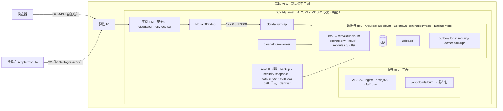

# 00 · ec2 基础模块契约（L0 基线）

> 本文是 `ec2` 基础模块的**完整契约**：基础栈 `infra/modules/ec2.yaml` 的全部参数，合并后的 `infra/userdata/l0-bootstrap.sh`，Nginx 与 systemd 的 include 点和 drop-in 约定，registry 条目，capabilities 中的本地健康项，`/lab` 卡片，以及 L0 冒烟测试。上一轮散落在总纲 §2 和 01、03、05 组文档中的基础栈参数与 User Data 新增项已全部收进本文，各组文档今后只引用本文的锚点，不再各自定义。
>
> **与总纲的关系**：总纲 [modular-design.md](../modular-design.md) §2 规定 L0 的**不变量**（2.4 目录布局、2.5 Nginx 结构、2.6 systemd、2.7 引导脚本的六条不变量、2.9 冒烟测试），二者冲突时以总纲为准。本文在不变量之内给出完整实现；对总纲的细化集中写在第 2 节，已由总纲第 2 轮回写（E1～E12 进入 2.2～2.7，E14 的参数并入 2.3，E13 无变更）。
>
> **适用的统一决策**：D1（`IAM_CREDENTIALS`）、D2（禁止 Export，`baseParams` 由 `scripts/module` 下发）、D3（规则只在 `rules.ts`，配置错误退出码 78）、D4（Node.js 22）、D5（机密在数据卷上）、D6（固定 uid/gid、nginx 入组、`UMask=0027`、冒烟断言）、D7、D8（ES256 + JWKS）、D9、D10、D11（ami、cost、vuln-scan 与本模块的接口）。不写价格与精确的性能数字。
>
> **状态**：设计稿，未在真实账号中部署。文中的模板、脚本与 Nginx 片段都是骨架，实现时以 `cfn-lint`、`nginx -t`、`shellcheck` 和第 9 节的冒烟测试为准。2026-10-13 在官方文档核实过三条关键事实：AL2023 的 Node.js 采用带版本命名空间的软件包（`nodejs22`、可执行文件 `node-22`，`node` 由 alternatives 指向当前激活的版本）；`cfn-signal` 不需要 AWS 凭证（CloudFormation 按实例所属的栈限定调用范围）；`AWS::SSM::Parameter::Value<…>` 类型的参数在**每次栈更新**时都会重新读取 Parameter Store 的最新值。

**谁读哪一节**

| 读者 | 先读 |
|---|---|
| 写 ec2 模板与引导脚本的人 | 第 3、4、6 节 |
| 需要改基础栈参数的模块（network、cdn、load-balancer、shell-access、iam、monitoring、backup、kms、ami） | 6.2、6.3 参数表与写入规则，第 8 节的分阶段替换流程 |
| 需要往 Nginx、systemd 投放内容的模块（cdn、load-balancer、waf、tls、shared-fs、tracing、threat-detection、vuln-scan） | 6.7、6.8、6.9 扩展点 |
| 写感知器、`/lab` 卡片、实验的人 | 第 5、7、9、10 节 |
| 备考者 | 第 12 节“对比：本项目 L0 vs 传统单机部署” |

<a id="ec2"></a>
## ec2：运行整个应用 ↔ Amazon EC2（基础模块）

> 一句话总结：ec2 不是“可插拔模块”，而是其他所有模块的地基。只部署这一个栈（一台 EC2、一块独立的 EBS 数据卷、一个弹性 IP、一个安全组，放在默认 VPC 里），CloudAlbum 的全部功能就能运行，而且不加载 AWS SDK、不调用任何 AWS API。它与“传统单机部署”最大的区别在于**实例是可替换的**：系统盘上不保存任何不可再生的状态，数据、机密与本地配置都在独立数据卷上；换实例类型、换 AMI、迁移 VPC、重建实例时，只要把数据卷改挂到新实例即可。

### 1. 元数据（registry 摘录）

| 字段 | 值 |
|---|---|
| id | `ec2` |
| 组 | `base`（不属于 A～F 任何一组；`/lab` 架构图的底座） |
| 机能 | 运行整个应用：计算（EC2）、块存储（EBS 根卷 + 独立数据卷）、固定入口（弹性 IP）、默认网络（默认 VPC + 安全组） |
| 主 AWS 服务 | Amazon EC2 |
| 辅助服务 | Amazon EBS、弹性 IP（公网 IPv4）、默认 VPC 与安全组、IMDSv2、SSM 公共参数（只在部署时解析 AMI，应用不读取） |
| 类型 | `base`：没有开关、不可禁用；`DEPLOY_MODE=single` 写在基础配置中，`asg` 取值归 autoscaling |
| `ownsEnv` | 无（不写 `modules.d`）。基础配置 `/etc/cloudalbum/cloudalbum.env` 只含 `AWS_REGION`、`CLOUDALBUM_ENV`、`APP_BASE_URL`、`DEPLOY_MODE`（总纲 4.4 第 1 层） |
| `credentials` | `none`：L0 的 `IAM_CREDENTIALS=none`；ec2 感知器只读 IMDS 与本机文件，从不调用 AWS API |
| 硬依赖 / 软依赖 / 互斥 | 无。反过来，**所有模块都依赖 ec2**：它们通过 `baseParams` 改基础栈参数，通过本文第 6 节的扩展点改主机配置 |
| 多实例 | 单实例。`DEPLOY_MODE=asg` 时 autoscaling 的启动模板复用同一个 `l0-bootstrap.sh`（没有数据卷，`/var/lib/cloudalbum` 在根卷上） |
| 权威端口 / 旁路键 | 不适用（没有端口；不支持 `X-Compare-Bypass`） |
| 路径头 | ec2 提供 `X-CloudAlbum-Path` 的 `entry`（Nginx `00-entry.conf` 计算）与 `inst`、`az`（IMDS）三段，本身不出现 `ec2=` 段 |
| 文档锚点 | `docs/modules/00-ec2-base.md#ec2` |

```yaml
# modules/registry.yaml —— ec2 条目（总纲 3.4 节选的完整版；只使用总纲 3.5 允许的字段）
ec2:
  group: base
  function: 运行整个应用
  awsService: Amazon EC2
  auxServices: [Amazon EBS, Elastic IP, Default VPC]
  type: base                                  # 没有 switch、ownsEnv、requires、port
  credentials: none
  version: 1                                  # 写入栈 Outputs.ModuleVersion（CFG-006）
  stacks: [{ name: main, template: infra/modules/ec2.yaml }]
  hostSetup: infra/userdata/l0-bootstrap.sh   # root 执行；install / postattach 两阶段；幂等（第 6.5 节）
  nginxFragments:                             # ec2 自己的 include 点（模块不得改写，见 6.7）
    - infra/nginx/cloudalbum.d/00-entry.conf
    - infra/nginx/cloudalbum.server.d/00-acme-challenge.conf
  preflight:                                  # scripts/module 更新基础栈前的检查（第 6.4 节）
    - ec2-ami-pin                             # 解析出的 AMI 与运行中实例不同 → 必须走 rebuild-instance
    - ec2-replacement-staged                  # 会替换实例的参数变化 → 必须走分阶段流程
    - ec2-volume-immutable                    # DataVolumeAz / DataVolumeKmsKeyId 在卷存在后不得修改
    - ec2-public-ipv4-at-boot                 # AssociateEip=true 时子网必须自动分配公网 IPv4（引导期出网）
    - ec2-ssh-cidr                            # SshIngressCidr 不是 /32 或为 0.0.0.0/0 时要求显式确认
  detector: detectors/ec2.ts
  probe: { kind: local, intervalSec: 30 }     # 只读 IMDS、/proc、statfs、security/snapshot.json
  billing:                                    # cost 本地估算的输入；不写单价（D11、D14）
    - { resource: "EC2 实例（按需）", dimension: hour, hourly: true }
    - { resource: "公网 IPv4（弹性 IP，未关联时同样计费）", dimension: hour, hourly: true }
    - { resource: "EBS gp3 根卷与数据卷", dimension: usage }
    - { resource: "EBS 快照（分阶段替换、备份演练）", dimension: usage }
    - { resource: "EC2 详细监控（DetailedMonitoring=true 时）", dimension: usage }
    - { resource: "互联网方向数据传出", dimension: usage }
  lab:
    summary:
      local: "单台 EC2：Nginx + api + worker + SQLite + 本地文件；数据、机密与本地配置在独立 EBS 数据卷上"
      aws: "—（基础模块。其他模块启用后应用仍运行在这台实例上；DEPLOY_MODE=asg 时由 autoscaling 的启动模板复制）"
    compare: functional
    keyMetrics:                               # /lab 卡片的检查项，对应第 7 节 checks[].id
      - imdsv2
      - data-volume
      - key-fingerprint
      - nginx
      - processes
      - disk
      - time-sync
      - memory
      - timers
      - security-snapshot
    hourlyBilled: true
    diagram:
      before: "flowchart LR; U[浏览器]-->EIP-->NG[Nginx]-->API[api]; API-->V[(数据卷)]"
      after:  "flowchart LR; U[浏览器]-->EIP-->NG[Nginx]-->API[api]; API-->V[(数据卷)]"
    experiments: [smoke, single-point-of-failure, imds-probe, cpu-credits, rebuild-drill]
    badges:
      footer: "运行在 EC2 · {instanceId} · {instanceType} · {az} · {deployMode}"
      card: "单点：停止实例 = 全站不可用；本地备份与数据在同一块卷上（见 backup）"
  doc: docs/modules/00-ec2-base.md#ec2
```

### 2. 与总纲的偏差（细化，已回写总纲 2.2～2.7；E13 无变更）

以下各项都**不违背**总纲 §2 的不变量，属于把总纲留给本文的实现细节写实，或者修正骨架中的隐患。总纲第 2 轮已把 E1～E12 回写到 2.2～2.7（E14 的参数并入 2.3 的说明），E13 保持原状无需回写；下表保留作为“为什么这样做”的出处。

| # | 总纲现状 | 本文的做法 | 理由 | 回写位置 |
|---|---|---|---|---|
| E1 | `ImageId` 用 `AWS::SSM::Parameter::Value<AWS::EC2::Image::Id>`，默认取 AL2023 公共参数 | 参数类型不变，但 `scripts/module` 首次部署时把公共参数**当时**解析出的 AMI ID 写进自己的 String 参数 `/cloudalbum/<env>/ec2/image-id`，并把这个参数名传给 `ImageId`；公共参数路径只作为手工在控制台部署时的默认值 | SSM 参数类型在每次栈更新时都会重新读取最新值（官方文档已核实）。AWS 一发布新 AMI，下一次任意参数更新（例如关闭 22 端口）就会顺带**替换实例**，而数据卷仍挂在旧实例上，更新失败或意外停机。固定之后，换 AMI 只能显式走 `rebuild-instance` | 2.2、2.3 |
| E2 | 数据卷用 `DataVolumeAttach` 控制，挂载方式未写明；骨架用环境变量 `DATA_VOLUME_ATTACH` 决定是否执行 `postattach` | 数据卷通过实例的 `Volumes` 属性挂载（实例启动时就已挂上）；是否挂卷写进实例标签 `CloudAlbumDataVolume=attach\|detach`，引导脚本经 IMDS 读取（L0 已开启实例元数据标签），**不写进 User Data** | ① 用独立的 `VolumeAttachment` 资源时，它要等实例 `CreationPolicy` 收到信号后才创建，首次引导永远等不到数据卷；② 修改 User Data 会让 CloudFormation 停止再启动实例（且 User Data 不会重新执行），所以任何会变化的值都不能放进 User Data | 2.3、2.7 |
| E3 | 未定义 `rebuild-instance` 如何让 CloudFormation 新建实例 | 基础栈有两个实例槽位 `InstanceA` / `InstanceB`，参数 `InstanceSlot=A\|B`；切换槽位 = 在不改其他参数的前提下强制新建实例 | CloudFormation 没有“重建某个资源”的命令；改 AMI、子网、密钥对会附带别的变化，槽位是唯一“只换实例、不换配置”的方式 | 2.2、9.2 |
| E4 | `ExecStart=/usr/bin/node` | 单元文件保持 `/usr/bin/node`，但引导脚本执行 `alternatives --set node /usr/bin/node-22`，把默认 `node` 固定到 22 | AL2023 中 `node` 是 alternatives 管理的虚拟名称，“先安装的版本自动激活”（官方文档）；固定后，即使以后有软件包拉进别的 Node 版本，服务也不会悄悄换运行时（D4） | 2.6 |
| E5 | 骨架中 `blkid /dev/sdf \|\| mkfs.xfs` | 只有“没有可识别的文件系统、并且前 1 MiB 全为 0”的设备才格式化，否则中止 | `blkid` 偶发失败或设备上是未知格式时，原写法会**格式化有数据的卷** | 2.7 |
| E6 | 骨架开头 `: "${APP_ARCHIVE_URL:?}" "${APP_PUBLIC_IP:?}" "${ADMIN_EMAIL:?}"` | 引导段把这些**非机密参数**写入根卷上的 `/etc/cloudalbum-bootstrap/params.env`（root 0600），`postattach` 阶段从这里读取；`APP_PUBLIC_IP` 允许为空（private 放置） | `cloudalbum-postattach` 是 `scripts/module` 事后经投递通道调用的，此时没有 User Data 的环境变量；该文件只保存参数，不参与“是否已初始化”的判断（不违反不变量 2） | 2.7 |
| E7 | 机密生成条件：`secrets.env` 不存在就生成 | 另加三道保护：① 数据卷必须已挂载（`mountpoint -q`）；② 数据卷已有初始化标记 `etc/.initialized` 或已有数据库文件、但缺 `secrets.env` 时**拒绝生成**并中止（除非显式 `--regenerate-secrets`）；③ `SECRETS_ORIGIN=aws\|bundle` 时一律不生成（secrets 模块启用后 PEM 已被删除，属于正常状态） | 落实不变量 1；防止“备份恢复漏了 secrets.env”时静默生成新密钥，导致已加密字段永久无法解密（与 CFG-007 互为双保险） | 2.7 |
| E8 | `security/` 为 `root:cloudalbum 750` | `root:cloudalbum 2770`（组可写 + setgid） | waf 的 BlocklistPort(nginx) 以 `cloudalbum` 身份“写临时文件 + rename”更新 `denylist.conf`（01#waf 定稿），目录必须组可写；setgid 让新文件属组保持 cloudalbum | 2.4 |
| E9 | 只列出了 5 个 include 点 | 另有 4 个由 ec2 创建的数据文件：`/etc/nginx/cloudalbum-vpc-cidr.inc`（总纲 2.5 的 `/internal/legacy-auth` 已在引用）与三个“槽位”文件 `cloudalbum.d/slot-*.inc`（6.7） | 00-entry.conf 计算 `$ca_entry`、`$ca_proto` 需要 ALB 所在网段与 `X-Origin-Verify` 的当前值；Nginx 的变量只能定义一次，模块不能“追加”到 ec2 的 map 里，只能填写 ec2 预留的槽位 | 2.5 约定 2 |
| E10 | `nginx.conf` 未提 | ec2 用发布包中的 `/etc/nginx/nginx.conf` **覆盖**发行版默认文件 | AL2023 的默认 `nginx.conf` 自带一个监听 80 的 server 块，与 `cloudalbum.conf` 的 `default_server` 冲突或抢先匹配 | 2.5 |
| E11 | nginx 加固 drop-in 只有 `InaccessiblePaths` | 同一文件再加 `RequiresMountsFor=/var/lib/cloudalbum` | Nginx 的证书（`/etc/cloudalbum/tls/`）与 denylist 都在数据卷上，数据卷挂载前启动 Nginx 必然失败 | 2.6 |
| E12 | 模块的主机级产物（Nginx 片段、drop-in、定时器、软件包）只在 `enable` 时投放 | **重放契约**：每个模块的主机级产物必须能由“发布包 + `modules.d/<id>.env` + `secrets.env`”重新生成；`l0-bootstrap.sh postattach` 对所有已启用模块执行一次 `hostSetup apply` | 实例被替换后根卷是全新的，若不重放，`/etc/nginx/cloudalbum.d/cdn-origin.conf`、tracing 的 drop-in、certbot 定时器等都会丢失，而 `modules.d` 仍声明它们已启用 | 2.7、9.2 |
| E13 | `admin:ensure` 生成的初始密码写到 `/root/cloudalbum-admin.txt` | 保持不变（只在本次真的新建管理员时写入，root 0600） | 一次性密码，丢了就用 `cli.js admin:reset-password` 重置；不需要随数据卷保存 | — |
| E14 | 基础栈参数表 | 另增 9 个部署参数：`Env`、`ModuleVersion`、`InstanceSlot`、`DataVolumeAz`、`DataVolumeSizeGiB`、`DataVolumeKmsKeyId`、`RootVolumeSizeGiB`、`CpuCredits`、`HttpPutResponseHopLimit`，以及 3 个首次启动参数 `AppArchiveUrl`、`AppArchiveSha256`、`AdminEmail`；新增 2 个 `baseParams` 写入方：backup 写 `InstanceBackupTag`，kms 换卷时写 `DataVolumeId` | 见 6.2 | 2.3 |

### 3. 本地实现（L0）

ec2 本身就是 L0。本节给出 L0 形态的完整规格；业务机能 F1–F14、X1–X30 的本地实现见总纲 2.8。

#### 3.1 拓扑



#### 3.2 实例规格

| 项目 | L0 取值 | 由谁决定 | 说明 |
|---|---|---|---|
| AMI | AL2023 最新版，部署时固定（E1） | `ImageId`；ami 模块可换成黄金 AMI | 换 AMI = 替换实例，走 `rebuild-instance` |
| 架构 / 实例类型 | `arm64` / `t4g.small` | `Arch`、`InstanceType` | 与 Lambda 的 `nodejs22.x arm64` 同架构，`packages/image-core` 的 sharp 在两边行为一致；`x86_64` / `t3.small` 也受支持 |
| CPU 积分模式 | `standard` | `CpuCredits` | 学习账号避免 `unlimited` 模式的超额积分费用；积分耗尽后 CPU 被限制在基线，这本身是 image-processing 的观察点 |
| IMDS | `HttpTokens=required`、`HttpPutResponseHopLimit=1`、`InstanceMetadataTags=enabled` | 模板固定（跳数可调） | 防 SSRF 读取凭证；实例标签供引导脚本与 autoscaling 感知使用 |
| 根卷 | gp3 20 GiB，加密，`DeleteOnTermination=true` | `RootVolumeSizeGiB` | 只放 OS、程序、1 GiB swap 文件；**不保存任何不可再生的状态** |
| 数据卷 | 独立 gp3 20 GiB，加密，挂到 `/dev/sdf` → `/var/lib/cloudalbum`（xfs，`LABEL=cadata`） | `DataVolume*` 参数 | 通过实例 `Volumes` 属性挂载，`DeleteOnTermination` 为 false（后挂的卷默认如此），`DeletionPolicy: Retain` |
| 弹性 IP | 1 个 | `AssociateEip` | 栈内始终分配；`AssociateEip=false` 只取消关联、不释放，避免 public→private→public 时地址变化 |
| 实例配置文件 | 无（`IAM_CREDENTIALS=none`） | `InstanceProfileName`（iam 写入） | L0 栈里没有任何 IAM 资源 |
| 详细监控 | 关 | `DetailedMonitoring`（monitoring 写入） | 开启后 EC2 指标为 1 分钟粒度（另行计费） |

#### 3.3 安全组 `cloudalbum-<env>-ec2-sg`

| 方向 | 端口 | 来源 | 由哪个参数控制 |
|---|---|---|---|
| 入站 | TCP 80、443 | `open`：`0.0.0.0/0` 与 `::/0`；`admin-ip`：`AdminIngressCidr`；`closed`：无 | `PublicHttpIngress` + `AdminIngressCidr` |
| 入站 | TCP 22 | `SshIngressCidr`（运维 IP/32）；为空时不建规则 | `SshIngressCidr` |
| 入站 | TCP 80 | ALB 安全组 | `AlbSecurityGroupId`（非空时） |
| 出站 | 全部 | `0.0.0.0/0` | 固定 |

模块需要的其他入站规则（cdn 的 8080 只放行 CloudFront 托管前缀列表、dns 的 Route 53 健康检查器前缀列表、network 的 EC2 Instance Connect Endpoint）都在**模块自己的栈**里建独立安全组，经 `ExtraSecurityGroupIds` 追加到实例上，不改这个安全组。托管前缀列表按其最大条目数计入规则配额，每块网卡能挂的安全组数量也有配额，以官方文档为准。

#### 3.4 磁盘布局与权限

**根卷**（丢失后重新执行 `l0-bootstrap.sh install` 即可完全恢复）：

```
/opt/cloudalbum-releases/<版本>/          root:root 755   发布包（frontend/dist、backend/dist、node_modules、infra/、scripts/、VERSION）
/opt/cloudalbum -> cloudalbum-releases/<版本>              scripts/deploy 切换这个符号链接
/etc/cloudalbum -> /var/lib/cloudalbum/etc                D5：机密与本地配置在数据卷上
/etc/cloudalbum-bootstrap/params.env      root 0600       引导参数（非机密，见 E6）
/etc/nginx/nginx.conf、conf.d/cloudalbum.conf、cloudalbum_{proxy,locations,upstream}.conf、cloudalbum-vpc-cidr.inc
/etc/nginx/cloudalbum.d/、cloudalbum.server.d/            扩展点（6.7）
/etc/systemd/system/cloudalbum-*.{service,timer,path}、*.service.d/   （6.8）
/etc/ssh/sshd_config.d/40-cloudalbum.conf、/etc/fail2ban/…、/etc/logrotate.d/cloudalbum、/etc/systemd/journald.conf.d/cloudalbum.conf
/usr/local/lib/cloudalbum/*.sh、/usr/local/sbin/cloudalbum-{postattach,predetach,runtime}
/swapfile（1 GiB）、/var/log/cloudalbum-bootstrap.log、/var/log/cloud-init-output.log
```

**数据卷**（总纲 2.4 的布局，补全属主与权限）：

| 路径 | 属主:属组 | 模式 | 说明 |
|---|---|---|---|
| `/var/lib/cloudalbum/` | cloudalbum:cloudalbum | 0750 | 卷根目录；nginx 通过 cloudalbum 组穿越 |
| `db/`、`uploads/`、`uploads/.incoming/`、`outbox/`、`logs/`、`logs/spans/`、`backup/`、`migrate/` | cloudalbum:cloudalbum | 0750 | 应用以 `UMask=0027` 写入，新文件 0640 |
| `etc/`、`etc/modules.d/`、`etc/keys/` | root:cloudalbum | 0750 | 应用只读（systemd `ReadOnlyPaths`），只有 `scripts/module` 以 root 写入 |
| `etc/cloudalbum.env`、`etc/secrets.env`、`etc/modules.d/*.env`、`etc/keys/*.pem`、`etc/runtime.json`、`etc/alerts.yaml` | root:cloudalbum | 0640 | D5 |
| `etc/tls/`（`selfsigned.{crt,key}`，`server.{crt,key}` 为符号链接） | root:cloudalbum / 私钥 root:root | 0750 / 0600 | 只有 Nginx 主进程（root）读私钥；tls 模块只切换符号链接 |
| `etc/fail2ban-ignoreip` | root:root | 0644 | 运维 IP，`scripts/module` 写入，`render-fail2ban.sh` 读取 |
| `etc/.initialized` | root:root | 0644 | 数据卷初始化标记（E7）；不在根卷上 |
| `security/` | root:cloudalbum | 2770 | E8；`denylist.conf`（cloudalbum:cloudalbum 0640）、`denylist.lock`、`snapshot.json`、`vuln-scan.json`（root:cloudalbum 0640） |
| `acme/.well-known/acme-challenge/` | root:cloudalbum | 0750 | Let's Encrypt / ACME 的 webroot（00-acme-challenge.conf） |

**用户与组（D6）**

- `cloudalbum`：系统用户，uid = gid = **2001**，主目录 `/var/lib/cloudalbum`，登录 shell `/sbin/nologin`。固定 uid 的原因：数据卷会被改挂到新实例，EFS 访问点、多实例引导配置包都按 uid 判断权限；随机分配的 uid 在新实例上会变。
- `nginx`：AL2023 软件包创建的用户，引导脚本执行 `usermod -aG cloudalbum nginx`，这是 `X-Accel-Redirect` 能读出 0640 媒体文件的前提。代价是 nginx worker 理论上也能读组可读的机密文件，所以 nginx 单元有加固 drop-in 遮蔽 `secrets.env` 与 `keys/`（6.8）。
- `cloudalbum-ops`：**不由 ec2 创建**，shell-access 启用时由它的 `hostSetup` 创建。
- `ec2-user`：AL2023 默认用户，sshd 加固片段只允许它登录。

#### 3.5 进程与定时器

| 单元 | 身份 | 作用 | 归属 |
|---|---|---|---|
| `nginx.service` | root 主进程 + nginx worker | 静态文件、反向代理、限速、`X-Accel-Redirect` | ec2 |
| `cloudalbum-api.service` | cloudalbum | Express，`127.0.0.1:3000` | ec2 |
| `cloudalbum-api@.service`（模板，L0 不启用） | cloudalbum | `LB_LOCAL_WORKERS=2` 时的第二个进程 `@3001` | ec2 提供，load-balancer 本地档启用 |
| `cloudalbum-worker.service` | cloudalbum | 定时任务、队列消费、对账、本地评估器 | ec2 |
| `cloudalbum-backup.timer` | cloudalbum | 每天 03:30 Asia/Tokyo，本地备份（backup 的对照组） | ec2 |
| `cloudalbum-security-snapshot.timer` | root | 每 2 分钟写 `security/snapshot.json`（第 7 节的主机事实也来自这里） | ec2 |
| `cloudalbum-healthcheck.timer` | root | 每 30 秒检查 api 存活，必要时重启 | ec2 |
| `cloudalbum-vuln-scan.timer` | root | 每天一次，脚本内容归 vuln-scan（06#vuln-scan） | ec2 安装 |
| `cloudalbum-denylist.path` → `.service` | root | `denylist.conf` 变化时逐行校验并 reload Nginx | ec2 |
| `fail2ban.service` | root | threat-detection 的基线（AL2023 核心仓库提供；装不上时标注“不可用”） | ec2 安装，`render-fail2ban.sh` 渲染 |
| `chronyd.service` | chrony | 时间同步（Amazon Time Sync Service） | AL2023 默认，ec2 只校验 |
| `sshd.service` | root | L0 运维通道 | AL2023 默认，ec2 加固 |
| `amazon-ssm-agent.service` | root | AL2023 AMI 预装；L0 没有角色，不会注册 | 保持 AMI 默认，shell-access 使用 |

### 4. AWS 实现：基础栈 `infra/modules/ec2.yaml`

ec2 没有“AWS 实现 vs 本地实现”之分，本节描述基础栈创建的资源。栈名 `cloudalbum-<env>-ec2`，不可删除（`scripts/teardown` 除外）。

| 逻辑 ID | 类型 | 条件 | 关键配置 |
|---|---|---|---|
| `InstanceSecurityGroup` | `AWS::EC2::SecurityGroup` | 总是 | 只含出站规则；入站规则全部用下面的独立资源，便于条件化 |
| `SshIngress`、`HttpOpen{80,443}{V4,V6}`、`HttpAdmin{80,443}`、`AlbIngress80` | `AWS::EC2::SecurityGroupIngress` | 按参数 | 见 3.3 |
| `DataVolume` | `AWS::EC2::Volume` | `DataVolumeId` 为空 | gp3、`Encrypted: true`、`AvailabilityZone: DataVolumeAz`、可选 `KmsKeyId`；标签 `Backup=true`、`DataClass=user-content`；`DeletionPolicy` 与 `UpdateReplacePolicy` 均为 `Retain` |
| `InstanceA` / `InstanceB` | `AWS::EC2::Instance` | `InstanceSlot` 二选一 | 见 6.6 模板骨架；`CreationPolicy` 等待 `cfn-signal` |
| `Eip` | `AWS::EC2::EIP` | 总是 | `Domain: vpc` |
| `EipAssociation` | `AWS::EC2::EIPAssociation` | `AssociateEip=true` | 关联到当前槽位的实例 |

**不创建**：IAM 角色与策略（iam 模块）、实例配置文件（iam）、额外安全组（各模块）、SSM 参数（`scripts/module` 在栈外维护 AMI 固定参数，E1）。栈 **没有 `PolicyArn` 输出，也没有任何 `Export`**（D2）。

### 5. 感知器要点（`backend/src/modules/detectors/ec2.ts`）

- **只读本机**：IMDSv2（实例 ID、类型、AZ 与 AZ ID、AMI ID、公网 IPv4、实例标签）、`/proc/self/mountinfo`、`statfs`、`/proc/meminfo`、`/proc/swaps`、`security/snapshot.json`（root 定时器采集的服务状态、时间同步、监听端口）、数据库 `system_meta` 中的密钥指纹记录、各进程心跳（LabMetricsStore）。`credentials: none`，任何情况下都不调用 AWS API，置信度最高为 `observed`。
- **数据卷 ID 的本地推断**：Nitro 实例上 EBS 卷以 NVMe 设备出现，设备序列号就是去掉连字符的卷 ID（`/sys/block/nvme1n1/device/serial` → `vol0abc…`），感知器据此在不调用 API 的情况下显示数据卷 ID（置信度 `inferred`）。
- **IMDSv2 是否强制**：不带令牌请求 `http://169.254.169.254/latest/meta-data/`，返回 401 即为强制；返回 200 说明 `HttpTokens=optional`（被人改过），状态 `degraded`。
- **路径头**：`inst` 与 `az` 由 `InstanceLifecyclePort(single).identity()` 在启动时从 IMDS 读出（autoscaling 的 `single` 驱动，见 01#autoscaling）；`entry` 由 Nginx 的 `$ca_entry` 计算，经 `cloudalbum_proxy.conf` 传给 Node，静态文件由 Nginx 直接 `add_header`（总纲 2.5）。
- **自检接口**：总纲 2.9 的 `GET /api/lab/self-check`（仅管理员）除“已加载模块清单”外，同时返回 ec2 全部检查项的明细与原始事实（第 7 节），供冒烟测试与 `/lab` 卡片使用。

### 6. CloudFormation 模板、引导脚本与扩展点

#### 6.1 参数一览（按用途分组）

| 组 | 参数 |
|---|---|
| 标准 | `Env`、`ModuleVersion` |
| 实例 | `Arch`、`InstanceType`、`ImageId`、`InstanceSlot`、`KeyName`、`CpuCredits`、`HttpPutResponseHopLimit`、`RootVolumeSizeGiB`、`DetailedMonitoring`、`InstanceProfileName`、`InstanceBackupTag` |
| 网络 | `VpcId`、`SubnetId`、`AssociateEip`、`PublicHttpIngress`、`AdminIngressCidr`、`SshIngressCidr`、`ExtraSecurityGroupIds`、`AlbSecurityGroupId` |
| 数据卷 | `DataVolumeAttach`、`DataVolumeId`、`DataVolumeAz`、`DataVolumeSizeGiB`、`DataVolumeKmsKeyId` |
| 首次启动 | `AppArchiveUrl`、`AppArchiveSha256`、`AdminEmail` |

#### 6.2 完整参数表

“更新影响”一列：**无中断** = 原地更新；**停止再启动** = 实例重启，EIP 与数据卷不变；**替换** = 新建实例，必须走第 8 节的分阶段流程（`preflight: ec2-replacement-staged` 强制）。具体某个属性的更新行为以 CloudFormation 官方资源参考为准。

| 参数 | 类型 / 取值 | 默认值 | 用途 | 谁可以改（`baseParams` 声明方或操作） | 更新影响 |
|---|---|---|---|---|---|
| `Env` | String | `lab` | 栈名、资源名、标签 | 部署时（`.cloudalbum/state.json`） | 改名会替换几乎所有资源，部署后不改 |
| `ModuleVersion` | String | registry `version` | `Outputs.ModuleVersion`，CFG-006 比对 | `scripts/module` | 无 |
| `Arch` | `arm64` \| `x86_64` | `arm64` | 选择发布包架构；模板 `Rules` 校验与 `InstanceType` 匹配 | 运维（部署参数） | 随 `ImageId` 一起变 → 替换 |
| `InstanceType` | `t4g.small` \| `t4g.medium` \| `t3.small` \| `t3.medium` | `t4g.small` | 实例规格 | 运维（部署参数） | 同架构：停止再启动；跨架构：替换 |
| `ImageId` | `AWS::SSM::Parameter::Value<AWS::EC2::Image::Id>`（值是 SSM 参数**名**） | 控制台默认 `/aws/service/ami-amazon-linux-latest/al2023-ami-kernel-default-arm64`；`scripts/module` 传 `/cloudalbum/<env>/ec2/image-id`（E1） | AMI | ami（`AMI_SOURCE=golden` 时改为黄金 AMI 的参数名）；`scripts/module rebuild-instance --ami latest` | 替换 |
| `InstanceSlot` | `A` \| `B` | `A` | 强制新建实例（E3） | `scripts/module rebuild-instance` | 替换 |
| `KeyName` | String（可空） | `cloudalbum-key` | SSH 密钥对；L0 必须有，否则禁用 shell-access 后无法回到 SSH（防锁死） | 运维；shell-access **不改**它 | 替换 |
| `CpuCredits` | `standard` \| `unlimited` | `standard` | T 系列积分模式 | 运维（cpu-credits 实验可临时改） | 无中断 |
| `HttpPutResponseHopLimit` | 1～64 | `1` | IMDSv2 令牌响应的跳数 | 运维（容器化时改为 2） | 无中断 |
| `RootVolumeSizeGiB` | Number | `20` | 根卷大小 | 运维 | 块设备映射变化 → 替换；L0 不改 |
| `DetailedMonitoring` | `true` \| `false` | `false` | EC2 详细监控 | monitoring（`--param DetailedMonitoring=true`） | 无中断 |
| `InstanceProfileName` | String（可空） | `''` | 实例配置文件 | iam（role 模式写入 `InfoInstanceProfileName`；keys / none 时置空） | 无中断（02#iam 已核实；以官方文档为准） |
| `InstanceBackupTag` | `true` \| `false` | `false` | 实例本身打 `Backup=true`，AWS Backup 生成包含所有卷的 AMI 恢复点 | backup（整机恢复变体） | 无中断（标签） |
| `VpcId` | String | `''` → `scripts/module` 解析为默认 VPC | 安全组所在 VPC | network | 替换安全组与实例 |
| `SubnetId` | String | `''` → 默认 VPC 中 `ap-northeast-1a` 的默认子网 | 实例子网 | network | 替换 |
| `AssociateEip` | `true` \| `false` | `true` | 是否把 EIP 关联到实例 | network（`private` 放置时 `false`） | 无中断（关联变化） |
| `PublicHttpIngress` | `open` \| `admin-ip` \| `closed` | `open` | 80/443 对公网的暴露级别 | cdn（`CDN_DIRECT_ACCESS`）、load-balancer（`LB_LOCK_ORIGIN`）、network（`private` 隐含 `closed`）；取最严格 | 无中断 |
| `AdminIngressCidr` | CIDR（可空） | `''` | `admin-ip` 档的来源 | 运维 IP（state.json）；cdn 设了 `CDN_ADMIN_CIDR` 时以它为准 | 无中断 |
| `SshIngressCidr` | CIDR（可空） | 首次部署时 `scripts/module` 填运维公网 IP/32（模板默认 `''`，不提供 `0.0.0.0/0`） | 22 入站 | shell-access（置空；`SHELL_ACCESS_MODE=ssh` 或 `--reopen-ssh` 时恢复） | 无中断 |
| `ExtraSecurityGroupIds` | CommaDelimitedList | `''` | 模块自带安全组 | cdn（源站安全组）、dns（健康检查安全组，可选）、network（EIC Endpoint 相关，可选）；并集，`+` 前缀表示追加 | 无中断 |
| `AlbSecurityGroupId` | String（可空） | `''` | 放行 ALB → 实例 80 | load-balancer | 无中断 |
| `DataVolumeAttach` | `true` \| `false` | `true` | 是否把数据卷挂到实例；同步写实例标签 `CloudAlbumDataVolume`（E2） | `scripts/module`（network、ami、rebuild-instance、kms 换卷的分阶段流程） | 挂卷 / 卸卷（卸卷前必须 `cloudalbum-predetach`） |
| `DataVolumeId` | String（可空） | `''`（= 用本栈创建的卷） | 改挂外部卷（快照建卷） | network（跨 AZ）、kms（`KMS_APPLY_TO` 含 `ebs` 时换卷）、`rebuild-instance --from-snapshot` | 分阶段改挂；本栈原有的卷因 `Retain` 变成孤儿卷，`scripts/module` 记入 state.json 待清理 |
| `DataVolumeAz` | AZ 名 | `''` → 首次部署时填为 `SubnetId` 所在 AZ，此后锁定 | 本栈数据卷所在 AZ | 只在首次部署写入 | **禁止修改**（会新建空卷，`preflight: ec2-volume-immutable`） |
| `DataVolumeSizeGiB` | Number | `20` | 数据卷大小 | 运维（只能增大） | 无中断（EBS 弹性卷）；之后 `postattach` 或 `cloudalbum-postattach --grow` 执行 `xfs_growfs`。同一卷两次修改之间有冷却时间，以官方文档为准 |
| `DataVolumeKmsKeyId` | String（可空） | `''`（`aws/ebs`） | 新建数据卷时使用的 KMS 密钥 | 只在新建卷时有效；kms 换已有卷走“快照复制 + `DataVolumeId`” | **禁止对已有卷修改**（会新建空卷） |
| `AppArchiveUrl` | URL（`https://` 或 `s3://`） | GitHub Release 中对应架构的发布包 | 首次引导下载发布包 | 部署时；例外：network `private` + `NatMode=none` 的替换实例流程中，由 `scripts/module` 改为工具链栈中的发布包镜像（`s3://…/releases/<版本>/<架构>.tgz`） | 写在 User Data 里：单独修改会停止再启动实例且不会重新执行，**部署后不单独改**，发布新版本用 `scripts/deploy`；只允许随替换类参数一起改 |
| `AppArchiveSha256` | String | 发布包的 SHA-256 | 校验发布包 | 部署时 | 同上 |
| `AdminEmail` | String | — | 初始管理员邮箱（`admin:ensure`） | 部署时 | 同上 |

#### 6.3 `baseParams` 的写入规则（`scripts/module` 执行）

1. **只能经 registry 声明**。模块在 `baseParams` 中声明要求（例如 cdn 的 `PublicHttpIngress: "${CDN_DIRECT_ACCESS}"`、`ExtraSecurityGroupIds: "+${Out.InfoOriginSecurityGroupId}"`），由 `scripts/module` 汇总后**一次**更新基础栈。任何模块栈都不得直接修改基础栈的资源（总纲 9.1）。
2. **合并**：`PublicHttpIngress` 取所有已启用模块要求中最严格的一级（`closed` > `admin-ip` > `open`）；`ExtraSecurityGroupIds` 取并集；其余参数同一时刻只允许一个写入方（例如 `VpcId` 只有 network），冲突时计划校验阶段退出码 2。禁用模块时撤销它的贡献并重新计算。
3. **记录**：每个参数“由谁、何时、改成什么、原值是什么”写入 `.cloudalbum/state.json` 的 `baseParams` 段；`disable` 与回滚据此还原（例如 `--reopen-ssh` 恢复原来的 `SshIngressCidr`）。
4. **替换类参数**（`ImageId`、`Arch`、跨架构 `InstanceType`、`KeyName`、`VpcId`、`SubnetId`、`InstanceSlot`、`RootVolumeSizeGiB`）只能出现在第 8 节的分阶段流程中，和 `DataVolumeAttach=false` 同时出现在一次更新里会被拒绝。
5. **更新方式**：`aws cloudformation deploy --stack-name cloudalbum-<env>-ec2 --parameter-overrides …`，未涉及的参数全部 `UsePreviousValue`；`ImageId` 的值是参数名，`UsePreviousValue` 仍会重新解析，所以 E1 的固定参数是必要的。

#### 6.4 部署前检查（registry `preflight`）

| 检查名 | 何时 | 违规条件 | 处理 |
|---|---|---|---|
| `ec2-ami-pin` | 任何基础栈更新前 | 本次将解析出的 AMI ID ≠ 运行中实例的 AMI（IMDS `ami-id` 或 `DescribeInstances`） | 拒绝（退出码 2），提示 `scripts/module rebuild-instance` |
| `ec2-replacement-staged` | 同上 | 有替换类参数变化，但不在分阶段流程中，或 `DataVolumeAttach=true` | 拒绝 |
| `ec2-volume-immutable` | 同上 | 本栈数据卷已存在时 `DataVolumeAz` 或 `DataVolumeKmsKeyId` 变化 | 拒绝 |
| `ec2-public-ipv4-at-boot` | 部署与换子网前 | `AssociateEip=true`，但目标子网 `MapPublicIpOnLaunch=false` | 拒绝：EIP 关联要等实例收到 `cfn-signal` 后才创建，引导期间实例没有公网地址，`dnf`、下载发布包、`cfn-signal` 都会失败，最终 `CreationPolicy` 超时回滚。01#network 的 public 子网已固定 `MapPublicIpOnLaunch=true`（app、data 子网仍为 false），`public` 放置据此通过；改用已有 VPC 的子网时由本检查把关 |
| `ec2-ssh-cidr` | 首次部署、修改 22 端口时 | `SshIngressCidr` 为 `0.0.0.0/0` 或掩码短于 /32 | 要求 `--i-understand-open-ssh`（05#shell-access 的“互联网噪声”实验需要临时开放），并写入 state.json 的过期提醒 |

这些是 `scripts/module` 在计划阶段做的部署前检查，不是 `rules.ts` 中的启动规则；如果主设计者希望把它们登记为“范围 = 部署”的规则，需要在第 5 节规则表中分配编号。

#### 6.5 User Data 引导段与 `l0-bootstrap.sh`

**User Data 引导段**（写在 `ec2.yaml` 中；只设变量、下载并校验发布包，然后交给发布包里的脚本；不含任何机密，也不含任何部署后会变化的值）：

```yaml
      UserData:
        Fn::Base64: !Sub |
          #!/bin/bash
          set -euo pipefail
          install -d -m 0700 /etc/cloudalbum-bootstrap
          cat > /etc/cloudalbum-bootstrap/params.env <<'EOF'
          CLOUDALBUM_ENV='${Env}'
          AWS_REGION='${AWS::Region}'
          DEPLOY_MODE=single
          APP_ARCHIVE_URL='${AppArchiveUrl}'
          APP_ARCHIVE_SHA256='${AppArchiveSha256}'
          APP_PUBLIC_IP='${Eip}'
          ADMIN_EMAIL='${AdminEmail}'
          BOOTSTRAP_SIGNAL=cfn
          CFN_STACK='${AWS::StackName}'
          EOF
          chmod 0600 /etc/cloudalbum-bootstrap/params.env
          A=/var/tmp/cloudalbum-release.tgz
          case '${AppArchiveUrl}' in                       # s3:// 只用于没有公网出口的私有子网（工具链栈的发布包镜像，经 S3 Gateway Endpoint + 实例角色）
            s3://*) for i in 1 2 3 4 5; do aws s3 cp '${AppArchiveUrl}' "$A" --region '${AWS::Region}' && break; sleep 10; done ;;
            *)      for i in 1 2 3 4 5; do curl -fsSL '${AppArchiveUrl}' -o "$A" && break; sleep 10; done ;;
          esac
          echo '${AppArchiveSha256}  /var/tmp/cloudalbum-release.tgz' | sha256sum -c -
          tar xzf "$A" -O --wildcards '*/infra/userdata/l0-bootstrap.sh' > /var/tmp/l0-bootstrap.sh
          exec bash /var/tmp/l0-bootstrap.sh all
```

- `${Eip}` 是 `!Ref Eip` 的结果（弹性 IP 地址）。EIP 资源先于实例创建，地址在栈的生命周期内不变，所以这一行不会导致 User Data 变化。
- `cfn-signal` 需要的资源逻辑 ID（`InstanceA` 或 `InstanceB`）不写在 User Data 里，由引导脚本经 IMDS 读取模板中为每个实例写死的标签 `CloudAlbumLogicalId`。不依赖 CloudFormation 自动打的 `aws:cloudformation:logical-id`：带 `aws:` 前缀的标签能否经 IMDS 读取，以官方文档为准。
- 引导段本身失败（下载失败、校验不通过）时还没有 `cfn-signal` 可用，只能等 `CreationPolicy` 超时（PT20M）后回滚；`/var/log/cloud-init-output.log` 中可以看到原因。
- **没有公网出口时的引导**（network `private` 放置且 `NatMode=none`，DEP-009）：`dnf` 经 S3 Gateway Endpoint 访问 AL2023 仓库；发布包改从工具链栈制品桶的 `releases/<版本>/<架构>.tgz` 下载（`AppArchiveUrl` 为 `s3://` 地址，需要实例角色，所以此时要求 `IAM_CREDENTIALS=role`）；`cfn-signal` 经 `cloudformation` Interface Endpoint（01#network 的 `InterfaceEndpoints=ops|all` 都包含它）。`AppArchiveUrl` 在 User Data 中，平时“部署后不改”；这里是在替换实例的同一次更新里修改，实例本来就要被替换，不会额外停机。
- autoscaling 的启动模板使用同一段引导代码，只是 `DEPLOY_MODE=asg`、`APP_PUBLIC_IP` 为空、是否发信号与发布包来源（私有子网没有 NAT 时同样用工具链栈的发布包镜像）由 01#autoscaling 决定；`l0-bootstrap.sh` 在 asg 模式下不挂数据卷、不生成机密、不执行数据库迁移。

**合并后的 `infra/userdata/l0-bootstrap.sh`**（满足总纲 2.7 的全部不变量；用法 `l0-bootstrap.sh all|install|postattach`）：

```bash
#!/bin/bash
# infra/userdata/l0-bootstrap.sh —— ec2 基础模块唯一的引导脚本（single 与 asg 共用），幂等
#   install    ：只动根卷（软件包、用户、发布包、Nginx/systemd/sshd/fail2ban 文件），不碰数据卷
#   postattach ：挂数据卷 → 接上 /etc/cloudalbum → 机密 → 重放模块主机产物 → 迁移 → 启动（= cloudalbum-postattach）
#   all        ：install；实例标签 CloudAlbumDataVolume=attach 且数据卷出现时再 postattach；最后 cfn-signal
set -euo pipefail
PHASE="${1:-all}"; shift || true
REGEN_SECRETS=no; [ "${1:-}" = --regenerate-secrets ] && REGEN_SECRETS=yes
exec > >(tee -a /var/log/cloudalbum-bootstrap.log) 2>&1
echo "=== $(date -Is) l0-bootstrap phase=$PHASE"

# ---------- 0. 参数与常量（params.env 只有参数，不用于“是否已初始化”的判断：不变量 2） ----------
. /etc/cloudalbum-bootstrap/params.env
: "${CLOUDALBUM_ENV:?}" "${AWS_REGION:?}" "${APP_ARCHIVE_URL:?}" "${APP_ARCHIVE_SHA256:?}"
: "${DEPLOY_MODE:=single}" "${APP_PUBLIC_IP:=}" "${ADMIN_EMAIL:=}" "${BOOTSTRAP_SIGNAL:=none}" "${CFN_STACK:=}"
DATA=/var/lib/cloudalbum; ETC=$DATA/etc; LIB=/usr/local/lib/cloudalbum; CA_ID=2001
ARCHIVE=/var/tmp/cloudalbum-release.tgz

imds() {   # IMDSv2：先 PUT 取令牌（跳数 1 对本机进程足够）
  local t; t=$(curl -fsS -m 2 -X PUT http://169.254.169.254/latest/api/token \
                 -H 'X-aws-ec2-metadata-token-ttl-seconds: 300') || return 1
  curl -fsS -m 2 -H "X-aws-ec2-metadata-token: $t" "http://169.254.169.254/latest/meta-data/$1"
}
cli() { runuser -u cloudalbum -- env CLOUDALBUM_ENV_DIR=/etc/cloudalbum CLOUDALBUM_ROLE=cli \
          /usr/bin/node /opt/cloudalbum/backend/dist/cli.js "$@"; }
signal() {  # 只在 all 阶段向 CreationPolicy 回报；cfn-signal 不需要 AWS 凭证
  [ "$PHASE" = all ] && [ "$BOOTSTRAP_SIGNAL" = cfn ] || return 0
  /opt/aws/bin/cfn-signal -e "$1" --stack "$CFN_STACK" --region "$AWS_REGION" \
    --resource "$(imds tags/instance/CloudAlbumLogicalId)" || true
}
trap 'rc=$?; [ "$rc" -ne 0 ] && signal "$rc"; exit "$rc"' EXIT

install_phase() {
  # 1. 软件包（D4：Node.js 22 LTS）。黄金 AMI（ami 模块）已预装时跳过下载与安装
  if [ ! -f /opt/cloudalbum/.image-manifest.json ]; then
    dnf -y install nginx nodejs22 nodejs22-npm sqlite tar gzip openssl jq logrotate xfsprogs chrony
    dnf -y install fail2ban-server fail2ban-systemd nftables \
      || echo "WARN: fail2ban 不可用，退回 sshd MaxAuthTries + Nginx limit_req（/lab 标注）"
  fi
  [ "$BOOTSTRAP_SIGNAL" = cfn ] && { rpm -q aws-cfn-bootstrap >/dev/null || dnf -y install aws-cfn-bootstrap; }
  alternatives --set node /usr/bin/node-22          # E4：默认 node 固定为 22，不随后装的版本漂移
  # 2. swap（2 GiB 内存的保护）
  [ -f /swapfile ] || { dd if=/dev/zero of=/swapfile bs=1M count=1024 status=none; chmod 600 /swapfile; mkswap /swapfile; }
  grep -q '^/swapfile ' /etc/fstab || echo '/swapfile none swap defaults 0 0' >> /etc/fstab
  swapon -a
  # 3. 用户（D6）：固定 uid/gid；nginx 加入 cloudalbum 组
  getent group cloudalbum >/dev/null || groupadd --system --gid "$CA_ID" cloudalbum
  id -u cloudalbum >/dev/null 2>&1 || useradd --system --uid "$CA_ID" --gid "$CA_ID" \
      --home-dir "$DATA" --no-create-home --shell /sbin/nologin cloudalbum
  [ "$(id -u cloudalbum):$(id -g cloudalbum)" = "$CA_ID:$CA_ID" ] || { echo "FATAL: cloudalbum 的 uid/gid 不是 $CA_ID"; exit 1; }
  usermod -aG cloudalbum nginx
  # 4. 发布包：/opt/cloudalbum 是指向某个版本目录的符号链接（scripts/deploy 切换它）
  if [ ! -f /opt/cloudalbum/.image-manifest.json ]; then
    [ -f "$ARCHIVE" ] || case "$APP_ARCHIVE_URL" in s3://*) aws s3 cp "$APP_ARCHIVE_URL" "$ARCHIVE" --region "$AWS_REGION" ;; *) curl -fsSL "$APP_ARCHIVE_URL" -o "$ARCHIVE" ;; esac
    echo "$APP_ARCHIVE_SHA256  $ARCHIVE" | sha256sum -c -
    ver=$(tar xzf "$ARCHIVE" -O --wildcards '*/VERSION' | head -1)
    rel=/opt/cloudalbum-releases/$ver
    [ -d "$rel" ] || { install -d "$rel"; tar xzf "$ARCHIVE" -C "$rel" --strip-components=1; }
    ln -sfn "$rel" /opt/cloudalbum
  fi
  # 5. 主机文件：nginx.conf 覆盖发行版默认、cloudalbum.conf/locations/proxy/upstream、00-entry、00-acme-challenge、
  #    槽位与 vpc-cidr 占位、systemd 单元与 drop-in 目录、nginx 加固 drop-in、logrotate、journald 上限、
  #    sshd 加固（sshd -t 后 reload）、fail2ban 过滤器与动作、/usr/local/lib/cloudalbum/*.sh、cloudalbum-{postattach,predetach,runtime}
  /opt/cloudalbum/infra/install-host-files.sh
  systemctl enable --now chronyd
  systemctl daemon-reload
}

attach_data_volume() {   # 只有 single 模式调用
  local dev=/dev/sdf i
  for i in $(seq 1 60); do [ -e "$dev" ] && break; sleep 2; done      # AL2023 的 udev 规则为 NVMe 卷建立 /dev/sdf
  [ -e "$dev" ] || { echo "FATAL: 数据卷 $dev 不存在"; exit 1; }
  if ! blkid -p "$dev" >/dev/null 2>&1; then                          # E5：只格式化全新的空卷
    cmp -s -n 1048576 "$dev" /dev/zero || { echo "FATAL: $dev 有数据但没有可识别的文件系统，拒绝格式化"; exit 1; }
    mkfs.xfs -L cadata "$dev"
  fi
  install -d -m 0755 "$DATA"
  grep -q '^LABEL=cadata ' /etc/fstab || echo 'LABEL=cadata /var/lib/cloudalbum xfs defaults,nofail,noatime 0 2' >> /etc/fstab
  systemctl daemon-reload
  mountpoint -q "$DATA" || mount "$DATA"
  mountpoint -q "$DATA" || { echo "FATAL: 数据卷未挂载"; exit 1; }
  xfs_growfs "$DATA" >/dev/null                                        # 卷在线扩容后生效；大小没变时无副作用
  local u g; u=$(stat -c %u "$DATA"); g=$(stat -c %g "$DATA")
  if [ "$u" != 0 ] && [ "$u:$g" != "$CA_ID:$CA_ID" ]; then             # 旧版本数据卷用随机 uid 创建（D6）
    echo "数据卷属主为 $u:$g，统一为 $CA_ID:$CA_ID"; chown -R --from="$u:$g" "$CA_ID:$CA_ID" "$DATA"
  fi
}

prepare_dirs() {
  install -d -o cloudalbum -g cloudalbum -m 0750 "$DATA"
  for d in db uploads uploads/.incoming outbox logs logs/spans backup migrate; do
    install -d -o cloudalbum -g cloudalbum -m 0750 "$DATA/$d"; done
  install -d -o root -g cloudalbum -m 0750 "$ETC" "$ETC/modules.d" "$ETC/keys" "$ETC/tls" \
                                         "$DATA/acme" "$DATA/acme/.well-known" "$DATA/acme/.well-known/acme-challenge"
  install -d -o root -g cloudalbum -m 2770 "$DATA/security"           # E8
  [ -e "$DATA/security/denylist.conf" ] || install -o cloudalbum -g cloudalbum -m 0640 /dev/null "$DATA/security/denylist.conf"
  # D5：/etc/cloudalbum 永远指向数据卷；根卷上若有旧布局的真实目录，只补数据卷上没有的文件
  if [ -d /etc/cloudalbum ] && [ ! -L /etc/cloudalbum ]; then
    cp -an /etc/cloudalbum/. "$ETC"/ && mv /etc/cloudalbum "/etc/cloudalbum.pre-volume.$(date +%s)"
  fi
  ln -sfn "$ETC" /etc/cloudalbum
}

write_base_config() {    # 只在首次写；之后只由 scripts/module 维护（总纲 4.4 第 1 层）
  if [ ! -f "$ETC/cloudalbum.env" ]; then
    ( umask 027; printf 'AWS_REGION=%s\nCLOUDALBUM_ENV=%s\nAPP_BASE_URL=http://%s\nDEPLOY_MODE=%s\n' \
        "$AWS_REGION" "$CLOUDALBUM_ENV" "${APP_PUBLIC_IP:-127.0.0.1}" "$DEPLOY_MODE" > "$ETC/cloudalbum.env.tmp" )
    chgrp cloudalbum "$ETC/cloudalbum.env.tmp"; mv "$ETC/cloudalbum.env.tmp" "$ETC/cloudalbum.env"
  fi
  for f in runtime.json alerts.yaml; do                   # 默认值来自发布包；已有文件不覆盖
    [ -f "$ETC/$f" ] || install -o root -g cloudalbum -m 0640 "/opt/cloudalbum/infra/defaults/$f" "$ETC/$f"; done
  [ -f "$ETC/fail2ban-ignoreip" ] || install -o root -g root -m 0644 /dev/null "$ETC/fail2ban-ignoreip"
}

ensure_secrets() {       # D5 + 不变量 1：只在数据卷已挂载、且其上没有时才生成
  local S=$ETC/secrets.env K=$ETC/keys/jwt-es256.pem n
  [ "$DEPLOY_MODE" = asg ] || mountpoint -q "$DATA" || { echo "FATAL: 数据卷未挂载，拒绝生成机密"; exit 1; }
  if [ -f "$S" ] && grep -Eq '^SECRETS_ORIGIN=(aws|bundle)$' "$S"; then return 0; fi   # secrets 模块 / 引导配置包管理
  if [ ! -f "$S" ]; then
    if [ "$REGEN_SECRETS" != yes ] && { [ -e "$ETC/.initialized" ] || [ -e "$DATA/db/cloudalbum.sqlite" ] || [ "$DEPLOY_MODE" = asg ]; }; then
      echo "FATAL: 数据卷已初始化（或 asg 模式）却缺少 secrets.env：拒绝重新生成。请从快照/备份恢复 $S；"
      echo "       确认放弃全部已加密字段与会话时，执行 cloudalbum-postattach --regenerate-secrets"; exit 1
    fi
    ( umask 027
      { echo "SECRETS_ORIGIN=instance"
        for n in UPLOAD_HMAC_KEY MEDIA_HMAC_KEY CALLBACK_HMAC_KEY INTERNAL_HMAC_KEY COOKIE_SECRET LOCAL_MASTER_KEY; do
          echo "$n=$(openssl rand -base64 32)"; done
        echo "JWT_SIGNING_KEY_FILE=/etc/cloudalbum/keys/jwt-es256.pem"; } > "$S.tmp" )
    chown root:cloudalbum "$S.tmp"; chmod 0640 "$S.tmp"; mv "$S.tmp" "$S"
  fi
  if [ ! -f "$K" ]; then                                   # D8：ES256（P-256）签名私钥
    [ -e "$ETC/.initialized" ] && echo "WARN: JWT 签名密钥缺失，重新生成：已签发的令牌全部失效（数据不受影响）"
    ( umask 027; openssl genpkey -algorithm EC -pkeyopt ec_paramgen_curve:P-256 -out "$K.tmp" )
    chown root:cloudalbum "$K.tmp"; chmod 0640 "$K.tmp"; mv "$K.tmp" "$K"
  fi
}

ensure_tls_selfsigned() {  # tls 模块的对照组；tls 只切换 server.crt/key 两个符号链接
  local T=$ETC/tls
  [ -e "$T/server.crt" ] && return 0
  openssl req -x509 -newkey rsa:2048 -nodes -days 825 -subj "/CN=cloudalbum-l0" \
    -addext "subjectAltName=IP:${APP_PUBLIC_IP:-127.0.0.1}" -keyout "$T/selfsigned.key" -out "$T/selfsigned.crt"
  chmod 0600 "$T/selfsigned.key"
  ln -sfn selfsigned.crt "$T/server.crt"; ln -sfn selfsigned.key "$T/server.key"
}

postattach_phase() {
  if [ "$DEPLOY_MODE" = single ]; then attach_data_volume; fi
  prepare_dirs
  [ "$DEPLOY_MODE" = asg ] && "$LIB/run-hostsetup.sh" autoscaling   # 引导配置包：写入 modules.d、secrets.env、keys（01#autoscaling）
  write_base_config
  ensure_secrets
  ensure_tls_selfsigned
  "$LIB/render-vpc-cidr.sh"           # /etc/nginx/cloudalbum-vpc-cidr.inc ← IMDS vpc-ipv4-cidr-blocks（network 迁移后自动更新）
  "$LIB/run-hostsetup.sh" --all       # E12：按 registry 拓扑序对所有已启用模块执行 hostSetup apply（片段、drop-in、定时器）
  "$LIB/render-fail2ban.sh"           # 按入口（是否在 cdn / load-balancer 后面）选择封禁方式
  cli check-config                    # 配置错误 → 退出码 78，脚本中止（D3）
  if [ "$DEPLOY_MODE" = single ]; then
    cli db:migrate
    cli keys:check-fingerprint        # 与数据库 system_meta 中的记录比对，不一致 → 78（CFG-007）
    pw=$(cli admin:ensure --email "$ADMIN_EMAIL" --print-password-if-created)
    [ -z "$pw" ] || ( umask 077; printf '%s\n' "$pw" > /root/cloudalbum-admin.txt )
  fi
  nginx -t
  systemctl enable --now nginx cloudalbum-api cloudalbum-worker cloudalbum-denylist.path \
    cloudalbum-backup.timer cloudalbum-security-snapshot.timer cloudalbum-healthcheck.timer cloudalbum-vuln-scan.timer
  rpm -q fail2ban-server >/dev/null 2>&1 && systemctl enable --now fail2ban
  for i in $(seq 1 60); do curl -fsS -m 3 'http://127.0.0.1/api/health/ready?scope=instance' >/dev/null && break; sleep 2; done
  curl -fsS -m 3 'http://127.0.0.1/api/health/ready?scope=instance' >/dev/null || { journalctl -u cloudalbum-api -n 50 --no-pager; exit 1; }
  [ "$DEPLOY_MODE" = single ] && touch "$ETC/.initialized"
  echo "KEY_FINGERPRINT=$(cli keys:fingerprint)"   # scripts/module 与 state.json 比对（不变量 3）
}

case "$PHASE" in
  install)    install_phase ;;
  postattach) postattach_phase ;;
  all)        install_phase
              want=$(imds tags/instance/CloudAlbumDataVolume 2>/dev/null || echo attach)
              if [ "$DEPLOY_MODE" = asg ] || [ "$want" = attach ]; then postattach_phase
              else echo "install-only：CloudAlbumDataVolume=$want，挂卷后由 scripts/module 执行 cloudalbum-postattach"; fi
              signal 0 ;;
  *)          echo "用法：$0 all|install|postattach [--regenerate-secrets]"; exit 64 ;;
esac
```

**辅助脚本**（`install-host-files.sh` 安装；全部 root 执行，幂等）：

| 脚本 | 作用 |
|---|---|
| `/usr/local/sbin/cloudalbum-postattach [--grow] [--regenerate-secrets]` | 调用已安装的 `l0-bootstrap.sh postattach`；`--grow` 只执行 `xfs_growfs` |
| `/usr/local/sbin/cloudalbum-predetach` | 分阶段替换的第一步：`readOnly=true` → 停 api、worker、定时器、Nginx → `sync` → `umount /var/lib/cloudalbum`；成功后才允许 `DataVolumeAttach=false` |
| `/usr/local/sbin/cloudalbum-runtime set <key> <json>` | 原子改写 `runtime.json`（同目录临时文件 + rename，ConfigPort 监听目录即可感知）；`scripts/migrate` 的只读窗口在 file 档下经它开关 `readOnly`（D7） |
| `$LIB/run-hostsetup.sh <id>\|--all` | 读取 registry（发布包中的 `modules/registry.json`）与 `modules.d/`，对已启用模块执行 `hostSetup apply`；禁用时 `scripts/module` 调用 `revert` |
| `$LIB/render-vpc-cidr.sh` | 从 IMDS 读取 VPC CIDR，写 `/etc/nginx/cloudalbum-vpc-cidr.inc`（`allow <CIDR>;` 每行一条） |
| `$LIB/render-fail2ban.sh` | 05#threat-detection 定义的渲染逻辑：`modules.d/cdn.env` 或 `load-balancer.env` 中有 `MODULE_*=on` 时，HTTP 类 jail 改用 `cloudalbum-denylist` 动作；`ignoreip` 取自 `etc/fail2ban-ignoreip` |
| `$LIB/denylist-apply.sh` | `cloudalbum-denylist.service` 调用：持 `security/denylist.lock` 逐行校验（只允许 `<IPv4/IPv6>[/前缀] 1;` 加注释）→ 通过则保存为 `denylist.conf.last-good` 并 `nginx -t && systemctl reload nginx`；不通过则恢复 last-good、写审计日志 |
| `$LIB/nginx-reload.sh` | 所有 reload 的统一入口（`scripts/module`、certbot deploy-hook、`run-hostsetup.sh`）：先 `denylist-apply.sh --check`，再 `nginx -t`，失败则回滚本次投放的片段 |
| `$LIB/security-snapshot.sh` | 第 7 节的主机事实 + 05 组定义的 sshd、fail2ban 字段，原子写 `security/snapshot.json` |
| `$LIB/healthcheck.sh` | 见 6.8 |
| `$LIB/vuln-scan.sh` | 内容归 06#vuln-scan（`dnf updateinfo list --security` + `npm audit --omit=dev`） |

#### 6.6 模板骨架

```yaml
# infra/modules/ec2.yaml（骨架；InstanceB 与 InstanceA 完全相同，只有 Condition 不同）
AWSTemplateFormatVersion: '2010-09-09'
Description: CloudAlbum base module "ec2" - EC2 + EBS data volume + EIP + SG (L0)
Metadata:
  CloudAlbum: { module: ec2, registryVersion: 2 }
Parameters:
  Env:                     { Type: String, Default: lab }
  ModuleVersion:           { Type: String }
  Arch:                    { Type: String, Default: arm64, AllowedValues: [arm64, x86_64] }
  InstanceType:            { Type: String, Default: t4g.small, AllowedValues: [t4g.small, t4g.medium, t3.small, t3.medium] }
  ImageId:                 { Type: 'AWS::SSM::Parameter::Value<AWS::EC2::Image::Id>',
                             Default: /aws/service/ami-amazon-linux-latest/al2023-ami-kernel-default-arm64 }
  InstanceSlot:            { Type: String, Default: A, AllowedValues: [A, B] }
  KeyName:                 { Type: String, Default: cloudalbum-key }
  CpuCredits:              { Type: String, Default: standard, AllowedValues: [standard, unlimited] }
  HttpPutResponseHopLimit: { Type: Number, Default: 1, MinValue: 1, MaxValue: 64 }
  RootVolumeSizeGiB:       { Type: Number, Default: 20 }
  DetailedMonitoring:      { Type: String, Default: 'false', AllowedValues: ['true', 'false'] }
  InstanceProfileName:     { Type: String, Default: '' }
  InstanceBackupTag:       { Type: String, Default: 'false', AllowedValues: ['true', 'false'] }
  VpcId:                   { Type: String }
  SubnetId:                { Type: String }
  AssociateEip:            { Type: String, Default: 'true', AllowedValues: ['true', 'false'] }
  PublicHttpIngress:       { Type: String, Default: open, AllowedValues: [open, admin-ip, closed] }
  AdminIngressCidr:        { Type: String, Default: '' }
  SshIngressCidr:          { Type: String, Default: '' }
  ExtraSecurityGroupIds:   { Type: CommaDelimitedList, Default: '' }
  AlbSecurityGroupId:      { Type: String, Default: '' }
  DataVolumeAttach:        { Type: String, Default: 'true', AllowedValues: ['true', 'false'] }
  DataVolumeId:            { Type: String, Default: '' }
  DataVolumeAz:            { Type: String }
  DataVolumeSizeGiB:       { Type: Number, Default: 20, MinValue: 20 }
  DataVolumeKmsKeyId:      { Type: String, Default: '' }
  AppArchiveUrl:           { Type: String }
  AppArchiveSha256:        { Type: String, AllowedPattern: '^[0-9a-f]{64}$' }
  AdminEmail:              { Type: String }
Rules:
  ArchMatchesType:
    Assertions:
      - Assert: { 'Fn::Or': [
            { 'Fn::And': [ { 'Fn::Equals': [ { Ref: Arch }, arm64 ] },
                           { 'Fn::Contains': [ [t4g.small, t4g.medium], { Ref: InstanceType } ] } ] },
            { 'Fn::And': [ { 'Fn::Equals': [ { Ref: Arch }, x86_64 ] },
                           { 'Fn::Contains': [ [t3.small, t3.medium], { Ref: InstanceType } ] } ] } ] }
        AssertDescription: InstanceType 与 Arch（发布包与 AMI 的架构）不一致
  AdminCidrRequired:
    RuleCondition: { 'Fn::Equals': [ { Ref: PublicHttpIngress }, admin-ip ] }
    Assertions:
      - Assert: { 'Fn::Not': [ { 'Fn::Equals': [ { Ref: AdminIngressCidr }, '' ] } ] }
        AssertDescription: PublicHttpIngress=admin-ip 时必须提供 AdminIngressCidr
Conditions:
  SlotA:          !Equals [!Ref InstanceSlot, A]
  SlotB:          !Equals [!Ref InstanceSlot, B]
  HasKey:         !Not [!Equals [!Ref KeyName, '']]
  HasSsh:         !Not [!Equals [!Ref SshIngressCidr, '']]
  HttpOpen:       !Equals [!Ref PublicHttpIngress, open]
  HttpAdmin:      !Equals [!Ref PublicHttpIngress, admin-ip]
  HasAlbSg:       !Not [!Equals [!Ref AlbSecurityGroupId, '']]
  HasExtraSgs:    !Not [!Equals [!Join ['', !Ref ExtraSecurityGroupIds], '']]
  HasProfile:     !Not [!Equals [!Ref InstanceProfileName, '']]
  CreateDataVol:  !Equals [!Ref DataVolumeId, '']
  HasVolKms:      !Not [!Equals [!Ref DataVolumeKmsKeyId, '']]
  AttachData:     !Equals [!Ref DataVolumeAttach, 'true']
  DoEip:          !Equals [!Ref AssociateEip, 'true']
  BackupInstance: !Equals [!Ref InstanceBackupTag, 'true']
Resources:
  InstanceSecurityGroup:
    Type: AWS::EC2::SecurityGroup
    Properties:
      GroupDescription: !Sub 'cloudalbum-${Env}-ec2-sg'
      VpcId: !Ref VpcId
      SecurityGroupEgress: [{ IpProtocol: '-1', CidrIp: 0.0.0.0/0 }]
  SshIngress:
    Condition: HasSsh
    Type: AWS::EC2::SecurityGroupIngress
    Properties: { GroupId: !Ref InstanceSecurityGroup, IpProtocol: tcp, FromPort: 22, ToPort: 22, CidrIp: !Ref SshIngressCidr }
  HttpOpen80V4:   # 另有 HttpOpen443V4、HttpOpen80V6（CidrIpv6: ::/0）、HttpOpen443V6，结构相同
    Condition: HttpOpen
    Type: AWS::EC2::SecurityGroupIngress
    Properties: { GroupId: !Ref InstanceSecurityGroup, IpProtocol: tcp, FromPort: 80, ToPort: 80, CidrIp: 0.0.0.0/0 }
  HttpAdmin80:    # 另有 HttpAdmin443
    Condition: HttpAdmin
    Type: AWS::EC2::SecurityGroupIngress
    Properties: { GroupId: !Ref InstanceSecurityGroup, IpProtocol: tcp, FromPort: 80, ToPort: 80, CidrIp: !Ref AdminIngressCidr }
  AlbIngress80:
    Condition: HasAlbSg
    Type: AWS::EC2::SecurityGroupIngress
    Properties: { GroupId: !Ref InstanceSecurityGroup, IpProtocol: tcp, FromPort: 80, ToPort: 80,
                  SourceSecurityGroupId: !Ref AlbSecurityGroupId }
  DataVolume:
    Condition: CreateDataVol
    Type: AWS::EC2::Volume
    DeletionPolicy: Retain
    UpdateReplacePolicy: Retain
    Properties:
      AvailabilityZone: !Ref DataVolumeAz
      Size: !Ref DataVolumeSizeGiB
      VolumeType: gp3
      Encrypted: true
      KmsKeyId: !If [HasVolKms, !Ref DataVolumeKmsKeyId, !Ref 'AWS::NoValue']
      Tags:
        - { Key: Name, Value: !Sub 'cloudalbum-${Env}-data' }
        - { Key: Backup, Value: 'true' }
        - { Key: DataClass, Value: user-content }
  Eip:
    Type: AWS::EC2::EIP
    Properties: { Domain: vpc, Tags: [{ Key: Name, Value: !Sub 'cloudalbum-${Env}-eip' }] }
  EipAssociation:
    Condition: DoEip
    Type: AWS::EC2::EIPAssociation
    Properties:
      AllocationId: !GetAtt Eip.AllocationId
      InstanceId: !If [SlotA, !Ref InstanceA, !Ref InstanceB]
  InstanceA:
    Condition: SlotA
    Type: AWS::EC2::Instance
    CreationPolicy: { ResourceSignal: { Count: 1, Timeout: PT20M } }
    Properties:
      ImageId: !Ref ImageId
      InstanceType: !Ref InstanceType
      KeyName: !If [HasKey, !Ref KeyName, !Ref 'AWS::NoValue']
      SubnetId: !Ref SubnetId
      SecurityGroupIds: !If
        - HasExtraSgs
        - !Split [',', !Join [',', [!Ref InstanceSecurityGroup, !Join [',', !Ref ExtraSecurityGroupIds]]]]
        - [!Ref InstanceSecurityGroup]
      IamInstanceProfile: !If [HasProfile, !Ref InstanceProfileName, !Ref 'AWS::NoValue']
      Monitoring: !Ref DetailedMonitoring
      CreditSpecification: { CPUCredits: !Ref CpuCredits }
      MetadataOptions: { HttpEndpoint: enabled, HttpTokens: required,
                         HttpPutResponseHopLimit: !Ref HttpPutResponseHopLimit, InstanceMetadataTags: enabled }
      BlockDeviceMappings:
        - { DeviceName: /dev/xvda, Ebs: { VolumeType: gp3, VolumeSize: !Ref RootVolumeSizeGiB, Encrypted: true, DeleteOnTermination: true } }
      Volumes: !If
        - AttachData
        - [{ Device: /dev/sdf, VolumeId: !If [CreateDataVol, !Ref DataVolume, !Ref DataVolumeId] }]
        - !Ref 'AWS::NoValue'
      Tags:
        - { Key: Name, Value: !Sub 'cloudalbum-${Env}-l0' }
        - { Key: CloudAlbumDataVolume, Value: !If [AttachData, attach, detach] }   # 引导脚本经 IMDS 读取（E2）
        - { Key: CloudAlbumLogicalId, Value: InstanceA }                          # cfn-signal 的 --resource；InstanceB 中写 InstanceB
        - !If [BackupInstance, { Key: Backup, Value: 'true' }, !Ref 'AWS::NoValue']
      UserData: …                                                                    # 见 6.5
  # InstanceB: 同上，Condition: SlotB
Outputs:                      # 不 Export（D2）；没有 PolicyArn（L0 无 IAM）
  ModuleId:                { Value: ec2 }
  ModuleVersion:           { Value: !Ref ModuleVersion }
  InstanceId:              { Value: !If [SlotA, !Ref InstanceA, !Ref InstanceB] }
  InstanceSecurityGroupId: { Value: !Ref InstanceSecurityGroup }
  VpcId:                   { Value: !Ref VpcId }
  SubnetId:                { Value: !Ref SubnetId }
  AvailabilityZone:        { Value: !If [SlotA, !GetAtt InstanceA.AvailabilityZone, !GetAtt InstanceB.AvailabilityZone] }
  DataVolumeId:            { Value: !If [CreateDataVol, !Ref DataVolume, !Ref DataVolumeId] }
  PublicIp:                { Value: !Ref Eip }
  InfoPublicDnsName:       # cdn 的 ec2 源站需要公网 DNS 名（DEP-014）；us-east-1 的格式不同
    Value: !Sub ['ec2-${Dashed}.${AWS::Region}.compute.amazonaws.com', { Dashed: !Join ['-', !Split ['.', !Ref Eip]] }]
  InfoImageId:             { Value: !Ref ImageId }
```

**栈级标签**：`Project=CloudAlbum`、`Env=<env>`、`Module=ec2`、`ModuleVersion=<ver>`、`ManagedBy=scripts/module`（`scripts/module` 部署时以 `--tags` 传入，会传播到实例、卷与 EIP；cost 模块按 `Project` 标签筛选费用）。数据卷另有 `Backup=true`、`DataClass=user-content`；`InstanceBackupTag=true` 时实例也带 `Backup=true`。`scripts/module` 在栈外用快照建卷（跨 AZ、kms 换卷、恢复演练）时，必须把这些标签复制到新卷上。

其他模块需要的基础栈信息：`VpcId`、`SubnetId`、`InstanceSecurityGroupId`、`InstanceId` 取自本栈 Outputs；ALB、RDS 等需要的“至少两个 AZ 的子网列表”由 `scripts/module` 在默认 VPC 中查询（本栈只有一个子网），network 启用后改取 network 栈的 Outputs（总纲 9.1）。

#### 6.7 Nginx 扩展点

**文件归属**（ec2 = 只有 ec2 可以改；模块 = 只有该模块可以写，禁用时清空或删除）：

| 文件 | 级别 | 归属 | 模块能做什么 |
|---|---|---|---|
| `/etc/nginx/nginx.conf` | main | ec2（覆盖发行版默认，E10） | 不可改 |
| `/etc/nginx/conf.d/cloudalbum.conf` | http + 80/443 server | ec2（正文见总纲 2.5） | 不可改 |
| `/etc/nginx/cloudalbum_locations.conf` | server 内 include（80/443 与 cdn 的 8080 共用） | ec2；内部端点 location 在**构建期**由 registry `internalEndpoints` 生成 | 不可改；8080 server 块只能 include 它 |
| `/etc/nginx/cloudalbum_proxy.conf` | location 内 include | ec2（正文见总纲 2.5） | 不可改 |
| `/etc/nginx/cloudalbum_upstream.conf` | upstream 成员 | ec2 创建，**load-balancer 本地档改写** | 只能写 `server 127.0.0.1:<port> …;` 行；`keepalive` 在主配置的 upstream 块里，不得重复 |
| `/etc/nginx/cloudalbum-vpc-cidr.inc` | `allow` 列表 | ec2（`render-vpc-cidr.sh`） | 不可改；被 `/internal/legacy-auth` 等 `vpc-hmac` 端点引用 |
| `/etc/nginx/cloudalbum.d/00-entry.conf` | http：`$ca_entry`、`$ca_proto`、`$ca_waf_seg`、`$ca_cdn_verified` | ec2 | 只能通过下面的槽位影响 |
| `/etc/nginx/cloudalbum.d/slot-alb-hops.inc` | geo 数据 | **load-balancer**（启用时写 `<VPC CIDR> 1;`，禁用时清空） | 不得删除文件（00-entry.conf 引用它） |
| `/etc/nginx/cloudalbum.d/slot-origin-verify.inc` | map 数据（root 0600） | **cdn**（`"<当前值>" 1;` 与轮换期间的 `"<上一值>" 1;`，由 `secrets.env` 的 `ORIGIN_VERIFY` 渲染） | 同上；cdn 不得再定义 `$ca_cdn_verified` |
| `/etc/nginx/cloudalbum.d/<id>-*.conf` | http 级片段 | 模块 | 例：`cdn-origin.conf`（整个 8080 server 块）、`load-balancer-realip.conf`（`set_real_ip_from`） |
| `/etc/nginx/cloudalbum.d/<id>-*.inc` | 只被显式 include 的数据文件 | 模块 | 例：`cdn-realip-ranges.inc`（只由 8080 server 块 include）；`.inc` 不会被 `*.conf` 通配符引入 |
| `/etc/nginx/cloudalbum.server.d/00-acme-challenge.conf` | server（只作用于 80/443） | ec2 | 不可改 |
| `/etc/nginx/cloudalbum.server.d/<id>-*.conf` | server 级片段（只作用于 80/443） | 模块 | 例：tls 的 80→443 跳转与 HSTS（按 `$ca_proto` 判断） |
| `/var/lib/cloudalbum/security/denylist.conf` | `geo $ca_denied` 数据 | 共享：waf 的 BlocklistPort(nginx) 与 fail2ban 的 `cloudalbum-denylist` 动作 | 持 `denylist.lock` 后“临时文件 + rename”；只允许 `<IP/CIDR> 1;` 加注释（01#waf） |

**规则**

1. 模块文件名必须以模块 id 开头；`00-` 与 `slot-` 前缀保留给 ec2。
2. 模块不得重新定义 `log_format cloudalbum_json`（字段顺序是 fail2ban 过滤器的契约）、`limit_req_zone`、`upstream cloudalbum_api`，以及任何 `$ca_*` 变量；模块自己的变量用 `$ca_<id>_*` 前缀（例如 `$ca_cdn_*`）。
3. 模块投放的 8080 server 块必须自带 `if ($ca_cdn_verified = 0) { return 403; }`、`if ($ca_denied) { return 403; }`、`if ($ca_block) { return 403; }`（80/443 的这三行在主配置里，8080 不会继承）。
4. 投放、撤销都经 `hostSetup apply|revert` 完成，最后调用 `$LIB/nginx-reload.sh`；`nginx -t` 失败时回滚本次投放的片段（总纲 2.5 约定 3）。
5. 片段必须能由“发布包模板 + `modules.d/<id>.env` + `secrets.env`”重新生成（E12 重放契约）；不得手工编辑后依赖它长期存在。

**ec2 提供的文件正文**（`cloudalbum.conf`、`cloudalbum_locations.conf`、`cloudalbum_proxy.conf` 的正文以总纲 2.5 为准，这里不重复）：

```nginx
# /etc/nginx/nginx.conf（ec2 所有；覆盖 AL2023 发行版默认文件，去掉其自带的 server 块）
user nginx;
worker_processes auto;
error_log /var/log/nginx/error.log notice;     # fail2ban 的 nginx-limit-req jail 读取它
pid /run/nginx.pid;
include /usr/share/nginx/modules/*.conf;
events { worker_connections 1024; }
http {
    include /etc/nginx/mime.types;
    default_type application/octet-stream;
    sendfile on; tcp_nopush on; keepalive_timeout 65; server_tokens off;
    gzip on; gzip_vary on; gzip_min_length 1024;
    gzip_types text/css application/javascript application/json image/svg+xml;
    real_ip_header X-Forwarded-For;            # 没有 set_real_ip_from 时不生效（L0 直连）
    real_ip_recursive on;
    include /etc/nginx/conf.d/*.conf;
}
```

```nginx
# /etc/nginx/cloudalbum.d/00-entry.conf（ec2 所有；模块只能写下面引用的两个槽位文件）
geo $realip_remote_addr $ca_hop_vpc {          # 上一跳（realip 改写之前的 TCP 对端）是否属于 ALB 所在 VPC
    default 0;
    include /etc/nginx/cloudalbum.d/slot-alb-hops.inc;
}
map $http_x_origin_verify $ca_cdn_verified {   # 带合法 X-Origin-Verify（cdn 的 8080 与 CloudFront→ALB 两种入口共用）
    default 0;
    include /etc/nginx/cloudalbum.d/slot-origin-verify.inc;
}
map $server_port $ca_via8080 { default 0; 8080 1; }
map "$ca_via8080$ca_hop_vpc$ca_cdn_verified:$http_x_amzn_trace_id" $ca_entry_base {
    default        nginx;
    "~^1"          "cloudfront>nginx";         # 只有 cdn 的 8080 监听器
    "~^010:.+"     "alb>nginx";
    "~^011:.+"     "cloudfront>alb>nginx";
}
map "$ca_entry_base:$http_x_amzn_waf_cloudalbum" $ca_entry {   # waf 写在它所挂载的资源之后（01 约定 4）
    default                            $ca_entry_base;
    "cloudfront>nginx:inspected"       "cloudfront>waf>nginx";
    "cloudfront>alb>nginx:inspected"   "cloudfront>waf>alb>nginx";
    "alb>nginx:inspected"              "alb>waf>nginx";
}
map "$ca_via8080$ca_hop_vpc$ca_cdn_verified" $ca_proto {       # 01 约定 3 的表格
    default  $scheme;                          # 直连：Nginx 自己终止 TLS，或明文
    "~^1"    https;                            # 8080：查看器协议策略为 redirect-to-https
    "010"    $http_x_forwarded_proto;          # 经 ALB：取 ALB 写入的值
    "011"    https;                            # CloudFront → ALB
}
map "$ca_denied$ca_block" $ca_waf_seg {        # 403 错误页的 waf 段
    default "";
    "~^1"   ";waf=nginx:denylist";
    "01"    ";waf=nginx:badinput";
}
```

```nginx
# /etc/nginx/cloudalbum.server.d/00-acme-challenge.conf（ec2 所有；只在 80/443）
location ^~ /.well-known/acme-challenge/ {     # Let's Encrypt HTTP-01 与 certbot --webroot -w /var/lib/cloudalbum/acme
    root /var/lib/cloudalbum/acme;
    default_type text/plain;
    try_files $uri =404;
}

# /etc/nginx/cloudalbum_upstream.conf（L0 默认内容；load-balancer 本地档改写）
server 127.0.0.1:3000 max_fails=1 fail_timeout=5s;
```

ec2 在 `cloudalbum_locations.conf` 中、总纲 2.5 所列 location 之外还提供以下内容（细化，同样不得被模块改写）：

```nginx
# 错误页：Nginx 自己产生的 429/403 返回 JSON，并带 waf 段（01#waf）
error_page 429 @ca_429;
error_page 403 @ca_403;
error_page 502 504 /_ca_errors/upstream.html;  # 总纲 5.3：api 因配置校验失败退出（78）时提示运行 check-config
location @ca_429 { default_type application/json;
                   add_header X-CloudAlbum-Path "entry=$ca_entry;waf=nginx:ratelimit" always;
                   return 429 '{"error":"RATE_LIMITED"}'; }
location @ca_403 { default_type application/json;
                   add_header X-CloudAlbum-Path "entry=$ca_entry$ca_waf_seg" always;
                   return 403 '{"error":"FORBIDDEN"}'; }
location = /_ca_errors/upstream.html { internal; root /opt/cloudalbum/infra/nginx; }
# 本机健康检查（ec2 感知器的 nginx 检查项）
location = /_ca/nginx-health { allow 127.0.0.1; deny all; access_log off; return 204; }
```

#### 6.8 systemd 扩展点

**单元归属**

| 单元 / 目录 | 归属 | 约定 |
|---|---|---|
| `cloudalbum-api.service`、`cloudalbum-api@.service`、`cloudalbum-worker.service` | ec2（正文见总纲 2.6） | 模块只能写 drop-in |
| `cloudalbum-{backup,security-snapshot,healthcheck,vuln-scan}.{service,timer}`、`cloudalbum-denylist.{path,service}` | ec2 | 模块不得修改 |
| `nginx.service.d/10-cloudalbum.conf` | ec2 | 模块不得为 nginx 投放 drop-in |
| `cloudalbum-api.service.d/50-<id>.conf`、`cloudalbum-worker.service.d/50-<id>.conf` | 模块（registry `systemdDropIns`） | api 的 drop-in 由 `run-hostsetup.sh` **同时**复制到 `cloudalbum-api@.service.d/`，保证 `LB_LOCAL_WORKERS=2` 的第二个进程配置一致 |
| `cloudalbum-<id>-*.{service,timer,path}` | 模块 | 模块自带的主机单元必须以 `cloudalbum-<id>-` 命名：cdn 的 `cloudalbum-cdn-cf-ranges.timer`、tls 的 `cloudalbum-tls-renew.timer`、db-proxy 本地档的 `cloudalbum-pgbouncer.service`（01、06 已按此命名） |
| `*.service.d/99-local.conf` | 运维临时实验 | 允许存在，但 ec2 感知器把它报告为 `degraded`（“存在手工 drop-in”），提醒用完删除 |

**drop-in 允许的指令**：`[Unit]` 的 `After=`、`Wants=`、`RequiresMountsFor=`；`[Service]` 的 `ReadWritePaths=`、`ReadOnlyPaths=`、`Environment=NODE_OPTIONS=…`（总纲 4.4 第 5 层只允许这一个额外键）。**禁止**：`User=`、`Group=`、`UMask=`、`ExecStart*=`、`EnvironmentFile=`（D5：机密不走环境变量）、`ProtectSystem=`、`NoNewPrivileges=`、`Restart*=`。`run-hostsetup.sh` 投放前做白名单检查，违规直接拒绝。

**时间**：系统时区保持 UTC（日志统一 ISO 8601 UTC）；凡是按“墙上时间”触发的定时器，`OnCalendar` 必须显式写 `Asia/Tokyo`；周期性任务用 `OnUnitActiveSec` 等单调计时。

```ini
# /etc/systemd/system/nginx.service.d/10-cloudalbum.conf（ec2 所有）
[Unit]
# 证书（etc/tls）与 denylist 都在数据卷上（E11）
RequiresMountsFor=/var/lib/cloudalbum
[Service]
# nginx worker 属于 cloudalbum 组，遮蔽组可读的机密（总纲 2.6）；TLS 私钥在 etc/tls/，不受影响
InaccessiblePaths=-/var/lib/cloudalbum/etc/secrets.env -/var/lib/cloudalbum/etc/keys
```

```ini
# /etc/systemd/system/cloudalbum-healthcheck.service（ec2 所有；timer 为 OnBootSec=2min、OnUnitActiveSec=30s）
[Service]
Type=oneshot
ExecStart=/usr/local/lib/cloudalbum/healthcheck.sh
# healthcheck.sh 的逻辑：
#   对 cloudalbum-api（127.0.0.1:3000）以及已启用的 cloudalbum-api@<port> 逐个 curl -fsS --max-time 3 /api/health/live；
#   失败时：若单元因退出码 78 停止（systemctl show -p ExecMainStatus = 78）→ 不重启，只记日志（配置错误重启无用）；
#           否则 systemctl restart 该单元，并写一条 healthcheck.restart 结构化日志供 /lab 统计。
#   连续 5 分钟内重启超过 3 次 → 停止干预，留给 systemd 的 StartLimit 与运维处理。
```

```ini
# /etc/systemd/system/cloudalbum-security-snapshot.timer（ec2 所有）
[Timer]
OnBootSec=1min
OnUnitActiveSec=2min
AccuracySec=10s
[Install]
WantedBy=timers.target

# /etc/systemd/system/cloudalbum-denylist.path（ec2 所有）
[Path]
PathChanged=/var/lib/cloudalbum/security/denylist.conf
[Install]
WantedBy=multi-user.target
# 同名 cloudalbum-denylist.service：Type=oneshot，ExecStart=/usr/local/lib/cloudalbum/denylist-apply.sh
```

**`ReadOnlyPaths` 嵌套路径的验证命令**（总纲 2.6 要求本文给出）：`ReadWritePaths=/var/lib/cloudalbum` 与 `ReadOnlyPaths=/var/lib/cloudalbum/etc` 嵌套时，预期是更具体的路径生效；以实测为准：

```bash
pid=$(systemctl show -p MainPID --value cloudalbum-api)
sudo nsenter -t "$pid" -m findmnt -T /var/lib/cloudalbum/etc -no TARGET,OPTIONS    # 期望 OPTIONS 含 ro
sudo nsenter -t "$pid" -m findmnt -T /var/lib/cloudalbum/logs -no TARGET,OPTIONS   # 期望含 rw
sudo nsenter -t "$pid" -m -S 2001 -G 2001 sh -c 'touch /var/lib/cloudalbum/etc/.probe'   # 期望 Read-only file system
sudo nsenter -t "$(cat /run/nginx.pid)" -m cat /var/lib/cloudalbum/etc/secrets.env    # 期望失败（InaccessiblePaths）
```

注意：`InaccessiblePaths` 在 nginx 启动时建立；`scripts/module` 以“临时文件 + rename”改写 `secrets.env` 后，统一执行一次 `systemctl restart nginx`（reload 不会重建命名空间），遮蔽效果以上面最后一条命令的实测为准。

#### 6.9 主机级扩展（`hostSetup`）与重放契约

- registry 的 `hostSetup` 是一个脚本路径（总纲 3.5），脚本必须支持 `apply` 与 `revert` 两个子命令，以 root 执行、幂等、只依赖“发布包 + `modules.d/<id>.env` + `secrets.env`”。
- 它可以：安装软件包（`amazon-efs-utils`、`amazon-cloudwatch-agent`、certbot 虚拟环境等）；写自己的 Nginx 片段与槽位、自己的 drop-in、自己的 `cloudalbum-<id>-*` 单元；在 `/etc/fstab` 追加带 `# cloudalbum:<id>` 标记的行；创建 `cloudalbum-` 前缀的系统用户（shell-access 的 `cloudalbum-ops`）。
- 它不可以：修改本文 6.7、6.8 中标为 ec2 的文件；修改 `cloudalbum` 用户与组；写 `secrets.env`（机密由 `scripts/module` 写入）。
- **重放**：`l0-bootstrap.sh postattach` 调用 `run-hostsetup.sh --all`，按 registry 拓扑序对所有在 `modules.d/` 中处于启用状态（含本地档）的模块执行 `apply`。所以实例替换后，cdn 的 8080 监听器、tracing 的 drop-in、tls 的续期定时器、shared-fs 的挂载都会自动恢复。
- `hostSetup` 一律是脚本路径（总纲 3.5）；01～06 组第 3 轮已把写成对象的地方改为脚本路径，片段改列在 `nginxFragments`、`systemdDropIns`。
- 槽位文件 `slot-origin-verify.inc` 与 db-proxy 本地档的 PgBouncer `userlist.txt` 都属于总纲 1.4 D5 的“派生副本”例外：由 hostSetup 从 `secrets.env` 渲染，可按重放契约重新生成，leak-scan 列出；前者必须在 Nginx 启动时就存在，所以放在根卷（root 0600）而不是 `/run`。

**跨文件事项的处理结果**（第 3 轮核对）

1. 01#network：public 子网已改为 `MapPublicIpOnLaunch=true`；`private` + `NatMode=none` 的引导期出网写进 DEP-009：Interface Endpoint 含 `cloudformation`、发布包改从工具链栈制品桶的镜像下载（不是 autoscaling 的发布物桶——Lab 20 早于 Lab 21，那时 autoscaling 还没有启用；autoscaling 也改用同一份镜像）。
2. 01#cdn：已改为只写 `slot-origin-verify.inc`，8080 server 块自带三行 `if`。
3. 01#load-balancer：`cloudalbum_upstream.conf` 只写 `server` 行；写 `slot-alb-hops.inc`；realip 片段改名为 `load-balancer-realip.conf`。
4. 02#iam：已统一为 `InstanceProfileName`。
5. 03#backup：已增加 `baseParams: { InstanceBackupTag: { value: "true", when: { BACKUP_WHOLE_INSTANCE: "on" } } }`。
6. 02#kms：数据卷换 CMK 已改为引用第 8 节流程（`enable kms --apply-to ebs`），kms registry 声明 `baseParams: { DataVolumeId }`。

### 7. 探针：capabilities 中的 ec2 本地健康项

**字段语义**：ec2 是 `type: base`，没有“未启用”状态。它的 `status` 直接表示本机（本地实现）的健康，取值 `ok | degraded | error`，**不会出现 `off`，也不输出 `localHealth`**；明细放在 `checks[]` 中。探针每 30 秒运行一次，只做本机读取，耗时在毫秒级；`?deep=1` 时额外执行一次写-读-删数据卷测试文件与 `nginx -t` 结果读取（来自快照）。

| `checks[].id` | 检查内容 | 方法 | ok | degraded | error |
|---|---|---|---|---|---|
| `imdsv2` | IMDSv2 是否强制、实例元数据标签是否可读 | 不带令牌 GET IMDS；带令牌读 `tags/instance/` | 无令牌 401，标签可读 | 无令牌也返回 200（`HttpTokens=optional`）；标签不可读 | IMDS 不可达（`HttpEndpoint=disabled`，`inst`/`az` 无法填写） |
| `data-volume` | 数据卷挂载 | `mountinfo`：`/var/lib/cloudalbum` 是独立挂载点、xfs、rw，设备不同于根卷；`/etc/cloudalbum` 是指向 `/var/lib/cloudalbum/etc` 的符号链接 | 全部满足 | 符号链接缺失（single 模式下机密会随根卷丢失） | 未挂载（会写到根卷上）或只读 |
| `key-fingerprint` | 本地主密钥未被替换 | `LOCAL_MASTER_KEY` 指纹与数据库 `system_meta` 记录比对 | 一致 | — | 不一致（实际上进程启动时就已因 CFG-007 退出 78，此项用于 `self-check` 与冒烟测试） |
| `nginx` | Nginx 可用、配置可加载 | `GET http://127.0.0.1/_ca/nginx-health`；快照中最近一次 `nginx-reload.sh` / `denylist-apply.sh` 的结果 | 204 且最近一次 reload 成功 | 最近一次 reload 或 denylist 校验失败（仍在用上一版本） | 不可达 |
| `processes` | api、worker、可选的 api@3001 | LabMetricsStore 中各进程 `process.heartbeat` 的最近时间；快照中的单元状态 | 全部 30 秒内有心跳 | worker 超过 2 分钟没有心跳；`@3001` 应启用却不在运行 | —（api 能响应本身就说明它在运行） |
| `disk` | 数据卷与根卷余量 | `statfs`（字节与 inode） | 两者都 ≥ 15% | 任一 < 15%（与 storage/local 的阈值一致） | 数据卷 < 5% 或不可写 |
| `memory` | 内存与 swap | `/proc/meminfo` 的 `MemAvailable`、`/proc/swaps` | swap 已启用且可用内存 ≥ 10% | swap 未启用，或可用内存 < 10% | — |
| `time-sync` | 时间同步 | 快照中 `chronyc -c tracking` 的结果 | 已同步，偏差 < 1 秒 | 未同步或偏差 ≥ 1 秒（AWS API 的签名、日志时间戳、证书校验都依赖时钟） | — |
| `timers` | 本地定时器 | 快照中各 timer 的最近触发时间；`backup/last-run.json` | 全部按时运行 | 本地备份超过 26 小时未成功；healthcheck 或 vuln-scan 定时器未激活 | — |
| `security-snapshot` | root 快照本身是否新鲜 | `snapshot.json` 的 `generatedAt` | < 5 分钟 | ≥ 5 分钟（上面依赖快照的检查项同时降为 `inferred`） | — |
| `fail2ban` | 威胁检测基线是否可用 | 快照中 fail2ban 状态 | 运行中，且封禁方式与入口匹配 | 未安装（旧 AMI）或在代理后面仍用 nftables 封禁 HTTP 类 jail | — |
| `manual-dropins` | 手工改动 | 是否存在 `*.service.d/99-local.conf`、`local.override.env`（后者同时触发 CFG-005） | 无 | 有 | — |

**汇总规则**：任一 `error` → `status=error`；否则任一 `degraded` → `degraded`；否则 `ok`。`/api/health/ready?scope=instance`（ALB、ASG、Route 53 的健康检查路径）在 `data-volume`、`disk` 为 `error` 或进程处于 draining 时返回 503；`/api/health/live` 始终只看进程存活。

```json
"ec2": {
  "driver": "single", "awsService": "Amazon EC2", "type": "base", "status": "ok",
  "detail": "t4g.small · ap-northeast-1a · 数据卷剩余 81% · IMDSv2 强制 · 时间已同步",
  "confidence": "observed",
  "checks": [
    { "id": "imdsv2",       "status": "ok", "detail": "无令牌请求返回 401；实例标签可读" },
    { "id": "data-volume",  "status": "ok", "detail": "/var/lib/cloudalbum ← nvme1n1（vol0…）xfs rw；/etc/cloudalbum → 数据卷" },
    { "id": "disk",         "status": "ok", "detail": "数据卷剩余 81%（inode 97%）；根卷剩余 64%" },
    { "id": "time-sync",    "status": "ok", "detail": "chrony 已同步 · 源 169.254.169.123（Amazon Time Sync）" }
  ],
  "public": { "instanceType": "t4g.small", "az": "ap-northeast-1a", "deployMode": "single" },
  "data": { "instanceId": "i-0123456789abcdef0", "amiId": "ami-0…", "azId": "apne1-az4", "arch": "arm64",
            "dataVolume": "vol-0…（inferred）", "publicIpv4": "203.0.113.10", "release": "2026.10.13-1",
            "keyFingerprint": "3fa1c2d9", "cpuCredits": "standard（来自基础栈参数，inferred）" }
}
```

（示例中的数值只用来说明格式。）

**`security/snapshot.json` 的结构**（ec2 定义；shell-access、threat-detection、compliance、vuln-scan 读取其中各自的段，字段只增不改）：

```json
{
  "schemaVersion": 1,
  "generatedAt": "2026-10-13T05:12:00Z",
  "host": {
    "units": { "nginx": "active", "cloudalbum-api": "active", "cloudalbum-worker": "active",
               "cloudalbum-backup.timer": "active", "cloudalbum-healthcheck.timer": "active",
               "fail2ban": "active", "chronyd": "active", "sshd": "active", "amazon-ssm-agent": "active" },
    "time": { "synchronized": true, "source": "169.254.169.123", "offsetMs": 0.4 },
    "listening": ["0.0.0.0:22", "0.0.0.0:80", "0.0.0.0:443", "127.0.0.1:3000"],
    "nginx": { "lastReloadAt": "…", "lastReloadOk": true, "denylistRejectedLines": 0 },
    "manualDropins": [],
    "release": "2026.10.13-1"
  },
  "sshd": { "listening": true, "failures24h": 0, "recentLogins": [] },
  "fail2ban": { "available": true, "jails": [] }
}
```

### 8. 数据迁移：实例替换、数据卷改挂与回滚

ec2 没有 `up`/`down` 数据迁移；它的“迁移”是**换实例而数据卷不动**。以下流程由 `scripts/module` 执行，network（迁入/迁出自定义 VPC）、ami（换黄金 AMI）、`rebuild-instance`（重建）、kms（数据卷换 CMK）、改密钥对或换架构都复用同一个“分阶段替换”。

**分阶段替换标准流程**（`scripts/module` 内部函数 `replaceInstance(changes)`）

1. **预检**：`ec2-*` 全部 preflight；记录当前实例 ID、AMI、数据卷 ID 与 AZ；经投递通道执行 `cli.js keys:fingerprint`，与 `state.json` 中的记录比对（不变量 3）。
2. **只读窗口**：`cloudalbum-runtime set readOnly true`（写接口返回 503 与 `Retry-After`）。
3. **快照**：对数据卷创建快照，标签 `Backup=true`、`Reason=pre-replace`、`SourceInstance=<id>`；等待完成。这是最后的保险（旧实例的根卷会被删除，但根卷上没有不可再生的状态）。
4. **卸卷**：投递 `cloudalbum-predetach`（停服务、`umount`）；基础栈更新 #1：`DataVolumeAttach=false`（实例标签同步改为 `detach`）。
5. **替换**：基础栈更新 #2：写入替换类参数（`ImageId`、`SubnetId`/`VpcId`、`InstanceSlot`、`KeyName`、`Arch`+`InstanceType` 等）。CloudFormation 新建实例 → 引导脚本读到 `detach`，只执行 `install` → `cfn-signal` 成功 → EIP 关联到新实例（`AssociateEip=true` 时）→ 删除旧实例。跨 AZ 时，`scripts/module` 先用第 3 步的快照在目标 AZ 建卷，并在本步一并传入 `DataVolumeId`。
6. **挂卷**：基础栈更新 #3：`DataVolumeAttach=true`；投递 `cloudalbum-postattach`（挂载、重放模块主机产物、迁移、启动）。
7. **复核**：`keys:fingerprint` 与第 1 步一致；第 9 节冒烟测试的 smoke 子集通过；关闭只读窗口。
8. **更新引用实例 ID 的资源**：重新 `enable` 引用实例 ID 的模块（load-balancer 的目标、cdn 的 EC2 型 VPC Origin、monitoring 的按实例告警），`state.json` 记录新实例 ID。按标签选择资源的模块（backup）不受影响。

**失败与回滚**：

| 失败点 | 处理 |
|---|---|
| 第 5 步新实例引导失败 | CloudFormation 回滚到更新 #1 之后的状态（旧实例仍在，卷已卸）；执行“更新 #3 + `cloudalbum-postattach`”把卷挂回旧实例，关闭只读 |
| 第 6 步 `postattach` 失败 | 卷不动；查看 `/var/log/cloudalbum-bootstrap.log` 修复后重试 `cloudalbum-postattach`；也可以把 `InstanceSlot` 再切一次，换一台全新的实例 |
| 第 7 步指纹不一致 | 不关闭只读窗口；说明挂上的不是原来的卷，或 `secrets.env` 被恢复成了别的版本：用第 3 步的快照建卷，经 `DataVolumeId` 改挂后重试。旧实例在第 5 步已被删除，“恢复旧实例”在这里的含义是“恢复到快照时的数据卷 + 一台新实例” |

**其他生命周期操作**

| 操作 | 命令 | 要点 |
|---|---|---|
| 首次部署 | `scripts/module base deploy --ssh-cidr auto --admin-email …` | 解析默认 VPC 与子网、`DataVolumeAz`；密钥对不存在时创建并把私钥保存到运维机；固定 AMI 参数（E1）；部署栈；等待 `cfn-signal`；记录指纹；运行冒烟测试 |
| 修改部署参数 | `scripts/module base set <参数>=<值>` | 只接受“无中断”与“停止再启动”类参数（6.2）；替换类参数会被 `ec2-replacement-staged` 拒绝并提示改用下面的命令 |
| 重建实例 | `scripts/module rebuild-instance [--ami latest] [--arch x86_64\|arm64] [--key-name …] [--from-snapshot <snap>]` | 分阶段替换，变化项为 `InstanceSlot`（可同时换 AMI、架构、密钥对）；`--from-snapshot` 用快照建卷并改挂（备份演练、卷损坏恢复） |
| 换黄金 AMI | `scripts/module enable ami` | ami 声明 `baseParams: { ImageId: <黄金 AMI 参数名> }`，触发分阶段替换；黄金 AMI 中有 `/opt/cloudalbum/.image-manifest.json`，`install` 阶段跳过软件包与发布包 |
| 数据卷换 CMK | `scripts/module enable kms --apply-to ebs` | 快照 → `copy-snapshot --kms-key-id` → 建卷 → 分阶段替换中以 `DataVolumeId` 改挂；原卷因 `Retain` 保留，确认后手工删除 |
| 换实例类型（同架构） | `scripts/module base set InstanceType=t4g.medium` | 停止再启动，有分钟级停机，EIP 与数据卷不变；跨架构必须 `rebuild-instance --arch x86_64` |
| 扩容数据卷 | `scripts/module base set DataVolumeSizeGiB=40`，然后 `cloudalbum-postattach --grow` | 在线完成；只能增大 |
| 发布新版本 | `scripts/deploy <版本>` | 下载并校验到 `/opt/cloudalbum-releases/<版本>` → 切换 `/opt/cloudalbum` → `cli.js db:migrate` → 重启（`LB_LOCAL_WORKERS=2` 时滚动重启）；回滚 = 切回上一个版本目录 |
| 拆除 | `scripts/teardown [--purge-data]` | 按逆拓扑序禁用所有模块，最后删除基础栈；数据卷因 `Retain` 保留并打印卷 ID（仍按 GB-月计费），`--purge-data` 先做最终快照再删除卷；EIP 随栈释放 |

### 9. 对比实验与 L0 冒烟测试

ec2 没有“有/无”对比；它的实验是**验证 L0 的性质**（Lab 0）。实验目录 `experiments/ec2/`。

#### 9.1 L0 冒烟测试（`experiments/ec2/smoke.ts`，场景 `smoke`）

由 `scripts/module` 在部署 ec2 栈、`rebuild-instance`、`profile apply l0-ec2` 之后自动执行，也是单模块冒烟矩阵（总纲 10.3）每轮“回到 L0”后的复核。从运维机运行：HTTP 检查直接请求入口，主机检查经投递通道（ssh 或 SSM Run Command）执行；结果写入 `experiments/_results/ec2/`，`--upload` 时进入 `/lab/results`。**任何一条失败即判定 L0 不可用**，脚本以非零退出码结束。

| # | 类别 | 检查 | 方法 | 通过标准 |
|---|---|---|---|---|
| S01 | 栈 | 基础栈状态 | `describe-stacks` | `CREATE_COMPLETE` 或 `UPDATE_COMPLETE`；事件中有一次成功的资源信号 |
| S02 | 栈 | 没有 Export、没有 IAM | 读取模板与 Outputs | 无 `Export`；无 `AWS::IAM::*` 资源；实例没有实例配置文件（L0） |
| S03 | 主机 | IMDSv2 强制 | 实例上 `curl -s -o /dev/null -w '%{http_code}' http://169.254.169.254/latest/meta-data/` | `401` |
| S04 | 主机 | 数据卷挂载与 D5 | `findmnt /var/lib/cloudalbum`；`readlink /etc/cloudalbum`；`stat -c '%U:%G %a' /etc/cloudalbum/secrets.env /etc/cloudalbum/keys/jwt-es256.pem` | 独立设备、xfs、rw；指向 `/var/lib/cloudalbum/etc`；`root:cloudalbum 640` |
| S05 | 主机 | D6 用户与权限 | `id cloudalbum`；`id -nG nginx`；`systemctl show -p UMask cloudalbum-api cloudalbum-worker` | uid=gid=2001；nginx 属于 cloudalbum；`UMask=0027` |
| S06 | 主机 | D4 运行时 | `node --version`；`readlink -f /usr/bin/node` | v22.x；指向 `node-22` |
| S07 | 主机 | 服务与定时器 | `systemctl is-active nginx cloudalbum-api cloudalbum-worker cloudalbum-denylist.path chronyd`；`systemctl list-timers 'cloudalbum-*'` | 全部 active；backup 的下次触发时间是东京 03:30 |
| S08 | 主机 | 只读与遮蔽 | 6.8 的四条验证命令 | `etc` 对应用只读；nginx 读不到 `secrets.env` |
| S09 | 主机 | 只监听必要端口 | `ss -ltn` | 对外只有 22、80、443；3000 只绑定 127.0.0.1 |
| S10 | 主机 | sshd 加固 | `sshd -T` | `passwordauthentication no`、`permitrootlogin no`、`maxauthtries 3` |
| S11 | HTTP | 就绪与能力（总纲 2.9 第 1 条） | `GET /api/health/ready`、`?scope=instance`；`GET /api/capabilities` | 200；除 ec2 外全部模块 `status=off` 且 `localHealth=ok`；ec2 `status=ok`；`validation.errors` 为空 |
| S12 | HTTP | 静态文件与路径头 | `GET /`、`GET /assets/<文件>` | 200；`index.html` 为 `no-cache`，assets 为 `immutable`；`X-CloudAlbum-Path: entry=nginx` |
| S13 | 功能 | 注册与登录（2.9 第 2 条） | 注册 → `/me/outbox` 读验证邮件 → 验证 → 登录；`GET /.well-known/jwks.json` | 登录成功；JWKS 中 `kty=EC`、`crv=P-256`、`alg=ES256` |
| S14 | 功能 | 上传与缩略图（2.9 第 3、4 条，D6） | `POST /api/photos` → PUT → `complete` → 轮询 `READY` → `GET /media/variants/<photoId>/thumb_200.webp` | 状态 `READY`；**200**，`Content-Type: image/webp`，路径头含 `storage=local:accel` |
| S15 | 功能 | 私有媒体 | 原图的签名 URL 与去掉签名的 URL | 签名 URL 200；无签名 403 |
| S16 | 功能 | F14 前缀令牌（2.9 第 5 条） | `POST /api/uploads/session` 申请令牌，以请求头 `Authorization: CA-Upload <令牌>` 分两片 `PUT /api/storage/upload?key&uploadId&part` 并 `complete`；用该令牌写别人的前缀；检查访问日志中不出现令牌 | 成功；越权写入 403；`nginx-access.json` 的 `uri` 中没有令牌 |
| S17 | 功能 | 社交与实验数据（2.9 第 6 条） | 点赞、评论、分享链接各一次；`POST /api/lab/runs` 后查询 `/api/lab/metrics?run=` | 全部成功；有数据 |
| S18 | 运行时 | 不加载 AWS SDK（2.9 第 7 条） | `GET /api/lab/self-check` | 已加载模块中没有 `@aws-sdk/*`；ec2 全部 `checks` 为 ok |
| S19 | Nginx | 上传上限 | `PUT /api/storage/upload` 带超过 `max` 的 `Content-Length` | 413 |
| S20 | Nginx | 限速与特征拦截 | 低速连续请求 `/api/auth/login` 直到 429；`GET /?q=union%20select` | 429 带 `waf=nginx:ratelimit`；403 带 `waf=nginx:badinput` |
| S21 | Nginx | denylist 通路 | 管理员把文档保留地址 `192.0.2.1` 加入封禁再移除（不会命中任何真实客户端） | `denylist.conf` 变化后快照中 `lastReloadOk=true`；写入非法行时被拒绝并保留 last-good |
| S22 | Nginx | ACME 挑战目录 | 在 `acme/.well-known/acme-challenge/` 放一个文件，从外部 `GET http://<EIP>/.well-known/acme-challenge/<文件>`，然后删除 | 200，`text/plain` |
| S23 | Nginx | 本机专用与内部端点 | 外部请求 `/metrics`、`/_ca/nginx-health`、`/internal/anything` | 403、403、404 |
| S24 | 运维 | 本地备份 | `systemctl start cloudalbum-backup.service`；读 `backup/last-run.json` | 成功，`integrity_check=ok` |
| S25 | 运维 | 安全快照 | 读 `security/snapshot.json` | 5 分钟内生成；含 `host`、`sshd`、`fail2ban` 段 |
| S26 | 韧性 | 进程自愈 | `kill -9` api 主进程，等待 60 秒 | 自动恢复，`/api/health/ready` 200 |
| S27 | 韧性 | 重启实例（可选，`--with-reboot`） | `reboot` 后等待 | 服务全部恢复；EIP 不变；数据与指纹不变 |

`--with-rebuild` 时额外执行 `rebuild-instance` 演练：实例 ID 改变，指纹不变，用 S13 创建的账号仍能登录，开启过 MFA 的账号仍能用原来的 TOTP 验证（证明 `mfa_secret_enc` 可解密）。

#### 9.2 L0 性质实验（Lab 0）

| 场景 | 做什么 | 观察什么 | 预期（定性） |
|---|---|---|---|
| `single-point-of-failure` | 外部探测每 5 秒请求一次 `/api/health/live`，期间停止实例再启动 | 不可用时长；公网地址是否变化 | 停止期间全站不可用；启动后 EIP 不变、数据完整；对照：没有 EIP 时自动分配的公网 IP 每次启动都会变（只在说明中演示，不改 L0） |
| `imds-probe` | 在实例上分别不带令牌、带令牌访问 IMDS；把 `HttpPutResponseHopLimit` 临时改为 2 再改回 | 状态码；跳数的作用 | 无令牌 401；说明 SSRF 读取凭证为何被挡住，以及容器内需要跳数 2 |
| `cpu-credits` | `standard` 模式下用 image-processing 的 inline 档连续上传大图 | 本地 CPU 与 steal（LabMetricsStore）；monitoring 启用后对照 `CPUCreditBalance` | 积分耗尽后处理变慢、CPU 被压在基线附近；`unlimited` 模式下不受限但可能产生额外费用 |
| `rebuild-drill` | `scripts/module rebuild-instance` | 停机时长；指纹；模块主机产物是否被重放 | 分钟级停机；指纹不变；已启用模块的 Nginx 片段、drop-in、定时器自动恢复 |
| （引用）`l0-plus-local-tiers` | 档位 `l0-plus-local-tiers`（总纲第 10 节） | 本地档带来的变化 | 不产生 AWS 费用，把“架构模式”与“托管服务”拆开对比 |
| （引用）卷丢失演练 | 03#backup 的 `drill`（在克隆环境中） | 本地备份是否幸存 | 本地备份与数据同卷，一起丢失；引出 backup 模块 |

### 10. 前端：`/lab` 卡片与徽章

**ec2 卡片**（`/lab` 架构图底座 + 卡片网格最前面的一张，全部数据来自 capabilities 与 `GET /api/lab/self-check`，前端不写 ec2 专用代码）：

- **标题**：运行整个应用 · `ec2` · base。
- **实例信息**：实例 ID、类型、架构、AZ 与 AZ ID、AMI ID 与来源（AL2023 公共 AMI / 黄金 AMI，来自 `.image-manifest.json`）、发布版本、运行时长、CPU 积分模式、公网 IPv4。
- **检查项**（`lab.keyMetrics`，红黄绿灯 + 一行说明）：IMDSv2 强制、数据卷挂载（独立设备、xfs、`/etc/cloudalbum` 在数据卷上）、密钥指纹、Nginx 与服务运行（nginx、api × N、worker 心跳）、磁盘余量（数据卷与根卷，含 inode）、时间同步（chrony 源与偏差）、内存与 swap、本地定时器、安全快照新鲜度。
- **常驻提示**（`lab.badges.card`）：“单点：停止实例 = 全站不可用；本地备份与数据在同一块卷上（见 backup）”。
- **按钮**：“复制冒烟测试命令”（`npm run exp -- ec2 --label l0 --scenario smoke --upload`）、“如何重建实例”（显示 `scripts/module rebuild-instance` 与停机提示）、“最近一次冒烟结果”（来自 `lab_results`）。
- **页脚状态条**（全站，`lab.badges.footer`）：`运行在 EC2 · i-0abc… · t4g.small · ap-northeast-1a · single`；ec2 状态为 `degraded`/`error` 时改为黄色/红色并附检查项名称。
- 架构图中 ec2 节点的颜色取 `status`（ok 橙色、degraded 黄色、error 红色）；没有灰色（ec2 永远“开着”）。

### 11. 费用与清理

- **计费维度**（registry `billing`，不写金额，以官方定价页为准）：EC2 按需实例按运行时间计费（停止后不收实例费用）；EBS 根卷与数据卷按预置容量计费（停止实例照样收）；EBS 快照按存储量计费（分阶段替换与演练会产生快照）；公网 IPv4 按小时计费，**弹性 IP 未关联时同样计费**；详细监控按指标计费；互联网方向的数据传出按量计费。
- **刻意的省钱默认值**：`CpuCredits=standard`（不会产生超额积分费用）；`DetailedMonitoring=false`；单个数据卷 20 GiB；不在 L0 中创建 NAT、Endpoint、ALB 等按小时计费的资源。
- **练完回到基线**：`scripts/module profile apply l0-ec2`。L0 本身的持续费用是“一台小实例 + 两块小卷 + 一个公网 IPv4”。
- **彻底清理**：`scripts/teardown`；它会打印因 `Retain` 留下的数据卷 ID、`rebuild-instance` 留下的孤儿卷与快照、`/cloudalbum/<env>/ec2/image-id` 参数。只有显式 `--purge-data` 才删除数据卷（先做最终快照）。拆除后在 EC2 控制台确认没有遗留的卷、快照与未关联的 EIP。

### 12. 对比：本项目 L0 vs 传统单机部署

| 维度 | 传统单机部署的常见做法 | 本项目 L0 | 为什么这样做 | 对应的 SAA 考点 |
|---|---|---|---|---|
| 数据放在哪里 | 应用、数据库文件、上传目录都在系统盘 | 根卷只放 OS 与程序；数据、机密与本地配置在独立的 gp3 数据卷上，挂载到 `/var/lib/cloudalbum` | 实例可以随时替换（换类型、换 AMI、换子网、重建），数据不动；数据卷可以单独快照、扩容、换加密密钥 | EBS 卷与实例的生命周期相互独立；根卷 `DeleteOnTermination` 默认 true、后挂卷默认 false；EBS 卷绑定 AZ，跨 AZ/跨区域只能经快照；在线扩容 |
| 为什么不用实例存储 | 带 NVMe 实例存储的机型读写很快，有人直接放数据 | 不用（t3、t4g 本来也没有实例存储） | 实例存储在实例停止、终止、底层硬件故障时数据丢失，只适合缓存与临时文件 | 实例存储与 EBS 的持久性差异；“临时数据放实例存储、持久数据放 EBS” |
| 卷加密 | 常常不加密 | 根卷与数据卷都加密；kms 模块经“快照复制 + 改挂”换成客户托管密钥 | 已有卷不能直接更换加密密钥 | EBS 加密只能在创建时决定；复制快照时可以重新加密；账号级默认加密；快照共享时要同时共享 CMK |
| 公网地址 | 用自动分配的公网 IP，停止再启动后地址会变 | 弹性 IP 作为固定入口；引导期间临时使用自动分配的地址出网 | 链接、DNS 记录、CloudFront 源站不随实例启停或替换而变化 | 弹性 IP；公网 IPv4 计费（包括未关联的 EIP）；公有子网与自动分配公网 IP |
| 实例元数据 | IMDSv1，任何 GET 请求都能读到凭证 | 强制 IMDSv2（会话令牌），跳数 1；开启实例元数据标签 | 防止 SSRF 漏洞读取实例角色凭证；容器化后才需要跳数 2 | IMDSv2 与 SSRF；跳数限制；AMI 的 `ImdsSupport` 属性；实例元数据标签 |
| 安装方式 | SSH 登录手工安装，无法复现 | User Data 只做引导，`l0-bootstrap.sh` 幂等、分 `install`/`postattach` 两阶段，用 `cfn-signal` 回报 | 任何时候都能重建出一模一样的实例；安装失败时栈自动回滚 | User Data（首次启动时以 root 执行一次、有大小上限、日志在 `cloud-init-output.log`）；`CreationPolicy` + `cfn-signal` |
| AMI 选择 | 每次手工挑“最新”，或手工做快照当模板 | 部署时解析 SSM 公共参数一次并固定；换 AMI 显式走 `rebuild-instance`；ami 模块提供黄金 AMI | 防止“任意一次栈更新顺带换 AMI、替换实例” | 用 SSM 公共参数获取最新 AMI；黄金 AMI 与 User Data 启动的取舍；EC2 Image Builder |
| 入站规则 | 22、80、443 对 `0.0.0.0/0` | 22 只对运维 IP；80/443 三档暴露级别；模块需要的入站规则放在模块自己的安全组里追加 | 最小暴露面；模块之间不互相修改同一个安全组 | 安全组有状态、只有允许规则、可以引用安全组和托管前缀列表；规则与每网卡安全组数量的配额 |
| 机密 | 写在代码、环境变量或系统盘上 | `secrets.env` 与 `keys/` 在数据卷上，只在缺失时生成，并有指纹校验 | 替换实例不会重新生成密钥，不会出现“已加密的数据再也解不开” | 共享责任模型；快照里包含机密，快照的访问控制就是机密的访问控制；Secrets Manager 的价值（secrets 模块对比） |
| 进程管理 | `nohup`、root 运行 | systemd：非 root、固定 uid、`ProtectSystem=strict`、`UMask=0027`、配置错误（退出码 78）不重启 | 最小权限；配置错误时不陷入重启循环 | （运维实践；与 SAA 的“最小权限”原则一致） |
| 时间 | 保持默认 | chronyd + Amazon Time Sync；墙上时间的定时器显式写时区 | AWS API 签名、日志、证书校验都依赖准确时钟；AL2023 默认 UTC | Amazon Time Sync Service |
| 可观测 | 没有 | 本地健康检查项 + `/lab` 卡片；`DetailedMonitoring` 参数 | 没有 CloudWatch 也能看见主机状态；启用 monitoring 后可对比 5 分钟与 1 分钟粒度 | 基础监控与详细监控；状态检查；自动恢复（recover 动作与简化自动恢复） |
| 突发性能 | 默认 `unlimited`，不知不觉产生积分费用 | `CpuCredits=standard` | 学习账号避免意外费用，同时让“积分耗尽”可以观察 | T 系列 CPU 积分；standard 与 unlimited 模式 |
| 单点 | 认为“有备份就行” | 明确标注单点：实例停止全站不可用，本地备份与数据同卷 | 为 load-balancer、autoscaling、backup、database（Multi-AZ）做铺垫 | 高可用与容错的区别；跨 AZ 部署；备份不等于高可用 |

### 13. 常见坑

- **SSM 参数类型的 AMI 会悄悄更新**：`AWS::SSM::Parameter::Value<AWS::EC2::Image::Id>` 在每次栈更新时重新读取最新值，AWS 发布新 AMI 后的下一次任意更新都会替换实例。必须固定（E1）。
- **CloudFormation 替换实例时数据卷还挂在旧实例上**：新实例挂不上卷，更新失败或长时间卡住；所以替换类变化一律走第 8 节的分阶段流程。
- **修改 User Data 不会重新执行**：而且会让实例停止再启动；部署后会变化的值（是否挂卷、运维 IP、发布版本）都不能放进 User Data。
- **`VolumeAttachment` + `CreationPolicy` 互相等待**：挂载资源要等实例收到信号后才创建，首次引导永远等不到数据卷；用实例的 `Volumes` 属性。
- **子网不自动分配公网 IPv4 + `CreationPolicy`**：EIP 关联在实例收到信号后才发生，引导期间无法出网，最终超时回滚（`ec2-public-ipv4-at-boot`）。
- **修改数据卷的 AZ 或 KMS 密钥会新建一块空卷**：旧卷因 `Retain` 保留成孤儿卷并继续计费，应用却挂上了空卷。
- **`blkid` 失败就格式化**：会毁掉有数据的卷；只格式化“无文件系统且开头全 0”的设备。
- **nginx 不在 cloudalbum 组里**：所有 `/media` 请求 403（X-Accel-Redirect 读不到 0640 文件）；`UMask` 太松（0022）会让其他用户也能读媒体与日志，太紧（0077）又会让 nginx 403。
- **不固定 uid**：数据卷改挂到新实例、或多实例共享 EFS 时，文件属主对不上。
- **机密放在根卷上**：重建实例后重新生成密钥，MFA 密文无法解密、所有会话失效（D5、CFG-007）。
- **发行版默认 `nginx.conf` 的 server 块**：与 `default_server` 冲突或抢先匹配。
- **`node` 由 alternatives 管理**：先装哪个版本就默认用哪个；用 `alternatives --set` 固定。
- **`/.well-known/jwks.json` 被 SPA 的 `try_files` 吞掉**：必须有精确匹配的 location（总纲 2.5 已有）。
- **AL2023 的默认值**：没有 cronie（用 systemd timer）、没有 rsyslog 与 `/var/log/secure`（sshd 日志只在 journal）、默认时区 UTC（定时器要写 `Asia/Tokyo`）。
- **跳数 1**：以后容器化时容器里取不到 IMDSv2 令牌，需要改成 2。
- **未关联的 EIP 也计费**：`AssociateEip=false` 只取消关联；不用时整栈拆除才会释放。
- **快照里有机密**：数据卷快照包含 `secrets.env` 与私钥，不要公开或随意跨账号共享快照。
- **`InaccessiblePaths` 与原子改写**：机密文件被替换后要重启（不是 reload）nginx 才会重新遮蔽。
- **在 CloudFront/ALB 后面用 nftables 封禁 HTTP 攻击**：封掉的是代理地址，等于封掉所有用户；`render-fail2ban.sh` 会自动改用 denylist（05#threat-detection）。
- **T 系列 standard 模式积分耗尽**：CPU 被限制在基线，容易被误认为“代码变慢了”；看本地 steal 与 monitoring 的积分余额。

## 修订记录

| 日期 | 修订 | 摘要 |
|---|---|---|
| 2026-10-13 | 新建（本轮） | 按 D10 新建 ec2 基础契约。收拢总纲 §2 与 01、03、05 组文档中的全部基础栈参数（`SshIngressCidr`、`KeyName`、`PublicHttpIngress`、`AdminIngressCidr`、`ExtraSecurityGroupIds`、`AlbSecurityGroupId`、`DataVolumeAttach`、`DataVolumeId`、`AssociateEip`、`VpcId`、`SubnetId`、`DetailedMonitoring`、`InstanceProfileName`、Backup 标签等）与 User Data 新增项（fail2ban、sshd 加固、root 安全快照、healthcheck、denylist path 单元、ACME 挑战目录、`cloudalbum_locations.conf`、`cloudalbum_upstream.conf`、`00-entry.conf`、只安装不启动与 `cloudalbum-postattach`、定时器时区）。给出完整参数表（默认值、用途、`baseParams` 写入方、更新影响）、模板骨架、合并后的 `l0-bootstrap.sh`（落实 D4、D5、D6 与总纲 2.7 的四条不变量）、Nginx 与 systemd 的扩展点与 drop-in 约定、registry 条目、capabilities 本地健康项、`/lab` 卡片、27 条 L0 冒烟测试、L0 vs 传统单机部署对比。对总纲的 14 项细化列在第 2 节（E1～E14），待主设计者确认后回写；需要 01、02、03 配合的事项列在 6.9 末尾。 |
| 2026-10-13 | 第 3 轮（审计修复） | 第 5 行改为“2.7 的六条不变量”；第 2 节标题改为“已回写总纲 2.2～2.7（E13 无变更）”。6.4 `ec2-public-ipv4-at-boot` 改为引用 01#network 已开启的 public 子网自动分配公网 IPv4。6.5 引导段与 `l0-bootstrap.sh` 支持 `s3://` 形式的 `AppArchiveUrl`（network `private` + `NatMode=none` 时从工具链栈的发布包镜像下载，随替换实例一起修改，`cfn-signal` 经 `cloudformation` Interface Endpoint），6.2 的 `AppArchiveUrl` 行同步说明这一例外。6.8 模块单元名定为 `cloudalbum-cdn-cf-ranges.timer`、`cloudalbum-tls-renew.timer`。6.9 补充“派生副本”说明（槽位文件留在根卷而非 `/run` 的理由），“仍需其他文件配合”五项改为第 3 轮的处理结果并增加 kms 换卷一项。S16 改为 `POST /api/uploads/session` + 请求头 `Authorization: CA-Upload <令牌>`，并断言访问日志中不出现令牌。 |
