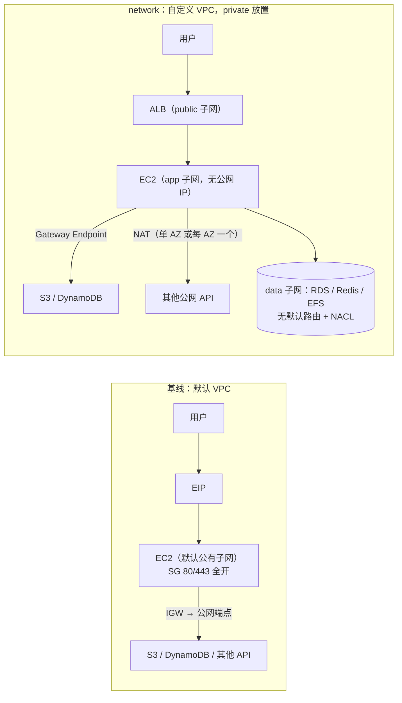
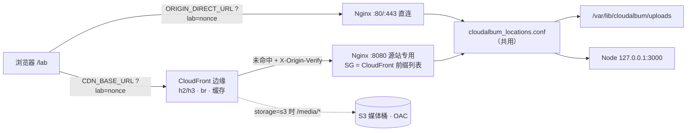
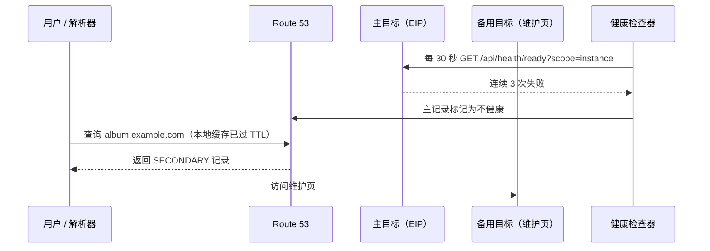
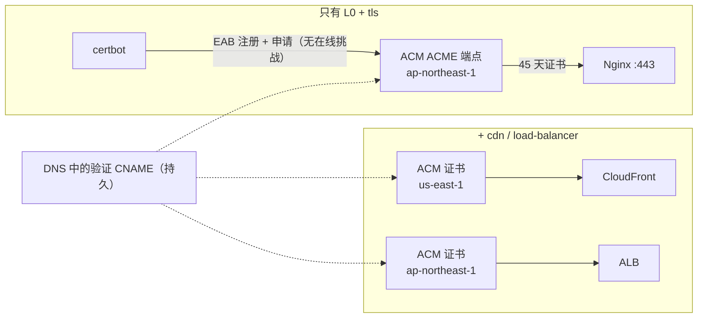
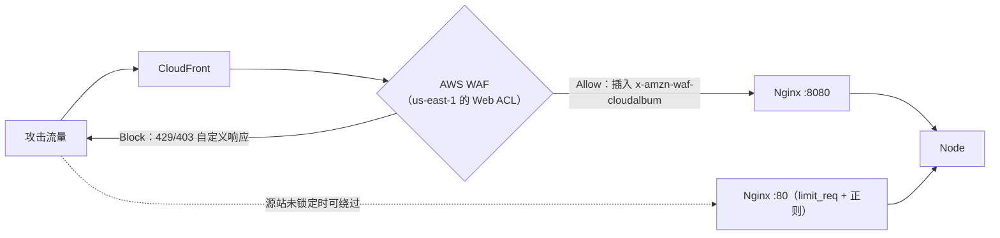
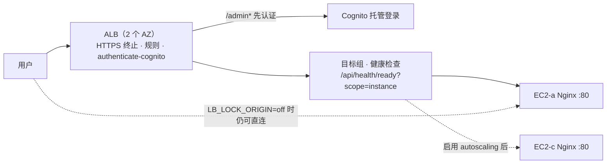
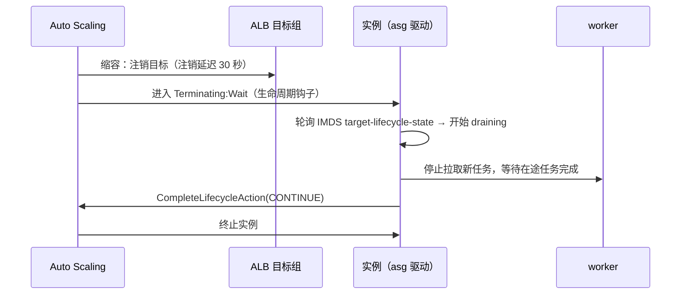

# A 组：入口、网络与扩展

本组 7 个模块决定一个请求怎样到达 CloudAlbum：实例在哪个网络里、用户通过哪个域名访问、TLS 在哪里终止、经过哪道防火墙、是否经过边缘缓存和负载均衡、最后由几台实例处理。L0（只有一台 EC2）时，这些职责全部由默认 VPC 和这台 EC2 上的 Nginx 承担；每启用一个模块，入口链上就多出一个 AWS 托管环节，变化可以在响应头 `X-CloudAlbum-Path` 的 `entry` 段、`/lab` 卡片和外部实验中直接观察到。

本文是 A 组的定稿设计手册，遵循 [modular-design.md](../modular-design.md)（下称“总纲”）的框架。本轮修订按完整性评审的统一值和主设计者的统一决策（D1～D15）收敛，修订摘要见文末“修订记录”。

- **ec2 基础契约不在本文定义。** ec2 基础栈的参数（`VpcId`、`SubnetId`、`AssociateEip`、`PublicHttpIngress`、`AdminIngressCidr`、`ExtraSecurityGroupIds`、`AlbSecurityGroupId`、`DataVolumeAttach`、`DataVolumeId`、`SshIngressCidr` 等）、`l0-bootstrap.sh`、Nginx 的 include 点与 systemd 的 drop-in 点，统一以 [00-ec2-base.md](00-ec2-base.md) 为准。本文只声明各模块通过 `baseParams` 设置哪些基础栈参数、往哪个 include 点投放什么内容。
- **锚点。** 每个模块的二级标题前有稳定锚点（`#network`、`#cdn`、`#dns`、`#tls`、`#waf`、`#load-balancer`、`#autoscaling`），registry 的 `doc` 字段写成 `docs/modules/01-edge-network-scaling.md#<id>`。
- **每个模块的结构**：第 0 节“元数据（registry 摘录）”，第 1～9 节沿用原结构（基线实现、AWS 实现、开关与配置、依赖与组合、对比实验、切换迁移回滚、SAA 考点、费用与清理、常见坑），第 10 节“探针”，第 11 节“前端徽章”。正文中“见第 N 节”的引用仍指原来的编号。

## 本组模块一览

“凭证”列取自 registry 的 `credentials` 字段（D1）：`required` 表示应用运行时必须调用 AWS API，`IAM_CREDENTIALS=none` 时触发 CRED-001；`optional` 表示 AWS API 只用于控制面感知、探针或管理按钮，没有凭证时模块照常工作，但状态为 `degraded`（detail 写“无凭证：控制面感知不可用”）。

| 模块 id | 机能 | 主 AWS 服务 | 开关（首个取值 = 本地实现） | 硬依赖（规则 ID） | 凭证 | 能否在 L0 上单独启用 |
|---|---|---|---|---|---|---|
| `network` | 网络隔离 | Amazon VPC | `NETWORK_PLACEMENT=default\|public\|private` | `public`：无。`private`（DEP-009）：入口（load-balancer，或 cdn 且 `CDN_ORIGIN_TYPE=vpc-origin`）+ 出网路径（NAT 或所需 VPC Endpoint）+ 运维通道（shell-access 或 EC2 Instance Connect Endpoint）。**`VpcId` 变化时**（迁入或迁出自定义 VPC）不能有已部署的 VPC 绑定模块（DEP-016）；同一 VPC 内从 `public` 切到 `private` 不触发 DEP-016 | optional | 能（`public` 放置）；`private` 不能 |
| `cdn` | 内容分发与边缘缓存 | Amazon CloudFront | `CDN_BASE_URL`（空 = EC2 直出） | 无（`ec2` 源站使用 L0 的 EIP 与公网 DNS，DEP-014）。`alb` 源站需 load-balancer；`vpc-origin` 需 network(private)；`CDN_MEDIA_ORIGIN=s3` 需 storage(s3)（DEP-010） | optional | 能 |
| `dns` | 域名解析 | Amazon Route 53 | `DNS_PROVIDER=none\|external\|route53`（dns 负责写入 `APP_BASE_URL`；基线 `APP_BASE_URL=http://<EIP>`） | 无模块依赖。前置条件：拥有域名并能在注册商处设置 NS。`DNS_TARGET_TYPE=alb` 需 load-balancer；`cloudfront` 需 cdn + tls | optional | 能（需域名） |
| `tls` | HTTPS 证书 | AWS Certificate Manager | `TLS_MODE=selfsigned\|letsencrypt\|acm` | 前置条件：域名。ACM ACME 端点可用（`TLS_ACME=on`，2026-07 新能力，已在官方文档核实）时无模块依赖；不可用（`TLS_ACME=off`）时退回 {dns 或外部 DNS, cdn 或 load-balancer}（DEP-005 回退分支）。挂在 CloudFront/ALB 上的集成证书需要对应挂载点 | optional | 能（需域名且 ACME 可用）；否则不能 |
| `waf` | Web 应用防护 | AWS WAF | `WAF_MODE=nginx\|aws` | cdn（CLOUDFRONT 范围）或 load-balancer（REGIONAL 范围）（DEP-006） | optional | 否 |
| `load-balancer` | 负载均衡 | Elastic Load Balancing（Application Load Balancer） | `LB_MODE=nginx\|alb`（本地档 `LB_LOCAL_WORKERS=2`） | 无（默认 VPC 中已有多个 AZ 的默认子网） | optional | 能 |
| `autoscaling` | 弹性伸缩 | Amazon EC2 Auto Scaling | `DEPLOY_MODE=single\|asg` | iam(role)、load-balancer（DEP-007）；database（postgres 且不在本机，ASG-002/003）；storage(s3) 或 shared-fs(efs)（ASG-001）；并通过其余多实例安全规则 ASG-004～ASG-014 | required | 否 |

**相关的新增模块**：`ami`（EC2 Image Builder，开关 `AMI_SOURCE=userdata|golden`）在主题上属于 A 组，按 D10/D11 写在 [06-governance-cost.md](06-governance-cost.md#ami)（以 registry 的 `doc` 字段为准），作为 Lab 21（autoscaling）的前置或扩展；本文 autoscaling 把它列为软依赖。cost 模块（Lab 1）的本地实现按已启用模块估算小时费用，本组各模块第 8 节列出的计费维度供它使用。

**本组共同约定**

以下约定适用于本组全部模块。上一轮标注“需同步总纲”的条目，本轮已按评审 consistency_issues 的统一值定稿（括号中注明对应的统一项），总纲按同一统一值修订。

**约定 1：开关、env 文件与机密**

- 纯基础设施型模块也各有一个“声明型开关”，第一个取值永远是本地实现（统一值 C1）：`NETWORK_PLACEMENT=default|public|private`、`DNS_PROVIDER=none|external|route53`（由 dns 写入 `APP_BASE_URL`）、`TLS_MODE=selfsigned|letsencrypt|acm`、`WAF_MODE=nginx|aws`、`LB_MODE=nginx|alb`。应用读取它来渲染 Nginx 片段、决定感知器（detector）的预期结果，并写进 `/api/capabilities`；它不改变业务代码路径。
- `MODULE_<ID>=on` 只表示“AWS 实现已部署”，只在开关取 AWS 值时写入 `/etc/cloudalbum/modules.d/<id>.env` 的第一行，CFG-004 据此校验。本地档（例如 `TLS_MODE=letsencrypt`、`DNS_PROVIDER=external`、`LB_LOCAL_WORKERS=2`）也写入同一个文件，但**不含** `MODULE_<ID>=on`。
- 各模块 `ownsEnv`（env 文件里只允许出现的键前缀）：network → `NETWORK_`；cdn → `CDN_`；dns → `APP_BASE_URL`、`DNS_`；tls → `TLS_`、`ACM_CERT_`；waf → `WAF_`；load-balancer → `LB_`；autoscaling → `DEPLOY_MODE`、`ASG_`。
- **凭证**（D1）：统一用 `IAM_CREDENTIALS=none|role|keys`，role 与 keys 都由 iam 栈提供。本组只有 autoscaling 是 `credentials: required`（它必须是 role，DEP-007）；其余模块是 `optional`，见“本组模块一览”的说明。本文不再出现其他凭证开关。
- **机密值不进 `modules.d`**（D5，统一值 C7/C8）：机密值只放在 `/etc/cloudalbum/secrets.env`（root:cloudalbum 0640，由 `load-env.ts` 作为第 3 层加载）与 `/etc/cloudalbum/keys/*.pem`。L0 上这两处实际位于数据卷的 `/var/lib/cloudalbum/etc`，`/etc/cloudalbum` 通过符号链接或恢复的方式使用它（见 00-ec2-base.md），所以 network 迁移、`rebuild-instance` 后密钥不变。`modules.d/*.env` 只能写 `*_SECRET_ARN` 或逻辑名，CFG-002 会拒绝机密类键。本组用到的逻辑名（SecretName）：`origin-verify`（cdn 的 `X-Origin-Verify`，load-balancer 的 `LB_ORIGIN_VERIFY` 共用；env 驱动读 `secrets.env` 的 `ORIGIN_VERIFY`，secretsmanager 驱动读 `cloudalbum/<env>/origin-verify`）与 `cloudfront-signing-key`（`CDN_SIGNED_MEDIA=on` 时使用；env 驱动读 `CLOUDFRONT_SIGNING_KEY_FILE=/etc/cloudalbum/keys/cloudfront-signing.pem`）。ACM ACME 的 EAB MAC Key 是一次性凭证，任何文件都不保存（见 tls）。

**约定 2：端口与 Nginx 布局**

| 端口 | 谁监听 | 用途 | 安全组 |
|---|---|---|---|
| 80 / 443 | Nginx 直连监听器（ec2 基础） | L0 入口；对比实验中“直连”一侧；ALB 的目标端口是 80 | 基础栈参数 `PublicHttpIngress=open\|admin-ip\|closed`（定义见 00-ec2-base.md） |
| 8080 | Nginx “CloudFront 源站专用”监听器（cdn 模块投放） | 只接收 CloudFront 回源，校验 `X-Origin-Verify` | cdn 栈自带的独立安全组，只放行 CloudFront 托管前缀列表 |
| 3000（可选 3001） | Node `cloudalbum-api`，只监听 127.0.0.1 | 应用；3001 是 load-balancer 本地档 `LB_LOCAL_WORKERS=2` 的第二个进程 | 不对外 |

- ec2 基础（00-ec2-base.md）提供本组用到的全部 include 点（统一值 C17）：`/etc/nginx/cloudalbum_locations.conf`（80/443 与 8080 共用的全部 `location`）、`/etc/nginx/cloudalbum_upstream.conf`（`upstream cloudalbum_api` 的成员，load-balancer 本地档改写它）、`/etc/nginx/cloudalbum.d/00-entry.conf`（计算 `entry` 段与 `$ca_proto` 的 `map`）、`/etc/nginx/cloudalbum.server.d/00-acme-challenge.conf`（`/.well-known/acme-challenge/`）、`/var/lib/cloudalbum/security/denylist.conf`（`geo $ca_denied` 的唯一 IP 封禁列表，见 waf）。8080 监听器所用的网段文件以 `.inc` 为扩展名，避免被 http 级通配符误引入。
- 模块只通过两个目录投放自己的片段：`/etc/nginx/cloudalbum.d/<id>-*.conf`（http 级，包括 cdn 的整个 8080 server 块）和 `/etc/nginx/cloudalbum.server.d/<id>-*.conf`（只作用于 80/443 server 块），外加改写上面列出的、明确归本组某个模块所有的 include 文件（`cloudalbum_upstream.conf` 归 load-balancer 本地档）。投放后执行 `nginx -t && systemctl reload nginx`，失败则回滚片段。
- 内部端点（例如 image-processing 的 `/internal/hooks/image-processed`）由提供方模块在 registry 的 `internalEndpoints` 中声明，location 写在 `cloudalbum_locations.conf` 里；本组的 8080 监听器不额外豁免任何内部端点（见 cdn 第 4 节与 DEP-020）。

**约定 3：客户端 IP 与协议只在 Nginx 解析一次**

| 入口组合 | 80/443 监听器信任的代理网段（`set_real_ip_from`） | 8080 监听器信任的网段 | 交给 Node 的协议 `$ca_proto` |
|---|---|---|---|
| L0 直连 | 无（不信任任何代理头） | — | `$scheme` |
| + cdn（源站 = EC2） | 无 | CloudFront origin-facing 网段 | 8080 上恒为 `https`（查看器协议策略是 redirect-to-https） |
| + load-balancer | VPC CIDR | — | ALB 传来的 `X-Forwarded-Proto` |
| + cdn（源站 = ALB） | VPC CIDR + CloudFront origin-facing 网段 | — | 带合法 `X-Origin-Verify` 的请求为 `https`，否则取 ALB 的值 |
| + cdn（VPC Origin） | — | VPC CIDR + CloudFront origin-facing 网段（实际来源地址以实测为准） | `https` |

- 所有监听器统一 `real_ip_header X-Forwarded-For; real_ip_recursive on;`。8080 的 `set_real_ip_from` 写在 8080 server 块内部，会覆盖 http 级继承的值，所以两个监听器互不影响。
- CloudFront 网段来自 `https://ip-ranges.amazonaws.com/ip-ranges.json` 中 `service = CLOUDFRONT_ORIGIN_FACING` 的条目，由 `cloudalbum-cdn-cf-ranges.timer`（模块单元一律命名为 `cloudalbum-<id>-*`，00-ec2-base.md 6.8）每天刷新并重新渲染 `/etc/nginx/cloudalbum.d/cdn-realip-ranges.inc`（不需要 AWS 凭证；扩展名 `.inc` 避免被 http 级通配符引入，只由 8080 server 块显式 include）。load-balancer 的 realip 片段为 `cloudalbum.d/load-balancer-realip.conf`（模块文件必须以模块 id 开头，00-ec2-base.md 6.7 规则 1）。
- 统一值（C16）：`cloudalbum_proxy.conf` 发送 `proxy_set_header X-Forwarded-For $remote_addr;` 与 `proxy_set_header X-Forwarded-Proto $ca_proto;`，Express 的 `trust proxy` 固定为 `loopback`。原总纲“按启用模块计算 trust proxy 跳数”的做法废止：它依赖 `$proxy_add_x_forwarded_for` 中出现的重复地址，组合一多就容易出错；现在 Node 永远只看到一个已经由 Nginx 解析好的地址。
- 解析结果被 WAF 基线限速（`limit_req` 以 `$binary_remote_addr` 为键）、IP 封禁（`geo $ca_denied` 默认按 realip 之后的 `$remote_addr` 匹配）、审计日志、Cookie 的 `Secure` 判断共用。realip 配错的两种后果：所有用户被当成同一个代理 IP 一起限速或封禁；或者攻击者伪造 `X-Forwarded-For` 绕过限速。

**约定 4：`X-CloudAlbum-Path` 中本组负责的段**

| 段 | 何时出现 | 取值 | 判定依据 |
|---|---|---|---|
| `entry` | 总是 | 入口链：`nginx`、`alb>nginx`、`alb>waf>nginx`、`cloudfront>nginx`、`cloudfront>waf>nginx`、`cloudfront>alb>nginx`、`cloudfront>waf>alb>nginx` | 由 Nginx 的 `map` 计算（`/etc/nginx/cloudalbum.d/00-entry.conf` 由 ec2 基础提供，各模块追加）：经 8080 进入 = CloudFront；`X-Amzn-Trace-Id` 存在且上一跳属于 VPC CIDR（`geo $realip_remote_addr`）= ALB；`x-amzn-waf-cloudalbum` 存在且入口含 cloudfront 或 alb = AWS WAF。`waf` 写在它所挂载的资源之后 |
| `inst` / `az` | 总是（总纲） | 实例 ID、可用区 | IMDS |
| `tls` | 请求经 TLS 到达时 | `<TLS_MODE>@<终止点>[:<证书>]`：`selfsigned@nginx`、`letsencrypt@nginx`、`acm@nginx:acme`（ACM ACME 证书）、`acm@cloudfront`、`acm@alb`；tls 未启用而经 CloudFront 默认证书到达时为 `selfsigned@cloudfront:cf-default` | 驱动位 = 当前 `TLS_MODE`（tls 模块的开关状态），`@` 后为终止点，结果位说明实际使用的证书来源。所以“tls 仍是本地档，但 CloudFront 用默认证书提供了受信任 HTTPS”可以从一个段里读出来 |
| `waf` | 请求被拦截时 | `nginx:ratelimit`、`nginx:badinput`、`nginx:denylist`、`aws:block-<规则名>`（规则名转小写，例如 `aws:block-rate-login`、`aws:block-crs`） | Nginx 的 429/403 错误页、WAF 自定义响应各自设置该头 |
| `load-balancer` | 只在 `LB_LOCAL_WORKERS=2` 时 | `nginx:w3000`、`nginx:w3001` | 由处理该请求的 Node 进程按自己的 `PORT` 标记（`ctx.path.mark`），用于观察本机两个进程的轮询 |

- 键只能是模块 id 或 `entry`、`inst`、`az`、`bypass`、`more`，值的语法为 `driver[@host][:outcome]`（统一值 C14）。静态文件由 Nginx `add_header` 只写 `entry=nginx`（以及 `inst`/`az`）；API 由 Express 中间件设置（总纲 7.2）。上一轮的 `X-CloudAlbum-Upstream` 自定义头已删除，改用上表的 `load-balancer` 段；Nginx 访问日志仍记录 `$upstream_addr`。
- 网络放置、部署模式这类“整套部署不变”的上下文不放进每个响应，写在 capabilities 的 `app` 段和页脚状态条里；实验运行器每次运行前都会抓取 capabilities 快照（总纲 8.2），切换前/切换后的结果不会混淆。

**约定 5：有效入口 URL**

`backend/src/config/base-url.ts` 按以下优先级计算“对外入口 URL”，用于邮件链接、F11 分享链接、auth=cognito 的回调与登出地址、Cookie 域：

1. dns 模块写入的 `APP_BASE_URL`（例如 `https://album.example.com`）；
2. cdn 启用时的 `CDN_BASE_URL`（`https://dxxxx.cloudfront.net`）；
3. load-balancer 启用时的 `http(s)://<LB_DNS_NAME>`（`LB_HTTPS=true` 才是 https）；
4. 基础配置中的 `APP_BASE_URL`（User Data 写入的 `http://<EIP>`）。

只有 dns 模块拥有 `APP_BASE_URL` 这个键，cdn 和 load-balancer 不改写它，因此不会触发 CFG-003。CORS 白名单是所有入口来源的并集（直连、CDN、ALB、自定义域名），否则 `/lab` 的跨入口对比实验读不到响应头。capabilities 中给出 `app.entry = { baseUrl, source }`。

**约定 6：源站暴露级别与附加安全组**

- 基础栈参数 `PublicHttpIngress=open|admin-ip|closed`（配合 `AdminIngressCidr`，参数定义见 00-ec2-base.md）控制实例安全组对公网的 80/443。多个模块都可能在 `baseParams` 中声明它，`scripts/module` 取所有已启用模块要求中**最严格**的一级：cdn 的 `CDN_DIRECT_ACCESS`、load-balancer 的 `LB_LOCK_ORIGIN`、network 的 `private` 放置（隐含 `closed`）。禁用模块时重新计算。
- 需要新增入站规则的模块，在**自己的栈里建独立安全组**，通过基础栈参数 `ExtraSecurityGroupIds`（追加）挂到实例上，不改基础安全组。原因：CloudFront 托管前缀列表在安全组规则配额中按 55 条计算，而每个安全组默认上限是 60 条入站规则，放进基础安全组后只剩 5 条余量（官方文档“AWS-managed prefix list weight”）。load-balancer 沿用 `AlbSecurityGroupId` 方式（只加 1 条规则）。
- 这类“只有安全组”的栈（cdn 的源站安全组、dns 的健康检查器安全组）也绑定 VPC，但它们没有 ENI、子网与数据，不算 DEP-016 所说的“VPC 绑定模块”：network 改变 `VpcId` 时，由 network 的 `injects` 把新 `VpcId` 注入这些栈，安全组随迁移一起重建（见 network 第 6 节）。

**约定 7：“受信任 HTTPS”判定**

capabilities 返回 `https = { trusted, via }`。满足任一条件即 `trusted=true`：直连 Nginx 使用 `letsencrypt` 或 `acm`（ACME）证书；请求经 CloudFront 域名到达（默认证书或 ACM 证书）；ALB 配置了 ACM 证书。自签名不算。auth=cognito 的非 localhost 回调地址、ALB 的 `authenticate-cognito`、`TLS_FORCE_HTTPS=true` 都依赖这个判定（B 组 auth 模块的依赖校验请使用它）。

**约定 8：必须放在 us-east-1 的资源**

CloudFront 使用的 ACM 证书（tls-edge 栈）、Cognito 托管登录页自定义域名的证书、CLOUDFRONT 范围的 WAF Web ACL、它的 IP 集合和日志组（waf-edge 栈）都在 us-east-1；CloudFront 指标、Route 53 健康检查指标与告警也在 us-east-1。注册表用 `stacks[].region` 声明，CRED-003 的例外清单包括 tls-edge 与 waf-edge。

**约定 9：跨模块参数只用提供方声明的 `injects`（统一值 C25，D2）**

模块栈之间禁止 CloudFormation `Export` / `!ImportValue`；跨模块参数只能由**提供方**在注册表中用 `injects` 声明（目标模块、目标栈、参数），由 `scripts/module` 在提供方启用、更新、禁用时执行。上一轮 C 组提出的、由被更新方声明的 `reconfigureOn` 已删除，原来写在那里的需求（cdn 启用后更新 storage 栈）改由下表 cdn → storage 一行承担。本组相关的注入：

写法统一为总纲 3.5 的 `{ target, stack?, params: { 参数: "${Out.<输出名>}" }, when? }`（各模块第 0 节）。`AppOrigins` 是逗号分隔的列表参数：dns、cdn、load-balancer 各自以 `+` 前缀**追加**自己的入口源，`scripts/module` 取并集后再并入基础上下文中的直连入口 `http://<EIP>`（与约定 5 的 CORS 白名单一致）。

| 注入方（提供方） | 被更新的模块 / 栈 | 参数 |
|---|---|---|
| tls | cdn | `AcmCertificateArn`、`Aliases` |
| tls | load-balancer | `CertificateArn`、`DomainName`（ALB 回调地址 `https://<域名>/oauth2/idpresponse` 用） |
| tls | social-api | 区域自定义域名的 `CertificateArn` |
| waf（CLOUDFRONT） | cdn | `WebAclArn`（CloudFront 只能用分配自身的 `WebACLId` 关联，不能用 WebACLAssociation） |
| cdn | storage | `CdnDistributionArn`（OAC 桶策略的 `AWS:SourceArn` 条件） |
| cdn | kms | `CloudFrontDistributionArn`（媒体桶使用 SSE-KMS 时，允许 `cloudfront.amazonaws.com` 解密） |
| cdn（`DNS_TARGET_TYPE=cloudfront`）/ load-balancer（`DNS_TARGET_TYPE=alb`） | dns | `TargetDnsName`（ALB 另有 `TargetHostedZoneId`；CloudFront 的托管区域 ID 固定） |
| dns / cdn / load-balancer | auth、identity-pool、storage | `AppOrigins`（auth：回调与登出地址；identity-pool：暂存桶 CORS；storage：原图桶 CORS；有效入口 URL 变化时更新，约定 5） |
| dns | email、tls | `HostedZoneId`（SES DKIM / MAIL FROM 记录；证书与 ACME 域验证的 CNAME） |
| load-balancer | auth | `AlbCallbackUrls`（`LB_ADMIN_AUTH=cognito` 时，auth 栈据此创建 ALB 专用机密客户端） |
| load-balancer | autoscaling | `TargetGroupArn` |
| load-balancer | cdn | `AlbOriginDomainName`（`CDN_ORIGIN_TYPE=alb` 时的源站域名） |
| load-balancer | image-processing、social-api | `OriginBaseUrl`（ALB 地址；未注入时 `scripts/module` 用基础上下文中的 `http://<EIP>`） |
| load-balancer | waf（`regional` 栈） | `AlbArn`（REGIONAL 范围的 WebACLAssociation） |
| load-balancer | monitoring | `AlbFullName`、`TargetGroupFullName`（告警与仪表板维度） |
| autoscaling | load-balancer | `InstanceId` 置空（L0 实例从目标组注销） |
| autoscaling | monitoring | `AsgName` |
| network | load-balancer、autoscaling、database、cache、shared-fs、db-proxy | `VpcId`、`SubnetIds`（按层选择 public / app / data 子网） |
| network | cdn、dns | `VpcId`（只影响它们的独立安全组，约定 6） |
| network | ami | `VpcId`、`SubnetId`（Image Builder 构建实例所在子网：public 子网，或 `NatMode≠none` 时的 app 子网） |

network 未启用时，上表中 network 提供的参数取默认 VPC 及其默认子网（由 `scripts/module` 从 ec2 基础栈的状态读取），不需要注入。本组接收、由其他组声明的注入：iam → autoscaling 的 `InstanceProfileName`（02#iam）；auth → load-balancer 的 `CognitoUserPoolArn`、`CognitoAlbClientId`、`CognitoDomain`（02#auth）；ami → autoscaling 的 `ImageParamArm64`、`ImageParamX8664`（06#ami）；kms → 所有声明了 `KmsKeyArn` 参数的栈（02#kms，`target: "*"`）。

禁用注入方时，先用空参数更新被注入的栈，再删除自己的栈（例如 ACM 拒绝删除仍被 CloudFront 使用的证书）。模块栈不自己挂 IAM 策略，只输出 `PolicyArn`，由 `scripts/module` 附加到 `CloudAlbumAppRole`（`IAM_CREDENTIALS=keys` 时附加到演示用户），附加关系记入 `.cloudalbum/state.json`（D2）。

**约定 10：本组相关的校验规则（统一编号，D3）**

全部规则只写在 `backend/src/rules/rules.ts` 一张表里，依赖只用 registry 的 `requires` 表达式书写，**每一项都带 `rule: <ID>`**（模块 id；`a | b` 任选其一；`when`/`need` 驱动条件依赖；条件只能在部署期判断的项写 `need: []`，由 `rules.ts` 的 `deployCheck()` 检查）。下表是本组模块涉及的规则说明，编号以总纲 5.2 为准：DEP-014～018 与 ASG-014 归本组；DEP-038～042 是本组 registry 中原先只有条件、没有编号的五条依赖（第 3 轮由总纲补编）；DEP-019～021 是 D 组 image-processing 的回写通道规则（原 DEP-D01～D03），因为和 cdn、autoscaling 相互作用而列在这里；DEP-028 是 C 组提出、落在 cdn 上的新规则。ASG-001～013 的条件只写在 `rules.ts`，不出现在 autoscaling 的 `requires` 中。结构或语义错误一律退出码 78，并一次性打印全部错误和修复命令。

| ID | 级别 | 可覆盖 | 范围 | 违规条件 | 说明 / 修复 |
|---|---|---|---|---|---|
| CRED-001 | error | 否 | 启动 | 启用了 `credentials: required` 的模块（本组为 autoscaling），但 `IAM_CREDENTIALS=none` | `scripts/module enable iam`（role） |
| CRED-002 | warn | — | 启动 | `IAM_CREDENTIALS=keys` | 长期访问密钥落盘；autoscaling 还会被 DEP-007 拒绝（实例必须用角色） |
| CRED-003 | error | 否 | 启动 | 模块 env 中资源 ARN 的区域与 `AWS_REGION` 不同 | 例外：tls-edge（证书）与 waf-edge（Web ACL、IP 集合、日志组）在 us-east-1 |
| DEP-005（修订） | error | 否 | 启动 | ① `TLS_MODE=acm` 但 `TLS_DOMAIN` 为空；② cdn/load-balancer/social-api 绑定了自定义域名，却缺少对应区域的集成证书 ARN；③ `TLS_ACME=off`（ACME 端点不可用或被显式关闭），但不满足“dns 或外部 DNS”且“cdn 或 load-balancer” | ①② 是证书挂载的基本条件。③ 是回退分支：ACM ACME 端点（2026-07 起，已核实）让只有 L0 时也能用 ACM；`scripts/module` 探测到端点不可用时写入 `TLS_ACME=off`，最小依赖回到 {dns 或外部 DNS, cdn 或 load-balancer}，即考试结论中的形态 |
| DEP-006 | error | 否 | 启动 | waf 已启用，但 cdn 与 load-balancer 都未启用 | WAF 不能关联 EC2、EIP、NLB |
| DEP-007 | error | 否 | 启动 | `DEPLOY_MODE=asg`，但 `IAM_CREDENTIALS≠role` 或 load-balancer 未启用 | 实例用角色拉取引导配置包；流量经 ALB 分发 |
| DEP-009（修订） | error | 否 | 部署 | `NETWORK_PLACEMENT=private`，但入口（load-balancer，或 cdn 且 `CDN_ORIGIN_TYPE=vpc-origin`）、出网路径、运维通道三者缺一。出网路径 = NAT；或 `NatMode=none` 时：Interface Endpoint 含 `cloudformation`（替换实例的 `cfn-signal`）与各已启用模块所需端点、`IAM_CREDENTIALS=role`、工具链栈的发布包镜像（network 第 2 节） | 原规则只接受 load-balancer 作为入口，也没有考虑新实例引导期的出网 |
| DEP-010 | error | 否 | 部署 | cdn 的 `CDN_MEDIA_ORIGIN=s3`，但 `STORAGE_DRIVER≠s3` | 改回 `CDN_MEDIA_ORIGIN=ec2` |
| DEP-011 | warn | — | 启动 | load-balancer 已启用，但 `AUTH_DRIVER≠cognito` 或 ALB 没有 HTTPS 监听器 | F12 的 `authenticate-cognito` 子功能关闭，应用层 RBAC 照常 |
| DEP-014 | error | 否 | 部署 | cdn 的 `CDN_ORIGIN_TYPE=ec2`，但实例没有关联 EIP | 源站只能填域名；没有 EIP 时实例停止再启动后公网 DNS 会变 |
| DEP-015 | error | 否 | 启动 | `TLS_FORCE_HTTPS=true`，但直连监听器使用自签名证书 | 自签名 + HSTS 会把用户锁在站外 |
| DEP-016（修订） | error | 否 | 部署 | network 的启用、禁用或更新会改变实例的 **`VpcId`**，而仍有已部署的 VPC 绑定模块（load-balancer、database、cache、shared-fs、autoscaling、db-proxy，以及放进 VPC 的 Lambda） | 同一 VPC 内只改 `NETWORK_PLACEMENT`（`public` ↔ `private`）**不触发**本规则，只检查 DEP-009，并更新 ALB 目标或 VPC Origin。只有安全组的栈（cdn、dns）不算 VPC 绑定模块，由 `injects` 随迁移重建。修复：先按 Lab 顺序在启用这些模块之前完成 `public` 迁入，或加 `--cascade` 先禁用、迁移后再启用 |
| DEP-017 | error | 否 | 启动 | `LB_ADMIN_AUTH=cognito`，但 `AUTH_DRIVER≠cognito` 或 ALB 没有 HTTPS 监听器 | 与 DEP-011（只警告并关闭子功能）互补：显式要求开启时直接报错 |
| DEP-018 | warn | — | 运行 | AWS WAF 已启用，但对应入口没有锁定（CLOUDFRONT 范围时 `CDN_DIRECT_ACCESS=open`；REGIONAL 范围时 `PublicHttpIngress=open`） | waf 状态为 `degraded`：攻击者可以直连 EC2 绕过 WAF |
| DEP-019 | error | 否 | 启动 | `IMAGE_PROCESSOR=lambda`、`IMAGE_RESULT_CHANNEL=callback`、`DEPLOY_MODE=asg`，且回调地址的主机不是负载均衡地址 | 回调会打到某一台实例；改为 ALB 地址，或改用 queue 通道 |
| DEP-020 | warn | — | 启动 | `IMAGE_RESULT_CHANNEL=callback` 且 cdn 已启用 | 本组的 8080 监听器与 CloudFront 行为都不放行 `/internal/hooks/`；只有 `CDN_DIRECT_ACCESS=open` 时回调还能走直连 80。收紧源站前改用 `IMAGE_RESULT_CHANNEL=queue`（预设 l4-async 已固定为 queue） |
| DEP-021 | warn | — | 启动 | 回调地址以 `http://` 开头 | HMAC 防伪造、防篡改，不防窃听 |
| DEP-028 | warn | — | 启动 | cdn 的 `CDN_MEDIA_ORIGIN=ec2`，而 `STORAGE_DRIVER=s3` | 源站 `/media` 会返回指向会过期预签名 URL 的 302，不能放进边缘缓存。此时 MediaUrlBuilder 不把媒体 URL 改写到 CDN，cdn 状态为 `degraded`，提示改为 `CDN_MEDIA_ORIGIN=s3` |
| DEP-038 | error | 否 | 启动 | `CDN_ORIGIN_TYPE=alb`，但 load-balancer 未启用 | 源站是 ALB 时必须先有 ALB；否则改回 `CDN_ORIGIN_TYPE=ec2` |
| DEP-039 | error | 否 | 启动 | `CDN_ORIGIN_TYPE=vpc-origin`，但 `NETWORK_PLACEMENT≠private` | VPC Origin 的目标（internal ALB 或私有 EC2）必须在私有子网 |
| DEP-040 | error | 否 | 启动 | `DNS_TARGET_TYPE=alb`，但 load-balancer 未启用 | Alias 目标不存在；改为 `eip` 或先启用 load-balancer |
| DEP-041 | error | 否 | 启动 | `DNS_TARGET_TYPE=cloudfront`，但 cdn 或 tls 未启用 | Alias 到 CloudFront 要求分配上配置了该备用域名，而备用域名需要 us-east-1 的 ACM 证书 |
| DEP-042 | error | 否 | 启动 | `LB_ORIGIN_VERIFY=on`，但 `CDN_ORIGIN_TYPE≠alb` | ALB 只接受带 `X-Origin-Verify` 的请求时，没有以 ALB 为源站的 CloudFront 就会把全部请求挡成 403 |
| SEC-001（修订） | warn | — | 运行 | cdn 已启用，但 8080 监听器缺失，或最近 5 分钟出现 `X-Origin-Verify` 不匹配的回源请求 | 有人用自己的 CloudFront 分配指向我们的源站 |
| SEC-002 | warn | — | 运行 | load-balancer 已启用，但仍有不经 ALB 的公网请求，或实例对 `0.0.0.0/0` 开放 80/443 | 用户绕过 ALB |
| ASG-013（修订） | warn | — | 启动 | 限速计数按实例分别统计：`CACHE_DRIVER≠redis`（应用层），或 `WAF_MODE=nginx`（Nginx 层） | 实际限额 = 单实例限额 × 实例数。总纲 CachePort 注释中的 ASG-015 改为引用本规则 |
| ASG-014 | error | 否 | 启动 | `DEPLOY_MODE=asg` 且 `TLS_MODE=letsencrypt` | HTTP-01 验证请求会被 ALB 分到随机实例；各实例重复签发会触发 CA 频率限制。TLS 应在 ALB 或 CloudFront 终止 |

**约定 11：组合矩阵与启用顺序**

| 组合 | 入口链 | DNS 目标 | TLS 终止 | WAF |
|---|---|---|---|---|
| L0 | `nginx` | A 记录 → EIP（可选） | Nginx（自签名 / Let's Encrypt / ACM ACME） | Nginx `limit_req` |
| + cdn | `cloudfront>nginx`（8080） | Alias → CloudFront | CloudFront 边缘 | CLOUDFRONT 范围 |
| + load-balancer | `alb>nginx`（80） | Alias → ALB | ALB（区域证书） | REGIONAL 范围 |
| + cdn + load-balancer | `cloudfront>alb>nginx` | Alias → CloudFront | CloudFront（回源到 ALB 可再走 HTTPS） | 优先挂在 CloudFront |
| + network(private) | 必须经 ALB 或 VPC Origin | 不能再指向 EIP | 同上 | 同上 |
| + autoscaling | 必须经 ALB | 指向 ALB 或 CloudFront | ALB 或 CloudFront | AWS WAF（Nginx 限速按实例计数） |

启用顺序不在本文单独规定，统一以评审给出的 Lab 顺序与预设档位为准（D12，统一值 C32）。与本组有关的位置：

| Lab | 本组模块 | 所在预设 | 说明 |
|---|---|---|---|
| Lab 5 | cdn | l2-edge | 先以 EC2 为源站；之后把媒体源站切到 S3（OAC 三阶段） |
| Lab 6 | dns、tls | l2-edge | 需要域名，可跳过；ACME 端点不可用时 tls 只做在 cdn 上（DEP-005 回退分支） |
| Lab 7 | waf | l2-edge | CLOUDFRONT 范围 |
| Lab 14 | network（`public`） | l6-data | **必须在任何 VPC 绑定模块之前**迁入自定义 VPC（DEP-016）；此时 cdn、dns 只有安全组需要随迁移重建；public 子网自动分配公网 IPv4，新实例引导期靠它出网，收到 `cfn-signal` 后改挂原 EIP |
| Lab 19 | load-balancer | l8-ha | 有域名时挂区域证书并设 `LB_ADMIN_AUTH=cognito`（没有域名时不设，F12 的 ALB 认证按 DEP-011 关闭）；cdn 源站切到 ALB |
| Lab 20 | network（`private`） | l8-ha | 同一 VPC 内从 `public` 切到 `private`，不触发 DEP-016；没有 NAT 时引导期出网走 Endpoint（含 `cloudformation`）+ 工具链栈发布包镜像（DEP-009） |
| Lab 21 | autoscaling（+ shared-fs 变体；ami 作为前置或扩展） | l8-ha、x-efs-asg | 依赖前面全部数据层模块 |

本组模块在 l0-plus-local-tiers 中的本地档：`LB_LOCAL_WORKERS=2`；有域名时 `TLS_MODE=letsencrypt`。每个模块单独加在 L0 上的形态由 `profiles/single/<id>.env` 自动生成（L0 + 本模块 + 最小硬依赖；`credentials: required` 的模块自动并入 iam(role)；dns、tls 的“拥有域名”在冒烟矩阵中标为“需人工”）。

**约定 12：本组定稿的设计点（均已进入评审统一值，总纲按此修订）**

1. 端口（共 24 个端口——23 个模块端口 + 内部 LockPort，总纲 4.1——中的 3 个）：`ports/cdn.ts`（CdnPort，`adapters/cdn/{direct,cloudfront}.ts`）、`ports/blocklist.ts`（BlocklistPort，`adapters/waf/{nginx,aws}.ts`）、`ports/instance-lifecycle.ts`（InstanceLifecyclePort，`adapters/autoscaling/{single,asg}.ts`）。驱动名等于开关取值；AWS SDK 客户端统一由 `backend/src/adapters/aws/clients.ts` 创建。三者都是**非权威端口**（统一值 C30）：故障时模块标为 `degraded`，在 status 与路径头中可见，不返回 503。
2. 纯基础设施型模块的声明型开关（约定 1，统一值 C1）。
3. tls 在 ACME 端点可用时可以在 L0 上单独启用，并保留回退分支（DEP-005）；network 的 private 放置接受 VPC Origin 作为入口（DEP-009）；DEP-016 只在 `VpcId` 变化时触发。
4. Nginx 的 include 点由 00-ec2-base.md 提供，cdn 使用独立的 8080 监听器（约定 2，统一值 C17）。
5. 客户端 IP 只在 Nginx 解析一次，Express `trust proxy = loopback`（约定 3，统一值 C16）。
6. ALB 目标组、ASG 与 Route 53 健康检查统一使用 `/api/health/ready?scope=instance`：只检查本实例的条件（进程、配置、未处于 draining、本机磁盘可写），不检查 RDS 等共享依赖。理由：HealthCheckType=ELB 时，共享依赖一故障，所有实例都会被判不健康并被 ASG 反复替换；单实例时 ALB 也会因“全部不健康”而失效开放，摘除没有意义。共享依赖的故障仍由 `/api/health/ready`（不带参数）和 capabilities 报告（统一值 C16）。
7. network 不为其他模块预建安全组；network 只输出 VPC、子网与 CIDR。
8. 跨模块参数只用提供方声明的 `injects`（约定 9，统一值 C25）。
9. 单机多进程只保留 `LB_LOCAL_WORKERS`，upstream 成员拆到 `cloudalbum_upstream.conf`；cache 的陈旧读实验复用它，`API_CLUSTER_WORKERS` 删除（统一值 C18）。
10. IP 封禁只保留 `/var/lib/cloudalbum/security/denylist.conf`（`geo $ca_denied`），BlocklistPort(nginx) 与 fail2ban 共用（统一值 C19，见 waf）。

**约定 13：实验运行约定**

- 统一使用总纲 8.2 的运行器：`npm run exp -- <模块> --label before|after --scenario <场景> [--target <URL>] [--upload]`。每个模块的实验目录为 `experiments/<id>/`，包含 `experiment.json`、`<场景>.k6.js` 或 `<场景>.ts`、`faults/*.sh`、`README.md`；需要 nmap、dig、openssl 的场景由 `.ts` 脚本调用这些命令并解析输出。
- 实验从 CloudShell（多个区域：us-east-1、eu-west-1、ap-southeast-2、ap-northeast-1）或学习者本机发起，**不在被测 EC2 上压测自己**。CloudShell 中按需安装工具（`sudo dnf install -y nmap bind-utils`，k6 按官方说明安装），安装内容在会话之间是否保留以官方文档为准。
- 只扫描、只压测自己账号里的资源。AWS 允许对其许可清单中的服务做安全测试，但禁止未经批准的 DoS 模拟，以官方的渗透测试政策为准。本组的限速实验只需要每秒数次到数十次的请求，不要做洪泛式压测。
- 从单一 IP 压测时会被 Nginx `limit_req`（每实例）和 AWS WAF `rate-global`（全局）限速。做 cdn、load-balancer、autoscaling 的负载实验前，把实验机 IP 加入 `WAF_LAB_ALLOW_CIDR`（同时渲染为 Nginx `geo` 白名单和 WAF 优先级最高的允许规则），实验后立即清空。waf 自己的实验要求白名单为空，`experiment.json` 用 `requires` 校验。

**约定 14：定稿时核实过的关键事实与出处（2026 年 10 月）**

- CloudFront 托管前缀列表（IPv4、IPv6 各一个）在安全组配额中按 55 条计算；Route 53 健康检查器前缀列表按 25 条计算：[AWS-managed prefix lists](https://docs.aws.amazon.com/vpc/latest/userguide/working-with-aws-managed-prefix-lists.html)。
- CloudFront VPC Origin 支持 ALB、NLB 与私有子网中的 EC2；VPC 必须挂 IGW；入站 NACL 不评估；东京不支持 `apne1-az3`：[Restrict access with VPC origins](https://docs.aws.amazon.com/AmazonCloudFront/latest/DeveloperGuide/private-content-vpc-origins.html)。
- 托管缓存策略的 TTL 与缓存键（CachingOptimized 最小 TTL 1 秒；UseOriginCacheControlHeaders 把全部 Cookie 放进缓存键）：[Use managed cache policies](https://docs.aws.amazon.com/AmazonCloudFront/latest/DeveloperGuide/using-managed-cache-policies.html)；CachingDisabled 下用 AllViewer 类源请求策略转发 `Authorization`：[re:Post 知识中心](https://repost.aws/knowledge-center/cloudfront-authorization-header)。
- ACM 的 ACME 端点（本轮于 2026-10-13 按 D13 重新核实，结论：**官方来源可以确认**）：[What's New 2026-07-06](https://aws.amazon.com/about-aws/whats-new/2026/07/aws-certificate-manager-acme)（所有商业区域可用）；用户指南 [ACME certificate automation](https://docs.aws.amazon.com/acm/latest/userguide/acm-acme.html)（45 天证书、私钥只在客户端、不能挂到 ELB/CloudFront/API Gateway、ACM 不负责续期）、[ACME endpoints](https://docs.aws.amazon.com/acm/latest/userguide/acm-acme-endpoints.html)（`AuthorizationBehavior=PRE_APPROVED`、目录 URL 形如 `https://acm-acme-enroll.<region>.api.aws/<id>/directory`）、[ACME domain validation](https://docs.aws.amazon.com/acm/latest/userguide/acm-acme-domain-validation.html)（持久 CNAME、最多验证 72 小时、可选 Route 53 自动建记录）、[External account bindings](https://docs.aws.amazon.com/acm/latest/userguide/acm-acme-eab.html)（服务主体 `acm-acme.amazonaws.com`、凭证可设过期、吊销 EAB 不影响已注册账户）、[Issuing certificates through ACME](https://docs.aws.amazon.com/acm/latest/userguide/acm-acme-issuance.html)（签发最多约 2 分钟，客户端超时至少 120 秒；`ListCertificates` 默认不列出 ACME 证书）；CloudFormation 资源 [`AWS::CertificateManager::AcmeEndpoint`](https://docs.aws.amazon.com/AWSCloudFormation/latest/TemplateReference/aws-resource-certificatemanager-acmeendpoint.html)、`AcmeDomainValidation`、[`AcmeExternalAccountBinding`](https://docs.aws.amazon.com/AWSCloudFormation/latest/TemplateReference/aws-resource-certificatemanager-acmeexternalaccountbinding.html)（EAB 的 KeyId/MacKey 不由 CloudFormation 返回）；计费维度见 [ACM 定价页](https://aws.amazon.com/certificate-manager/pricing/)（ACME 证书按域名在签发与每次续期时计费）。ACM 公有证书默认有效期改为 198 天、到期前约 45 天续期：[What's New 2026-02](https://aws.amazon.com/about-aws/whats-new/2026/02/aws-certificate-manager-updates-default)。
- Let's Encrypt 的 IP 地址证书与 6 天短期证书正式可用：[Let's Encrypt 公告 2026-01-15](https://letsencrypt.org/2026/01/15/6day-and-ip-general-availability)。
- ALB 日志可作为 vended logs 投递到 CloudWatch Logs：[What's New 2026-07](https://aws.amazon.com/about-aws/whats-new/2026/07/amazon-cloudwatch-logs/)。
- WAF CRS 的 `SizeRestrictions_BODY`（8 KB）与各资源的请求体检查上限：[Baseline rule groups](https://docs.aws.amazon.com/waf/latest/developerguide/aws-managed-rule-groups-baseline.html)；限速规则的最低阈值与评估窗口：[Rate-based rule settings](https://docs.aws.amazon.com/waf/latest/developerguide/waf-rule-statement-type-rate-based-high-level-settings.html)。
- SSM Agent 3.3.40.0 起优先使用 `ssmmessages`：[Reference: ec2messages, ssmmessages](https://docs.aws.amazon.com/systems-manager/latest/userguide/systems-manager-setting-up-messageAPIs.html)。
- 其余拿不准的限制在正文中标注“以官方文档为准”。

<a id="network"></a>

## network：网络隔离 ↔ Amazon VPC

> 一句话总结：没有它时，EC2 放在账号自带的默认 VPC 公有子网里，挂弹性 IP，安全组对全网开放 80/443，访问 S3 等服务走公网端点；有了它之后，实例可以迁入自建的分层 VPC 私有子网，出网改走 NAT，访问 S3/DynamoDB 改走 Gateway Endpoint。最直观的区别：外部 nmap 扫描从“80/443 开放”变成实例完全无响应，出网 IP 从实例 EIP 变成 NAT 的 EIP。

### 0. 元数据（registry 摘录）

```yaml
# modules/registry.yaml 中 network 的条目（摘录；不一致时以 registry 为准，并同步本节）
network:
  group: A
  function: 网络隔离
  awsService: Amazon VPC
  auxServices: [NAT Gateway, VPC Endpoint, VPC Flow Logs, EC2 Instance Connect Endpoint]
  type: infra
  detector: detectors/network.ts
  switch: { var: NETWORK_PLACEMENT, values: [default, public, private], ownedValues: [public, private], localTiers: [] }
  ownsEnv: [NETWORK_]
  credentials: optional                  # 无凭证时感知器只能按 CIDR 推断（inferred）
  prerequisites: []                      # private + NatMode=none 时另需 toolchain（发布包镜像，DEP-009 的 deployCheck 检查）
  requires:
    - { rule: DEP-009, when: { NETWORK_PLACEMENT: private },
        need: ["load-balancer | CDN_ORIGIN_TYPE=vpc-origin",                     # 入口
               "NETWORK_NAT_MODE!=none | NETWORK_INTERFACE_ENDPOINTS!=none",     # 出网；NatMode=none 时 deployCheck() 另查：端点含 cloudformation 与各模块所需端点、IAM_CREDENTIALS=role、工具链栈的发布包镜像
               "shell-access | NETWORK_EIC_ENDPOINT=on"] }                        # 运维通道
    - { rule: DEP-016, need: [] }        # 无启动期条件；deployCheck()：本次启用 / 禁用 / 更新会改变 VpcId，且仍有已部署的 VPC 绑定模块
  soft: [shell-access, load-balancer, logging]
  conflicts: []
  orderBefore: [load-balancer, database, cache, shared-fs, autoscaling, db-proxy]   # DEP-016：先迁入再建 VPC 绑定资源
  authoritative: false
  bypass: []
  stacks: [{ name: main, template: infra/modules/network.yaml }]   # 栈参数 Placement=public|private 由 --placement 给出
  baseParams:                            # 定义见 00-ec2-base.md 6.2；只在“替换实例的流程”中由 replaceInstance() 分阶段下发（00 第 8 节）
    VpcId: "${Out.EnvNetworkVpcId}"
    SubnetId: "${Out.InfoInstanceSubnetId}"            # public：public 第一个子网；private：app 第一个子网（与数据卷同 AZ）
    AssociateEip: "${Out.InfoAssociateEip}"            # public = true，private = false
    PublicHttpIngress: "${Out.InfoPublicHttpIngress}"  # private = closed；public = open（与其他声明方取最严格）
    # DataVolumeAttach、DataVolumeId 不是 network 的长期取值：replaceInstance() 在分阶段流程中临时写入（跨 AZ 时传快照建的新卷）
  injects:                               # D2：跨模块参数只由提供方声明；network 未启用时这些参数由 scripts/module 取默认 VPC 的值（基础上下文）
    - { target: load-balancer, params: { VpcId: "${Out.EnvNetworkVpcId}", SubnetIds: "${Out.EnvNetworkPublicSubnetIds}" } }   # internet-facing ALB 在 public 子网
    - { target: autoscaling,   params: { SubnetIds: "${Out.InfoAsgSubnetIds}" } }                                         # private：app 子网；public：public 子网
    - { target: database,      params: { VpcId: "${Out.EnvNetworkVpcId}", SubnetIds: "${Out.EnvNetworkDataSubnetIds}" } }
    - { target: cache,         params: { VpcId: "${Out.EnvNetworkVpcId}", SubnetIds: "${Out.EnvNetworkDataSubnetIds}" } }
    - { target: shared-fs,     params: { VpcId: "${Out.EnvNetworkVpcId}", SubnetIds: "${Out.EnvNetworkDataSubnetIds}" } }
    - { target: db-proxy,      params: { VpcId: "${Out.EnvNetworkVpcId}", SubnetIds: "${Out.EnvNetworkDataSubnetIds}" } }
    - { target: cdn,           params: { VpcId: "${Out.EnvNetworkVpcId}" } }        # 只影响 cdn 源站安全组
    - { target: dns,           params: { VpcId: "${Out.EnvNetworkVpcId}" } }        # 只影响健康检查器安全组
    - { target: ami,           params: { VpcId: "${Out.EnvNetworkVpcId}", SubnetId: "${Out.InfoBuildSubnetId}" } }   # Image Builder 构建实例：public 子网，或 NatMode≠none 时 app 子网
  secretParams: []
  migration: instance-move               # 分阶段替换实例 + 数据卷改挂，见第 6 节
  probe: { kind: detector, intervalSec: 60 }
  lab: { compare: before-after, hourlyBilled: true, experiments: [surface-scan, egress-path, scan-count, endpoint-only, cost-inventory] }   # 文案见第 11 节
  doc: docs/modules/01-edge-network-scaling.md#network
```

- 类型 I（纯基础设施型），没有端口，只有感知器；不承载权威数据。
- 多实例：与部署模式无关；ASG 使用哪层子网见第 4 节。

### 1. 基线实现（仅 EC2）

`NETWORK_PLACEMENT=default`（没有 `network.env` 时的缺省值）。

- **网络**：默认 VPC（172.31.0.0/16），每个 AZ 一个 /20 默认公有子网，主路由表 `0.0.0.0/0 → IGW`。实例所在子网与 EIP 关联由 ec2 基础栈决定（`SubnetId`、`AssociateEip` 的缺省行为见 00-ec2-base.md）。
- **安全组** `cloudalbum-<env>-ec2-sg`（00-ec2-base.md）：入站 80/443 来自 `0.0.0.0/0` 与 `::/0`；22 只对基础栈参数 `SshIngressCidr`（管理员 /32）开放，启用 shell-access 后删除；出站全部放行。
- **出网**：实例用自己的公网 IP 经 IGW 出网；访问 S3、DynamoDB、Cognito 等都走各服务的公网端点。
- **感知器** `backend/src/modules/detectors/network.ts`：启动时用 IMDSv2 读取 `mac`，再读 `network/interfaces/macs/<mac>/vpc-id`、`subnet-id`、`vpc-ipv4-cidr-block`、`public-ipv4`，以及 `placement/availability-zone`、`placement/availability-zone-id`。有凭证时再调用 `ec2:DescribeVpcs` 确认 `IsDefault`（置信度 `confirmed`），否则只能按 CIDR 推断（`inferred`）。
- **出网 IP 观测**：worker 每 10 分钟（以及 `/lab` 网络卡片刷新时）请求 `https://checkip.amazonaws.com`，结果写入 LabMetricsStore。这不是 AWS API 调用，不需要凭证，也不违反“L0 不访问 AWS API”。
- **攻击面观测**：worker 本来就在增量读取 Nginx JSON 访问日志（总纲 7.3 的 `lab_origin_samples`），这里增加一个 `scan` 维度：命中常见扫描路径（`/wp-login.php`、`/.env`、`/phpmyadmin`、`/cgi-bin/` 等）且返回 403/404 的请求，以及 `Host` 是裸 IP 的请求，按小时计数。`/lab` 网络卡片显示“过去 24 小时打到实例的扫描请求数”。
- **费用**：默认 VPC 不收费；EIP 作为公网 IPv4 地址按小时收费（以官方定价为准）。

### 2. AWS 实现

`infra/modules/network.yaml`（栈名 `cloudalbum-<env>-network`）：

- **VPC**：10.0.0.0/16，`EnableDnsSupport` 与 `EnableDnsHostnames` 均为 true。
- **AZ**：参数 `AzIds` 用 AZ ID 而不是 AZ 名称（AZ 名称到 AZ ID 的映射因账号而异），默认 `apne1-az1,apne1-az4`。`scripts/module` 会把 L0 实例所在的 AZ ID 放在第一位（它不是 `apne1-az3` 时），使迁移时数据卷可以直接改挂。东京的 `apne1-az3` 不支持 CloudFront VPC Origin，新账号通常也无法使用，不要选它。
- **子网**（public 子网 `MapPublicIpOnLaunch=true`，app、data 子网为 false）：public 子网必须自动分配公网 IPv4，原因是基础栈的 EIP 关联要等新实例发出 `cfn-signal` 之后才创建，引导期间（`dnf`、下载发布包、`cfn-signal`）实例只能靠自动分配的公网地址出网，否则 `CreationPolicy` 超时回滚（00-ec2-base.md 的 `preflight: ec2-public-ipv4-at-boot`）；EIP 关联后自动分配的地址随即释放，对外地址仍是原 EIP。ALB、NAT 的公网地址与此参数无关：

| 层 | AZ-1 | AZ-2 | 路由 | 用途 |
|---|---|---|---|---|
| public | 10.0.0.0/24 | 10.0.1.0/24 | `0.0.0.0/0 → IGW` | ALB、NAT、`public` 放置的实例 |
| app | 10.0.10.0/24 | 10.0.11.0/24 | `0.0.0.0/0 → NAT`（NatMode≠none 时）；S3/DynamoDB 前缀列表 → Gateway Endpoint | `private` 放置的实例、ASG、VPC 内 Lambda 的 ENI |
| data | 10.0.20.0/24 | 10.0.21.0/24 | **没有默认路由**，只有 Gateway Endpoint | RDS、ElastiCache、EFS 挂载目标 |

- **NAT**：参数 `NatMode=none|instance|gateway`，**默认 `none`**（`public` 放置不需要 NAT）。`gateway`：默认 1 个放在 public 第一个子网，`HaNat=true` 时每个 AZ 一个、每个 app 路由表指向本 AZ 的 NAT。`instance`：t4g.nano 的 AL2023 实例，开启 IP 转发并配置 iptables MASQUERADE，关闭源/目标检查（`SourceDestCheck=false`），挂 EIP，自带安全组（入站只允许 VPC CIDR）。
- **Gateway Endpoint**：S3 与 DynamoDB，关联 app 与 data 路由表，免费。参数 `EndpointPolicyMode=open|restricted`：restricted 时只允许访问 `cloudalbum-*` 资源，**同时必须放行 AL2023 软件仓库所在的 S3 桶**（`al2023-repos-<region>-*`，桶名以官方文档为准），否则私有子网里 `dnf install` 会失败。
- **Interface Endpoint**：参数 `InterfaceEndpoints=none|ops|all`。`ops` = `ssm`、`ssmmessages`、`logs`、`monitoring`、`cloudformation`（SSM Agent 3.3.40.0 起优先使用 `ssmmessages`，老区域是否还需要 `ec2messages` 以官方文档为准；`cloudformation` 供 `NatMode=none` 时替换实例的引导脚本发 `cfn-signal`）；`all` 再加 `secretsmanager`、`sqs`、`sns`、`sts`、`kms` 以及按已启用模块需要的端点。放在 app 子网，`PrivateDnsEnabled=true`，端点安全组只放行 VPC CIDR 的 443。每个端点每个 AZ 按小时计费。
- **没有 NAT 时的引导期出网**（`private` + `NatMode=none`，DEP-009）：替换实例时新实例的引导脚本要 `dnf`（AL2023 仓库在 S3 上，经 S3 Gateway Endpoint）、下载发布包、发 `cfn-signal`（经 `cloudformation` Interface Endpoint）。GitHub Release 不可达，所以 `scripts/module` 先把固定版本的发布包复制到工具链栈制品桶的 `releases/<版本>/<架构>.tgz`，并在替换实例的同一次基础栈更新中把 `AppArchiveUrl` 改为该 `s3://` 地址（实例本来就要被替换，改 User Data 不会额外停机）；引导段用实例角色经 S3 Gateway Endpoint 下载，所以此时要求 `IAM_CREDENTIALS=role`，network 的 `PolicyArn` 含对 `releases/*` 的 `s3:GetObject`。`EndpointPolicyMode=restricted` 时 Gateway Endpoint 策略也要放行工具链桶。
- **NACL**（只加在 data 子网）：入站只允许 app 子网 CIDR 的 TCP 5432、6379、2049；出站只允许到 app 子网 CIDR 的 TCP 1024–65535（临时端口）。NACL 无状态，忘了出站临时端口会导致连接挂起而不是立即被拒绝。
- **VPC Flow Logs**：VPC 级，`TrafficType=ALL`，自定义格式（v5 字段）：`version interface-id instance-id srcaddr dstaddr srcport dstport protocol packets bytes action pkt-srcaddr pkt-dstaddr flow-direction traffic-path start end`；`MaxAggregationInterval=60`（便于实验观察）。目标为 CloudWatch Logs `/cloudalbum/<env>/vpc-flow`（保留 7 天，需要一个投递 IAM 角色）或 S3（参数 `FlowLogDestination=cloudwatch|s3`）。
- **EC2 Instance Connect Endpoint**（可选，`EnableEicEndpoint=true`）：放在 app 第一个子网，自带安全组；实例安全组通过附加安全组放行来自该端点安全组的 22。私有实例不需要公网 22 也能 SSH。
- **不预建其他模块的安全组**：RDS、ElastiCache、EFS、ALB 的安全组仍由各自模块在自己的栈里创建（总纲 9.1“不修改别人的资源”）。network 只输出 VPC、子网、CIDR。
- **两种放置方式**：

| `NETWORK_PLACEMENT` | 实例位置 | 公网地址 | 入口 | 能否单独运行 |
|---|---|---|---|---|
| `public` | public 第一个子网 | 原 EIP 重新关联 | 与 L0 相同（EIP 直连） | 能，相当于“自定义 VPC 版 L0” |
| `private` | app 第一个子网 | 无 | 只能经 ALB（internet-facing，在 public 子网），或 CloudFront VPC Origin | 不能（DEP-009） |

- **Outputs**：`EnvNetworkPlacement`、`EnvNetworkVpcId`、`EnvNetworkVpcCidr`、`EnvNetworkPublicSubnetIds`、`EnvNetworkAppSubnetIds`、`EnvNetworkDataSubnetIds`、`EnvNetworkNatMode`、`EnvNetworkNatPublicIps`、`EnvNetworkS3EndpointId`、`EnvNetworkDdbEndpointId`、`EnvNetworkInterfaceEndpoints`、`EnvNetworkEicEndpoint`、`EnvNetworkFlowLogGroup`；按栈参数 `Placement` 与 `NatMode` 计算的 `InfoInstanceSubnetId`、`InfoAssociateEip`、`InfoPublicHttpIngress`（供 `baseParams`）、`InfoAsgSubnetIds`、`InfoBuildSubnetId`（供 `injects`）；`PolicyArn` 包含 `ec2:DescribeVpcs`、`DescribeSubnets`、`DescribeRouteTables`、`DescribeNatGateways`、`DescribeVpcEndpoints`，对 Flow Logs 日志组的 `logs:StartQuery`、`logs:GetQueryResults`（供 `/lab` 查询），以及 `NatMode=none` 时对工具链桶 `releases/*` 的 `s3:GetObject`。
- **baseParams**（由 `scripts/module` 更新基础栈；参数定义与缺省值见 00-ec2-base.md）：`VpcId`、`SubnetId`、`AssociateEip`（public=true，private=false）、`PublicHttpIngress`（private 隐含 closed）；`DataVolumeAttach` 与 `DataVolumeId` 只在迁移分阶段中临时使用（第 6 节）。
- **injects**：见第 0 节，按层把 VPC 与子网注入 load-balancer（public）、autoscaling（随放置）、database / cache / shared-fs / db-proxy（data），把 `VpcId` 注入 cdn、dns（它们只有独立安全组，约定 6），把构建子网注入 ami。



### 3. 开关与配置

```bash
# 基线：没有 /etc/cloudalbum/modules.d/network.env，NETWORK_PLACEMENT 缺省为 default

# 启用后由 scripts/module 根据栈 Outputs 生成 /etc/cloudalbum/modules.d/network.env
MODULE_NETWORK=on
MODULE_NETWORK_VERSION=1
NETWORK_PLACEMENT=private                 # default | public | private
NETWORK_VPC_ID=vpc-0abc1234def567890
NETWORK_VPC_CIDR=10.0.0.0/16
NETWORK_PUBLIC_SUBNET_IDS=subnet-0aaa,subnet-0bbb
NETWORK_APP_SUBNET_IDS=subnet-0ccc,subnet-0ddd
NETWORK_DATA_SUBNET_IDS=subnet-0eee,subnet-0fff
NETWORK_NAT_MODE=gateway                  # none | instance | gateway
NETWORK_NAT_PUBLIC_IPS=203.0.113.20
NETWORK_S3_ENDPOINT_ID=vpce-0s3...
NETWORK_DDB_ENDPOINT_ID=vpce-0ddb...
NETWORK_INTERFACE_ENDPOINTS=ops           # none | ops | all
NETWORK_EIC_ENDPOINT=off                  # on：已建 EC2 Instance Connect Endpoint（DEP-009 的运维通道之一）
NETWORK_FLOW_LOG_GROUP=/cloudalbum/lab/vpc-flow

# CloudFormation 参数（scripts/module enable network --placement public|private --param ...）
# Placement=private  AzIds=apne1-az1,apne1-az4  NatMode=gateway  HaNat=false  InterfaceEndpoints=ops
# EndpointPolicyMode=open  FlowLogDestination=cloudwatch  EnableEicEndpoint=false  ToolchainBucket=<工具链桶名，NatMode=none 时用>
```

感知器要点（纯基础设施型没有端口，只有感知器）：

| 检查 | 方法 | 结论 |
|---|---|---|
| 实例实际所在 VPC 是否等于 `NETWORK_VPC_ID` | IMDS `vpc-id` | 不等 → `degraded`：“声明已启用，但实例还在默认 VPC（迁移未完成）” |
| 放置方式与公网地址是否一致 | IMDS `public-ipv4` 是否存在 | `private` 却有公网 IP，或 `public` 却没有 → `degraded` |
| 出网 IP | checkip 结果与 `NETWORK_NAT_PUBLIC_IPS` / EIP 比较 | 写入 detail：“出网经 NAT 203.0.113.20” |
| S3 访问路径 | 有凭证时 `DescribeRouteTables` 检查子网路由表是否含 S3 前缀列表路由 | detail：“S3 经 Gateway Endpoint” |

### 4. 依赖与组合

**硬依赖**

- `public` 放置：除 L0 外无依赖。
- `private` 放置（DEP-009）：① 入口：load-balancer，或 cdn 且 `CDN_ORIGIN_TYPE=vpc-origin`；② 出网：`NatMode≠none`；或 `NatMode=none` 时同时满足——`InterfaceEndpoints≠none`（`ops`、`all` 都含 `cloudformation`，替换实例时的 `cfn-signal` 需要它）、每个已启用且需要调用 AWS / 公网 API 的模块都有对应 Endpoint（`scripts/module` 逐项探测，不可达的模块在 capabilities 中变成 `error`）、`IAM_CREDENTIALS=role` 且工具链栈存在（发布包镜像，见第 2 节“没有 NAT 时的引导期出网”）；③ 运维通道：shell-access（需要 iam 且 `IAM_CREDENTIALS=role`，外加 NAT 或 ssm/ssmmessages 端点），或 EC2 Instance Connect Endpoint。缺任何一项，`scripts/module` 拒绝切换。
- `public` 放置：network 栈的 public 子网固定 `MapPublicIpOnLaunch=true`，新实例引导期有自动分配的公网 IPv4（`preflight: ec2-public-ipv4-at-boot` 通过）；如果改用已有 VPC 的子网，`scripts/module` 先检查该属性。
- **只有 `VpcId` 变化时**（默认 VPC → 自定义 VPC 的 `public` 迁入，或禁用时迁回默认 VPC）才要求当前没有已部署的 VPC 绑定模块（DEP-016）：load-balancer、database、cache、shared-fs、autoscaling、db-proxy、VPC 内的 Lambda。它们的子网、ENI、安全组都属于原 VPC，必须先禁用（或 `--cascade`），迁移后再在新 VPC 中启用。按统一的 Lab 顺序，`public` 迁入（Lab 14）排在所有 VPC 绑定模块之前，正常练习路径不会触发 DEP-016。
- 同一 VPC 内从 `public` 切到 `private`（Lab 20）不改变 `VpcId`，不触发 DEP-016：RDS、ElastiCache、EFS、ALB 原地不动，只检查 DEP-009，并在实例替换后更新 ALB 目标或 VPC Origin。
- cdn 的源站安全组、dns 的健康检查器安全组只是“附着”在 VPC 上，`VpcId` 变化时由 `injects` 随迁移重建，不需要禁用 cdn、dns。

**与其他模块组合时的变化**

- **load-balancer**：ALB 使用 `NETWORK_PUBLIC_SUBNET_IDS`；没有 network 时用默认 VPC 中两个 AZ 的默认子网。
- **cdn**：`private` 放置时 EC2 没有公网 DNS，CloudFront 源站只能是 ALB 或 VPC Origin。VPC Origin 的要求：目标位于私有子网；VPC 挂有 IGW（只表示 VPC 可以接收互联网流量，不参与路由）；子网至少有一个空闲 IPv4；目标安全组放行 CloudFront 托管前缀列表或服务托管的 `CloudFront-VPCOrigins-Service-SG`；入站 NACL 不评估、出站 NACL 要放行临时端口；东京不支持 `apne1-az3`（以官方文档为准）。VPC Origin 引用的是 EC2 实例或 ALB 的 ARN，实例一替换就要重建，所以 `private` 放置推荐“internal ALB 作为 VPC Origin”。
- **database / cache / shared-fs**：模板都接受 `VpcId`、`SubnetIds`。启用 network 后使用 data 子网，安全组仍由各自栈创建并引用实例安全组。RDS 设 `PubliclyAccessible=false` 后，在两种 VPC 中都不会暴露公网。
- **image-processing / scheduler 的 Lambda**：只有需要访问 VPC 内 RDS/Redis 时才放进 app 子网，此时必须经 NAT 或 Endpoint 出网（经典考点）。CloudAlbum 的默认设计（Lambda 经 HMAC 回调 EC2）不需要把 Lambda 放进 VPC。
- **storage=s3 / social-store=dynamodb**：私有子网经 Gateway Endpoint 访问，不产生 NAT 数据处理费。桶策略可以用 `aws:SourceVpce` 拒绝 Endpoint 以外的访问，但这样也会挡住控制台和本机 CLI。
- **auth=cognito、email=ses、tagging=rekognition**：私有子网没有 NAT 时，必须有对应的 Interface Endpoint（是否提供、私有 DNS 是否覆盖 JWKS 地址以官方文档为准），否则表现为“随机卡住”直到超时。
- **tls**：`private` 放置后 Let's Encrypt 的 HTTP-01 无法从公网回连；ACM 的 ACME 端点只需要实例**出站**访问 `acm-acme-enroll.<region>.api.aws`（经 NAT，或使用 ACM ACME 的 PrivateLink 端点）。
- **dns**：`private` 放置后记录不能再指向 EIP，只能 Alias 到 ALB 或 CloudFront。
- **shell-access**：`private` 放置时 SSM 需要 NAT 或 ssm/ssmmessages 端点。
- **logging / monitoring**：Flow Logs 进入 CloudWatch Logs；NAT Gateway 指标包括 `BytesOutToDestination`、`ErrorPortAllocation`。**threat-detection**：GuardDuty 自己采集 Flow Logs 与 DNS 日志，不依赖你开启 Flow Logs。

**多实例（ASG）注意事项**

- ASG 使用 `NETWORK_APP_SUBNET_IDS`（private）或 `NETWORK_PUBLIC_SUBNET_IDS`（public，实例需要公网 IP 才能出网，每个实例的公网 IPv4 都单独计费）。
- 单个 NAT Gateway 是单 AZ 单点，该 AZ 故障时另一个 AZ 的实例也无法出网；生产环境用 `HaNat=true`。所有实例共用 NAT 的 EIP 作为固定出网 IP，便于第三方做 IP 白名单。

### 5. 对比实验：有 vs 没有

| 维度 | 没有 VPC 模块（基线：默认 VPC 公有子网） | 有 VPC 模块（自定义 VPC，`private` 放置） |
|---|---|---|
| 实例公网可达性 | EIP 直达 80/443（22 对管理员 IP） | 无公网 IP，外部无法直达 |
| 外部端口扫描 | 能看到 80/443 开放 | 实例不可见，只能扫到 ALB / CloudFront |
| 打到实例的扫描请求 | 上线后不久就出现 | 接近 0，扫描落在 ALB / CloudFront（可被 WAF 过滤） |
| 出网 IP | 实例自己的 EIP | NAT 的 EIP（多实例共享） |
| 访问 S3 / DynamoDB | 公网端点 | Gateway Endpoint，删掉 NAT 路由后仍可用 |
| 流量审计 | 只有 Nginx 访问日志 | VPC Flow Logs（ACCEPT/REJECT、traffic-path） |
| 数据层隔离 | 数据库若部署也在可路由到公网的子网 | data 子网无默认路由 + NACL |
| 运维登录 | SSH 22（管理员 IP） | Session Manager 或 EC2 Instance Connect Endpoint |
| 按小时计费的网络资源 | 只有公网 IPv4 | NAT（小时 + 处理 GB）、Interface Endpoint（每 AZ 小时）、Flow Logs 摄取 |

**页面上能直接看到的差异**：`/lab` 网络卡片显示 VPC 类型（默认/自定义）、子网层级（公有/私有）、实例是否有公网 IP、出网 IP 及其来源（实例 EIP 或 NAT EIP）、S3/DynamoDB 访问路径、最近一次外部扫描看到的开放端口、过去 24 小时的扫描请求数、按小时计费的网络资源清单（只列资源与“按小时计费”标记，不写金额）。页脚状态条从“网络：默认 VPC · 公有子网”变为“网络：自定义 VPC · 私有子网 · 出网经 NAT”。

**测量指标**：外部可达端口数；实例每小时收到的扫描请求数；出网 IP；删除 NAT 路由后各模块的健康状态；Flow Logs 中 REJECT 记录数与 `traffic-path` 分布；同区域 S3 小对象往返时间（通常差别不大，只作对照）；按小时计费资源的数量。

**操作步骤**

1. **建立基线（before）**：在 CloudShell（外部网络）中执行 `npm run exp -- network --label before --scenario surface-scan --target <EIP>`。`experiments/network/surface-scan.ts` 调用 `nmap -Pn -sT --top-ports 1000 <目标>` 并解析开放端口；有凭证时同时导出实例安全组入站规则。可选：用 VPC Reachability Analyzer 分析从 IGW 到实例 ENI 的路径（按次收费）。
2. **出网路径**：`npm run exp -- network --label before --scenario egress-path`。`experiments/network/egress-path.ts` 调用仅管理员可用的 `POST /api/lab/network/egress-probe`，由实例自己完成：请求 checkip 得到出网 IP；对 `s3.ap-northeast-1.amazonaws.com`、`dynamodb.ap-northeast-1.amazonaws.com` 做 DNS 解析与 TCP/TLS 建连计时（不需要凭证，只测网络路径）。
3. **扫描计数**：观察 `/lab` 网络卡片 24 小时的扫描请求数，或 `--scenario scan-count`（读取 `/api/lab/metrics`）。
4. **切换**：按第 6 节启用 `network --placement private`（同时启用 load-balancer 或 cdn vpc-origin）。
5. **after 测量**：重复第 1～3 步，`--label after`。`surface-scan` 的目标同时填 ALB DNS / CloudFront 域名和原 EIP（如已释放则跳过），对比两边的开放端口。
6. **Endpoint 验证（运行时故障注入，仅 private）**：`npm run exp -- network --label after --scenario endpoint-only`。场景在第 10 秒执行 `experiments/network/faults/nat-route-off.sh`（删除 app 路由表中的 `0.0.0.0/0 → NAT` 路由），持续 3 分钟内反复调用 egress-probe 与 `/api/capabilities`，最后执行 `faults/nat-route-on.sh` 恢复。观察：S3/DynamoDB 探测仍成功，checkip 超时，依赖公网 API 且没有 Endpoint 的模块（例如 email=ses、tagging=rekognition）变为 `degraded` 或 `error`。
7. **Flow Logs 分析**：在 CloudWatch Logs Insights 中用 `parse` 按自定义格式拆字段后统计（完整查询见 `experiments/network/README.md`），例如“按 `dstport` 统计 REJECT 次数”“按 `traffic-path` 统计出站字节”。注意 Flow Logs 不记录访问 Amazon DNS、IMDS（169.254.169.254）、Amazon Time Sync 等流量。
8. **费用清单**：`--scenario cost-inventory`（`experiments/network/cost-inventory.ts`）用 `DescribeNatGateways`、`DescribeVpcEndpoints`、`DescribeAddresses` 列出按小时计费的资源。1～2 天后在 Cost Explorer 按使用类型（NAT Gateway 小时与字节、VPC Endpoint 小时、公网 IPv4）查看实际费用。

**预期结果**

- 基线：实例公网地址直接暴露，80/443 对全网开放，上线后不久 Nginx 日志中就会出现扫描器请求；出网 IP 就是实例 EIP；没有额外固定费用。
- `public` 放置：攻击面与基线相同，多了分层子网、Gateway Endpoint 与 Flow Logs，可以观察 REJECT 记录。
- `private` 放置：外部扫描完全碰不到实例；实例层的扫描请求数降到接近 0（扫描流量落在 ALB/CloudFront 上，还可能被 WAF 过滤）；出网 IP 变成 NAT 的 EIP；S3/DynamoDB 走 Gateway Endpoint，删除 NAT 路由后仍可用；S3 往返时间与基线同一数量级（毫秒级），差别通常不明显。NAT Gateway 即使没有流量也按小时计费，是本组实验中最显著的固定成本之一。

**运行时 A/B 还是切换重启**：主对比必须“切换前/切换后”两次测量，因为实例只能处于一个子网，迁移需要替换实例。启用后可以做一个运行时故障实验（第 6 步的 NAT 路由开关），对比 Gateway Endpoint 与 NAT 两条路径。

### 6. 切换、数据迁移与回滚

network 的启用是一次**实例迁移**（总纲 9.3），有停机窗口，通常是分钟级。要点是 CloudFormation 替换实例时，不能把一块仍挂在旧实例上的数据卷挂到新实例上，所以 `scripts/module` 分阶段更新基础栈。基础栈的“只安装、不挂卷、不启动服务”模式与 `cloudalbum-postattach` 由 00-ec2-base.md 提供。

迁移分两种，按 Lab 顺序各做一次：

| 场景 | 命令 | `VpcId` 是否变化 | DEP-016 | 受影响的其他资源 |
|---|---|---|---|---|
| 迁入自定义 VPC，`public` 放置（Lab 14） | `scripts/module enable network --placement public [--endpoints ops\|all]` | 是 | 检查 | 实例安全组随 VPC 重建；cdn、dns 的独立安全组经 `injects` 重建；新实例在 public 子网先用自动分配的公网 IPv4 完成引导，收到 `cfn-signal` 后 EIP 重新关联，公网地址不变 |
| 同一 VPC 内改为 `private`（Lab 20） | `scripts/module enable network --placement private --nat gateway\|instance\|none`（已启用时等价于更新放置方式） | 否 | 不检查，只检查 DEP-009 | 实例换到 app 子网（同 AZ）；ALB 目标或 VPC Origin 指向新实例；数据层资源不动。`--nat none` 时新实例的引导出网走 Endpoint：先上传发布包镜像，`AppArchiveUrl` 随替换改为 `s3://` 地址（第 2 节） |

**enable / 更新放置方式**

1. **计划校验**：`VpcId` 变化时检查 DEP-016；`private` 时检查入口、出网、运维通道（DEP-009）；记录 L0 实例的 AZ ID、数据卷 ID，以及**本机密钥指纹**（`cloudalbum keys fingerprint` 输出 `LOCAL_MASTER_KEY` 与各 HMAC、JWT 密钥的 SHA-256 前 8 位）；提示停机窗口与是否按小时计费。
2. **部署或更新 network 栈**，等待 NAT、Endpoint 就绪。
3. **进入只读窗口**：运行时配置 `readOnly=true`，写接口返回 503；停止 `cloudalbum-api` 与 `cloudalbum-worker`；对数据卷做快照（保险，打 `Backup=true` 标签）；停止实例。
4. **基础栈更新 #1**：`DataVolumeAttach=false`，卸载数据卷。
5. **基础栈更新 #2**：`VpcId`（如有变化）、`SubnetId`、`AssociateEip`、`PublicHttpIngress` 改为新值；`VpcId` 变化时同时经 `injects` 更新 cdn、dns 栈的 `VpcId`。CloudFormation 会替换实例（`VpcId` 变化时还会替换实例安全组）。新实例的 User Data 照常安装，但因为 `DataVolumeAttach=false`，跳过挂载、**跳过密钥生成**和启动服务，安装完成即发出就绪信号。引导期出网：`public` 放置靠 public 子网自动分配的公网 IPv4（EIP 要等信号之后才关联）；`private` 放置靠 NAT，或 `NatMode=none` 时靠 S3 Gateway Endpoint + `cloudformation` Interface Endpoint，并在本次更新中把 `AppArchiveUrl` 改为工具链栈中的发布包镜像（第 2 节）。如果新子网与数据卷不在同一个 AZ，`scripts/module` 先用快照在目标 AZ 建卷，并把新卷 ID 传给参数 `DataVolumeId`。
6. **基础栈更新 #3**：`DataVolumeAttach=true`，挂载数据卷；`scripts/module` 通过投递通道执行 `cloudalbum-postattach`（挂载 `/var/lib/cloudalbum`、把 `/etc/cloudalbum` 指向数据卷上的 `/var/lib/cloudalbum/etc`、启动服务）。机密与本地配置（`secrets.env`、`keys/`、`modules.d/`、`tls/`、`runtime.json`）都在数据卷上，新实例直接沿用，不会重新生成（D5）。`public` 放置用 EIP 上的 SSH 或 SSM；`private` 放置只能用 SSM 或 EC2 Instance Connect Endpoint。
7. **健康探针与密钥指纹校验**：`public` 直接经 EIP；`private` 经 ALB / CloudFront，或 SSM 端口转发访问 `127.0.0.1/api/health/ready`。再次执行 `cloudalbum keys fingerprint`，必须与第 1 步一致；不一致说明新实例生成了新密钥（已加密的 `mfa_secret` 将无法解密），立即停止，保持只读并按“回滚”处理。
8. **切换入口**：`public` 放置时原 EIP 已在第 5 步重新关联到新实例，公网地址和所有链接不变；`private` 放置时更新 load-balancer 栈的目标实例 ID，或重建指向新实例的 VPC Origin。
9. **关闭只读**，写入 `network.env`，更新状态文件。

实例 ID 会改变。引用实例 ID 的资源都要跟着更新：ALB 目标、EC2 类型的 VPC Origin、按实例 ID 建的 CloudWatch 告警。按标签选择资源的（例如 backup）不受影响。`scripts/rebuild-instance` 与 kms 的换卷流程复用第 3～7 步，同样校验密钥指纹。

**回滚**：用同样的分阶段流程反向迁移（等价于 `disable network`，或把放置方式改回 `public`）；第 3 步的快照是最后的保险。不要依赖“保留旧实例”：CloudFormation 替换完成后会删除旧实例和旧安全组。

**disable**：迁回默认 VPC 会改变 `VpcId`，所以先过 DEP-016 校验，再执行方向相反的迁移，回到默认 VPC 默认子网与原 EIP；再删除 network 栈（NAT、Endpoint、Flow Logs 配置）。Flow Logs 日志组按总纲的数据保护约定保留，`--purge` 时才删除。

### 7. SAA 考点

- 默认 VPC 与自定义 VPC；“公有子网”的定义是其路由表有指向 IGW 的路由。
- NAT Gateway 与 NAT 实例的对比：托管、高可用（同一 AZ 内）、带宽、能否挂安全组、需要关闭源/目标检查、费用；单 AZ NAT 的单点问题。
- Gateway Endpoint（只支持 S3 与 DynamoDB，免费，加在路由表上，只对同区域生效）与 Interface Endpoint（PrivateLink，按小时与流量收费，S3、DynamoDB 也有）。
- 安全组有状态、作用于 ENI、只有允许规则、可以引用安全组和前缀列表；NACL 无状态、作用于子网、有允许和拒绝、按编号顺序评估、要放行临时端口。
- VPC Flow Logs 的目标（CloudWatch Logs、S3、Data Firehose）、字段，以及不记录的流量类型。
- 实例不能在 VPC/子网之间移动，只能新建；EBS 卷绑定 AZ，跨 AZ 只能用快照。
- 弹性 IP 与公网 IPv4 收费；IPv6 出网用 Egress-only Internet Gateway。
- 堡垒机、SSM Session Manager、EC2 Instance Connect Endpoint 三种运维方式对比。
- CIDR 规划，每个子网保留 5 个地址；VPC Peering 与 Transit Gateway（了解）；Reachability Analyzer（了解）。

### 8. 费用与清理

- 免费：自定义 VPC、子网、路由表、IGW、Gateway Endpoint、NACL、EC2 Instance Connect Endpoint。
- 主要费用：NAT Gateway 按小时加按处理 GB 计费，没有流量也收小时费，单个 NAT 每月是数十美元量级；NAT 实例便宜得多但要自己运维；Interface Endpoint 按“端点 × AZ × 小时”加流量计费；Flow Logs 按日志摄取量计费；EIP 与 NAT 的公网 IPv4 按小时计费；跨 AZ 流量收费。具体以官方定价为准。
- 清理：实验结束后把 `NatMode` 改为 `none`、`InterfaceEndpoints` 改为 `none`（栈更新即可），或执行 `scripts/module disable network` 迁回默认 VPC 并删除栈。`scripts/module status network` 会列出仍在计费的 NAT 与 Endpoint。

### 9. 常见坑

- 实例不能“搬”到另一个 VPC，只能新建；CloudFormation 替换实例时，数据卷必须先从旧实例卸下才能挂到新实例，所以基础栈要分阶段更新，迁移一定有停机窗口。
- 只启用 `private` 放置而没有 ALB 或 VPC Origin，网站完全不可达（DEP-009 会阻止）。
- 私有子网没有 NAT 时，访问 Cognito JWKS、SES、Rekognition 等公网端点会超时，现象像“随机卡住”；Lambda 放进 VPC 后也一样。
- Gateway Endpoint 策略写得太严，会挡住 AL2023 软件仓库（仓库托管在 S3 上），`dnf install` 失败。
- NACL 无状态，忘记放行 1024–65535 的回包时，连接会挂起而不是被拒绝。
- Gateway Endpoint 只对关联了它的路由表生效，而且只对同区域的 S3/DynamoDB 生效。
- 桶策略用 `aws:SourceVpce` 限制后，自己在控制台和本机 CLI 也会被拒绝。
- AZ 名称在不同账号中对应不同的物理 AZ，模板要用 AZ ID；东京的 `apne1-az3` 不支持 CloudFront VPC Origin。
- VPC Origin 绑定实例 ARN，实例一替换就要重建；用 internal ALB 作为 VPC Origin 更稳定。
- 删除 VPC 栈前必须先删掉依赖它的 ALB、RDS、ElastiCache、EFS 和 Lambda ENI；Lambda 的 ENI 释放可能较慢，导致栈删除长时间卡住。
- Flow Logs 不记录访问 Amazon DNS、IMDS 等流量，不能用它排查所有问题；用 CloudWatch Logs 作为目标时还需要一个投递角色。
- 安全组仍被其他资源引用时无法删除；按约定由各模块在自己的栈里建安全组，删除顺序就是禁用顺序的逆序。
- 新实例的 User Data 如果在数据卷挂上之前就生成了密钥，这套新密钥可能取代数据卷上的旧密钥被应用加载，已加密字段再也解不开、所有会话失效；所以“只安装”模式必须跳过密钥生成（只有数据卷上也没有密钥时才生成），迁移后必须比对密钥指纹（第 6 节第 7 步）。
- 把“换 VPC”和“同一 VPC 内换子网”混为一谈：前者要先处理 VPC 绑定模块（DEP-016），后者不需要。

### 10. 探针

network 是纯基础设施型，探针就是感知器（`detectors/network.ts`），结论写入 capabilities 的 `network` 条目；第 3 节的感知器表是判定细节。

| 探针 | 方式 | `degraded` 判据 | `error` 判据 | 所需权限（在 `PolicyArn` 中） | 无凭证时 |
|---|---|---|---|---|---|
| 常规（60 秒） | IMDS 读取 `vpc-id`、`subnet-id`、`public-ipv4`、AZ ID；与 `NETWORK_VPC_ID`、`NETWORK_PLACEMENT` 比较；checkip 出网 IP | 声明的 VPC 与实际不符（迁移未完成）；放置方式与公网地址不一致；出网 IP 既不是 EIP 也不在 `NETWORK_NAT_PUBLIC_IPS` 中 | — | 不需要 | 照常，置信度 `observed` |
| 深度（管理员或 enable 健康检查阶段） | `DescribeVpcs`（`IsDefault`）、`DescribeRouteTables`（S3/DynamoDB 前缀列表路由）、`DescribeNatGateways`、`DescribeVpcEndpoints` | NAT 不是 `available`；所需 Endpoint 缺失 | 控制面确认 VPC 或子网不存在 | `ec2:DescribeVpcs`、`DescribeSubnets`、`DescribeRouteTables`、`DescribeNatGateways`、`DescribeVpcEndpoints` | 跳过，状态 `degraded`（无凭证：控制面感知不可用），置信度 `inferred` |
| 出网探测（`/api/lab/network/egress-probe`，按需） | 对 S3、DynamoDB 区域端点做 DNS 解析与 TCP/TLS 建连计时 | 某个已启用模块需要的端点不可达 | — | 不需要 | 照常 |

### 11. 前端徽章

全局徽章，数据来自 capabilities；network 不出现在每个请求的路径头中。

| 位置 | 本地实现时（`default`） | AWS 实现时 | 降级时 |
|---|---|---|---|
| 页脚状态条 | 网络：默认 VPC · 公有子网 | 网络：自定义 VPC · 公有子网（`public`）／网络：自定义 VPC · 私有子网 · 出网经 NAT（`private`） | 文案后附“降级”，悬停显示 detail（例如“实例还在默认 VPC”） |
| `/lab` 网络卡片 | VPC 类型、子网层级、是否有公网 IP、出网 IP 来源 | 同左，另加 Endpoint、NAT、Flow Logs 状态与按小时计费资源清单（不写金额） | 黄色边框 |

```yaml
# registry.yaml：network.lab.badges
badges:
  local: "网络：默认 VPC · 公有子网"
  aws:
    public: "网络：自定义 VPC · 公有子网"
    private: "网络：自定义 VPC · 私有子网 · 出网经 {egress}"   # egress = NAT / Endpoint
```

<a id="cdn"></a>

## cdn：内容分发与边缘缓存 ↔ Amazon CloudFront

> 一句话总结：没有它时，浏览器直接从东京这台 EC2 上的 Nginx 取页面、JS 和缩略图，每个字节都由实例发出；有了它之后，同样的资源由离用户最近的 CloudFront 边缘节点返回，命中缓存时根本不回源。最直观的区别：响应头里出现 `X-Cache: Hit from cloudfront` 和递增的 `Age`，远离东京的地区首字节时间明显下降，EC2 出网流量曲线几乎变平。

### 0. 元数据（registry 摘录）

```yaml
# modules/registry.yaml 中 cdn 的条目（摘录）
cdn:
  group: A
  function: 内容分发与边缘缓存
  awsService: Amazon CloudFront
  auxServices: [CloudFront Functions, 响应头策略（Server-Timing）]
  type: param                            # A·P：参数型，另有管理用小端口 CdnPort
  port: CdnPort                          # adapters/cdn/{direct,cloudfront}.ts，非权威
  switch: { var: CDN_BASE_URL, kind: param }   # 空 = direct 驱动 = 本地实现；非空 = cloudfront 驱动
  ownsEnv: [CDN_]
  credentials: optional                  # 失效按钮与 GetDistribution 探针需要；没有时 degraded
  prerequisites: []
  requires:
    - { rule: DEP-010, when: { CDN_MEDIA_ORIGIN: s3 }, need: ["STORAGE_DRIVER=s3"] }
    - { rule: DEP-028, when: { CDN_MEDIA_ORIGIN: ec2 }, need: ["STORAGE_DRIVER!=s3"], severity: warn }
    - { rule: DEP-038, when: { CDN_ORIGIN_TYPE: alb }, need: ["load-balancer"] }
    - { rule: DEP-039, when: { CDN_ORIGIN_TYPE: vpc-origin }, need: ["NETWORK_PLACEMENT=private"] }
    - { rule: DEP-014, when: { CDN_ORIGIN_TYPE: ec2 }, need: [] }   # 条件只在 rules.ts 的 deployCheck()：基础栈 AssociateEip=true 且实例有公网 DNS 名
  soft: [tls, dns, waf, storage, kms, secrets]
  conflicts: []
  authoritative: false
  multiInstanceSafe: { direct: true, cloudfront: true }   # 多实例时源站必须是 ALB（autoscaling 的规则负责）
  bypass: [cdn]
  stacks: [{ name: main, template: infra/modules/cdn.yaml }]   # 分配是全局资源，栈在 ap-northeast-1
  baseParams:                            # 定义见 00-ec2-base.md 6.2
    ExtraSecurityGroupIds: "+${Out.InfoOriginSecurityGroupId}"   # 源站安全组（8080 只放行 CloudFront 前缀列表），追加
    PublicHttpIngress: "${CDN_DIRECT_ACCESS}"                     # open | admin-ip | closed，与其他声明方取最严格
    AdminIngressCidr: "${CDN_ADMIN_CIDR}"                         # 仅 CDN_DIRECT_ACCESS=admin-ip 时
  injects:
    - { target: storage,       params: { CdnDistributionArn: "${Out.InfoDistributionArn}" } }          # OAC 桶策略的 AWS:SourceArn
    - { target: kms,           params: { CloudFrontDistributionArn: "${Out.InfoDistributionArn}" } }   # 媒体桶 SSE-KMS 时允许 CloudFront 解密
    - { target: dns,           params: { TargetDnsName: "${Out.InfoDistributionDomainName}" }, when: { DNS_TARGET_TYPE: cloudfront } }
    - { target: auth,          params: { AppOrigins: "+${Out.EnvCdnBaseUrl}" } }   # 回调与登出地址（约定 9：AppOrigins 由各入口追加，取并集）
    - { target: identity-pool, params: { AppOrigins: "+${Out.EnvCdnBaseUrl}" } }   # 暂存桶 CORS
    - { target: storage,       params: { AppOrigins: "+${Out.EnvCdnBaseUrl}" } }   # 原图桶 CORS
  secretParams: [origin-verify, cloudfront-signing-key]   # 逻辑名；值只在 secrets.env 或 Secrets Manager；后者仅 CDN_SIGNED_MEDIA=on
  nginxFragments: [infra/modules/cdn/nginx/cdn-origin.conf.tpl]   # 只含 8080 server 块，不定义任何 map
  hostSetup: infra/modules/cdn/host-setup.sh   # 渲染槽位 slot-origin-verify.inc 与 cdn-realip-ranges.inc，安装 cloudalbum-cdn-cf-ranges.timer
  migration: none                        # 数据库只存键，URL 在读取时计算
  probe: { kind: active, method: "GET ${CDN_BASE_URL}/api/health/live + cloudfront:GetDistribution", intervalSec: 60 }
  lab: { compare: runtime-ab, sideBySide: true, hourlyBilled: false, experiments: [ttfb, media-load, origin-requests, invalidation, api-nocache, compression] }
  doc: docs/modules/01-edge-network-scaling.md#cdn
```

- 类型 A·P：应用只用 `CDN_BASE_URL` 改写媒体 URL，另有管理用的 CdnPort（缓存失效、探针）。CdnPort 是非权威端口：CloudFront 或失效 API 出错时只把 cdn 标为 `degraded`，媒体 URL 退回源站地址，不返回 503。
- 支持旁路键 `cdn`（管理员，MediaUrlBuilder 对本次请求返回源站 URL）。

### 1. 基线实现（仅 EC2）

`CDN_BASE_URL` 为空，由 EC2 上的 Nginx 直出（进程：nginx + 只监听 127.0.0.1:3000 的 `cloudalbum-api`）。

- **文件位置**：前端构建产物 `/opt/cloudalbum/frontend/dist`（`index.html` 与 `assets/<name>-<hash>.js|css`）；照片在 `/var/lib/cloudalbum/uploads/`，键格式见总纲 2.4（`raw/…` 原图不对外，`variants/<photoId>/thumb_200.webp`、`display_1080.webp` 对外）。
- **Nginx 缓存头**（ec2 基础的 `cloudalbum_locations.conf`，见 00-ec2-base.md）：
  - SPA：`try_files $uri $uri/ /index.html`；`index.html` 返回 `Cache-Control: no-cache`。
  - `/assets/`：`public, max-age=31536000, immutable`（文件名带内容哈希）。
  - `/media/`：交给 Node 校验权限，Node 返回 `X-Accel-Redirect` 让 Nginx 零拷贝发送文件；公开媒体 `public, max-age=86400`，私有媒体 `private, max-age=300`；ETag 默认开启。X-Accel-Redirect 要求 Nginx worker 能读上传目录：ec2 基础把 nginx 用户加入 cloudalbum 组、服务单元设 `UMask=0027`，L0 冒烟测试断言上传后 `GET /media/variants/...` 返回 200（D6，见 00-ec2-base.md）。8080 监听器复用同一份 location，前提相同。
  - `/api/`：需要认证的接口由 Express 设 `Cache-Control: private, no-store`；新增演示接口 `GET /api/public/now` 返回 `public, s-maxage=10, max-age=0`（用于观察 CDN 微缓存），`GET /api/lab/now` 返回 `private, no-store`。
- **压缩与协议**：`gzip on`（text/css、application/javascript、application/json、image/svg+xml，`gzip_min_length 1024`，`gzip_vary on`）；AL2023 默认的 nginx 包不带 brotli 模块，基线不提供 `br`。80 端口是 HTTP/1.1；443（自签名或 tls 模块提供的证书）开启 HTTP/2；基线不做 HTTP/3。
- **为对比实验添加的响应头**：`Timing-Allow-Origin`（入口来源列表）；CORS 允许全部入口来源（约定 5），`Access-Control-Expose-Headers: Server-Timing, X-CloudAlbum-Path, X-Cache, Age, X-Amz-Cf-Pop`；`X-CloudAlbum-Path: entry=nginx`。
- **应用侧**：`services/media-url.ts`（MediaUrlBuilder）先调用 StoragePort 的 `createReadUrl()` 得到源站 URL，再交给 CdnPort 的 `direct` 驱动，`mediaUrl()` 原样返回相对路径 `/media/<key>`（私有媒体带 `exp`、`sig` 查询参数），`invalidate()` 返回 `not-applicable`。数据库只存对象键不存 URL，开关 CDN 不需要迁移数据。
- **需要 storage 组配合的约束**：公开媒体的 URL 必须稳定（不带随时间变化的签名），私有媒体的签名只能放在 `exp`、`sig` 两个查询参数里，`/media` 处理器校验签名时忽略其他参数（例如实验用的 `lab`）。否则边缘缓存命中率会很低。
- **注意**：浏览器缓存（`Cache-Control`、ETag）在两种模式下都生效，对比时必须把“浏览器缓存”和“边缘缓存”区分开（见第 5 节的 `?lab=<nonce>` 技巧）。

### 2. AWS 实现

`infra/modules/cdn.yaml`（栈名 `cloudalbum-<env>-cdn`，部署在 ap-northeast-1；CloudFront 是全局服务。us-east-1 的证书与 CLOUDFRONT 范围 WAF 由 tls、waf 模块通过参数注入，见约定 9）。

**源站**

| 源站 | 条件 | 关键配置 |
|---|---|---|
| `ec2-origin`（默认） | `CDN_ORIGIN_TYPE=ec2` | `DomainName` = EC2 公网 DNS（`ec2-<EIP>.ap-northeast-1.compute.amazonaws.com`，不能填 IP；启用 dns 后可改为 `origin.<域名>`）；`HTTPPort=8080`；`OriginProtocolPolicy=http-only`；`OriginCustomHeaders` 带 `X-Origin-Verify: <密钥>`；`OriginReadTimeout=30`；`ConnectionAttempts=3` |
| `alb-origin` | `CDN_ORIGIN_TYPE=alb`，需 load-balancer | ALB DNS 或 ALB 的自定义域名；ALB 有覆盖该域名的证书时用 `https-only`，否则 `http-only`；ALB 监听器规则校验 `X-Origin-Verify` |
| `vpc-origin` | `CDN_ORIGIN_TYPE=vpc-origin`，需 network(private) | `AWS::CloudFront::VpcOrigin` 指向 internal ALB（推荐）或私有子网中的 EC2；目标安全组放行前缀列表或服务托管安全组 |
| `s3-media` | `CDN_MEDIA_ORIGIN=s3`，需 storage(s3) | 媒体桶 REST 端点 + Origin Access Control（SigV4，always）；`/media/*` 行为挂一个 CloudFront Function（viewer-request）去掉 `/media` 前缀，使 `/media/variants/…` 对应对象键 `variants/…`；桶策略由 storage 栈根据注入的 `CdnDistributionArn` 生成，只授权 `variants/*` 前缀（不能把 `reports/` 等也暴露出去）；媒体桶用 SSE-KMS 时，kms 的密钥策略还要允许 `cloudfront.amazonaws.com` 解密 |

**源站保护**（`ec2-origin`）：cdn 栈创建自己的安全组 `cloudalbum-<env>-cdn-origin-sg`（参数 `VpcId`，network 改变 VPC 时经 `injects` 更新并随迁移重建），入站只允许 TCP 8080 来自 `com.amazonaws.global.cloudfront.origin-facing` 托管前缀列表（前缀列表 ID 由 `scripts/module` 查询后作为参数传入），通过基础栈参数 `ExtraSecurityGroupIds` 挂到实例上（约定 6）。Nginx 的 8080 监听器校验 `X-Origin-Verify`，支持新旧两个值以便轮换。前缀列表只能证明“来自某个 CloudFront 分配”，密钥头才能证明“来自我们的分配”。密钥的逻辑名是 `origin-verify`（约定 1）：栈参数 `OriginVerifySecret`（NoEcho）由 `scripts/module` 经 SecretsPort 读取后传入，不写进 `modules.d`，也不写进 `state.json`。

**行为（按优先级）**

| 路径 | 源站 | 缓存策略 | 源请求策略 | 其他 |
|---|---|---|---|---|
| `/assets/*` | ec2 | Managed-CachingOptimized | 无 | `Compress=true`；长期缓存。该策略最小 TTL 为 1 秒，所以只能用于不会返回私有内容的路径 |
| `/media/*` | ec2 或 s3 | 自定义 `cloudalbum-media`：最小 0、默认 86400、最大 31536000 秒；缓存键只含查询参数 `exp`、`sig`；不含 Cookie 和请求头；不缓存压缩变体 | 无（缓存键中的参数会自动转发） | `Compress=false`（图片本身已压缩）。私有媒体源站返回 `private`，最小 TTL 为 0 时边缘不缓存 |
| `/api/public/*` | ec2 | 自定义 `cloudalbum-api-micro`：最小 0、默认 0、最大 60 秒；缓存键含全部查询参数，不含 Cookie | 无 | 演示 `s-maxage` 微缓存。不用 Managed-UseOriginCacheControlHeaders，因为它把全部 Cookie 放进缓存键，登录用户之间无法共享缓存 |
| `/api/*` | ec2 | Managed-CachingDisabled | Managed-AllViewer | 允许全部 7 种方法；转发 `Authorization`、Cookie、查询参数、`X-Compare-Bypass`、`Host`。CachingDisabled 不允许把 `Authorization` 放进缓存键，只能靠“转发全部查看器请求头”的源请求策略把它带到源站 |
| `/social/*`（可选） | API Gateway | Managed-CachingDisabled | Managed-AllViewerExceptHostHeader | 由 social-api 模块提供源站；API Gateway 必须收到它自己的 Host |
| 默认 `*` | ec2 | Managed-UseOriginCacheControlHeaders | 无 | 遵从 `index.html` 的 `no-cache`；SPA 深链接由 Nginx `try_files` 处理。默认行为只允许 GET/HEAD，所以 `POST /internal/*` 经 CDN 会被拒绝——内部端点刻意不经 CloudFront（DEP-020） |

**分配配置**：`HttpVersion=http2and3`；`IPV6Enabled=true`；`PriceClass_200`（包含日本，需要全球覆盖时改为 `PriceClass_All`）；所有行为 `ViewerProtocolPolicy=redirect-to-https`；没有 tls 时使用默认证书 `*.cloudfront.net`，有 tls 时由注入参数设置 `Aliases` 与 us-east-1 的 ACM 证书（`sni-only`，`TLSv1.2_2021`）；`WebACLId` 由 waf 注入（可选）；`CustomErrorResponses` 中 403/404 的 `ErrorCachingMinTTL` 设为 0～5 秒（默认的错误缓存时间会让“缩略图生成前的 404”在边缘停留）；标准日志可选（S3 或 CloudWatch Logs）。

**响应头策略** `cloudalbum-lab`：CORS（允许全部入口来源，暴露 `X-Cache`、`Age`、`X-Amz-Cf-Pop`、`Server-Timing`、`X-CloudAlbum-Path`）；自定义头 `Timing-Allow-Origin`；开启 Server-Timing 头，实验期间采样率 100（CloudFront 会追加 `cdn-pop`、`cdn-cache-hit`/`cdn-cache-miss`、`cdn-upstream-fbl` 等指标，字段以官方文档为准）；安全头 HSTS 只在绑定自定义域名后开启，`max-age` 从小值开始。

**应用适配器** `backend/src/adapters/cdn/cloudfront.ts`：

- `mediaUrl()`：公开媒体返回 `${CDN_BASE_URL}/media/<key>`；私有媒体：`CDN_MEDIA_ORIGIN=ec2` 时返回 `${CDN_BASE_URL}/media/<key>?exp=…&sig=…`（签名参数在缓存键中且被转发，源站校验后返回 `private`，边缘不缓存）；`CDN_MEDIA_ORIGIN=s3` 时返回 StoragePort 给出的 S3 预签名 URL（不经 CDN），除非 `CDN_SIGNED_MEDIA=on`（改用 CloudFront 签名 URL，受信任密钥组的公钥在 cdn 栈中，私钥经 SecretsPort 读取逻辑名 `cloudfront-signing-key`）。`STORAGE_DRIVER=s3` 而 `CDN_MEDIA_ORIGIN` 仍为 `ec2` 时（DEP-028），源站 `/media` 会返回指向会过期预签名 URL 的 302，不能进边缘缓存，所以 `mediaUrl()` 不改写媒体 URL（原样返回 originUrl），cdn 状态为 `degraded`，detail 提示改为 `CDN_MEDIA_ORIGIN=s3`；页面与 `/assets` 仍经 CDN。
- `invalidate(paths)` 调用 `CreateInvalidation`，`getInvalidation(id)` 查询进度。
- `probe()`：先请求 `${CDN_BASE_URL}/api/health/live?cdnprobe=<nonce>`，确认响应的 `X-CloudAlbum-Path` 以 `entry=cloudfront` 开头（证明 8080 监听器与密钥都正确）；再连续两次请求同一个 `/assets` 文件，第二次应看到 `X-Cache: Hit`；有凭证时再用 `GetDistribution` 确认状态为 `Deployed`。
- **管理员旁路**（总纲 8.3 的 `X-Compare-Bypass: cdn`）：MediaUrlBuilder 对这次请求返回源站 URL，页面上的图片直接从 EC2 加载。边缘本身没有旁路开关，见第 5 节。

**Outputs**：`EnvCdnBaseUrl`、`EnvCdnDistributionId`、`EnvCdnOriginType`、`EnvCdnMediaOrigin`、`InfoDistributionArn`、`InfoDistributionDomainName`、`InfoOriginSecurityGroupId`（经 `baseParams` 追加到 `ExtraSecurityGroupIds`）；`PolicyArn` 只允许对本分配执行 `cloudfront:CreateInvalidation`、`GetInvalidation`、`GetDistribution`。



### 3. 开关与配置

```bash
# 基线：CDN_BASE_URL 为空（EC2 直出）
# /etc/cloudalbum/modules.d/cdn.env（scripts/module 根据 Outputs 生成）
MODULE_CDN=on
MODULE_CDN_VERSION=1
CDN_BASE_URL=https://d111111abcdef8.cloudfront.net     # 绑定自定义域名后为 https://album.example.com
CDN_DISTRIBUTION_ID=E123EXAMPLE
CDN_ORIGIN_TYPE=ec2                 # ec2 | alb | vpc-origin
CDN_ORIGIN_PORT=8080
CDN_MEDIA_ORIGIN=ec2                # ec2 | s3（需 storage=s3）
CDN_DIRECT_ACCESS=open              # open | admin-ip | closed → 映射为基础栈 PublicHttpIngress
CDN_ADMIN_CIDR=198.51.100.7/32
CDN_SIGNED_MEDIA=off                # off | on
CDN_ORIGIN_DIRECT_URL=http://ec2-203-0-113-10.ap-northeast-1.compute.amazonaws.com   # 对比实验的直连地址
# 本文件不含任何机密值（CFG-002 会拒绝机密类键）。X-Origin-Verify 的值用逻辑名 origin-verify 读取：
#   SECRETS_DRIVER=env            → /etc/cloudalbum/secrets.env 中的 ORIGIN_VERIFY（实际在数据卷 /var/lib/cloudalbum/etc）
#   SECRETS_DRIVER=secretsmanager → cloudalbum/<env>/origin-verify（ARN 由 secrets 模块管理）
# CDN_SIGNED_MEDIA=on 时的私钥同理，逻辑名 cloudfront-signing-key（env 驱动：CLOUDFRONT_SIGNING_KEY_FILE）

# CloudFormation 参数：VpcId（network 注入） OriginDomainName OriginType OriginPort MediaOrigin MediaBucketDomain PriceClass
#   AcmCertificateArn Aliases WebAclArn（后三个由 tls / waf 注入） OriginVerifySecret(NoEcho，经 SecretsPort 读取后传入)
#   CloudFrontPrefixListId LoggingDestination EnableOriginShield
```

端口接口（对总纲的细化，见约定 12）：

```ts
// backend/src/ports/cdn.ts
import type { Adapter } from './common.js';

export type InvalidationStatus = 'not-applicable' | 'InProgress' | 'Completed';

export interface CdnPort extends Adapter {
  readonly driver: 'direct' | 'cloudfront';          // CDN_BASE_URL 为空 → direct
  /** originUrl 来自 StoragePort.createReadUrl()；direct 原样返回，cloudfront 按可见性改写到 CDN 域名 */
  mediaUrl(key: string, opts: { visibility: 'public' | 'private'; originUrl: string }): string;
  invalidate(paths: string[]): Promise<{ id: string; status: InvalidationStatus }>;
  getInvalidation(id: string): Promise<{ status: InvalidationStatus; createTime?: string }>;
}
// X-CloudAlbum-Path 结果词表（总纲 7.2）：cdn=cloudfront | cdn=cloudfront:bypass；direct 驱动不出现该段
```

```nginx
# /etc/nginx/cloudalbum.d/slot-origin-verify.inc（ec2 预留的槽位，cdn 的 hostSetup 写入；root:root 0600）
# 由 00-entry.conf 中唯一的 map $http_x_origin_verify $ca_cdn_verified include（00-ec2-base.md 6.7）；cdn 不得再定义这个变量
"__当前值__"   1;
"__上一个值__" 1;      # 只在轮换期间存在；值由 hostSetup 以 root 从 secrets.env 的 ORIGIN_VERIFY（或 Secrets Manager）读取后渲染
```

```nginx
# /etc/nginx/cloudalbum.d/cdn-origin.conf（registry nginxFragments 的模板渲染结果；不含任何机密，也不定义任何 map）
server {
    listen 8080;
    server_name _;
    include /etc/nginx/cloudalbum.d/cdn-realip-ranges.inc;   # set_real_ip_from <CloudFront origin-facing 网段>;（cloudalbum-cdn-cf-ranges.timer 每日刷新；扩展名 .inc，不会被 http 级通配符引入）
    real_ip_header X-Forwarded-For;
    real_ip_recursive on;
    gzip_types application/json;   # JS/CSS 不在源站压缩，交给边缘做 br/gzip；API JSON 仍由源站 gzip（CachingDisabled 的行为边缘不压缩）
    access_log /var/lib/cloudalbum/logs/nginx-access.json cloudalbum_json;
    # 00-ec2-base.md 6.7 规则 3：8080 不继承 80/443 server 块里的三行检查，必须自带
    if ($ca_cdn_verified = 0) { return 403; }   # $ca_cdn_verified 由 00-entry.conf 的 map + slot-origin-verify.inc 计算
    if ($ca_denied) { return 403; }             # 同一份 denylist（geo $ca_denied 由 ec2 基础在 http 级定义），按 realip 之后的客户端地址匹配
    if ($ca_block)  { return 403; }             # 与 80/443 相同的特征拦截（map $ca_block 在 ec2 主配置中）
    root /opt/cloudalbum/frontend/dist;
    include /etc/nginx/cloudalbum_locations.conf;           # 与 80/443 共用 location
}
# $ca_proto（8080 上恒为 https）与 entry 段由 00-entry.conf 的 map 按 $server_port 计算
```

- origin-verify 的值在 `secrets.env` 之外有一个**派生副本**：槽位文件 `slot-origin-verify.inc`（根卷，root 0600，Nginx master 以 root 读取）。它符合总纲 1.4 D5 的派生副本例外：由 `hostSetup` 从 `secrets.env`（或 Secrets Manager）重新生成（重放契约），leak-scan 会列出它。它留在 `/etc/nginx/cloudalbum.d/` 而不放 `/run`，因为 `00-entry.conf` 在 Nginx 启动时就要 include 它，`/run` 在重启后为空会让 Nginx 起不来。

```ts
// frontend/src/lab/cdnProbe.ts（/lab 对比按钮的核心逻辑）
export async function probe(base: string, path: string) {
  const url = `${base}${path}${path.includes('?') ? '&' : '?'}lab=${crypto.randomUUID()}`;
  const res = await fetch(url, { mode: 'cors' });   // 不要用 cache:'reload' / 'no-store'：它们会附加 no-cache 请求头
  await res.arrayBuffer();
  const t = performance.getEntriesByName(url).pop() as PerformanceResourceTiming | undefined;
  return {
    status: res.status,
    xCache: res.headers.get('x-cache'), age: res.headers.get('age'), pop: res.headers.get('x-amz-cf-pop'),
    ttfbMs: t ? t.responseStart - t.requestStart : null,
    tlsMs: t && t.secureConnectionStart > 0 ? t.connectEnd - t.secureConnectionStart : 0,
    proto: t?.nextHopProtocol, encodedBytes: t?.encodedBodySize, decodedBytes: t?.decodedBodySize,
    serverTiming: t?.serverTiming.map((s) => `${s.name}=${s.duration}`),   // 需要 Timing-Allow-Origin
  };
}
```

### 4. 依赖与组合

**硬依赖**

- `CDN_ORIGIN_TYPE=ec2`：实例关联 EIP 并有公网 DNS 主机名（默认 VPC 已开启 DNS 主机名，L0 满足；DEP-014）。CloudFront 源站只能填域名。
- 安全组放行 CloudFront 前缀列表访问 8080（cdn 栈自带安全组，`scripts/module` 自动挂载）。
- `CDN_ORIGIN_TYPE=alb`：需要 load-balancer。`vpc-origin`：需要 network(private)，以及 internal ALB 或私有子网中的 EC2。
- `CDN_MEDIA_ORIGIN=s3`：需要 storage(s3)（DEP-010）；启用了 kms 且媒体桶用 SSE-KMS 时，密钥策略必须允许 CloudFront 解密。
- 自定义域名：需要 tls（us-east-1 的 ACM 证书覆盖该域名，否则无法把域名加为备用域名），并由 dns 创建 Alias 或在外部 DNS 配 CNAME。不用自定义域名时，`*.cloudfront.net` 默认证书已经是受信任的 HTTPS。
- 缓存失效按钮：需要 `IAM_CREDENTIALS≠none`（推荐 role），`PolicyArn` 中有 `cloudfront:CreateInvalidation`；没有凭证时 cdn 状态为 `degraded`（`credentials: optional`），其他功能不受影响。
- 回源走 HTTPS（可选）：源站域名必须有受信任证书，CloudFront 不接受自签名。EC2 源站默认 `http-only`，需要 HTTPS 回源时改用 ALB + ACM，或用 `origin.<域名>` + tls 模块的 ACME/Let's Encrypt 证书。

**与其他模块组合**

- **tls**：没有 tls 时，CloudFront 默认证书就是最便宜的受信任 HTTPS，也能满足 auth=cognito 回调地址必须是 HTTPS 的要求；有 tls 时绑定自定义域名。
- **dns**：A/AAAA Alias 指向分配，CloudFront 的 Alias 托管区域 ID 固定为 `Z2FDTNDATAQYW2`。启用 dns 后建议把源站域名改为 `origin.<域名>`（A → EIP），以后换 EIP 只需改 DNS，不用改分配。
- **waf**：CLOUDFRONT 范围的 Web ACL 建在 us-east-1，由 cdn 栈的 `WebAclArn` 参数关联。源站必须锁定（`CDN_DIRECT_ACCESS≠open`），否则 WAF 可被绕过（DEP-018）。
- **load-balancer**：源站换成 ALB；ALB 安全组只允许前缀列表，监听器规则校验 `X-Origin-Verify`。`/admin*`、`/oauth2/*` 必须使用 CachingDisabled + AllViewer。
- **network(private)**：只能用 ALB 或 VPC Origin。**autoscaling**：源站必须是 ALB。
- **storage=s3**：不开 CDN 时 S3 图片用预签名 GET URL，每个 URL 都不同，浏览器缓存利用率低；开 CDN 且 `CDN_MEDIA_ORIGIN=s3` 后公开图片 URL 稳定，可以在边缘和浏览器缓存。storage 已是 s3 而 `CDN_MEDIA_ORIGIN` 还是 `ec2` 时触发 DEP-028（warn）：媒体不经 CDN，cdn 为 `degraded`。
- **network**：`VpcId` 变化时，cdn 的源站安全组经 `injects` 随迁移重建，不需要禁用 cdn；EIP 重新关联后源站域名不变。`private` 放置后源站只能是 ALB 或 VPC Origin。
- **social-store（F11 分享链接）**：分享页的媒体用带有效期的签名 URL；签名参数必须进入缓存键，且源站返回的缓存时间不能超过链接有效期。
- **cache（ElastiCache）**：两者在不同层级。CDN 只缓存公共、静态内容（看 `X-Cache`）；个性化时间线只能靠 Redis（看 `X-CloudAlbum-Path` 的 `cache=` 段）。
- **image-processing**：缩略图生成前 `/media` 返回 404，错误缓存 TTL 要很小，或者前端等到照片 `status=READY` 再显示；`IMAGE_PROCESSOR=inline` 处理大图可能超过 `OriginReadTimeout`，返回 504。lambda 档的回写：cdn 不为 `/internal/*` 建行为，8080 监听器也不豁免 `/internal/hooks/`（豁免会让任何 CloudFront 分配都能打到内部端点）；回调只能走直连 80，而 `CDN_DIRECT_ACCESS` 收紧后连直连也不通，所以启用 cdn 时 image-processing 用 `IMAGE_RESULT_CHANNEL=queue`（DEP-020；预设 l4-async 已固定）。照片被拦截后，衍生图要做一次失效。
- **auth=cognito**：App Client 的回调地址要包含 CDN 域名；本地认证若用 Cookie 携带刷新令牌，`/api/*` 必须转发 Cookie（AllViewer 已包含）。
- **social-api**：可选 `/social/*` 行为指向 API Gateway。
- **monitoring**：CloudFront 指标在 us-east-1；缓存命中率、源站延迟等附加指标要单独开启并收费。**logging / analytics**：标准日志可投递到 S3 或 CloudWatch Logs；实时日志需要 Kinesis Data Streams。**tracing**：X-Ray 没有 CloudFront 段，用 `X-Amz-Cf-Id` 关联日志。

**多实例（ASG）**：边缘缓存天然被多实例共享，缓存失效只需执行一次；源站必须是 ALB（不能是某台实例）。

### 5. 对比实验：有 vs 没有

| 维度 | 没有 CloudFront（基线：EC2 直出） | 有 CloudFront |
|---|---|---|
| 内容从哪里发出 | 东京的 EC2 | 离用户最近的边缘节点；命中时不回源 |
| 远端用户首字节时间 | 受跨洲 RTT 影响，数百毫秒量级 | 命中时数十毫秒量级 |
| HTTPS | 自签名（或 tls 模块的证书） | `*.cloudfront.net` 或自定义域名的受信任证书 |
| 协议 | 80 端口 HTTP/1.1；443 HTTP/2 | HTTP/2、HTTP/3 |
| 压缩 | gzip | 文本资源 br/gzip（边缘压缩） |
| 源站负载 | 每个请求都到达 EC2 | 只剩未命中的回源请求 |
| 更新已缓存的同名文件 | 立即生效（受浏览器缓存影响） | TTL 内仍是旧内容，需要失效或换版本号 |
| 动态 API | 直达 | 经边缘转发不缓存；公共接口可做秒级微缓存 |

**页面上能直接看到的差异**：`/lab` 的 CDN 卡片有一张左右对照表（“直连 EC2”与“经 CloudFront”），每个资源一行：首字节时间、总耗时、TLS 握手耗时、协议（`nextHopProtocol`）、`Content-Encoding`、传输字节与解码后字节、`X-Cache`（Hit / Miss / RefreshHit）、`Age`、边缘节点（`X-Amz-Cf-Pop` 或 Server-Timing 的 `cdn-pop`）、回源首字节 `cdn-upstream-fbl`。旁边的“源站负载”面板显示 EC2 出网字节/秒、CPU，以及按“是否带 `X-Amz-Cf-Id`”分开统计的源站请求数（来自 LabMetricsStore，每 10 秒采样，不依赖 CloudWatch）。相册页的缩略图角标从“图片由 EC2 Nginx 直出”变为“图片由 CloudFront 提供 · HIT/MISS”；图片地址从 `/media/…` 变为 `https://dxxxx.cloudfront.net/media/…`。

**测量指标**：① 跨地域首字节时间与总耗时（命中、未命中分开）；② `X-Cache` 命中率与 `Age` 变化；③ EC2 出网字节、CPU、源站请求数，CloudFront `Requests`/`BytesDownloaded`；④ 缓存失效：从改动到用户看到新内容的秒数、失效请求从 InProgress 到 Completed 的时长、消耗的失效路径数；⑤ 动态 API：经 CDN 两次请求都是 Miss 且时间戳不同，`/api/public/now` 在 `s-maxage` 内返回相同时间戳；⑥ 压缩：`Content-Encoding` 与传输字节；⑦ 协议与连接数，加载 60 张缩略图的总耗时。

**操作步骤**

1. **准备**：确认 `CDN_DIRECT_ACCESS=open`（或 `admin-ip` 且包含实验机 IP），使两条路径都可达；如需从单一 IP 压测，按约定 13 设置 `WAF_LAB_ALLOW_CIDR`。
2. **跨地域首字节时间**：在 us-east-1、eu-west-1、ap-southeast-2、ap-northeast-1 四个区域的 CloudShell 中执行 `npm run exp -- cdn --label after --scenario ttfb --upload`。`experiments/cdn/ttfb.ts` 对“直连 URL”和“CDN URL”各请求 20 次，每次新建连接（调用 `curl -w '%{time_connect} %{time_appconnect} %{time_starttransfer} %{time_total} %{http_version}' -D -`），解析 `X-Cache` 与 `X-Amz-Cf-Pop`。学习者本机浏览器上的 `/lab` 对比按钮作为“本地视角”。
3. **源站负载**：在 CloudShell 或本机运行 `npm run exp -- cdn --label after --scenario media-load`（`experiments/cdn/media-load.k6.js`，环境变量 `TARGET=direct|cdn`）。每次迭代加载相册 JSON、30 张缩略图和 1 张展示图，两种模式各跑 5 分钟，中间间隔 5 分钟。观察 `/lab` 的“源站负载”面板；可选在 CloudWatch 查看 EC2 `NetworkOut`、`CPUUtilization`（开启 1 分钟详细监控）与 us-east-1 的 CloudFront `Requests`。`--scenario origin-requests`（`experiments/cdn/origin-requests.ts`）按“是否经 CloudFront”统计最近 15 分钟的源站请求数。
4. **缓存失效**：在 `/lab` 依次点击：“覆盖同名缩略图”（`POST /api/lab/cdn/overwrite-thumb`，用带 v2 水印的图覆盖同一个键）→ 经 CDN 刷新仍是旧图（Hit，`Age` 递增），直连已是新图 →“创建失效”（`invalidate(['/media/<key>'])`，页面轮询直到 Completed 并显示耗时）→ 刷新后先 Miss 再显示新图 →“版本化键”（`POST /api/lab/cdn/version-thumb` 生成新的变体键，例如 `variants/<photoId>/thumb_200.v3.webp`，并更新照片记录）→ 立即看到新图，不需要失效。命令行版本：`--scenario invalidation`（`experiments/cdn/invalidation.ts`）。
5. **动态 API**：`/lab` 的“API 两次请求”按钮请求 `${CDN}/api/lab/now`（`private, no-store`），两次都是 Miss 且时间戳不同；再请求 `${CDN}/api/public/now`（`s-maxage=10`），第二次 Hit 且时间戳相同。`--scenario api-nocache`（`experiments/cdn/api-nocache.ts`）用 curl 做同样检查，并比较远端区域直连与经 CDN 访问 `/api/lab/now` 的首字节时间。
6. **压缩**：`--scenario compression`（`experiments/cdn/compression.ts`）对主 JS、CSS 和一个 API JSON 带 `Accept-Encoding: gzip, deflate, br` 分别请求两条路径，记录 `Content-Encoding` 与下载字节；页面上用 Resource Timing 的 `encodedBodySize`/`decodedBodySize` 展示。
7. **协议**：`/lab` 的“加载 60 张缩略图”按钮分别用两条路径加载，记录 `nextHopProtocol`、总耗时；同时在浏览器开发者工具的 Network 面板打开 Protocol 列看瀑布图；第二次访问时观察 `Alt-Svc` 带来的 h3（步骤说明在 `experiments/cdn/README.md`）。
8. **管理员旁路**：带 `X-Compare-Bypass: cdn` 请求相册接口，返回的图片 URL 是源站地址；同一页面中可以并排比较两种图片来源的加载。

关键技巧：URL 后加 `?lab=<nonce>`。`/assets` 的 CachingOptimized 与 `/media` 的 `cloudalbum-media` 都不把 `lab` 放进缓存键，所以它只绕过浏览器缓存，边缘仍然命中。

浏览器混合内容限制：HTTPS 页面不能请求 HTTP 资源。在浏览器里做对比时，从直连入口 `http://<EIP>/lab` 打开页面（HTTP 页面可以请求 HTTPS 的 CDN 资源）；或者先用 tls 模块让直连入口也有受信任证书。

**预期结果**

① 命中缓存时，远离东京的区域经 CDN 的首字节时间明显更低，通常从数百毫秒降到数十毫秒；从东京本地访问两者差别很小。第一次（Miss）经 CDN 与直连接近，可能略慢。动态 API 不缓存，但远端用户的 TLS 在附近边缘终止、边缘到源站复用连接，通常也会略快。
② 命中率提高后，源站请求数和 EC2 出网字节基本只剩回源那部分，下降幅度很大；CPU 下降相对温和，因为 Nginx 发送静态文件本来就便宜，主要收益是带宽与连接卸载。同一对象同时发生的多个 Miss 会被边缘合并。
③ 覆盖同名对象后，在 TTL 内经 CDN 看到的一直是旧内容；失效通常需要数十秒到数分钟才完成；版本化键立即生效且不消耗失效配额。
④ 认证 API 永远是 Miss；公共 API 在 `s-maxage` 内命中。
⑤ 直连返回 gzip，CDN 对 JS/CSS 返回 br，传输字节更少；图片大小不变。
⑥ 直连 HTTP/1.1 时，浏览器对同一主机的并发连接数有限，瀑布图呈台阶状；经 CDN 用 h2/h3 多路复用，总耗时更短；h3 可能要到第二次访问才出现，UDP 被阻断时回落到 h2。

**运行时 A/B**：可以。同一部署中两条 URL 同时在线（`CDN_ORIGIN_DIRECT_URL` 直连 80/443，`CDN_BASE_URL` 经 CloudFront 到 8080），实验脚本分别请求即可；API 层另有 `X-Compare-Bypass: cdn`。边缘层不提供旁路请求头：把它加进缓存键只会多出一份缓存，并不是真正的旁路，不加进缓存键则 CloudFront 根本不会因它回源。`CDN_DIRECT_ACCESS=closed` 时改为 `admin-ip`，只让实验机直连。

### 6. 切换、数据迁移与回滚

**enable**（`scripts/module enable cdn [--origin ec2|alb|vpc-origin] [--media-origin ec2|s3]`）

1. 校验硬依赖（DEP-014、DEP-010、DEP-028 等），查询 CloudFront 托管前缀列表 ID。
2. 生成 `X-Origin-Verify` 密钥（逻辑名 `origin-verify`）：`SECRETS_DRIVER=env` 时写入 `/etc/cloudalbum/secrets.env` 的 `ORIGIN_VERIFY`；`secretsmanager` 时存入 `cloudalbum/<env>/origin-verify`。`cdn.env` 中不出现密钥值（D5）。
3. 执行 cdn 的 `hostSetup apply`：**只写** ec2 预留的槽位文件 `slot-origin-verify.inc`（不定义 map），渲染 `cdn-origin.conf`（8080 server 块）与 `cdn-realip-ranges.inc`，安装 `cloudalbum-cdn-cf-ranges.timer`；经 `nginx-reload.sh` 执行 `nginx -t`，通过后才 reload，失败则回滚本次投放的文件。
4. 部署 cdn 栈（含源站安全组），基础栈追加 `ExtraSecurityGroupIds`；等待分配状态变为 `Deployed`，通常需要数分钟，`scripts/module` 显示进度。
5. 写入 `cdn.env`，重启 `cloudalbum-api`。
6. 健康探针：经 CDN 访问 `/api/health/live` 能看到 `entry=cloudfront>nginx`，重复请求 `/assets` 文件能看到 Hit。
7. 可选收紧：`CDN_DIRECT_ACCESS=admin-ip` 或 `closed`（重算 `PublicHttpIngress`），并把 dns 的记录切到分配。

不需要迁移数据：数据库只存键，URL 在读取时计算。

**`CDN_MEDIA_ORIGIN=s3` 的三阶段**（解决“桶策略需要分配 ARN、分配需要桶域名”的循环）：先以 `ec2` 媒体源站部署分配 → 把 `CdnDistributionArn` 注入 storage 栈生成 OAC 桶策略（以及 kms 密钥策略）→ 再把 cdn 栈的 `MediaOrigin` 改为 `s3`。

**密钥轮换**：生成新值写入 `secrets.env` → hostSetup 重新渲染槽位文件，同时写新旧两个值，`nginx -t` 后 reload → 更新 cdn 栈的源站自定义头（分配重新部署）→ 等状态 `Deployed` 后从槽位文件移除旧值并 reload。

**disable**：清空 `CDN_BASE_URL` 并重启，应用立即改回返回相对 URL；dns 记录切回原目标；反向依赖校验（waf 的 CLOUDFRONT 关联、dns Alias、storage 的 OAC 桶策略）通过后，先用空参数更新被注入的栈，再禁用并删除分配（CloudFront 要求先禁用、等待部署完成后才能删除，需要数分钟），最后 `hostSetup revert`：移除 8080 监听器、清空槽位文件 `slot-origin-verify.inc`（保留空文件，00-entry.conf 仍引用它）、移除附加安全组与 `cloudalbum-cdn-cf-ranges.timer`。已发出的邮件中如果有 CDN 绝对链接会失效，所以邮件里应使用有效入口 URL（约定 5）。

**回滚**：任何阶段失败都可以只清空 `CDN_BASE_URL` 并重启——直连入口一直保持可用。

### 7. SAA 考点

- 边缘站点与区域边缘缓存；Origin Shield 进一步减少回源。
- 缓存策略（缓存键与 TTL）、源请求策略（转发什么）、响应头策略（CORS、安全头、Server-Timing）三者的分工；最小 TTL 大于 0 时会无视 `no-cache`/`private`。
- TTL 与源站 `Cache-Control`、`s-maxage` 的关系；失效与带版本号文件名的取舍和费用。
- OAC 与 OAI 的区别（OAC 支持 SSE-KMS 与所有区域）；只允许 CloudFront 访问 S3 的桶策略。
- 自定义源站必须是域名；用托管前缀列表加自定义请求头保护源站；VPC Origin 让源站完全私有。
- CloudFront 使用的 ACM 证书和 CLOUDFRONT 范围的 WAF 必须在 us-east-1。
- CloudFront 签名 URL、签名 Cookie 与 S3 预签名 URL 的区别。
- CloudFront Functions 与 Lambda@Edge 的区别；地理限制；价格等级。
- 从 AWS 源站到 CloudFront 的传输免费，CloudFront 可以降低 EC2 出网流量费。
- CloudFront 与 Global Accelerator 的对比（缓存/HTTP 与静态 Anycast IP、TCP/UDP）；S3 Transfer Acceleration。
- 源站故障转移（Origin Group，只对 GET/HEAD/OPTIONS 生效）；HTTP/2、HTTP/3；边缘自动压缩的条件。

### 8. 费用与清理

- 没有固定月费：按出网 GB（各大洲单价不同）与请求数计费；有长期免费额度，本项目实验流量通常在免费额度内，以官方定价为准。
- 从 EC2、S3、ALB 回源到 CloudFront 的流量免费，所以开启后 EC2 出网流量费会下降。
- 额外收费项：超出每月免费配额的失效路径、Origin Shield、实时日志、附加指标、标准日志投递到 CloudWatch Logs 的摄取费。签名 URL 本身不收费但需要密钥管理。
- CloudFront 还提供按月固定费率的套餐（捆绑 WAF 等），是否划算以官方定价页为准。
- 清理：`scripts/module disable cdn`（禁用并删除分配需要数分钟）；OAC 桶策略随 storage 栈参数恢复。

### 9. 常见坑

- 源站不能填 IP；EC2 公网 DNS 只有在关联 EIP 时才稳定。
- 回源 HTTPS 要求受信任证书，自签名会导致 502；`*.compute.amazonaws.com` 拿不到公共 CA 证书，所以 EC2 源站默认 `http-only`，再用前缀列表和密钥头保护。
- CloudFront 托管前缀列表在安全组配额中按 55 条规则计算，放进已有规则的安全组很容易超过默认 60 条上限；用独立安全组。
- 源站不锁定时，攻击者可以绕过 CDN 和 WAF 直连 EC2；只放行前缀列表也不够，别人的 CloudFront 分配同样来自这些网段，必须再校验密钥头。
- Nginx 和 Express 必须正确解析真实客户端 IP（8080 只信任 CloudFront 网段），否则 `limit_req` 会把同一个边缘节点后面的用户一起限速，审计日志中的 IP 也是错的。
- `/api/*` 漏配源请求策略时，`Authorization` 不会被转发，表现为“经 CDN 就 401”；绝不能把个性化 API 放进会缓存的行为，否则用户 A 的数据会返回给用户 B。
- 托管的 CachingOptimized 最小 TTL 是 1 秒，即使源站返回 `private`/`no-store` 也会缓存至少 1 秒，只能用在纯静态路径上。
- 默认行为只允许 GET/HEAD；`/api/*` 没有允许全部方法时，POST 返回 403。
- 签名参数不在缓存键中时，带不同签名的链接会被当成同一个对象；缓存时间超过链接有效期时，过期后仍能拿到内容。
- `index.html` 被长期缓存会导致发布后用户还停留在旧版本；用带哈希的文件名加 `index.html` 的 `no-cache`。
- 跨源 Resource Timing 没有 `Timing-Allow-Origin` 时细节字段全是 0；跨源读取 `X-Cache` 需要 `Access-Control-Expose-Headers`；HTTPS 页面请求 HTTP 直连地址会被当作混合内容拦截。
- 只有源站返回未压缩内容时，CloudFront 才会做 br 压缩；CachingDisabled 的行为边缘不压缩。
- 404 会按错误缓存 TTL 留在边缘，缩略图生成完成后仍显示 404。
- 分配部署要等数分钟；失效不是瞬间完成，超出免费配额还要收费。
- `CDN_MEDIA_ORIGIN=s3` 时，CloudFront 把完整路径 `/media/…` 转给 S3，必须用 CloudFront Function 去掉前缀（源站路径只能“加前缀”不能“去前缀”）；OAC 桶策略要限制到 `variants/*`。
- 如果把前端改为 S3 源站，用自定义错误响应把 403/404 改成 `/index.html` 会作用于整个分配，把 API 的 404 也变成 200；应改用 CloudFront Function 做 SPA 回退。
- `OriginReadTimeout` 默认 30 秒，inline 处理大图时可能返回 504。
- 把 `X-Origin-Verify` 的值写进 `cdn.env` 或模板默认值：它会出现在 `modules.d`、栈参数默认值或 `state.json` 中。值只放在 `secrets.env`（或 Secrets Manager），栈参数用 NoEcho。

### 10. 探针

| 探针 | 方式 | `degraded` 判据 | `error` 判据 | 所需权限（在 `PolicyArn` 中） | 无凭证时 |
|---|---|---|---|---|---|
| 常规（60 秒） | `GET ${CDN_BASE_URL}/api/health/live?cdnprobe=<nonce>`，确认 `X-CloudAlbum-Path` 以 `entry=cloudfront` 开头；被动统计最近 5 分钟带 `X-Amz-Cf-Id` 的请求占比与 `X-Origin-Verify` 不匹配次数 | 首字节 > 1 秒；经 CDN 的请求占比为 0（用户仍直连）；出现密钥不匹配（同时触发 SEC-001）；DEP-028 命中；源站未锁定而 waf 依赖它（DEP-018 由 waf 报告） | 经 CDN 访问返回 403/5xx 连续 3 次（8080 监听器缺失或密钥不一致） | 不需要 | 照常 |
| 深度（管理员或 enable 健康检查阶段） | 连续两次请求同一个 `/assets` 文件，第二次应为 `X-Cache: Hit`；`GetDistribution` 确认 `Deployed`、源站与证书配置符合 `cdn.env` | 第二次仍为 Miss；分配状态 `InProgress` | 分配不存在或已禁用 | `cloudfront:GetDistribution`（失效按钮另需 `CreateInvalidation`、`GetInvalidation`，限本分配） | 跳过控制面检查，状态 `degraded`（无凭证：控制面感知不可用；失效按钮隐藏） |

### 11. 前端徽章

| 位置 | 本地实现时（direct） | AWS 实现时（cloudfront） | 数据来源 |
|---|---|---|---|
| 缩略图角标 | 图片由 EC2 Nginx 直出 | 图片由 CloudFront 提供 · HIT / MISS / RefreshHit | 全局：capabilities 的 cdn；请求级：Resource Timing 中 CloudFront 追加的 `cdn-*` 项（字段名以官方文档为准），没有时读 `X-Cache` |
| 管理员旁路 | — | 紫色“管理员旁路 · 源站”（`bypass=cdn`，路径段 `cdn=cloudfront:bypass`） | 请求级 |
| DEP-028 命中时 | — | 黄色“CDN 降级 · 媒体未经 CDN” | capabilities |
| 页脚状态条 | 入口：Nginx | 入口：CloudFront → Nginx（经 WAF、ALB 时依次插入） | 请求级 `entry=` 段 |

```yaml
# registry.yaml：cdn.lab.badges
badges:
  local: "图片由 EC2 Nginx 直出"
  aws: "图片由 CloudFront 提供 · {outcome}"     # outcome = HIT / MISS / RefreshHit
  bypass: "管理员旁路 · 源站"
  degraded: "CDN 降级 · {reason}"
```

<a id="dns"></a>

## dns：域名解析 ↔ Amazon Route 53

> 一句话总结：没有它时用户用 `http://<EIP>` 或 `ec2-…compute.amazonaws.com` 访问，邮件和分享链接里写的也是 IP；有了它之后网站有一个固定域名，背后的目标可以在 EIP、ALB、CloudFront 之间切换而链接不变，还能做健康检查与故障转移。最直观的区别：地址栏和邮件链接变成 `album.example.com`；在“换 IP 演练”中，IP 链接立即失效，而域名链接在 TTL 过后自动恢复。

### 0. 元数据（registry 摘录）

```yaml
# modules/registry.yaml 中 dns 的条目（摘录）
dns:
  group: A
  function: 域名解析
  awsService: Amazon Route 53
  auxServices: [Route 53 健康检查]
  type: infra
  detector: detectors/dns.ts
  switch: { var: DNS_PROVIDER, values: [none, external, route53], ownedValues: [route53], localTiers: [external] }
  ownsEnv: [APP_BASE_URL, DNS_]          # 只有 dns 拥有 APP_BASE_URL（约定 5）
  credentials: optional                  # 健康检查状态等控制面感知需要
  prerequisites: [domain]                # 冒烟矩阵中标为“需人工”
  requires:
    - { rule: DEP-040, when: { DNS_TARGET_TYPE: alb }, need: ["load-balancer"] }
    - { rule: DEP-041, when: { DNS_TARGET_TYPE: cloudfront }, need: ["cdn", "tls"] }   # 备用域名需要 us-east-1 证书
  soft: [cdn, load-balancer, tls, email, auth]
  conflicts: []
  authoritative: false
  bypass: []
  stacks: [{ name: main, template: infra/modules/dns.yaml }]
  baseParams:
    ExtraSecurityGroupIds: "+${Out.InfoHealthCheckSecurityGroupId}"   # 仅放行 Route 53 健康检查器前缀列表时（输出为空则不追加）
  injects:
    - { target: auth,          params: { AppOrigins: "+${Out.EnvAppBaseUrl}" } }      # 回调与登出地址
    - { target: identity-pool, params: { AppOrigins: "+${Out.EnvAppBaseUrl}" } }      # 暂存桶 CORS
    - { target: storage,       params: { AppOrigins: "+${Out.EnvAppBaseUrl}" } }      # 原图桶 CORS
    - { target: email,         params: { HostedZoneId: "${Out.EnvDnsHostedZoneId}" } } # SES DKIM / MAIL FROM 记录
    - { target: tls,           params: { HostedZoneId: "${Out.EnvDnsHostedZoneId}" } } # 证书与 ACME 域验证的 CNAME
  # 本栈接收的注入：TargetDnsName（cdn，DNS_TARGET_TYPE=cloudfront）；TargetDnsName、TargetHostedZoneId（load-balancer，DNS_TARGET_TYPE=alb）；VpcId（network）
  nginxFragments: [infra/modules/dns/nginx/dns-canonical.conf.tpl]   # 投放到 cloudalbum.server.d/，仅 DNS_CANONICAL_REDIRECT=on
  hostSetup: infra/modules/dns/host-setup.sh
  migration: none
  probe: { kind: detector, intervalSec: 60 }
  lab: { compare: before-after, sideBySide: true, hourlyBilled: false, experiments: [ip-change-drill, failover-drill, weighted-sample] }
  doc: docs/modules/01-edge-network-scaling.md#dns
```

- 类型 I；本地档 `DNS_PROVIDER=external`（外部注册商的 A 记录）不写 `MODULE_DNS=on`。
- `APP_BASE_URL` 的基线值由 ec2 基础写入 `cloudalbum.env`；dns 启用后在 `dns.env` 中覆盖它，cdn 与 load-balancer 不改写它。

### 1. 基线实现（仅 EC2）

- User Data 在基础配置 `/etc/cloudalbum/cloudalbum.env` 中写入 `APP_BASE_URL=http://<EIP>`（00-ec2-base.md）。EC2 的公网 DNS 主机名 `ec2-<EIP 以短横线分隔>.ap-northeast-1.compute.amazonaws.com` 同样可以访问。
- **本地档“外部 DNS”**：如果在其他注册商有域名，可以手工建一条 A 记录指向 EIP（TTL 300），并在 `modules.d/dns.env` 写入 `APP_BASE_URL=http://album.example.com` 与 `DNS_PROVIDER=external`（不含 `MODULE_DNS=on`）。这仍然是本地实现，不涉及 AWS。
- `APP_BASE_URL` 参与“有效入口 URL”的计算（约定 5），用于邮件里的绝对链接（验证、通知、日报）、F11 分享链接、CORS 白名单、Cookie 域，以及 auth=cognito 的回调与登出地址。
- L0 必须关联 EIP，否则实例停止再启动后公网 IP 改变，已发出的链接全部失效。
- **感知器** `detectors/dns.ts`：被动统计最近 5 分钟请求的 `Host` 是否等于有效入口 URL 的主机名（看出多少用户仍在用 IP 访问）；主动用 Node 的 `dns.promises.resolve4(host, { ttl: true })` 解析该主机名，比较结果是 EIP、ALB 还是 CloudFront，并显示剩余 TTL。

### 2. AWS 实现

`infra/modules/dns.yaml`（栈名 `cloudalbum-<env>-dns`）。参数：`DomainName`（例如 `album.example.com`）、`CreateHostedZone` 或 `ExistingHostedZoneId`、`TargetType=eip|alb|cloudfront`（`scripts/module` 根据已启用模块自动选择：有 cdn 选 cloudfront，否则有 load-balancer 选 alb，否则 eip）、`EnableHealthCheck`、`RoutingPolicy=simple|failover|weighted`。

- **公有托管区域**：可以托管整个 `example.com`，也可以只托管子域 `album.example.com`（在注册商或父域的 DNS 中为子域添加 NS 委派，域名本身仍留在原注册商）。
- **记录**：

| 目标 | 记录 | 说明 |
|---|---|---|
| `eip` | `album` A 203.0.113.10，TTL 60 | EIP 不能作为 Alias 目标，只能用普通 A 记录 |
| `alb` | `album` A/AAAA Alias → `dualstack.<ALB DNS>`，`EvaluateTargetHealth=true` | 托管区域 ID 用 ALB 的 `CanonicalHostedZoneID` |
| `cloudfront` | `album` A/AAAA Alias → `dxxxx.cloudfront.net` | 托管区域 ID 固定为 `Z2FDTNDATAQYW2`；分配上必须已配置该备用域名（需要 tls 的 us-east-1 证书） |
| 源站名（可选） | `origin.album` A → EIP | 作为 CloudFront 源站域名，或用于源站证书 |

- **其他模块的记录**：ACM 的 DNS 验证 CNAME 由 tls 栈在拿到 `DNS_HOSTED_ZONE_ID` 后创建；ACM ACME 的域验证 CNAME 由 `scripts/module` 在创建域验证时传入托管区域 ID 自动创建；email 模块的 SES DKIM、MAIL FROM 记录由 email 栈创建。
- **健康检查**（`EnableHealthCheck=true`）：HTTP(S) 检查 `origin.album.example.com/api/health/ready?scope=instance`，间隔 30 秒，失败阈值 3。健康检查器来自多个区域的公网地址：源站被锁定时，要么改为检查 CloudFront/ALB 端点，要么由 dns 栈建一个独立安全组（参数 `VpcId`，network 改变 VPC 时经 `injects` 重建），放行 Route 53 健康检查器的托管前缀列表（`com.amazonaws.<region>.route53-healthchecks`，在安全组配额中按 25 条计算，覆盖范围以官方文档为准），并通过 `ExtraSecurityGroupIds` 挂到实例上。健康检查指标与告警在 us-east-1。
- **路由策略演示**：
  - `failover`：PRIMARY 指向 EIP 并关联健康检查；SECONDARY 指向维护页。维护页可以是名为 `album.example.com` 的 S3 静态网站桶（桶名必须与记录名完全相同，且只支持 HTTP）。站点已经强制 HTTPS 时，S3 网站端点不能提供该域名的证书，应改用 cdn 模块的源站组（Origin Group）在 CDN 层做故障转移，而不是 DNS 层。
  - `weighted`：同名两条 A 记录，权重 90/10，分别指向 EIP 与 ALB（或 CloudFront Alias），演示“入口灰度切换”。HTTPS 下两个目标都必须持有该域名的有效证书。
  - latency、geolocation、geoproximity 需要多区域部署，本项目只在文档中对比。
- **Outputs**：`EnvAppBaseUrl`、`EnvDnsHostedZoneId`、`EnvDnsRecordName`、`EnvDnsTargetType`、`EnvDnsTtl`、`EnvDnsRoutingPolicy`、`EnvDnsHealthCheckId`、`InfoNameServers`、`InfoHealthCheckSecurityGroupId`（只在放行健康检查器前缀列表时非空）；记录目标来自注入参数 `TargetDnsName`（cdn 或 load-balancer 按 `DNS_TARGET_TYPE` 注入；ALB 另注入 `TargetHostedZoneId`，CloudFront 的托管区域 ID 固定）；`PolicyArn` 包含 `route53:GetHostedZone`、`ListResourceRecordSets`、`GetHealthCheckStatus`（只读，供感知器与 `/lab` 使用；演练脚本在运维机上用管理员凭证修改记录，应用不需要写权限）。



### 3. 开关与配置

```bash
# 基线：基础配置中 APP_BASE_URL=http://<EIP>（User Data 写入），没有 dns.env
# 本地档（外部注册商的 A 记录）：modules.d/dns.env 只写 APP_BASE_URL 与 DNS_PROVIDER=external

# /etc/cloudalbum/modules.d/dns.env（启用 Route 53 后由 scripts/module 生成）
MODULE_DNS=on
MODULE_DNS_VERSION=1
APP_BASE_URL=https://album.example.com     # 有受信任证书时才写 https，否则 http
DNS_PROVIDER=route53                        # none | external | route53
DNS_HOSTED_ZONE_ID=Z0123456789ABCDEFGHIJ
DNS_RECORD_NAME=album.example.com
DNS_TARGET_TYPE=eip                         # eip | alb | cloudfront
DNS_TTL=60
DNS_ROUTING_POLICY=simple                   # simple | failover | weighted
DNS_HEALTH_CHECK_ID=
DNS_CANONICAL_REDIRECT=off                  # on：Nginx 把用 IP 或 EC2 主机名访问的请求 301 到域名
```

`DNS_CANONICAL_REDIRECT=on` 时投放 `/etc/nginx/cloudalbum.server.d/dns-canonical.conf`：`Host` 不是记录名时返回 301。`/api/health/*` 路径不跳转，否则健康检查结果会失真（见第 9 节）。

感知器的状态判定：解析结果与 `DNS_TARGET_TYPE` 不一致（例如仍解析到旧 IP）→ `degraded`，detail 写明“记录尚未传播或指向旧目标”；有凭证时读取健康检查状态。

### 4. 依赖与组合

**硬依赖与前置条件**

- 拥有一个域名（通过 Route 53 Domains 或外部注册商注册），并能在注册商处修改 NS 或为子域添加 NS 委派。这是前置条件，不是模块依赖。
- `DNS_TARGET_TYPE=eip`：EC2 关联 EIP（L0 已满足）。
- `DNS_TARGET_TYPE=alb`：需要 load-balancer。
- `DNS_TARGET_TYPE=cloudfront`：需要 cdn，并且分配上已配置该备用域名，这又要求 tls（us-east-1 的 ACM 证书覆盖该域名）。
- 健康检查：被检查的端点必须能被公网上的健康检查器访问（见第 2 节）。
- 用 `https://album.example.com` 访问：需要受信任证书，来源可以是 tls 的 ACM（ACME 装在 Nginx 上，或集成证书在 CloudFront/ALB 上），也可以是本地档 Let's Encrypt。
- 如果 auth=cognito：有效入口 URL 改变时必须同步更新 App Client 的回调地址（dns 在 registry 中声明 `injects` → auth，`scripts/module` 自动更新 auth 栈参数）。

**与其他模块组合**

- **tls**：ACM 证书的 DNS 验证记录、ACME 域验证记录都可以由托管区域自动创建；Let's Encrypt 可选 DNS-01（需要 iam 授予该托管区域的 `route53:ChangeResourceRecordSets`），这样不必开放 80 端口，也能签发通配符证书。
- **cdn / load-balancer**：Alias 记录指向 AWS 资源的查询免费，可以用在根域名（apex）；ALB 的 Alias 可以评估目标健康状态。
- **autoscaling**：只能指向 ALB（或其前面的 CloudFront），因为 ASG 实例没有固定 IP。
- **auth=cognito**：托管登录页的自定义域名（例如 `auth.album.example.com`）需要 us-east-1 证书，并要求父域已有可解析的记录（以官方文档为准）。
- **email=ses**：域名身份验证所需的 DKIM、SPF、MAIL FROM 记录建在同一个托管区域。
- **monitoring / notification**：健康检查告警发到 SNS（告警在 us-east-1）。
- **network**：`private` 放置后不能再指向 EIP；可选私有托管区域（例如 `db.internal.cloudalbum` 指向 RDS 端点），要求 VPC 开启 DNS 支持与 DNS 主机名，只作了解。
- **waf**：Route 53 健康检查请求可能被限速规则误伤，必要时为其 User-Agent 或网段加豁免。

**多实例（ASG）**：DNS 只指向 ALB，不要给每台实例单独建 A 记录；DNS 轮询无法感知实例健康，也会被客户端缓存。

### 5. 对比实验：有 vs 没有

| 维度 | 没有 Route 53（基线：IP / EC2 主机名） | 有 Route 53 |
|---|---|---|
| 用户看到的地址 | `http://203.0.113.10` 或 `ec2-…amazonaws.com` | `album.example.com` |
| 换目标（换 IP、上 ALB、上 CDN） | 所有旧链接失效 | 改记录，TTL 过后用户无感 |
| 邮件、分享链接 | 绑定 IP | 绑定域名，长期有效 |
| 受信任 HTTPS | 只能用 IP 证书（短期，见 tls） | 可以申请域名证书 |
| 健康检查与故障转移 | 无 | 健康检查 + failover 记录 |
| 灰度切换入口 | 无 | 加权记录 |
| 根域名指向 AWS 资源 | 不适用 | Alias 记录（查询免费） |

**页面上能直接看到的差异**：地址栏、邮件链接、分享链接都显示 `album.example.com`。`/lab` 的 DNS 卡片显示有效入口 URL 与来源、DNS 提供方、目标类型、服务端解析结果与剩余 TTL、健康检查状态（有凭证时），以及“换 IP 演练”和“故障转移演练”的时间线。DNS 不在请求路径上，所以卡片同时显示 `GET /api/lab/echo` 回显的 `Host` 头，作为“用户实际用什么名字访问”的对照。

**测量指标**：解析结果与 TTL；记录变更后公共解析器返回新值所需的秒数；IP 改变后失效的链接数；故障转移时间（从停掉 Nginx 到客户端拿到备用记录并访问成功）；加权路由的实际分配比例。

**操作步骤**

1. **换 IP 演练（before：无 Route 53）**：`npm run exp -- dns --label before --scenario ip-change-drill`。`experiments/dns/ip-change-drill.ts` 调用 `faults/reassociate-eip.sh`：分配一个临时 EIP 并关联到实例，模拟“实例被替换、IP 变化”；脚本每 5 秒用旧 IP 链接和（若有）外部 A 记录访问 `/api/health/live`，记录失败次数；最后关联回原 EIP 并释放临时 EIP（必须恢复，否则基础栈的 EIP 关联会与实际状态不一致）。如果 cdn 已启用且源站是 EC2 公网 DNS，演练会让 CDN 回源失败，请先把源站改为 `origin.<域名>` 或暂时禁用 cdn。
2. **换 IP 演练（after：有 Route 53）**：同一脚本加 `--label after`。启用 Route 53 后，脚本在关联临时 EIP 之后用 UPSERT 更新记录，持续执行 `dig +short album.example.com @8.8.8.8` 与 `curl -s -o /dev/null -w "%{http_code}" http://album.example.com/api/health/live`，记录域名链接恢复所需的时间。
3. **故障转移演练**：`--scenario failover-drill`（`experiments/dns/failover-drill.ts`）。需要 `DNS_ROUTING_POLICY=failover` 与健康检查。场景在第 10 秒经投递通道执行 `faults/stop-nginx.sh`，在 CloudShell 中每 5 秒执行一次 `dig` 与 `curl`，记录“健康检查变为不健康”“客户端拿到备用记录”“访问成功”三个时刻，最后执行 `faults/start-nginx.sh` 恢复。
4. **加权分配**：`--scenario weighted-sample`（`experiments/dns/weighted-sample.ts`）直接向该托管区域的权威名称服务器（`dig @ns-xxx.awsdns-xx.com`）查询 200 次，避开解析器缓存，统计两个目标出现的比例。
5. **Alias 与 CNAME**：按 `experiments/dns/README.md` 手工操作：`dig` 可以看到 Alias 直接返回 A 记录；尝试在根域名建 CNAME 会被拒绝。

CloudShell 中没有 `dig` 时先执行 `sudo dnf install -y bind-utils`。

**预期结果**：基线下链接里是 IP 或 EC2 主机名，IP 一变旧链接全部失效，也没有自动故障转移。启用 Route 53 后名字固定，换目标后用户在 TTL 过后无感切换；故障转移需要数十秒到数分钟，大致等于“检查间隔 × 失败阈值 + TTL + 解析器与客户端缓存”，部分客户端缓存得更久；加权路由在大量查询中接近设定比例，但因为缓存，无法精确控制到每个用户。

**运行时 A/B 还是切换重启**：部分可以运行时对比——IP/主机名 URL 与域名 URL 同时可用，可以并排比较；加权路由在运行中就能看到分配效果；故障转移演练本身是一次运行中的事件。“换 IP”对比是一次性的切换前/切换后测量。应用侧只有 `APP_BASE_URL` 变化，需要重启 api 与 worker。

### 6. 切换、数据迁移与回滚

**enable**（`scripts/module enable dns --domain album.example.com [--zone-id Z…] [--target eip|alb|cloudfront]`）

1. 部署 dns 栈，输出 NS 记录。
2. 新建托管区域时，到注册商处修改 NS 或添加子域 NS 委派，生效时间以注册商与顶级域为准；`scripts/module` 轮询 `dig NS` 直到委派生效。
3. 按目标类型创建记录。迁移前先把原有外部记录的 TTL 调低，等旧 TTL 过期后再切换。
4. 写入 `dns.env`，通过 `injects` 更新 auth 回调地址、email 的 SES 身份；重启 api 与 worker。
5. 探针：域名解析到预期目标，且 `GET /api/health/ready` 成功。

旧的 IP 链接在 EIP 保留期间仍然可用；开启 `DNS_CANONICAL_REDIRECT=on` 可以让它们 301 到域名。

**数据迁移**：无。数据库中只存键不存 URL；已发出的邮件中的旧链接（IP）只要 EIP 不变仍然有效。

**disable**：清空 `dns.env`，有效入口 URL 回到下一优先级（约定 5）；删除业务记录与健康检查；建议保留托管区域，避免下次重新委派。如果要删除托管区域，必须先删掉除 SOA、NS 以外的所有记录；重建后 NS 会变化，需要重新委派。被 cdn、tls 依赖的记录（Alias、验证 CNAME）由反向依赖校验阻止删除。

**回滚**：把记录改回原目标即可，生效受 TTL 影响。

### 7. SAA 考点

- 公有与私有托管区域；私有托管区域要求 VPC 开启 `enableDnsSupport` 与 `enableDnsHostnames`。
- A、AAAA、CNAME 与 Alias 的区别：根域名只能用 Alias；指向 AWS 资源的 Alias 查询免费；Alias 只能指向 AWS 资源（或同一托管区域中的记录），不能指向 IP。
- TTL 与缓存：迁移前先调低 TTL。
- 路由策略：简单、加权、延迟、故障转移、地理位置、地理邻近、多值应答、基于 IP。
- 健康检查类型：端点检查、计算型检查、基于 CloudWatch 告警（用于私有资源）；Alias 的 Evaluate Target Health。
- Route 53 故障转移 + S3 静态维护页，与灾备 RTO 的关系。
- 域名注册与 DNS 托管是两件事；NS 委派；Route 53 Resolver 入站/出站端点用于混合云（了解）。

### 8. 费用与清理

- 每个托管区域按月收费；标准查询按百万次计费，指向 AWS 资源的 Alias 查询免费；健康检查按月计费，检查非 AWS 端点、HTTPS、字符串匹配、快速间隔都会更贵；注册域名按年计费，不同顶级域价格不同。以上以官方定价为准。创建后很快就删除的托管区域有不收费的宽限规则，以官方文档为准。
- 清理：`scripts/module disable dns` 删除记录与健康检查；托管区域默认保留（按月计费），确认不再使用时加 `--purge` 删除。

### 9. 常见坑

- 根域名不能建 CNAME，要用 Alias；Alias 不能指向 IP 或 EIP，这时只能用普通 A 记录。
- DNS 缓存导致切换和故障转移都不是瞬间完成；迁移前要提前调低 TTL，并等旧 TTL 过期。
- 源站被锁定为只接受 CloudFront 前缀列表后，对源站的健康检查会失败；改为检查 CloudFront/ALB 端点，或放行 Route 53 健康检查器的托管前缀列表。
- 作为故障转移备用目标的 S3 网站端点要求桶名与记录名完全相同，而且只支持 HTTP；HTTPS 站点应改用 CloudFront 源站组。同一个备用域名同一时刻只能挂在一个 CloudFront 分配上，不能用“两个分配互为备份”。
- CloudFront 备用域名必须有覆盖它的 us-east-1 证书，否则无法添加。
- 修改注册商 NS 需要时间；删除后重建托管区域会得到新的 NS，需要重新委派。
- 健康检查指标与告警只在 us-east-1。
- 有效入口 URL 变化后，已发出的邮件与链接仍是旧地址；数据库中应存键而不是 URL。
- 换 IP 演练会改变 EC2 公网 DNS 主机名，以它为源站的 CloudFront 分配会回源失败。
- `DNS_CANONICAL_REDIRECT` 若对健康检查请求也做 301：ALB 目标组的匹配码是 200，会判定目标不健康；Route 53 的 HTTP 健康检查把 3xx 也算作健康，反而掩盖了后端故障。健康检查路径必须排除在跳转之外。

### 10. 探针

| 探针 | 方式 | `degraded` 判据 | `error` 判据 | 所需权限（在 `PolicyArn` 中） | 无凭证时 |
|---|---|---|---|---|---|
| 常规（60 秒） | 被动：最近 5 分钟请求的 `Host` 是否等于有效入口 URL 的主机名；主动：`dns.promises.resolve4(host, { ttl: true })`，比较解析结果是 EIP、ALB 还是 CloudFront | 解析结果与 `DNS_TARGET_TYPE` 不一致（记录未传播或指向旧目标）；仍有大量请求用 IP 访问（只写 detail，不降级） | 名称无法解析（NXDOMAIN）且持续超过 TTL | 不需要 | 照常 |
| 深度（管理员或 enable 健康检查阶段） | `GetHostedZone`、`ListResourceRecordSets` 核对记录；`GetHealthCheckStatus` | 健康检查不健康；委派 NS 与托管区域不一致 | 托管区域不存在 | `route53:GetHostedZone`、`ListResourceRecordSets`、`GetHealthCheckStatus` | 跳过，状态 `degraded`（无凭证：控制面感知不可用） |

### 11. 前端徽章

| 位置 | 本地实现时（`none` / `external`） | AWS 实现时（`route53`） | 数据来源 |
|---|---|---|---|
| 页脚状态条“入口地址” | 入口：http://203.0.113.10（IP）／入口：album.example.com（外部 DNS） | 入口：album.example.com（Route 53 · {policy}） | capabilities 的 `app.entry` 与 dns 条目 |
| 分享对话框、邮件预览 | 链接显示 IP 时附灰色提示“IP 变化后链接失效” | 无提示 | 有效入口 URL |
| `/lab` DNS 卡片 | 解析结果、剩余 TTL、请求 `Host` 分布 | 另加健康检查状态与演练时间线 | capabilities |

```yaml
# registry.yaml：dns.lab.badges
badges:
  local: "入口：{host}（{provider}）"            # provider = IP / 外部 DNS
  aws: "入口：{host}（Route 53 · {policy}）"    # policy = simple / failover / weighted
```

<a id="tls"></a>

## tls：HTTPS 证书 ↔ AWS Certificate Manager

> 一句话总结：没有它时，Nginx 用 User Data 生成的自签名证书提供 HTTPS，浏览器显示“不安全”，真实用户只能退回 HTTP；有了它之后证书由 ACM 签发——只有 L0 时，经 ACM 的 ACME 端点把受信任证书装进 Nginx，启用 CloudFront/ALB 后由 ACM 托管的证书在边缘或负载均衡器上终止 TLS 并自动续期。最直观的区别：地址栏从红色警告变成锁标志，证书签发者从 `CN=cloudalbum-l0` 变成 Amazon。

**考试结论与 2026 新能力（D13）**

ACM 的 ACME 端点已于 2026-10-13 在 AWS 官方来源核实（What's New 2026-07-06；ACM 用户指南“ACME certificate automation”各页；CloudFormation 资源 `AWS::CertificateManager::AcmeEndpoint` 等，出处见约定 14）。因此本模块保留“只有 L0 时也能用 ACM”的主路径，但学习时必须把两件事分开：

| | 考试结论（SAA 题库的常见答案） | 2026 新能力（本项目可实操） |
|---|---|---|
| ACM 证书能否装到 EC2 | **不能**。ACM 公有证书（`RequestCertificate` 签发）私钥由 ACM 托管、不可导出，只能挂在 CloudFront、ALB、API Gateway 等集成服务上；要在 EC2 上终止 TLS，答案是“前面加 ALB/CloudFront”或“导入第三方证书” | ACM 提供托管的 ACME 端点：certbot 等 ACME 客户端在实例上生成私钥，经 EAB 注册后签发 45 天的公有证书，可以装到 Nginx；这类证书反过来**不能**挂到 ELB、CloudFront、API Gateway |
| 续期 | 集成证书由 ACM 自动续期（DNS 验证记录必须保留） | ACME 证书由客户端续期，ACM 不负责 |
| 域验证 | DNS 验证或邮件验证，随证书申请进行 | `PRE_APPROVED`：管理员预先建立持久的域验证（CNAME），客户端申请时没有在线挑战 |
| 本项目何时使用 | 启用 cdn 或 load-balancer 后的集成证书（tls-edge、tls-regional 栈） | 只有 L0 时装到 Nginx（`TLS_ACME=on`） |

回退分支：`scripts/module enable tls` 先探测 ACME 端点是否可用（CLI/SDK 是否支持、区域是否提供、是否被 SCP 或权限拒绝）。不可用，或学习者用 `--no-acme` 选择练习“考试形态”时，写入 `TLS_ACME=off`：Nginx 上保持自签名或 Let's Encrypt，ACM 只用于 CloudFront/ALB，tls 的最小依赖退回 {dns 或外部 DNS, cdn 或 load-balancer}（DEP-005 第 ③ 条）。

### 0. 元数据（registry 摘录）

```yaml
# modules/registry.yaml 中 tls 的条目（摘录）
tls:
  group: A
  function: HTTPS 证书
  awsService: AWS Certificate Manager
  auxServices: [ACM ACME 端点]
  type: infra
  detector: detectors/tls.ts
  switch: { var: TLS_MODE, values: [selfsigned, letsencrypt, acm], ownedValues: [acm], localTiers: [letsencrypt] }
  ownsEnv: [TLS_, ACM_CERT_]
  credentials: optional                  # 只用于 DescribeCertificate 等感知；签发由部署者身份与 ACME 客户端完成
  prerequisites: [domain]
  preflight: [acme-endpoint]             # 探测结果由 scripts/module 写成 tls.env 的 TLS_ACME=on|off（--no-acme 时直接 off）
  requires:
    - { rule: DEP-005, when: { TLS_MODE: acm }, need: ["TLS_DOMAIN!="] }                                  # ①
    - { rule: DEP-005, when: { TLS_MODE: acm, TLS_ACME: "off" },                                          # ③ 回退分支（启动时即可求值）
        need: ["dns | DNS_PROVIDER=external", "cdn | load-balancer"] }
    # ② 集成证书的挂载条件（cdn / load-balancer / social-api 绑定了自定义域名却缺证书）属部署范围，由 DEP-005 的 deployCheck() 检查
    - { rule: DEP-015, when: { TLS_FORCE_HTTPS: "true" }, need: ["TLS_MODE!=selfsigned"] }
  soft: [dns, cdn, load-balancer, social-api]
  conflicts: []
  authoritative: false
  bypass: []
  stacks:
    - { name: main,     template: infra/modules/tls.yaml, when: { TLS_ACME: "on" } }                    # ACME 端点、域验证、签发角色
    - { name: edge,     template: infra/modules/tls.yaml, region: us-east-1, when: cdn }      # CloudFront 集成证书
    - { name: regional, template: infra/modules/tls.yaml, when: "load-balancer | social-api" }
  injects:
    - { target: cdn,           params: { AcmCertificateArn: "${Out.EnvAcmCertArnEdge}", Aliases: "${TLS_DOMAIN}" } }
    - { target: load-balancer, params: { CertificateArn: "${Out.EnvAcmCertArnRegional}", DomainName: "${TLS_DOMAIN}" } }
    - { target: social-api,    params: { CertificateArn: "${Out.EnvAcmCertArnRegional}" } }
  # 本栈接收的注入：HostedZoneId（dns，自动建验证 CNAME）
  hostSetup: infra/modules/tls/host-setup.sh   # /opt/certbot 虚拟环境、/etc/cloudalbum/tls/server.* 符号链接、cloudalbum-tls-renew.timer
  migration: none
  probe: { kind: detector, intervalSec: 300 }
  lab: { compare: before-after, sideBySide: true, hourlyBilled: false, experiments: [inspect, handshake, cipher-scan, renew-drill] }
  doc: docs/modules/01-edge-network-scaling.md#tls
```

- 类型 I；本地档 `TLS_MODE=letsencrypt` 不写 `MODULE_TLS=on`。
- ACME 端点、域验证、EAB 与 ACME 账户的标识都记入 `.cloudalbum/state.json`，并在 disable 清理清单中逐项删除（第 6 节）。

### 1. 基线实现（仅 EC2）

`TLS_MODE=selfsigned`（L0 默认）：

- User Data 用 openssl 生成 `/etc/cloudalbum/tls/server.crt`、`server.key`（RSA 2048，`CN=cloudalbum-l0`，SAN 为 `IP:<EIP>`，见 00-ec2-base.md）。Nginx 443 配置 `ssl_protocols TLSv1.2 TLSv1.3` 并开启 HTTP/2。`/etc/cloudalbum` 实际位于数据卷（D5），只有数据卷上也没有证书时才生成，所以 network 迁移、重建实例后证书与私钥不变。
- 80 端口继续正常提供站点，不强制跳转，不加 HSTS（自签名证书加 HSTS 会把用户锁在站外，DEP-015）。
- 证书路径固定为 `/etc/cloudalbum/tls/server.crt|key`。本地档与 ACM 档都只是把这两个路径改为指向新证书文件的符号链接，然后 `nginx -t && systemctl reload nginx`，主配置不变。TLS 私钥与 certbot 的 ACME 账户密钥按 `keys/*.pem` 同等保护：root:root 0600（Nginx master 以 root 读取），只在数据卷上，不进 `modules.d`、`secrets.env` 或 `state.json`。
- certbot 的配置目录（ACME 账户密钥、证书、续期配置）统一用 `--config-dir /etc/cloudalbum/letsencrypt`、`--work-dir /var/lib/cloudalbum/certbot/work`、`--logs-dir /var/lib/cloudalbum/logs/certbot`，都在数据卷上。默认的 `/etc/letsencrypt` 在根卷，实例一替换 ACME 账户就丢了，ACM ACME 还得重新签发 EAB 注册。

本地档 `TLS_MODE=letsencrypt`（不涉及 AWS，作为第二个对照组）：

- **有域名**（dns 模块或外部 A 记录指向 EIP）：`scripts/tls/letsencrypt.sh <域名> <邮箱>`。certbot 用 pip 安装到虚拟环境 `/opt/certbot`（AL2023 默认仓库是否提供 certbot 以实际为准）；用 webroot 方式签发：`certbot certonly --webroot -w /var/lib/cloudalbum/acme -d album.example.com`（加上述目录参数），由 ec2 基础提供的 `cloudalbum.server.d/00-acme-challenge.conf` 在 80 端口提供 `/.well-known/acme-challenge/`。
- **没有域名，只有 EIP**：Let's Encrypt 自 2026 年 1 月起正式签发 IP 地址证书，但必须使用 `shortlived` 配置档，有效期约 6 天，只能用 HTTP-01 或 TLS-ALPN-01 验证；Certbot 的支持情况与所需版本以官方文档为准。这样 L0 也能得到受信任的 HTTPS，代价是续期非常频繁，必须完全自动化。`*.compute.amazonaws.com` 主机名通常会被公共 CA 的策略拒绝，不要尝试。
- 续期：systemd 定时器 `cloudalbum-tls-renew.timer`（每天两次；模块单元命名为 `cloudalbum-<id>-*`）执行 `certbot renew --deploy-hook /opt/cloudalbum/scripts/tls/deploy-hook.sh`（更新符号链接、`nginx -t`、reload）。签发成功后可以设 `TLS_FORCE_HTTPS=true`：80→443 跳转（只对直连入口，按 `$ca_proto` 判断，避免 ALB/CloudFront 后面出现跳转循环），并加 HSTS（`max-age` 先设小值）。

应用侧：

- Nginx 计算 `$ca_proto` 交给 Node（约定 3），Express 据此判断 `req.secure`，HTTPS 下 Cookie 加 `Secure`。
- 感知器 `detectors/tls.ts`：对每个入口（直连、CDN、ALB、有效入口 URL）用 Node 的 `tls.connect` 握手，读取 `getPeerCertificate()` 的签发者、SAN、`valid_to`、剩余天数、协商的协议版本与 ALPN；有凭证时再调用 `acm:DescribeCertificate` 读取续期状态。
- SEC-005：`AUTH_DRIVER=local` 且观测到经明文 HTTP 提交 `/api/auth/*` 时，前端显示“当前连接未加密”横幅。

### 2. AWS 实现

`TLS_MODE=acm`。ACM 以三种方式提供证书，`scripts/module` 按已启用的模块与 `TLS_ACME` 自动选择：

| 方式 | 证书在哪里 | 私钥在哪里 | 栈 / 区域 | 续期 | 何时使用 |
|---|---|---|---|---|---|
| ACM ACME 端点（2026-07 新能力，已核实） | EC2 上的 Nginx | 实例上（certbot 生成，ACM 看不到） | `main` 栈，ACME 端点在 ap-northeast-1 | 客户端（certbot）按计划续期；证书有效期 45 天 | `TLS_ACME=on`（默认，探测可用时）；只有 L0 时这是唯一方式 |
| ACM 集成证书（edge） | CloudFront、Cognito 托管登录页自定义域名 | ACM 托管，不可导出 | `tls-edge` 栈，**us-east-1** | ACM 托管自动续期 | 启用 cdn 并绑定自定义域名 |
| ACM 集成证书（regional） | ALB、API Gateway 区域自定义域名 | ACM 托管，不可导出 | `tls-regional` 栈，ap-northeast-1 | ACM 托管自动续期 | 启用 load-balancer 或 social-api 自定义域名 |

**ACME 端点（证书装到 Nginx）**

- `infra/modules/tls.yaml` 的 `main` 栈创建三样东西（CloudFormation 已提供对应资源类型，已核实）：
  - EAB 使用的 IAM 角色 `cloudalbum-<env>-acme-issuer`：信任策略允许服务主体 `acm-acme.amazonaws.com` 执行 `sts:AssumeRole`、`sts:TagSession`、`sts:SetSourceIdentity`（带 `sts:SourceIdentity` 条件 `acm-acme-*`）；权限只有 `acm:RequestCertificate` 与 `acm:RevokeCertificate`，并用标准 ACM 条件键把域名限制在 `TLS_DOMAIN`（条件键写法以官方文档为准）。这个角色不附加到应用角色上，应用实例不需要任何 ACM 写权限。
  - `AWS::CertificateManager::AcmeEndpoint`：`AuthorizationBehavior=PRE_APPROVED`，`CertificateAuthority.PublicCertificateAuthority.AllowedKeyAlgorithms=[EC_prime256v1, RSA_2048]`，`CertificateTags` 带 `Project=CloudAlbum`（供 cost 模块的成本分配标签使用）；`Fn::GetAtt EndpointUrl` 输出为 `EnvTlsAcmeDirectoryUrl`。
  - `AWS::CertificateManager::AcmeDomainValidation`：`DomainName=TLS_DOMAIN`，范围 `ExactDomain=ENABLED`、`Subdomains`/`Wildcards` 默认 `DISABLED`；给出 `HostedZoneId`（dns 注入）时自动在 Route 53 建 CNAME，否则 `scripts/module` 打印记录让学习者在外部 DNS 添加。域验证是持久资源，验证通过后客户端申请证书**不需要任何在线挑战**——80 端口不必对公网开放，实例也不需要 AWS 凭证。同一域名在不同端点需要各自的 CNAME。
- **EAB 不放进模板**：CloudFormation 的 `AcmeExternalAccountBinding` 不返回 Key ID 与 MAC Key，凭证只能用 `GetAcmeExternalAccountBindingCredentials` 读取。所以由 `scripts/module` 用部署者身份执行 `aws acm create-acme-external-account-binding --expiration '{"Value":1,"Type":"DAYS"}'`，读取凭证后经投递通道交给实例上的 certbot 完成一次性注册，然后删除该 EAB。吊销或删除 EAB 不影响已注册的 ACME 账户；要停止某个账户继续签发，用 `RevokeAcmeAccount` 或删除整个端点。
- `.cloudalbum/state.json` 记录：ACME 端点 ARN、域验证 ARN 与 CNAME、EAB ARN（注册后标记为已删除）、ACME 账户 ID（certbot 注册返回）、已签发证书的 ARN。disable 时按这份记录清理（第 6 节）。
- EAB 凭证（Key ID + MAC Key）设置较短的有效期（例如 1 天），只在首次注册时通过投递通道交给实例上的 certbot，不写入任何 env 文件或 `secrets.env`：

```bash
/opt/certbot/bin/certbot certonly --webroot -w /var/lib/cloudalbum/acme --non-interactive --agree-tos \
  --config-dir /etc/cloudalbum/letsencrypt --work-dir /var/lib/cloudalbum/certbot/work --logs-dir /var/lib/cloudalbum/logs/certbot \
  --email ops@example.com \
  --server "https://acm-acme-enroll.ap-northeast-1.api.aws/<endpoint-id>/directory" \
  --eab-kid "<KeyId>" --eab-hmac-key "<MacKey>" \
  --issuance-timeout 120 \
  -d album.example.com
# 官方文档：签发最多约 2 分钟，客户端超时至少 120 秒；之后 certbot renew 沿用已注册的 ACME 账户自动续期
# 官方示例用 --standalone；本项目改用 --webroot，避免与 Nginx 争用 80 端口。PRE_APPROVED 下预期不会有验证请求到达（以实测为准）
```

- 签发的证书出现在 ACM 证书清单中（`CertificateKeyPairOrigin=ACME`），但 `ListCertificates` 默认**不列出**它们，要加过滤条件 `--certificate-key-pair-origins ACME`（`SearchCertificates` 默认包含）。同一 ACME 账户以相同域名与密钥算法续期时，证书 ARN 保持不变。ACME 证书不能挂到 CloudFront、ALB、API Gateway 上，不能用 `ExportCertificate` 导出，也不能用 ACM 的 `RevokeCertificate` 吊销（只能经 ACME 的 revoke-cert，例如 `certbot revoke`）。
- 端点在 `AWS/CertificateManager` 命名空间发布 `CertificateIssuanceSuccess`、`CertificateIssuanceFailed`（维度 `AcmeEndpointArn`），可以设告警。
- 私有子网出网：实例需要访问 `acm-acme-enroll.<region>.api.aws`（经 NAT，或 ACM 提供的 PrivateLink 方式，见官方文档“Issuing ACME certificates over AWS PrivateLink”）；吊销检查还会访问 `*.amazontrust.com` 的 OCSP/CRL。

**回退分支（`TLS_ACME=off`）**：不创建 ACME 端点与域验证，`main` 栈只保留空壳（或不部署）；Nginx 上的证书保持 `selfsigned` 或 `letsencrypt`，直连入口的 `tls` 段相应显示；ACM 只以集成证书的形式出现在 CloudFront/ALB 上。此时 `TLS_MODE=acm` 表示“入口上的受信任证书来自 ACM”，规则 DEP-005 ③ 要求 cdn 或 load-balancer 与域名解析同时存在。

**集成证书（CloudFront / ALB 上）**

- `AWS::CertificateManager::Certificate`：`DomainName=album.example.com`，可选 SAN `*.album.example.com`；`ValidationMethod=DNS`；提供 `DomainValidationOptions.HostedZoneId` 时 CloudFormation 自动创建验证记录；`KeyAlgorithm` 为 `RSA_2048` 或 `EC_prime256v1`。
- 挂载由被注入的栈完成（约定 9）：cdn 的 `ViewerCertificate`（`sni-only`、`TLSv1.2_2021`）与 `Aliases`；load-balancer 的 HTTPS:443 监听器（`SslPolicy` 选 TLS 1.3 系列策略，名称以官方文档为准），HTTP:80 重定向到 443；social-api 的 API Gateway 自定义域名。
- ACM 公有证书的有效期自 2026 年起为 198 天，ACM 在到期前约 45 天自动续期；续期的前提是 DNS 验证记录仍然存在、证书正在被使用（以官方文档为准）。
- 源站侧：CloudFront 到 EC2 保持 HTTP:8080；ALB 到 EC2 走 VPC 内的 HTTP:80，或设 `LB_TARGET_PROTOCOL=HTTPS` 用实例上的证书再加密一次（ALB 不校验目标证书）。

**其他把证书放到 EC2 上的方式（只作对比）**：ACM 可导出公有证书（收费，申请时必须选择允许导出，导出后要自己安装、续期后要自己重新导出）；ACM for Nitro Enclaves（需要支持 Enclave 的实例类型，t3.small/t4g.small 不适用）。ACME 端点可用时本项目不使用这两种方式；回退分支下也不使用，而是保持 Let's Encrypt 或自签名。

**Outputs**：`EnvTlsMode`（`acm`）、`EnvTlsDomain`、`EnvTlsAcme`（`on`/`off`）、`EnvAcmCertArnEdge`、`EnvAcmCertArnRegional`、`EnvTlsAcmeDirectoryUrl`、`InfoAcmeEndpointArn`、`InfoAcmeDomainValidationArn`、`InfoAcmeIssuerRoleArn`；`PolicyArn` 包含 `acm:DescribeCertificate`、`acm:ListCertificates`、`acm:SearchCertificates`（感知器只读）。



### 3. 开关与配置

```bash
# 基线：没有 tls.env，TLS_MODE 缺省为 selfsigned
# 本地档：modules.d/tls.env 写 TLS_MODE=letsencrypt 及 TLS_DOMAIN / TLS_LE_*（不含 MODULE_TLS）

# /etc/cloudalbum/modules.d/tls.env（启用 ACM 后由 scripts/module 生成）
MODULE_TLS=on
MODULE_TLS_VERSION=1
TLS_MODE=acm                          # selfsigned | letsencrypt | acm
TLS_DOMAIN=album.example.com
TLS_LE_EMAIL=ops@example.com          # letsencrypt 与 ACME 注册共用
TLS_LE_PROFILE=classic                # classic | shortlived（IP 地址证书必须用 shortlived，仅 letsencrypt 档）
TLS_FORCE_HTTPS=false                 # true：直连入口 80→443 跳转 + HSTS，只允许受信任证书（DEP-015）
TLS_ACME=on                           # on：Nginx 证书经 ACM ACME 端点签发；off：回退分支，ACM 只用于 CloudFront/ALB（DEP-005 ③）
TLS_ACME_DIRECTORY_URL=https://acm-acme-enroll.ap-northeast-1.api.aws/<endpoint-id>/directory   # TLS_ACME=off 时为空
TLS_CERTBOT_CONFIG_DIR=/etc/cloudalbum/letsencrypt   # 在数据卷上；ACME 账户密钥随数据卷保留
ACM_CERT_ARN_EDGE=arn:aws:acm:us-east-1:111122223333:certificate/...
ACM_CERT_ARN_REGIONAL=arn:aws:acm:ap-northeast-1:111122223333:certificate/...
# TLS 终止点不写在 env 里：由感知器按入口计算，写入 capabilities.https.via
```

感知器的状态判定：`TLS_MODE=acm` 且 `TLS_ACME=on`，但直连握手拿到的证书签发者不是 Amazon → `degraded`（符号链接未切换或 reload 失败）；任一入口证书剩余天数低于续期窗口仍未续期 → `degraded`；证书过期或域名不匹配 → `error`。探针汇总见第 10 节。

### 4. 依赖与组合

**硬依赖（DEP-005 修订版，含回退分支）**

- 前置条件：拥有域名，并能添加 DNS 验证 CNAME（dns 模块自动添加；外部 DNS 手工添加）。ACM 不能为 IP、`amazonaws.com` 或 `cloudfront.net` 名称签发证书。
- `TLS_ACME=on`（只有 L0 也可以）：证书经 ACME 端点装到 Nginx，没有其他模块依赖；实例需要出站访问 `acm-acme-enroll.<region>.api.aws`（私有子网经 NAT 或 ACM ACME 的 PrivateLink 方式）。
- `TLS_ACME=off`（ACME 端点不可用，或学习者选择考试形态）：最小依赖退回 {dns 或外部 DNS, cdn 或 load-balancer}，证书只以集成证书形式挂在 CloudFront/ALB 上（DEP-005 ③）。`profiles/single/tls.env` 生成时按探测结果二选一。
- 集成证书需要挂载点：cdn（证书在 us-east-1）、load-balancer（证书在 ap-northeast-1）或 social-api 的自定义域名；域名最终要解析到对应资源（dns 的 Alias，或外部 DNS 的 CNAME——外部 DNS 的根域名不能用 CNAME）。
- 本地档 `letsencrypt`：域名 A 记录指向 EIP（或使用 IP 证书）；HTTP-01 要求 80 端口对公网开放，与 `CDN_DIRECT_ACCESS=closed` 冲突时改用 DNS-01（依赖 dns + iam）或改用 ACM ACME。
- `TLS_FORCE_HTTPS=true` 只允许在直连入口使用受信任证书时设置（DEP-015）。

**与其他模块组合**

- **cdn**：TLS 在边缘终止。即使没有 tls 模块，CloudFront 默认证书也提供受信任的 HTTPS；tls 让它可以使用自定义域名。
- **load-balancer**：HTTPS 监听器；`authenticate-cognito` 动作只能用在 HTTPS 监听器上（DEP-017）。
- **auth=cognito**：回调地址必须是 HTTPS（localhost 除外），托管登录页的自定义域名需要 us-east-1 证书。auth=cognito 实际上需要“受信任的 HTTPS”（约定 7），来源可以是 tls（ACME 或集成证书）、cdn 默认证书或本地档 Let's Encrypt。
- **dns**：DNS 验证与 ACME 域验证记录、Alias、DNS-01。
- **waf**：TLS 终止点就是 WAF 能检查明文流量的位置，这也是 WAF 只能挂在 CloudFront、ALB、API Gateway 等服务上的原因之一。
- **storage=s3、identity-pool**：页面使用 HTTPS 后，所有媒体与上传 URL 也必须是 https，否则浏览器拦截混合内容。
- **monitoring**：ACM 证书的 `DaysToExpiry` 指标与 EventBridge 的证书即将到期事件；ACME 端点有签发成功/失败指标（`AWS/CertificateManager` 命名空间）。
- **secrets**：EAB 的 MAC Key 只在注册时使用，不进 SecretsPort；Let's Encrypt/ACME 的证书私钥与账户密钥留在实例的数据卷上（root 0600）。
- **network**：迁移或重建实例后，证书、私钥与 certbot 账户都随数据卷保留；`cloudalbum-postattach` 按 `tls.env` 重放 tls 的 `hostSetup`，重新安装 `/opt/certbot` 虚拟环境与 `cloudalbum-tls-renew.timer`（它们在根卷上）。

**多实例（ASG）**：TLS 必须在 ALB 或 CloudFront 终止。每台实例各自用 Let's Encrypt HTTP-01 签发不可行（验证请求会被分到随机实例，还会触发签发频率限制），ASG-014 会拒绝；实例上的 ACME 证书只在 `LB_TARGET_PROTOCOL=HTTPS` 时有意义，而 ALB 并不校验目标证书，自签名即可。

### 5. 对比实验：有 vs 没有

| 维度 | 没有 ACM（基线：自签名；本地档 Let's Encrypt） | 有 ACM |
|---|---|---|
| 浏览器表现 | 自签名：拦截页“证书无效”；Let's Encrypt：锁标志 | 锁标志 |
| 证书签发者 | `CN=cloudalbum-l0` / Let's Encrypt | Amazon |
| 证书有效期与续期 | 自签名长期有效但不受信任；Let's Encrypt 目前 90 天且计划逐步缩短（IP 证书约 6 天），certbot 定时器续期 | ACME 证书 45 天，certbot 续期；集成证书 198 天，ACM 托管续期，实例上零运维 |
| 私钥位置 | 实例上 | ACME：实例上；集成证书：ACM 托管，不可导出 |
| 能否挂到 CloudFront/ALB | 不能（只能导入证书，需手动续期） | 集成证书可以 |
| TLS 终止位置 | Nginx | Nginx（ACME）、CloudFront 边缘、ALB |
| 远端用户握手耗时 | 握手往返到东京 | 经 CloudFront 时在附近边缘完成 |
| 是否依赖入站 80 端口 | Let's Encrypt HTTP-01 需要 | 不需要（预先批准的 DNS 域验证） |

**页面上能直接看到的差异**：地址栏的安全状态；证书查看器中的签发者。`/lab` 的 TLS 卡片按入口（直连、CDN、ALB）列出：签发者、SAN、到期日、剩余天数、续期方式（certbot 定时器或 ACM 托管）、TLS 版本与加密套件、ALPN 协商结果、终止位置、浏览器实测的握手时间（Resource Timing 的 `connectEnd - secureConnectionStart`）。`X-CloudAlbum-Path` 的 `tls` 段显示 `selfsigned@nginx`、`letsencrypt@nginx`、`acm@nginx:acme`、`selfsigned@cloudfront:cf-default`、`acm@cloudfront` 或 `acm@alb`（语法见约定 4）。

**测量指标**：多区域测得的 TLS 握手时间（curl 的 `time_appconnect - time_connect`）；证书剩余天数；续期需要的人工步骤数；支持的协议与套件；ALPN（h2）；自签名证书下跨源 fetch 与 Cognito 回调的失败情况。

**操作步骤**

1. **before（自签名）**：`npm run exp -- tls --label before --scenario inspect`。`experiments/tls/inspect.ts` 对每个入口执行 TLS 握手并记录证书信息（等价于 `openssl s_client -connect host:443 -servername host` 加 `openssl x509 -noout -issuer -subject -dates -ext subjectAltName`）。
2. **浏览器检查**：按 `experiments/tls/README.md` 用浏览器打开 `https://<EIP>/`，记录拦截页；在 `/lab` 点击“跨源 fetch 测试”，记录自签名证书导致的失败。
3. **握手时间**：在四个区域的 CloudShell 中执行 `--scenario handshake`（`experiments/tls/handshake.ts`，curl 每次新建连接，取 20 次的中位数）。
4. **套件扫描**：`--scenario cipher-scan`（`experiments/tls/cipher-scan.ts` 调用 `nmap --script ssl-enum-ciphers -p 443 <host>`），比较 Nginx 与 CloudFront/ALB 的协议与套件。
5. **切换**：`scripts/module enable tls`（第 6 节），只有 L0 时 Nginx 换成 ACM ACME 证书；如已启用 cdn/load-balancer，同时挂上集成证书。
6. **after**：重复第 1～4 步，`--label after`。
7. **续期演练**：`--scenario renew-drill`（`experiments/tls/renew-drill.ts`）：对 ACME 证书执行 `certbot renew --dry-run`（以及 `--force-renewal` 观察 ACM 中证书 ARN 保持不变）；对集成证书执行 `aws acm describe-certificate`，查看 `RenewalEligibility`、`InUseBy` 与验证记录状态。

**预期结果**：自签名下流量虽然加密，但证书不受信任，浏览器告警，其他源发起的 fetch 会失败，真实用户无法使用 Cognito 回调。Let's Encrypt 与 ACM ACME 都受信任，证书有效期短、依靠定时器自动续期，区别在于 ACM 的域验证是预先批准的 DNS 记录，不需要开放 80 端口，签发记录出现在 ACM 控制台与 CloudTrail 中。ACM 集成证书续期完全托管，实例上没有任何证书运维，但只能用在集成服务上。远端区域经 CloudFront 的握手时间明显更低，数量级上从数百毫秒降到数十毫秒，因为握手发生在附近的边缘；从东京访问差别不大。ALB 终止 TLS 不减少往返次数，但能卸载实例 CPU 并集中管理证书。

**运行时 A/B 还是切换重启**：当 cdn 或 load-balancer 已经挂上 ACM 证书、直连 Nginx 仍开放时，可以在同一部署中并排比较各入口。只有 L0 时，自签名、Let's Encrypt、ACM ACME 之间是“切换前/切换后”，切换只需 Nginx reload，不重启应用。

### 6. 切换、数据迁移与回滚

**enable**（`scripts/module enable tls --domain album.example.com [--zone-id Z…] [--no-acme]`）

1. 校验域名；**探测 ACME 端点是否可用**（部署者身份调用 `aws acm list-acme-endpoints`：命令不存在、区域不支持、被权限或 SCP 拒绝都算不可用），可用且没有 `--no-acme` 时 `TLS_ACME=on`，否则 `TLS_ACME=off` 并检查 DEP-005 ③；查看已启用的 cdn/load-balancer/social-api，决定要部署哪些栈。
2. 部署 tls 的 `main` 栈（`TLS_ACME=on` 时含签发角色、ACME 端点与域验证），需要时部署 `tls-edge`（us-east-1）与 `tls-regional`。有 dns 模块时验证记录自动创建；没有时 `scripts/module` 打印需要添加的 CNAME 并等待（集成证书在 CloudFormation 中等待验证，超时后栈失败；ACME 域验证最多验证 72 小时，之后变为 `INVALID`，失败原因 `TIMED_OUT`）。
3. `TLS_ACME=on`：等待域验证变为 `VALID`；用 CLI 创建 1 天有效的 EAB 并读取凭证（不放进模板，原因见第 2 节）。
4. `TLS_ACME=on`：通过投递通道在实例上执行 certbot 注册与签发（目录参数见第 1 节），更新 `/etc/cloudalbum/tls/server.*` 符号链接，`nginx -t` 后 reload；安装 `cloudalbum-tls-renew.timer`；删除 EAB；把 ACME 账户 ID 与证书 ARN 写入 `state.json`。
5. 通过 `injects` 更新 cdn（`Aliases` + 证书）、load-balancer（HTTPS 监听器 + 重定向）和/或 social-api。
6. 更新 DNS 记录；写入 `tls.env`；需要时设 `TLS_FORCE_HTTPS=true`；重启 api 与 worker（有效入口 URL 变为 https），运行探针。

**数据迁移**：无。

**回滚**：符号链接指回自签名证书并 reload，立即生效；集成证书的挂载通过 `injects` 撤销。

**disable**：先关闭 `TLS_FORCE_HTTPS` 与 HSTS（浏览器在 HSTS 的 `max-age` 内会拒绝回到 HTTP 或自签名证书，这也是 `max-age` 要从小值开始的原因），再按 `state.json` 的清理清单执行：

1. 撤销挂载：用空参数更新 cdn、load-balancer、social-api 栈（ACM 拒绝删除仍在使用的证书，可查看 `InUseBy`）。
2. Nginx 证书切回 `selfsigned` 或 `letsencrypt`，reload。
3. 可选：`certbot revoke` 吊销仍在有效期内的 ACME 证书（ACM 的 `RevokeCertificate` 对它无效）。
4. 删除 tls 的 `main` 栈：ACME 端点删除时会一并删除其 EAB、域验证与已注册的 ACME 账户；签发角色随栈删除。
5. 删除 `tls-edge`、`tls-regional` 栈（集成证书）。
6. 删除 DNS 中的验证 CNAME（dns 托管的由栈删除；外部 DNS 由 `scripts/module` 打印提醒）。
7. 删除实例上的 `cloudalbum-tls-renew.timer` 与 `/etc/cloudalbum/letsencrypt` 中本端点的账户与续期配置；已过期的 ACME 证书可以用 `DeleteCertificate` 删除，ACM 也会在过期一年后自动删除。
8. `TLS_MODE` 写回 `selfsigned` 或 `letsencrypt`，清理 `state.json` 中的对应记录。

### 7. SAA 考点

按 D13 分两栏记忆，答题时以左栏为准：

| 考试结论 | 2026 新能力（题库可能尚未覆盖） |
|---|---|
| ACM 公有证书只能用在集成服务（CloudFront、ALB、API Gateway 等）上，不能装到 EC2；要在 EC2 终止 TLS，在前面加 ALB/CloudFront，或导入第三方证书 | ACME 端点为自管服务器签发 45 天公有证书，私钥在客户端；这类证书反过来不能挂到集成服务上 |
| 集成证书免费、ACM 自动续期，DNS 验证记录必须保留 | ACME 证书由客户端续期；按域名在签发与续期时计费；域验证是预先批准的持久 CNAME |

- ACM 公有证书用于集成服务时免费、自动续期；DNS 验证与邮件验证的区别；验证记录必须保留才能自动续期。
- 证书的区域要求：CloudFront 与 Cognito 托管登录页自定义域名用 us-east-1；ALB 与区域型 API Gateway 用资源所在区域。
- 普通 ACM 公有证书不能导出；可导出公有证书收费；导入的第三方证书要手动续期；ACM Private CA 用于内部证书。
- SNI 与“一个监听器挂多张证书”；ALB 安全策略。
- 端到端加密：ALB 到目标可以再加密，ALB 不校验目标证书。
- CloudFront 的查看器协议策略与源站协议策略。
- HSTS；在边缘终止 TLS 能降低远端用户的握手延迟。
- NLB 的 TLS 监听器与 TCP 透传（了解）。

### 8. 费用与清理

- 用于 CloudFront、ALB 等集成服务的 ACM 公有证书免费；ACME 签发的证书按证书中的域名计费，签发与每次续期都计一次（45 天证书意味着一年续期多次），超出免费额度的 API 调用另计；可导出公有证书按域名在签发与续期时收费；ACM Private CA 有月费，本项目不用；Let's Encrypt 免费。以上以 [ACM 定价页](https://aws.amazon.com/certificate-manager/pricing/) 为准，本文不写金额。
- 间接成本是挂载点本身的费用（ALB 按小时，CloudFront 按流量）。tls 本身不按小时计费（`hourlyBilled: false`）。
- 清理：`scripts/module disable tls` 按第 6 节的清单删除证书栈与 ACME 端点；之后在 ACM 控制台用 ACME 过滤条件确认没有遗留的 ACME 证书（过期的 ACME 证书会在到期一年后被自动删除，也可以手动删除）。

### 9. 常见坑

- 普通 ACM 证书（集成证书）不能装到 EC2 Nginx 上；要在 Nginx 上用 ACM 签发的证书，只能走 ACME 端点（或付费的可导出证书）。反过来，ACME 证书也不能挂到 CloudFront、ALB、API Gateway 上。
- CloudFront 只能使用 us-east-1 的证书，在 ap-northeast-1 申请的证书在 CloudFront 中选不到。
- DNS 验证 CNAME 被删掉后，ACM 无法自动续期；ACME 域验证记录被删掉后，新的签发会失败。
- ALB 的 `*.elb.amazonaws.com` 与 CloudFront 的默认域名都不能用来申请你自己的证书，必须使用自定义域名。
- ACME 签发可能需要约 2 分钟，ACME 客户端的默认超时往往更短，要显式调大。
- 自签名证书加 HSTS 会把用户锁在站外；HSTS 的 `max-age` 要从小值开始，禁用 TLS 前先关闭 HSTS。
- Let's Encrypt HTTP-01 要求 80 端口对公网开放，锁定源站后续期会失败；IP 地址证书约 6 天过期，续期任务一旦停止很快就会出问题。
- HTTPS 页面引用 http 资源时，浏览器会拦截混合内容。
- 在 ALB/CloudFront 后面对直连监听器做 80→443 跳转时，要按 `$ca_proto` 判断，否则会出现跳转循环。
- 证书仍被使用时无法删除，栈删除顺序必须是“先解除挂载，再删证书”。
- 用 `aws acm list-certificates` 找不到 ACME 证书：默认不列出，要加 `--certificate-key-pair-origins ACME`。
- 想用 ACM 的 `RevokeCertificate` 吊销 ACME 证书会失败，只能经 ACME 端点（`certbot revoke`）。
- 吊销或删除 EAB 并不会让已注册的 ACME 账户失效；要停止签发，吊销账户或删除端点。
- certbot 用默认的 `/etc/letsencrypt`（根卷）时，实例一替换 ACME 账户和续期配置就丢失；本项目把配置目录放在数据卷上。
- 考试答题仍按“ACM 证书不能装到 EC2”作答；ACME 端点是 2026 年的新能力，不要拿它推翻题目里的经典结论。

### 10. 探针

tls 是纯基础设施型，探针就是感知器 `detectors/tls.ts`，对每个入口（直连、CDN、ALB、有效入口 URL）分别握手。

| 探针 | 方式 | `degraded` 判据 | `error` 判据 | 所需权限（在 `PolicyArn` 中） | 无凭证时 |
|---|---|---|---|---|---|
| 常规（300 秒） | Node `tls.connect` 握手，读取签发者、SAN、`valid_to`、协议版本与 ALPN | `TLS_MODE=acm` 且 `TLS_ACME=on`，但直连证书签发者不是 Amazon；任一入口剩余天数低于续期窗口仍未续期（ACME 证书按 45 天有效期计算窗口）；`cloudalbum-tls-renew.timer` 最近一次运行失败 | 证书过期；域名不匹配；握手失败 | 不需要 | 照常 |
| 深度（管理员或 enable 健康检查阶段） | `DescribeCertificate`（集成证书的续期状态、`InUseBy`）；`SearchCertificates` 按 `AcmeEndpointArn` 找 ACME 证书 | 集成证书 `RenewalStatus` 异常；验证 CNAME 缺失 | 证书不存在或已吊销 | `acm:DescribeCertificate`、`ListCertificates`、`SearchCertificates` | 跳过，状态 `degraded`（无凭证：控制面感知不可用） |

ACME 端点本身的签发成功/失败由 CloudWatch 指标 `CertificateIssuanceSuccess`、`CertificateIssuanceFailed` 反映，monitoring 启用后可以设告警；应用侧不调用 ACME 控制面 API。

### 11. 前端徽章

| 位置 | 本地实现时 | AWS 实现时 | 数据来源 |
|---|---|---|---|
| 页脚状态条“证书” | 证书：自签名（Nginx）· 不受信任／证书：Let's Encrypt（Nginx） | 证书：ACM（ACME → Nginx）／证书：ACM（CloudFront 边缘）／证书：ACM（ALB） | 请求级 `tls=` 段；没有该段时读 capabilities 的 `https.via` |
| CloudFront 默认证书 | 证书：CloudFront 默认证书（tls 未启用） | — | 请求级 `tls=selfsigned@cloudfront:cf-default` |
| 登录与注册页 | `AUTH_DRIVER=local` 且经明文 HTTP 提交时显示红色横幅“当前连接未加密”（SEC-005） | 无横幅 | capabilities 与 SEC-005 |
| `/lab` TLS 卡片 | 各入口的签发者、到期日、续期方式 | 另显示 `TLS_ACME`（on：ACME；off：回退分支·仅集成证书）与考试结论提示 | capabilities |

```yaml
# registry.yaml：tls.lab.badges
badges:
  local:
    selfsigned: "证书：自签名（Nginx）· 不受信任"
    letsencrypt: "证书：Let's Encrypt（Nginx）"
  aws: "证书：ACM（{via}）"                   # via = ACME → Nginx / CloudFront 边缘 / ALB
  note: "考试结论：ACM 证书只能挂在集成服务上；ACME 端点是 2026 年的新能力"
```

<a id="waf"></a>

## waf：Web 应用防护 ↔ AWS WAF

> 一句话总结：没有它时，EC2 上的 Nginx 用 `limit_req` 限速、用几条正则拦截明显的攻击载荷，每个恶意请求都已经到达实例；有了它之后，AWS WAF 在 CloudFront 边缘或 ALB 上按托管规则与限速规则拦截，被拦截的请求根本不会到达 EC2。最直观的区别：攻击期间源站请求数曲线保持平稳，被拦截的响应带有 `waf=aws:block-<规则名>`，而 Nginx 方案的响应是 `waf=nginx:ratelimit`。

### 0. 元数据（registry 摘录）

```yaml
# modules/registry.yaml 中 waf 的条目（摘录）
waf:
  group: A
  function: Web 应用防护
  awsService: AWS WAF
  auxServices: [WAF IP 集合, 托管规则组]
  type: infra
  detector: detectors/waf.ts
  port: BlocklistPort                    # 管理用小端口，adapters/waf/{nginx,aws}.ts，非权威
  switch: { var: WAF_MODE, values: [nginx, aws], ownedValues: [aws], localTiers: [] }
  ownsEnv: [WAF_]
  credentials: optional                  # 写 IP 集合、读拦截计数需要；没有时封禁按钮只读，状态 degraded
  prerequisites: []
  requires:
    - { rule: DEP-006, when: { WAF_MODE: aws }, need: ["cdn | load-balancer"] }
    - { rule: DEP-018, when: { WAF_MODE: aws }, need: [], severity: warn }   # 运行范围：入口未锁定（CDN_DIRECT_ACCESS=open / PublicHttpIngress=open）时由感知器触发，条件在 rules.ts
  soft: [threat-detection, logging, monitoring]
  conflicts: []
  authoritative: false
  multiInstanceSafe: { nginx: false, aws: true }   # nginx 限速按实例计数（ASG-013，warn）
  bypass: []                             # 刻意不提供按请求绕过 WAF 的旁路
  stacks:
    - { name: edge,     template: infra/modules/waf.yaml, region: us-east-1, when: cdn }        # CLOUDFRONT 范围；CRED-003 例外
    - { name: regional, template: infra/modules/waf.yaml, when: load-balancer }   # REGIONAL 范围；已有 edge 时默认不部署（纵深防御需 --also-regional）
  injects:
    - { target: cdn, params: { WebAclArn: "${Out.EnvWafWebAclArn}" }, when: { WAF_SCOPE: CLOUDFRONT } }   # CloudFront 只能用分配自身的 WebACLId 关联
  # 本栈接收的注入：AlbArn（load-balancer，REGIONAL 范围的 WebACLAssociation）
  hostSetup: infra/modules/waf/host-setup.sh   # 只渲染 WAF_LAB_ALLOW_CIDR 的 Nginx 白名单片段；denylist 的 path 单元归 ec2，与 threat-detection 共用
  migration: scripts/waf/sync-denylist   # denylist.conf ↔ IP 集合
  probe: { kind: detector, intervalSec: 60 }
  lab: { compare: runtime-ab, sideBySide: true, hourlyBilled: false, experiments: [flood, payloads, false-positive, bypass] }
  doc: docs/modules/01-edge-network-scaling.md#waf
```

- 类型 I，附带管理用端口 BlocklistPort（不在请求路径上）。BlocklistPort 是非权威端口：写 IP 集合失败只让 waf 变为 `degraded`，本地 denylist 照常生效。

### 1. 基线实现（仅 EC2）

`WAF_MODE=nginx`，全部在 Nginx 中实现（数值是示例，需要按实际调整）：

- **限速**（ec2 基础提供，见 00-ec2-base.md）：`limit_req_zone $binary_remote_addr zone=ca_api:10m rate=20r/s;`、`zone=ca_auth:10m rate=2r/s;`；`/api/` 用 `burst=40 nodelay`，`/api/auth/` 用 `burst=5 nodelay`；`limit_req_status 429`。键 `$binary_remote_addr` 依赖约定 3 的真实 IP 解析。
- **特征拦截**：`map $request_uri $ca_block` 用正则匹配 `union select`、`<script`、`../`、`%2e%2e%2f` 等，命中返回 403。它的作用是演示局限性：二次编码、大小写、注释插入等变体能绕过，也容易误杀正常内容。
- **IP 封禁列表（唯一一份，统一值 C19）**：`/var/lib/cloudalbum/security/denylist.conf`，由 ec2 基础提供的 `geo $ca_denied { default 0; include /var/lib/cloudalbum/security/denylist.conf; }` 读取，80/443 与 8080 的 server 块都有 `if ($ca_denied) { return 403; }`（错误页带 `waf=nginx:denylist`）。文件每行一条 `198.51.100.0/24 1;  # src=admin|fail2ban ts=<时间> note=<说明>`。
  - 写入方有两个：管理后台 `/admin/security` 的“封禁 IP”按钮经 BlocklistPort 的 `nginx` 驱动写入（`src=admin`）；threat-detection 基线中 fail2ban 的 `cloudalbum-denylist` 动作写入（`src=fail2ban`，带解封时间）。两者都先取 `security/denylist.lock` 的 flock，再“写临时文件 + rename”，不会互相覆盖。
  - 只有一个 systemd path 单元 `cloudalbum-denylist.path` 监听该文件；触发的服务逐行校验格式（只允许 `<IP 或 CIDR> 1;` 加注释，防止被注入任意 Nginx 指令），再执行 `nginx -t && systemctl reload nginx`。校验失败时保留上一个可用版本并写审计日志。
  - 上一轮的 `blocklist.conf`（`deny` 指令）与 `00-waf-blocklist.conf` 已删除。
- **请求体大小**：`client_max_body_size 30m`（照片上传，00-ec2-base.md）。
- **错误页**：429/403 返回带 `X-CloudAlbum-Path: entry=nginx;waf=nginx:ratelimit`（或 `badinput`、`denylist`）的 JSON，使用 `add_header … always`。
- **统计**：worker 增量读取 Nginx JSON 访问日志，每分钟按原因汇总 429 与 403 的次数，写入 LabMetricsStore。
- **分工**：真正的 SQL 注入防护在代码里（Knex 参数化查询）；fail2ban 属于 threat-detection 的基线，把频繁触发 429/403 的 IP 写进同一份 denylist（在 cdn 或 load-balancer 后面时只能这样封，防火墙层看到的是代理地址），两者互补。sshd 的 jail 仍用 nftables。

### 2. AWS 实现

`infra/modules/waf.yaml`，参数 `Scope=CLOUDFRONT|REGIONAL`。启用了 cdn 时部署为 `waf-edge` 栈（**us-east-1**，CLOUDFRONT 范围）；只有 load-balancer 时部署为 `waf-regional` 栈（ap-northeast-1，REGIONAL 范围）。

`AWS::WAFv2::WebACL` `cloudalbum-<env>-acl`（新版控制台称为 protection pack）：

- **默认动作** Allow，并用 `CustomRequestHandling` 插入请求头 `cloudalbum: inspected`。WAF 会给自定义请求头加 `x-amzn-waf-` 前缀，源站收到的是 `x-amzn-waf-cloudalbum`，Nginx 据此在 `entry` 段中加入 `waf`。
- **规则**（按优先级）：

| 优先级 | 规则 | 内容 | 动作 |
|---|---|---|---|
| 0 | `allow-lab` | IP 集合 `cloudalbum-lab-allow`（约定 13 的实验机白名单，平时为空） | Allow |
| 1 | `block-ip-set` | IP 集合 `cloudalbum-blocklist` | Block |
| 2 | `rate-login` | 基于速率，按 IP 聚合；范围缩小为“URI 以 `/api/auth/` 开头且方法为 POST” | Block，自定义 429 JSON，响应头 `X-CloudAlbum-Path: waf=aws:block-rate-login` |
| 3 | `rate-global` | 基于速率，按 IP 聚合；评估窗口可选 60/120/300/600 秒，阈值最低 10 | Block，自定义 429 |
| 4 | `AWSManagedRulesAmazonIpReputationList` | 已知恶意 IP | 托管组自带 |
| 5 | `AWSManagedRulesCommonRuleSet`（CRS） | OWASP 常见攻击；`SizeRestrictions_BODY`（超过 8 KB 的请求体）通过 `RuleActionOverrides` 改为 Count，或用范围缩小语句排除 `/api/storage/upload`，否则 storage=local 的照片上传会被拦截 | 托管组自带 |
| 6 | `AWSManagedRulesKnownBadInputsRuleSet` | Log4j、已知恶意路径等 | 托管组自带 |
| 7 | `AWSManagedRulesSQLiRuleSet` | SQL 注入 | 托管组自带 |
| 8（可选） | 地理匹配；注册接口的 CAPTCHA/Challenge | — | — |

- 托管规则组先用 `OverrideAction: Count` 观察，确认没有误杀后改为 `None` 正式生效（`WAF_RULE_ACTION=count|block`）。
- 容量：CRS、KnownBadInputs、SQLi、IpReputation 与两条限速规则合计在默认 1500 WCU 以内（以控制台显示为准）。
- REGIONAL 范围且 ALB 在 CloudFront 后面时，限速规则的聚合键改为 `FORWARDED_IP`（读取 `X-Forwarded-For`），否则看到的都是 CloudFront 的地址。
- **关联**：CLOUDFRONT 范围通过注入 cdn 栈的 `WebAclArn` 参数写入分配的 `WebACLId`（CloudFront 不使用 `WebACLAssociation`）；REGIONAL 范围用 `AWS::WAFv2::WebACLAssociation` 关联 ALB ARN。
- **日志**：`AWS::WAFv2::LoggingConfiguration` 投递到 CloudWatch Logs 日志组 `aws-waf-logs-cloudalbum-<env>`（名称必须以 `aws-waf-logs-` 开头，且与 Web ACL 在同一区域——CLOUDFRONT 范围就在 us-east-1）；`RedactedFields` 屏蔽 `authorization` 与 `cookie` 头；`LoggingFilter` 只保留 BLOCK 与 COUNT。
- **IP 封禁（`WAF_MODE=aws`）**：`denylist.conf` 仍是实例上的唯一来源（fail2ban 继续写它，Nginx 继续读它，作为直连入口的保护）；BlocklistPort 的 `aws` 驱动负责把同一份列表同步到 IP 集合 `cloudalbum-blocklist`：管理后台按钮先写 denylist，再立即同步；worker 每分钟比对一次，把 fail2ban 新增或到期的条目增量同步。同步调用 `wafv2:GetIPSet` 取得 `LockToken`，再 `UpdateIPSet`（乐观锁，遇到 `WAFOptimisticLockException` 重试）。CLOUDFRONT 范围的 IP 集合也在 us-east-1，SDK 客户端（由 `adapters/aws/clients.ts` 创建）的区域必须设为 us-east-1。首次启用时 `scripts/waf/sync-denylist` 做一次全量导入。
- **Outputs**：`EnvWafMode`（`aws`）、`EnvWafScope`、`EnvWafWebAclArn`、`EnvWafIpSetId`、`EnvWafIpSetName`、`EnvWafLogGroup`；`PolicyArn` 包含 `wafv2:GetWebACL`、`GetIPSet`、`UpdateIPSet`（只限两个 IP 集合）、`GetSampledRequests`、`cloudwatch:GetMetricData`。



### 3. 开关与配置

```bash
# 基线：没有 waf.env，WAF_MODE 缺省为 nginx；Nginx 限速参数可在本地档中调整
# /etc/cloudalbum/modules.d/waf.env（启用 AWS WAF 后由 scripts/module 生成）
MODULE_WAF=on
MODULE_WAF_VERSION=1
WAF_MODE=aws                          # nginx | aws
WAF_NGINX_RATE_API=20r/s              # 本地实现的参数，两种模式都保留
WAF_NGINX_RATE_AUTH=2r/s
WAF_SCOPE=CLOUDFRONT                  # CLOUDFRONT | REGIONAL
WAF_WEB_ACL_ARN=arn:aws:wafv2:us-east-1:111122223333:global/webacl/cloudalbum-lab-acl/...
WAF_IP_SET_ID=...
WAF_IP_SET_NAME=cloudalbum-blocklist
WAF_RULE_ACTION=count                 # count | block（先观察再拦截）
WAF_RATE_LIMIT=300                    # 每个评估窗口每个 IP 的请求数（最低 10）
WAF_RATE_WINDOW_SEC=300               # 60 | 120 | 300 | 600
WAF_LOG_GROUP=aws-waf-logs-cloudalbum-lab
WAF_ORIGIN_NGINX_LIMIT=relaxed        # strict | relaxed | off：启用 AWS WAF 后经 WAF 入口的 Nginx 限速力度
WAF_LAB_ALLOW_CIDR=                   # 实验机白名单（约定 13），平时为空
```

端口接口（管理用小端口，不在请求路径上，见约定 12）：

```ts
// backend/src/ports/blocklist.ts
import type { Adapter } from './common.js';

export interface BlockEntry { cidr: string; addedAt?: string; note?: string }
export interface BlocklistPort extends Adapter {
  readonly driver: 'nginx' | 'aws';                // = WAF_MODE
  list(): Promise<BlockEntry[]>;
  /** 两种驱动都先写 security/denylist.conf（path 单元校验后 reload，秒级生效）；aws 另外 UpdateIPSet，在边缘传播后生效 */
  add(cidr: string, note: string): Promise<{ effective: 'after-reload' | 'propagating' }>;
  remove(cidr: string): Promise<void>;
  /** aws：把 denylist.conf 与 IP 集合做增量同步（worker 每分钟调用）；nginx：空操作 */
  sync(): Promise<{ added: number; removed: number }>;
}
// 实现：backend/src/adapters/waf/nginx.ts、backend/src/adapters/waf/aws.ts
```

感知器 `detectors/waf.ts`：被动统计最近 5 分钟经 CloudFront/ALB 入口的请求中带 `x-amzn-waf-cloudalbum` 的比例（应接近 100%）；主动（有凭证）读取 Web ACL 的关联资源与规则动作。声明启用但比例为 0 → `degraded`（未关联）；入口未锁定 → `degraded`（DEP-018）。

### 4. 依赖与组合

**硬依赖**

- 挂载点：cdn（CLOUDFRONT 范围，Web ACL 必须建在 us-east-1）或 load-balancer（REGIONAL 范围，与 ALB 同区域）。只有 L0 时不能启用：WAF 不能关联 EC2、EIP 或 NLB（DEP-006）。
- 防绕过：挂在 CloudFront 上时，源站必须只接受 CloudFront（8080 监听器、前缀列表、`X-Origin-Verify`），且 `CDN_DIRECT_ACCESS≠open`；挂在 ALB 上时，`PublicHttpIngress` 不能是 `open`。否则 waf 状态为 `degraded`（DEP-018）。
- 管理后台写 IP 集合：需要 `IAM_CREDENTIALS≠none`（推荐 role），`PolicyArn` 中有 `wafv2:GetIPSet`、`UpdateIPSet`；没有凭证时只更新本地 denylist，按钮旁注明“未同步到 AWS WAF”，waf 状态 `degraded`。

**与其他模块组合**

- **cdn 与 load-balancer 都启用**：优先挂在 CloudFront 上，在边缘拦截；也可以在 ALB 上再挂一个 REGIONAL Web ACL 做纵深防御（费用翻倍，ALB 上的限速要用 `FORWARDED_IP`）。
- **storage**：storage=local 时照片经 `/api/storage/upload` 上传，大请求体会触发 CRS 的 `SizeRestrictions_BODY`；各挂载点检查请求体的大小上限不同（ALB 固定 8 KB；CloudFront 默认 16 KB，可提高到 64 KB），超出部分按“超大请求处理”设置处理。storage=s3 时浏览器用预签名 URL 直接 PUT 到 S3，完全不经过 WAF（S3 不能关联 WAF），只能依靠短有效期与大小限制保护。
- **auth=cognito**：登录流量直接发往 Cognito，不经过我们的 Web ACL，`rate-login` 不起作用；可以给 Cognito User Pool 另外关联一个 REGIONAL Web ACL（可选）。
- **social-api**：只有 API Gateway REST API 能关联 WAF，HTTP API 不支持；需要防护时让 `/social/*` 经过 CloudFront。
- **cache=redis**：可选用 Redis 实现应用层分布式限速，作为多实例下 Nginx 限速的替代基线。
- **logging / monitoring**：CLOUDFRONT 范围的指标与日志在 us-east-1；可以对 `BlockedRequests` 突增设告警。
- **analytics**：WAF 日志也可经 Data Firehose（流名称同样必须以 `aws-waf-logs-` 开头）写入 S3，再用 Athena 分析。
- **threat-detection**：基线 fail2ban 与本模块共用 `denylist.conf`（统一值 C19）；`WAF_MODE=aws` 时 fail2ban 封禁的 IP 经 BlocklistPort 的同步也进入 IP 集合，在边缘生效。可选把 GuardDuty 发现经 EventBridge 与 Lambda 自动写入 IP 集合。

**多实例（ASG）**：Nginx 的 `limit_req` 按实例、按 zone 独立计数，实际限额变成 N 倍（ASG-013 警告）；AWS WAF 在整个 Web ACL 范围内统一计数。

### 5. 对比实验：有 vs 没有

| 维度 | 没有 AWS WAF（基线：Nginx） | 有 AWS WAF |
|---|---|---|
| 拦截位置 | EC2 上（请求已经到达实例） | CloudFront 边缘或 ALB（请求不到达实例） |
| 限速粒度与生效速度 | 按秒计算，burst 精确，几乎立即生效 | 按评估窗口聚合，有检测延迟，不保证精确等于阈值 |
| 多实例下的限额 | 每实例独立，变成 N 倍 | 全局统一 |
| 攻击载荷识别 | 几条正则，编码变体可绕过，易误杀 | 托管规则组持续更新，对编码变体识别更强 |
| 误杀风险 | 正则误杀 | CRS 会误杀大请求体（上传），需先 Count 调优 |
| 被拦截时源站负载 | 连接、TLS、日志、带宽都消耗在实例上 | 源站请求数保持平稳 |
| 封禁 IP | 写 `denylist.conf`（geo）+ reload | 同一份 denylist 同步到 IP 集合 |
| 可观测性 | Nginx 日志汇总 | 采样请求、CloudWatch 指标、WAF 日志 |

**页面上能直接看到的差异**：被拦截时的响应不同——Nginx 返回 `waf=nginx:ratelimit` 的 429，AWS WAF 返回自定义 JSON 与 `waf=aws:block-<规则名>`。`/lab` 的 WAF 卡片显示：当前模式、挂载点、规则列表与动作（count/block）、最近 5 分钟各规则拦截数（AWS：`GetMetricData`；Nginx：日志汇总）、攻击期间源站收到的请求数，以及“经入口但没有 `x-amzn-waf-cloudalbum` 头的请求数”（绕过 WAF 的请求）。管理后台的“封禁 IP”显示生效方式（reload 后生效 / 正在传播）。

**测量指标**：攻击开始到第一次拦截的时间；拦截比例随时间的变化；攻击期间 EC2 收到的请求数与字节数；恶意载荷检出率（直连对比经 WAF）；正常操作的误杀情况（上传照片、包含 SQL 关键字的评论）；额外增加的延迟。

**操作步骤**（前提：cdn 或 load-balancer 已启用；`CDN_DIRECT_ACCESS=admin-ip` 且包含实验机 IP，使两条路径都可达；`WAF_LAB_ALLOW_CIDR` 为空）

1. **限速**：在 CloudShell 中执行 `npm run exp -- waf --label after --scenario flood`。`experiments/waf/flood.k6.js` 用 `constant-arrival-rate` 从单个 IP 以略高于限额的速率（每秒数次到数十次）持续 10 分钟，`TARGET=direct|edge` 两条路径各跑一次，逐秒记录状态码。不要提高到洪泛级别（约定 13）。
2. **载荷**：`--scenario payloads`（`experiments/waf/payloads.ts`）发送约 30 条载荷（`' OR 1=1--`、URL 编码与二次编码变体、`<script>`、`../../etc/passwd`、请求头中的 `${jndi:` 字符串、恶意 User-Agent），分别打向两条路径，生成状态码对照表。
3. **误杀**：`--scenario false-positive`（`experiments/waf/false-positive.ts`）在 storage=local 时上传一张约 5 MB 的照片，并提交一条包含 `SELECT * FROM` 的评论，分别在 `WAF_RULE_ACTION=count` 与 `block` 下运行。
4. **绕过**：`--scenario bypass`（`experiments/waf/bypass.ts`）直接请求 EC2 公网 DNS 的 80 与 8080 端口，分别带与不带密钥头，验证源站锁定是否有效。
5. **控制台**：WAF → Web ACL → Overview 与 Sampled requests；Logs Insights（日志组在 Web ACL 所在区域）：`stats count() by terminatingRuleId, action`。
6. **before 对照**：在启用 waf 前（`WAF_MODE=nginx`）用同样的第 1～3 步跑 `--label before`，得到纯 Nginx 的结果。

**预期结果**：Nginx 限速几乎立即生效，burst 控制精确，但每个请求仍然到达 EC2，消耗连接、TLS、日志与带宽；简单正则会漏掉编码变体，也可能误杀。AWS WAF 的限速有检测延迟、按窗口聚合，通常在数十秒量级之后才开始拦截，且拦截期间放行的数量不一定精确等于阈值；被拦截的请求不会到达源站，源站请求数保持平稳；托管规则对编码变体的识别能力更强；CRS 会误杀大请求体，必须先用 Count 模式调优；增加的延迟几乎感觉不到。

**运行时 A/B 还是切换重启**：在入口已锁定但对实验机开放直连（`admin-ip`）时，可以运行时对比：同一套攻击脚本同时打向直连 URL（Nginx 处理）与 CDN/ALB URL（AWS WAF 处理）。Count 与 Block 的切换要更新栈，属于切换前/切换后对比。本模块故意不提供按请求绕过 WAF 的请求头——那本身就是一个安全漏洞。

### 6. 切换、数据迁移与回滚

**enable**（`scripts/module enable waf`）

1. 校验挂载点与源站锁定状态（DEP-006、DEP-018），决定范围与栈区域。
2. 部署 Web ACL，`WAF_RULE_ACTION=count`（实验环境观察几分钟，生产环境建议观察至少一天的真实流量）。
3. 关联：CLOUDFRONT 范围通过 `injects` 更新 cdn 栈（分配重新部署需要数分钟）；REGIONAL 范围的 ALB 关联很快生效。
4. 写入 `waf.env`；经 WAF 入口的 Nginx 限速按 `WAF_ORIGIN_NGINX_LIMIT` 放宽（直连入口保持原限速）；重启 api（BlocklistPort 切换到 `aws` 驱动）。
5. 探针：源站能收到 `x-amzn-waf-cloudalbum` 头。
6. 运行 `payloads` 与 `false-positive`，在日志中检查 COUNT 记录是否有误杀；必要时调整规则覆盖或范围缩小语句。
7. `scripts/module set waf WAF_RULE_ACTION=block`。

**数据迁移**：`scripts/waf/sync-denylist` 把 `denylist.conf` 的条目全量导入 IP 集合；之后由 BlocklistPort 增量同步。disable 时不需要反向导出：`denylist.conf` 一直是实例上的唯一来源。

**回滚**：把 `WAF_RULE_ACTION` 改回 `count` 即可停止拦截；或解除关联。

**disable**：恢复 `WAF_MODE=nginx` 与严格的 Nginx 限速，BlocklistPort 回到 `nginx` 驱动并停止 IP 集合同步（`denylist.conf` 保持不变，继续由 Nginx 生效）；先解除关联（用空的 `WebAclArn` 更新 cdn 栈，或删除 ALB 关联），再删除 Web ACL（仍处于关联状态的 Web ACL 无法删除）；日志组按数据保护约定保留。

### 7. SAA 考点

- WAF 的挂载点：CloudFront、ALB、API Gateway REST API、AppSync、Cognito User Pool、App Runner、Verified Access 等（以官方文档为准）；不能挂在 EC2、EIP、NLB 上。
- Web ACL、规则、规则组、托管规则组、基于速率的规则、IP 集合、正则模式集、地理匹配。
- Count 模式；WCU 容量。
- 日志目标（CloudWatch Logs、S3、Data Firehose）与 `aws-waf-logs-` 命名前缀。
- Shield Standard（自动、免费）与 Shield Advanced（付费、DDoS 响应团队、成本保护）的区别；Firewall Manager 用于多账户统一管理。
- 安全组、NACL（三/四层）与 WAF（七层）的分工；用 NACL 封网段与用 WAF IP 集合封 IP 的对比。
- Bot Control、CAPTCHA/Challenge（了解）。

### 8. 费用与清理

- 按每个 Web ACL 每月、每条规则每月、每百万请求计费；AWS 托管的基础规则组不另收订阅费，但 Bot Control、账户接管防护、账户创建欺诈防护等高级规则组额外收费；CAPTCHA/Challenge 按次收费；日志按目标服务计费；WCU 超过默认容量会产生额外费用。以上以官方定价为准。CloudFront 的固定费率套餐可能已包含 WAF，见 cdn 模块。
- 实验期间费用不高；实验结束后执行 `scripts/module disable waf` 删除 Web ACL。

### 9. 常见坑

- WAF 不能挂在 EC2、EIP 或 NLB 上；只有 L0 时启用会被拒绝。
- CLOUDFRONT 范围的 Web ACL、它的 IP 集合和日志组都必须在 us-east-1，在其他区域的控制台和 SDK 客户端中找不到。
- 日志组、S3 桶或 Firehose 流的名称必须以 `aws-waf-logs-` 开头。
- CRS 的 `SizeRestrictions_BODY` 会拦截超过 8 KB 的请求体，导致照片上传失败；不同挂载点检查请求体的大小上限不同，超出部分按“超大请求处理”设置处理。
- CRS 会拦截没有 User-Agent 的请求和带扫描器特征 User-Agent（例如 nmap）的请求；自写的实验脚本要带正常的 User-Agent，扫描结果要按这一点解读。
- 限速规则不是即时生效，也不是精确值；最低阈值与评估窗口只有固定的可选值。
- CloudFront 后面的 ALB 上的 Web ACL 默认看到的是 CloudFront 的地址，要用 `FORWARDED_IP`。
- 源站未锁定时可以完全绕过 WAF。
- Nginx 的 `limit_req` 按实例、按 zone 独立计数；realip 配错会导致所有用户一起被限速，或者让攻击者伪造 `X-Forwarded-For`。
- 不要在日志中记录 `Authorization` 和 Cookie，用 `RedactedFields` 屏蔽。
- 不先用 Count 模式观察就直接 Block，很容易误杀真实用户。
- 实验机白名单 `allow-lab` 是 Allow 动作，会让该 IP 跳过所有规则；做 waf 自己的实验前必须清空，平时也不要长期保留。
- 让 Node 写 Nginx 配置文件时，必须在 reload 前校验内容格式，否则一个被攻破的应用进程就能改写 Nginx 配置。
- 两个写入方（管理后台与 fail2ban）各写各的文件、各有 reload 单元，会出现“这边解封、那边还在封”的不一致；本项目只保留一个 denylist 文件、一把锁、一个 path 单元。
- 在 CloudFront/ALB 后面用防火墙（nftables）封 IP 无效：看到的是代理地址。应用层封禁要靠 realip 之后的 `geo`，或者在边缘用 WAF IP 集合。

### 10. 探针

| 探针 | 方式 | `degraded` 判据 | `error` 判据 | 所需权限（在 `PolicyArn` 中） | 无凭证时 |
|---|---|---|---|---|---|
| 常规（60 秒） | 被动：最近 5 分钟经 CloudFront/ALB 入口的请求中带 `x-amzn-waf-cloudalbum` 的比例（应接近 100%）；“经入口但没有该头”的请求数；`denylist.conf` 最近一次校验与 reload 结果 | 声明启用但比例为 0（Web ACL 未关联）；入口未锁定（DEP-018）；denylist 校验失败、仍在用上一个版本；IP 集合同步落后（最近一次 `sync()` 失败） | — | 不需要 | 照常 |
| 深度（管理员或 enable 健康检查阶段） | `GetWebACL`（规则与动作，`WAF_RULE_ACTION` 是否一致）、`GetIPSet`（条目数与 denylist 是否一致）、`GetSampledRequests` | 规则动作与声明不一致；IP 集合与 denylist 不一致 | Web ACL 不存在或未关联任何资源 | `wafv2:GetWebACL`、`GetIPSet`、`GetSampledRequests`、`cloudwatch:GetMetricData`（写入另需 `UpdateIPSet`，限两个 IP 集合） | 跳过，状态 `degraded`（无凭证：控制面感知不可用，封禁只在本地生效） |

### 11. 前端徽章

| 位置 | 本地实现时（nginx） | AWS 实现时（aws） | 数据来源 |
|---|---|---|---|
| 被拦截时的错误页 | 请求过于频繁 · 已被 Nginx 限速（实例上）／已被 IP 封禁（Nginx） | 已被 AWS WAF 拦截 · 规则 {rule}（边缘） | 请求级 `waf=` 段 |
| 管理后台 · 安全 | 封禁 IP：reload 后生效（本机） | 封禁 IP：正在传播到 AWS WAF（全局） | BlocklistPort 的 `effective` |
| `/lab` WAF 卡片 | Nginx 限速与拦截计数 | 规则列表、拦截计数、绕过 WAF 的请求数 | capabilities 与 LabMetricsStore |

```yaml
# registry.yaml：waf.lab.badges
badges:
  local: "已被 Nginx {reason}（实例上）"        # reason = 限速 / 特征拦截 / IP 封禁
  aws: "已被 AWS WAF 拦截 · 规则 {rule}"
  degraded: "WAF 降级 · {reason}"              # 例如“源站未锁定，可被绕过”
```

<a id="load-balancer"></a>

## load-balancer：负载均衡 ↔ Elastic Load Balancing（Application Load Balancer）

> 一句话总结：没有它时，Nginx 自己就是“负载均衡器”：上游只有本机的一个（或两个）Node 进程，实例本身就是唯一入口；有了它之后，ALB 成为跨 AZ 的托管入口，负责健康检查、HTTPS 终止、`/admin` 的 Cognito 登录与 WAF 挂载。最直观的区别：响应中出现 `entry=alb>nginx` 与 `X-Amzn-Trace-Id`；有两个以上目标时，重启或终止一台实例，用户几乎看不到错误。

### 0. 元数据（registry 摘录）

```yaml
# modules/registry.yaml 中 load-balancer 的条目（摘录）
load-balancer:
  group: A
  function: 负载均衡
  awsService: Elastic Load Balancing（Application Load Balancer）
  auxServices: [目标组, ALB vended logs]
  type: infra
  detector: detectors/load-balancer.ts
  switch: { var: LB_MODE, values: [nginx, alb], ownedValues: [alb], localTiers: [] }   # 本地档 LB_LOCAL_WORKERS=1|2 是子选项，不写 MODULE_LOAD_BALANCER
  ownsEnv: [LB_]
  credentials: optional                  # DescribeTargetHealth 等感知需要
  prerequisites: []
  requires:
    - { rule: DEP-017, when: { LB_ADMIN_AUTH: cognito }, need: ["AUTH_DRIVER=cognito", "LB_HTTPS=true"] }
    - { rule: DEP-011, when: { LB_MODE: alb }, need: ["AUTH_DRIVER=cognito", "LB_HTTPS=true"], severity: warn }   # 只关闭 F12 的 ALB 认证子功能
    - { rule: DEP-042, when: { LB_ORIGIN_VERIFY: "on" }, need: ["CDN_ORIGIN_TYPE=alb"] }
  soft: [tls, dns, cdn, auth, waf, network]
  conflicts: []
  authoritative: false
  multiInstanceSafe: { nginx: true, alb: true }
  bypass: []
  stacks: [{ name: main, template: infra/modules/load-balancer.yaml }]
  baseParams:                            # 定义见 00-ec2-base.md 6.2
    AlbSecurityGroupId: "${Out.EnvLbSgId}"
    PublicHttpIngress: "${Out.InfoPublicHttpIngress}"   # LB_LOCK_ORIGIN=on → admin-ip；off → open（与其他声明方取最严格）
  injects:
    - { target: autoscaling,      params: { TargetGroupArn: "${Out.EnvLbTgArn}" } }
    - { target: cdn,              params: { AlbOriginDomainName: "${Out.EnvLbDnsName}" }, when: { CDN_ORIGIN_TYPE: alb } }
    - { target: dns,              params: { TargetDnsName: "${Out.EnvLbDnsName}", TargetHostedZoneId: "${Out.EnvLbCanonicalHostedZoneId}" }, when: { DNS_TARGET_TYPE: alb } }
    - { target: auth,             params: { AppOrigins: "+${Out.InfoEntryOrigin}" } }       # http(s)://<ALB DNS>
    - { target: auth,             params: { AlbCallbackUrls: "${Out.InfoAlbCallbackUrl}" }, when: { LB_ADMIN_AUTH: cognito } }   # https://<域名>/oauth2/idpresponse
    - { target: identity-pool,    params: { AppOrigins: "+${Out.InfoEntryOrigin}" } }
    - { target: storage,          params: { AppOrigins: "+${Out.InfoEntryOrigin}" } }
    - { target: image-processing, params: { OriginBaseUrl: "${Out.InfoEntryOrigin}" } }      # 回调地址的主机（DEP-019）
    - { target: social-api,       params: { OriginBaseUrl: "${Out.InfoEntryOrigin}" } }      # proxy 集成的回源地址
    - { target: monitoring,       params: { AlbFullName: "${Out.InfoAlbFullName}", TargetGroupFullName: "${Out.InfoTargetGroupFullName}" } }   # 告警维度
    - { target: waf, stack: regional, params: { AlbArn: "${Out.EnvLbArn}" } }                 # REGIONAL 范围的 WebACLAssociation
  # 本栈接收的注入：VpcId、SubnetIds（network）；CertificateArn、DomainName（tls）；CognitoUserPoolArn、CognitoAlbClientId、CognitoDomain（auth）；InstanceId（autoscaling 置空）
  secretParams: [origin-verify]          # 仅 LB_ORIGIN_VERIFY=on
  nginxFragments: [infra/modules/load-balancer/nginx/load-balancer-realip.conf.tpl]   # cloudalbum.d/load-balancer-realip.conf：set_real_ip_from <VPC CIDR>
  hostSetup: infra/modules/load-balancer/host-setup.sh   # 写槽位 slot-alb-hops.inc；LB_LOCAL_WORKERS=2 时改写 cloudalbum_upstream.conf 并启用 cloudalbum-api@3001
  migration: none
  probe: { kind: detector, intervalSec: 30 }
  lab: { compare: runtime-ab, sideBySide: true, hourlyBilled: true, experiments: [rolling-restart, health-fail, latency] }
  doc: docs/modules/01-edge-network-scaling.md#load-balancer
```

- 类型 I。本地档只有 `LB_LOCAL_WORKERS=2`（统一值 C18；cache 的陈旧读实验复用它，原 `API_CLUSTER_WORKERS` 已删除）。
- F12（管理后台）的 ALB `authenticate-cognito` 是 auth 与 load-balancer 的**组合子功能**，不是本模块的主机能（评审 G20）；只缺其一时由 DEP-011 关闭该子功能。

### 1. 基线实现（仅 EC2）

`LB_MODE=nginx`：

- **上游**：`upstream cloudalbum_api` 的成员不写在主配置里，而在 ec2 基础提供的 include 文件 `/etc/nginx/cloudalbum_upstream.conf` 中（00-ec2-base.md）；L0 默认内容为 `server 127.0.0.1:3000 max_fails=1 fail_timeout=5s;`（`keepalive 32` 写在主配置的 upstream 块里，这个文件只放 `server` 行）。路径路由全部在 Nginx 中完成：`/` 是 SPA 静态文件，`/media/` 经 Node 校验后由 Nginx 发送文件，`/api/` 转发到上游；`/admin` 是 SPA 路由，权限由应用层 `requireGroup('admin')` 检查（可选：总纲提到的 Nginx 管理 IP 白名单）。
- **健康检查端点**（总纲 6.3）：`/api/health/live`（进程存活）、`/api/health/ready`（权威端口都不为 `error`），以及本组新增的 `/api/health/ready?scope=instance`（只看本实例：进程、配置、未处于 draining、本机磁盘可写，见约定 12）。
- **自愈**（ec2 基础提供，见 00-ec2-base.md）：systemd `Restart=on-failure`；`cloudalbum-healthcheck.timer` 每 30 秒执行 `curl -fsS --max-time 3 http://127.0.0.1:3000/api/health/live || systemctl restart cloudalbum-api`。
- **本地档 `LB_LOCAL_WORKERS=2`**（本机负载均衡演示，单机多进程的唯一机制）：用 ec2 基础提供的模板单元再启动 `cloudalbum-api@3001.service`（与主单元相同，只是 `PORT=3001`；同样 `UMask=0027`），load-balancer 的 hostSetup 把 `cloudalbum_upstream.conf` 改写为 `server 127.0.0.1:3000 max_fails=1 fail_timeout=5s; server 127.0.0.1:3001 max_fails=1 fail_timeout=5s;`（只写 `server` 行），两者轮询；`proxy_next_upstream error timeout http_502`（Nginx 默认不重试 POST 等非幂等请求）。`scripts/restart-rolling` 每次只重启一个进程并等待它的 `ready`，在单机上实现接近零停机的重启。SQLite 使用 WAL 模式，可以容忍同一台机器上的多个进程。改回 1 时恢复默认内容并停止 3001。
- 两个 api 进程时，`CACHE_DRIVER=memory`、进程内推送等“每进程一份”的状态会表现出与多实例相同的不一致。这正是 cache 模块“陈旧读”实验要演示的现象（它复用本档，不另设 `API_CLUSTER_WORKERS`），所以这里不设校验规则，只在 `/lab` 的 load-balancer 卡片与 cache 卡片上提示。
- **可观测**：处理请求的 Node 进程在路径头中写 `load-balancer=nginx:w3000` 或 `nginx:w3001`（只在 `LB_LOCAL_WORKERS=2` 时出现，约定 4），`/lab` 能看到请求在两个进程之间轮换；Nginx 访问日志记录 `$upstream_addr`。

### 2. AWS 实现

`infra/modules/load-balancer.yaml`（栈名 `cloudalbum-<env>-load-balancer`）：

- **ALB**：internet-facing（`CDN_ORIGIN_TYPE=vpc-origin` 时改为 internal）；子网：启用 network 时用 `NETWORK_PUBLIC_SUBNET_IDS`，否则用默认 VPC 中至少两个 AZ 的默认子网；属性：`idle_timeout.timeout_seconds=60`、`routing.http.drop_invalid_header_fields.enabled=true`。
- **安全组**：栈自带 `cloudalbum-<env>-alb-sg`，允许 `0.0.0.0/0` 访问 80/443（`CDN_ORIGIN_TYPE=alb` 时改为只允许 CloudFront 托管前缀列表）；通过基础栈参数 `AlbSecurityGroupId`（00-ec2-base.md）让实例安全组放行来自 ALB 安全组的 80。`LB_LOCK_ORIGIN=on` 时 `PublicHttpIngress` 至少为 `admin-ip`，用户无法绕过 ALB。ALB 绑定子网与 VPC，属于 DEP-016 所说的 VPC 绑定模块。
- **目标组** `cloudalbum-<env>-app-tg`：`instance` 类型，HTTP:80，目标是 Nginx，所以静态文件与 `/media` 的处理与基线一致；健康检查 `/api/health/ready?scope=instance`，匹配码 200，间隔 15 秒，健康/不健康阈值都是 2；`deregistration_delay` 30 秒；关闭粘性会话；算法 `round_robin`（可选 `least_outstanding_requests`）。`DEPLOY_MODE=single` 时注册 L0 实例（参数 `InstanceId`）；启用 autoscaling 后由 ASG 管理目标。
- **监听器**：HTTP:80——有区域证书（`LB_HTTPS=true`）时 301 到 HTTPS，否则直接转发；HTTPS:443 只在 tls 注入了区域证书时创建，`SslPolicy` 选 TLS 1.3 系列策略（名称以官方文档为准）。
- **监听器规则**：

| 优先级 | 条件 | 动作 |
|---|---|---|
| 1 | `LB_ORIGIN_VERIFY=on` 时：请求头 `X-Origin-Verify` 等于密钥（逻辑名 `origin-verify`，与 cdn 共用；以 NoEcho 栈参数传入） | 转发；同时默认动作改为固定响应 403 |
| 10 | 路径 `/admin*`（`LB_ADMIN_AUTH=cognito`） | `authenticate-cognito`（未登录时跳转登录）→ 转发 |
| 11 | 路径 `/api/admin/*`（`LB_ADMIN_AUTH=cognito`） | `authenticate-cognito`，`OnUnauthenticatedRequest=deny`（返回 401，而不是让 fetch 收到跨域跳转）→ 转发 |
| 20 | 路径 `/api/*` | 转发 |
| 可选 | 加权转发到两个目标组 | 演示蓝绿发布 |

  `authenticate-cognito` 需要 User Pool ARN、一个**带客户端密钥**的 App Client（回调地址 `https://<域名>/oauth2/idpresponse`，与 SPA 使用的无密钥客户端分开）以及 User Pool 域名，这些由 auth 模块的输出提供。
- **访问日志**：参数 `LogDestination=s3|cloudwatch|none`。传统访问日志写入本栈创建的 S3 桶（桶策略的写法因区域而异，以官方文档为准）；自 2026 年 7 月起，ALB 的访问日志、连接日志、健康检查日志也可以作为 vended logs 投递到 CloudWatch Logs 或 Data Firehose（按 vended logs 计费）。
- **应用侧**：
  - 投放 `/etc/nginx/cloudalbum.d/load-balancer-realip.conf`（`set_real_ip_from <VPC CIDR>;`，见约定 3），并把 VPC CIDR 写进 ec2 预留的槽位 `slot-alb-hops.inc`（`<VPC CIDR> 1;`，供 00-entry.conf 判断上一跳是否为 ALB）；禁用时清空槽位、保留空文件。
  - `LB_ADMIN_AUTH=cognito` 时，应用必须校验 ALB 传来的 `x-amzn-oidc-data`：按 JWT 头中的 `kid` 从 `https://public-keys.auth.elb.ap-northeast-1.amazonaws.com/<kid>` 取 ES256 公钥验签，检查 `signer` 等于本 ALB 的 ARN、`exp` 未过期。`x-amzn-oidc-data` 携带的是用户信息端点返回的声明，通常不含组；组信息在 ALB 一并转发的访问令牌 `x-amzn-oidc-accesstoken` 中，用 auth 模块 cognito 驱动的 `verifyAccessToken()` 校验后读取 `cognito:groups` 是否含 `admin`（字段以官方文档为准）。ALB 生成的令牌编码中带填充字符，部分 JWT 库不接受，按官方示例处理。不能盲目信任这个请求头：直连 EC2 时任何人都能伪造它。
- **Outputs**：`EnvLbMode`（`alb`）、`EnvLbDnsName`、`EnvLbArn`、`EnvLbTgArn`、`EnvLbSgId`、`EnvLbCanonicalHostedZoneId`、`EnvLbHttps`、`EnvLbLogDestination`；供 `baseParams` / `injects` 使用的 `InfoPublicHttpIngress`（栈参数 `LockOrigin=on` → `admin-ip`，否则 `open`）、`InfoEntryOrigin`（`http(s)://<ALB DNS 或 DomainName>`）、`InfoAlbCallbackUrl`（`https://<DomainName>/oauth2/idpresponse`，`DomainName` 由 tls 注入）、`InfoAlbFullName`、`InfoTargetGroupFullName`（CloudWatch 维度）；`PolicyArn` 包含 `elasticloadbalancing:DescribeTargetHealth`、`DescribeLoadBalancers`、`DescribeTargetGroups`。



### 3. 开关与配置

```bash
# 基线：没有 load-balancer.env，LB_MODE 缺省为 nginx
# 本地档：modules.d/load-balancer.env 只写 LB_LOCAL_WORKERS=2（不含 MODULE_LOAD_BALANCER）

# /etc/cloudalbum/modules.d/load-balancer.env（启用 ALB 后由 scripts/module 生成）
MODULE_LOAD_BALANCER=on
MODULE_LOAD_BALANCER_VERSION=1
LB_MODE=alb                              # nginx | alb
LB_LOCAL_WORKERS=1                       # 1 | 2（本地档，ALB 模式下也可保留）
LB_DNS_NAME=cloudalbum-lab-alb-1234567890.ap-northeast-1.elb.amazonaws.com
LB_ARN=arn:aws:elasticloadbalancing:ap-northeast-1:111122223333:loadbalancer/app/cloudalbum-lab-alb/...
LB_TG_ARN=arn:aws:elasticloadbalancing:ap-northeast-1:111122223333:targetgroup/cloudalbum-lab-app-tg/...
LB_SG_ID=sg-0alb...
LB_CANONICAL_HOSTED_ZONE_ID=Z14GRHDCWA56QT     # 示例；以栈输出为准
LB_HTTPS=false                           # tls 注入区域证书后为 true
LB_ADMIN_AUTH=app                        # app | cognito（需 auth=cognito 且 HTTPS，DEP-017）
LB_ORIGIN_VERIFY=off                     # on：只接受带 X-Origin-Verify 的请求（cdn 以 ALB 为源站时）
LB_LOCK_ORIGIN=off                       # on：实例不再对公网开放 80/443
LB_TARGET_PROTOCOL=HTTP                  # HTTP | HTTPS（目标侧用实例证书再加密）
LB_LOG_DESTINATION=s3                    # s3 | cloudwatch | none
```

感知器 `detectors/load-balancer.ts`（总纲 3.3）：被动统计带 `X-Amzn-Trace-Id`（且上一跳属于 VPC CIDR）的请求占比与 `ELB-HealthChecker/2.0` 健康检查；主动（有凭证）`DescribeTargetHealth` 读取本实例的目标状态。SEC-002：已启用但仍有大量不经 ALB 的公网请求，或实例对 `0.0.0.0/0` 开放 80/443 → 警告“用户绕过了 ALB”。

### 4. 依赖与组合

**硬依赖**

- 同一个 VPC 中至少两个位于不同 AZ 的子网（默认 VPC 满足；启用 network 时用 public 子网）。
- 实例安全组放行 ALB 安全组的 80（基础栈参数 `AlbSecurityGroupId`，`scripts/module` 自动设置）。
- Nginx 的 realip 包含 VPC CIDR（`scripts/module` 自动投放）。
- HTTPS 监听器：需要 tls（ap-northeast-1 的区域证书）与自定义域名（dns 或外部 CNAME）；ALB 自带的 `*.elb.amazonaws.com` 拿不到你的证书。
- `LB_ADMIN_AUTH=cognito`：需要 auth=cognito、HTTPS 监听器、带密钥的 App Client 与 Cognito 域名（DEP-017；只缺其中之一而没有显式开启时，F12 子功能关闭并给出 DEP-011 警告）。
- `LB_ORIGIN_VERIFY=on`：需要 cdn 且 `CDN_ORIGIN_TYPE=alb`。

**与其他模块组合**

- **autoscaling**：ASG 通过 `TargetGroupARNs` 注册到目标组，健康检查类型为 ELB；启用 asg 后 L0 实例从目标组注销。
- **cdn**：源站改为 ALB，ALB 安全组只允许前缀列表并校验请求头；或改用 internal ALB + VPC Origin。CloudFront 在前面时，`/admin*`、`/oauth2/*` 必须转发全部 Cookie 与查询参数且不缓存，`Host` 要保持为自定义域名（AllViewer），否则 ALB 生成的回调地址不对。
- **tls**：HTTPS 监听器。**dns**：Alias，开启 Evaluate Target Health。**waf**：关联 REGIONAL Web ACL。
- **auth=cognito**：`authenticate-cognito` 用带密钥的机密客户端；应用的 SPA 仍用无密钥的公共客户端。
- **network**：子网；`private` 放置时 ALB（或 VPC Origin）是唯一入口。
- **tracing**：ALB 添加 `X-Amzn-Trace-Id`，X-Ray SDK 沿用它继续链路（ALB 本身不产生追踪段）。
- **logging / analytics**：传统访问日志在 S3，可用 analytics 模块的 Athena 查询；新的 vended logs 可直接进 CloudWatch Logs。
- **monitoring**：`RequestCount`、`TargetResponseTime`、`HTTPCode_ELB_5XX_Count`、`HTTPCode_Target_5XX_Count`、`HealthyHostCount`、`UnHealthyHostCount`。
- **notification 的实时推送（SSE/WebSocket）**：受 60 秒空闲超时影响，需要每隔约 30 秒发送一次心跳。
- 没有 dns 时，有效入口 URL 变为 `http://<LB_DNS_NAME>`（约定 5）。

**多实例（ASG）**：`CACHE_DRIVER=memory` 加多个目标时，不要用粘性会话掩盖缓存不一致；注销延迟要与长请求、SSE 连接协调。

### 5. 对比实验：有 vs 没有

| 维度 | 没有 ALB（基线：Nginx 单机） | 有 ALB |
|---|---|---|
| 入口 | 实例 EIP | 跨 AZ 的托管入口（DNS 名称，IP 会变化） |
| 健康检查与摘除 | 本机 systemd / 定时器重启进程 | 目标组健康检查，摘除不健康目标 |
| 重启 / 发布期间 | 单进程重启有数秒 502；本地两进程滚动可接近零错误 | 单目标同基线；两个以上目标 + 注销延迟接近零错误 |
| HTTPS 终止 | Nginx | ALB（区域证书，集中管理） |
| `/admin` 登录 | 应用自己的登录 + RBAC | ALB 先跳转 Cognito，再由应用校验 |
| WAF | Nginx 限速 | 可关联 REGIONAL Web ACL |
| 访问日志 | 本地 JSON 文件 | S3 或 CloudWatch Logs |
| 固定费用 | 无 | 按小时 + LCU，外加每个节点的公网 IPv4 |

**页面上能直接看到的差异**：`/lab` 的 LB 卡片显示当前入口（直连或 ALB）、目标健康状态列表（有凭证时 `DescribeTargetHealth`，否则用探针）、连续 20 次请求在各实例/进程上的分布（单实例时只有一个 ID；`LB_LOCAL_WORKERS=2` 时看到 3000/3001 交替；启用 ASG 后出现多个实例与 AZ）、请求头回显（`X-Forwarded-For` 链、`X-Forwarded-Proto`、`X-Amzn-Trace-Id`，来自 `GET /api/lab/echo`）。`LB_ADMIN_AUTH=cognito` 时，访问 `/admin` 会直接跳到 Cognito 登录页而不是应用自己的登录页；锁定入口后，直连 EC2 被拒绝。

**测量指标**：重启或发布期间的可用性（恒定负载下非 2xx 的数量与持续时间）；ALB 增加的延迟（比较 `TargetResponseTime` 与客户端测得的延迟）；健康检查发现故障所需时间（间隔 × 阈值）；5XX 的来源（ALB 自己产生还是目标返回）。

**操作步骤**

1. **滚动重启**：`npm run exp -- load-balancer --label <before|after> --scenario rolling-restart`。`experiments/load-balancer/rolling-restart.k6.js` 以每秒 20 个请求的恒定负载运行 3 分钟，第 60 秒执行 `faults/restart-api.sh`（经投递通道 `systemctl restart cloudalbum-api`，或在本地两进程档执行 `scripts/restart-rolling`），`TARGET=direct|alb`。依次在四种配置下运行：(a) 基线单进程；(b) `LB_LOCAL_WORKERS=2` + 滚动重启；(c) ALB + 单个目标；(d) ALB + ASG 两台实例（autoscaling 模块启用后）。
2. **健康检查失败**：`--scenario health-fail`（`experiments/load-balancer/health-fail.ts`）调用仅管理员可用的 `POST /api/lab/lb/health-fail?seconds=90`，让本实例的 `ready?scope=instance` 返回 503；每 5 秒执行一次 `aws elbv2 describe-target-health`，同时持续发送客户端请求。
3. **延迟**：`--scenario latency`（`experiments/load-balancer/latency.k6.js`）在东京的 CloudShell 中测量直连与经 ALB 的 p50/p95。
4. **头部回显**：`/lab` 的“请求头回显”按钮，分别经直连与 ALB 请求 `/api/lab/echo`，对比真实客户端 IP 是否一致（验证 realip 配置）。
5. **可选**：用 Athena 查询 S3 中的 ALB 访问日志，或在 CloudWatch Logs Insights 查询 vended logs。

**预期结果**：基线单进程重启时 Nginx 会返回数秒的 502；`LB_LOCAL_WORKERS=2` 加滚动重启在单机上也能接近零错误。ALB + 单个目标时，重启期间的中断与基线相同——ALB 本身不提供高可用，它只是前提条件。ALB + 至少两个目标 + 注销延迟时接近零错误。ALB 增加的延迟在毫秒级，感觉不到。只有一个目标且健康检查失败时，ALB 会“失效开放”（所有目标都不健康时仍向它们转发），请求照常被处理，这是一个重要知识点；有两个目标时，不健康的那个在达到阈值后被摘除。

**运行时 A/B 还是切换重启**：可以运行时对比——在 `LB_LOCK_ORIGIN=off` 时，EIP 直连（只经过 Nginx）与 ALB DNS 同时指向同一台实例，实验脚本分别请求即可，`X-CloudAlbum-Path` 的 `entry` 段区分两条路径。健康检查失败与滚动重启都是运行中的演练。启用/禁用 ALB 本身只需要 Nginx reload 与应用重启，不需要迁移。

### 6. 切换、数据迁移与回滚

**enable**（`scripts/module enable load-balancer`）

1. 校验子网与 AZ；部署栈（创建 ALB 需要数分钟，`scripts/module` 显示进度）。
2. 更新基础栈参数 `AlbSecurityGroupId`；注册 L0 实例，等待状态变为 `healthy`。
3. 执行 hostSetup：投放 `load-balancer-realip.conf`、写槽位 `slot-alb-hops.inc`，`nginx -t` 通过后 reload。
4. 写入 `load-balancer.env`；有效入口 URL 自动变为 ALB 地址（没有 dns、没有 cdn 时）；启用了 dns 时通过 `injects` 更新 Alias；启用了 cdn 且选择 `--cdn-origin alb` 时把源站切到 ALB。
5. 重启 api 与 worker；探针：经 ALB 访问 `/api/health/ready` 能看到 `entry=alb>nginx`。
6. 过渡期保留 EIP 直连用于对比，之后可设 `LB_LOCK_ORIGIN=on`。

**数据迁移**：无。

**回滚**：DNS 与 cdn 源站切回 EIP；`LB_LOCK_ORIGIN=off`。

**disable**：反向依赖校验（autoscaling、cdn 以 ALB 为源站、dns Alias 指向 ALB 时拒绝）→ 先把 DNS 与 cdn 切回 EC2 的 EIP，等待 TTL → `hostSetup revert`（删除 `load-balancer-realip.conf`、清空 `slot-alb-hops.inc`）→ 删除栈；基础栈的 `AlbSecurityGroupId` 清空。访问日志桶按数据保护约定保留。

### 7. SAA 考点

- ALB、NLB、GWLB、CLB 的区别：七层与四层、静态 IP、是否保留源 IP、是否支持安全组。
- 监听器、规则条件（路径、主机、请求头、查询参数、源 IP、方法）、目标组类型（instance、ip、lambda）。
- 健康检查；所有目标都不健康时的失效开放。
- 跨区负载均衡（ALB 默认开启）；注销延迟（连接耗尽）；慢启动。
- 粘性会话及其代价；`X-Forwarded-For`、`X-Forwarded-Proto`。
- `authenticate-cognito` / `authenticate-oidc` 动作；用 ACM 做 SSL 卸载；用 SNI 挂多张证书。
- 固定响应、重定向动作；加权目标组实现蓝绿发布。
- 访问日志（传统方式写入 S3；新的 vended logs 可写入 CloudWatch Logs，考试题库可能仍按“只能 S3”出题）；LCU 计费。
- ALB 至少需要两个 AZ；ALB 的 IP 会变化，需要固定 IP 时用 NLB 或 Global Accelerator。

### 8. 费用与清理

- 按小时加 LCU 小时计费，没有流量也按小时扣费，每月固定成本在十美元量级起；每个 AZ 的 ALB 节点还会产生公网 IPv4 费用；访问日志产生 S3 存储费或 vended logs 费用。以上以官方定价为准。
- ALB 是 README 中提到的“按小时计费、没人访问也在扣钱”的资源之一，实验结束后执行 `scripts/module disable load-balancer` 删除。

### 9. 常见坑

- ALB 至少需要两个不同 AZ 的子网。
- 所有目标都不健康时 ALB 会失效开放，单目标下看不出“摘除”效果。
- 健康检查路径不要依赖共享依赖：用深度检查时，数据库一抖动所有目标都会不健康，ALB 失效开放、ASG 反复替换实例。本组使用 `ready?scope=instance`。
- `authenticate-cognito` 只能用在 HTTPS 监听器上；App Client 必须有客户端密钥，回调地址固定为 `/oauth2/idpresponse`。对 API 路径要设 `OnUnauthenticatedRequest=deny`，否则会话过期时 fetch 收到跨域跳转而失败。
- 必须校验 `x-amzn-oidc-data` 的签名与 `signer`；实例对公网开放时，攻击者可以绕过 ALB（以及挂在它上面的 WAF 与 Cognito 认证）直接伪造这个请求头。
- 不能为 ALB 的 DNS 名称申请 ACM 证书，必须使用自定义域名。
- ALB 的 IP 会变化，不能写死；DNS 要用 Alias。
- 注销延迟与长请求、空闲超时与 SSE 之间要协调好。
- `X-Forwarded-For` 可以被伪造，只信任 ALB 追加的最右侧值（由 Nginx realip 统一处理）。
- 直连入口开启 80→443 跳转时，ALB 的 HTTP 监听器转发过来的请求也会被跳转到 ALB 没有监听的 443，形成死链；跳转要按 `$ca_proto` 判断（见 tls）。
- 访问日志桶的桶策略写法因区域而异。
- 在主配置里直接写 `upstream` 成员，模块就只能改写主配置；成员放在 `cloudalbum_upstream.conf` 里，本地档只改这一个文件。
- ALB 绑定 VPC：先建 ALB 再把实例迁到另一个 VPC 会被 DEP-016 拒绝；按 Lab 顺序 load-balancer（Lab 19）在 network `public` 迁入（Lab 14）之后，`private` 切换（Lab 20）在同一 VPC 内进行。

### 10. 探针

| 探针 | 方式 | `degraded` 判据 | `error` 判据 | 所需权限（在 `PolicyArn` 中） | 无凭证时 |
|---|---|---|---|---|---|
| 常规（30 秒） | 被动：带 `X-Amzn-Trace-Id` 且上一跳属于 VPC CIDR 的请求占比；`ELB-HealthChecker/2.0` 最近一次到达时间；`LB_LOCAL_WORKERS=2` 时两个进程的 `ready` | 声明启用但没有经 ALB 的请求；超过 2 个检查间隔没有收到健康检查；仍有大量绕过 ALB 的公网请求（SEC-002）；本地档某个进程不 ready | — | 不需要 | 照常 |
| 深度（管理员或 enable 健康检查阶段） | `DescribeTargetHealth`（本实例目标状态）、`DescribeLoadBalancers`、`DescribeTargetGroups` | 本实例目标 `unhealthy` 或 `draining`；HTTPS 监听器缺失而 `LB_HTTPS=true` | ALB 或目标组不存在；本实例不在目标组中 | `elasticloadbalancing:DescribeTargetHealth`、`DescribeLoadBalancers`、`DescribeTargetGroups` | 跳过，状态 `degraded`（无凭证：控制面感知不可用） |

ALB 自己的健康检查打的是 `/api/health/ready?scope=instance`，它和这里的探针是两回事：前者决定 ALB 是否转发，后者决定 capabilities 中 load-balancer 的状态。

### 11. 前端徽章

| 位置 | 本地实现时（nginx） | AWS 实现时（alb） | 数据来源 |
|---|---|---|---|
| 页脚状态条“入口” | 入口：Nginx · i-0abc…（`LB_LOCAL_WORKERS=2` 时附“· 进程 3001”） | 入口：ALB → Nginx · i-0def… · ap-northeast-1c | 请求级 `entry=`、`inst=`、`az=`、`load-balancer=` 段 |
| 管理后台登录 | 应用自己的登录页 | 先跳转 Cognito 托管登录（`LB_ADMIN_AUTH=cognito`，F12 组合子功能） | capabilities |
| `/lab` LB 卡片 | 连续 20 次请求在进程间的分布 | 目标健康列表、请求在实例与 AZ 间的分布、请求头回显 | capabilities 与 `/api/lab/echo` |

```yaml
# registry.yaml：load-balancer.lab.badges
badges:
  local: "入口：Nginx{worker}"                 # worker = 空 / “· 进程 3001”
  aws: "入口：ALB → Nginx"
  degraded: "ALB 降级 · {reason}"              # 例如“用户绕过了 ALB”
```

<a id="autoscaling"></a>

## autoscaling：弹性伸缩 ↔ Amazon EC2 Auto Scaling

> 一句话总结：没有它时只有一台手工维护的 EC2，扩容要停机换实例类型，实例坏了就是全站中断；有了它之后，应用运行在一组由启动模板批量创建、按负载增减、坏了自动替换的实例上。最直观的区别：连续请求的 `inst=`/`az=` 在多台实例间轮换；压测时 InService 实例数自动增加；手动终止一台后，几分钟内自动补齐，而用户几乎没有感觉。

### 0. 元数据（registry 摘录）

```yaml
# modules/registry.yaml 中 autoscaling 的条目（摘录）
autoscaling:
  group: A
  function: 弹性伸缩
  awsService: Amazon EC2 Auto Scaling
  auxServices: [启动模板, SSM Parameter Store（SecureString 引导配置包）]   # 发布包镜像在工具链栈制品桶的 releases/ 前缀（可选）
  type: param                            # A·P：DEPLOY_MODE，另有 InstanceLifecyclePort
  port: InstanceLifecyclePort            # adapters/autoscaling/{single,asg}.ts，非权威
  switch: { var: DEPLOY_MODE, values: [single, asg], ownedValues: [asg], localTiers: [] }
  ownsEnv: [DEPLOY_MODE, ASG_]
  credentials: required                  # 必须是 role（DEP-007）；gen-single 自动并入 iam(role)
  prerequisites: []
  requires:
    - { rule: DEP-007, when: { DEPLOY_MODE: asg }, need: ["IAM_CREDENTIALS=role", "load-balancer"] }
    # 共享数据库（ASG-002/003：postgres 且 DB_HOST 不在本机）、共享存储（ASG-001：storage(s3) 或 shared-fs(efs)）
    # 与其余多实例规则 ASG-004～016 不是模块间依赖，条件只写在 rules.ts（总纲 5.1），这里不重复
  soft: [ami, database, storage, shared-fs, cache, queue, scheduler, secrets, logging, monitoring, shell-access]
  conflicts: []
  authoritative: false
  multiInstanceSafe: { single: true, asg: true }
  bypass: []
  stacks: [{ name: main, template: infra/modules/autoscaling.yaml }]
  baseParams: {}                         # 不改基础栈；L0 实例保留用于回滚
  injects:
    - { target: load-balancer, params: { InstanceId: "" } }              # 置空：L0 实例从目标组注销（第 6 节第 6 步）
    - { target: monitoring,    params: { AsgName: "${Out.EnvAsgName}" } } # 告警与仪表板维度
  # 本栈接收的注入：SubnetIds（network）；TargetGroupArn（load-balancer）；InstanceProfileName（iam，role 模式）；
  #   ImageParamArm64、ImageParamX8664（ami，AMI_SOURCE=golden；为空时启动模板引用固定参数 /cloudalbum/<env>/ec2/image-id）；
  #   KmsKeyArn（kms：scripts/module 写引导配置包 SecureString 时用）
  secretParams: []                       # 共享密钥随引导配置包分发，不作为栈参数
  migration: fleet-switch                # 见第 6 节；数据迁移由前置模块完成
  probe: { kind: active, method: "IMDS target-lifecycle-state + autoscaling:DescribeAutoScalingInstances", intervalSec: 30 }
  lab: { compare: before-after, hourlyBilled: true, experiments: [stateless-check, scale-out, max-toggle, terminate-drill, refresh] }
  doc: docs/modules/01-edge-network-scaling.md#autoscaling
```

- 类型 A·P，带 InstanceLifecyclePort（非权威：生命周期轮询失败只让 autoscaling 变为 `degraded`，ASG 按心跳超时与默认结果继续）。
- 软依赖 `ami`（EC2 Image Builder，`AMI_SOURCE=userdata|golden`，文档见 06-governance-cost.md#ami）：启用后启动模板改用黄金 AMI，作为 Lab 21 的前置或扩展，对比“启动到 InService”的耗时。

### 1. 基线实现（仅 EC2）

`DEPLOY_MODE=single`，单台 L0 EC2，手工运维：

- **纵向扩容**：停止实例 → 更换实例类型 → 启动。EIP 与数据卷保持不变，但有分钟级停机。
- **故障恢复**：进程级由 systemd `Restart=on-failure` 负责；硬件级依赖 EC2 的简化自动恢复（支持的实例类型在系统状态检查失败时默认启用，以官方文档为准），也可以由 monitoring 模块配置 CloudWatch 告警的 recover 动作；需要彻底重建时运行 `scripts/rebuild-instance`：用同一份 User Data 新建实例，把数据卷（同一 AZ）改挂过去，或从备份恢复。机密与本地配置在数据卷的 `/var/lib/cloudalbum/etc` 上，新实例沿用而不重新生成；流程与 network 迁移相同，最后比对密钥指纹（见 network 第 6 节）。
- **发布**：`scripts/deploy` 拉取新版本发布包、切换 `/opt/cloudalbum` 指向、`systemctl restart`，有短暂中断（可用 load-balancer 的本地档 `LB_LOCAL_WORKERS=2` 做滚动重启）。
- **生命周期端口**（`single` 驱动，`backend/src/adapters/autoscaling/single.ts`）：从 IMDS 读取实例身份（instance-id、可用区、实例类型）；收到 SIGTERM 时进入 draining：`/api/health/ready` 返回 503、worker 停止拉取新任务、`server.close()` 等待在途请求结束，在 systemd `TimeoutStopSec` 内退出。
- 所有状态都在本机 `/var/lib/cloudalbum` 下，单实例时没有任何一致性问题。

### 2. AWS 实现

`infra/modules/autoscaling.yaml`（栈名 `cloudalbum-<env>-autoscaling`）：

- **启动模板** `cloudalbum-<env>-lt`：
  - `ImageId`：**一律引用固定参数，不直接引用 SSM 公共参数**（否则 AWS 每发布一次新 AMI，扩容出来的实例就与机群中已有实例不同，形成不可控的漂移）。`AMI_SOURCE=userdata` 时引用 ec2 基础栈首次部署时固定下来的 `resolve:ssm:/cloudalbum/<env>/ec2/image-id`（00-ec2-base.md E1；混合实例覆盖的另一种架构用 `/cloudalbum/<env>/ec2/image-id-<arch>`，同样由 `scripts/module` 首次解析后固定）；`AMI_SOURCE=golden` 时引用 ami 注入的 `ImageParamArm64` / `ImageParamX8664`（已晋升黄金 AMI 的参数名，预装 Node.js 22、Nginx 与发布包），参数为空时退回上面的固定参数。换 AMI 一律显式进行：更新这个参数（`rebuild-instance --ami latest` 或 `ami promote`），再触发实例刷新。架构必须与实例类型一致。
  - 实例类型 t3.small 或 t4g.small；`IamInstanceProfile` 使用参数 `InstanceProfileName`（iam 的 `injects` 注入 `CloudAlbumAppRole` 的实例配置文件）；安全组 = 基础栈的实例安全组 + 各模块的附加安全组（约定 6）。
  - `MetadataOptions`：`HttpTokens=required`、`HttpPutResponseHopLimit=1`、`InstanceMetadataTags=enabled`。
  - 只有加密的 gp3 根卷，**没有数据卷**，实例是无状态的。
  - `UserData`：与 L0 相同的 `l0-bootstrap.sh`（00-ec2-base.md；安装 AL2023 的 nodejs22，以固定 uid/gid 2001 创建 cloudalbum 用户，nginx 加入 cloudalbum 组，服务单元 `UMask=0027`——固定 uid 让多实例共用 EFS 时文件属主一致），以 `DEPLOY_MODE=asg` 运行：下载**固定版本**的发布包（与 L0 相同的 `APP_ARCHIVE_URL`；私有子网没有 NAT 时改用工具链栈制品桶 `releases/` 前缀中的镜像，经 S3 Gateway Endpoint 用实例角色下载，与 network 的单实例私有放置共用同一份镜像）；用实例角色读取**引导配置包**——SSM Parameter Store 的 SecureString 参数 `/cloudalbum/<env>/bootstrap/bundle`（归 autoscaling 模块所有，统一值 C9），内容是压缩后的 `modules.d/*.env` 与共享的 `secrets.env`（`SECRETS_ORIGIN=bundle`）。实例把它们解到 `/etc/cloudalbum/`（ASG 实例没有数据卷，这里就是根卷；唯一的权威副本是 SSM 参数）。CloudFormation 不能直接创建 SecureString 参数，所以由 `scripts/module` 用 `aws ssm put-parameter --type SecureString` 写入；标准参数有大小上限，超出时使用高级参数或拆分（限制与计费以官方文档为准）。User Data 中不出现任何密钥。启动时**不运行数据库迁移**（由 `scripts/module` 统一执行一次）。
- **ASG** `cloudalbum-<env>-asg`：
  - 子网（由 network 注入 `SubnetIds`）：network `private` 时用 app 子网；`public` 时用 public 子网，启动模板设 `AssociatePublicIpAddress=true`（每台实例的公网 IPv4 都单独计费）；没有 network 时用默认 VPC 中至少两个 AZ 的默认子网。
  - `MinSize=2`、`DesiredCapacity=2`、`MaxSize=4`（实验值）；`TargetGroupARNs=[TargetGroupArn]`（由 load-balancer 注入）；`HealthCheckType=ELB`；`HealthCheckGracePeriod` 不小于“启动 + 安装”所需时间（实测后设置）；设置 `DefaultInstanceWarmup`；开启组指标收集。
  - 可选 `MixedInstancesPolicy`：按需基础容量 1 台，其余用 Spot（`price-capacity-optimized` 分配策略），开启 `CapacityRebalance`。混用 x86（t3）与 arm64（t4g）时，必须按实例类型分别覆盖启动模板（不同架构用不同 AMI）。
- **伸缩策略**：目标跟踪 `ASGAverageCPUUtilization=50`；可选目标跟踪 `ALBRequestCountPerTarget`；可选预定操作（例如夜间缩到最小）；预测式伸缩只作了解。
- **生命周期钩子** `terminate-drain`：`EC2_INSTANCE_TERMINATING`，`HeartbeatTimeout=120`，`DefaultResult=CONTINUE`。
- **实例刷新**：发布与配置变更都通过 Instance Refresh 完成；`MinHealthyPercentage=100` + `MaxHealthyPercentage=200`（先启动新实例再终止旧实例），`SkipMatching=true`（参数组合的行为以官方文档为准）。
- **发布包镜像**（可选）：不再单独建发布物桶，统一使用工具链栈 `cloudalbum-<env>-toolchain` 制品桶的 `releases/<版本>/<架构>.tgz`（`scripts/module` 上传），network 的单实例私有放置也用它；它不属于 storage 模块。
- **应用侧**（`asg` 驱动，`backend/src/adapters/autoscaling/asg.ts`）：
  - 身份：IMDS 的 instance-id、可用区；ASG 名称来自 `ASG_NAME`，有凭证时用 `DescribeAutoScalingInstances` 确认本实例确实属于该组（IMDS 中 `aws:` 前缀标签是否可读以官方文档为准，不作为唯一依据）。
  - 每 5 秒轮询 IMDS 的 `autoscaling/target-lifecycle-state`；同时轮询 `spot/instance-action`（Spot 中断通知）。
  - 一旦进入终止流程，就进入 draining：`/api/health/ready` 返回 503，worker 停止拉取新任务，等待在途请求与任务完成。ALB 侧的连接排空由目标组的注销延迟负责。
  - 完成后调用 `CompleteLifecycleAction`（需要 iam 权限）；失败时等待心跳超时，ASG 按默认结果 CONTINUE 继续终止。
- **Outputs**：`EnvDeployMode`（`asg`）、`EnvAsgName`、`EnvAsgMin`、`EnvAsgDesired`、`EnvAsgMax`、`EnvAsgCpuTarget`、`EnvAsgLifecycleHook`、`EnvAsgBootstrapParam`、`EnvAsgArtifactsBucket`；`PolicyArn` 包含 `autoscaling:DescribeAutoScalingGroups`、`DescribeAutoScalingInstances`、`CompleteLifecycleAction`（限本组）、对引导配置参数的 `ssm:GetParameter`（及默认 `aws/ssm` 密钥的解密）、对工具链桶 `releases/*` 的 `s3:GetObject`。

**启动校验**：`backend/src/rules/rules.ts` 中与多实例有关的规则（总纲 5.2 的 ASG 类加上本组修订）。`scripts/module` 在应用配置前先用 `check-config --plan` 演练一次，实例启动时再执行一次；存在 error 时拒绝启动（退出码 78），可覆盖的规则可以用 `CLOUDALBUM_ALLOW_UNSAFE=<规则 ID,…>` 降级为警告（教学用，见第 5 节）。

| 条件（`DEPLOY_MODE=asg`） | 规则 | 级别 | 可覆盖 | 不处理会怎样 / 修复 |
|---|---|---|---|---|
| `IAM_CREDENTIALS≠role` 或 load-balancer 未启用 | DEP-007 | error | 否 | 实例拿不到引导配置包；流量无法分发 |
| `IMAGE_PROCESSOR=lambda`、`IMAGE_RESULT_CHANNEL=callback`，回调地址不是负载均衡地址 | DEP-019 | error | 否 | 回调打到某一台实例 → 改为 ALB 地址，或用 queue 通道 |
| `STORAGE_DRIVER=local` | ASG-001 | error | 是 | 照片只在上传时命中的实例上，其他实例 404 → 启用 storage(s3) 或 shared-fs(efs) |
| `DB_DRIVER=sqlite` | ASG-002 | error | 否 | 每台实例一个库，数据分叉 → 启用 database |
| `DB_HOST` 是回环地址或本实例 | ASG-003 | error | 否 | 同上（自建库在会被伸缩的实例上） |
| `CACHE_DRIVER=memory` | ASG-004 | error | 是 | 各实例缓存不一致 → 启用 cache，或改为 none |
| `QUEUE_DRIVER=memory` | ASG-005 | error | 是 | 缩容时队列中的任务随进程消失 → sync 或 sqs |
| `SCHEDULER_DRIVER=cron` 且锁的范围是本机 | ASG-006 | error | 是 | 每台实例各跑一次日报 → 共享 postgres 锁，或启用 scheduler |
| `AUTH_DRIVER=local` 且 `SECRETS_ORIGIN=instance` | ASG-007 | error | 是 | 各实例 JWT 密钥不同，随机 401 → 引导配置包共享密钥、secrets 模块，或改用 cognito |
| 上传/媒体/回调 HMAC 密钥或本地主密钥来自本机 | ASG-008 | error | 是 | A 签发的上传 URL 在 B 上验签失败 |
| `TLS_MODE=letsencrypt` | ASG-014（新增） | error | 否 | 改在 ALB 或 CloudFront 终止 TLS |
| `LOG_DRIVER=file`、`METRICS_DRIVER=local`、`EMAIL_DRIVER=outbox`、`CONFIG_DRIVER=file` | ASG-009～012 | warn | — | 日志、样本、`.eml` 文件分散在各实例并随实例消失；配置漂移 |
| 应用层或 Nginx 层限速按实例计数 | ASG-013（修订） | warn | — | 实际限额 = 单实例限额 × 实例数 |



图中“先注销目标、再进入生命周期钩子”的先后关系以官方文档为准；应用侧不依赖这个顺序：无论哪一步先到，draining 都会让 `ready` 返回 503，在途请求与任务完成后才调用 `CompleteLifecycleAction`。

### 3. 开关与配置

```bash
# 基线：基础配置中 DEPLOY_MODE=single（User Data 写入），没有 autoscaling.env

# /etc/cloudalbum/modules.d/autoscaling.env（启用后由 scripts/module 生成，并随引导配置包分发到每台实例）
MODULE_AUTOSCALING=on
MODULE_AUTOSCALING_VERSION=1
DEPLOY_MODE=asg                         # single | asg
ASG_NAME=cloudalbum-lab-asg
ASG_APP_VERSION=2026.10.13-1            # 所有实例必须一致
ASG_MIN=2
ASG_DESIRED=2
ASG_MAX=4
ASG_CPU_TARGET=50
ASG_LIFECYCLE_HOOK=terminate-drain
ASG_BOOTSTRAP_PARAM=/cloudalbum/lab/bootstrap/bundle
ASG_ARTIFACTS_BUCKET=                   # 可选：工具链栈制品桶名（发布包镜像在 releases/ 前缀）；私有子网无 NAT 时必填
# 教学用的不安全组合（只对可覆盖规则生效，详见第 5 节）：
# CLOUDALBUM_ALLOW_UNSAFE=ASG-001,ASG-004,ASG-005,ASG-006,ASG-007
```

端口接口（对总纲的细化，见约定 12）：

```ts
// backend/src/ports/instance-lifecycle.ts
import type { Adapter } from './common.js';

export interface InstanceIdentity {
  instanceId: string; az: string; azId?: string; instanceType: string; asgName?: string;
}
export type TerminationReason = 'sigterm' | 'asg-scale-in' | 'asg-refresh' | 'spot-interruption';

export interface InstanceLifecyclePort extends Adapter {
  readonly driver: 'single' | 'asg';                 // = DEPLOY_MODE
  identity(): Promise<InstanceIdentity>;
  /** single：SIGTERM；asg：另外轮询 IMDS target-lifecycle-state 与 spot/instance-action */
  onTerminating(cb: (reason: TerminationReason) => Promise<void>): void;
  isDraining(): boolean;                             // true 时 /api/health/ready 返回 503
  /** asg：CompleteLifecycleAction；失败时等待心跳超时；single：空操作 */
  complete(result: 'CONTINUE' | 'ABANDON'): Promise<void>;
}
// capabilities 中额外给出 configHash 与密钥指纹（SHA-256 前 8 位），/lab 跨实例比对
```

### 4. 依赖与组合

**硬依赖**（DEP-007 与 ASG 类规则）

- **iam**：实例要用实例角色读取引导配置包与发布物；禁止把访问密钥放进 User Data 或 env 文件。
- **load-balancer**：ASG 实例没有固定 IP，必须有统一入口与目标组健康检查。
- **database**：`DB_DRIVER=postgres` 且 `DB_HOST` 不是本机（RDS，或一台独立的自建 PostgreSQL EC2）。禁止 SQLite，包括放在 EFS 上的 SQLite（NFS 上的文件锁不可靠，性能也差）。
- **storage(s3) 或 shared-fs(efs)**：禁止 `STORAGE_DRIVER=local`。
- **共享密钥**：`SECRETS_ORIGIN=bundle`（引导配置包）或 `aws`（secrets 模块），禁止“每台实例首次启动时随机生成”。
- **子网**：至少两个 AZ；私有子网需要 NAT 或 Endpoint 才能安装软件包、下载发布包、读取 SSM 参数。

**多实例下各模块“本地实现”的问题**（对应上一节的规则）

- storage=local：照片上传到 A 实例后，请求被分到 B 实例会 404；缩略图只存在于 A；实例一终止文件就永久丢失。
- DB_DRIVER=sqlite：每台实例各有一个库，在 A 注册的用户在 B 上不存在。
- CACHE_DRIVER=memory：A 修改了相册标题后，B 在 TTL 内仍返回旧数据；缓存失效只在本机生效。
- QUEUE_DRIVER=memory：任务在进程内存中，缩容或终止时直接丢失。
- SCHEDULER_DRIVER=cron：每台实例都会触发，N 台实例就发 N 份日报；清理任务并发竞争。用 postgres 的 `job_runs` 唯一键加锁后，所有实例都会被唤醒但只有一台执行。
- AUTH_DRIVER=local 且各实例自己生成 JWT 密钥：A 签发的令牌在 B 上校验失败，表现为随机 401、刷新页面就掉线。capabilities 中给出密钥指纹，`/lab` 可以跨实例比对。
- EMAIL_DRIVER=outbox：`.eml` 文件分散在各实例（`outbox_emails` 表是共享的）。
- LOG_DRIVER=file、METRICS_DRIVER=local：日志与原始样本分散在各实例，并随实例终止而丢失。
- 进程内推送（SSE）：连接在 B 上的客户端收不到 A 发出的事件；cache=redis 时改用 Redis pub/sub，否则退化为轮询。
- WAF_MODE=nginx：限速按实例计数。TLS_MODE=letsencrypt：见 ASG-014。

**与其他模块组合**

- **config=ssm**：只负责运行时业务热键（`/cloudalbum/<env>/runtime/*`，例如 `maintenanceMode`、`feedCacheTtlSec`），各实例在一个轮询周期内收敛；它**不能**改模块驱动（D7）。模块配置（`modules.d`）的变更只经引导配置包 + 实例刷新生效。
- **secrets**：共享的 JWT 密钥、CDN 源站密钥可以放在 Secrets Manager（`SECRETS_ORIGIN=aws`）。
- **shell-access**：通过 SSM Run Command 向整个机群下发命令；也是查看单台实例的唯一方便途径。
- **logging**：生命周期钩子中先刷新日志再终止。**monitoring**：目标跟踪策略自动创建并维护 CloudWatch 告警，与 `METRICS_DRIVER` 无关。
- **backup**：实例无状态，不需要备份 EBS；备份对象是 RDS、EFS、S3。
- **network**：子网选择；所有实例经 NAT 出网时有统一的出网 IP。
- **cdn、dns**：都必须指向 ALB。**image-processing=lambda**：callback 通道的回调地址必须是 ALB（DEP-019），不能是某台实例；启用了 cdn 时改用 queue 通道（DEP-020），各实例的结果轮询器竞争消费、幂等写回。
- **ami**：黄金 AMI 预装运行时与发布包，User Data 只做配置，扩容时“启动到 InService”更快；对比实验见第 5 节的 scale-out 与 refresh。
- **queue=sqs**：可选“按队列积压量除以实例数”伸缩（SAA 常考）。

### 5. 对比实验：有 vs 没有

| 维度 | 没有 Auto Scaling（基线：单实例） | 有 Auto Scaling |
|---|---|---|
| 实例数量 | 1 台，手工维护 | Min～Max 之间自动增减 |
| 负载升高 | 延迟上升、开始出错；只能停机换更大的实例类型 | 告警触发扩容，分钟级完成 |
| 实例故障 | 全站中断，直到人工重建 | 自动替换，少量在途请求出错 |
| 发布 | 重启有短暂中断 | 实例刷新，先启后停，接近零错误 |
| 状态 | 全部在本机数据卷 | 实例无状态，状态在 RDS、S3/EFS、Redis |
| 配置分发 | 直接改本机 env | 引导配置包 + 实例刷新 |
| 每个请求由谁处理 | 永远是同一台 | `inst`/`az` 在多台之间轮换 |

**页面上能直接看到的差异**：每个响应的 `X-CloudAlbum-Path` 带 `inst=i-…;az=…`，页脚状态条显示“ASG · i-0def… · ap-northeast-1c”。`/lab` 的 ASG 卡片包含：

- **一致性表**：每台实例一行——AZ、生命周期状态、启动时间、`ASG_APP_VERSION`、配置哈希、JWT 密钥指纹、存储与数据库目标。所有行必须一致，不一致的格子标红。
- 连续 20 次请求在各实例上的分布柱状图。
- 有凭证时显示 ASG 活动历史，以及压测期间 desired 与 InService 实例数的时间线。
- 使用 `CLOUDALBUM_ALLOW_UNSAFE` 时，页面顶部显示红色横幅“不安全实验模式”（总纲 5.3）。

**测量指标**：InService 实例数随时间的变化；递增负载下的 p95 延迟与错误率；扩容所需时间（告警 → InService → 目标健康）；实例被终止后的自愈时间与期间的错误数；实例刷新期间的错误数；一致性检查是否通过。

**操作步骤**

1. **无状态一致性检查**：`npm run exp -- autoscaling --label <before|after|unsafe> --scenario stateless-check`。`experiments/autoscaling/stateless-check.ts`：登录拿到令牌 → 经 ALB 请求 30 次 `/api/me`，期望全部 200 且分布在不同实例上 → 上传一张照片 → 请求它的媒体 URL 30 次，期望全部 200 → 创建相册，确认每台实例都能列出它 → 比对各实例的 `/api/lab/instance-fingerprint`。分别在 `single`、`asg`、不安全组合三种状态下运行。
2. **扩容**：`--scenario scale-out`（`experiments/autoscaling/scale-out.k6.js`）对仅管理员可用的计算密集接口 `/api/lab/cpu?ms=200` 逐步加压 10 分钟；运行器每 15 秒执行一次 `describe-auto-scaling-groups` 记录实例数。从单一 IP 压测前，按约定 13 设置 `WAF_LAB_ALLOW_CIDR`。
3. **运行时对比“固定一台”与“可以扩容”**：`--scenario max-toggle`：用 `aws autoscaling update-auto-scaling-group --max-size 1`（同时把 min 与 desired 调为 1）与恢复 `--max-size 4` 两种状态，跑同样的负载，比较 p95 与错误率；不需要重启应用。
4. **终止演练**：`--scenario terminate-drill`（`experiments/autoscaling/terminate-drill.k6.js`）在恒定负载下于第 60 秒执行 `faults/terminate-one.sh`（`aws ec2 terminate-instances` 终止一台实例），记录错误数与补齐所需时间。
5. **实例刷新**：`--scenario refresh`（`experiments/autoscaling/refresh.k6.js`）在负载下执行 `faults/start-refresh.sh`（`start-instance-refresh`），统计错误数。
6. **不安全组合（教学）**：在 `asg` 状态下，设置 `CLOUDALBUM_ALLOW_UNSAFE=ASG-001,ASG-004,ASG-005,ASG-006,ASG-007`，并把对应驱动改回本地实现（`STORAGE_DRIVER=local`、`CACHE_DRIVER=memory`、`QUEUE_DRIVER=memory`、主机级锁的 cron、实例自己生成的 JWT 密钥），经实例刷新生效后重复第 1 步（`--label unsafe`）。ASG-002/003 不可覆盖，数据库始终是共享的。演示结束立即恢复。
7. **控制台**：EC2 → Auto Scaling Groups → Activity 与 Monitoring；CloudWatch 中由目标跟踪自动创建的 AlarmHigh/AlarmLow 告警（不要手工修改）。
8. **（扩展，需要 ami 模块）User Data 与黄金 AMI**：分别在 `AMI_SOURCE=userdata` 与 `golden` 下运行第 2 步与第 5 步，记录每台新实例从 `Pending` 到目标组 `healthy` 的耗时，以及实例刷新的总时长（ASG 活动历史与目标组事件）。预期：黄金 AMI 省掉现场安装，扩容与刷新明显更快；代价是要维护镜像流水线，配置变化仍靠引导配置包。

**预期结果**

- `single`：高负载下延迟持续上升并开始出错，只能停机换更大的实例类型；实例终止就是全站中断，直到重建完成。
- `asg`：负载持续一段时间后，告警触发扩容，通常在分钟级完成（包括告警评估周期、启动、User Data 安装与健康检查），之后延迟恢复；负载停止后缩容更慢，这是有意的保守设计；终止一台实例时，只有在途的少量请求出错，分钟级内容量恢复；至少两台实例时做实例刷新，接近零错误。
- 第 3 步：“固定一台”在同样负载下 p95 明显更高、错误率上升；“可以扩容”在扩容完成后恢复。
- 不安全组合：随机出现 401（JWT 密钥不一致）、约 1/N 概率的图片 404（照片只在一台实例上）、标题修改后刷新时新旧交替（memory 缓存）、日报重复发送（主机级锁）、缩容时异步任务丢失（memory 队列）——这正是启动校验要阻止的问题。

**运行时 A/B 还是切换重启**：`single` 与 `asg` 之间的切换需要迁移，用“切换前/切换后”两次测量。启用 asg 后有两类运行时对比：无状态一致性检查随时可以运行；通过 API 修改 ASG 的 max（第 3 步），用同样的负载比较“固定一台”和“可以扩容”。

### 6. 切换、数据迁移与回滚

**enable**（`scripts/module enable autoscaling [--with-deps]`）

1. **先完成前置模块的启用与数据迁移**（按 Lab 顺序它们在 Lab 21 之前都已启用）：iam（`IAM_CREDENTIALS=role`）；load-balancer；database（建议两步：SQLite → EC2 自建 PostgreSQL → RDS，用 database 模块的迁移工具）；storage(s3) 或 shared-fs(efs)（用 storage 模块的迁移工具把上传目录迁出）。
2. 以 `DEPLOY_MODE=asg` 执行一次 `check-config --plan`，所有 error 必须清零。
3. 构建并发布固定版本的发布包，确定 `ASG_APP_VERSION`。
4. 渲染引导配置包（`modules.d/*.env` + 共享 `secrets.env`，`SECRETS_ORIGIN=bundle`），用 `put-parameter --type SecureString` 写入 SSM。
5. 以 `Desired=1` 部署栈，等待实例 InService 且在目标组中健康。
6. 从目标组注销 L0 实例（30 秒排空）。
7. 把 Desired 调到 2。
8. L0 实例停机保留用于回滚，或者转作自建 PostgreSQL 主机/运维机，EIP 随它保留。

之后，`scripts/module` 对其他模块的启停自动切换为“机群模式”（总纲 9.2 第 7 步）：更新引导配置包、生成新的启动模板版本并触发实例刷新；启用了 shell-access 时也可以用 SSM Run Command 作为快速通道。

**数据迁移**：本模块自身没有数据；数据迁移由前置模块完成。数据库模式迁移只由 `scripts/module` 执行一次，不在实例启动时执行。

**回滚**：启动 L0 实例并重新注册到目标组，ASG 的 desired 设为 0，`DEPLOY_MODE` 改回 `single`。由于共享的 RDS、S3 中有最新数据，回滚后数据不会丢。

**disable**：与 enable 相反——L0 实例重新承接流量后删除 ASG 与启动模板，删除 SSM 引导配置参数。状态仍保留在 RDS、S3、EFS 中；如果要退回 SQLite 或本地存储，由对应模块做反向迁移。

### 7. SAA 考点

- 启动模板与启动配置（已弃用）；min/desired/max。
- 伸缩策略：目标跟踪、步进、简单、预定、预测；冷却时间与实例预热。
- 健康检查类型 EC2 与 ELB，以及宽限期。
- 生命周期钩子；终止策略；AZ 再平衡；缩容保护。
- 实例刷新；暖池；混合实例策略与 Spot（`price-capacity-optimized`、两分钟中断通知、Capacity Rebalance）。
- 无状态设计：会话放在 ElastiCache 或 DynamoDB，文件放在 S3 或 EFS；粘性会话的代价。
- 按 SQS 积压量除以实例数来伸缩。
- 黄金 AMI 与 User Data 启动的取舍（启动速度与灵活性）；EC2 Image Builder（新增的 ami 模块，Lab 21 的前置或扩展）。
- 纵向扩展与横向扩展；IMDSv2。

### 8. 费用与清理

- Auto Scaling 本身免费，按实际运行的实例（N 台 × 实例单价）与各自的 EBS 计费；公有子网中的每台实例还有公网 IPv4 费用。
- 启用 asg 的前提（ALB、RDS、ElastiCache、EFS、NAT 等）才是主要成本。
- 可以通过 Spot 混合实例、Graviton（t4g）与夜间的预定缩容节省；以官方定价为准。
- 清理：实验结束后先把 desired 与 min 设为 0，或执行 `scripts/module disable autoscaling` 回到单实例；SSM 高级参数（如使用）按月计费，记得一并删除。

### 9. 常见坑

- 健康检查宽限期太短时，实例还在安装软件就被判定不健康并终止，形成反复替换的循环。
- 健康检查依赖共享依赖（数据库）时，数据库一故障所有实例都被判不健康，ASG 反复替换而问题依旧；目标组使用 `ready?scope=instance`。
- 依赖 User Data 现场安装会让扩容变慢，可以用黄金 AMI（ami 模块）或暖池缓解。
- 健康检查类型保持默认的 EC2 时，应用层故障不会触发替换，要改为 ELB。
- 缩容会终止正在处理任务的实例，需要生命周期钩子加优雅退出；SQS 可见性超时也要设置合理。
- 每台实例启动时都运行数据库迁移会并发执行，应改为统一执行一次。
- 配置漂移：有的实例用的是旧版启动模板或旧的引导配置包，要用实例刷新，并在 capabilities 中比对配置哈希。
- 粘性会话会掩盖有状态的 bug，缩容时才暴露。
- 写在 User Data 里的密钥可以通过 `DescribeInstanceAttribute` 读出来；用 SSM SecureString 并只授权实例角色读取。
- CloudFormation 不能直接创建 SecureString 参数，要由脚本写入。
- 进程内 cron 会重复执行（日报发多份）。
- 不要手工修改目标跟踪策略自动创建的告警。
- AZ 再平衡可能在你没有预料的时候终止实例。
- 混合实例策略混用 x86 与 arm64 时，必须按实例类型覆盖启动模板，否则会用错误架构的 AMI 启动失败。
- 实例的出网 IP 各不相同，第三方 IP 白名单会失效；需要固定出网 IP 时让实例在私有子网经 NAT 出网。
- 从单一 IP 压测会被 Nginx 与 WAF 限速，测出来的是“限速”而不是“扩容”；按约定 13 临时加白名单。
- 用 `useradd --system` 让系统自动分配 uid：各实例的 cloudalbum uid 不同，共用 EFS 时文件属主错乱；ec2 基础固定为 2001。

### 10. 探针

| 探针 | 方式 | `degraded` 判据 | `error` 判据 | 所需权限（在 `PolicyArn` 中） | 无凭证时 |
|---|---|---|---|---|---|
| 常规（30 秒，`asg` 驱动） | IMDS `autoscaling/target-lifecycle-state` 与 `spot/instance-action`；本实例配置哈希与 `ASG_APP_VERSION` | 进入 `Terminating`/draining（预期中的降级，detail 写原因）；配置哈希与机群多数不一致（配置漂移） | — | 不需要 | 不适用（`credentials: required`，`IAM_CREDENTIALS=none` 时 CRED-001 已拒绝启动） |
| 深度（管理员或 enable 健康检查阶段） | `DescribeAutoScalingInstances`（本实例确实属于 `ASG_NAME`）、`DescribeAutoScalingGroups`（InService 数、活动历史）；读取引导配置参数的版本 | InService 数低于 min；引导配置包版本与本实例不一致 | `DEPLOY_MODE=asg` 但本实例不属于该组；引导配置参数不可读 | `autoscaling:DescribeAutoScalingGroups`、`DescribeAutoScalingInstances`、`ssm:GetParameter`（限引导配置参数） | 同上 |
| `single` 驱动 | SIGTERM 处理器已注册；IMDS 可读 | IMDS 不可读（身份信息退化为主机名） | — | 不需要 | 照常 |

### 11. 前端徽章

| 位置 | 本地实现时（single） | AWS 实现时（asg） | 数据来源 |
|---|---|---|---|
| 页脚状态条 | i-0abc… · single | i-0def… · ap-northeast-1c · ASG | 请求级 `inst=`、`az=` 段与 capabilities |
| 顶部横幅 | — | 使用 `CLOUDALBUM_ALLOW_UNSAFE` 时红色“不安全实验模式” | capabilities 的 `validation.overridden` |
| `/lab` ASG 卡片 | 单实例信息 | 一致性表（不一致的格子标红）、请求分布、实例数时间线 | capabilities 与 `/api/lab/instance-fingerprint` |

```yaml
# registry.yaml：autoscaling.lab.badges
badges:
  local: "{inst} · single"
  aws: "{inst} · {az} · ASG"
  degraded: "ASG 降级 · {reason}"              # 例如“配置漂移”“正在排空”
```

## 修订记录

### 2026-10-13：按完整性评审与统一决策 D1～D15 收敛

- **D13 ACME 核实**：在 AWS 官方来源（What's New 2026-07-06、ACM 用户指南 ACME 各页、CloudFormation 资源参考、ACM 定价页）确认了 ACM ACME 端点，tls 保留“只有 L0 也能用 ACM”的主路径；新增“考试结论 / 2026 新能力”两栏；保留回退分支 `TLS_ACME=off`（最小依赖 {dns 或外部 DNS, cdn 或 load-balancer}，DEP-005 ③）；ACME 端点与域验证改用 CloudFormation 资源，EAB 由 `scripts/module` 创建（模板拿不到凭证）；`state.json` 记录与 disable 清理清单；修正 ACME 计费维度、`ListCertificates` 默认不列 ACME 证书、只能经 ACME 吊销等细节；certbot 目录移到数据卷。
- **DEP-016** 只在 `VpcId` 变化时触发；同一 VPC 内 `public` → `private` 只检查 DEP-009。cdn、dns 的独立安全组经 network 的 `injects` 随迁移重建，不算 VPC 绑定模块。network 迁移拆成 Lab 14（public 迁入）与 Lab 20（同 VPC 改 private）两种，并加入密钥指纹校验（G2）。
- **单机多进程**只保留 `LB_LOCAL_WORKERS`，upstream 成员拆到 `cloudalbum_upstream.conf`；删除 `X-CloudAlbum-Upstream`，改用路径段 `load-balancer=nginx:w3000|w3001`；不再为本机双进程设校验警告。
- **IP 封禁**统一为 `/var/lib/cloudalbum/security/denylist.conf`（`geo $ca_denied`），BlocklistPort(nginx) 与 fail2ban 共用一把锁、一个 path 单元；`WAF_MODE=aws` 时同步到 IP 集合；删除 `blocklist.conf`、`00-waf-blocklist.conf`、`import-blocklist`。
- **ec2 基础参数**改为引用 00-ec2-base.md，本文不再定义；各模块只声明 `baseParams`。
- **机密**（D5）：`cdn.env` 删除 `CDN_ORIGIN_VERIFY_SECRET`，改用逻辑名 `origin-verify`、`cloudfront-signing-key`；明确机密实际存放在数据卷。
- **凭证**（D1）：统一为 `IAM_CREDENTIALS`；每个模块标注 `credentials`（仅 autoscaling 为 required）；DEP-007 要求 role。
- **injects**（D2）：只保留提供方声明的 `injects`，删除 `reconfigureOn`；补齐 network → 各 VPC 绑定模块、load-balancer → autoscaling/cdn、autoscaling → load-balancer、dns/cdn/lb → auth 等注入。
- **规则编号**（D3）：规则表改为本组相关规则的说明，补入 CRED-001～003、DEP-007/010/011、DEP-019～021、DEP-028、SEC-002；ASG-015 的引用改为 ASG-013。
- **统一值落地**：声明型开关（`DNS_PROVIDER` 等）、路径头语法（`tls` 段改为 `<TLS_MODE>@<终止点>[:<证书>]`，waf 规则名小写）、trust proxy、健康检查路径、非权威端口分类、Lab 顺序与预设档位（约定 11 改为引用）。
- **模板**（D10）：每个模块增加稳定锚点、第 0 节“元数据（registry 摘录）”、第 10 节“探针”、第 11 节“前端徽章”。
- **新增模块**（D11）：autoscaling 引入 ami 软依赖与 User Data / 黄金 AMI 对比扩展实验；cost 模块使用各节列出的计费维度。
- **其他**：F12 标为组合子功能（G20）；DEP-028（storage=s3 而媒体源站仍是 ec2）落到 cdn；cdn 不放行 `/internal/*`，lambda 回写在启用 cdn 时用 queue 通道（DEP-020）；固定 uid 2001、nginx 加入 cloudalbum 组的前提写入 cdn 与 autoscaling。

### 2026-10-13：第 3 轮（审计修复）

- **registry 摘录按总纲 3.5 重写**：7 个模块的 `requires` 每一项都带 `rule:`——network 标 DEP-009、DEP-016；cdn 标 DEP-010、DEP-014、DEP-028、DEP-038、DEP-039；dns 标 DEP-040、DEP-041；tls 标 DEP-005（①③ 两条）与 DEP-015；waf 改为 `{ rule: DEP-006, when: {WAF_MODE: aws} }` 并补 DEP-018；load-balancer 标 DEP-011、DEP-017、DEP-042；autoscaling 只保留 `{ rule: DEP-007, when: {DEPLOY_MODE: asg}, need: [IAM_CREDENTIALS=role, load-balancer] }`，ASG-001～003 等条件只在 `rules.ts`。DEP-038～042 由总纲 5.2 新编号，约定 10 的规则表同步补入；DEP-011 的条件改正为 `AUTH_DRIVER≠cognito`。
- **字段写法**：`injects` 统一为 `{ target, stack?, params: { 参数: "${Out.X}" }, when? }`；`baseParams` 改为映射；`hostSetup` 改为脚本路径，片段移到 `nginxFragments`；cdn 的开关改为 `{ var, kind: param }`；cdn 注入 dns 的参数统一为 `TargetDnsName`（ALB 另有 `TargetHostedZoneId`）；auth 的回调参数统一为 `AppOrigins`（各入口以 `+` 追加取并集）。
- **补齐提供方注入**：dns / cdn / load-balancer → auth、identity-pool、storage 的 `AppOrigins`；load-balancer → image-processing、social-api 的 `OriginBaseUrl`，→ monitoring 的 `AlbFullName`、`TargetGroupFullName`，→ waf(regional) 的 `AlbArn`，→ auth 的 `AlbCallbackUrls`；autoscaling → monitoring 的 `AsgName`；network → ami 的 `VpcId`、`SubnetId`；tls → load-balancer 增加 `DomainName`。autoscaling 第 0 节注明接收 iam 的 `InstanceProfileName`、ami 的 `ImageParamArm64` / `ImageParamX8664`。
- **Nginx / systemd 与 ec2 契约对齐**（00-ec2-base.md 6.7～6.9）：cdn 不再在 `cdn-origin.conf` 中定义 `map $ca_cdn_verified`，改由 hostSetup 只写槽位 `slot-origin-verify.inc`（`"<值>" 1;`，root 0600），`nginx -t` 通过后 reload；8080 server 块补 `if ($ca_block) { return 403; }`；`lb-realip.conf` → `load-balancer-realip.conf`，并由 load-balancer 写槽位 `slot-alb-hops.inc`；`cloudalbum_upstream.conf` 只写 `server` 行；`cloudalbum-cf-ranges.timer` → `cloudalbum-cdn-cf-ranges.timer`，`certbot-renew.timer` → `cloudalbum-tls-renew.timer`。
- **Lab 14 / Lab 20 的引导期出网**：network 的 public 子网改为 `MapPublicIpOnLaunch=true`（app、data 仍为 false），满足 `preflight: ec2-public-ipv4-at-boot`；`InterfaceEndpoints=ops` 增加 `cloudformation`；`NatMode=none` 时发布包改从工具链栈制品桶 `releases/` 前缀经 S3 Gateway Endpoint 下载（需要 role），写进 DEP-009 的出网条件。autoscaling 也改用同一份镜像，不再单独建发布物桶。
- **AMI 固定**：autoscaling 启动模板在 userdata 档也引用固定参数 `/cloudalbum/<env>/ec2/image-id`（golden 档引用 ami 注入的 `ImageParam*`），换 AMI 只能显式更新参数后实例刷新。
- **其他**：约定 12 的端口数改为 24（23 个模块端口 + LockPort）；l8-ha / Lab 19 注明没有域名时不设 `LB_ADMIN_AUTH`；cdn 的 origin-verify 槽位文件按总纲 D5 的“派生副本”例外说明。

未采纳：审计第 19 条建议把 origin-verify 槽位文件渲染到 `/run/cloudalbum-nginx/`。理由：`00-entry.conf` 在 Nginx 启动时就要 include 该文件，`/run` 在重启后为空，Nginx 会先于 hostSetup 启动失败；改为按 D5 派生副本例外处理（根卷、root 0600、可重放、leak-scan 列出）。
