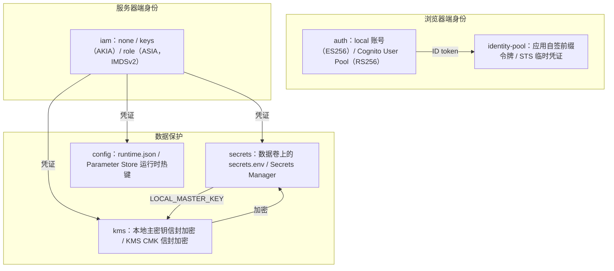
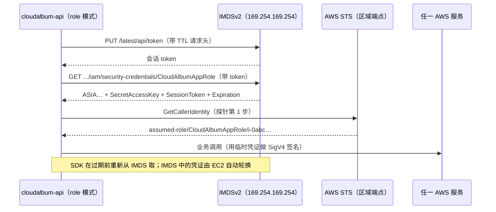
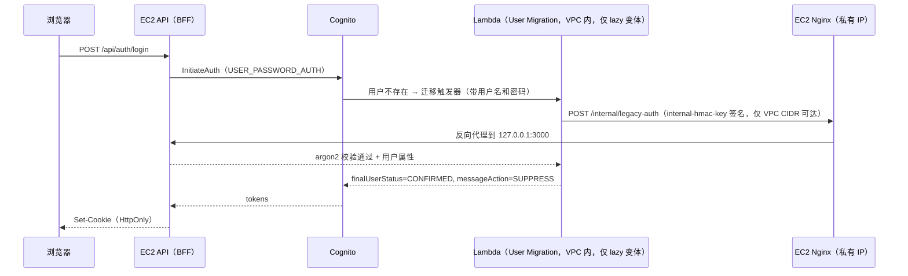
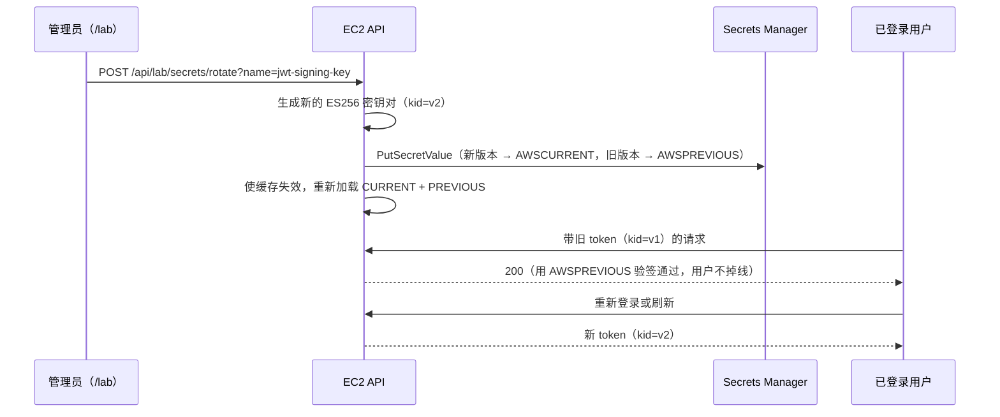
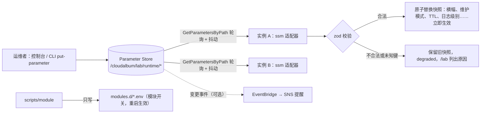
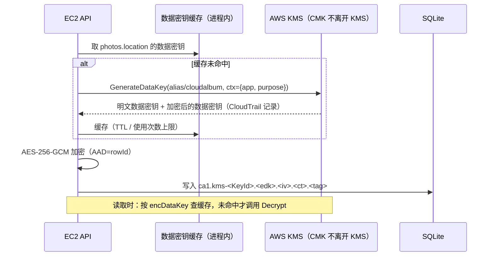

# B 组：身份与安全

本组 6 个模块分别回答四个问题：服务器以什么身份调用 AWS（iam）；终端用户是谁、能不能直接使用 AWS 资源（auth、identity-pool）；密码和运行时配置放在哪里（secrets、config）；数据用谁的密钥加密（kms）。在 L0（仅 EC2）下，这些机能全部由 EC2 本地实现：本地账号表 + argon2id + ES256 JWT、应用自签的“前缀范围上传令牌”、数据卷上的 `secrets.env` 与 `keys/*.pem`、本地 `runtime.json`、用本地主密钥（`LOCAL_MASTER_KEY`）做信封加密的字段。每启用一个模块，就把其中一项换成 AWS 托管实现，并且可以在 /lab 上直接看到前后差别。

## 本组模块一览

| 模块 id | 机能 | 主 AWS 服务（辅助服务） | 开关（首个取值 = 本地实现 = 默认） | 类型 | 凭证（registry `credentials`） | 模块级硬依赖 | 能否在 L0 上单独启用 | 文档锚点 |
|---|---|---|---|---|---|---|---|---|
| iam | 服务器访问 AWS 的凭证 | AWS IAM（STS） | `IAM_CREDENTIALS=none\|role\|keys` | A | none（本模块就是凭证的提供方） | —（role 模式要求 IMDS 可用） | 是 | `#iam` |
| auth | 用户注册登录 | Amazon Cognito User Pool（Lambda 触发器，内联代码） | `AUTH_DRIVER=local\|cognito`（子选项 `COGNITO_LOGIN_MODE=sdk\|managed`） | A | required | —（managed 子模式需受信 HTTPS，DEP-029；lazy 迁移变体需触发器，DEP-031） | 是（+iam） | `#auth` |
| identity-pool | 终端用户凭临时凭证直传（F14） | Amazon Cognito Identity Pool（IAM 角色、模块自带暂存桶） | `IDENTITY_POOL_ID`（空 = none 驱动：应用自签的前缀范围上传令牌） | A·P（带 DirectUploadPort） | required | storage（s3）；auth（cognito），或 auth（local）+ 开发者认证身份（DEP-002） | 否：{iam, storage, auth} | `#identity-pool` |
| secrets | 密码与密钥管理 | AWS Secrets Manager | `SECRETS_DRIVER=env\|secretsmanager` | A | required | — | 是（+iam） | `#secrets` |
| config | 运行时配置与远程开关 | AWS Systems Manager Parameter Store | `CONFIG_DRIVER=file\|ssm` | A | required | — | 是（+iam） | `#config` |
| kms | 数据加密密钥 | AWS KMS（客户托管密钥） | `KMS_KEY_ID`（空 = local 驱动：本地主密钥信封加密） | A | required | —（`KmsKeyArn` 经 `target: "*"` 注入，目标模块未启用时没有可注入的栈，不构成依赖） | 是（+iam） | `#kms` |

**“能否在 L0 上单独启用”的含义**：“是（+iam）”表示在 L0 上只要满足凭证前置（`IAM_CREDENTIALS≠none`，即先启用 iam，免费，几分钟就能完成），不再依赖其他任何模块，这个模块就能完整运行，对比实验也能做。“否”表示还依赖其他模块，并给出最小集合，例如 identity-pool 的最小集合是 {iam, storage, auth}。凭证前置不写进 `requires`，而是由 registry 的 `credentials` 字段加规则 CRED-001 统一表达（见公共约定 1）。

**本组公共约定**

1. **AWS 凭证是统一前置，不是模块依赖（D1）**。
   - 开关只有一个：`IAM_CREDENTIALS=none|role|keys`。`none` 是 L0 的本地实现，也是默认值；`role` 和 `keys` 都由 iam 栈提供，只有这两种取值才写 `MODULE_IAM=on`。总纲旧稿中的 `AWS_CREDENTIALS_SOURCE` 和 `scripts/module credentials --static` 已删除，长期密钥的反面教材改为 `scripts/module enable iam --mode keys`。
   - registry 给每个模块标注 `credentials: required | optional | none`。本组：iam 为 `none`（它就是凭证的提供方）；auth、identity-pool、secrets、config、kms 为 `required`。
   - 规则 **CRED-001**（error，退出码 78）：任一 `credentials: required` 的模块处于 AWS 取值（`MODULE_<ID>=on`），而 `IAM_CREDENTIALS=none`。**CRED-002**（warn）：`IAM_CREDENTIALS=keys`。`credentials: optional` 的模块（例如只在 /lab 展示时才调用 AWS 的模块）不触发 CRED-001，缺凭证时只是对应子功能为 `degraded`。
   - `scripts/module enable <id>` 的计划校验命中 CRED-001 时提示 `scripts/module enable iam`；带 `--with-deps` 时自动并入 iam（role 模式）。`profiles/single/<id>.env` 由 gen-single 自动并入 iam(role)。
   - 旧稿的 `requireAwsCredentials()`、`DependencyError` 和“按 last-known-good 装配”全部删除：配置错误一律由规则引擎在启动时一次性报告，退出码 78，不做回退装配。
2. **启用顺序与档位**：以评审确定的 Lab 顺序和预设档位为准，本文不再自定顺序。与本组有关的是：
   - Lab 1 启用 iam（与 cost 模块一起做，作为后续所有 AWS 模块的前置和成本护栏），对应档位 l1-ops（`IAM_CREDENTIALS=role`）。
   - Lab 8 启用 auth + identity-pool，对应档位 l3-identity（`AUTH_DRIVER=cognito`、`COGNITO_LOGIN_MODE=managed` 借用 CloudFront 的 HTTPS、`AUTH_MIGRATION=bulk`、设置 `IDENTITY_POOL_ID`）。
   - Lab 13 启用 kms + secrets + config，对应档位 l5-security，排在数据层档位 l6-data（RDS、EFS）之前，使 RDS、EFS 创建时就使用 CMK。registry 为 kms 声明 `orderBefore: [storage, database, shared-fs, secrets]`，`scripts/module profile apply` 在同一批启用中先启用 kms。storage 在 l2-edge 就已启用，它的存量对象需要原地复制才能换成 SSE-KMS（见 kms 第 6 节）。
3. **部署者身份和应用身份分开**：`scripts/module` 运行在运维机（自己的电脑或 CloudShell）上，用部署者自己的身份（IAM Identity Center 会话、CloudShell，或只在当前 shell 中导出的临时凭证）部署 CloudFormation 栈、附加策略；L0 通过 ssh 投递配置，启用 shell-access 后改走 SSM Run Command（总纲 §9.2）。应用角色 `CloudAlbumAppRole` 永远不授予 `iam:*`、`cloudformation:*` 这类管理权限。
4. **依赖规则只有一处（D3）**：所有规则只写在 `backend/src/rules/rules.ts` 一张表里，依赖关系只用 registry 的 `requires` 表达式书写，编号统一。旧稿的 `backend/src/modules/deps.ts` 已删除。与本组有关的规则：

| 规则 | 级别 | 范围 | 违规条件 | 涉及模块 |
|---|---|---|---|---|
| CFG-001 | error | 启动 | 子选项与驱动不匹配（zod 判别联合失败），例如 `SECRETS_ROTATION=on` 而 `SECRETS_DRIVER=env`；`CRYPTO_LOCAL_PLAINTEXT=on` 而 `KMS_KEY_ID` 非空 | secrets、kms |
| CFG-002 | error | 启动 | `modules.d/<id>.env` 出现不属于该模块 `ownsEnv` 的键，**或出现机密类键**：SecretName 清单对应的变量名（`UPLOAD_HMAC_KEY`、`LOCAL_MASTER_KEY`、`COGNITO_CLIENT_SECRET`、`DB_PASSWORD`……），以及 `*_PASSWORD`、`*_SECRET`、`*_PRIVATE_KEY`、`IAM_KEYS_*` 等模式；只允许 `*_SECRET_ARN` 和逻辑名 | 全部 |
| CRED-001 | error | 启动 | 见上文第 1 条 | 全部 `credentials: required` 的模块 |
| CRED-002 | warn | 启动 | `IAM_CREDENTIALS=keys`：长期密钥落盘；SSM Agent、CloudWatch Agent 不会读取应用的密钥 | iam |
| DEP-001 | error | 启动 | shell-access 已启用，但 `IAM_CREDENTIALS≠role` | shell-access、iam |
| DEP-002（修订） | error | 启动 | `IDENTITY_POOL_ID` 非空，但 `STORAGE_DRIVER≠s3`；或 `AUTH_DRIVER≠cognito` 且 `IDENTITY_DEV_PROVIDER` 为空 | identity-pool |
| DEP-007（澄清） | error | 启动 | `DEPLOY_MODE=asg`，但 `IAM_CREDENTIALS≠role` 或 load-balancer 未启用（keys 模式意味着把密钥写进 User Data 或 AMI） | autoscaling、iam |
| DEP-011 | warn | 启动 | load-balancer 已启用，但 auth≠cognito 或 tls 缺失：F12 的 `authenticate-cognito` 子功能关闭 | load-balancer、auth |
| DEP-013 | warn | 启动 | auth=cognito 且 email=outbox：Cognito 自己发验证码，outbox 里看不到（这本身就是对比点） | auth、email |
| DEP-029 | error | 启动 | `COGNITO_LOGIN_MODE=managed`，但 `APP_BASE_URL` 不是受信 HTTPS（受信 = 经 cdn 的默认域名，或 `TLS_MODE` 为 `letsencrypt` / `acm`） | auth |
| DEP-030 | warn | 启动 | `IDENTITY_POOL_ID` 非空且 `APP_BASE_URL` 为 http：临时凭证经明文下发，identity-pool 标为 `degraded` | identity-pool |
| DEP-031 | error | 启动 | `AUTH_MIGRATION=lazy`，但 `COGNITO_TRIGGERS≠on`；该变体的内部端点 `/internal/legacy-auth` 由 registry 的 `internalEndpoints` 声明 | auth |
| ASG-007 | error（可覆盖） | 启动 | `AUTH_DRIVER=local` 且 `SECRETS_ORIGIN=instance`：各实例的 JWT 签名密钥不同 | auth、secrets |
| ASG-008 | error（可覆盖） | 启动 | HMAC 密钥或 `LOCAL_MASTER_KEY` 的来源为 `instance`（且未用 KMS） | secrets、kms |
| ASG-012 | warn | 启动 | `CONFIG_DRIVER=file`：各实例的 `runtime.json` 可能漂移 | config |
| ASG-013 | warn | 启动 | `CACHE_DRIVER≠redis`：登录失败计数、限速计数按实例分别统计 | auth |

   其余跨组规则只在组合说明中引用：DEP-017（`LB_ADMIN_AUTH=cognito` 需要 auth(cognito) + HTTPS，A 组）、DEP-023（social-api 的 jwt 授权器需要 `AUTH_DRIVER=cognito`，D 组）。kms 的 `KmsKeyArn` 按 `target: "*"` 注入所有声明了该参数的已启用模块栈，之后启用的模块在启用时拿到，不设规则（顺序要求由 `orderBefore` 表达）。registry 中的 `requires` 每一项都带 `rule:`（总纲 5.1），见各模块第 0 节。

5. **策略与跨栈参数（D2）**
   - 禁止 CloudFormation `Export` 和 `Fn::ImportValue`。每个调用 AWS 的模块栈只创建并输出**一条**客户托管策略 `PolicyArn`（命名 `cloudalbum-<env>-<id>`，含业务权限和第 10 节探针所需的只读权限），模板里**不写** `Roles` / `Users`。
   - `scripts/module enable` 把 `PolicyArn` 附加到 `CloudAlbumAppRole`（role 模式）或演示用户 `cloudalbum-<env>-demo-keys`（keys 模式），附加关系记入 `.cloudalbum/state.json` 的 `attachments`；`disable` 时按记录分离；role 与 keys 互切时，按记录把全部策略重新附加到新主体。
   - 跨模块参数只通过“提供方在 registry 中声明的 `injects`”传递：提供方声明目标模块、目标栈和参数；目标模块启用时，`scripts/module` 按同一声明从提供方栈的 Outputs 取值；提供方之后发生变化时，再按声明更新目标栈。总纲旧稿的 `reconfigureOn` 已删除。本组涉及的注入：

   写法统一为总纲 3.5 的 `{ target, stack?, params: { 参数: "${Out.<输出名>}" }, when? }`（值是表达式，不是裸输出名）。

| 提供方 | 目标栈 | 参数 | 说明 |
|---|---|---|---|
| iam | autoscaling | `InstanceProfileName` | role 模式下启动模板使用的实例配置文件（单实例经 `baseParams` 写基础栈同名参数） |
| auth | identity-pool | `UserPoolId`、`UserPoolClientId` | 取代旧稿的 ImportValue |
| auth | load-balancer | `CognitoUserPoolArn`、`CognitoAlbClientId`、`CognitoDomain` | F12 的 `authenticate-cognito`（A 组） |
| auth | social-api | `UserPoolId`、`UserPoolClientId` | jwt 授权器与 Lambda 授权器的 cognito 分支（D 组） |
| kms | 所有声明了 `KmsKeyArn` 参数的模块栈（`target: "*"`） | `KmsKeyArn` | 是否用 CMK 由目标栈是否声明该参数决定；`KMS_APPLY_TO` 只管不经栈注入的 fields、ebs |
| cdn（01 已声明） | kms | `CloudFrontDistributionArn` | 密钥策略允许 CloudFront 经 OAC 解密 |
| dns / cdn / load-balancer（01 已声明） | auth、identity-pool（以及 C 组 storage） | `AppOrigins`（入口 URL，各提供方以 `+` 追加取并集） | 回调地址、暂存桶 CORS |
| load-balancer（01 已声明） | auth | `AlbCallbackUrls` | 非空时 auth 栈创建 ALB 专用的机密客户端 |
| email（04 已声明） | auth | `SesIdentityArn` | 非空时 User Pool 改用 SES 发信 |

6. **机密与本地配置的存放（D5、D6）**
   - 机密值只放在两处：`/etc/cloudalbum/secrets.env`（`root:cloudalbum 0640`，由 `config/load-env.ts` 作为第 3 层加载，不用 systemd `EnvironmentFile`）和 `/etc/cloudalbum/keys/*.pem`（`root:cloudalbum 0640`）。旧稿的 `secret-values.env`、`iam-keys.env`、`/var/lib/cloudalbum/keys/` 一律取消。
   - L0 的机密与本地配置（`secrets.env`、`keys/`、`modules.d/`、`runtime.json`）实际存放在数据卷 `/var/lib/cloudalbum/etc` 上，`/etc/cloudalbum` 通过符号链接（或 bootstrap 恢复）使用它们。bootstrap 只有在数据卷上也没有时才生成密钥；`SECRETS_ORIGIN=aws` 时不生成。这样 network 迁移、rebuild-instance、kms 换卷之后，`LOCAL_MASTER_KEY` 和 JWT 签名密钥不变，已加密的字段仍可解密，用户也不会掉线。三类流程都校验“`LOCAL_MASTER_KEY` 指纹前后一致”。
   - `modules.d/*.env` 只写开关、资源标识、`*_SECRET_ARN` 或逻辑名；CloudFormation Outputs 也只输出 ARN，不输出值（CFG-002）。
   - `cloudalbum` 用户固定 uid/gid（2001），`nginx` 加入 `cloudalbum` 组，服务单元 `UMask=0027`（定义见 `docs/modules/00-ec2-base.md`）。本组新建的文件一律按 `root:cloudalbum 0640` 或 `cloudalbum:cloudalbum 0640` 创建。
7. **对统一约定的细化（附理由）**
   - (a) auth 在 cognito 模式下仍采用 BFF + HttpOnly Cookie，而不是 README 中 `aws-amplify` 把 token 放在浏览器存储里的做法。理由：与基线用同一种会话模型，对比时只体现“身份提供方”这一个差异；同时避免 token 被 XSS 窃取。Amplify 的做法作为 lab 选读。
   - (b) 本地认证令牌统一为 **ES256 + JWKS**：私钥通过 `SecretsPort('jwt-signing-key')` 读取，env 驱动对应 `JWT_SIGNING_KEY_FILE=/etc/cloudalbum/keys/jwt-es256.pem`；`GET /.well-known/jwks.json` 同时发布当前和上一版本的 `kid`。总纲中“HS256、本地令牌没有 JWKS”的表述作废。
   - (c) identity-pool 由后端代为换取临时凭证（因为 ID token 在 HttpOnly Cookie 里）。直传的文件先落在 identity-pool 自己的暂存桶 `private/<identityId>/<photoId>.<ext>`，`complete` 校验通过后，再由服务端 CopyObject 导入 storage 的原图键 `raw/<userId>/<photoId>.<ext>`，这样不需要改动其他模块的 S3 事件过滤器。
   - (d) ConfigPort 只管运行时业务热键（`runtime.json` 或 `/cloudalbum/<env>/runtime/*`），**不能**远程修改任何模块开关或驱动；模块开关只由 `scripts/module` 写入 `modules.d`，修改后重启生效（D7）。
   - (e) kms 只保留一个开关 `KMS_KEY_ID`：为空 = local 驱动 = 用 `LOCAL_MASTER_KEY` 做 AES-256-GCM 信封加密（L0 默认就加密）。“明文”只作为对照实验的子选项 `CRYPTO_LOCAL_PLAINTEXT=on`。旧稿的 `FIELD_ENCRYPTION` 已删除。
   - (f) 端口文件与驱动名：`ports/aws-credentials.ts`（`adapters/iam/{none,role,keys}.ts`）、`ports/auth.ts`（`adapters/auth/{local,cognito}.ts`）、`ports/direct-upload.ts`（`adapters/identity-pool/{none,cognito}.ts`）、`ports/secrets.ts`、`ports/config.ts`、`ports/crypto.ts`（`adapters/kms/{local,kms}.ts`）。AWS SDK client 只由 `backend/src/adapters/aws/clients.ts` 创建。驱动 id 必须等于开关取值，例如 `AuthPort.id` 只能是 `local` 或 `cognito`，sdk / managed 子模式写进路径头的 outcome。
   - (g) 路径头只用模块 id 作键，值为 `driver[@host][:outcome]`：`auth=local:verify|cognito:sdk|cognito:managed`、`identity-pool=none:token|cognito:sts|cognito:error-fallback`、`config=file|ssm:v12`、`kms=local|kms:cache-hit|kms:call`。不出现 `iam` 段和 `upload` 段；实例一律看 `inst=` 段，不再使用 `X-Instance-Id`。
   - (h) 本组的 Lambda（auth 触发器、secrets 轮换函数）统一用 `nodejs22.x`、arm64，代码用 `Code.ZipFile` 内联，不依赖工具链栈的制品桶。EC2 侧同为 Node.js 22 LTS（D4）。
   - (i) 权威端口：auth、secrets、kms（故障时返回 503，不回退本地实现）；非权威端口：config、identity-pool（降级在 `status` 和路径头中可见）。AwsCredentialsPort 本身不单独判定，凭证故障由各调用方模块按自己的分类处理。
8. **本组共用的实验辅助**：`experiments/_lib/cloudtrail.ts` 封装 `LookupEvents`，iam、secrets、config、kms 都用它展示“谁在什么时候调用了什么”。注意两点：CloudTrail 事件通常要几分钟才能查到；`LookupEvents` 每个账号每个区域每秒只能调用 2 次，所以 /lab 卡片的结果缓存 60 秒。`experiments/_lib/leak-scan.sh` 由 iam 和 secrets 共用。
9. **/lab 总览图**：本组在 /lab 上有一张“身份与凭证”总览图，分三层：



10. 本文中所有限额、价格和时延都只给出定性描述和数量级，具体数值以官方文档为准。
11. **每个模块的小节结构**：按总纲附录 A（第 3 轮定稿：“0. 元数据（registry 摘录）”+ 1～9 节 +“10. 探针”+“11. 前端徽章”，01～06 组统一）；每个模块的二级标题前有一个显式锚点（`<a id="<模块 id>"></a>`），registry 的 `doc` 字段写成 `docs/modules/02-identity-security.md#<模块 id>`。

<a id="iam"></a>
## iam：访问 AWS 的凭证 ↔ AWS IAM

> 一句话总结：没有它时，应用不调用任何 AWS API，所有机能都走 EC2 本地实现，磁盘上也没有任何 AWS 凭证；启用后，EC2 通过实例配置文件（IAM 角色 `CloudAlbumAppRole`）从 IMDSv2 取得小时级、自动轮换、不落盘的临时凭证，其他模块因此才能调用 AWS。最直观的区别：/lab 的 iam 卡片上“当前 AWS 身份”从“无”变成 `assumed-role/CloudAlbumAppRole/i-xxxx`（ASIA 开头，带过期倒计时）；反面教材 keys 模式显示的则是 AKIA 开头、永不过期、存放在磁盘上的长期密钥。

### 0. 元数据（registry 摘录）

```yaml
iam:
  group: B
  function: 访问 AWS 的凭证
  awsService: AWS IAM
  auxServices: [AWS STS]
  type: adapter
  port: AwsCredentialsPort                    # ports/aws-credentials.ts；adapters/iam/{none,role,keys}.ts
  switch: { var: IAM_CREDENTIALS, values: [none, role, keys], ownedValues: [role, keys], localTiers: [] }
  ownsEnv: [IAM_]
  credentials: none                           # 本模块就是凭证的提供方
  requires: []                                # role 模式要求 IMDS 可用（不是模块依赖）
  authoritative: false                        # 凭证故障由各调用方模块按自己的分类处理
  multiInstanceSafe: { none: true, role: true, keys: false }   # asg 只允许 role（DEP-007）
  bypass: []
  stacks: [{ name: main, template: infra/modules/iam.yaml }]
  baseParams:
    InstanceProfileName: "${Out.InfoInstanceProfileName}"   # ec2 栈给实例挂实例配置文件（00-ec2-base.md 6.2）；keys / none 模式下为空
  injects:
    - { target: autoscaling, params: { InstanceProfileName: "${Out.InfoInstanceProfileName}" }, when: { IAM_CREDENTIALS: role } }   # 启动模板的实例配置文件
  secretParams: []
  migration: null                             # 无业务数据
  probe: { kind: active, method: "sts:GetCallerIdentity + iam:GetRole(self)", intervalSec: 30 }
  lab:
    compare: before-after
    experiments: [whoami, leak-scan, imds-ssrf, revoke, long-run]
    hourlyBilled: false
  doc: docs/modules/02-identity-security.md#iam
```

- 只有 `IAM_CREDENTIALS` 为 `role` 或 `keys` 时才写 `modules.d/iam.env`，并带 `MODULE_IAM=on`；`none` 时文件不存在。
- `baseParams` 由 `scripts/module` 更新基础栈的 `InstanceProfileName` 参数（keys / none 模式下置空），CloudFormation 对 `AWS::EC2::Instance` 的这个属性做“无中断更新”（No interruption，2026-10 核实官方模板参考），实例不需要重启；参数定义见 `docs/modules/00-ec2-base.md`。

### 1. 基线实现（仅 EC2）

- `IAM_CREDENTIALS=none`。`container.ts` 装配 `backend/src/adapters/iam/none.ts`，它的 `provider()` 直接抛出 `AwsCredentialsUnavailable`。正常情况下走不到这一步：只要有 `credentials: required` 的模块处于 AWS 取值，规则 CRED-001 就会在启动时拒绝启动（退出码 78）。none 驱动的异常只是兜底断言，防止有代码绕过规则悄悄走 SDK 默认凭证链。所有端口都装配本地驱动。
- `GET /api/capabilities` 返回 `iam = {driver:'none', awsService:'AWS IAM', status:'off', localHealth:'ok', detail:'应用未调用任何 AWS API'}`。路径头中不出现 `iam` 段：凭证不是请求路径上的一跳。
- 实例不挂实例配置文件；磁盘上没有 `~/.aws/credentials`，也没有任何以 AKIA 开头的字符串。
- IMDS：AL2023 AMI 的 `ImdsSupport` 属性是 `v2.0`，从它启动的实例默认就是“IMDSv2 必需 + hop limit 2”。L0 的启动参数仍然显式写上 `MetadataOptions: {HttpTokens: required, HttpEndpoint: enabled}`，以免账号级默认值变化或更换 AMI 后行为改变。L0 不跑容器，hop limit 可以设为 1（更严格）；以后容器化时再改回 2。
- 运维身份：L0 下应用身份根本不存在，`scripts/module`、`scripts/admin` 使用的是部署者自己的身份。
- 不需要额外的进程或文件。

### 2. AWS 实现

**CloudFormation：`infra/modules/iam.yaml`**

| 资源 | 说明 |
|---|---|
| `CloudAlbumAppRole` | 信任策略只信任 `ec2.amazonaws.com`。`RoleName` 是固定名称，所以部署时要加 `CAPABILITY_NAMED_IAM` |
| `CloudAlbumAppInstanceProfile` | `AWS::IAM::InstanceProfile`，包含上面这个角色 |
| `cloudalbum-<env>-iam`（客户托管策略，即本栈的 `PolicyArn`） | 只包含 /lab 和探针需要的只读权限：针对**角色自身**的 `iam:GetRole`、`iam:ListAttachedRolePolicies`、`iam:ListRolePolicies`；`CreateDemoUser=true` 时另含针对**演示用户自身**的 `iam:GetUser`、`iam:ListAttachedUserPolicies`；以及 `cloudtrail:LookupEvents`（Resource 为 `*`，用于查询事件历史）。模板**不写** `Roles`/`Users`，由 `scripts/module` 附加 |
| `cloudalbum-<env>-demo-keys`（IAM 用户，条件 `CreateDemoUser=true`） | 只用于反面教材。模板里**不**创建 `AWS::IAM::AccessKey`，以免 SecretAccessKey 出现在模板或栈输出里 |

Outputs（**不 Export**）：`ModuleId`、`ModuleVersion`、`PolicyArn`、`EnvIamCredentials`（`role`；keys 模式由脚本改写为 `keys`）、`EnvIamExpectedRole`、`InfoAppRoleName`、`InfoAppRoleArn`、`InfoInstanceProfileName`、`InfoDemoUserName`。`scripts/module` 把角色名和演示用户名记入 `.cloudalbum/state.json`，后续附加策略时使用。

**“最小权限随模块增减”的约定（全项目适用，D2）**

- 本栈不授予任何业务权限。每个需要调用 AWS API 的模块，在自己的栈里创建**一条**客户托管策略 `cloudalbum-<env>-<id>`（`AWS::IAM::ManagedPolicy`），只作为 `PolicyArn` 输出，模板里不写 `Roles`、`Users`，也不使用 `Export`/`Fn::ImportValue`。
- `scripts/module enable <id>` 部署栈之后，把 `PolicyArn` 附加到当前凭证主体：role 模式是 `CloudAlbumAppRole`，keys 模式是演示用户；附加关系记入 `.cloudalbum/state.json` 的 `attachments`（模块、策略 ARN、主体）。`disable <id>` 先按记录分离，再删除栈。role 与 keys 互切时，脚本按 `attachments` 把全部策略从旧主体分离、附加到新主体。
- iam 栈不能被误删，靠的是 `disable iam` 的反向依赖校验（仍有 `credentials: required` 的模块处于 AWS 取值时拒绝，`--cascade` 才按逆拓扑序一并禁用），而不是 ImportValue 造成的栈间耦合。
- 配额：每个角色、每个用户可挂载的托管策略数量都有上限（撰写时角色默认 20 个、用户默认 10 个，都可以通过 Service Quotas 申请提高；以官方文档为准）。全部模块再加上 shell-access、logging 挂载的 AWS 托管策略，数量会接近上限。所以 `scripts/module enable` 在部署前会用 `aws iam list-attached-role-policies` 统计已挂载数量，并与配额比较，不够时直接提示申请提额。演示用户的上限更低，这也是 keys 模式无法承载“全部模块”的原因之一。
- Lambda（image-processing、auth 触发器、secrets 轮换）使用各自栈里的执行角色，不经过本模块，但遵循同样的“角色 + 临时凭证”原则。

**端口与适配器**

- 端口 `backend/src/ports/aws-credentials.ts`；适配器 `backend/src/adapters/iam/none.ts`、`role.ts`、`keys.ts`。`backend/src/adapters/aws/clients.ts` 是唯一创建 AWS SDK client 的地方，所有 client 共用 `credentials.provider()`。
- `role.ts`：显式使用 `@aws-sdk/credential-providers` 的 `fromInstanceMetadata({ timeout, maxRetries })`，外面包一层 memoize，在凭证过期前几分钟刷新，并暴露 `forceRefresh()` 供撤销实验使用。**不使用 SDK 的默认凭证链**：默认链会优先读取环境变量，残留的 `AWS_ACCESS_KEY_ID` 会悄悄覆盖角色凭证。
- `keys.ts`：从分层配置的第 3 层（`secrets.env`）读取 `IAM_KEYS_ACCESS_KEY_ID`、`IAM_KEYS_SECRET_ACCESS_KEY`，构造静态凭证 provider。键名刻意不用 `AWS_ACCESS_KEY_ID`，避免被任何 SDK 默认链或子进程意外拾取。
- 健康探针分两步（详见第 10 节）：
  1. `sts:GetCallerIdentity`：确认“我是谁”。注意这个调用**不需要任何权限，显式 Deny 也挡不住它**，所以它只能证明认证成功，不能证明有权限。
  2. `iam:GetRole`（查询角色自身，由本栈 `PolicyArn` 授权）：确认授权仍然有效。撤销会话后，第 2 步会失败，第 1 步不会。
  - detail 中返回：调用者 ARN、AccessKeyId 的前 4 位（AKIA 是长期密钥，ASIA 是临时凭证）、过期时间、角色上已挂载的策略列表。在 role 模式下，如果进程环境变量中残留 `AWS_ACCESS_KEY_ID`，或 `secrets.env` 中还有 `IAM_KEYS_*`，状态标为 `degraded`，detail 写“检测到残留的长期密钥”。

**两种模式**

1. **role（推荐）**：执行 `scripts/module enable iam`（默认 `--mode role`）：部署栈 → 附加本栈 `PolicyArn` 到 `CloudAlbumAppRole`，并补附 `state.json` 中已记录的其他策略 → 按 `baseParams` 更新 ec2 基础栈的 `InstanceProfileName`（无中断更新，实例不重启）→ 确认实例 `HttpTokens=required`（L0 基础栈已经这样设置，不一致时只告警）→ 写入 `modules.d/iam.env`（`MODULE_IAM=on`、`IAM_CREDENTIALS=role`）→ 重启 `cloudalbum-api` 和 `cloudalbum-worker` → 运行探针。挂载后要过一小段时间才能在 IMDS 中读到凭证，所以探针要带重试。
2. **keys（反面教材）**：执行 `scripts/module enable iam --mode keys`（栈参数 `CreateDemoUser=true`）。部署者执行 `aws iam create-access-key --user-name cloudalbum-<env>-demo-keys`，脚本把结果原子写入 `/etc/cloudalbum/secrets.env`（实际在数据卷上，`root:cloudalbum 0640`）的 `IAM_KEYS_*` 两行，把 `state.json` 中记录的全部策略附加到演示用户，再把 `IAM_CREDENTIALS` 改为 `keys` 并重启。密钥**不进 modules.d**（CFG-002）。这把长期密钥也不能放进 Secrets Manager：读取 Secrets Manager 本身就需要凭证，这是先有鸡还是先有蛋的问题；secrets 模块迁移时会跳过它。



### 3. 开关与配置

```bash
# /etc/cloudalbum/modules.d/iam.env —— L0（none）时文件不存在；role / keys 时由 scripts/module 写入
MODULE_IAM=on
MODULE_IAM_VERSION=1
IAM_CREDENTIALS=role                 # none | role | keys（keys 只作反面教材）
IAM_EXPECTED_ROLE=CloudAlbumAppRole  # role 模式启动时校验 GetCallerIdentity 返回的 ARN 中包含此角色名
IAM_IMDS_TIMEOUT_MS=1000
IAM_IMDS_MAX_RETRIES=3
# AWS_REGION、CLOUDALBUM_ENV 在基础配置 /etc/cloudalbum/cloudalbum.env 中，这里不重复
```

```bash
# /etc/cloudalbum/secrets.env 片段 —— 仅 keys 模式出现；文件 root:cloudalbum 0640，实际位于数据卷 /var/lib/cloudalbum/etc/
# 切回 role 时，scripts/module 删除访问密钥，并原子重写 secrets.env 去掉这两行
IAM_KEYS_ACCESS_KEY_ID=AKIA****************
IAM_KEYS_SECRET_ACCESS_KEY=****************************************
```

端口接口要点：

```ts
// backend/src/ports/aws-credentials.ts
import type { AwsCredentialIdentityProvider } from '@smithy/types';

export interface CallerIdentity {
  arn: string;              // arn:aws:sts::<acct>:assumed-role/CloudAlbumAppRole/i-0abc…
  account: string;
  keyPrefix: string;        // 'AKIA' | 'ASIA'
  expiration?: Date;        // 长期密钥为 undefined
  source: 'static' | 'imds';  // static = secrets.env 中的 IAM_KEYS_*（keys 模式）
}

export interface AwsCredentialsPort {
  readonly id: 'none' | 'role' | 'keys';
  provider(): AwsCredentialIdentityProvider;   // none 时抛 AwsCredentialsUnavailable
  whoami(): Promise<CallerIdentity>;           // sts:GetCallerIdentity（不受策略约束）
  checkAuthorized(): Promise<boolean>;         // iam:GetRole（角色自身），受策略评估约束
  forceRefresh(): Promise<void>;               // 丢弃内存缓存，重新从 IMDS 取
  health(): Promise<{ status: 'ok' | 'degraded' | 'error'; detail: string }>;
}
```

凭证前置的规则（`backend/src/rules/rules.ts` 节选；与总纲 §5.1 同一张表）：

```ts
// backend/src/rules/rules.ts（节选）
{
  id: 'CRED-001', category: 'CRED', severity: 'error', overridable: false, scope: 'startup',
  modules: ['iam'],
  // needsAws(id) = registry[id].credentials === 'required' && on(id)
  check: ({ cfg, enabledModules, needsAws }) =>
    cfg.iam.IAM_CREDENTIALS === 'none' && enabledModules().some(needsAws),
  message: ({ enabledModules, needsAws }) =>
    `以下模块要调用 AWS API，但 IAM_CREDENTIALS=none：${enabledModules().filter(needsAws).join(', ')}`,
  fix: 'scripts/module enable iam          # 默认 role 模式；反面教材：--mode keys',
},
{
  id: 'CRED-002', category: 'CRED', severity: 'warn', scope: 'startup',
  modules: ['iam'],
  check: ({ cfg }) => cfg.iam.IAM_CREDENTIALS === 'keys',
  message: () => '正在使用长期访问密钥（AKIA，落盘在 secrets.env）；SSM Agent、CloudWatch Agent 不会读取它',
  fix: 'scripts/module enable iam --mode role',
},
// 违规时 check-config 一次性打印全部错误并以退出码 78 退出；不存在 DependencyError，也没有回退装配
```

### 4. 依赖与组合

**硬依赖**
- `ec2`（实例本身）。
- role 模式：实例能访问 IMDS（`HttpEndpoint=enabled`）。如果应用将来跑在容器里，hop limit 至少设为 2，否则容器内取不到 token。
- 出网：能访问 STS 区域端点（`sts.ap-northeast-1.amazonaws.com`）和各目标服务的公有端点。默认 VPC 公有子网 + 弹性 IP 已经满足。如果 network 模块把实例移入私有子网，需要 NAT 或相应的 VPC 终端节点：S3 和 DynamoDB 用 Gateway Endpoint；STS、Secrets Manager、SSM、KMS 等用 Interface Endpoint。从 IMDS 取凭证本身不需要出网。
- 部署者身份需要以下权限：`iam:CreateRole`、`iam:CreateInstanceProfile`、`iam:AddRoleToInstanceProfile`、`iam:PassRole`（基础栈挂载实例配置文件时需要）、`iam:AttachRolePolicy` / `iam:DetachRolePolicy`（keys 模式还要 `iam:AttachUserPolicy` / `iam:DetachUserPolicy`）、`ec2:AssociateIamInstanceProfile`；CloudFormation 部署时加 `CAPABILITY_NAMED_IAM`。

**与其他模块组合**
- registry 中 `credentials: required` 的模块（本组的 auth、identity-pool、secrets、config、kms；其他组的 storage、social-store、analytics、queue、notification、email、scheduler、tagging、logging、monitoring、tracing 的 xray 档、image-processing 的 lambda 档等）都受 CRED-001 约束，由规则引擎在启动时统一校验。
- autoscaling：`DEPLOY_MODE=asg` 只允许 role 模式（DEP-007 中“iam 已启用”指 `IAM_CREDENTIALS=role`），启动模板引用 iam 经 `injects` 注入的 `InstanceProfileName`。keys 模式意味着要把密钥写进 User Data 或 AMI，规则直接拒绝。
- shell-access、logging、monitoring 使用的代理：SSM Agent 用实例配置文件（或账号级的 Default Host Management Configuration）取凭证，CloudWatch Agent 默认也用实例配置文件。它们都**不会读取**应用的 `IAM_KEYS_*`。shell-access 因此要求 `IAM_CREDENTIALS=role`（DEP-001）；logging、monitoring 在 keys 模式下若想用 Agent，只能再给 Agent 配一份长期密钥（凭证文件 + profile），泄露面翻倍，CRED-002 的 detail 会点出这一点。
- kms：KMS 是少数“资源策略（密钥策略）也必须放行”的服务。默认密钥策略中有一条“允许本账号根主体”的语句，含义是把授权委托给 IAM 策略。只要保留这条语句，角色上的 IAM 策略就足够了（详见 kms 模块）。
- audit：在 CloudTrail 中，keys 模式的 `userIdentity.type` 是 `IAMUser`，`accessKeyId` 以 AKIA 开头；role 模式是 `AssumedRole`，以 ASIA 开头，会话名就是实例 ID，可以追溯到具体机器。
- network：私有子网时注意上面提到的终端节点。
- 多实例（ASG）：keys 模式要把密钥复制到每台机器，轮换时逐台修改；role 模式由启动模板统一下发，自动轮换。每台实例的会话名不同，CloudTrail 能区分是哪台机器发起的调用。

### 5. 对比实验：有 vs 没有

| 维度 | 没有 IAM 角色（基线 none；反面教材 keys） | 有 IAM 角色（role） |
|---|---|---|
| 能否调用 AWS API | none：不能，所有 AWS 模块都无法启用；keys：能 | 能 |
| 凭证形态 | keys：AKIA 开头的长期访问密钥 | ASIA 开头的 STS 临时凭证 + SessionToken |
| 有效期与轮换 | 永不过期，只能人工轮换 | 小时级，EC2 自动轮换，SDK 自动刷新 |
| 明文落盘 | 数据卷上的 `secrets.env`（`IAM_KEYS_*`），还会随数据卷快照、本地备份进入更多位置 | 不落盘，只存在于 IMDS 和进程内存中 |
| 泄露后的处置 | 停用或删除密钥，业务立即中断，直到换上新密钥并重启 | 撤销会话（Revoke sessions）让所有旧凭证副本失效；实例换取新会话后恢复（见步骤 4） |
| 多实例分发 | 复制到每台机器，逐台轮换 | 启动模板统一下发 |
| CloudTrail 中的身份 | IAMUser，AKIA… | AssumedRole，ASIA…，会话名是实例 ID |
| SSM Agent、CloudWatch Agent | 需要另配长期密钥 | 直接可用 |
| 业务功能与性能 | 相同 | 相同 |

**页面上能直接看到的差异**
- /lab 的 iam 卡片显示“当前 AWS 身份”：
  - none：灰色，“应用未使用 AWS 凭证”。
  - keys：`arn:aws:iam::<acct>:user/cloudalbum-<env>-demo-keys`，Key 以 AKIA 开头，过期时间显示“永不（需人工轮换）”，并带红色徽章“长期凭证在磁盘上”（CRED-002）。
  - role：`arn:aws:sts::<acct>:assumed-role/CloudAlbumAppRole/i-xxxx`，Key 以 ASIA 开头，显示过期倒计时，到期前自动换新。
- 卡片下方列出角色上当前挂载的 `cloudalbum-<env>-*` 策略，并与 `state.json` 的 `attachments` 对照（不一致时标黄）。每启用一个模块就多一条，禁用后就消失，“最小权限随模块增减”一目了然。
- “最近调用”区域显示 CloudTrail 事件历史中这个身份最近的几次调用（有几分钟的延迟）。
- 业务页面本身没有任何区别。

**测量指标**
凭证类型与有效期；明文凭证落盘的位置数量（泄露面）；撤销或停用后多久开始失败、多久恢复；CloudTrail 中的 `userIdentity.type` 和 accessKeyId 前缀；凭证刷新前后的请求错误率。

**操作步骤**
1. 身份对照：在实例上以 cloudalbum 用户运行 `npx tsx experiments/iam/whoami.ts`。如果 `secrets.env` 中的 `IAM_KEYS_*` 和实例配置文件同时存在，脚本会分别用静态凭证和 `fromInstanceMetadata()` 调用 GetCallerIdentity，并排打印 ARN、Key 前缀和过期时间。/lab 卡片上的“对比实验”按钮调用的是同一段逻辑（`GET /api/lab/iam/whoami`，仅管理员可用）。
2. 泄露面扫描：通过 SSH 或 Session Manager 在实例上运行 `sudo bash experiments/iam/leak-scan.sh`（内部调用 `experiments/_lib/leak-scan.sh`）。扫描范围：`/etc/cloudalbum`（及其指向的 `/var/lib/cloudalbum/etc`）、`/var/lib/cloudalbum` 的其余目录（含同盘本地备份 `backup/`）、`/var/log`、`journalctl -u 'cloudalbum-*'`、各进程的 `/proc/<pid>/environ`、`/root/.aws`、`/home/*/.aws`、shell 历史。输出每一类位置的命中数。AMI 和 EBS 快照可以用 `--snapshot <snap-id>` 参数，挂载后再扫描（可选）。
3. IMDSv2 与 SSRF：运行 `bash experiments/iam/imds-ssrf.sh`。脚本先模拟一个“只能发 GET 请求的 SSRF”：`curl -s -o /dev/null -w '%{http_code}' http://169.254.169.254/latest/meta-data/iam/security-credentials/`，在 IMDSv2 必需的情况下返回 401。然后按正规流程，先 `PUT /latest/api/token`（带 `X-aws-ec2-metadata-token-ttl-seconds` 请求头）拿到 token，再带上 token 访问，返回 200 和角色名。这说明 IMDSv2 的会话 token 加上 PUT 方法能挡住大多数 SSRF。同时也要注意：能在实例上执行命令的人仍然能拿到临时凭证，所以最小权限依然必要。
4. 撤销实验：先运行 `k6 run -e BASE=http://<EIP> -e COOKIE='<管理员 Cookie>' experiments/iam/aws-ping.k6.js`，以每秒 1～2 次的低速率持续请求 `/api/lab/aws-ping`。这是一个管理员接口，内部同时调用 GetCallerIdentity 和 `iam:GetRole`，分别报告两者的结果。然后：
   - keys 模式：执行 `aws iam update-access-key --user-name cloudalbum-<env>-demo-keys --access-key-id AKIA… --status Inactive`。
   - role 模式：在控制台打开角色，选择 Revoke sessions → Revoke active sessions。这等价于给角色挂一条内联策略 `AWSRevokeOlderSessions`，对 `aws:TokenIssueTime` 早于撤销时刻（再往后约 30 秒）的会话拒绝一切操作。

   观察两列结果分别从什么时候开始失败。role 模式下，接着运行 `bash experiments/iam/refresh-role-creds.sh`：它先执行 `aws ec2 replace-iam-instance-profile-association`，让实例拿到新会话，再调用 `POST /api/lab/iam/refresh`（即 `forceRefresh()`）。观察多久恢复。

   实验结束后：删除 `AWSRevokeOlderSessions` 内联策略；keys 模式下删除该密钥，或重新激活它。
5. CloudTrail 对照：分别运行 `npx tsx experiments/_lib/cloudtrail.ts --attr Username=i-0abc…` 和 `--attr Username=cloudalbum-<env>-demo-keys`（等价于 `aws cloudtrail lookup-events --lookup-attributes AttributeKey=Username,AttributeValue=…`），对比两者的 `userIdentity`。
6. 长时间运行：在 role 模式下运行 `k6 run -e DURATION=6h experiments/iam/aws-ping.k6.js`，确认凭证刷新前后错误数为 0。

**预期结果**
- 业务功能完全相同，性能上也看不出差别：凭证在本机获取，耗时毫秒级，而且有缓存。差别全在安全属性上。
- leak-scan：keys 模式能在 `secrets.env`、同盘本地备份、数据卷快照等多处扫出 AKIA；role 模式扫不到长期凭证。
- 撤销：
  - keys 模式：停用后几秒到几十秒内（IAM 是最终一致的）开始报认证失败，两列都失败。业务一直中断，直到写入新密钥并重启。
  - role 模式：`iam:GetRole` 这一列在几十秒内开始返回显式 Deny，而 GetCallerIdentity 这一列**照常成功**，这直观地证明了“GetCallerIdentity 不能用作权限探针”。更重要的观察是：IMDS 并不知道会话已经被撤销，它会继续提供旧凭证，直到凭证自然轮换（小时级），所以这台实例本身也会一直失败。执行 `replace-iam-instance-profile-association` 并刷新后，分钟级恢复；而被盗走的旧凭证副本永久失效。结论：撤销会话的作用是让被盗的副本作废，实例自己需要配合换一个新会话。
- CloudTrail：keys 模式是 IAMUser + AKIA；role 模式是 AssumedRole + ASIA，会话名是实例 ID。
- 长时间运行：role 模式在凭证刷新前后没有错误。

**运行时 A/B 还是切换重启**：业务流量只能切换后重启。同一个进程只装配一种凭证 provider，改 `IAM_CREDENTIALS` 后必须重启。身份对照（步骤 1）可以在运行时并排展示。

### 6. 切换、数据迁移与回滚

- none → role：部署 iam 栈 → 附加 `PolicyArn` → 基础栈 `InstanceProfileName` 参数挂载实例配置文件 → 写入 `iam.env`（`MODULE_IAM=on`、`IAM_CREDENTIALS=role`）→ 重启两个服务 → 探针返回 assumed-role 即算通过。
- role → keys（仅用于演示）：`scripts/module enable iam --mode keys`：用 `CreateDemoUser=true` 更新栈 → create-access-key → 写入 `secrets.env` 的 `IAM_KEYS_*` → 按 `attachments` 把全部策略附加到演示用户 → 把 `IAM_CREDENTIALS` 改为 `keys` → 重启。
- keys → role：先切换到 role 并验证通过 → `aws iam delete-access-key` → 原子重写 `secrets.env` 去掉 `IAM_KEYS_*`（旧文件 shred）→ 从演示用户分离全部策略 → 运行 leak-scan 确认没有残留 → 检查数据卷上的本地备份，以及 keys 模式期间做过的 AMI 和快照。
- 禁用 iam：规则引擎先做反向依赖校验，仍有 `credentials: required` 的模块处于 AWS 取值时拒绝（`--cascade` 按逆拓扑序一并禁用）。通过后：删除实验遗留的 `AWSRevokeOlderSessions` 内联策略 → 按 `attachments` 分离角色和演示用户上的**全部**客户托管策略（它们是栈外附加的，不分离会导致 CloudFormation 删除角色失败）→ 基础栈 `InstanceProfileName` 置空 → 删除栈 → 删除 `iam.env`（回到 `IAM_CREDENTIALS=none`）。
- 没有业务数据需要迁移。

### 7. SAA 考点

- IAM 用户、组、角色、策略的区别；AWS 托管策略、客户托管策略、内联策略的区别
- 实例配置文件（Instance Profile）与访问密钥的取舍：不要把访问密钥放在 EC2 上
- STS 临时凭证与自动轮换；`aws:TokenIssueTime` 与撤销角色会话
- IMDSv2（基于会话 token）防 SSRF；hop limit；AMI 的 `ImdsSupport` 属性
- 最小权限：按模块拆分策略
- 策略评估逻辑：显式 Deny 优先，其次是 Allow，默认拒绝；GetCallerIdentity 是例外，不需要权限
- SDK 默认凭证提供链的优先级
- `iam:PassRole` 的作用
- IAM Access Analyzer、权限边界（Permission Boundary）、SCP 与身份策略的关系
- 如何解读 CloudTrail 中的 userIdentity

### 8. 费用与清理

- IAM 和 STS 本身免费，本模块没有额外费用。用 `LookupEvents` 查询事件历史也不收费。
- 清理顺序：先禁用所有 `credentials: required` 的模块 → 删除演示用户的所有访问密钥 → 删除 `AWSRevokeOlderSessions` 内联策略 → 按 `state.json` 分离全部策略附加 → 解除实例配置文件的挂载 → 删除 `cloudalbum-<env>-iam` 栈。

### 9. 常见坑

- SDK 默认凭证链会优先使用环境变量。如果切换到 role 后 `AWS_ACCESS_KEY_ID` 还留在环境里，实例配置文件会被悄悄覆盖。所以 role 模式要显式使用 `fromInstanceMetadata()`，并在发现残留的 env 密钥时告警。
- GetCallerIdentity 不需要任何权限，不能用来验证“权限是否还有效”。健康检查要再加一个受策略约束的调用。
- 撤销会话后，IMDS 仍会提供旧凭证，直到凭证自然轮换，实例自己也会持续失败。必要时用 `replace-iam-instance-profile-association` 强制换新会话，并刷新 SDK 缓存。
- 不要用 CloudFormation 的 `AWS::IAM::AccessKey` 再把 SecretAccessKey 放进 Outputs，否则任何能读取栈的人都能看到。
- 模块模板里不要写 `Roles: [...]` 或 `Users: [...]` 去挂策略，也不要用 `Export` / `Fn::ImportValue` 引用 iam 栈：那样所有模块栈都会在 CloudFormation 层被绑到 iam 栈上，keys 模式下的附加对象也会不一致。策略一律由 `scripts/module` 附加并记入 `state.json`。
- 栈外附加的策略不归 CloudFormation 管：直接删除 iam 栈时，角色上还挂着策略会导致删除失败。必须先按 `attachments` 分离。
- 实例配置文件挂载之后要等一小段时间凭证才可用，探针要带重试。
- 角色和用户可挂载的托管策略数量都有上限（以官方文档为准）；内联策略虽然不限条数，但有总字符数上限。启用模块前先检查数量。
- 关闭 IMDSv1 后，老旧的工具或脚本可能读不到元数据，要先排查。
- IMDSv2 能挡住 SSRF，但挡不住远程代码执行：实例上任何能执行命令的进程都能读到临时凭证。除了最小权限，还可以用 `aws:EC2InstanceSourceVPC`、`aws:EC2InstanceSourcePrivateIPv4` 等条件键限制凭证只能在本 VPC 或本实例上使用（以官方文档为准）。
- 不要拿应用角色去执行 `scripts/module`。应用角色上不能出现 `iam:*`、`cloudformation:*` 这类权限。
- 部署时忘记加 `CAPABILITY_NAMED_IAM`，栈会直接失败。
- `LookupEvents` 每秒只能调用 2 次，/lab 卡片如果不做缓存，很容易被限流。

### 10. 探针

| 驱动 | 常规探针（30 秒 ±5 秒） | 深度探针 | `degraded` 判据 | `error` 判据 | 所需权限 |
|---|---|---|---|---|---|
| `none` | 无 AWS 调用；`status=off`，`localHealth=ok` | — | — | — | — |
| `role` | ① `sts:GetCallerIdentity`（ARN 含 `IAM_EXPECTED_ROLE`）② `iam:GetRole`（角色自身） | 再列出角色上已挂载的策略，与 `state.json` 的 `attachments` 比对 | 凭证剩余有效期异常短且刷新失败；检测到残留长期密钥；挂载的策略与记录不一致 | IMDS 取不到凭证；第 ② 步 AccessDenied（例如会话被撤销）；ARN 不是预期角色 | 本栈 `PolicyArn`：`iam:GetRole`、`iam:ListAttachedRolePolicies`、`iam:ListRolePolicies`（限角色自身）、`cloudtrail:LookupEvents` |
| `keys` | 同上（第 ② 步改为 `iam:GetUser` 查询演示用户自身） | 同上 | 始终至少 `degraded`（CRED-002） | 密钥被停用或删除 | 同上，资源换成演示用户 |

- GetCallerIdentity 不受策略约束，所以只用第 ① 步做探针会漏掉“会话已被撤销”的情况，这正是撤销实验要展示的。
- iam 不是权威端口：探针为 `error` 时，`/api/health/ready` 不因 iam 本身返回 503，而是由调用 AWS 的各权威端口（auth、secrets、kms、storage 等）各自失败后体现。

### 11. 前端徽章

| 位置 | 本地实现（none） | AWS 实现（role） | 反面教材（keys） | 数据来源 |
|---|---|---|---|---|
| /lab 的 iam 卡片 | 灰色“应用未使用 AWS 凭证” | 橙色“IAM 角色 · 临时凭证（ASIA）· 剩余 mm:ss” | 红色“长期访问密钥（AKIA）在磁盘上” | capabilities：iam |
| 页脚状态条 | 不显示 | “凭证：实例角色” | “凭证：长期密钥（不安全）” | capabilities：iam |

- 业务页面上没有 iam 徽章：凭证不改变任何业务行为，差异只在 /lab 上展示。
- registry 的 `lab.badges` 写法：`{ local: "应用未使用 AWS 凭证", aws: "IAM 角色 · 临时凭证", degraded: "凭证异常", error: "无法获得 AWS 凭证" }`；keys 模式的红色文案由 CRED-002 的警告驱动。

<a id="auth"></a>
## auth：用户注册登录 ↔ Amazon Cognito User Pool

> 一句话总结：没有 Cognito 时，EC2 自己保存 argon2id 密码哈希、签发 ES256 JWT，并自己实现邮箱验证、锁定、找回密码和 TOTP；启用后，密码和认证流程交给 Cognito User Pool，EC2 只做 BFF（代用户调用 Cognito、把 token 写进 HttpOnly Cookie、用 JWKS 在本地验签）。最直观的区别：注册验证邮件不再出现在 /admin/outbox，而是真的发到邮箱；Token 查看器里的 `iss` 变成 `https://cognito-idp.ap-northeast-1.amazonaws.com/<poolId>`，`alg` 变成 RS256；managed 子模式下点“登录”会跳到 Cognito 托管登录页。

### 0. 元数据（registry 摘录）

```yaml
auth:
  group: B
  function: 用户注册登录
  awsService: Amazon Cognito User Pool
  auxServices: [AWS Lambda]                   # 触发器，Code.ZipFile 内联，nodejs22.x arm64
  type: adapter
  port: AuthPort                              # ports/auth.ts；adapters/auth/{local,cognito}.ts
  switch: { var: AUTH_DRIVER, values: [local, cognito], ownedValues: [cognito], localTiers: [] }
  ownsEnv: [AUTH_, COGNITO_]
  credentials: required                       # Admin* API、DescribeUserPool 探针、bulk 迁移
  requires:
    - { rule: DEP-029, when: { COGNITO_LOGIN_MODE: managed }, need: ["cdn | tls | TLS_MODE=letsencrypt"] }   # 受信 HTTPS（cdn 默认证书、ACM 或 Let's Encrypt）
    - { rule: DEP-031, when: { AUTH_MIGRATION: lazy }, need: ["COGNITO_TRIGGERS=on"] }                        # 迁移 Lambda 是否在 VPC 内由 deployCheck() 检查
    - { rule: DEP-013, when: { AUTH_DRIVER: cognito }, need: ["EMAIL_DRIVER!=outbox"], severity: warn }      # 提示：Cognito 自己发验证码，outbox 看不到
  soft: [email, tls, dns, kms]                # email=ses 时改用 SES 发信；自定义域名需 tls(us-east-1) + dns
  authoritative: true
  multiInstanceSafe: { local: false, cognito: true }   # local 需共享密钥与共享数据库（ASG-007、ASG-002/003）
  bypass: []
  stacks: [{ name: main, template: infra/modules/auth.yaml }]
  injects:
    - { target: identity-pool, params: { UserPoolId: "${Out.InfoUserPoolId}", UserPoolClientId: "${Out.EnvCognitoClientId}" } }
    - { target: load-balancer, params: { CognitoUserPoolArn: "${Out.InfoUserPoolArn}", CognitoAlbClientId: "${Out.InfoAlbClientId}", CognitoDomain: "${Out.EnvCognitoDomain}" } }
    - { target: social-api,    params: { UserPoolId: "${Out.InfoUserPoolId}", UserPoolClientId: "${Out.EnvCognitoClientId}" } }   # jwt 授权器 / Lambda 授权器的 cognito 分支
  # 本栈接收的注入：AppOrigins（dns / cdn / load-balancer，"+" 追加）、AlbCallbackUrls（load-balancer）、SesIdentityArn（email）、KmsKeyArn（kms）
  internalEndpoints:
    - { path: /internal/legacy-auth, exposure: vpc-hmac, secret: internal-hmac-key, when: { AUTH_MIGRATION: lazy } }
  secretParams: []                            # client secret 不经参数，由脚本读出后交给 SecretsPort
  migration: scripts/migrate/auth             # 默认 bulk
  probe: { kind: active, method: "cognito-idp:DescribeUserPool + JWKS 新鲜度", intervalSec: 30 }
  lab:
    compare: before-after                     # AUTH_DUAL_STACK=on 时可运行时并排
    experiments: [feature-matrix, cloc, login-storm, brute-force, revoke, cross-instance, token-claims]
    hourlyBilled: false
  doc: docs/modules/02-identity-security.md#auth
```

### 1. 基线实现（仅 EC2）

`AUTH_DRIVER=local`，入口是 `backend/src/adapters/auth/local.ts`，辅助代码放在 `backend/src/adapters/auth/local/` 下（`hash.ts`、`tokens.ts`、`lockout.ts`、`mfa.ts`、`password-policy.ts`）。

- 用到的库：`@node-rs/argon2`（argon2id，有 linux x64 和 arm64 的预编译二进制，AL2023 上不需要编译；纯 JS 备选为 `bcryptjs`）、`jose`（ES256 JWT 的签发与校验）、`otplib` + `qrcode`（可选的 TOTP MFA）、`express-rate-limit`、`cookie-parser`；CSRF 用双提交 token。
- 数据（Knex，SQLite 文件 `/var/lib/cloudalbum/db/cloudalbum.sqlite`）：
  - `users`：id（uuid）、email（unique）、password_hash、email_verified、display_name、plan、role（admin/member）、auth_provider（local/cognito）、auth_subject、identity_id（identity-pool 用）、mfa_secret_enc（经 CryptoPort 加密，L0 默认用本地主密钥）、failed_logins、locked_until、token_version、created_at
  - `auth_tokens`：id、user_id、type（verify_email / reset_password / refresh）、token_hash、family_id、expires_at、used_at
  - local 模式下 `users.auth_subject = users.id`，本地令牌的 `sub` 声明就是 `users.id`（D 组 social-api 的 Lambda 授权器据此取得内部用户 ID）。
- 签名密钥：通过 SecretsPort 读取逻辑名 `jwt-signing-key`。secrets=env 时，它对应 `JWT_SIGNING_KEY_FILE=/etc/cloudalbum/keys/jwt-es256.pem`（P-256 私钥，`root:cloudalbum 0640`，实际位于数据卷 `/var/lib/cloudalbum/etc/keys/`；由 l0-bootstrap.sh 生成，数据卷上已有时不重新生成，因此重建实例后用户不会掉线）；secrets=secretsmanager 时，来自 `cloudalbum/<env>/jwt-signing-key`。公钥（当前版本和上一版本）发布在 `GET /.well-known/jwks.json`，用 `kid` 区分。
- 流程：
  - `POST /api/auth/register`：校验密码策略和运行时配置 `allowedEmailDomains`（F3）→ 写入 users（email_verified=false）→ 生成随机 token（库里只存它的 sha256）→ 通过 EmailPort 发验证邮件。基线下邮件写入 outbox，管理员在 `/admin/outbox` 查看。单人练习时如果 email 模块提供了本人邮件预览 `/me/outbox`（只显示收件人是本人的 outbox 邮件，由 D 组 email 模块定义），用户也可以自己完成验证；auth 不实现这个页面。
  - `POST /api/auth/login`：argon2 校验 → 失败计数与锁定 → 签发 access JWT（有效期 `AUTH_ACCESS_TTL_SEC`，默认 900 秒；声明包括 sub、email、groups、plan，以及 `tv`=token_version），放进 HttpOnly Cookie `ca_at`。refresh token 是随机串，库里只存哈希，放进 `ca_rt`（Path=/api/auth，有效期 `AUTH_REFRESH_TTL_DAYS`，默认 30 天）。每次使用 refresh token 都会轮换；同一族（family）的旧 token 被重放时，整族作废。
  - 其他接口：`POST /api/auth/refresh`、`/logout`（删除 refresh 记录，并把 token_version 加 1）、`/forgot`、`/reset`、`/mfa/enroll`、`/mfa/verify`，以及 `GET /api/me`。
- 校验中间件：验签 + 检查 exp + 要求 `tv` 等于 users.token_version（按主键查询，结果在进程内缓存几秒）。这是一个刻意的“有状态”设计：登出能让旧 access token 立即失效，代价是每个请求多一次本地数据库读取。
- 防护：
  - 账号锁定，阈值可配置。
  - Nginx 对 `/api/auth/` 做 `limit_req`，与 waf 模块的基线共用同一个 zone。要设置 `limit_req_status 429;`，否则 Nginx 默认返回 503。
  - 错误提示统一，防止用户枚举。
  - 密码策略加常见密码黑名单 `/usr/share/cloudalbum/common-passwords.txt`。
- Cookie：`ca_at`、`ca_rt` 都是 HttpOnly + SameSite=Lax。`AUTH_COOKIE_SECURE=auto` 表示 APP_BASE_URL 是 https 时才加 Secure。
- 进程：全部在 cloudalbum-api 内完成，邮件由 cloudalbum-worker 投递。首个管理员由 l0-bootstrap.sh 调用 `node dist/cli.js admin:create` 创建；幂等判断查询数据库中是否已有 admin，而不是检查根卷上的文件，所以重建实例时不会重复创建。
- 路径头：每个已认证请求带 `auth=local:verify`；Server-Timing 带 `auth;dur=…;desc="local:verify"`。

### 2. AWS 实现

**CloudFormation：`infra/modules/auth.yaml`**

- `AWS::Cognito::UserPool`：设置 `DeletionPolicy: Retain`、`UpdateReplacePolicy: Retain` 和 `DeletionProtection: ACTIVE`，防止栈更新导致资源替换或误删时把用户全部丢掉。主要配置：
  - `UsernameAttributes: [email]`，`AutoVerifiedAttributes: [email]`
  - `Policies.PasswordPolicy`：长度、大小写、数字
  - `MfaConfiguration: OPTIONAL`，`EnabledMfas: [SOFTWARE_TOKEN_MFA]`。email 模块为 ses 且功能层级在 Essentials 及以上时，可以追加 `EMAIL_OTP`
  - `AccountRecoverySetting`：verified_email
  - `Schema`：自定义属性 `custom:plan`、`custom:legacy_id`、`custom:app_uid`（都设为可变；`custom:app_uid` 存内部 `users.id`，由 EC2 在 JIT 建档或 bulk 迁移时用 `AdminUpdateUserAttributes` 写入，供 D 组 social-api 的 Lambda 集成把 Cognito 身份映射为内部用户）
  - 参数 `UserPoolTier`：默认 `ESSENTIALS`，这也是新建 User Pool 的默认值。自定义 access token、新版托管登录、邮件 MFA 都要求 Essentials 及以上。只有选 `PLUS` 时，才能设置 `UserPoolAddOns.AdvancedSecurityMode=AUDIT|ENFORCED`（威胁防护）
  - `EmailConfiguration`：默认 `COGNITO_DEFAULT`；参数 `SesIdentityArn` 非空时（由 email 模块的 `injects` 传入），改为 `DEVELOPER` + `SourceArn`。注意：SES 如果还在沙箱里，只能发给已验证的地址
- `UserPoolGroup`：admin、member。
- 应用客户端 `cloudalbum-bff`：
  - `GenerateSecret: true`（后端是机密客户端）
  - `ExplicitAuthFlows`：`ALLOW_USER_PASSWORD_AUTH` 和 `ALLOW_REFRESH_TOKEN_AUTH`。BFF 本来就能拿到明文密码，用 USER_PASSWORD_AUTH 最简单，lazy 迁移变体也必须用它。`ALLOW_USER_SRP_AUTH` 可选，用于对比
  - `PreventUserExistenceErrors: ENABLED`
  - `EnableTokenRevocation: true`；`AccessTokenValidity` 和 `IdTokenValidity` 设短（例如 15 分钟），`RefreshTokenValidity` 按需设置（可选范围以官方文档为准）
  - 显式列出 `ReadAttributes` 和 `WriteAttributes`：`ReadAttributes` 包含 `custom:app_uid`；**`WriteAttributes` 中不包含 `custom:plan` 和 `custom:app_uid`**。否则用户可以拿自己的 access token 调用 `UpdateUserAttributes`，把自己改成付费套餐，或冒充别的内部用户。plan 以 users 表中的值为准
- 托管登录（`COGNITO_LOGIN_MODE=managed`）还需要：
  - 应用客户端设置 `AllowedOAuthFlowsUserPoolClient: true`、`AllowedOAuthFlows: [code]`、`AllowedOAuthScopes: [openid, email, profile]`、`CallbackURLs` 与 `LogoutURLs`（由参数 `AppOrigins` 生成 `<origin>/api/auth/callback`；入口 URL 变化时由 dns / cdn / load-balancer 的 `injects` 自动更新）、`SupportedIdentityProviders`
  - `AWS::Cognito::UserPoolDomain`：使用前缀域名 `cloudalbum-<env>-<acct>`，设置 `ManagedLoginVersion: 2`，即新版托管登录
  - `AWS::Cognito::ManagedLoginBranding`：可以先用 `UseCognitoProvidedValues: true`
- ALB 专用客户端 `cloudalbum-alb`（Condition：参数 `AlbCallbackUrls` 非空，由 load-balancer 的 `injects` 传入）：`GenerateSecret: true`、`AllowedOAuthFlows: [code]`、`AllowedOAuthScopes: [openid]`、`CallbackURLs` 为 `https://<域名>/oauth2/idpresponse`。与 BFF 客户端分开，是为了两边的回调地址、令牌有效期互不影响。客户端 ID 以 `InfoAlbClientId` 输出，经 `injects` 交给 load-balancer 栈（F12，DEP-011 / DEP-017）。
- 可选触发器（Condition `EnableTriggers`，即 `COGNITO_TRIGGERS=on`）。代码在 `lambdas/cognito-triggers/`，体量很小，直接用 `Code.ZipFile` 内联到模板里，运行时 `nodejs22.x`、arm64，这样 auth 模块就不依赖任何 S3 部署桶：
  - Pre Sign-up：邮箱域名白名单（对应 F3；默认关闭时，白名单仍由 BFF 在调用 SignUp 之前按运行时配置 `allowedEmailDomains` 检查）。
  - Pre Token Generation：在 `LambdaConfig.PreTokenGenerationConfig` 中选 `V2_0` 事件，往 access token 里加 `plan` 声明（要求 Essentials 及以上）。
  - User Migration：只用于 `AUTH_MIGRATION=lazy` 可选变体（见第 6 节），部署在实例所在 VPC 的子网里。
  - 每个触发器有自己的执行角色，并通过 `AWS::Lambda::Permission`（Principal 为 `cognito-idp.amazonaws.com`，SourceArn 为 User Pool ARN）允许 Cognito 调用。
  - Post Confirmation 不部署：EC2 在用户第一次带 token 访问时直接 upsert users 行（JIT）并写入 `custom:app_uid`。这样核心功能就不依赖“Lambda 访问数据库”这条网络路径，何况 Lambda 本来也访问不到 EC2 上的 SQLite 文件。总纲 DEP-012 描述的“触发器直写库”只作为 database 启用后的可选增强，本文不展开。
- 应用策略 `cloudalbum-<env>-auth`（本栈的 `PolicyArn`，由 `scripts/module` 附加）：`cognito-idp:DescribeUserPool`、`DescribeUserPoolClient`（探针）、`ListUsers`、`AdminGetUser`、`AdminCreateUser`、`AdminUpdateUserAttributes`、`AdminResetUserPassword`、`AdminListGroupsForUser`、`AdminAddUserToGroup`、`AdminRemoveUserFromGroup`、`AdminDisableUser`、`AdminEnableUser`、`AdminUserGlobalSignOut`，资源限定为本 User Pool。
- Outputs（不 Export）：`ModuleId`、`ModuleVersion`、`PolicyArn`、`EnvAuthDriver`（`cognito`）、`EnvCognitoUserPoolId`、`EnvCognitoClientId`、`EnvCognitoDomain`、`InfoUserPoolArn`、`InfoUserPoolId`、`InfoIssuer`、`InfoJwksUri`、`InfoAlbClientId`。client secret **不放进 Outputs**：`scripts/module enable auth` 用 `describe-user-pool-client` 读出它，再交给 SecretsPort 的当前驱动保存，逻辑名为 `cognito-client-secret`（env 驱动写入 `secrets.env` 的 `COGNITO_CLIENT_SECRET`；secretsmanager 驱动写入 `cloudalbum/<env>/cognito-client-secret`）。

**应用适配器**：入口是 `backend/src/adapters/auth/cognito.ts`（驱动 id 为 `cognito`），两种子模式的实现放在辅助目录 `adapters/auth/cognito/sdk.ts` 和 `managed.ts`，由 `COGNITO_LOGIN_MODE` 选择，结果体现在路径头的 outcome 中（`cognito:sdk` / `cognito:managed`）。

- sdk 子模式：后端用 `@aws-sdk/client-cognito-identity-provider` 调用 `SignUp`、`ConfirmSignUp`、`InitiateAuth`（USER_PASSWORD_AUTH）、`RespondToAuthChallenge`（SOFTWARE_TOKEN_MFA）、`ForgotPassword`、`ConfirmForgotPassword`、`GlobalSignOut`、`RevokeToken`。这些都是**不需要签名的公开 API**，调用它们不需要 IAM 凭证，但每次都要带上 `SECRET_HASH = Base64(HMAC-SHA256(clientSecret, username + clientId))`。前端继续使用自家的登录表单。
- managed 子模式：
  - `GET /api/auth/login` 302 跳转到 `https://<domain>/oauth2/authorize`，走授权码 + PKCE 流程。state 和 code_verifier 放在短期签名 Cookie 里，这个 Cookie 必须是 SameSite=Lax，因为从 Cognito 域名跳回来是一次跨站的顶层导航。
  - `/api/auth/callback` 用 code、verifier 和 client_secret 去 `/oauth2/token` 换取 token。
  - 登出时跳转到 `https://<domain>/logout?client_id=…&logout_uri=…`。
- 两种子模式都把 token 放进 HttpOnly Cookie：`ca_at`（access token）；`ca_it`（ID token，identity-pool 换凭证和首次 JIT 时需要）；`ca_rt`（refresh token，Path=/api/auth）。前端 JS 不接触任何 token。需要跨域调用 API Gateway（D 组 social-api）时，前端调用 `GET /api/auth/session?for=social` 取得一个只存在内存中的短期令牌（cognito 模式返回 ID token，local 模式返回本地 access token），放进 Authorization 头。
- 令牌校验：用 `aws-jwt-verify` 的 `CognitoJwtVerifier.create({ userPoolId, tokenUse: 'access', clientId })`。JWKS 第一次拉取后在进程内缓存，遇到新的 `kid` 时自动重新拉取。校验通过后，用 `sub` 去查 `users.auth_subject`；首次登录时，用 ID token 里的 email 做 JIT 绑定或创建用户，并写入 `custom:app_uid`。用户组来自 `cognito:groups` 声明。
- /admin 的用户管理改为调用 Admin* API，这些需要 AWS 凭证（CRED-001）。
- 故障语义：auth 是权威端口。Cognito 不可达时登录、注册、刷新返回 503，**不会**回退到本地账号；已登录用户的请求仍可用缓存的 JWKS 本地验签，直到 JWKS 缓存过期（探针显示 `degraded`）。

```mermaid
sequenceDiagram
  participant B as 浏览器
  participant API as EC2（BFF）
  participant C as Cognito User Pool
  B->>API: POST /api/auth/login（email、password）
  API->>C: InitiateAuth USER_PASSWORD_AUTH + SECRET_HASH
  alt 已开启 MFA
    C-->>API: Challenge SOFTWARE_TOKEN_MFA + session
    API-->>B: 200 {challenge: MFA_TOTP}
    B->>API: POST /api/auth/mfa/verify（6 位码）
    API->>C: RespondToAuthChallenge
  end
  C-->>API: AccessToken、IdToken、RefreshToken
  API->>API: 用 JWKS 验签；JIT upsert users
  API-->>B: Set-Cookie ca_at / ca_it / ca_rt（HttpOnly）
  B->>API: GET /api/me（Cookie）
  API->>API: 本地验签（JWKS 已缓存），不访问 Cognito
  API-->>B: 200（X-CloudAlbum-Path: …;auth=cognito:sdk）
```

### 3. 开关与配置

```bash
# /etc/cloudalbum/modules.d/auth.env —— cognito 启用后由 scripts/module 写入
# （L0 下文件可以不存在，全部取默认值；也可以只写本地调优键而不写 MODULE_AUTH，这不算半启用）
MODULE_AUTH=on
MODULE_AUTH_VERSION=1
AUTH_DRIVER=cognito            # local | cognito
# —— 本地实现（cognito 模式下在 AUTH_DUAL_STACK=on 时仍生效）——
AUTH_ACCESS_TTL_SEC=900
AUTH_REFRESH_TTL_DAYS=30
AUTH_LOCKOUT_THRESHOLD=5
AUTH_LOCKOUT_MINUTES=15
AUTH_MFA=optional              # off | optional
AUTH_COOKIE_SECURE=auto        # auto：APP_BASE_URL 是 https 时才加 Secure
# —— 迁移（见第 6 节）——
AUTH_MIGRATION=bulk            # bulk（默认，不需要 Lambda）| lazy（可选变体，受 DEP-031 约束）
AUTH_DUAL_STACK=off            # on：local 与 cognito 并存，只在迁移窗口或运行时对比时打开
# —— Cognito（值来自 infra/modules/auth.yaml 的 Env* 输出）——
COGNITO_LOGIN_MODE=sdk         # sdk | managed（managed 受 DEP-029 约束）
COGNITO_USER_POOL_ID=ap-northeast-1_XXXXXXXXX
COGNITO_CLIENT_ID=xxxxxxxxxxxxxxxxxxxxxxxxxx
COGNITO_DOMAIN=cloudalbum-lab-123456789012.auth.ap-northeast-1.amazoncognito.com
COGNITO_TRIGGERS=off           # off | on（触发器 Lambda 在 auth 栈内创建）
COGNITO_CLIENT_SECRET_ARN=     # 只有 secrets=secretsmanager 时才写 ARN；值本身绝不出现在 modules.d（CFG-002）
# client secret 通过 SecretsPort 读取逻辑名 cognito-client-secret：
#   secrets=env            → /etc/cloudalbum/secrets.env 中的 COGNITO_CLIENT_SECRET
#   secrets=secretsmanager → cloudalbum/<env>/cognito-client-secret
```

端口接口 `backend/src/ports/auth.ts`：

```ts
export interface Principal {
  userId: string; subject: string; email: string;
  groups: string[]; plan: string; provider: 'local' | 'cognito';
}
export interface TokenSet { accessToken: string; idToken?: string; refreshToken?: string; expiresAt: Date; }
export interface AuthFeatures {
  mfa: Array<'totp' | 'sms' | 'email' | 'passkey'>;
  socialLogin: string[];            // sdk 子模式下为空：社交登录需要 User Pool 域名和 HTTPS 回调
  hostedUi: boolean;
  lockout: 'app' | 'cognito';
  threatProtection: boolean;        // 只有 Plus 层级才为 true
  passwordPolicy: string;
}
export type SignInResult =
  | { kind: 'ok'; tokens: TokenSet }
  | { kind: 'challenge'; challenge: 'MFA_TOTP' | 'NEW_PASSWORD'; session: string }
  | { kind: 'redirect'; url: string }             // managed login
  | { kind: 'reset-required'; delivery: 'email' }; // bulk 迁移用户首次登录：已发送重置验证码
export interface AuthPort {
  readonly id: 'local' | 'cognito';               // 等于 AUTH_DRIVER 的取值
  readonly mode?: 'sdk' | 'managed';              // 仅 cognito；写进路径头 outcome，不是驱动
  features(): AuthFeatures;
  signUp(i: { email: string; password: string; displayName: string }): Promise<{ needsConfirmation: boolean }>;
  confirmSignUp(email: string, code: string): Promise<void>;
  signIn(email: string, password: string): Promise<SignInResult>;
  respondToChallenge(session: string, answer: string): Promise<SignInResult>;
  handleCallback?(code: string, state: string, verifier: string): Promise<TokenSet>;
  refresh(refreshToken: string, username: string): Promise<TokenSet>;   // Cognito 的 SECRET_HASH 需要 username
  signOut(tokens: TokenSet, global?: boolean): Promise<void>;
  forgotPassword(email: string): Promise<void>;
  confirmForgotPassword(email: string, code: string, newPassword: string): Promise<void>;
  verifyAccessToken(token: string): Promise<Principal>;   // 中间件对每个请求调用
  health(): Promise<{ status: 'ok' | 'degraded' | 'error'; detail: string }>;
}
// 与总纲 §4.2 的 AuthPort 是同一个端口：本文的 signIn / signUp / refresh 等方法就是总纲 flows 的展开，
// 总纲的 adminSetGroups / adminDisableUser 与 Migratable<ExportedIdentity> 保持不变。
```

### 4. 依赖与组合

**硬依赖**
- 凭证前置（`credentials: required`，CRED-001）：/admin 用户管理用到的 Admin* API、bulk 迁移的 `AdminCreateUser`，以及健康探针调用的 `DescribeUserPool`，都需要 IAM 凭证。SignUp、InitiateAuth 等公开 API 本身不需要。
- EC2 能通过 HTTPS 出网访问 `cognito-idp.ap-northeast-1.amazonaws.com`（默认 VPC 公有子网已满足；私有子网需要 NAT，是否有可用的 VPC 终端节点以官方文档为准）。
- `COGNITO_LOGIN_MODE=managed` 时需要受信 HTTPS（DEP-029）：`APP_BASE_URL` 必须是 https，且证书受信。可以由 cdn 模块提供默认的 `https://xxxx.cloudfront.net` 域名（档位 l3-identity 就是这样做的），前提是 cdn 把 `/api/*` 路由到 EC2 源站、不缓存并转发 Cookie 和查询串（自定义源站要用 EC2 的公有 DNS 名称，不能用 IP）；也可以由 tls 模块提供（`TLS_MODE=acm`，或本地档 `TLS_MODE=letsencrypt`）。L0 的自签名证书不满足。回调地址必须与 App Client 中的配置逐字一致，只有 `http://localhost` 允许用 http。
- 托管登录如果使用自定义域名（例如 `auth.example.com`），ACM 证书必须在 **us-east-1**，需要 dns 模块，而且创建时要求父域名有一条有效的 A 记录。
- `COGNITO_TRIGGERS=on` 时需要 AWS Lambda。触发器函数和执行角色都在 auth 栈内创建，代码内联，不依赖 image-processing 模块，也不依赖工具链栈。
- `AUTH_MIGRATION=bulk`（默认）：不需要 Lambda、不需要内部端点，只需要应用策略中的 `AdminCreateUser`、`AdminUpdateUserAttributes`、`AdminAddUserToGroup`、`AdminResetUserPassword`。
- `AUTH_MIGRATION=lazy`（可选变体，`scripts/module enable auth --migration lazy`）需要：
  - `COGNITO_TRIGGERS=on`（DEP-031），App Client 启用 `USER_PASSWORD_AUTH`（SRP 流程拿不到明文密码，无法触发迁移）。
  - 迁移 Lambda 部署在实例所在的 VPC，通过 EC2 的私有 IP 访问 Nginx 上的 `/internal/legacy-auth`。这个内部端点在 registry 的 `internalEndpoints` 中声明，Nginx 片段只在 lazy 变体启用时投放，只放行 VPC CIDR，Node 仍然只监听 127.0.0.1:3000。请求带 HMAC 签名，HMAC 密钥是独立的逻辑名 `internal-hmac-key`（不与 image-processing 回调的 `callback-hmac-key` 共用）。
  - 密钥注入：secrets=secretsmanager 时，模板用动态引用 `{{resolve:secretsmanager:cloudalbum/<env>/internal-hmac-key}}`；secrets=env 时，按总纲 §9.1 的 `secretParams` 机制以 NoEcho 参数传入（与 RDS 主密码同一机制，不再是“唯一例外”）。两种方式下，这个值都会出现在 Lambda 的环境变量里，有 `lambda:GetFunctionConfiguration` 权限的人都能看到，所以迁移窗口结束后要轮换这把密钥。推荐在做 lazy 变体之前先完成 Lab 13 的 secrets。

**与其他模块组合**
- email：local 模式下，验证码和重置密码邮件走应用的 EmailPort（outbox 或 ses）。cognito 模式下，这些邮件由 Cognito 自己发送，`/admin/outbox` 里不再出现，这本身就是一个看得见的差异（DEP-013 提示）。email=ses 时，email 模块通过 `injects` 把 `SesIdentityArn` 交给 auth 栈，EmailConfiguration 切换到 SES，突破默认邮件很低的每日上限（以官方文档为准）。
- secrets：本地 JWT 签名密钥（`jwt-signing-key`）、Cognito client secret（`cognito-client-secret`）、lazy 变体的 HMAC 密钥（`internal-hmac-key`），都通过 SecretsPort 读取。
- kms：local 模式的 `users.mfa_secret_enc` 经 CryptoPort 加密；L0 用本地主密钥，启用 kms 后换成 CMK。
- database：users 表在两种模式下都保留，存放资料、plan、auth_subject 和 identity_id；只有 local 模式才有 password_hash。
- cache / autoscaling：local 模式在多实例下有三个前提：签名密钥必须共享（`SECRETS_ORIGIN` 为 `bundle` 或 `aws`，否则 ASG-007）；refresh token 表和 token_version 必须在共享数据库里（ASG-002/003）；失败计数最好放在 redis 里（否则 ASG-013 警告：计数按实例分别统计）。否则在 A 实例登录后访问 B 实例会失败。cognito 模式下 access token 的校验是无状态的，任何实例都能用 JWKS 校验，没有这些问题。
- load-balancer + tls：`/admin*`、`/api/admin/*` 可以使用 ALB 的 `authenticate-cognito` 动作（F12，DEP-011、DEP-017）。要求：只能用在 HTTPS 监听器上；App Client 必须有密钥（本栈的 `cloudalbum-alb` 客户端）；User Pool 必须配置域名；回调地址为 `https://<域名>/oauth2/idpresponse`。ALB 会在请求头里注入 `x-amzn-oidc-data`（ALB 用 ES256 签名，应用要从所在区域的 ALB 公钥端点取公钥验签，并检查 `signer` 字段是不是自己的 ALB），组信息从 `x-amzn-oidc-accesstoken` 经 cognito 驱动校验后读取，应用层再检查 admin 组。local 模式没有这种零代码接入。
- social-api：API Gateway HTTP API 的 JWT 授权器只需要填 issuer 和 audience 就能校验 Cognito 令牌，不用写代码（DEP-023：jwt 授权器要求 `AUTH_DRIVER=cognito`）；JWT 授权器只支持 RSA 系列算法，所以 local 模式的 ES256 令牌要用 Lambda 授权器，通过 `/.well-known/jwks.json` 校验，不需要共享密钥。前端用 `GET /api/auth/session?for=social` 取得内存中的短期令牌放进 Authorization 头；lambda 集成用 ID token 中的 `custom:app_uid`（cognito）或 `sub`（local，即 `users.id`）识别内部用户。
- identity-pool：硬依赖 auth=cognito（或开发者认证身份，DEP-002），并且需要 `ca_it` Cookie 中的 ID token；auth 通过 `injects` 把 `UserPoolId`、`UserPoolClientId` 交给 identity-pool 栈。
- cdn：`/api/auth/*` 行为必须禁止缓存，并转发 Cookie 和查询串。cdn 还能提供受信的 HTTPS 域名，让托管登录模式可用（DEP-029）；入口 URL 变化时，cdn 的 `injects` 自动更新回调地址。
- waf：基线时用 Nginx 的 limit_req；启用 waf 后，可以对 `/api/auth/login` 加速率规则，也可以把区域级 Web ACL 直接关联到 User Pool。
- audit / logging：Cognito 的管理 API 调用记录在 CloudTrail 中；Plus 层级的用户活动日志可以导出到 CloudWatch Logs。local 模式的登录事件只能写进应用审计表。
- config：`AUTH_DRIVER` 是模块开关，只由 `scripts/module` 写入 `modules.d`，修改后重启生效；ConfigPort 不能远程修改它。运行时配置里只有 `allowedEmailDomains`（F3）与本模块相关。

**多实例（ASG）注意事项**：cognito 模式天然适合水平扩展；local 模式必须满足上面三个前提，规则 ASG-007、ASG-002/003 在 `DEPLOY_MODE=asg` 时强制检查，ASG-013 给出警告。

### 5. 对比实验：有 vs 没有

| 维度 | 没有 Cognito（基线 local） | 有 Cognito User Pool |
|---|---|---|
| 密码存储 | 自己保存 argon2id 哈希，数据库泄露就是我们的事故 | AWS 保管，应用接触不到哈希 |
| 注册验证邮件 | 应用经 EmailPort 发送（基线写入 outbox，在 /admin/outbox 查看） | Cognito 发送（默认发件人，或经 SES） |
| 登录界面 | 自己的 React 表单 | sdk：仍用自己的表单；managed：托管登录页（必须 HTTPS 回调） |
| MFA | 可选 TOTP，注册、校验、恢复都要自己写 | TOTP；短信、邮件、passkey 按层级和配置提供（以官方文档为准） |
| 社交登录与联合身份 | 每接一个 IdP 都要自己集成 | Google、Apple、SAML、OIDC，配置即可（需要 User Pool 域名） |
| 账号锁定 | failed_logins + Nginx limit_req，多实例要共享状态 | 内置临时锁定，全局统一 |
| 威胁防护 | 只有限速 | Plus 层级：风险自适应认证、泄露凭证检测 |
| 令牌签名 | ES256，自己的密钥 | RS256，用 JWKS 校验 |
| 登出后旧 access token | 立即失效（`tv` 检查） | refresh token 立即失效；本地验签的 access token 在过期前仍然有效 |
| 多实例 | 要共享密钥、共享数据库 | 无状态，直接可用 |
| ALB / API Gateway 集成 | 不支持 / 要写 Lambda 授权器 | authenticate-cognito / 内置 JWT 授权器 |
| 自写代码 | 多 | 少（调用 SDK + 校验） |
| 资源消耗与费用 | 消耗 EC2 的 CPU（argon2） | 按 MAU 计费，EC2 的 CPU 基本不受影响 |

**页面上能直接看到的差异**
- 登录页：managed 模式会跳转到 Cognito 托管登录页（带品牌样式；如果配置了外部 IdP，还会有社交登录按钮）；sdk 模式还是原来的表单，但错误提示来自 Cognito。
- 注册：验证邮件真正发到邮箱（发件人是 Cognito 或 SES），不再出现在 /admin/outbox。
- 设置页：根据 `/api/capabilities` 返回的 features，显示或隐藏 TOTP MFA 和“使用 Google 登录”。
- /lab/auth 卡片：
  - 功能对照矩阵（打勾或打叉）。
  - Token 查看器：解码 Cookie 中的 JWT。local 模式是 `alg=ES256`、`iss=https://<host>`；cognito 模式是 `alg=RS256`、`iss=https://cognito-idp…`，并带有 `token_use`、`client_id`、`cognito:groups`。
  - 自写代码行数统计和暴力破解实验的结果。
- /admin 用户列表：数据源从 users 表变成 Cognito 的 ListUsers。

**测量指标**
功能矩阵（MFA、社交登录、锁定、威胁防护、密码策略）；自写代码量（cloc 统计）；登录接口的 p50/p95 延迟；登录压力下 EC2 的 CPU 和 CPUCreditBalance；已认证请求的校验耗时（Server-Timing 中的 `auth;dur`，以及 JWKS 冷启动）；连续输错密码多少次后被锁定或拒绝、响应码是什么；登出后旧 access token 还能用多久；多实例下跨实例请求的成功率；邮件送达情况。

**操作步骤**
1. 功能矩阵：`npx tsx experiments/auth/feature-matrix.ts --base http://<EIP>`，读取 `/api/capabilities` 中的 features 并打印对照表。
2. 代码量：`cloc backend/src/adapters/auth/local.ts backend/src/adapters/auth/local backend/src/adapters/auth/cognito.ts backend/src/adapters/auth/cognito`。
3. 登录压力：`k6 run -e BASE=http://<EIP> -e USERS=experiments/auth/users.csv experiments/auth/login-storm.k6.js`，用中等并发登录（测试账号由 `scripts/admin seed-users` 预先创建）。同时观察 CPU 和 CPUCreditBalance：monitoring 模块启用时看 CloudWatch 控制台，未启用时用 `top` 或 `sar -u 1`。
4. 暴力破解：`k6 run -e BASE=http://<EIP> -e EMAIL=victim@example.test experiments/auth/brute-force.k6.js`，对测试账号连续提交错误密码，记录响应码序列。
5. 撤销：`npx tsx experiments/auth/revoke.ts --base http://<EIP>`。流程：登录 → 保存 Cookie → 登出 → 用旧 access token 访问 `/api/me`，每 30 秒重试一次，直到被拒绝或超过 access token 的有效期。
6. 跨实例（autoscaling 启用时）：`npx tsx experiments/auth/cross-instance.ts --base https://<ALB 或 CDN 域名> --n 200`，通过 ALB 反复请求，按响应头 `X-CloudAlbum-Path` 中的 `inst=` 段统计各实例的成功率。
7. Token 声明：用 /lab/auth 的 Token 查看器对比两种 token 的声明。
8. 双栈对比（`AUTH_DUAL_STACK=on`）：步骤 3、4 分别带 `-e PROVIDER=local` 和 `-e PROVIDER=cognito`，脚本会请求 `POST /api/auth/login?provider=…`。

**预期结果**
- 功能：local 只有我们自己实现的那部分（密码策略、简单锁定、可选 TOTP）。Cognito 开箱即有 MFA、托管登录页、统一锁定，配置后即可支持社交登录和 SAML/OIDC 联合；Plus 层级还有威胁防护。具体功能以官方文档为准。
- 代码量与安全责任：local 适配器的代码量是 Cognito 适配器的数倍（哈希、令牌轮换、重置流程、锁定、MFA 都要自己写），而且由我们保管密码哈希，承担泄露责任。Cognito 模式下密码由 AWS 保管，但 Cookie 安全、CSRF 防护、授权逻辑和 App Client 配置（例如 WriteAttributes）仍是我们的责任，这就是共享责任模型。
- 性能：local 登录时 argon2 会占用 EC2 的 CPU，并发登录会明显推高 CPU、消耗突发积分。Cognito 登录（USER_PASSWORD_AUTH）多一次同区域的网络往返，延迟增加几十毫秒量级，但 EC2 的 CPU 基本不受影响；如果改用 SRP，要多一次往返，BFF 上还有一段大数运算。已认证请求的校验两者都在本地完成，都是亚毫秒到毫秒级；Cognito 只在第一次请求时多一次 JWKS 拉取。
- 暴力破解：local 模式会依次看到 401、423（账号锁定），速率过高时还会看到 429（Nginx）。cognito 模式先是 NotAuthorizedException（BFF 映射为 401），连续失败后出现“尝试次数超限”的临时锁定（BFF 映射为 429），锁定时长会逐步增加。
- 撤销：local 模式登出后，旧 access token 立即失效（`tv` 检查）。cognito 模式下，GlobalSignOut 和 RevokeToken 会立即让 refresh token 失效，但本地验签的 access token 在过期前（不超过配置的 access token 有效期）仍然能用。这是“无状态校验”的代价：要想立即失效，只能每个请求都去问 Cognito，或者自己维护一个拒绝列表。
- 多实例：没有共享密钥的 local 模式会出现跨实例失败；cognito 模式全部成功。

**运行时 A/B 还是切换重启**：默认切换前后各测一次（`AUTH_DUAL_STACK` 默认 off）。临时打开 `AUTH_DUAL_STACK=on` 时可以在运行时并排对比：local 和 cognito 两个适配器同时装配，中间件按 JWT 的 `iss` 选择对应的校验器，管理员在 /lab/auth 页面上能看到“本地账号”和“Cognito”两个登录入口。每个响应的路径头带 `auth=local:verify`、`auth=cognito:sdk` 或 `auth=cognito:managed`（JWKS 刚被拉取时为 `auth=cognito:jwks-fetch`），Server-Timing 中带 `auth;dur`。双栈只用于迁移窗口和对比实验，结束后关闭。

### 6. 切换、数据迁移与回滚

**local → cognito（默认：`AUTH_MIGRATION=bulk`，不需要 Lambda）**
1. `scripts/module enable auth`：部署栈 → 附加 `PolicyArn` → 把 client secret 交给 SecretsPort 保存 → 迁移 `up`（见第 2 步）→ 写入 `auth.env`（`AUTH_MIGRATION=bulk`、`AUTH_DUAL_STACK=off`、`COGNITO_TRIGGERS=off`）→ 重启 → 探针通过。
2. 批量迁移 `migrate-module auth up`（只读窗口内，经端口执行，总纲 §9.3）：对每个本地用户调用 `AdminCreateUser`（`MessageAction=SUPPRESS`，不发邀请；`email_verified=true`；`custom:app_uid=users.id`；`custom:legacy_id`），再同步用户组，更新 `users.auth_provider='cognito'`、`users.auth_subject=<sub>`。密码无法迁移，账号处于“需要设置新密码”的状态；所有刷新令牌失效，用户需要重新登录。
3. 首次登录时重置密码：迁移后的用户第一次在 BFF 登录时 `InitiateAuth` 会失败；BFF 用 `AdminGetUser` 确认该账号是“已迁移、从未登录”的状态，就调用 `AdminResetUserPassword`（此时才发出重置验证码邮件），并返回 `SignInResult.kind='reset-required'`；前端提示“账号已迁移到 Cognito，请用邮件中的验证码设置新密码”，再走 `ConfirmForgotPassword`。这样不会在迁移当天群发邮件，也不需要任何 Lambda。`AdminResetUserPassword` 对 `FORCE_CHANGE_PASSWORD` 状态用户的行为以实测为准；如不可用，改用 `CreateUserImportJob` 导入（导入后的用户本来就是“需要重置密码”状态，首次登录同样走找回密码），需要额外一个允许 Cognito 写 CloudWatch Logs 的导入角色。managed 子模式下，迁移窗口内建议先用 sdk 表单完成首次重置。
4. 迁移只复制、不删源：本地 users 表中的密码哈希仍然保留（回滚时可用），确认无误后再用 `migrate-module auth up --prune-source` 清理。

**lazy 迁移（可选变体：`scripts/module enable auth --migration lazy`）**
1. 额外开启 `COGNITO_TRIGGERS=on`（DEP-031）、`AUTH_DUAL_STACK=on`，部署 User Migration 触发器，投放 `/internal/legacy-auth` 的 Nginx 片段。
2. 用户在 Cognito 登录时，如果查不到账号，User Migration 触发器会调用 EC2 的 `/internal/legacy-auth` 校验 argon2 哈希。校验通过后，触发器返回 `finalUserStatus=CONFIRMED`、`messageAction=SUPPRESS`，以及 `email`、`email_verified=true`、`custom:legacy_id`，Cognito 随即创建用户。用户的原密码保留，整个过程对用户无感。
3. 迁移窗口结束时，对仍未迁移的用户执行一次 bulk（第 2、3 步），然后改回 `AUTH_MIGRATION=bulk`、`AUTH_DUAL_STACK=off`、`COGNITO_TRIGGERS=off` 并重启；`scripts/module` 同时撤下 `/internal/legacy-auth` 的 Nginx 片段，并轮换 `internal-hmac-key`。

ID 映射：`users.id` 保持不变，`users.auth_subject` 记录 Cognito 的 `sub`，Cognito 侧的 `custom:app_uid` 记录 `users.id`。



**cognito → local（回滚）**：只在 Cognito 注册的用户在本地没有密码哈希，回滚后必须走“找回密码”。禁用前，脚本会给出受影响的用户数并要求确认。User Pool 设置了 Retain 和删除保护，删除栈后池仍然保留，需要手动关闭删除保护后再删除。

### 7. SAA 考点

- User Pool（认证，回答“你是谁”）与 Identity Pool（授权，换取 AWS 临时凭证）的区别
- ID token、access token、refresh token 各自的用途
- 授权码 + PKCE 流程；SPA 公有客户端不能有密钥，BFF 机密客户端可以有
- ALB 的 authenticate-cognito 动作只能用于 HTTPS 监听器
- API Gateway HTTP API 的 JWT 授权器
- Cognito Lambda 触发器（Pre Sign-up、Pre Token Generation、User Migration）
- 社交登录和 SAML 联合
- 托管登录使用自定义域名时，ACM 证书必须在 us-east-1
- 无状态会话是 ASG 水平扩展的前提
- Cognito 与 IAM Identity Center 的适用场景
- 功能层级（Lite / Essentials / Plus）与威胁防护
- 共享责任模型

### 8. 费用与清理

- Cognito User Pool 按月活跃用户（MAU）计费，分 Lite、Essentials、Plus 三个层级，Plus（含威胁防护）明显更贵；有一定的免费额度，以官方定价为准。短信 MFA 会另外产生短信费用；邮件走 SES 时按 SES 计费；Lambda 触发器的费用可以忽略。
- local 模式没有服务费，但登录时的哈希计算会消耗 EC2 的 CPU 和突发积分。
- 清理：`scripts/module disable auth`（先做反向依赖校验：identity-pool 依赖它；再执行迁移 `down`）→ 分离 `PolicyArn` → 关闭 User Pool 的删除保护 → 删除 User Pool Domain（自定义域名还要删除 DNS 记录和 us-east-1 的证书）→ 删除 User Pool → 删除触发器的 CloudWatch 日志组 → 如果 client secret 存在 Secrets Manager 里，一并删除。

### 9. 常见坑

- 托管登录的回调地址必须是 HTTPS，并且逐字匹配。L0 的 `http://<EIP>` 不能用托管登录（DEP-029），只能先用 sdk 模式，或者先启用 cdn 或 tls 模块。
- bulk 迁移用 `AdminCreateUser` 时忘了 `MessageAction=SUPPRESS`，Cognito 会给每个用户群发带临时密码的邀请邮件；默认邮件额度很低，还会大面积发送失败。
- User Pool 的部分属性（用户名属性、必需属性等）创建后不能修改，改模板可能导致资源替换、用户全部丢失。一定要设置 Retain 和删除保护。
- Cognito 默认邮件的每日上限很低，演示时注册量一大就收不到邮件，需要配置 SES。SES 还在沙箱时只能发给已验证的地址（以官方文档为准）。
- 校验 token 时必须指定 `tokenUse:'access'` 和 `clientId`，否则 API 可能误接受 ID token，或接受其他客户端签发的 token。
- App Client 有密钥时，每次调用都要计算 SECRET_HASH，漏掉会报 NotAuthorizedException。用邮箱做用户名时，刷新 token 计算 SECRET_HASH 要用 Cognito 内部的用户名（token 中的 `username` 声明，通常是一个 UUID），而不是 email。
- 默认情况下应用客户端可以写所有可变属性。忘了限制 WriteAttributes，用户就能自己修改 `custom:plan` 或 `custom:app_uid`。
- 在 HTTP（没有 TLS）下 Cookie 不能加 Secure，密码在浏览器到 EC2 这一段是明文传输。两种模式都存在这个问题，/lab 会显示警告徽章（SEC-005）。
- 托管登录的 state Cookie 如果设成 SameSite=Strict，从 Cognito 跳回时浏览器不会带上它，回调会失败。
- lazy 迁移触发器有严格的超时限制（以官方文档为准），EC2 的内部接口必须快速响应；而且只能配合 USER_PASSWORD_AUTH 或托管登录使用。
- Nginx 的 limit_req 默认返回 503，要设置 `limit_req_status 429`。
- ALB 放在 CloudFront 后面使用 authenticate-cognito 时，要转发 Cookie 和 Host，回调地址要用对外的域名。
- Pre Token Generation 修改 access token 需要 V2 事件，而且要求 Essentials 及以上层级。
- 把 auth 当作非权威端口、Cognito 故障时悄悄退回本地账号，会造成“同一个邮箱两套密码”。auth 是权威端口，故障时只能返回 503。
- 本地 JWT 签名密钥放在根卷上时，重建实例会重新生成密钥，所有用户被迫重新登录。密钥必须放在数据卷上（公共约定 6）。

### 10. 探针

| 驱动 | 常规探针（30 秒 ±5 秒） | 深度探针 | `degraded` 判据 | `error` 判据 | 所需权限 |
|---|---|---|---|---|---|
| `local` | `status=off`；`localHealth`：签名私钥可读、JWKS 能生成、users 表可读 | 用当前私钥签发并校验一个测试令牌 | 只发布了一个 `kid`（刚轮换失败）；登录失败率异常升高 | 私钥不可读或格式错误 | — |
| `cognito` | `DescribeUserPool`；JWKS 缓存是否新鲜 | 拉取 JWKS；`DescribeUserPoolClient` 核对回调地址与 `APP_BASE_URL` 一致 | JWKS 刷新失败但缓存未过期；回调地址与入口 URL 不一致（managed）；最近 5 分钟 Cognito 调用错误率 > 1% | User Pool 不存在；client secret 取不到；连续 3 次探针失败 | 本栈 `PolicyArn`：`cognito-idp:DescribeUserPool`、`cognito-idp:DescribeUserPoolClient` |

- auth 是权威端口：`error` 时 `/api/health/ready` 返回 503。
- `AUTH_DUAL_STACK=on` 时两个驱动分别探测，detail 中列出两行。

### 11. 前端徽章

| 位置 | 本地实现（local） | AWS 实现（cognito） | 数据来源 |
|---|---|---|---|
| 登录页 | “本地账号（EC2）” | “登录由 Amazon Cognito 提供”（managed 时登录按钮旁加“托管登录”） | capabilities：auth |
| 注册成功提示 | “验证邮件未真正发出（本地 outbox）”（email=outbox 时） | “验证邮件由 Amazon Cognito 发送” | capabilities：auth、email |
| 设置页 · 安全 | “MFA：本地 TOTP” | “MFA：Cognito（TOTP / 邮件，按层级）” | `features` |
| /lab 的 auth 卡片 | “ES256 · 自签 JWKS” | “RS256 · Cognito JWKS · sdk / managed” | capabilities + 请求级 `auth=` 段 |

- registry 的 `lab.badges` 写法：`{ local: "本地账号（EC2）", aws: "登录由 Amazon Cognito 提供", degraded: "认证服务降级", error: "认证服务不可用" }`。
- 状态为 `degraded` / `error` 时徽章变黄 / 红，并附“降级”或“故障”字样，与 capabilities 一致。

<a id="identity-pool"></a>
## identity-pool：终端用户直接访问 AWS 资源 ↔ Amazon Cognito Identity Pool

> 一句话总结：F14 是“多文件、可续传、按前缀授权的直传”。没有 Identity Pool 时，由 EC2 自己签发一个短期的**前缀范围上传令牌**：浏览器持有一个令牌，可以在 `raw/<userId>/` 前缀下连续上传多个文件、分片续传，但每一片都要由应用代码授权；启用后，已登录用户换取一组只能写自己前缀的 STS 临时凭证，浏览器自己签名，直接把照片分片上传到 S3 暂存桶，授权由 IAM 策略变量完成。最直观的区别：DevTools 里能看到 UploadPart 请求直达 S3，请求头带 `x-amz-security-token`，Authorization 中的 Key 以 ASIA 开头，而且不再有“每片先问一次 EC2”的请求；/lab 上的“越权测试”按钮写别人的前缀时，本地令牌由应用返回 403，STS 凭证由 S3 返回 AccessDenied。

### 0. 元数据（registry 摘录）

```yaml
identity-pool:
  group: B
  function: 终端用户凭临时凭证直传（F14）
  awsService: Amazon Cognito Identity Pool
  auxServices: [AWS IAM（Uploader 角色）, Amazon S3（模块自带暂存桶）]
  type: param                                 # 参数型开关，但带端口
  port: DirectUploadPort                      # ports/direct-upload.ts；adapters/identity-pool/{none,cognito}.ts
  switch: { var: IDENTITY_POOL_ID, kind: param }   # 空 = none 驱动（应用自签的前缀令牌，L0）；非空 = cognito 驱动
  ownsEnv: [IDENTITY_]
  credentials: required
  requires:
    # 省略 when = 本模块启用（IDENTITY_POOL_ID 非空，MODULE_IDENTITY_POOL=on）时生效（总纲 5.1）
    - { rule: DEP-002, need: ["STORAGE_DRIVER=s3"] }                                              # 原图位置必须在 S3
    - { rule: DEP-002, when: { IDENTITY_DEV_PROVIDER: "" }, need: ["AUTH_DRIVER=cognito"] }        # 没有开发者认证身份时需要 auth=cognito
    - { rule: DEP-030, need: [], severity: warn }   # 条件（APP_BASE_URL 以 http:// 开头）写在 rules.ts 的 check()
  soft: [kms]                                 # 暂存桶 SSE-KMS
  authoritative: false                        # 故障时退回 none 驱动的前缀令牌，路径头 identity-pool=cognito:error-fallback
  multiInstanceSafe: { none: true, cognito: true }   # 前缀令牌用共享的 upload-hmac-key（ASG-008 约束其来源）
  bypass: [identity-pool]                     # 仅 POST /api/uploads/session
  # 本栈接收的注入：UserPoolId、UserPoolClientId（auth）；AppOrigins（dns / cdn / load-balancer，暂存桶 CORS）；KmsKeyArn（kms）
  stacks: [{ name: main, template: infra/modules/identity-pool.yaml }]
  secretParams: []
  migration: null                             # 无数据迁移；users.identity_id 保留
  probe: { kind: active, method: "cognito-identity:DescribeIdentityPool + s3:HeadBucket(staging)", intervalSec: 30 }
  lab:
    compare: runtime-ab                       # X-Compare-Bypass: identity-pool
    experiments: [cross-prefix, upload-bench, resume, policy-sim]
    hourlyBilled: false
  doc: docs/modules/02-identity-security.md#identity-pool
```

- 参数 `UserPoolId`、`UserPoolClientId` 由 auth 的 `injects` 传入；`KmsKeyArn` 由 kms 的 `injects` 传入；`AppOrigins`（暂存桶 CORS）启用时由 `scripts/module` 按当前入口 URL 生成，之后由 dns / cdn / load-balancer 的 `injects` 更新。不使用任何 ImportValue。

### 1. 基线实现（仅 EC2）：应用自签的前缀范围上传令牌

`IDENTITY_POOL_ID` 为空时装配 `backend/src/adapters/identity-pool/none.ts`。它不是“关闭”，而是 F14 的本地实现：

- **令牌**：`POST /api/uploads/session` 返回一个短期 HMAC 令牌（密钥为 SecretsPort 的 `upload-hmac-key`，与 F6 的签名 URL 同一把密钥）。令牌内容为 `{v:1, uid, prefix:"raw/<userId>/", exp, maxFiles, maxBytesPerFile, jti}`，有效期 `IDENTITY_TOKEN_TTL_SEC`（默认 900 秒），单文件上限取运行时配置 `maxUploadMb`。浏览器持有的是**一个令牌**，而不是每个文件一个 URL。
- **多文件**：每个文件仍先 `POST /api/photos` 建档，拿到 `photoId` 和目标键 `raw/<userId>/<photoId>.<ext>`；令牌只允许写自己前缀下、属于自己且状态为“上传中”的照片。
- **分片与续传**：
  - storage=local：浏览器直接 `PUT /api/storage/upload?key=…&uploadId=…&part=<n>`，请求头 `Authorization: CA-Upload <令牌>`；Node 校验键在令牌前缀之内后，把分片写到数据卷上的 `uploads/.incoming/<uploadId>/`。`GET /api/storage/upload/parts?uploadId=…` 返回已收到的分片，断网恢复后只补传缺失的分片。所有字节经过 EC2（这是 L0 的本质）。
  - storage=s3（identity-pool 未启用时）：浏览器带令牌调用 `POST /api/uploads/parts:sign`，后端校验前缀后，为这一片签发预签名 `UploadPart` URL，浏览器再直传 S3；分片上传的创建和完成由后端代为调用。字节不经过 EC2，但**每一片都要先问一次 EC2**，授权逻辑写在应用代码里。
- **完成**：`POST /api/photos/:id/complete` 合并分片，校验大小、Content-Type 和文件头（magic number），然后进入与 F6 相同的处理流程。
- **安全属性**：令牌只是应用自己的约定，泄露后在有效期内可以往该用户前缀写文件；撤销靠 `jti` 黑名单（存数据库）。这正是与 STS 凭证对比的地方：后者的授权由 IAM 策略变量在 S3 端执行，不经过应用代码。
- 路径头：`identity-pool=none:token`；Server-Timing 带 `identity-pool;dur=…;desc="none:token"`。
- 前端：`frontend/src/upload/strategies/token.ts`。F14 的“多文件直传”入口在 L0 下照常显示，徽章为“应用自签令牌（EC2）”。
- 不需要额外的进程；只在数据卷上多一个 `uploads/.incoming/` 临时目录（`cloudalbum:cloudalbum`，由 `image.reconcile` 定时任务清理 1 天以上的残留）。

### 2. AWS 实现

**CloudFormation：`infra/modules/identity-pool.yaml`**

- `AWS::Cognito::IdentityPool`：
  - `AllowUnauthenticatedIdentities: false`（不开放访客身份）
  - `CognitoIdentityProviders: [{ProviderName: !Sub 'cognito-idp.${AWS::Region}.amazonaws.com/${UserPoolId}', ClientId: !Ref UserPoolClientId}]`。`UserPoolId`、`UserPoolClientId` 是本栈的**参数**，由 auth 在 registry 中声明的 `injects` 传入（D2：不使用 Export / ImportValue）；参数为空时（auth=local + 开发者认证身份）不设置这一项
  - 可选的 `DeveloperProviderName: login.cloudalbum`，供 auth=local 时使用
- IAM 角色 `CloudAlbumUploaderRole`：
  - 信任主体是 `cognito-identity.amazonaws.com`，Action 为 `sts:AssumeRoleWithWebIdentity`。Condition 必须同时要求 `cognito-identity.amazonaws.com:aud` 等于本 IdentityPoolId，以及 `cognito-identity.amazonaws.com:amr` 包含 `authenticated`。
  - 权限策略（只针对暂存桶）：
    - `s3:PutObject`、`s3:AbortMultipartUpload`、`s3:ListMultipartUploadParts`，资源为 `arn:aws:s3:::cloudalbum-<env>-upload-staging-{acct}/private/${cognito-identity.amazonaws.com:sub}/*`
    - `s3:ListBucket`，条件 `StringLike s3:prefix = private/${cognito-identity.amazonaws.com:sub}/*`
    - 暂存桶如果使用 SSE-KMS（kms 模块），还需要 `kms:GenerateDataKey` **和** `kms:Decrypt`。分片上传时，S3 要先解密各分片才能合并，所以只给 GenerateDataKey 会在 UploadPart 或合并阶段失败。
- `AWS::Cognito::IdentityPoolRoleAttachment`：把上面的角色设为已认证身份的默认角色。
- 暂存桶 `cloudalbum-<env>-upload-staging-{acct}`，由本栈拥有，不修改 storage 栈的任何资源：
  - 阻止所有公有访问；桶策略拒绝 `aws:SecureTransport=false` 的请求。
  - CORS：`AllowedOrigins` 取参数 `AppOrigins`（当前入口 URL 的源）；方法包括 PUT、POST（创建和完成分片上传）、DELETE（AbortMultipartUpload）、GET（ListParts）；允许 `authorization`、`x-amz-*`、`content-type` 请求头；`ExposeHeaders` 包含 `ETag`（分片上传必需）。
  - 键布局：`private/<identityId>/<photoId>.<ext>`。
  - 生命周期：`private/` 下的对象 1 天后过期；未完成的分片上传 1 天后自动中止。
  - 默认 SSE-S3；参数 `KmsKeyArn` 非空时（kms 的 `injects`，`target: "*"`）改为 SSE-KMS。
  - **不配置任何事件通知**（`NotificationConfiguration` 一概不写）：暂存区的对象不会触发缩略图、打标签等流程。
- 应用策略 `cloudalbum-<env>-identity-pool`（本栈的 `PolicyArn`，由 `scripts/module` 附加）：对暂存桶的 `s3:GetObject`（含 HeadObject，也是 CopyObject 的源端读取权限）、`s3:DeleteObject`、`s3:ListBucket`（探针）；`cognito-identity:DescribeIdentityPool`（探针）；auth=local 时再加 `cognito-identity:GetOpenIdTokenForDeveloperIdentity`；`KmsKeyArn` 非空时加 `kms:Decrypt`。向原图位置写入用的是 storage 模块 `PolicyArn` 中已经授予的权限。
- Outputs（不 Export）：`ModuleId`、`ModuleVersion`、`PolicyArn`、`EnvIdentityPoolId`、`EnvIdentityStagingBucket`、`EnvIdentityUploadPrefix`（`private/`）、`InfoUploaderRoleArn`。

**为什么用独立的暂存桶，而不是直接写进原图桶的 `private/` 前缀**：如果直接写进原图桶，image-processing、queue、tagging 的 S3 事件过滤器都要额外包含 `private/`，而且还没经过后端校验的文件会直接进入处理流水线；另外，CORS 和生命周期规则都属于 storage 栈的资源，跨栈修改会让两个模块耦合。改成“暂存 → 校验 → 服务端复制”后，其他模块完全不用修改。代价是每张照片多一次 CopyObject 和一次 DeleteObject 请求，字节在 S3 内部复制，不经过 EC2。

**后端适配器** `backend/src/adapters/identity-pool/cognito.ts`：
- `POST /api/uploads/session`：返回 `{mode:'sts', region, bucket, prefix, credentialsUrl:'/api/uploads/credentials'}`。管理员带 `X-Compare-Bypass: identity-pool` 时改由 none 驱动返回前缀令牌，用于同一部署内的运行时 A/B。
- `GET /api/uploads/credentials`：用 Cookie `ca_it` 里的 ID token，依次调用 `GetId(Logins)` 和 `GetCredentialsForIdentity`。这两个都是不需要签名的公开 API，不需要服务器有 IAM 凭证。identityId 写入 `users.identity_id`，然后返回 `{accessKeyId, secretAccessKey, sessionToken, expiration, bucket, prefix, identityId}`。
- auth=local 时：改用 `GetOpenIdTokenForDeveloperIdentity`（需要 AWS 凭证），拿到 Cognito 签发的 OpenID token 后，再调用 `GetCredentialsForIdentity`（Logins 的键为 `cognito-identity.amazonaws.com`）。
- `POST /api/photos/:id/complete`：
  1. 对暂存对象 `private/<identityId>/<photoId>.<ext>` 执行 HeadObject，检查大小不超过运行时配置 `maxUploadMb`、Content-Type 在 F6 的白名单里；再用带 Range 的 GetObject 读取文件开头的几个字节，检查文件头（magic number），防止扩展名伪装。
  2. 不合规就删除对象，并把照片标记为 FAILED。
  3. 合规就调用 StoragePort 的“导入”方法：用服务端 CopyObject 把对象复制到原图键 `raw/<userId>/<photoId>.<ext>`（字节不经过 EC2），然后删除暂存对象，把照片标记为已上传。之后的缩略图、打标签流程与其他上传方式完全相同（下游订阅的是 EventBridge 的 Object Created 事件，包含 Copy）。
- 故障语义：identity-pool 是非权威端口。Cognito Identity 或暂存桶不可用时，`POST /api/uploads/session` 退回 none 驱动的本地前缀令牌（`mode: 'token'`、`fallback: true`，F14 仍可用，只是授权改由应用执行；不是退回 F6 的逐文件上传目标），路径头记为 `identity-pool=cognito:error-fallback`，状态为 `degraded`，前端徽章同步变黄。

**前端** `frontend/src/upload/strategies/sts.ts`：用 `@aws-sdk/client-s3` + `@aws-sdk/lib-storage` 的 `Upload` 做分片上传，key 为 `private/{identityId}/{photoId}.{ext}`。S3Client 的 `credentials` 配成一个函数：凭证快过期时重新请求 `/api/uploads/credentials`，这样大文件上传途中也能刷新凭证。上传完成后调用 complete 接口。

```mermaid
sequenceDiagram
  participant B as 浏览器
  participant API as EC2 API
  participant CI as Cognito Identity Pool
  participant ST as S3 暂存桶
  participant RAW as S3 原图位置（storage 模块）
  B->>API: GET /api/uploads/credentials（Cookie 中有 ca_it）
  API->>CI: GetId(Logins = ID token)
  API->>CI: GetCredentialsForIdentity
  CI-->>API: ASIA… 临时凭证（约 1 小时）
  API-->>B: 凭证 + bucket + prefix=private/{identityId}/
  B->>ST: CreateMultipartUpload / UploadPart × N / Complete（直达 S3）
  B->>API: POST /api/photos/:id/complete
  API->>ST: HeadObject + Range GetObject（校验大小、类型、文件头）
  API->>RAW: CopyObject 到 raw/<userId>/<photoId>.<ext>（服务端复制）
  API->>ST: DeleteObject
  API-->>B: 200（X-CloudAlbum-Path: …;identity-pool=cognito:sts;storage=s3:import）
  Note over RAW: 之后的缩略图、打标签与其他上传方式相同
```

### 3. 开关与配置

```bash
# /etc/cloudalbum/modules.d/identity-pool.env —— 启用后由 scripts/module 写入
# （L0 下文件不存在：IDENTITY_POOL_ID 为空 = none 驱动 = 应用自签的前缀范围上传令牌）
MODULE_IDENTITY_POOL=on
MODULE_IDENTITY_POOL_VERSION=1
IDENTITY_POOL_ID=ap-northeast-1:xxxxxxxx-xxxx-xxxx-xxxx-xxxxxxxxxxxx
IDENTITY_STAGING_BUCKET=cloudalbum-lab-upload-staging-123456789012
IDENTITY_UPLOAD_PREFIX=private/
IDENTITY_DEV_PROVIDER=         # auth=local 时填 login.cloudalbum（开发者认证身份）
IDENTITY_TOKEN_TTL_SEC=900     # none 驱动的前缀令牌有效期（L0 也可以在本文件中单独设置，不写 MODULE_ 行）
IDENTITY_PART_SIZE_MB=8
# 单文件上限只用运行时配置 maxUploadMb（ConfigPort），类型白名单与 F6 共用，本模块不另设
```

端口接口 `backend/src/ports/direct-upload.ts`（F14 专用；F6 的单文件上传目标仍由 StoragePort 在 `POST /api/photos` 中返回）：

```ts
export type DirectUploadSession =
  | { mode: 'token'; token: string; expiresAt: string; prefix: string; partSize: number;
      partUrl: '/api/storage/upload' | '/api/uploads/parts:sign';
      fallback?: true }                                                     // none 驱动；cognito 故障时也返回它（fallback=true）
  | { mode: 'sts'; region: string; bucket: string; prefix: string; partSize: number;
      credentialsUrl: '/api/uploads/credentials' };                         // cognito 驱动

export interface TempAwsCredentials {
  accessKeyId: string; secretAccessKey: string; sessionToken: string;
  expiration: string; identityId: string;
}

export interface DirectUploadPort {
  readonly id: 'none' | 'cognito';                 // 等于驱动名：IDENTITY_POOL_ID 为空 → none
  /** POST /api/uploads/session；bypass=true（X-Compare-Bypass: identity-pool）时 cognito 驱动返回 none 的令牌 */
  openSession(who: Principal, opts?: { bypass?: boolean }): Promise<DirectUploadSession>;
  /** none 驱动：校验令牌与键前缀；storage=s3 时返回该分片的预签名 UploadPart URL */
  authorizePart?(token: string, key: string, uploadId: string, part: number): Promise<{ url?: string }>;
  credentials?(who: Principal, idToken: string): Promise<TempAwsCredentials>;   // 仅 cognito
  complete(photoId: string, who: Principal): Promise<{ ok: boolean; reason?: string }>;
  health(): Promise<{ status: 'ok' | 'degraded' | 'error'; detail: string }>;
}
```

### 4. 依赖与组合

**硬依赖**（registry `requires`，对应 DEP-002）
- storage（`STORAGE_DRIVER=s3`）：最终的原图位置必须在 S3（本地磁盘无法用 IAM 凭证访问；而且如果照片最终还要落到 EC2 本地，“字节不经过 EC2”的意义就没有了）。
- auth（`AUTH_DRIVER=cognito`）；或者 `auth=local` + `IDENTITY_DEV_PROVIDER`，走开发者认证身份（需要 `cognito-identity:GetOpenIdTokenForDeveloperIdentity` 权限）。
- 凭证前置（CRED-001）：后端要读取、复制、删除暂存对象。最小集合因此是 {iam, storage, auth}。
- 暂存桶的 CORS 必须允许当前入口的源（参数 `AppOrigins`，入口变化时由 dns / cdn / load-balancer 的 `injects` 更新）。
- 如果暂存桶使用 SSE-KMS，Uploader 角色和应用角色都需要 `kms:GenerateDataKey` 和 `kms:Decrypt`。
- **强烈建议 HTTPS**：在 L0 的 `http://<EIP>` 下，`/api/uploads/credentials` 返回的临时 AWS 凭证会以明文经过公网。规则 DEP-030（warn）在 APP_BASE_URL 为 http 时把本模块标为 `degraded`（detail：“临时凭证经明文 HTTP 下发”），并建议先启用 tls 或 cdn。

**与其他模块组合**
- storage：需要 StoragePort 提供“从 S3 暂存对象导入到原图键”的方法（服务端 CopyObject）。原图键统一为 `raw/<userId>/<photoId>.<ext>`，`photos.raw_key` 记录实际键；暂存键 `private/<identityId>/…` 只存在于本模块的暂存桶里。none 驱动在 storage=local 时还需要 StoragePort(local) 的 `/api/storage/upload` 接受令牌和分片参数（C 组配合）。
- image-processing / queue / tagging：不需要修改。按 MUTEX-004 的统一做法，它们在自己的栈里建 EventBridge 规则并订阅 Object Created（包含 Copy），所以服务端复制进来的对象同样会触发处理。
- kms：见硬依赖。
- auth：ID token 存放在 HttpOnly Cookie `ca_it` 中，所以由后端代为换取凭证。如果改成浏览器直接用 Amplify，就要把 token 暴露给 JS。
- waf / logging：直传 S3 的请求不经过 Nginx 和 WAF，应用日志里看不到这些上传。如果 audit 模块的 trail 开启了 S3 数据事件（会产生额外费用），可以在 CloudTrail 中看到请求者是 `assumed-role/CloudAlbumUploaderRole/CognitoIdentityCredentials`。
- cdn：无影响（暂存桶和原图桶都不对外分发）。
- autoscaling：上传的字节不再经过 EC2，扩容压力下降。凭证接口是无状态的，任何实例都能处理。

### 5. 对比实验：有 vs 没有

对比的两边都是 F14（多文件、分片、续传、按前缀授权），区别只在“授权由谁执行”；F6 的逐文件签名 URL 不参与这张表。

| 维度 | 没有 Identity Pool（none 驱动：应用自签的前缀令牌） | 有 Identity Pool（STS 临时凭证直传） |
|---|---|---|
| 浏览器持有什么 | 一个应用自签的 HMAC 令牌（`CA-Upload`），只有本应用认识 | 一组 STS 临时凭证（ASIA…），S3 直接认识 |
| 授权在哪里执行 | 应用代码：每一片都由 Node 校验令牌和键前缀 | IAM 策略变量 `${cognito-identity.amazonaws.com:sub}`，由 S3 在服务端执行 |
| 字节路径 | storage=local：浏览器 → Nginx → Node → 数据卷；storage=s3：浏览器 → S3（但每片先向 EC2 要签名） | 浏览器 → S3 暂存桶 → （服务端复制）→ 原图位置 |
| 每个文件对后端的请求 | 建档 + **每个分片一次**（上传或签名）+ complete | 凭证有效期内只换一次凭证，加每个文件一次建档和 complete |
| EC2 入站流量 | storage=local：与上传字节同一量级；storage=s3：只有元数据 | 只有元数据 |
| 断点续传 | 支持：查询已收到的分片后补传 | 支持：lib-storage 分片上传，失败的分片单独重传 |
| 撤销 | 应用维护 `jti` 黑名单 | 凭证到期前无法单独撤销（可以禁用身份、改角色策略） |
| 服务端控制力 | 强：每一片都经过应用 | 较弱：IAM 无法限制大小和类型，靠 complete 校验和暂存桶的生命周期规则兜底 |
| 审计 | 应用日志 | CloudTrail S3 数据事件（需要开启，收费） |

**页面上能直接看到的差异**
- 上传对话框显示“直传方式”徽章：“应用自签令牌（EC2）”或“STS 临时凭证直传 S3”。
- 浏览器 DevTools 的网络面板：
  - sts 模式：请求直达 `cloudalbum-<env>-upload-staging-<acct>.s3.ap-northeast-1.amazonaws.com`，请求头带 `x-amz-security-token`，Authorization 中的 Key 以 ASIA 开头；大文件会出现多个 UploadPart 请求，中间没有任何发往 EC2 的请求。
  - token 模式：每个分片前都有一个发往 EC2 的请求（storage=local 时就是分片本身，storage=s3 时是 `parts:sign`），请求头带 `Authorization: CA-Upload …`。
- /lab 的 identity-pool 卡片：显示当前 identityId（或令牌的前缀与剩余有效期）、生效的策略；还有“越权测试”的四个按钮：写自己的前缀、写别人的前缀、列出整个桶、删除别人的对象。

**测量指标**
越权访问被谁拒绝、返回什么（应用 403 还是 S3 AccessDenied）；每次批量上传对后端发起的请求数；批量上传期间 EC2 的 NetworkIn；大文件的上传耗时和失败重传的情况；凭证或令牌的作用范围与有效期（爆炸半径）。

**操作步骤**
1. 越权测试：`npx tsx experiments/identity-pool/cross-prefix.ts --base https://<站点> --mode token|sts`。脚本登录两个测试用户；用户 A 用自己的令牌或凭证分别写自己的前缀（预期成功）、写 B 的前缀、列出桶根目录、删除 B 的对象（预期都被拒绝）。
2. 两种方式的对比：`npx tsx experiments/identity-pool/upload-bench.ts --base https://<站点> --mode token|sts --files 50 --size large`，记录总耗时和对后端的请求数。同时看 EC2 的 NetworkIn：monitoring 模块启用时在 CloudWatch 控制台查看，否则在实例上运行 `sar -n DEV 1`。在 L0（storage=local）上也可以单独跑 `--mode token`，作为 F14 本地实现的基线。
3. 断点续传：`npx tsx experiments/identity-pool/resume.ts --file <大文件> --mode token|sts`，上传途中断开网络再恢复，观察只有缺失的分片被重传。
4. 策略模拟：在控制台 IAM Policy Simulator 中选择 UploaderRole，填入不同的资源 ARN 进行模拟。
5. 审计（可选）：如果 audit 模块的 trail 开启了 S3 数据事件，在 CloudTrail 中查看上传请求的 `userIdentity`。

**预期结果**
- 越权：两种方式都会拒绝。token 模式由应用返回 403 `UPLOAD_PREFIX_DENIED`（拒绝逻辑在我们的代码里）；sts 模式由 S3 返回 AccessDenied（拒绝逻辑在 IAM 策略里，应用代码完全不参与）。
- 后端请求数：token 模式随分片数线性增长；sts 模式与分片数无关，只与文件数有关。
- EC2 负载：token 模式在 storage=local 时 EC2 入站流量与上传字节同一量级；storage=s3 的 token 模式和 sts 模式下，EC2 只处理元数据请求。
- sts 的代价是服务器的控制力变弱：凭证有效期内（增强流程下约 1 小时，以官方文档为准），用户可以往自己的前缀写任意多个对象，只能靠 complete 校验和暂存桶的 1 天过期规则兜底；每张照片还多一次复制和一次删除请求。
- 未调用 complete 的对象不会进入处理流程，1 天后由生命周期规则自动清理。

**运行时 A/B 还是切换重启**：可以在运行时 A/B。启用后，管理员请求 `POST /api/uploads/session` 时带 `X-Compare-Bypass: identity-pool`（只在这个接口上有效，总纲 §8.3 白名单），本次会话改由 none 驱动发放前缀令牌，其余请求照常走 STS。路径头分别为 `identity-pool=none:token`、`identity-pool=cognito:sts`、`identity-pool=cognito:bypass`；故障退回本地前缀令牌时为 `identity-pool=cognito:error-fallback`。

### 6. 切换、数据迁移与回滚

- 启用：确认 storage=s3 和 auth=cognito 都已经是 ok 状态 → 部署栈（参数 `UserPoolId`、`UserPoolClientId` 按 auth 的 `injects` 声明从 auth 栈 Outputs 取值；`AppOrigins` 取当前入口 URL；创建暂存桶并设置 CORS）→ 附加 `PolicyArn` → 写入 `identity-pool.env` → 重启 → `/api/capabilities` 返回 `identity-pool=ok` 后，前端的 F14 策略从 token 切换为 sts。
- 禁用：前端自动退回 none 驱动的前缀令牌。已经导入原图位置的照片照常可读，不需要数据迁移。删除栈之前要先清空暂存桶（CloudFormation 无法删除非空的桶），并确认没有正在进行的分片上传；`scripts/module disable identity-pool` 会先执行这两步，再分离 `PolicyArn`。
- auth 栈更新（例如重建 App Client）时，auth 的 `injects` 会自动用新的 `UserPoolClientId` 更新本栈，不需要手工处理。
- `users.identity_id` 列保留，重新启用时可以继续使用。

### 7. SAA 考点

- User Pool 与 Identity Pool 的分工
- IAM 策略变量 `${cognito-identity.amazonaws.com:sub}`
- Web 身份联合与 `AssumeRoleWithWebIdentity`；信任策略中的 `aud`、`amr` 条件
- 预签名 URL、应用自签令牌与临时凭证的取舍（saa-coverage.md 中的易混概念）
- S3 CORS（暴露 ETag）
- 访客（未认证）身份的风险
- 开发者认证身份
- 基于规则或基于 token 的角色映射
- SSE-KMS 场景下调用方需要 KMS 权限（分片上传还需要 kms:Decrypt）
- S3 分片上传与生命周期规则清理未完成的分片

### 8. 费用与清理

- Identity Pool 本身不单独收费（以官方定价为准）；S3 的请求费和存储费照常收取。每张照片多一次 CopyObject 和一次 DeleteObject，还会在暂存桶里短暂存放一份，量都很小。省下的是 EC2 的带宽和 CPU。
- 如果为了审计开启了 S3 数据事件，CloudTrail 会按事件数量收费。
- 清理：`scripts/module disable identity-pool`（清空暂存桶、中止未完成的分片上传、删除栈）→ 从 users 表中清空 identity_id（可选）。

### 9. 常见坑

- `${cognito-identity.amazonaws.com:sub}` 是 Identity ID（形如 `ap-northeast-1:uuid`），不是 User Pool 中的 sub。前缀必须用 identityId，并保存到 `users.identity_id`。
- 角色的信任策略如果缺少 `aud` 和 `amr` 条件，任何 Identity Pool 都可能扮演这个角色。
- CORS 没有暴露 ETag 会导致分片上传失败；没有允许 DELETE，取消上传时会失败。
- IAM 无法限制上传对象的大小和类型，必须在 complete 时校验。
- 大文件上传时间可能超过凭证有效期，要在上传过程中刷新凭证；none 驱动的令牌同理，要在过期前重新 `POST /api/uploads/session`。
- 使用 SSE-KMS 时只给 `kms:GenerateDataKey` 不够，分片上传还需要 `kms:Decrypt`。
- 下游如果只订阅了 `PutObject` 一类事件，服务端复制进来的对象不会触发缩略图生成；统一订阅 EventBridge 的 Object Created（包含 Copy）。
- 在 HTTP 站点上下发临时凭证等于把凭证明文暴露在网络上（DEP-030）。
- 不要在模板里用 `Fn::ImportValue` 取 User Pool ID：那样 auth 栈在 identity-pool 存在期间无法更新相关输出，两个模块在 CloudFormation 层被绑死。一律用参数加 `injects`。
- none 驱动的令牌是应用自己的约定：不要把它设计成“任意键可写”，键必须同时满足前缀匹配和“属于本人、状态为上传中的照片”两个条件。

### 10. 探针

| 驱动 | 常规探针（30 秒 ±5 秒） | 深度探针 | `degraded` 判据 | `error` 判据 | 所需权限 |
|---|---|---|---|---|---|
| `none` | `status=off`；`localHealth`：`upload-hmac-key` 可读、`uploads/.incoming/` 可写 | 签发并校验一个测试令牌 | `.incoming/` 中残留分片过多 | 密钥不可读；目录不可写 | — |
| `cognito` | `DescribeIdentityPool`；暂存桶 `HeadBucket` | 用测试身份走一遍 `GetId` + `GetCredentialsForIdentity`，写-删 `private/_probe/` | APP_BASE_URL 为 http（DEP-030）；最近 5 分钟换取凭证的失败率 > 1%（此时已退回本地前缀令牌） | 身份池或暂存桶不存在；无权限 | 本栈 `PolicyArn`：`cognito-identity:DescribeIdentityPool`、`s3:ListBucket`（暂存桶） |

- identity-pool 是非权威端口：`error` 时不影响 `/api/health/ready`，F14 上传退回 none 驱动的本地前缀令牌（`identity-pool=cognito:error-fallback`），状态与路径头都能看到。

### 11. 前端徽章

| 位置 | 本地实现（none） | AWS 实现（cognito） | 数据来源 |
|---|---|---|---|
| 上传对话框 · 多文件直传 | “应用自签令牌（EC2）· 分片续传” | “直传 S3（Identity Pool 临时凭证）” | capabilities：identity-pool；请求级 `identity-pool=` 段 |
| 上传对话框（降级时） | — | 黄色“临时凭证不可用，已改用应用自签令牌（EC2）” | 请求级 `identity-pool=cognito:error-fallback` |
| /lab 的 identity-pool 卡片 | “令牌前缀 raw/<userId>/ · 剩余 mm:ss” | “identityId · ASIA 凭证剩余 mm:ss” | capabilities + `/api/lab/identity-pool/whoami` |

- registry 的 `lab.badges` 写法：`{ local: "应用自签令牌（EC2）", aws: "直传 S3（Identity Pool 临时凭证）", degraded: "已退回逐文件上传", error: "临时凭证不可用" }`。
- 总纲 §12.3 “上传按钮”一行中 F14 的文案以本表为准。

<a id="secrets"></a>
## secrets：密码与密钥管理 ↔ AWS Secrets Manager

> 一句话总结：没有 Secrets Manager 时，敏感值放在数据卷上的 `secrets.env` 和 `keys/*.pem` 里（经 `/etc/cloudalbum` 使用，`root:cloudalbum 0640`），启动时加载，改值要改文件并重启；启用后，敏感值集中存放在 Secrets Manager，应用运行时按需读取并缓存，支持带版本的轮换和审计。最直观的区别：/lab 上“轮换 JWT 签名密钥”按钮从灰色变为可以点击，点完之后不需要重启、已登录用户不掉线，新签发 token 的 `kid` 改变，CloudTrail 中能查到每一次 GetSecretValue。

### 0. 元数据（registry 摘录）

```yaml
secrets:
  group: B
  function: 密码与密钥管理
  awsService: AWS Secrets Manager
  auxServices: [AWS Lambda]                   # 仅 SECRETS_ROTATION=on；Code.ZipFile 内联，nodejs22.x arm64
  type: adapter
  port: SecretsPort                           # ports/secrets.ts；adapters/secrets/{env,secretsmanager}.ts
  switch: { var: SECRETS_DRIVER, values: [env, secretsmanager], ownedValues: [secretsmanager], localTiers: [] }
  ownsEnv: [SECRETS_]
  credentials: required
  requires: []                                # SECRETS_ROTATION=on 只能配 secretsmanager，由 zod 判别联合（CFG-001）保证
  soft: [kms, database]                       # CMK 加密；轮换自建 PG 密码
  authoritative: true
  multiInstanceSafe: { env: false, secretsmanager: true }   # env 下的来源为 instance，ASG-007/008 约束
  bypass: []
  stacks: [{ name: main, template: infra/modules/secrets.yaml }]
  secretParams: []
  migration: scripts/migrate/secrets          # secrets.env 中每个值 → 一个 secret；SECRETS_ORIGIN=aws
  probe: { kind: active, method: "secretsmanager:DescribeSecret（不取值）+ 缓存年龄", intervalSec: 30 }
  lab:
    compare: before-after
    experiments: [leak-scan, rotate-under-load, audit, cache-ttl]
    hourlyBilled: false
  doc: docs/modules/02-identity-security.md#secrets
```

### 1. 基线实现（仅 EC2）

`SECRETS_DRIVER=env`，适配器为 `backend/src/adapters/secrets/env.ts`。

- 机密值只放在两处（D5）：`/etc/cloudalbum/secrets.env` 和 `/etc/cloudalbum/keys/*.pem`，都是 `root:cloudalbum 0640`。它们实际存放在数据卷 `/var/lib/cloudalbum/etc/` 上，`/etc/cloudalbum` 通过符号链接（或 bootstrap 恢复）使用，所以 network 迁移、rebuild-instance、kms 换卷之后值不变。l0-bootstrap.sh 只在数据卷上也没有时才生成，并且 `SECRETS_ORIGIN=aws` 时不生成。
- `secrets.env` 由 `config/load-env.ts` 作为分层配置的第 3 层加载（不用 systemd `EnvironmentFile`，值也不写进进程环境变量）；应用进程以 `cloudalbum` 组身份读取它。注意区分：`/etc/cloudalbum/modules.d/secrets.env` 只放本模块的开关，不放任何值（CFG-002）。
- 应用通过 SecretsPort 按“逻辑名”读取。env 驱动把逻辑名转为大写下划线作为变量名；值是文件路径的（PEM 私钥）加 `_FILE` 后缀。完整的逻辑名清单（全项目统一）：

| 逻辑名 | 用途 | 使用方 | env 驱动下的位置 |
|---|---|---|---|
| `jwt-signing-key` | auth=local 的 ES256 签名私钥（另保留上一版本，供 JWKS 发布） | auth | `JWT_SIGNING_KEY_FILE=/etc/cloudalbum/keys/jwt-es256.pem`（上一版本 `jwt-es256.prev.pem`） |
| `upload-hmac-key` | F6 上传签名 URL、F14 前缀范围上传令牌 | storage、identity-pool | `UPLOAD_HMAC_KEY` |
| `media-hmac-key` | 本地媒体 URL 签名 | storage | `MEDIA_HMAC_KEY` |
| `callback-hmac-key` | image-processing 回调 `/internal/hooks/image-processed` | image-processing | `CALLBACK_HMAC_KEY` |
| `internal-hmac-key` | auth lazy 变体的 `/internal/legacy-auth` | auth | `INTERNAL_HMAC_KEY` |
| `cookie-secret` | 签名短期 Cookie（PKCE state、CSRF） | auth | `COOKIE_SECRET` |
| `local-master-key` | kms local 驱动的主密钥 | kms | `LOCAL_MASTER_KEY` |
| `db-password` | EC2 自建 PostgreSQL 的密码（RDS 用托管主密码，只写 ARN） | database | `DB_PASSWORD` |
| `redis-auth-token` | 自建 Valkey / ElastiCache 的 AUTH 令牌 | cache | `REDIS_AUTH_TOKEN` |
| `origin-verify` | cdn 回源校验头 | cdn、social-api | `ORIGIN_VERIFY` |
| `cognito-client-secret` | auth=cognito 时的 client secret | auth | `COGNITO_CLIENT_SECRET` |
| `cloudfront-signing-key` | CloudFront 签名 URL 私钥（`CDN_SIGNED_MEDIA=on` 时） | cdn | `CLOUDFRONT_SIGNING_KEY_FILE=/etc/cloudalbum/keys/cloudfront-signing.pem` |

- `secrets.env` 里还有两类不归 SecretsPort 管的条目：`SECRETS_ORIGIN=instance|bundle|aws`（来源标记，多实例规则 ASG-007/008 据此判断），以及 iam keys 模式的 `IAM_KEYS_*`（读取 Secrets Manager 本身就需要它，不能迁移）。
- 修改：`sudo scripts/secrets set <NAME>` 交互式输入新值（不出现在命令行参数和 shell 历史中），原子写回文件后执行 `systemctl restart cloudalbum-api cloudalbum-worker`。`sudo scripts/secrets rotate jwt-signing-key` 会先把当前私钥改名为 `jwt-es256.prev.pem` 再生成新私钥，所以重启后旧 token 仍可验签。
- 没有版本、没有审计；多实例时要逐台修改（或经 autoscaling 的引导配置包分发，`SECRETS_ORIGIN=bundle`）。

### 2. AWS 实现

**CloudFormation：`infra/modules/secrets.yaml`**（声明 `Transform: AWS::SecretsManager-2020-07-23`，以便使用托管轮换函数）

- `AWS::SecretsManager::Secret`，名称统一为 `cloudalbum/<env>/<逻辑名>`（只创建“容器”，值由迁移脚本写入，模板里不出现任何值）：
  - `cloudalbum/<env>/jwt-signing-key`：迁移时写入现有的 ES256 私钥 PEM（GenerateSecretString 无法生成这种格式），保证用户不掉线。
  - `upload-hmac-key`、`media-hmac-key`、`callback-hmac-key`、`internal-hmac-key`、`cookie-secret`、`local-master-key`、`origin-verify`：迁移时写入 `secrets.env` 中的现值；从未生成过的用 `GenerateSecretString`。
  - `cognito-client-secret`、`cloudfront-signing-key`：由对应模块的启用流程写入。
  - `db-password`：仅当 database 是 EC2 自建 PostgreSQL 时才创建。如果是 RDS，database 模块使用 `ManageMasterUserPassword`，由 RDS 自己创建并轮换 secret（名称形如 `rds!db-…`），本栈不创建，database 模块在自己的 env 里写 `DB_PASSWORD_SECRET_ARN`。
  - 参数 `KmsKeyArn`：由 kms 的 `injects` 传入（`target: "*"`，kms 启用即注入），为空时使用 AWS 托管密钥 `aws/secretsmanager`。
- 轮换，分两档：
  - **默认（不需要 Lambda）**：/lab 的“轮换”按钮由后端生成新密钥对，再调用 `PutSecretValue`。新版本自动获得 `AWSCURRENT` 标签，原来的版本自动变成 `AWSPREVIOUS`。这样 L0 + iam + secrets 就能完整演示“不重启轮换”。
  - **`SECRETS_ROTATION=on`（需要 Lambda）**：
    - JWT 密钥：自定义轮换函数 `lambdas/secrets-rotation/jwt-key`，按 createSecret、setSecret、testSecret、finishSecret 四步实现；代码很小，用 `Code.ZipFile` 内联，运行时 `nodejs22.x`、arm64，不需要进 VPC。用 `AWS::SecretsManager::RotationSchedule` 设置周期。
    - 自建 PostgreSQL：用 `RotationSchedule` 的 `HostedRotationLambda`（`RotationType: PostgreSQLSingleUser`），函数放进 VPC。它既要能连到数据库，也要能连到 Secrets Manager 端点。默认 VPC 没有 NAT，所以需要 Secrets Manager 的 Interface Endpoint（按小时收费）。
- 应用策略 `cloudalbum-<env>-secrets`（本栈的 `PolicyArn`，由 `scripts/module` 附加）：
  - `secretsmanager:GetSecretValue`、`DescribeSecret`、`ListSecretVersionIds`，资源限定为 `cloudalbum/<env>/*`；RDS 托管 secret 的读取权限放在 database 模块自己的 `PolicyArn` 里，本栈不引用别的模块的资源。
  - 只对 `cloudalbum/<env>/jwt-signing-key` 授予 `secretsmanager:PutSecretValue`（/lab 的手动轮换）；`SECRETS_ROTATION=on` 时改为授予 `secretsmanager:RotateSecret`，同时授予对轮换函数的 `lambda:InvokeFunction`（调用 RotateSecret 需要这项权限）。
  - 使用 CMK 时加 `kms:Decrypt`，条件 `kms:ViaService = secretsmanager.ap-northeast-1.amazonaws.com`。
- Outputs（不 Export）：`ModuleId`、`ModuleVersion`、`PolicyArn`、`EnvSecretsDriver`（`secretsmanager`）、`EnvSecretsPrefix`（`cloudalbum/<env>/`）、各 secret 的 `Info*Arn`。**只输出 ARN，不输出值**。

**适配器** `backend/src/adapters/secrets/secretsmanager.ts`：
- 逻辑名映射为 `${SECRETS_PREFIX}<逻辑名>`；调用 GetSecretValue，结果在内存里缓存 `SECRETS_CACHE_TTL_SEC` 秒。
- 故障语义：secrets 是权威端口。缓存过期且刷新失败时，依赖该 secret 的操作返回 503，**不会**回退去读 `secrets.env`。
- 数据库连接认证失败（PostgreSQL 错误码 28P01）时，先让缓存失效，重新取值，再重建连接池。
- JWT：签名用 `AWSCURRENT` 版本；校验器同时加载 `AWSCURRENT` 和 `AWSPREVIOUS`（用 `kid` 区分），所以轮换后旧 token 在过期前依然有效。收到不认识的 `kid` 时（多实例下其他实例已经用新密钥签发了 token），立即强制刷新一次缓存（有频率限制），而不是等 TTL 过期。
- `/.well-known/jwks.json` 同时发布两个版本的公钥。



### 3. 开关与配置

```bash
# /etc/cloudalbum/modules.d/secrets.env —— 启用后由 scripts/module 写入；只放开关与引用，不放值（CFG-002）
MODULE_SECRETS=on
MODULE_SECRETS_VERSION=1
SECRETS_DRIVER=secretsmanager  # env | secretsmanager
SECRETS_PREFIX=cloudalbum/lab/
SECRETS_CACHE_TTL_SEC=300
SECRETS_ROTATION=off           # off（/lab 用 PutSecretValue 手动轮换）| on（Lambda 轮换，额外依赖 Lambda）
```

```bash
# /etc/cloudalbum/secrets.env —— env 驱动的值文件（L0 默认）；root:cloudalbum 0640，实际位于 /var/lib/cloudalbum/etc/
SECRETS_ORIGIN=instance
JWT_SIGNING_KEY_FILE=/etc/cloudalbum/keys/jwt-es256.pem
UPLOAD_HMAC_KEY=<随机串>
MEDIA_HMAC_KEY=<随机串>
CALLBACK_HMAC_KEY=<随机串>
COOKIE_SECRET=<随机串>
LOCAL_MASTER_KEY=<32 字节，base64>
# 以下按需出现：INTERNAL_HMAC_KEY、DB_PASSWORD、REDIS_AUTH_TOKEN、ORIGIN_VERIFY、COGNITO_CLIENT_SECRET、
#               CLOUDFRONT_SIGNING_KEY_FILE、IAM_KEYS_*（iam keys 模式，不归 SecretsPort）
# 迁移到 Secrets Manager 后，本文件只保留 SECRETS_ORIGIN=aws（以及 keys 模式下的 IAM_KEYS_*），其余值被清除
```

端口接口 `backend/src/ports/secrets.ts`（与总纲 §4.2 合并后的形态）：

```ts
export type SecretName =
  | 'jwt-signing-key' | 'upload-hmac-key' | 'media-hmac-key' | 'callback-hmac-key' | 'internal-hmac-key'
  | 'cookie-secret' | 'local-master-key' | 'db-password' | 'redis-auth-token' | 'origin-verify'
  | 'cognito-client-secret' | 'cloudfront-signing-key';

export interface SecretMeta {               // 给 /lab 卡片用，不含值
  name: SecretName;
  source: 'env' | 'secretsmanager';
  origin: 'instance' | 'bundle' | 'aws';    // instance = 本机生成（多实例不安全，ASG-007/008）
  location: string;                         // 文件路径（数据卷上）或 ARN
  version?: string;                         // env 驱动为文件内容哈希的前 8 位
  lastRotatedAt?: string; nextRotationAt?: string; lastReadAt?: string;
}

export interface SecretsPort {
  readonly id: 'env' | 'secretsmanager';
  get(name: SecretName): Promise<string>;                          // secretsmanager 档带 TTL 缓存
  getPrevious(name: SecretName): Promise<string | undefined>;       // env：*.prev.pem；secretsmanager：AWSPREVIOUS
  invalidate(name: SecretName): void;
  onRotate(name: SecretName, cb: (next: string) => void): () => void;   // db-password 轮换后重建连接池
  rotate?(name: SecretName): Promise<{ version: string }>;         // 仅 secretsmanager（/lab 按钮）
  describe(): Promise<SecretMeta[]>;
  health(): Promise<{ status: 'ok' | 'degraded' | 'error'; detail: string }>;
}
```

### 4. 依赖与组合

**硬依赖**
- 凭证前置（CRED-001）：GetSecretValue；使用 CMK 时还需要 `kms:Decrypt`。
- EC2 能访问 `secretsmanager.ap-northeast-1.amazonaws.com`（默认 VPC 公有子网已满足；私有子网需要 Interface Endpoint 或 NAT）。
- `SECRETS_ROTATION=on` 时需要 AWS Lambda（函数在本栈内创建）；它只能与 `SECRETS_DRIVER=secretsmanager` 同时出现（CFG-001）。
- 轮换自建数据库的密码时：需要 database 为 EC2 自建 PostgreSQL，并且轮换 Lambda 既能连到数据库，也能连到 Secrets Manager 端点（VPC 内的 Lambda 默认不能上公网，需要 Interface Endpoint 或 NAT）。

**与其他模块组合**
- iam：keys 模式下的长期访问密钥不能放进 Secrets Manager，因为读取 Secrets Manager 本身就需要凭证；迁移脚本跳过 `IAM_KEYS_*`。
- auth：本地 JWT 签名密钥、Cognito client secret、lazy 变体用的 HMAC 密钥都由本模块下发。在 ASG 下，local auth 要想共享签名密钥，需要 `SECRETS_ORIGIN` 为 `bundle`（autoscaling 的引导配置包）或 `aws`（本模块），否则 ASG-007 拒绝启动。
- database：RDS 托管主密码可以免去自写轮换逻辑；EC2 自建的 PostgreSQL 要用托管轮换 Lambda。两种情况下应用都要实现“认证失败 → 使缓存失效 → 重取”（`onRotate`）。
- kms：用 CMK 加密 secret 后，禁用这把密钥会导致取不到值；不过应用内的缓存在 TTL 内还能继续使用。kms 自己的 `local-master-key` 也由本模块保管，启用 kms 后它仍用于解密 `keyRef=local-v1` 的旧密文，直到重新加密完成。
- cdn / storage / image-processing / cache：它们需要的 HMAC 密钥、回源校验头、CloudFront 签名私钥、Redis AUTH 令牌都以逻辑名登记在上表，env 文件里只出现 `*_SECRET_ARN` 或逻辑名。
- config：Parameter Store 可以通过 `/aws/reference/secretsmanager/<name>` 引用 secret，但**只能用 GetParameter 或 GetParameters 读取，GetParametersByPath 不支持**，而且调用者同时需要对该 secret 的 `secretsmanager:GetSecretValue` 权限。本项目的 config 模块不走这条路，敏感值一律通过 SecretsPort 读取。
- logging：日志脱敏中间件对已知的 secret 逻辑名和值的前缀做 redact，防止值被写进 CloudWatch Logs。
- backup：切换后，备份里不再有明文密钥文件（但切换前的旧备份仍然有）。
- autoscaling：所有实例从同一个 secret 取值，轮换一次全体生效。
- image-processing 等 Lambda：可以用 AWS Parameters and Secrets Lambda Extension 缓存读取结果。

**多实例（ASG）注意事项**：轮换后各实例的缓存刷新时间不同，在 TTL 窗口内可能出现“一台已用新密钥签发、另一台还不认识新 kid”的情况。上面“遇到未知 kid 立即刷新”的逻辑就是为此设计的。

### 5. 对比实验：有 vs 没有

| 维度 | 没有 Secrets Manager（基线 env 文件） | 有 Secrets Manager |
|---|---|---|
| 存放位置 | 数据卷上的 `secrets.env` 与 `keys/*.pem`（与被它们保护的数据在同一块盘上） | Secrets Manager（静态加密），只在进程内存中缓存 |
| 明文落盘位置 | 多处（文件本身、数据卷快照、同盘本地备份、AMI） | 无 |
| 轮换 | 改文件 + 重启，多实例逐台操作 | 新版本 + 版本标签，不需要重启；可以按计划自动轮换 |
| 轮换期间的可用性 | 重启期间可能出现短暂的 502；脚本保留了上一版本私钥时旧 token 仍有效，手工轮换忘了保留则全部掉线 | 不中断，AWSPREVIOUS 在过渡期内仍可校验 |
| 审计 | 无 | CloudTrail 记录每一次 GetSecretValue、PutSecretValue |
| 访问控制 | 文件权限 | IAM 策略（以及可选的资源策略、KMS 密钥策略） |
| 多实例一致性 | 容易漂移 | 同一个来源 |
| 冷启动开销 | 无 | 第一次读取多一次网络调用 |
| 费用 | 无 | 按 secret 个数和 API 调用次数计费 |

**页面上能直接看到的差异**
- /lab 的 secrets 卡片逐条列出每个 secret：来源（env 文件路径，或 Secrets Manager ARN）、版本号、上次轮换时间、下次轮换时间、最近读取记录（来自 CloudTrail，有几分钟延迟）。所有地方都不显示值。
- “轮换 JWT 签名密钥”按钮：env 模式下是灰色，提示“需要手工修改文件并重启”；secretsmanager 模式下可以点击，点完之后已登录用户不会掉线，用 Token 查看器可以看到新签发 token 的 `kid` 已经改变。

**测量指标**
明文密钥落盘的位置数量；轮换期间的请求错误数和服务中断时长；完成一次轮换需要的人工步骤；能否查到“谁在什么时候读取了密钥”；冷启动多出来的耗时（Server-Timing 中的 `secrets;dur`）；每小时的 GetSecretValue 调用次数（反映缓存效果）。

**操作步骤**
1. 泄露面扫描：在实例上运行 `sudo bash experiments/secrets/leak-scan.sh --needle <测试 secret 值的前 8 位>`。扫描 `/etc/cloudalbum`（含数据卷上的 `/var/lib/cloudalbum/etc`）、数据卷上的本地备份 `backup/`、各进程的 `/proc/<pid>/environ`（验证值确实没有进入环境变量）、`journalctl`，以及数据卷快照和 AMI（可选，`--snapshot <snap-id>`）。
2. 带负载轮换：`k6 run -e BASE=http://<EIP> -e COOKIE='<测试用户 Cookie>' experiments/secrets/rotate-under-load.k6.js`，保持恒定负载（已登录用户反复访问 `/api/me`）。
   - env 模式：按手工流程执行 `sudo scripts/secrets rotate jwt-signing-key`（当前私钥改名为 `.prev.pem` → 生成新私钥 → 重启）；再用 `--no-keep-previous` 重做一次，模拟常见的“直接覆盖”失误。
   - secretsmanager 模式：点击 /lab 上的“轮换”按钮；或者在 `SECRETS_ROTATION=on` 时执行 `aws secretsmanager rotate-secret --secret-id cloudalbum/<env>/jwt-signing-key`。
   - 比较两次的错误数，以及之后旧 token 是否仍然有效。
3. 审计：`npx tsx experiments/_lib/cloudtrail.ts --attr EventName=GetSecretValue`（等价于 `aws cloudtrail lookup-events --lookup-attributes AttributeKey=EventName,AttributeValue=GetSecretValue`），查看调用者和时间。
4. 冷启动与缓存：重启服务后执行 `curl -sI 'http://<EIP>/api/health?verbose=1'`，查看 Server-Timing 中的 `secrets;dur`；再分别把 `SECRETS_CACHE_TTL_SEC` 设为 0 和 300，跑同样的负载 10 分钟，用第 3 步统计 GetSecretValue 的次数。

**预期结果**
- env 模式：明文分布在多个位置（文件、快照、同盘备份），leak-scan 能扫出来，但进程环境变量里扫不到（load-env.ts 不写 `process.env`）；轮换要改文件并重启，重启期间 Nginx 可能短暂返回 502（秒级）；保留了上一版本私钥时旧 token 仍有效，直接覆盖时所有旧 token 立即失效、用户掉线。多实例时要逐台操作。读取没有任何审计记录。
- secretsmanager 模式：磁盘上没有明文（`secrets.env` 只剩 `SECRETS_ORIGIN=aws`）；轮换不需要重启，已登录用户无感，错误数为 0；每一次读取都能在 CloudTrail 中查到（有几分钟延迟）。代价是冷启动多一次网络调用（几十毫秒量级），以及按 secret 个数收取的月费。
- 缓存：TTL=0 时 GetSecretValue 的调用次数与请求量同一量级；TTL=300 时下降几个数量级。

**运行时 A/B 还是切换重启**：驱动本身（env ↔ secretsmanager）不能在运行时 A/B，只能切换前后各测一次（改 `SECRETS_DRIVER` 后重启）。“轮换”这个能力可以在运行中演示。

### 6. 切换、数据迁移与回滚

- env → secretsmanager：`scripts/module enable secrets` 部署栈、附加 `PolicyArn` 后，执行 `migrate-module secrets up`：把 `secrets.env` 和 `keys/*.pem` 中的值逐个写入 `cloudalbum/<env>/<逻辑名>`（跳过 `IAM_KEYS_*`）。写入用 `PutSecretValue` 加 `--cli-input-json file://…`（临时文件 0600，用完 shred），不在命令行参数里出现明文 → 写入 `modules.d/secrets.env`（`SECRETS_DRIVER=secretsmanager`）→ 重启 → 探针逐个确认能取到值、指纹与迁移前一致（JWT 签名密钥值不变，用户不会掉线）→ 原子重写数据卷上的 `secrets.env`，只保留 `SECRETS_ORIGIN=aws`，旧文件和 PEM 用 shred 删除。
- 回滚：`scripts/module disable secrets` 先执行 `down`，把当前值（AWSCURRENT）写回数据卷上的 `secrets.env` 和 `keys/*.pem`（`root:cloudalbum 0640`），`SECRETS_ORIGIN=instance`，改回 `SECRETS_DRIVER=env`，重启，再分离 `PolicyArn`、删除栈。删除 secret 默认有恢复窗口，脚本用 `--recovery-window-in-days` 参数并给出提示。
- RDS 托管的 secret 属于 database 模块，本模块不删除它。

### 7. SAA 考点

- Secrets Manager 与 Parameter Store SecureString 的区别（内置轮换、费用、跨账号共享、单个值的大小上限）
- RDS 托管主密码（ManageMasterUserPassword）
- 轮换 Lambda 的四个步骤，以及 AWSCURRENT、AWSPENDING、AWSPREVIOUS 版本标签
- VPC 中的 Lambda 访问 Secrets Manager 需要 Interface Endpoint 或 NAT
- KMS 信封加密；用 CMK 加密 secret
- CloudFormation 动态引用 `{{resolve:secretsmanager:...}}`
- 在 Lambda 中缓存读取（Parameters and Secrets Lambda Extension）
- 通过 Parameter Store 引用 Secrets Manager 的限制

### 8. 费用与清理

- 按 secret 个数计月费，再按 API 调用次数收费（以官方定价为准）。缓存可以大幅减少调用次数。轮换 Lambda 的费用可以忽略；Interface Endpoint 按小时计费，只有在私有子网或 VPC 内 Lambda 轮换时才需要。
- 对比：Parameter Store 标准参数的 SecureString 不另外收费，但没有内置轮换。
- 清理：`scripts/module disable secrets`。反复练习时可以用 `aws secretsmanager delete-secret --force-delete-without-recovery` 立即删除，否则同名 secret 在恢复窗口内无法重新创建。如果创建过 Interface Endpoint，记得一起删除。

### 9. 常见坑

- 删除 secret 有恢复窗口，期间不能重新创建同名 secret。反复练习时，要么带 `--force-delete-without-recovery`，要么换个名字。
- 托管轮换 Lambda 在 VPC 内，访问 Secrets Manager 端点需要 Interface Endpoint 或 NAT，否则轮换会卡住，AWSPENDING 标签残留，之后再调用 RotateSecret 都会报错。
- 调用 RotateSecret 除了 `secretsmanager:RotateSecret`，还需要对轮换函数的 `lambda:InvokeFunction` 权限；没有配置轮换函数的 secret 不能直接 RotateSecret。
- 应用缓存与轮换的配合：拿到的值失效时（例如数据库认证失败），必须让缓存失效并重新取值，否则会一直失败到 TTL 过期。
- 多实例下遇到不认识的 `kid` 要立即刷新，否则 TTL 窗口内会有部分请求被拒。
- 不要把 secret 值放进 CloudFormation 的 Outputs、普通参数或 modules.d 下的 env 文件（CFG-002 会拒绝启动）；Outputs 只放 ARN。模板里确实需要用到 secret 值时，优先用动态引用 `{{resolve:secretsmanager:...}}`；secrets 未启用时按总纲 §9.1 的 `secretParams` 以 NoEcho 参数传入，值本身写进 `secrets.env`，modules.d 只写逻辑名。
- 切换完成后，旧 `secrets.env` 里的明文必须清理，还要检查数据卷快照、同盘本地备份和 AMI 里有没有残留。
- 把 `secrets.env` 放在根卷上，重建实例时 bootstrap 会重新生成全部密钥：已加密的字段再也解不开，所有会话失效。它必须在数据卷上（公共约定 6）。
- `/aws/reference/secretsmanager/...` 只能用 GetParameter/GetParameters 读取，用 GetParametersByPath 读不到。

### 10. 探针

| 驱动 | 常规探针（30 秒 ±5 秒） | 深度探针 | `degraded` 判据 | `error` 判据 | 所需权限 |
|---|---|---|---|---|---|
| `env` | `status=off`；`localHealth`：`secrets.env` 与 `keys/*.pem` 可读、权限为 0640、位于数据卷上 | 校验 `LOCAL_MASTER_KEY` 指纹与数据库中记录的一致 | 文件在根卷而不在数据卷；权限过宽 | 必需的逻辑名缺失；文件不可读 | — |
| `secretsmanager` | 对每个已登记的 secret 调用 `DescribeSecret`（不取值）+ 缓存年龄 | `GetSecretValue` 版本一致性（与缓存比对 VersionId） | 最近一次轮换失败；`AWSPENDING` 残留；缓存超过 2 个 TTL 未刷新成功 | 缓存过期且刷新失败；secret 不存在；无权限 | 本栈 `PolicyArn`：`secretsmanager:DescribeSecret`、`secretsmanager:ListSecretVersionIds` |

- secrets 是权威端口：`error` 时 `/api/health/ready` 返回 503。

### 11. 前端徽章

| 位置 | 本地实现（env） | AWS 实现（secretsmanager） | 数据来源 |
|---|---|---|---|
| /lab 的 secrets 卡片 | “机密在本机数据卷（secrets.env）· 无审计” | “机密在 AWS Secrets Manager · 版本 vN · 上次轮换 …” | capabilities：secrets；`describe()` |
| /lab 的“轮换 JWT 签名密钥”按钮 | 灰色“需要手工修改文件并重启” | 可点击“不重启轮换” | capabilities：secrets |
| 页脚状态条（管理员） | “机密：本机文件” | “机密：Secrets Manager” | capabilities：secrets |

- registry 的 `lab.badges` 写法：`{ local: "机密在本机数据卷", aws: "机密在 AWS Secrets Manager", degraded: "机密刷新异常", error: "无法读取机密" }`。业务页面上没有 secrets 徽章。

<a id="config"></a>
## config：运行时配置与远程开关 ↔ AWS Systems Manager Parameter Store

> 一句话总结：本模块只管**运行时业务热键**（维护模式、只读、上传上限、邮箱域名白名单、时间线缓存 TTL、旁路总开关、横幅、日志级别、功能开关），不管任何模块开关或驱动（D7）。没有 Parameter Store 时，这些热键在每台实例的 `runtime.json` 里，改一个值要登录机器，没有版本和审计；启用后，它们集中放在 `/cloudalbum/<env>/runtime/` 路径下，带版本、有审计、受 IAM 控制，所有实例在一个轮询周期内自动收敛。最直观的区别：在控制台改一个参数，全站顶部的维护横幅在几十秒内出现，全程不需要登录服务器。

### 0. 元数据（registry 摘录）

```yaml
config:
  group: B
  function: 运行时配置与远程开关
  awsService: AWS Systems Manager Parameter Store
  auxServices: []
  type: adapter
  port: ConfigPort                            # ports/config.ts；adapters/config/{file,ssm}.ts
  switch: { var: CONFIG_DRIVER, values: [file, ssm], ownedValues: [ssm], localTiers: [] }
  ownsEnv: [CONFIG_]
  credentials: required
  requires: []
  authoritative: false                        # 读取失败沿用最后一次成功的快照，状态 degraded
  multiInstanceSafe: { file: false, ssm: true }   # file 只是警告（ASG-012）
  bypass: []
  stacks: [{ name: main, template: infra/modules/config.yaml }]
  secretParams: []
  migration: scripts/migrate/config           # runtime.json ↔ /cloudalbum/<env>/runtime/*
  probe: { kind: active, method: "ssm:GetParametersByPath 计数 + 最后刷新时间", intervalSec: 30 }
  lab:
    compare: before-after
    experiments: [propagation, history-rollback, audit, reject-invalid, layers]
    hourlyBilled: false
  doc: docs/modules/02-identity-security.md#config
```

### 1. 基线实现（仅 EC2）

`CONFIG_DRIVER=file`，适配器为 `backend/src/adapters/config/file.ts`。

- **两种配置严格区分**（总纲 §4.4）：
  - 启动配置：`/etc/cloudalbum/cloudalbum.env`（基础配置：`AWS_REGION`、`CLOUDALBUM_ENV=lab`、`APP_BASE_URL`、`DEPLOY_MODE`，由 ec2 的 User Data 写入，定义见 `00-ec2-base.md`）、`modules.d/*.env`（模块开关，只由 `scripts/module` 写入）、`secrets.env`。改动后必须重启，**与本模块无关**。
  - 运行时配置：`/etc/cloudalbum/runtime.json`（实际位于数据卷 `/var/lib/cloudalbum/etc/`，`root:cloudalbum 0640`），这是本模块唯一管理的东西。
- RuntimeConfig 的键（全项目统一，`backend/src/config/runtime-schema.ts` 用 zod 校验）：

| 键 | 类型 | 默认 | 谁读取 |
|---|---|---|---|
| `maintenanceMode` | boolean | false | 全站：写接口返回 503，页面顶部显示维护提示 |
| `readOnly` | boolean | false | 数据迁移窗口（总纲 §9.3） |
| `maxUploadMb` | number | 20 | F6、F14 上传 |
| `allowedEmailDomains` | string[] | `[]`（不限制） | F3 注册 |
| `feedCacheTtlSec` | number | 30 | cache 模块的时间线 cache-aside |
| `labBypassEnabled` | boolean | true | `X-Compare-Bypass` 总开关 |
| `banner` | string | 空 | 全站横幅 |
| `logLevel` | `debug\|info\|warn\|error` | info | LoggerPort |
| `featureFlags` | Record<string, boolean> | `{}` | 例如 `lab.faults`（E 组故障注入） |

- 热更新：用 `fs.watch` 监听 `runtime.json` 所在的**目录**，而不是直接监听文件。编辑器保存文件时往往是“写临时文件再改名”，直接监听文件会丢失后续的事件。变更后立即生效，不需要重启。
- 校验：新内容先过 zod；不合法（例如 `maxUploadMb=-1`）或出现未知键（例如有人写了 `CACHE_DRIVER`）时，拒绝这次变更、沿用上一份快照，状态标为 `degraded` 并在 /lab 上列出被拒绝的键。ConfigPort 永远不会改变任何驱动。
- 修改方式：SSH 或 Session Manager 登录实例后编辑 `runtime.json`。只对这一台机器有效，没有版本历史和审计。
- 路径头：读取运行时配置不是请求路径上的一跳，常规请求不带 `config` 段；/lab 与 `/api/capabilities` 的响应带 `config=file`（ssm 时为 `config=ssm:v<N>`，N 为快照版本号），用来观察传播。

### 2. AWS 实现

**CloudFormation：`infra/modules/config.yaml`**

- 本栈只创建权限和（可选的）提醒规则，**不创建参数本身**：参数的值来自迁移脚本（`runtime.json` 的现值），如果由 CloudFormation 创建，之后在控制台修改就会变成栈漂移。参数路径统一为 `/cloudalbum/<env>/runtime/<key>`，类型为 String（`allowedEmailDomains` 用 StringList，`featureFlags` 存 JSON 字符串），并打上 `Project=CloudAlbum`、`Module=config` 标签。
- 运行时热键都不敏感，一律用 String，不用 SecureString；敏感值一律交给 secrets 模块。（autoscaling 的引导配置包 `/cloudalbum/<env>/bootstrap/bundle` 是 SecureString，但它归 autoscaling 模块所有，与本模块无关。）
- 应用策略 `cloudalbum-<env>-config`（本栈的 `PolicyArn`，由 `scripts/module` 附加）：`ssm:GetParametersByPath`、`ssm:GetParameters`、`ssm:GetParameter`、`ssm:GetParameterHistory`，资源为 `arn:aws:ssm:ap-northeast-1:<acct>:parameter/cloudalbum/<env>/runtime` 及其下的 `/*`。**不授予** `ssm:PutParameter`：改参数是运维者的动作，不是应用的动作。
- 可选：一条 EventBridge 规则匹配 `Parameter Store Change` 事件（限定 `/cloudalbum/<env>/runtime/` 前缀），目标是 notification 模块的 SNS 主题（如果启用了），用于“配置被改动”的提醒。/lab 上的变更流不依赖它，直接用 GetParameterHistory 实现。
- Outputs（不 Export）：`ModuleId`、`ModuleVersion`、`PolicyArn`、`EnvConfigDriver`（`ssm`）、`EnvConfigPath`（例如 `/cloudalbum/lab/runtime`）。

**适配器** `backend/src/adapters/config/ssm.ts`：
- 启动时调用 `GetParametersByPath`（`Recursive: false`，处理分页，每页最多 10 条），得到初始快照；首次加载失败时退回 `runtime.json` 的内容并标为 `degraded`（config 是非权威端口）。
- 合并优先级：代码默认值 < `runtime.json`（file 层）< SSM（ssm 层）。只合并 RuntimeConfig 中登记的键，未知键忽略并在 /lab 上列出。
- 每 `CONFIG_REFRESH_SEC` 秒（加随机抖动）轮询一次，用各参数的 Version 计算出快照版本号 `v<N>`。发现变化后先过 zod：合法就原子替换内存快照并触发 `onChange`（热键立即生效）；不合法就保留旧快照，状态 `degraded`，detail 写明被拒绝的键和原因。
- **没有**“应用并重启”、没有 restart 类键、没有 last-known-good：模块开关根本不在本模块管辖范围内。多实例之间的模块配置收敛由 autoscaling 的引导配置包加实例刷新完成（总纲 §9.2 第 7 步）。



### 3. 开关与配置

```bash
# /etc/cloudalbum/modules.d/config.env —— 启用后由 scripts/module 写入
# CONFIG_* 只能来自本地文件，永远不从远端读取（否则就成了先有鸡还是先有蛋的问题）
MODULE_CONFIG=on
MODULE_CONFIG_VERSION=1
CONFIG_DRIVER=ssm              # file | ssm
CONFIG_PATH=/cloudalbum/lab/runtime
CONFIG_REFRESH_SEC=30
# AWS_REGION、CLOUDALBUM_ENV 在 cloudalbum.env 中（由 ec2 维护），本模块不读写它
```

`/etc/cloudalbum/runtime.json`：file 驱动（L0 默认）的数据源，`root:cloudalbum 0640`，位于数据卷。

```json
{ "maintenanceMode": false, "readOnly": false, "maxUploadMb": 20, "allowedEmailDomains": [],
  "feedCacheTtlSec": 30, "labBypassEnabled": true, "banner": "", "logLevel": "info", "featureFlags": {} }
```

```bash
# 示例：远程修改运行时热键（运维者身份，不是应用角色）
aws ssm put-parameter --name /cloudalbum/lab/runtime/banner \
  --type String --value "今晚 23:00 维护" --overwrite
aws ssm put-parameter --name /cloudalbum/lab/runtime/feedCacheTtlSec \
  --type String --value 120 --overwrite
```

端口接口 `backend/src/ports/config.ts`（与总纲 §4.2 一致，补充 `logLevel` 和 /lab 用的分层视图）：

```ts
export interface RuntimeConfig {
  maintenanceMode: boolean;
  readOnly: boolean;
  maxUploadMb: number;
  allowedEmailDomains: string[];
  feedCacheTtlSec: number;
  labBypassEnabled: boolean;
  banner?: string;
  logLevel: 'debug' | 'info' | 'warn' | 'error';
  featureFlags: Record<string, boolean>;
}

export interface ConfigPort {
  readonly id: 'file' | 'ssm';
  current(): RuntimeConfig;                       // 同步读内存快照，热路径零 I/O
  onChange(cb: (next: RuntimeConfig, changedKeys: string[], source: 'file' | 'ssm') => void): () => void;
  refresh(): Promise<{ changedKeys: string[]; rejected: Array<{ key: string; reason: string }> }>;
  describeSource(): { driver: 'file' | 'ssm'; location: string; lastLoadedAt: string; version?: string };
  layers(): { defaults: Partial<RuntimeConfig>; file: Partial<RuntimeConfig>; ssm?: Partial<RuntimeConfig> };  // /api/lab/config/diff
  health(): Promise<{ status: 'ok' | 'degraded' | 'error'; detail: string }>;
}
```

### 4. 依赖与组合

**硬依赖**
- 凭证前置（CRED-001）：`ssm:GetParametersByPath` 等。
- EC2 能访问 `ssm.ap-northeast-1.amazonaws.com`（默认 VPC 公有子网已满足；私有子网需要 Interface Endpoint 或 NAT）。
- 自举键（`CONFIG_*` 在 `modules.d/config.env`，`AWS_REGION`、`CLOUDALBUM_ENV` 在 `cloudalbum.env`）必须在本地文件中。

**与其他模块组合**
- autoscaling：多实例下运行时热键自动收敛（ASG-012 在 `CONFIG_DRIVER=file` 时给出警告）。模块开关的收敛不归本模块：它由 autoscaling 的引导配置包（SSM SecureString `/cloudalbum/<env>/bootstrap/bundle`）加实例刷新完成。
- cache：`feedCacheTtlSec` 是热键，远程调整后立即影响时间线的 cache-aside TTL，可以直接观察命中率变化（C 组 cache 实验复用）。
- logging：`logLevel` 是热键，远程调成 `debug` 后日志量立即上升，调回后恢复。
- auth：`allowedEmailDomains` 是热键（F3）。
- 各模块的开关（`*_DRIVER`、`MODULE_*`）：**不在本模块管辖范围内**。有人往 `/cloudalbum/<env>/runtime/` 下写 `CACHE_DRIVER` 之类的键，只会被当作未知键忽略并在 /lab 上列出，绝不会影响装配。
- secrets：敏感值不放在本模块里。Parameter Store 虽然能用 `/aws/reference/secretsmanager/<name>` 引用 secret，但只支持 GetParameter/GetParameters，不支持 GetParametersByPath，所以本项目不走这条路。
- kms：本模块的参数都是 String，与 kms 无关；config 栈不声明 `KmsKeyArn`，所以 kms 的 `target: "*"` 注入不影响它。autoscaling 引导配置包这类 SecureString 由 autoscaling 栈接收 `KmsKeyArn`、`scripts/module` 按它写入。
- monitoring 和 audit：参数变更会记录在 CloudTrail 中（PutParameter），可以配置告警。

**多实例（ASG）注意事项**：所有实例的轮询要加随机抖动，避免同时请求触发限流；快照版本号写进 `/api/capabilities` 的路径头（`config=ssm:v<N>`），方便验证是否已经收敛。

### 5. 对比实验：有 vs 没有

| 维度 | 没有 Parameter Store（基线 runtime.json） | 有 Parameter Store |
|---|---|---|
| 修改方式 | 登录每台实例编辑文件 | 控制台 / CLI / IaC，不需要登录机器 |
| 多实例一致性 | 逐台修改，容易漂移 | 一个轮询周期内自动收敛 |
| 版本与回滚 | 无（除非自己做备份） | 每个参数都有版本历史，可以写回旧值 |
| 审计 | 无 | CloudTrail 记录 PutParameter 的调用者 |
| 访问控制 | 文件权限 + 谁能登录机器 | IAM 按路径授权 |
| 热键生效速度 | 文件监听，几乎立即 | 一个轮询周期（几十秒量级） |
| 写错值时 | zod 拒绝，沿用旧快照 | 同左，另外能用版本历史一键写回 |
| 费用 | 无 | 标准参数在标准吞吐量下不额外收费 |

**页面上能直接看到的差异**
- /lab 的 config 卡片：每个热键都显示当前值、来源徽章（默认 / file / ssm vN）、最近被拒绝的变更及原因。
- 远程开关演示：在控制台或用 CLI 修改 `/cloudalbum/<env>/runtime/banner` 或 `maintenanceMode`，全站顶部的横幅或维护提示在一个轮询周期内出现，全程不需要登录服务器。
- 变更流：用 GetParameterHistory 列出最近的修改（时间、修改者、旧值和新值）。
- 对比基线：同样的效果需要先登录实例，再编辑 `runtime.json`。

**测量指标**
传播时间（从 put-parameter 到所有实例的快照版本号都变化）；完成一次修改需要的人工步骤和登录次数；多实例配置是否一致；能否查到变更历史并回滚；写入非法值时是否被拒绝；API 调用次数，以及是否被限流。

**操作步骤**
1. 传播时间：`npx tsx experiments/config/propagation.ts --base https://<站点> --key banner --value "test-$(date +%s)"`。脚本先执行 put-parameter，然后每秒请求一次 `/api/capabilities`，读取响应头 `X-CloudAlbum-Path` 中的 `config=ssm:v<N>` 和 `inst=` 段（经过 ALB 时会轮流命中不同实例），记录每台实例看到新版本的时间。基线对照：加上 `--file` 参数，脚本通过 Session Manager 或 SSH 修改 `runtime.json`，用同样的方法计时。
2. 热键效果：把 `feedCacheTtlSec` 从 30 改为 120，观察 /lab 上时间线的缓存命中率变化；把 `logLevel` 改为 `debug`，观察日志量变化；把 `maintenanceMode` 改为 `true`，观察写接口返回 503。
3. 变更历史与回滚：`aws ssm get-parameter-history --name /cloudalbum/<env>/runtime/banner`，然后用 put-parameter 写回旧值，观察页面恢复。
4. 审计：`npx tsx experiments/_lib/cloudtrail.ts --attr EventName=PutParameter`，查看是谁改的。
5. 拒绝非法值（`reject-invalid`）：执行 `aws ssm put-parameter --name /cloudalbum/<env>/runtime/maxUploadMb --value -1 --overwrite` 和 `aws ssm put-parameter --name /cloudalbum/<env>/runtime/CACHE_DRIVER --value redis`，观察 /lab 上分别显示“值不合法，已拒绝”和“未知键（ConfigPort 不管模块开关）”，网站行为不变。实验后删除这两个参数。
6. 配置分层：`curl -s -b '<管理员 Cookie>' http://<EIP>/api/lab/config/diff | jq`，并排查看默认值、file 层、ssm 层与最终生效值。

**预期结果**
- 单实例：两种方式下热键都能在秒级到几十秒内生效，文件监听甚至更快。区别在于 ssm 集中管理、有版本、有审计、受 IAM 控制，而且不需要登录机器。
- 多实例：ssm 在一个轮询周期内自动让所有实例收敛；file 方式要逐台修改，容易漂移。
- 非法值与越权键：两种驱动都会拒绝，网站行为不变；这说明“远程开关”的爆炸半径被限制在业务热键内。
- API 调用量：每台实例每个轮询周期调用几次（取决于参数数量和分页），远低于默认的吞吐量上限（以官方文档为准）。

**运行时 A/B 还是切换重启**：驱动（file ↔ ssm）只能切换前后各测一次。`GET /api/lab/config/diff`（仅管理员）可以在运行中并排列出 file 层和 ssm 层的值，以及最终生效的值和来源。

### 6. 切换、数据迁移与回滚

- file → ssm：`scripts/module enable config` 部署栈、附加 `PolicyArn` 后执行 `migrate-module config up`：把 `runtime.json` 的每个键写成 `/cloudalbum/<env>/runtime/<key>` → 写入 `modules.d/config.env`（`CONFIG_DRIVER=ssm`）→ 重启 → 在 diff 页面确认两层的值一致。`cloudalbum.env`、`modules.d`、`secrets.env` 一概不导入。
- ssm → file：`scripts/module disable config` 先执行 `down`，把 SSM 中的当前值写回 `runtime.json`，再改回 `CONFIG_DRIVER=file`、重启，分离 `PolicyArn`，最后删除栈；参数本身按 `--purge` 决定是否删除。
- 远程误操作的回滚：用 get-parameter-history 找到旧值并写回；非法值在写回之前就已被 zod 拒绝，网站不受影响。

### 7. SAA 考点

- Parameter Store、Secrets Manager、AppConfig 的区别（AppConfig 提供带验证器和部署策略的功能开关）
- 标准参数和高级参数（大小上限、参数策略、费用）；标准吞吐量和高吞吐量
- 层级路径与按路径授权（IAM）
- SecureString 与 KMS
- 参数变更事件发送到 EventBridge
- 不可变基础设施与配置外置；“运行时开关”与“部署配置”的区分
- CloudFormation 中引用 SSM 参数（`AWS::SSM::Parameter::Value<String>` 参数类型、`{{resolve:ssm:...}}`）

### 8. 费用与清理

- 标准参数在标准吞吐量下不额外收费；高级参数和高吞吐量模式需要付费（以官方定价为准）。
- 清理：`scripts/module disable config`（导出到 `runtime.json` → 切回 file → 分离策略 → 删除栈）。`/cloudalbum/<env>/runtime/*` 参数由迁移脚本创建，不归栈管理，`--purge` 时用 `aws ssm delete-parameters` 删除。

### 9. 常见坑

- CloudFormation 不能创建 SecureString 类型的参数；本模块的运行时热键也不需要 SecureString。
- 实例多、轮询频繁时会触发 ThrottlingException。要加随机抖动，用 GetParametersByPath 一次拉取整个路径，并处理分页；吞吐量上限以官方文档为准。
- 自举的“先有鸡还是先有蛋”：`CONFIG_DRIVER`、路径和区域本身不能放在 SSM 里。
- 让 ConfigPort 去改模块开关或驱动，等于给“远程改参数”的人开了切换数据库、关闭认证的后门，而且切换后还得重启。本项目明确禁止：模块开关只由 `scripts/module` 写入 `modules.d`。
- 运行时配置写进 CloudFormation 管理的参数，之后在控制台修改就会造成栈漂移；参数应由迁移脚本创建。
- 参数值有大小上限（标准层和高级层不同），参数历史保留的版本数量也有上限（以官方文档为准）。
- `/aws/reference/secretsmanager/...` 不能通过 GetParametersByPath 读取。
- `fs.watch` 直接监听文件，在“写临时文件再改名”的保存方式下会失效，要监听目录。
- api 和 worker 都要各自加载并监听运行时配置，否则两个进程看到的 `maintenanceMode`、`logLevel` 不一致。

### 10. 探针

| 驱动 | 常规探针（30 秒 ±5 秒） | 深度探针 | `degraded` 判据 | `error` 判据 | 所需权限 |
|---|---|---|---|---|---|
| `file` | `status=off`；`localHealth`：`runtime.json` 可读、可通过 zod | — | 最近一次变更被拒绝 | 文件不可读且没有可用快照 | — |
| `ssm` | `GetParametersByPath` 计数 + 最后刷新时间 | `GetParameterHistory`（最近一次修改者） | 超过 2 个周期未刷新成功（沿用快照）；最近一次变更被拒绝；出现未知键 | 首次加载失败且 `runtime.json` 也不可用 | 本栈 `PolicyArn`：`ssm:GetParametersByPath`、`ssm:GetParameterHistory` |

- config 是非权威端口：`error` 时不影响 `/api/health/ready`，应用使用代码默认值并标红。

### 11. 前端徽章

| 位置 | 本地实现（file） | AWS 实现（ssm） | 数据来源 |
|---|---|---|---|
| 全站横幅 / 维护提示的角标（管理员可见） | “来自本机 runtime.json” | “来自 Parameter Store · v<N>” | capabilities：config |
| /lab 的 config 卡片 | “运行时配置：本机文件 · 无版本” | “运行时配置：Parameter Store · v<N> · 上次修改者 …” | capabilities + `describeSource()` |

- registry 的 `lab.badges` 写法：`{ local: "运行时配置：本机文件", aws: "运行时配置：Parameter Store", degraded: "配置刷新异常（沿用快照）", error: "配置不可用（使用默认值）" }`。

<a id="kms"></a>
## kms：数据加密密钥 ↔ AWS KMS

> 一句话总结：没有 CMK 时，敏感字段由本地主密钥 `LOCAL_MASTER_KEY` 做 AES-256-GCM 信封加密，但主密钥和密文放在同一块数据卷上，谁解密过无从审计，也无法“一键撤销”；EBS、S3 要么不加密，要么用看不到、管不了密钥策略的 AWS 托管密钥。启用后，由一把自己控制密钥策略的 KMS 客户托管密钥（CMK）做信封加密，密钥材料永远不离开 KMS。最直观的区别：/lab 上能看到每一次 Decrypt 的调用者和加密上下文；运行“禁用密钥”演示后，拍摄地点和原图在各级缓存过期后就读不出来，重新启用后立即恢复。

### 0. 元数据（registry 摘录）

```yaml
kms:
  group: B
  function: 数据加密密钥
  awsService: AWS KMS
  auxServices: []
  type: adapter
  port: CryptoPort                            # ports/crypto.ts；adapters/kms/{local,kms}.ts
  switch: { var: KMS_KEY_ID, kind: param }   # 空 = local 驱动（LOCAL_MASTER_KEY 信封加密，L0 默认）；非空 = kms 驱动
  ownsEnv: [KMS_, CRYPTO_]
  credentials: required
  requires: []                                # 注入目标未启用时没有可注入的栈，不构成依赖
  orderBefore: [storage, database, shared-fs, secrets]   # RDS、EFS 只能在创建时加密
  authoritative: true
  multiInstanceSafe: { local: false, kms: true }   # local 的主密钥来源为 instance 时受 ASG-008 约束
  bypass: [kms]                               # 跳过数据密钥缓存，仅照片详情
  stacks: [{ name: main, template: infra/modules/kms.yaml }]
  injects:
    - { target: "*", params: { KmsKeyArn: "${Out.InfoKeyArn}" } }   # 所有模板中声明了 KmsKeyArn 参数的已启用模块栈（总纲 3.4）
  baseParams:                                 # 只在 --apply-to ebs 换卷时，由 replaceInstance() 在分阶段流程中写入（00-ec2-base.md 第 8 节）
    DataVolumeId: "${Param.NewDataVolumeId}"  # scripts/module 用 CMK 复制快照后建的新卷；不是长期取值
  # 本栈接收的注入：CloudFrontDistributionArn（cdn，密钥策略允许 CloudFront 经 OAC 解密）
  secretParams: []
  migration: scripts/migrate/kms              # 按 EncryptedBlob.keyRef 分批重新加密，可续传
  probe: { kind: active, method: "kms:DescribeKey（KeyState）", intervalSec: 30 }
  lab:
    compare: before-after                     # 数据密钥缓存可用 X-Compare-Bypass: kms 做运行时对比
    experiments: [disable-demo, decrypt-count, field-read, ciphertext-view, key-file-risk]
    hourlyBilled: false
  doc: docs/modules/02-identity-security.md#kms
```

- `KMS_APPLY_TO` 只含**不经栈注入**的作用对象：`fields`（应用字段，本模块适配器直接做信封加密）与 `ebs`（数据卷换 CMK，走 00-ec2-base.md 第 8 节的分阶段替换）。其余资源（S3 桶、Secrets Manager、RDS、EFS、引导配置包的 SecureString、各模块的 SNS 主题 / 队列 / 日志组等）是否使用 CMK，只取决于目标栈是否声明了 `KmsKeyArn` 参数：kms 以 `target: "*"` 注入，凡声明了的已启用模块栈都会拿到，之后启用的模块在启用时拿到。第 2 轮的 `s3`、`secrets`、`ssm`、`rds`、`efs` 取值作废——那种按取值过滤的写法会让 l5-security（`fields,ebs,s3,secrets,ssm`）之后创建的 RDS、EFS 拿不到 CMK，违背“kms 先于数据层”的排序理由。
- `cdn` 声明的 `injects`（cdn → kms 的 `CloudFrontDistributionArn`）由 A 组定义，本栈只接收这个参数。

### 1. 基线实现（仅 EC2）

`KMS_KEY_ID` 为空 = **local 驱动**（L0 默认），适配器 `backend/src/adapters/kms/local.ts`。

- 敏感字段默认就是加密的：SQLite 中的 `photos.location`（EXIF 中的 GPS 拍摄地点）和 `users.mfa_secret_enc`（本地 TOTP 密钥）经 CryptoPort 做信封加密：每次加密生成随机数据密钥，用它以 AES-256-GCM 加密字段，再用 `LOCAL_MASTER_KEY` 包裹数据密钥。上传目录 `/var/lib/cloudalbum/uploads` 本身不做应用层加密。
- 主密钥来自 SecretsPort 的 `local-master-key`：env 驱动下就是数据卷上 `secrets.env` 的 `LOCAL_MASTER_KEY`（由 l0-bootstrap.sh 在数据卷上首次生成，重建实例不会重新生成，否则已加密的字段将永久无法解密）；secrets 启用后从 Secrets Manager 读取。数据库中记录主密钥的指纹（SHA-256 前 8 位），启动时比对，不一致就拒绝启动并提示“主密钥被替换”。
- 问题在于：主密钥和密文在同一台机器、同一块数据卷上（快照和本地备份也同时包含两者），无法审计谁解密过，也无法“一键撤销”。这正是与 CMK 对比的地方。
- 对照子选项 `CRYPTO_LOCAL_PLAINTEXT=on`：只用于实验，新写入的字段以明文保存，便于对比“加密与不加密”的数据库内容；只允许在 local 驱动下设置（`KMS_KEY_ID` 非空时 zod 拒绝，CFG-001），开启时 /lab 顶部显示红色提示。已有密文照常解密。
- EBS 是否加密取决于账号在本区域的“EBS 默认加密”设置。即使开启了，用的也是 AWS 托管密钥 `aws/ebs`：看不到也改不了它的密钥策略，也不能用它加密的快照做跨账号共享。
- 密文统一为 `EncryptedBlob`（总纲 §4.2），序列化形式为 `ca1.<keyRef>.<edk>.<iv>.<ct>.<tag>`：`keyRef` 为 `local-v1` 或 `kms-<KeyId>`，`edk` 是被主密钥加密的数据密钥（各段为 base64url）。加密上下文为 `{app, purpose}`（`purpose` = `表.列`），`rowId` 放进 AES-GCM 的 AAD。
- 路径头：`kms=local`；Server-Timing 带 `kms;dur=…;desc="local"`。

### 2. AWS 实现

**CloudFormation：`infra/modules/kms.yaml`**

- `AWS::KMS::Key`：对称密钥，`EnableKeyRotation: true`（自动轮换周期可以配置，以官方文档为准），别名 `alias/cloudalbum`。
- 密钥策略只放三类语句，**不列出任何应用或 Lambda 角色的 ARN**：
  1. 允许本账号根主体 `arn:aws:iam::<acct>:root` 执行 `kms:*`。这条语句的含义是“把授权委托给本账号的 IAM 策略”，同时防止把自己锁在外面。
  2. 密钥管理员（参数 `KeyAdminArns`，例如部署者使用的角色）：管理类操作，包括禁用、启用和计划删除。
  3. 条件语句（参数 `CloudFrontDistributionArn` 非空时生效）：允许服务主体 `cloudfront.amazonaws.com` 执行 `kms:Decrypt`，条件 `AWS:SourceArn` 为本分发的 ARN。供 cdn 模块通过 OAC 读取 SSE-KMS 对象。这个参数由 cdn 在 registry 中声明的 `injects` 传入（cdn 启用或分发变化时由 `scripts/module` 更新本栈），本栈不读取 cdn 栈。
  - 不在密钥策略里写 image-processing、identity-pool 等角色的 ARN，原因有二：一是这些角色可能还没创建，引用不存在的主体会导致策略校验失败，模块启用顺序因此被绑死；二是那样会让 kms 栈和其他所有模块耦合。改成由各模块在自己的 `PolicyArn` 中授予 KMS 权限（资源为注入的 `KmsKeyArn`），靠第 1 条语句生效。
- 应用策略 `cloudalbum-<env>-kms`（本栈的 `PolicyArn`，由 `scripts/module` 附加）：
  - 字段加密（直接调用）：`kms:GenerateDataKey`、`kms:Decrypt`，条件 `kms:EncryptionContext:app = cloudalbum`。
  - 经由其他服务使用：`kms:GenerateDataKey`、`kms:Decrypt`，条件 `kms:ViaService` 为 `s3`、`secretsmanager`、`ssm` 在本区域的端点。
  - `kms:DescribeKey`（探针和 /lab 卡片显示密钥状态）。
  - 应用角色**不授予** `kms:DisableKey`、`kms:ScheduleKeyDeletion`，以及任何修改密钥策略的权限。
- Outputs（不 Export）：`ModuleId`、`ModuleVersion`、`PolicyArn`、`EnvKmsKeyId`（`alias/cloudalbum` 或密钥 ARN，写入 `kms.env`）、`InfoKeyArn`、`InfoKeyAlias`。

**其他模块如何使用这把密钥**（fields、ebs 由 `KMS_APPLY_TO` 控制；其余各行的栈声明了参数 `KmsKeyArn`，由 kms 的 `injects`（`target: "*"`）传入；目标模块此时未启用就没有可注入的栈，等它启用时再按同一声明注入）：

| 作用对象 | 做法 | 时机 |
|---|---|---|
| fields（应用字段） | 本模块的适配器直接做信封加密 | 随时；存量数据由 `migrate-module kms up` 分批重新加密 |
| ebs（`KMS_APPLY_TO` 含 `ebs`） | `scripts/module enable kms --apply-to ebs`，完全复用 00-ec2-base.md 第 8 节的“数据卷换 CMK”分阶段替换：只读窗口 → 数据卷快照 → `copy-snapshot --kms-key-id alias/cloudalbum` → 在**同一个 AZ** 用加密快照建卷（复制 `Backup=true`、`DataClass` 标签；文件系统标签 `cadata` 随快照保留）→ `cloudalbum-predetach` 后 `DataVolumeAttach=false` 卸卷 → `DataVolumeId=<新卷>` → `DataVolumeAttach=true` 并执行 `cloudalbum-postattach` → 比对 `LOCAL_MASTER_KEY` 等密钥指纹 → 关闭只读窗口。数据卷始终经实例的 `Volumes` 属性挂到 `/dev/sdf`、fstab 固定为 `LABEL=cadata`，不在栈外手工挂卷。**有只读窗口和分钟级停机**（实例会被替换）；根卷不在此范围内；原卷因 `Retain` 保留，确认后手工删除 | 新卷从创建起就用 CMK |
| storage 的原图桶、媒体桶；identity-pool 的暂存桶 | 桶默认加密改为 SSE-KMS，并开启 Bucket Key | 只对新对象生效，存量对象需要原地复制 |
| secrets | `KmsKeyId` 指向 CMK | 之后写入的新版本生效 |
| autoscaling 引导配置包（SecureString） | autoscaling 栈接收 `KmsKeyArn`；`scripts/module` 按它执行 `put-parameter --type SecureString --key-id …` | 重新 put 时生效 |
| database（RDS） | `StorageEncrypted` + `KmsKeyId` | **只能在创建实例时指定**；已有实例要走“快照 → 用 CMK 复制快照 → 从快照恢复”。这就是 kms 排在数据层档位之前（`orderBefore`）的原因 |
| shared-fs（EFS） | 文件系统 `Encrypted` + `KmsKeyId` | 同样只能在创建时指定 |
| cache、social-store、backup、analytics、monitoring、logging、workflow、db-proxy、compliance、cost、vuln-scan、ami 等 | 各自模板中声明了 `KmsKeyArn` 的资源（节点静态加密、表、备份库、事件桶、SNS 主题、日志组、结果队列、黄金 AMI 快照……）改用 CMK；需要服务主体使用时，密钥策略的服务主体语句见各模块常见坑 | 随各自栈更新生效；只能在创建时指定的属性（如 ElastiCache 静态加密）同样受 `orderBefore` 的启用顺序影响 |

**应用适配器** `backend/src/adapters/kms/kms.ts`（信封加密）：
- 加密：按“表.列”取数据密钥。缓存中没有时，调用 `GenerateDataKey(KeyId, EncryptionContext={app:'cloudalbum', purpose:'<table>.<column>'})`，拿到明文数据密钥和加密后的数据密钥；明文数据密钥在内存中缓存 `KMS_DATA_KEY_CACHE_SEC` 秒，或者用满 `KMS_DATA_KEY_MAX_USES` 次后更换。本地用 AES-256-GCM 加密，**把 rowId 作为 GCM 的附加认证数据（AAD）**，防止把 A 行的密文搬到 B 行。
- 解密：按“加密后的数据密钥”查缓存，缓存未命中才调用 `Decrypt`（带同样的加密上下文）。
- 为什么 rowId 不放进 KMS 加密上下文：数据密钥缓存只能在加密上下文完全相同的请求之间复用（AWS Encryption SDK 的缓存 CMM 也是按加密上下文分区的）。如果上下文里带 rowId，每一行都是一次缓存未命中，缓存就白做了。代价是 CloudTrail 中只能看到“哪张表的哪一列”，看不到具体是哪一行。
- 也可以直接用 `@aws-crypto/client-node`（AWS Encryption SDK）的缓存 CMM 实现，原则相同。
- 兼容读取：按 `EncryptedBlob.keyRef` 选择解密方式，`local-v1` 的旧密文用 `LOCAL_MASTER_KEY` 解密，所以迁移期间新旧密文可以并存、无需停写；`migrate-module kms up` 分批把它们重新加密为 `kms-<KeyId>`，/lab 显示进度。
- 故障语义：kms 是权威端口。解密失败（密钥被禁用、无权限）时，依赖该字段的接口返回 503 `CRYPTO_UNAVAILABLE`，**不会**退回本地主密钥，也不会把密文或空值当作结果返回。
- 路径头：`kms=kms:cache-hit`（命中数据密钥缓存）或 `kms=kms:call`（调用了 KMS）；管理员旁路时为 `kms=kms:bypass`。



### 3. 开关与配置

```bash
# /etc/cloudalbum/modules.d/kms.env —— 启用后由 scripts/module 写入
MODULE_KMS=on
MODULE_KMS_VERSION=1
KMS_KEY_ID=alias/cloudalbum    # 空 = local 驱动（本地主密钥信封加密，L0 默认）；非空 = kms 驱动
KMS_DATA_KEY_CACHE_SEC=300
KMS_DATA_KEY_MAX_USES=10000
KMS_APPLY_TO=fields,ebs        # 只含不经栈注入的作用对象：fields（应用字段）、ebs（数据卷换 CMK）；默认 fields。其余资源由 injects（target: "*"）决定
```

```bash
# L0 的对照实验（local 驱动）：可以单独写一个只有本地档设置、不带 MODULE_KMS 的 kms.env
CRYPTO_LOCAL_PLAINTEXT=on      # 仅对照实验：新写入的字段不加密；KMS_KEY_ID 非空时 zod 拒绝（CFG-001）
```

开关说明：本模块只有一个开关 `KMS_KEY_ID`，第一个取值“空”就是本地实现 local 驱动，而且 L0 下字段默认就是加密的。旧稿的 `FIELD_ENCRYPTION=none|local|kms` 已删除，“明文”只作为对照子选项保留。主密钥 `LOCAL_MASTER_KEY` 是机密，只在 `secrets.env`（或 Secrets Manager）中，绝不写进 `kms.env`。

端口接口 `backend/src/ports/crypto.ts`（与总纲 §4.2 一致）：

```ts
export interface EncryptedBlob { v: 1; keyRef: string; edk: string; iv: string; tag: string; ct: string }
// 序列化：ca1.<keyRef>.<edk>.<iv>.<ct>.<tag>；keyRef = 'local-v1' | 'kms-<KeyId>'

export interface CryptoPort {
  readonly id: 'local' | 'kms';                    // 等于驱动名：KMS_KEY_ID 为空 → local
  readonly keyRef: string;
  /** 信封加密：local 用 LOCAL_MASTER_KEY 包裹随机数据密钥；kms 用 GenerateDataKey。
   *  context = { app: 'cloudalbum', purpose: '<表>.<列>' }（KMS EncryptionContext）；aad = rowId（只进 AES-GCM） */
  encrypt(plaintext: Buffer, context: { app: string; purpose: string }, aad: string): Promise<EncryptedBlob>;
  decrypt(blob: EncryptedBlob, context: { app: string; purpose: string }, aad: string): Promise<Buffer>;   // 按 keyRef 选择解密方式
  health(): Promise<{ status: 'ok' | 'degraded' | 'error'; detail: string }>;   // kms：DescribeKey 的 KeyState
}
// 字段级便捷封装放在 services/field-crypto.ts（不是端口）：encryptField(table, column, rowId, value) → 'ca1.…' 字符串；
// CRYPTO_LOCAL_PLAINTEXT=on 时只在这里跳过加密，端口本身不变。
```

### 4. 依赖与组合

**硬依赖**
- 凭证前置（CRED-001）：GenerateDataKey、Decrypt、DescribeKey。KMS 的授权要同时满足 IAM 策略和密钥策略；本设计的密钥策略通过根主体语句把授权委托给 IAM，所以角色上有 IAM 策略就够了。
- EC2 能访问 `kms.ap-northeast-1.amazonaws.com`（默认 VPC 公有子网已满足；私有子网需要 Interface Endpoint 或 NAT）。
- `KMS_APPLY_TO` 与 `injects` 都不产生模块依赖：fields 和 ebs 不需要其他模块；`target: "*"` 的注入目标未启用时没有可注入的栈，目标模块之后启用时由 `scripts/module` 汇总注入。唯一的顺序要求是 RDS、EFS 等只能在创建时加密的资源必须在创建前拿到密钥，由 `orderBefore` 保证。
- 运行 `--apply-to ebs` 的部署者需要对这把密钥的 `kms:CreateGrant`、`kms:GenerateDataKeyWithoutPlaintext`、`kms:Decrypt`、`kms:DescribeKey`、`kms:ReEncrypt*` 权限（由 EBS 在复制快照、建卷时代为使用）。

**与其他模块组合**
- storage：已有对象不会因为改了默认加密而被重新加密，需要用脚本（或 S3 Batch Operations）原地复制。开启 Bucket Key 后，CloudTrail 中 KMS 事件的加密上下文是**桶的 ARN**，而不是对象的 ARN。
- identity-pool、image-processing（Lambda）：它们的角色需要在自己的 IAM 策略中授予 `kms:GenerateDataKey` / `kms:Decrypt`（分片上传两者都要），否则上传或生成缩略图时会返回 AccessDenied。
- cdn：CloudFront 只能通过 OAC（不能用旧的 OAI）读取 SSE-KMS 对象，并且密钥策略必须允许 cloudfront 服务主体。禁用密钥后，CloudFront 中已经缓存的缩略图在 TTL 内仍然能访问，这是观察“缓存与撤销”边界的好例子。
- secrets：禁用密钥后，GetSecretValue 会失败，但应用缓存在 TTL 内继续工作，过了 TTL 才暴露问题。
- database：RDS 加密只能在创建实例时开启。不要拿 RDS 用的密钥做禁用演示：实例会进入“无法访问加密凭证”的状态，恢复过程麻烦，超过一定期限还可能只能从备份恢复（以官方文档为准）。
- backup：要跨账号共享 EBS 或 RDS 快照，必须使用 CMK 加密；用 AWS 托管密钥加密的快照不能共享。
- audit：KMS 的 Encrypt、Decrypt、GenerateDataKey 属于管理事件（读事件），默认就会出现在 CloudTrail 事件历史中，不需要另外开数据事件。
- auth：local 模式下的 `mfa_secret_enc` 也通过 CryptoPort 加密。
- secrets：local 驱动的主密钥 `LOCAL_MASTER_KEY` 由 SecretsPort 保管（逻辑名 `local-master-key`）；启用 kms 后它仍用于解密 `local-v1` 的旧密文，直到 `migrate-module kms up` 完成。
- ec2 / network：主密钥在数据卷上，所以 network 迁移、rebuild-instance、`--apply-to ebs` 换卷都必须保留数据卷内容（换卷是快照复制，内容逐块相同），并校验主密钥指纹不变；否则已有密文永久无法解密。
- 多实例：所有实例共用同一把 CMK，不需要分发主密钥，这正好解决了 local 驱动在多实例下的痛点（local 驱动时主密钥来源必须是 `bundle` 或 `aws`，否则 ASG-008 拒绝启动）。每台实例各自维护数据密钥缓存，KMS 调用量随实例数线性增长。
- load-balancer / autoscaling：kms 是权威端口，`error` 时 `/api/health/ready`（不带参数）返回 503，capabilities 标红。ALB 目标组和 ASG 的健康检查统一使用 `/api/health/ready?scope=instance`（只检查本实例条件），所以在 ALB 后做禁用演示时实例不会被摘除或替换，共享依赖的故障只在 capabilities 中报告。

### 5. 对比实验：有 vs 没有

| 维度 | 没有 KMS CMK（基线 local 驱动：本地主密钥信封加密） | 有 KMS CMK |
|---|---|---|
| 敏感字段 | 信封加密，但主密钥与密文在同一块数据卷上 | 信封加密，主密钥不离开 KMS |
| 密钥保管 | 主密钥在 `secrets.env` 里，可以连同数据卷快照、同盘备份一起被拷走 | 密钥材料不可导出 |
| 审计 | 无 | CloudTrail 记录每次 GenerateDataKey、Decrypt（含调用者和加密上下文） |
| 撤销 | 只能换主密钥，并重新加密全部数据 | 禁用密钥：各级缓存过期后，依赖它的读取全部失败；重新启用即恢复 |
| EBS / S3 / RDS / EFS | 不加密，或用 AWS 托管密钥（不能改策略、快照不能跨账号共享） | CMK：可控的密钥策略、轮换、跨账号共享 |
| 多实例 | 要分发主密钥（引导配置包或 Secrets Manager） | 共用一把 CMK |
| 性能 | 本地运算，微秒级 | 缓存命中时与本地相同；未命中多一次 KMS 调用（毫秒到几十毫秒量级） |
| 费用 | 无 | 每把 CMK 按月计费，另按请求计费 |

**页面上能直接看到的差异**
- /lab 的 kms 卡片：
  - 列出各类资源的加密状态：EBS（无 / aws/ebs / alias/cloudalbum）、S3（SSE-S3 / SSE-KMS + Bucket Key）、RDS、EFS、secrets、ssm、字段加密（明文对照 / local-v1 / kms）及重新加密进度。
  - 用 DescribeKey 显示密钥的实时状态（Enabled、Disabled、PendingDeletion）。
  - 用 LookupEvents 拉取最近的 Decrypt 和 GenerateDataKey 调用：谁、什么时候、什么加密上下文（有几分钟延迟）。
- 照片详情页：拍摄地点旁边显示锁形图标和“本地主密钥”或“KMS CMK”。
- 运行禁用演示后：照片详情接口返回 503 `CRYPTO_UNAVAILABLE`，页面显示“密钥已禁用，加密字段无法读取”（kms 是权威端口，不回退、不显示空值）；原图下载失败；已经被 CDN 缓存的缩略图仍然可以看到。重新启用密钥后恢复正常。

**测量指标**
CloudTrail 中 KMS 调用的次数（Bucket Key 开和关、数据密钥缓存开和关）；每个请求增加的延迟（Server-Timing 中的 `kms;dur`）；禁用密钥后哪些读取失败、哪些仍然成功，以及各自多久之后失败；是否被限流。

**操作步骤**
1. 禁用演示：用管理员自己的凭证（例如在 CloudShell 中）运行 `bash experiments/kms/disable-demo.sh --key alias/cloudalbum --base http://<EIP>`。脚本执行 `aws kms disable-key`，然后每 30 秒依次请求照片详情（字段解密）、带 `X-Compare-Bypass: kms` 的照片详情、原图下载、`/api/capabilities`，记录每一项从什么时候开始失败；几分钟后执行 `aws kms enable-key`，记录恢复时间。应用角色本身没有禁用密钥的权限，所以这一步必须用管理员身份。
2. 调用次数：`npx tsx experiments/kms/decrypt-count.ts --bucket <原图桶> --n 200`。脚本下载 N 张原图，等待 CloudTrail 落地后，用 `aws cloudtrail lookup-events --lookup-attributes AttributeKey=EventSource,AttributeValue=kms.amazonaws.com` 统计调用次数。分别在 Bucket Key 开和关的情况下各测一次。注意：Bucket Key 设置只影响新写入的对象，所以每次测试前要重新上传测试图片（脚本加 `--reupload`）。
3. 字段读取压测：`k6 run -e BASE=http://<EIP> -e COOKIE='<管理员 Cookie>' experiments/kms/field-read.k6.js`，分别带和不带 `X-Compare-Bypass: kms`（只有管理员可用，只在照片详情接口上有效）。
4. 数据库里看密文：`sqlite3 /var/lib/cloudalbum/db/cloudalbum.sqlite 'select location from photos limit 3'`，三种情况下分别看到明文（`CRYPTO_LOCAL_PLAINTEXT=on` 的对照）、`ca1.local-v1.*`、`ca1.kms-<KeyId>.*`。
5. 本地主密钥的风险（local 驱动）：`sudo grep -c LOCAL_MASTER_KEY /var/lib/cloudalbum/etc/secrets.env` 并对同一数据卷的快照重复一次，说明拿到这台机器、这块数据卷或它的快照的人，就同时拿到了密文和主密钥；kms 驱动下主密钥不在任何磁盘上。

**预期结果**
- 正常读写时用户感受不到区别；缓存未命中的那一次 KMS 调用会增加几毫秒到几十毫秒（量级）。
- 开启 Bucket Key 和数据密钥缓存后，KMS 调用次数会下降一个数量级以上。
- CloudTrail 能看到每一次 KMS 调用的主体和加密上下文；local 驱动什么记录都没有。
- 禁用密钥后，各层的失败时间不同，这正好说明撤销的边界在哪里：
  - 带 `X-Compare-Bypass: kms` 绕过缓存的字段读取：在 KMS 的最终一致性窗口内（通常很快）失败。
  - 普通字段读取：数据密钥缓存过期后（不超过 `KMS_DATA_KEY_CACHE_SEC`）才失败。
  - S3 原图（SSE-KMS）：没有开 Bucket Key 时很快失败；开了 Bucket Key 时，S3 可能会在一段有限的时间内复用已经解密的桶级密钥，所以可能晚一些才失败（时长以实测为准）。
  - Secrets Manager 中的值：应用缓存 TTL 过期后才失败。
  - CDN 缓存的缩略图、已挂载的 EBS 卷：在缓存 TTL 内或卷保持挂载期间仍然可用。
  - 重新启用后，下一次调用就恢复。
- local 驱动的主密钥可以连同数据卷一起被拷走；CMK 的密钥材料永远不离开 KMS。

**运行时 A/B 还是切换重启**：部分支持运行时对比。管理员请求照片详情时带 `X-Compare-Bypass: kms`，本次请求跳过数据密钥缓存，强制调用 KMS，Server-Timing 中的 `kms;dur` 显示差异；路径头中为 `kms=kms:cache-hit`、`kms=kms:call` 或 `kms=kms:bypass`。S3 Bucket Key 开和关，以及 local 与 kms 两档之间的比较，需要改配置后各测一次。

### 6. 切换、数据迁移与回滚

- 启用：部署 kms 栈 → 附加 `PolicyArn` → 写入 `kms.env`（`MODULE_KMS=on`、`KMS_KEY_ID`、`KMS_APPLY_TO`）→ 重启 → 新写入的字段开始用 CMK 加密 → 按 `injects`（`target: "*"`）用参数 `KmsKeyArn` 更新所有声明了该参数的已启用模块栈 → `KMS_APPLY_TO` 含 `ebs` 时执行数据卷换 CMK（分阶段替换，有停机）。按档位 l5-security 启用时，kms 先于 secrets、database、shared-fs（`orderBefore`）。
- 存量数据的处理：
  - 应用字段：`migrate-module kms up` 按 `keyRef` 分批把 `local-v1`（以及对照实验留下的明文）重新加密为 `kms-<KeyId>`，可续传，无需停写，/lab 显示进度。
  - S3：用脚本原地复制（CopyObject 到自身，指定新的加密设置），或使用 S3 Batch Operations。
  - EBS：按第 2 节（即 00-ec2-base.md 第 8 节）的快照复制 + 分阶段替换换成新卷，校验主密钥指纹不变；确认无误后删除旧卷（旧卷上有未用 CMK 加密的数据和 `secrets.env`，要一并删除它的快照）。
  - RDS：快照 → 用 CMK 复制快照 → 从快照恢复 → 切换端点（由 database 模块执行，期间有停机）。
  - secrets：`update-secret --kms-key-id`，之后写入的新版本生效。
- 禁用（回滚）：`scripts/module disable kms` 先执行 `migrate-module kms down`：字段重新加密回 `local-v1`（`LOCAL_MASTER_KEY` 必须仍然可用）；S3 复制为 SSE-S3；secrets 改回 `aws/secretsmanager`；再用空的 `KmsKeyArn` 按 `injects` 更新各目标栈。确认没有任何数据依赖这把密钥后，分离 `PolicyArn`、删除栈。密钥只能计划删除（有等待期，期间可以取消），脚本会强制二次确认。实验结束时建议先**禁用**密钥，观察一段时间再计划删除。

### 7. SAA 考点

- AWS 托管密钥、客户托管密钥、AWS 自有密钥的区别
- 信封加密与数据密钥；加密上下文
- 密钥策略与 IAM 策略的关系（根主体语句的含义），以及 `kms:ViaService`
- SSE-S3、SSE-KMS、DSSE-KMS、SSE-C 的区别
- S3 Bucket Key 降低 KMS 调用量和成本
- RDS 和 EBS 只能在创建时加密，存量数据要靠快照复制
- 共享加密快照需要使用 CMK
- CloudFront 通过 OAC 读取 SSE-KMS 对象（OAI 不支持）
- 自动密钥轮换（不改变密钥 ID，旧密文仍可解密）
- 密钥删除的等待期，以及“禁用”和“删除”的区别
- KMS 请求配额与限流
- 多区域密钥用于灾备

### 8. 费用与清理

- 每把 CMK 按月计费，再按 API 请求次数计费（以官方定价为准）。开启自动轮换后，轮换产生的新密钥材料也会计入费用（具体规则以官方定价为准）。禁用的密钥仍然收取月费，只有删除后才停止计费。AWS 托管密钥没有月费，但同样按请求收费。
- Bucket Key 和数据密钥缓存可以大幅减少请求费用。
- 清理：先确认没有任何数据依赖这把密钥 → `scripts/module disable kms`（会先执行第 6 节的回滚）→ `aws kms schedule-key-deletion --pending-window-in-days <天数>`（等待期范围以官方文档为准）。换卷前的旧 EBS 卷和它的快照也要一并清理。

### 9. 常见坑

- 密钥删除有等待期，一旦删除就不可逆，相关数据永久无法解密。实验中只禁用，不删除；确实要删除时，先用 CloudTrail 确认最近没有任何使用记录。
- 密钥策略里如果漏掉账号根主体或管理员，可能把自己永久锁在外面，只能找 AWS Support。
- 在密钥策略里引用还不存在的角色 ARN 会导致策略校验失败；用根主体委托给 IAM，可以避免模块之间的启用顺序被绑死。
- 把桶切换到 SSE-KMS 后，忘了给 Lambda、Identity Pool 角色、CloudFront 授权，会导致缩略图和直传失败；分片上传还需要 `kms:Decrypt`。
- 已有的 S3 对象、RDS 实例、EBS 卷都不会因为改了默认设置就被重新加密。
- 在 KMS 加密上下文里放每行都不同的值（例如 rowId），会让数据密钥缓存完全失效。
- 大量小对象在没有开 Bucket Key 的情况下读取，可能触发 KMS 限流（配额以官方文档为准）。
- 禁用 RDS 使用的 CMK 会导致实例无法访问，不要用 RDS 做禁用演示。
- “禁用后立即失败”只适用于直接调用 KMS 的路径。数据密钥缓存、Secrets 缓存、Bucket Key、CDN 缓存、已挂载的 EBS 都会让失效时间往后推，评估“撤销是否生效”时要把这些缓存都考虑进去。
- 把 `LOCAL_MASTER_KEY` 放在根卷上：network 迁移或 rebuild-instance 时 bootstrap 会重新生成它，数据卷上的 `mfa_secret_enc` 等密文就再也解不开了。主密钥必须在数据卷上，且每次换实例、换卷都校验指纹。
- 解密失败时“显示空值”或“退回本地主密钥”都是静默降级：kms 是权威端口，只能返回 503 并在状态与路径头中可见。

### 10. 探针

| 驱动 | 常规探针（30 秒 ±5 秒） | 深度探针 | `degraded` 判据 | `error` 判据 | 所需权限 |
|---|---|---|---|---|---|
| `local` | `status=off`；`localHealth`：`LOCAL_MASTER_KEY` 可读、指纹与数据库记录一致 | 加密-解密一个测试值 | `CRYPTO_LOCAL_PLAINTEXT=on`（对照实验中） | 主密钥缺失或指纹不一致（拒绝启动） | — |
| `kms` | `DescribeKey`（`KeyState=Enabled`） | `GenerateDataKey` + `Decrypt` 往返 | 仍有 `local-v1` 密文未重新加密；最近 1 分钟 KMS 限流 | `Disabled` / `PendingDeletion`；AccessDenied | 本栈 `PolicyArn`：`kms:DescribeKey`（深度探针另需 `kms:GenerateDataKey`、`kms:Decrypt`，已在同一策略中） |

- kms 是权威端口：`error` 时 `/api/health/ready` 返回 503（见第 4 节关于 ALB 的说明）。

### 11. 前端徽章

| 位置 | 本地实现（local） | AWS 实现（kms） | 数据来源 |
|---|---|---|---|
| 照片详情 · 拍摄地点 | 锁形图标 + “本地主密钥加密（同盘）” | 锁形图标 + “KMS 客户托管密钥加密” | capabilities：kms；字段的 `keyRef` |
| 照片详情（降级时） | — | 红色“密钥不可用，加密字段无法读取” | 503 `CRYPTO_UNAVAILABLE` |
| /lab 的 kms 卡片 | “local-v1 · 无审计” | “alias/cloudalbum · Enabled · 本次 cache-hit / call” | capabilities + 请求级 `kms=` 段 |

- registry 的 `lab.badges` 写法：`{ local: "本地主密钥加密（同盘）", aws: "KMS 客户托管密钥加密", degraded: "加密降级", error: "密钥不可用" }`；`CRYPTO_LOCAL_PLAINTEXT=on` 时文案改为红色“明文（对照实验）”。

## 修订记录

### 2026-10-13 第 2 轮：收敛修订（落实完整性评审与主设计者统一决策 D1～D15）

文中出现的 D1～D15 指主设计者在本轮拍板的统一决策；DEP / CRED / CFG / ASG 编号以评审 consistency_issues 的统一编号为准。

**已落实**
- 凭证（D1）：统一为 `IAM_CREDENTIALS=none|role|keys`，registry 增加 `credentials` 字段，CRED-001 / CRED-002 按新定义书写；删除 `requireAwsCredentials()`、`DependencyError`、last-known-good 装配，配置错误一律退出码 78。
- 跨栈（D2）：删除全部 Export / ImportValue；各模块栈只输出 `PolicyArn`（`cloudalbum-<env>-<id>`），由 `scripts/module` 附加到 `CloudAlbumAppRole` 或演示用户并记入 `state.json`；identity-pool 通过参数接收 `UserPoolId`、`UserPoolClientId`（auth 的 `injects`）；本组涉及的 `injects` 汇总在公共约定 5；iam 的实例配置文件改由 `baseParams` 挂载（已核实 CloudFormation 对 `IamInstanceProfile` 为无中断更新）。
- 规则（D3）：删除 `deps.ts`，本组规则改用统一编号（CFG-001/002、CRED-001/002、DEP-001/002/007/011/013/029/030/031、ASG-007/008/012/013），依赖只用 registry `requires` 表达式书写。
- 运行时（D4）：auth 触发器与 secrets 轮换函数改为 `nodejs22.x` arm64，内联 `Code.ZipFile`。
- 机密（D5、D6）：机密只在 `secrets.env` 与 `keys/*.pem`（`root:cloudalbum 0640`，实际在数据卷 `/var/lib/cloudalbum/etc`）；删除 `secret-values.env`、`iam-keys.env`、systemd `EnvironmentFile`；SecretName 统一为 12 个逻辑名并补上 `cloudfront-signing-key`；CFG-002 增加机密类键检查；主密钥指纹校验。
- config（D7）：ConfigPort 只管 RuntimeConfig 热键（`runtime.json` / `/cloudalbum/<env>/runtime/*`），删除远程改驱动、“应用并重启”、restart 键、`app.env`、`STAGE`、`flags.json`；对比实验改用 `banner`、`maintenanceMode`、`feedCacheTtlSec`、`logLevel` 和“拒绝非法值”实验。
- auth（D8）：默认 `AUTH_MIGRATION=bulk`（`AdminCreateUser` 不发邀请，首次登录时重置密码，不需要 Lambda），lazy 改为可选变体并受 DEP-031 约束、内部端点由 `internalEndpoints` 声明并使用独立的 `internal-hmac-key`；`AUTH_DUAL_STACK` 默认 off；本地 JWT 统一 ES256 + JWKS；`AuthPort.id` 只取 `local|cognito`；配置键改为 `AUTH_ACCESS_TTL_SEC=900`、`AUTH_REFRESH_TTL_DAYS=30`、`AUTH_COOKIE_SECURE`；outbox 路径改为 `/admin/outbox`，`/me/outbox` 交给 D 组 email。
- 路径头与端口（D9）：路径头改为 `auth=cognito:sdk`、`identity-pool=cognito:sts`、`config=ssm:v<N>`、`kms=kms:cache-hit` 等合规写法，删除 `iam`、`upload` 段与 `X-Instance-Id`；旁路键 `kms-cache` 改为 `kms`，identity-pool 旁路只在 `POST /api/uploads/session`；端口文件改为 `ports/crypto.ts`、SDK 工厂改为 `adapters/aws/clients.ts`；权威 / 非权威划分按统一值写入各模块。
- kms：删除 `FIELD_ENCRYPTION`，`KMS_KEY_ID` 为空即 local 驱动（L0 默认就加密），对照子选项 `CRYPTO_LOCAL_PLAINTEXT=on`；密文统一为 `EncryptedBlob`（`ca1.<keyRef>.<edk>.<iv>.<ct>.<tag>`）；registry 增加 `orderBefore`；`--ebs` 换卷同步迁移数据卷上的机密并校验指纹。
- F14（评审 gap）：identity-pool 的 none 驱动改为 L0 本地实现“前缀范围上传令牌”，对比改为“应用自签令牌 vs STS 临时凭证 + IAM 策略变量”；上传流程与键布局按统一值（暂存 `private/<identityId>/…` → CopyObject 到 `raw/<userId>/…`，上限只用 `maxUploadMb`）。
- 档位与 Lab（D12）：引用评审的新顺序（Lab 1 iam、Lab 8 auth + identity-pool、Lab 13 kms + secrets + config / l5-security 先于 l6-data），删除本组自定的启用顺序。
- 模板（D10）：每个模块增加“0. 元数据（registry 摘录）”“10. 探针”“11. 前端徽章”，二级标题前加显式锚点，registry `doc` 写成“文件#锚点”。
- 本组上一轮 unresolved 的落地：storage 导入方法与 Object Created（含 Copy）订阅按统一值写定；`scripts/module` 运行位置与投递通道引用总纲 §9.2；`cloudalbum.env` 归 ec2 维护；cdn → kms 参数改为 cdn 的 `injects`；策略命名统一为 `cloudalbum-<env>-<id>`；lazy 变体的 NoEcho 注入归入总纲 `secretParams` 机制，不再是“唯一例外”。D 组提出的 `custom:app_uid`、`GET /api/auth/session?for=social`、“local 令牌的 `sub` 即 `users.id`”一并落地。

**未采纳或有偏差的评审意见（理由）**
- consistency_issues 中“keys 模式密钥写入 `/etc/cloudalbum/iam-keys.env`”：改为写入 `secrets.env` 的 `IAM_KEYS_*`，理由是 D5 规定机密值只放在 `secrets.env` 与 `keys/*.pem`。
- `KMS_APPLY_TO` 新增取值 `efs`，`ssm` 的含义改为“`scripts/module` 写入的 SecureString（如 autoscaling 引导配置包）”：理由是 config 的运行时热键不再使用 SecureString，而 EFS 与 RDS 一样只能在创建时加密。
- bulk 迁移首次登录用 `AdminResetUserPassword` 触发重置：它对 `FORCE_CHANGE_PASSWORD` 状态用户的行为未实测，文中保留 `CreateUserImportJob` 作为回退。
- registry `requires` 中 `"cdn | tls | TLS_MODE=letsencrypt"` 混用了模块 id 与 `VAR=value`：总纲三种表达式没有明确允许这种组合，需要总纲确认或改为纯规则函数（DEP-029）。

**仍需其他文件配合**
- 总纲：Core zod 删除 `AWS_CREDENTIALS_SOURCE`、增加 `IAM_CREDENTIALS`；§2.8 F1（ES256）、F14（前缀令牌）、X7/X8/X10；§4.1 端口表（AwsCredentials、DirectUpload）；§4.2 SecretName（12 个）、`CryptoPort.encrypt/decrypt` 增加 `aad` 参数、RuntimeConfig 增加 `logLevel`；§6.1 示例（iam 驱动、auth detail）；§8.3 BypassKey 白名单；§9.2 第 4、5 步；§9.3 auth 行；registry.schema.json 收录 `credentials`、带 `when` 的 `injects`、`internalEndpoints`、`orderBefore`、参数型开关的 `drivers`。
- `00-ec2-base.md`：`InstanceProfileName`（第 3 轮由 `IamInstanceProfile` 改名，与 00 6.2 一致）与 `DataVolumeId` 基础栈参数；`/var/lib/cloudalbum/etc` 布局与符号链接；bootstrap 生成 ES256 PEM（不再是 HS256 随机串）与主密钥指纹；`uploads/.incoming/`；`admin:create` 用数据库判断幂等。
- A 组（01）：声明 cdn → kms 的 `CloudFrontDistributionArn`、dns / cdn / load-balancer → auth、identity-pool 的 `AppOrigins`、load-balancer → auth 的 `AlbCallbackUrls` 注入，并接收 auth → load-balancer 的注入；`origin-verify`、`cloudfront-signing-key` 只放在 `secrets.env`。
- C 组（03）：StoragePort 的“从暂存桶导入”方法与路径头结果 `s3:import`；`/api/storage/upload` 接受前缀令牌与分片参数；storage、shared-fs、database 接收 kms 注入的 `KmsKeyArn`；RDS 托管 secret 的读取权限放进 database 自己的 `PolicyArn`。
- D 组（04）：email 提供 `/me/outbox` 并声明 email → auth 的 `SesIdentityArn` 注入；social-api 使用 `custom:app_uid` 与 `GET /api/auth/session?for=social`；`image.reconcile` 顺带清理 `uploads/.incoming/`。
- E 组（05）：DEP-001 的条件改为 `IAM_CREDENTIALS≠role`；故障注入开关 `featureFlags['lab.faults']` 与 `logLevel` 归 RuntimeConfig。


### 2026-10-13 第 3 轮：审计修复

**已落实**
- **kms 注入方式（审计 high）**：以总纲 3.4 为准，kms 的 `injects` 改为一条 `{ target: "*", params: { KmsKeyArn: "${Out.InfoKeyArn}" } }`；`KMS_APPLY_TO` 只保留不经栈注入的 `fields`、`ebs`，其余资源是否用 CMK 由目标栈是否声明 `KmsKeyArn` 决定。同步修改公共约定 5 的注入表、kms 第 0、2、3、4、6 节、secrets 与 config 中的相关说明。这样 l5-security 之后创建的 RDS、EFS 一定拿到 CMK。
- **数据卷换 CMK（审计 medium）**：第 2 节 ebs 行改为引用 00-ec2-base.md 第 8 节：快照 → `copy-snapshot --kms-key-id` → 同 AZ 建卷 → 分阶段替换（`DataVolumeAttach=false` → `DataVolumeId=<新卷>` → `DataVolumeAttach=true` + `cloudalbum-postattach`）→ 比对密钥指纹；注明有只读窗口与分钟级停机；命令统一为 `scripts/module enable kms --apply-to ebs`；kms registry 增加 `baseParams: { DataVolumeId }`（只由 `replaceInstance()` 在换卷时写入）。删除“栈外手工挂卷、mkfs、rsync、fstab 用 UUID、实例不需要停机”的旧做法。
- **registry 摘录按总纲 3.5 重写**：`requires` 每项带 `rule:`（auth：DEP-029、DEP-031，另补 DEP-013 提示；identity-pool：两条 DEP-002 与 DEP-030）；`injects` 的值改为 `"${Out.X}"`；参数型开关（identity-pool、kms）改为 `{ var, kind: param }`；`internalEndpoints` 改为 `{ path, exposure: vpc-hmac, secret: internal-hmac-key, when }`。
- **baseParams 参数名**：iam 改为 `InstanceProfileName: "${Out.InfoInstanceProfileName}"`（keys / none 模式下为空），正文与第 2 轮记录同步。
- **补齐提供方注入**：iam → autoscaling 的 `InstanceProfileName`（role 模式）；auth → social-api 的 `UserPoolId`、`UserPoolClientId`。公共约定 5 注入表补上这两行，并把“待 A 组 / D 组声明”改为“已声明”。
- **F14 故障语义**：identity-pool 故障时 `POST /api/uploads/session` 退回 none 驱动的本地前缀令牌（`identity-pool=cognito:error-fallback`），不再退回 F6；`DirectUploadSession` 删除 `fallback-f6` 分支，改为 token 会话上的 `fallback: true`。端点名 `/api/uploads/session`、`/api/uploads/parts:sign`、`/api/uploads/credentials` 与令牌请求头 `Authorization: CA-Upload <令牌>` 已由总纲 2.8、4.2、8.3 收录。

**仍需其他文件配合**
- 无新增。DEP-012（Post Confirmation 触发器需要 database）目前没有对应的开关变量，registry 中也无引用；若保留该可选增强，需要总纲为触发器子选项定名后再补 registry 条目。
