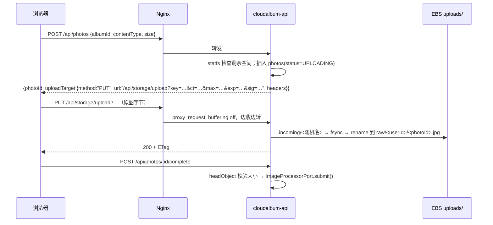

# C 组：数据与存储

本组 7 个模块覆盖 CloudAlbum 的全部“有状态”部分：照片文件（storage / shared-fs）、关系数据（database）、缓存（cache）、社交数据（social-store）、备份（backup）和点击流（analytics）。在 L0 中，这些数据全部放在 EC2 的同一块 EBS 数据卷 `/var/lib/cloudalbum` 上，所以 L0 是一个“单盘、单机、单写者”的系统；本组每个模块把其中一类数据交给一个 AWS 托管服务，并让学员亲眼看到“交出去”之前和之后的差别。

本文是 C 组的定稿设计手册，遵循 [modular-design.md](../modular-design.md)（下称“总纲”）的框架。本轮修订按完整性评审的统一值和主设计者的统一决策（D1～D15）收敛，修订摘要见文末“修订记录”。文中“统一值 Cn”指评审 `consistency_issues` 的第 n 项，“Gn”指 `gaps` 的第 n 项（从 0 起编号，与 01 组文档相同）。

- **ec2 基础契约不在本文定义。** 数据卷布局（含机密与本地配置所在的 `/var/lib/cloudalbum/etc`）、`l0-bootstrap.sh`、固定 uid/gid 2001、nginx 加入 `cloudalbum` 组、服务单元 `UMask=0027`、`cloudalbum-backup.timer`、Nginx 的 `/_media_local/` 与 `/_media_efs/` internal location 及各 include 点，统一以 [00-ec2-base.md](00-ec2-base.md) 和总纲第 2 节为准（D5、D6）。本文只声明各模块通过 `baseParams`、`hostSetup`、`systemdDropIns` 改动什么。
- **锚点。** 每个模块的二级标题前有稳定锚点（`#storage`、`#shared-fs`、`#database`、`#cache`、`#social-store`、`#backup`、`#analytics`），registry 的 `doc` 字段写成 `docs/modules/03-data-storage.md#<id>`（D10）。
- **每个模块的结构**（总纲附录 A 的新模板）：第 0 节“元数据（registry 摘录）”，第 1～9 节沿用原结构（基线实现、AWS 实现、开关与配置、依赖与组合、对比实验、切换迁移回滚、SAA 考点、费用与清理、常见坑），第 10 节“探针”，第 11 节“前端徽章”。正文中“见第 N 节”仍指原编号。

## 本组模块一览

“凭证”列取自 registry 的 `credentials` 字段（D1）：`required` 表示开关取 AWS 值时应用必须调用 AWS API，`IAM_CREDENTIALS=none` 时触发 CRED-001（error）；`optional` 表示应用数据面不调用 AWS API，凭证只用于深度探针、控制面感知或 EFS 的 IAM 授权挂载，缺失时这些子功能关闭并给出 CRED-004（warn），模块照常工作。

| 模块 id | 机能 | 主 AWS 服务（辅助服务） | 开关（首个取值 = 本地实现） | 硬依赖（规则 ID） | 凭证 | 能否在 L0 上单独启用 |
|---|---|---|---|---|---|---|
| `storage` | 照片对象存储 | Amazon S3（EventBridge：桶级事件投递） | `STORAGE_DRIVER=local\|s3`（`efs` 值归 shared-fs） | 与 shared-fs 互斥（MUTEX-001） | required | 能（+iam：`single/storage` = L0 + iam(role) + storage） |
| `shared-fs` | 多实例共享文件系统 | Amazon EFS | `STORAGE_DRIVER=efs`（复用本地文件适配器，只换根目录） | 实例所在 AZ 有挂载目标、`sg-efs` 放行来自实例安全组的 TCP 2049、实例装有 amazon-efs-utils、VPC 开启 DNS；与 storage 互斥（MUTEX-001）；VPC 绑定模块（DEP-016） | optional（`IamAuth=true` 时需 role） | 能 |
| `database` | 关系数据库 | Amazon RDS for PostgreSQL | `DB_DRIVER=sqlite\|postgres`（+ `DB_HOST`；本地档：EC2 上自建 PostgreSQL） | 同一 VPC、DB 子网组覆盖 ≥2 个 AZ、`sg-db` 放行来自实例安全组的 5432；与自建 PG 二选一（MUTEX-002）；VPC 绑定模块（DEP-016） | optional（深度探针） | 能（密码认证） |
| `cache` | 缓存 | Amazon ElastiCache（Valkey / Redis OSS） | `CACHE_DRIVER=none\|memory\|redis`（本地档：memory、EC2 上自建 Valkey） | 同一 VPC、`sg-cache` 放行来自实例安全组的 6379（Serverless 另加 6380）；客户端 TLS；与自建 Valkey 二选一（MUTEX-003）；VPC 绑定模块（DEP-016） | optional（深度探针） | 能 |
| `social-store` | 点赞、评论与分享链接存储 | Amazon DynamoDB | `SOCIAL_DRIVER=db\|dynamodb` | 能访问 DynamoDB 区域端点 | required | 能（+iam） |
| `backup` | 备份 | AWS Backup | `BACKUP_MODE=local\|aws`（声明型开关；基线 systemd timer + `sqlite3 .backup`） | 数据资源带 `Backup=true` 标签；区域资源类型 opt-in；先部署灾备区域备份库 | optional（感知器） | 能 |
| `analytics` | 点击流采集与投递 | Amazon Data Firehose（模块自带的 S3 事件桶；Athena、Glue Data Catalog 只用于报表查询） | `ANALYTICS_DRIVER=db\|firehose` | 能访问 Firehose、Athena、S3 端点（事件桶由本模块自建，不依赖 storage） | required | 能（+iam） |

**一个机能 ↔ 一个主服务（R3）**：analytics 的机能名从上一轮的“点击流采集与分析”改为“点击流采集与投递”，主服务是 Data Firehose；Athena（报表查询）和 Glue Data Catalog（表结构、分区投影）只是读取数据湖的辅助服务（G20）。database（RDS for PostgreSQL）与新增的 db-proxy（RDS Proxy）同属 RDS 家族，按子服务区分。

**相关的新增模块**：`db-proxy`（Amazon RDS Proxy，开关 `DB_PROXY_MODE=none|pgbouncer|rds-proxy`）在主题上属于本组，按 D10、D11 写在 [06-governance-cost.md](06-governance-cost.md#db-proxy)，作为 Lab 15（database）的扩展步骤；本文 database 第 4 节给出两者的衔接点。cost 模块（Lab 1）的本地实现按 registry 的 `billing` 字段估算已启用模块的小时费用，本组各模块第 0 节的 `billing` 与第 8 节的计费维度供它使用（不写金额）。

**本组共同约定**

以下约定适用于本组全部模块。上一轮列为“需要回写总纲”的细化项（旁路键 `replica`、容器 `dbRead`、`DB_READ_HOST`/`DB_SSL_CA`、`STORAGE_S3_GET_TTL_SEC`/`STORAGE_S3_URL_REUSE_SEC`、`SocialStorePort.purgePhoto`、`ClickEvent.eventId`、`analytics.retention`、shared-fs 的 `ownsEnv` 含 `STORAGE_LOCAL_ROOT`、registry 字段 `lab.sideBySide` 与 `credentials`），总纲 3.5、4.2、4.4 已经采纳；`reconfigureOn` 与 `API_CLUSTER_WORKERS` 两项按统一值删除（见约定 3、约定 6）。

**约定 1：开关、env 文件与本地档（统一值 C1、C26）**

- 每个模块一个开关，第一个取值是本地实现，也是默认值。backup 是纯基础设施型，本轮补上声明型开关 `BACKUP_MODE=local|aws`（C1）：它不切换业务代码，只决定感知器的预期结果和 capabilities 的展示。
- L0 不写本组任何配置。基础配置 `cloudalbum.env` 只放全局键（总纲 4.4），本组各开关与子参数取 zod 默认值（`STORAGE_DRIVER=local`、`DB_DRIVER=sqlite`、`CACHE_DRIVER=none`、`SOCIAL_DRIVER=db`、`BACKUP_MODE=local`、`ANALYTICS_DRIVER=db` 等）。临时调整默认值只能写 `local.override.env`（触发 CFG-005 横幅）。
- `MODULE_<ID>=on` 只在开关取 AWS 值时写入 `modules.d/<id>.env` 的第一行。本组的本地档也写入同一个文件，但**不含** `MODULE_<ID>=on`，由 registry 豁免 CFG-004（半启用）：

  | 本地档 | `modules.d` 中写什么 | CFG-004 豁免依据 | 仍然生效的规则 |
  |---|---|---|---|
  | cache `memory` | `CACHE_DRIVER=memory`、`CACHE_MEMORY_MAX_ITEMS` | `switch.localTiers: [memory]` | ASG-004 |
  | EC2 自建 PostgreSQL | `DB_DRIVER=postgres`、`DB_HOST=127.0.0.1` 等（密码在 `secrets.env`） | `selfHosted.match: { DB_HOST: loopback }` | MUTEX-002、ASG-003 |
  | EC2 自建 Valkey | `CACHE_DRIVER=redis`、`REDIS_URL=redis://127.0.0.1:6379`、`REDIS_TLS=off` | `selfHosted.match: { REDIS_URL: loopback }` | MUTEX-003、ASG-004（回环 `REDIS_URL` 分支，第 3 轮总纲采纳） |

  “回环地址”指主机部分为 `localhost`、`127.0.0.0/8` 或 `::1`；只按配置值判定，不做 DNS 解析。`match` 命中时，capabilities 中该模块为 `status=off` + `localHealth`，`/lab` 卡片显示“本地档：EC2 自建”。`DB_HOST`/`REDIS_URL` 指向非回环地址却没有 `MODULE_<ID>=on`，仍按半启用报 CFG-004；反过来，`MODULE_DATABASE=on` 而 `DB_HOST` 是回环地址，由 MUTEX-002 拒绝（MUTEX-002、MUTEX-003 保持不变）。
- 各模块的 `ownsEnv`：storage → `STORAGE_S3_`；shared-fs → `EFS_`、`STORAGE_LOCAL_ROOT`；database → `DB_`（`DB_PROXY_` 按“最长前缀”归 db-proxy，总纲 3.5）；cache → `REDIS_`、`CACHE_MEMORY_`；social-store → `SOCIAL_DDB_`；backup → `BACKUP_`；analytics → `ANALYTICS_FIREHOSE_`、`ANALYTICS_S3_`、`ANALYTICS_ATHENA_`。开关变量本身按 `switch.ownedValues` 归属（例如 `STORAGE_DRIVER=efs` 归 shared-fs）。

**约定 2：凭证与机密（D1、D5，统一值 C0、C7、C8）**

- 凭证只由 iam 提供：`IAM_CREDENTIALS=none|role|keys`。本组 `credentials: required` 的是 storage、social-store、analytics，它们取 AWS 值而 `IAM_CREDENTIALS=none` 时报 CRED-001（error），`keys` 时报 CRED-002（warn）；`profiles/single/<id>.env` 为它们自动并入 iam(role)。shared-fs、database、cache、backup 是 `optional`：EFS 走 NFS、RDS 用密码、ElastiCache 用 TLS（加可选 AUTH），应用数据面都不调用 AWS API。
- 模块栈只输出 `PolicyArn`，由 `scripts/module` 附加到 `CloudAlbumAppRole`（`keys` 模式下附加到演示用户），附加关系记入 `.cloudalbum/state.json`（D2）。以 root 运行的 EFS 挂载助手不读取 `secrets.env` 中的长期密钥，只能用实例角色，所以 shared-fs 的 `IamAuth` 只在 `role` 模式下打开；AWS Backup 用的是栈内创建、由 AWS Backup 服务代入的服务角色，与应用的凭证模式无关。
- 机密值只放在 `/etc/cloudalbum/secrets.env`（`root:cloudalbum 0640`，`load-env.ts` 第 3 层）与 `/etc/cloudalbum/keys/*.pem`，两者实际位于数据卷的 `/var/lib/cloudalbum/etc`；只有数据卷上也没有时才生成密钥。本组用到的逻辑名（SecretName）：

  | 逻辑名 | 用途 | env 驱动读取的变量（只在 `secrets.env`） | secrets 启用后 |
  |---|---|---|---|
  | `upload-hmac-key` | storage(local) 的上传签名；F14 本地前缀令牌 | `UPLOAD_HMAC_KEY` | SecretsPort 读 `cloudalbum/<env>/upload-hmac-key` |
  | `media-hmac-key` | `/media` 私有媒体签名；analytics 的 `ipHash` 子密钥 | `MEDIA_HMAC_KEY` | SecretsPort 读 `cloudalbum/<env>/media-hmac-key` |
  | `db-password` | 自建 PostgreSQL 的密码；secrets 未启用时 RDS 的主密码 | `DB_PASSWORD` | `modules.d` 只写 `DB_PASSWORD_SECRET_ARN`（RDS 托管主密码，或 secrets 栈创建的 `cloudalbum/<env>/db-password`） |
  | `redis-auth-token` | 可选的 ElastiCache / 自建 Valkey AUTH 令牌 | `REDIS_AUTH_TOKEN` | `modules.d` 只写 `REDIS_AUTH_SECRET_ARN` |

  `scripts/module` 把 `secretParams` 的值写进 `secrets.env`（secrets 未启用时），`modules.d` 只能出现 `*_SECRET_ARN` 或逻辑名；`DB_PASSWORD`、`REDIS_AUTH_TOKEN` 出现在 `modules.d` 中会被 CFG-002 拒绝（上一轮 `database.env` 直接写 `DB_PASSWORD` 的做法作废，G15）。

**约定 3：跨模块参数只用提供方声明的 `injects`（D2，统一值 C6、C25）**

- 模块栈之间禁止 `Export` / `!ImportValue`，模板也不自己挂策略。上一轮本组提出的、由被更新方声明的 `reconfigureOn` 已删除，需求改由提供方的 `injects` 承担：提供方启用、更新或禁用时，`scripts/module` 用新值（或空值）更新被注入的栈；被注入方启用时，汇总所有已启用提供方的当前值。
- 与本组有关的注入：

  | 提供方 | 被注入的模块（栈） | 参数 | 声明位置 |
  |---|---|---|---|
  | storage | cdn | `MediaBucketDomain`（取 `InfoMediaBucketRegionalDomainName`，`CDN_MEDIA_ORIGIN=s3` 时使用） | 本文 storage 第 0 节 |
  | storage | image-processing、workflow | `RawBucketName`、`MediaBucketName` | 本文 storage 第 0 节 |
  | storage | tagging | `RawBucketName`（`TAGGER_INPUT=s3` 时授予 `s3:GetObject`） | 本文 storage 第 0 节 |
  | database | db-proxy | `DbInstanceIdentifier`、`DbSecretArn` | 本文 database 第 0 节（参数名以 06 为准） |
  | cdn | storage | `CdnDistributionArn`（OAC 桶策略的 `AWS:SourceArn`） | 01 cdn |
  | storage | audit | `DataEventBuckets`（原图桶、媒体桶；trail 只记录写数据事件） | 本文 storage 第 0 节 |
  | social-store | social-api | `SocialTableName`（lambda 集成的后端与授权器读写同一张表） | 本文 social-store 第 0 节 |
  | database | monitoring | `DbInstanceId`（告警与仪表板维度） | 本文 database 第 0 节 |
  | cache | monitoring | `CacheReplicationGroupId`（告警与仪表板维度） | 本文 cache 第 0 节 |
  | dns / cdn / load-balancer | storage | `AppOrigins`（原图桶 CORS；各入口以 `+` 追加，取并集，再并入直连入口） | 01（已声明，与注入 auth、identity-pool 的 `AppOrigins` 同值） |
  | network | database、cache、shared-fs（及 db-proxy） | `VpcId`、`SubnetIds`（data 子网） | 01 network |
  | kms | 本组所有声明了 `KmsKeyArn` 参数的栈：storage、shared-fs、database、cache、social-store、backup、analytics | `KmsKeyArn` | 02 kms（`target: "*"`，已声明）。是否用 CMK 只取决于栈是否声明该参数；`KMS_APPLY_TO` 只管 fields、ebs |
  | monitoring | backup | `AlarmTopicArn`（备份 / 复制作业失败通知） | 05 monitoring（已声明） |
  | db-proxy | database | `ClientSecurityGroupIds`（放行 RDS Proxy 的安全组访问 5432）；`DB_PROXY_AUTH=iam` 时另注入 `IamDatabaseAuthentication=true` | 06 db-proxy（已声明） |

**约定 4：本组相关的校验规则（统一编号，D3，统一值 C3、C4、C5、C27）**

全部规则只写在 `backend/src/rules/rules.ts` 一张表里，依赖只用 registry 的 `requires` / `conflicts` 表达式书写，不另设 `deps.ts`，也没有“按上次可用配置装配”的回退；结构或语义错误一律退出码 78，并一次性打印全部错误与修复命令。下表只是本组涉及规则的说明：

| ID | 级别 | 范围 | 违规条件 | 说明 / 修复 |
|---|---|---|---|---|
| CFG-002 | error | 启动 | `modules.d/<id>.env` 出现不属于 `ownsEnv` 的键，或机密类键 | 本组常见：`DB_PASSWORD`、`REDIS_AUTH_TOKEN` 写进了 `modules.d` |
| CFG-004 | error | 启动 | 半启用 | 本组本地档由 `localTiers` 与 `selfHosted.match` 豁免（约定 1） |
| CRED-001 | error | 启动 | storage(s3)、social-store(dynamodb)、analytics(firehose) 之一已启用而 `IAM_CREDENTIALS=none` | `scripts/module enable iam`（role） |
| CRED-002 | warn | 启动 | `IAM_CREDENTIALS=keys` | 长期密钥落盘；shared-fs 的 `IamAuth` 保持 false |
| CRED-003 | error | 启动 | env 中资源 ARN 的区域与 `AWS_REGION` 不同 | backup 的灾备库 ARN 因此只作 `Info*` 输出 |
| DEP-002 | error | 启动 | identity-pool 已启用而 `STORAGE_DRIVER≠s3` | 见 02 identity-pool |
| DEP-003 | error | 启动 | `IMAGE_PROCESSOR=lambda` 而 `STORAGE_DRIVER≠s3` | 见 04 image-processing |
| DEP-010 | error | 部署 | `CDN_MEDIA_ORIGIN=s3` 而 `STORAGE_DRIVER≠s3` | 见 01 cdn |
| DEP-016 | error | 部署 | network 的启用、禁用或更新会改变 `VpcId`，而 database、cache、shared-fs（或 db-proxy 等其他 VPC 绑定模块）已部署 | 按 Lab 顺序先迁入自定义 VPC（Lab 14），或 `--cascade`；同一 VPC 内 `public` ↔ `private` 不触发 |
| DEP-022 | error | 启动 | social-api 的 lambda 集成而 `SOCIAL_DRIVER≠dynamodb` | 取代已废止的 DEP-008（C3） |
| DEP-027 | error | 启动 | `TAGGER_INPUT=s3` 而 `STORAGE_DRIVER≠s3` | 见 04 tagging |
| DEP-028 | warn | 启动 | `CDN_MEDIA_ORIGIN=ec2` 而 `STORAGE_DRIVER=s3` | 上一轮本组建议的“DEP-014”改为此编号，落在 cdn：cdn 为 `degraded`，MediaUrlBuilder 不把媒体 URL 改写到 CDN |
| DEP-032、DEP-033、DEP-036 | error | 启动 | db-proxy 的依赖：`rds-proxy` 需要 database(RDS)，默认 `DB_PROXY_AUTH=secrets` 时还需要 secrets(secretsmanager)（DEP-032）；`DB_PROXY_AUTH=iam` 变体要求 RDS 开启 IAM 数据库认证（DEP-036，database 经 db-proxy 注入的 `IamDatabaseAuthentication` 开启）；`DB_DRIVER=sqlite` 时不能启用 `DB_PROXY_MODE`（DEP-033） | 定义见 06 db-proxy 与总纲 5.2 |
| DEP-034 | error | 启动 | workflow(stepfunctions) 而 `STORAGE_DRIVER≠s3` | 定义见 06 workflow |
| MUTEX-001 | error | 启动 | storage 与 shared-fs 同时启用 | 先 disable 一个（含数据迁回） |
| MUTEX-002 | error | 启动 | database(RDS) 已启用，但 `DB_DRIVER=sqlite` 或 `DB_HOST` 不是该 RDS 端点 | 自建 PostgreSQL 与 RDS 二选一 |
| MUTEX-003 | error | 启动 | cache(ElastiCache) 已启用，但 `REDIS_URL` 指向本机 | 自建 Valkey 与 ElastiCache 二选一 |
| MUTEX-004 | error | 部署 | 原图桶或媒体桶的 `NotificationConfiguration` 中出现 `EventBridgeConfiguration` 以外的配置（Lambda、SQS、SNS 目标） | 措辞修订（C27）：开启 EventBridge 投递本身就写在 `NotificationConfiguration` 里，旧写法“出现即违规”会误伤 storage 自己 |
| ASG-001 | error（可覆盖） | 启动 | `DEPLOY_MODE=asg` 且 `STORAGE_DRIVER=local` | 照片只在接收上传的那台实例上 |
| ASG-002、ASG-003 | error | 启动 | `DEPLOY_MODE=asg` 且 `DB_DRIVER=sqlite`，或 `DB_HOST` 是回环 / 本实例地址 | 不可覆盖 |
| ASG-004 | error（可覆盖） | 启动 | `DEPLOY_MODE=asg` 且（`CACHE_DRIVER=memory`，或 `CACHE_DRIVER=redis` 且 `REDIS_URL` 为回环地址） | 回环分支由第 3 轮总纲 5.2 采纳：每台实例各有一个自建 Valkey，与 memory 一样各自为政 |
| ASG-008 | error（可覆盖） | 启动 | 上传 / 媒体 HMAC 密钥的来源为 `instance` | A 签发的上传 URL 在 B 上验签失败 |
| ASG-013 | warn | 启动 | `CACHE_DRIVER≠redis`（应用层限速计数按实例统计） | 原 CachePort 注释中的 ASG-015 改为引用本规则 |

**约定 5：`X-CloudAlbum-Path` 中本组负责的段与旁路键（统一值 C13、C14）**

键只能是模块 id 或 `entry`、`inst`、`az`、`bypass`、`more`，值的语法为 `driver[@host][:outcome]`。段名取适配器的 `meta.module`，所以 `efs` 驱动的结果写在 `shared-fs` 段。

| 段 | 取值 |
|---|---|
| `storage` | `local:sign`、`local:write`、`local:part`（F14 本地前缀令牌的分片）、`local:accel`、`s3:presign`、`s3:head`、`s3:redirect`、`s3:import`（F14 暂存对象经 CopyObject 导入） |
| `shared-fs` | `efs:sign`、`efs:write`、`efs:part`、`efs:accel` |
| `database` | `sqlite`、`postgres@local`、`postgres@rds`、`postgres@rds:replica`、`postgres@rds:bypass`；db-proxy 启用后的主机类别见 06 |
| `cache` | `none`、`memory:hit`、`memory:miss`、`redis@local:hit`、`redis@local:miss`、`redis@elasticache:hit`、`redis@elasticache:miss`、`redis@elasticache:bypass`、`redis@elasticache:error-bypass` |
| `social-store` | `db`、`dynamodb`、`dynamodb:throttled` |
| `analytics` | `db`、`firehose`、`firehose:partial`、`db:bypass`、`firehose:bypass` |

本组的旁路键：`cache`、`replica`（仅 `GET /api/feed`、`GET /api/albums/*`）、`analytics`，均已进入总纲 4.2 的 `BypassKey`。storage、shared-fs、database 引擎、social-store 是权威数据，不做一半一半的运行时 A/B；storage、social-store、analytics 另外提供只作用于 lab 命名空间的**侧路对比**（registry `lab.sideBySide: true`）：两种适配器同时装配，只读写 `lab/` 前缀或 `lab-` 开头的实验数据，接口为 `/api/lab/<id>/...`（仅管理员），不触碰业务数据。

**约定 6：数据、磁盘与迁移窗口**

- **一块盘的水位。** L0 中 `etc/`（机密与本地配置）、`db/`、`uploads/`、`outbox/`、`logs/`、`backup/` 和实验目录 `lab/`（总纲 2.4 已列出）都在同一块 20 GiB 数据卷上。任何一个写满，SQLite 都会写失败、整站不可用。所以磁盘水位是 storage、backup、analytics 三个对比实验的共同背景：storage 有 507 拒绝阈值，backup 只保存 SQLite 副本和上传清单，analytics 的 db 驱动有保留期。
- **数据里只存逻辑键。** 存储键（`raw/…`、`variants/…`、`reports/…`）、内部用户 ID、照片 ID 在各驱动间保持不变；URL 一律在响应时由 MediaUrlBuilder 生成。缓存里也只放逻辑键和元数据，从不缓存 URL（这样就不存在“缓存 TTL 比预签名 URL 寿命长”的问题）。
- **多实例规则只在 `DEPLOY_MODE=asg` 时检查。** 只启用 load-balancer、单实例挂在 ALB 后面时，不要求共享存储。
- **单机多进程只用 `LB_LOCAL_WORKERS=2`**（统一值 C18）：cache 的陈旧读实验、database 的连接数实验都复用 load-balancer 的本地档（systemd 模板单元 `cloudalbum-api@3001` + `cloudalbum_upstream.conf`），上一轮的 `API_CLUSTER_WORKERS`（`node:cluster`）已删除。
- **备份标签统一为 `Backup=true`**（总纲 9.1），由承载数据的资源在自己的栈里打上；backup 模块只按标签选择资源，不修改别人的资源。
- **加密要先决定。** RDS 与 EFS 的静态加密密钥只能在创建时指定。kms 在 registry 中声明 `orderBefore: [storage, database, shared-fs, secrets]`，Lab 13（l5-security）排在数据层（l6-data）之前，RDS、EFS 创建时就由 kms 的 `injects` 拿到 `KmsKeyArn`。storage 在 Lab 4 就已启用，所以 kms 之后只影响新对象，存量对象仍是 SSE-S3（原地复制换密钥见 02 kms）。
- **迁移的只读窗口**（本组细化，总纲 9.3 规则 3 已采纳）：本组 `migrate-module <id> up|down` 在只读窗口内一律执行三件事：运行时 `readOnly=true`（写接口 503 + `Retry-After`）；`systemctl stop cloudalbum-worker`（定时任务、队列消费、缩略图生成、指标汇总都在 worker 里，会继续写数据库和 `uploads/`）；API 进程的 LabMetricsStore 汇总暂存内存，`ANALYTICS_DRIVER=db` 的事件丢弃并计数。`verify` 通过、写入 env、重启 api 与 worker 并且探针通过之后，才关闭只读。

**约定 7：Lab 顺序与预设档位（D11、D12，统一值 C32）**

启用顺序不在本文单独规定，以评审的 Lab 顺序与预设档位为准。与本组有关的位置：

| Lab | 本组模块 | 所在预设 | 说明 |
|---|---|---|---|
| Lab 0（第二部分） | 本地档：`CACHE_DRIVER=memory`、EC2 自建 PostgreSQL、自建 Valkey（配合 `LB_LOCAL_WORKERS=2`） | l0-plus-local-tiers | 不产生 AWS 费用，把“架构模式”与“托管服务”拆开 |
| Lab 1 | （cost 读取本组的 `billing`） | l1-ops | 本组模块启用后自动进入 cost 的本地估算 |
| Lab 4 | storage | l2-edge | 第一个数据模块；kms 尚未启用 |
| Lab 13 | （kms、secrets） | l5-security | 必须早于 database、shared-fs；secrets 先启用，RDS 直接采用托管主密码 |
| Lab 14 | （network，`public` 放置） | l6-data | 必须早于 database、cache、shared-fs（DEP-016） |
| Lab 15 | database（扩展步骤：db-proxy，见 06） | l6-data | 从单 AZ 开始；Multi-AZ、只读副本按实验开启 |
| Lab 16 | cache | l6-data | |
| Lab 17 | social-store（+ social-api） | l7-serverless-social | |
| Lab 18 | analytics | l6-data | |
| Lab 21 | shared-fs | x-efs-asg | 与 l8-ha 的 S3 方案对照 |
| Lab 24 | backup | l9-full | 放在最后，按标签一次纳入全部数据资源 |
| — | storage、database、cache | x-named-comparisons | 用户点名对比的最小集合；RDS、ElastiCache 按小时计费，练完回到 l0-ec2 |

**约定 8：本组新增的 CLI 子命令与运行器参数（待总纲第 11 节与 `backend/src/cli.ts`、`experiments/_lib/runner.ts` 登记）**

- `node dist/cli.js`：`db:verify --host <端点>`、`lab:seed`、`lab:seed-events --target db|s3`、`lab:fs-bench`、`scheduler:pause <任务名>`、`verify --all`；`migrate-module <id>` 的选项 `--no-readonly`、`--backfill`、`--from postgres@local`（另有总纲已定义的 `--dry-run`、`--resume`、`--prune-source`）。
- 实验运行器：`--param k=v`、`--detach`（长时间实验，结果写入 `lab_results`）、`--vus 10,50,200`（按列表依次运行）。

<a id="storage"></a>

## storage：照片对象存储 ↔ Amazon S3

> 一句话总结：没有 S3 时，原图字节经 Nginx 流进 EC2 上的 Node 进程、写到 EBS，缩略图由 Nginx 从本地磁盘发出；启用后浏览器拿预签名 URL 直接 PUT 到 S3，EC2 只签一个几 KB 的 URL。最直观的区别是：DevTools 里上传请求的目标主机从本站变成 `*.s3.ap-northeast-1.amazonaws.com`，同时 EC2 的网卡入流量不再随上传量增长。

### 0. 元数据（registry 摘录）

```yaml
# modules/registry.yaml 中 storage 的条目（摘录；不一致时以 registry 为准，并同步本节）
storage:
  group: C
  function: 照片对象存储
  awsService: Amazon S3
  auxServices: [Amazon EventBridge（桶级事件投递）]
  type: adapter
  port: StoragePort                      # adapters/storage/{local,s3}.ts；权威端口
  switch: { var: STORAGE_DRIVER, values: [local, s3, efs], ownedValues: [s3], localTiers: [] }   # efs 归 shared-fs
  ownsEnv: [STORAGE_S3_]
  credentials: required
  prerequisites: []
  requires: []                           # 依赖 storage(s3) 的规则（DEP-002/003/010/027/034）写在依赖方条目里
  soft: [kms, cdn]
  conflicts:
    - { module: shared-fs, rule: MUTEX-001 }
    - { rule: MUTEX-004, need: [] }      # 部署范围：原图桶 / 媒体桶的 NotificationConfiguration 只允许 EventBridgeConfiguration（deployCheck() 检查模板）
  authoritative: true
  multiInstanceSafe: { local: false, s3: true }
  bypass: []                             # 权威数据，不做运行时 A/B；另有 lab 命名空间侧路对比
  stacks: [{ name: main, template: infra/modules/storage.yaml }]
  injects:                               # D2：本模块作为提供方
    - { target: cdn,              params: { MediaBucketDomain: "${Out.InfoMediaBucketRegionalDomainName}" } }
    - { target: image-processing, params: { RawBucketName: "${Out.EnvStorageS3RawBucket}", MediaBucketName: "${Out.EnvStorageS3MediaBucket}" } }
    - { target: workflow,         params: { RawBucketName: "${Out.EnvStorageS3RawBucket}", MediaBucketName: "${Out.EnvStorageS3MediaBucket}" } }
    - { target: tagging,          params: { RawBucketName: "${Out.EnvStorageS3RawBucket}" } }
    - { target: audit,            params: { DataEventBuckets: "${Out.EnvStorageS3RawBucket},${Out.EnvStorageS3MediaBucket}" } }   # trail 的 S3 写数据事件
  # 本栈接收的注入：KmsKeyArn（kms，target "*"）、CdnDistributionArn（cdn）、AppOrigins（dns / cdn / load-balancer，"+" 追加）
  migration: scripts/migrate/storage
  probe: { kind: active, method: "s3:HeadBucket ×2", intervalSec: 30 }
  billing: [{ resource: "S3 存储、请求与流出流量", dimension: usage }]
  lab: { compare: before-after, sideBySide: true, hourlyBilled: false, experiments: [upload-burst, upload-sidebyside, ebs-growth] }   # 文案见第 11 节
  doc: docs/modules/03-data-storage.md#storage
```

- 类型 A，权威端口：s3 驱动故障时返回 503 并把模块置为 `error`，绝不回退到本地磁盘。
- 本模块被 identity-pool（DEP-002）、image-processing 的 lambda 档（DEP-003）、cdn 的 S3 媒体源站（DEP-010）、tagging 的 S3 输入（DEP-027）、workflow（DEP-034）依赖；这些规则写在依赖方的条目里。

### 1. 基线实现（仅 EC2）

**驱动**：`STORAGE_DRIVER=local`，实现为 `backend/src/adapters/storage/local.ts` 中的 `LocalStorage`（shared-fs 的 `efs` 驱动复用同一个类）。根目录 `STORAGE_LOCAL_ROOT=/var/lib/cloudalbum/uploads`，目录中的相对路径就是逻辑键：

```
/var/lib/cloudalbum/uploads/
├── raw/<userId>/<photoId>.<jpg|png|webp>        # 原图，private
├── variants/<photoId>/thumb_200.webp            # 缩略图，public（UUID 不可猜测）
├── variants/<photoId>/display_1080.webp         # 展示图，public
├── reports/daily/<yyyy-mm-dd>.csv               # F13 日报，private（只有管理员能签发读取 URL）
└── .incoming/                                    # 上传中的临时文件；与目标同一文件系统，保证 rename 原子
```

`.incoming/` 必须放在上传根目录下：systemd 的 `PrivateTmp` 让 `/tmp` 落在根卷上，与数据卷是两个文件系统，跨文件系统 `rename()` 会失败（`EXDEV`），无法做到“写完再原子出现”。

**上传流程（F6）**——前端流程与 S3 完全相同，只有 URL 不同：



- **签名**：`sig = base64url(HMAC-SHA256(UPLOAD_HMAC_KEY, "PUT\n" + key + "\n" + ct + "\n" + max + "\n" + exp))`。密钥来自 `/etc/cloudalbum/secrets.env`（实际在数据卷 `/var/lib/cloudalbum/etc` 上；L0 引导脚本只在数据卷上也没有时才生成 `UPLOAD_HMAC_KEY`，所以换实例后已签发的 URL 仍然有效），启用 secrets 模块后改由 Secrets Manager 提供，代码通过 `SecretsPort.get('upload-hmac-key')` 读取，不感知来源。
- **`PUT /api/storage/upload` 的检查顺序**（`http/routes/uploads.ts`）：
  1. 签名与有效期（`crypto.timingSafeEqual`）；
  2. 请求头 `Content-Type` 必须等于签名里的 `ct`；
  3. 有 `Content-Length` 且大于 `max` → 立即 413，不读请求体；
  4. 剩余空间低于 `STORAGE_LOCAL_MIN_FREE_PCT` → 507；
  5. 目标键已存在：大小一致返回 200（幂等重试），否则 409；
  6. `stream.pipeline(req, 字节计数（超过 max 立即中止）, sha256 旁路计算, fs.createWriteStream(tmp, { flags: 'wx', mode: 0o640 }))`，完成后 `fsync` 再 `rename`；任何错误或客户端中断都删除临时文件。
  
  不使用 multer 的内存存储：整个文件进 Node 堆，内存会随“并发数 × 文件大小”增长，这正是对比实验要避免的失真。
- **F14 的本地前缀令牌**（identity-pool 未启用时由 `DirectUploadPort(none)` 使用，令牌格式与授权逻辑见 [02 identity-pool](02-identity-security.md#identity-pool)）：同一个路由还接受分片形式 `PUT /api/storage/upload?key=…&uploadId=…&part=<n>`，请求头 `Authorization: CA-Upload <令牌>`。storage 只负责字节落盘：校验键在令牌前缀 `raw/<userId>/` 之内后，把分片写到 `uploads/.incoming/<uploadId>/<part>`（同样 `fsync`，写满检查同上）；`GET /api/storage/upload/parts?uploadId=…` 返回已收到的分片，断网后只补传缺失的分片；`complete` 时按序拼接、`fsync`、`rename` 到原图键，路径头记为 `storage=local:part`。`.incoming/` 中超过 24 小时未完成的 `uploadId` 目录由 `image.reconcile` 一并清理。
- **Nginx**：ec2 基础提供的 `cloudalbum_locations.conf`（00-ec2-base.md，总纲 2.5）已经为 `location /api/storage/upload` 设置了 `proxy_request_buffering off`，`client_max_body_size 30m`。运行时配置 `maxUploadMb` 默认 25，最大不能超过 30（再大要同时改 Nginx）。不关掉请求缓冲时，Nginx 会先把整个文件缓冲到磁盘再转给 Node，API 进程的内存和耗时曲线就看不出上传的影响。
- **读取（F7 结果、F11 分享）**：所有媒体都走 `/media/<key>`，先由 Node 判断权限，再返回 `X-Accel-Redirect`，由 Nginx 用 sendfile 发文件：
  - `variants/…`（public）：URL 不带签名，Node 只检查照片存在且不是 `BLOCKED`，然后重定向到 `/_media_local/public/<key>`（`Cache-Control: public, max-age=86400`）；
  - `raw/…`、`reports/…`（private）：URL 带 `exp` 与 `sig`（`MEDIA_HMAC_KEY`），校验后重定向到 `/_media_local/private/<key>`（`private, max-age=300`）。
- **文件权限（已并入 L0 基线，D6）**：Nginx worker 以 `nginx` 用户运行，而数据目录是 `cloudalbum:cloudalbum 750`（uid/gid 固定为 2001）。L0 引导脚本执行 `usermod -aG cloudalbum nginx`，两个服务单元都设置 `UMask=0027`（新文件 640、目录 750，组可读），否则 X-Accel-Redirect 会得到 403。L0 冒烟测试（总纲 2.9）断言上传后 `GET /media/variants/<photoId>/thumb_200.webp` 返回 200、路径头含 `storage=local:accel`。本模块不再单独修改引导脚本（G0）。
- **磁盘保护**：签发上传目标和 PUT 开始时都用 `fs.promises.statfs` 检查剩余空间。低于 `STORAGE_LOCAL_MIN_FREE_PCT`（默认 10%）返回 507；探针在低于 15% 时把 `localHealth` 置为 `degraded`（总纲 6.2），前端据此把上传按钮置灰并提示原因。
- **进程分工**：`cloudalbum-api` 接收上传字节；`IMAGE_PROCESSOR=inline` 时 api 自己生成缩略图，`worker` 档时 `cloudalbum-worker` 读 `raw/`、写 `variants/`。
- **孤儿清理**：上传目标签发后用户放弃上传，照片会停在 `UPLOADING`。worker 的 `image.reconcile` 定时任务把超过 1 小时仍为 `UPLOADING` 的照片删除（连同可能存在的对象）。

### 2. AWS 实现

**栈** `infra/modules/storage.yaml`（栈名 `cloudalbum-<env>-storage`），两个桶都 `DeletionPolicy: Retain` + `UpdateReplacePolicy: Retain`：

| 资源 | 关键配置 | 理由 |
|---|---|---|
| 原图桶 `cloudalbum-<env>-storage-raw-<acct>-<region>` | 4 项 Block Public Access 全开；`ObjectOwnership: BucketOwnerEnforced`；版本控制开启；默认加密 SSE-S3，参数 `KmsKeyArn`（kms 的 `injects`，`target: "*"`）非空时改为 SSE-KMS + `BucketKeyEnabled: true`；**`NotificationConfiguration` 只包含 `EventBridgeConfiguration: { EventBridgeEnabled: true }`**（MUTEX-004 修订后的措辞：只允许这一项）；CORS（见下）；标签 `Backup=true`、`DataClass=user-content` | 版本控制是 AWS Backup 备份 S3 的前提，也能恢复误删；事件统一经 EventBridge 投递（总纲 3.2 决定 1），消费者（image-processing、workflow）在自己的栈里建规则，订阅 `Object Created`（包含 CopyObject，否则 F14 经 identity-pool 导入的照片不会被处理） |
| 原图桶生命周期 | 未完成的分段上传 7 天后中止；当前版本 30 天后转 `STANDARD_IA`；非当前版本 30 天后过期；`lab/` 前缀 1 天后过期 | 原图处理完后很少读取；IA 有最短存储期和 128 KB 最小计费尺寸，原图是 MB 级，适合 |
| 展示桶 `cloudalbum-<env>-storage-media-<acct>-<region>` | 同样私有、默认加密；**存储类别保持 Standard**；不开版本控制；`variants/` 可以从原图重新生成，所以不打 `Backup=true` | 缩略图通常小于 128 KB，Intelligent-Tiering 对小于 128 KB 的对象不做自动分层、始终按频繁访问层计费，对缩略图没有收益（以官方文档为准） |
| 桶策略（两个桶） | 拒绝 `aws:SecureTransport = false` | 强制 HTTPS |
| 展示桶策略（可选） | 参数 `CdnDistributionArn`（cdn 的 `injects`）非空时，追加：允许 `cloudfront.amazonaws.com` 对 `variants/*` 执行 `s3:GetObject`，条件 `AWS:SourceArn = <分配 ARN>` | OAC；`raw/` 与 `reports/` 永远不经 CDN 暴露。展示桶默认不写 `NotificationConfiguration`，需要时同样只能开 EventBridge 投递 |
| 托管策略（Output `PolicyArn`） | `s3:PutObject`、`s3:GetObject`、`s3:DeleteObject` 作用于两个桶的对象；`s3:AbortMultipartUpload`、`s3:ListMultipartUploadParts`（F14 本地前缀令牌在 s3 下的分片上传）；`s3:ListBucket`（两个桶）；`s3:GetEncryptionConfiguration`（深度探针）；`KmsKeyArn` 非空时加 `kms:GenerateDataKey`、`kms:Decrypt` | 没有 `s3:ListBucket` 时，对不存在的键执行 HeadObject 返回 403 而不是 404，应用会把“没有这个对象”误判成“权限错误”。F14 的 CopyObject 导入：写原图键用本策略的 `s3:PutObject`，读暂存对象用 identity-pool 栈 `PolicyArn` 中的 `s3:GetObject`（02 identity-pool）。模板不把策略附加到任何角色，由 `scripts/module` 附加（D2） |

**CORS**（原图桶）：`AllowedOrigins` 来自参数 `AppOrigins`，即所有入口来源的并集（直连 EIP 的 http/https、CDN 域名、ALB 域名、自定义域名，01 约定 5 的“有效入口 URL”规则）。首次启用时由 `scripts/module` 按当前入口计算；之后入口变化由提供方 dns / cdn / load-balancer 的 `injects` 更新（与它们注入 auth、identity-pool 的 `AppOrigins` 是同一个值，D2；上一轮的 `reconfigureOn: [dns, cdn]` 已删除）。`AllowedMethods: [PUT, GET, HEAD]`（PUT 同时覆盖 F6 的预签名 PUT 与 F14 本地前缀令牌的预签名 `UploadPart`；identity-pool 的 STS 直传写的是它自带的暂存桶，不需要原图桶放行 POST），`AllowedHeaders: [content-type, x-amz-*]`，`ExposedHeaders: [ETag]`（分片上传必需），`MaxAge: 3000`。

**Outputs**：`ModuleId`、`ModuleVersion`、`PolicyArn`、`EnvStorageDriver = s3`、`EnvStorageS3RawBucket`、`EnvStorageS3MediaBucket`、`InfoMediaBucketRegionalDomainName`（经 storage 的 `injects` 传给 cdn 栈的 `MediaBucketDomain`）、`InfoRawBucketArn`。桶名经 storage 的 `injects` 传给 image-processing、workflow、tagging 的栈参数；它们不读取 storage 栈的 Outputs，也不使用 `ImportValue`。

```yaml
# infra/modules/storage.yaml（节选）
Parameters:
  Env:                { Type: String, Default: lab }
  ModuleVersion:      { Type: String }
  KmsKeyArn:          { Type: String, Default: '' }     # kms 的 injects（target "*"，kms 启用即注入）
  AppOrigins:         { Type: CommaDelimitedList }      # dns / cdn / load-balancer 的 injects；首次启用由 scripts/module 计算
  CdnDistributionArn: { Type: String, Default: '' }     # cdn 的 injects
Conditions:
  HasKms: !Not [!Equals [!Ref KmsKeyArn, '']]
  HasCdn: !Not [!Equals [!Ref CdnDistributionArn, '']]
Resources:
  RawBucket:
    Type: AWS::S3::Bucket
    DeletionPolicy: Retain
    UpdateReplacePolicy: Retain
    Properties:
      BucketName: !Sub 'cloudalbum-${Env}-storage-raw-${AWS::AccountId}-${AWS::Region}'
      VersioningConfiguration: { Status: Enabled }
      OwnershipControls: { Rules: [{ ObjectOwnership: BucketOwnerEnforced }] }
      PublicAccessBlockConfiguration:
        { BlockPublicAcls: true, BlockPublicPolicy: true, IgnorePublicAcls: true, RestrictPublicBuckets: true }
      BucketEncryption:
        ServerSideEncryptionConfiguration:
          - ServerSideEncryptionByDefault:
              SSEAlgorithm: !If [HasKms, 'aws:kms', 'AES256']
              KMSMasterKeyID: !If [HasKms, !Ref KmsKeyArn, !Ref 'AWS::NoValue']
            BucketKeyEnabled: !If [HasKms, true, false]
      NotificationConfiguration:
        EventBridgeConfiguration: { EventBridgeEnabled: true }   # 唯一允许的通知配置
      CorsConfiguration:
        CorsRules:
          - AllowedOrigins: !Ref AppOrigins
            AllowedMethods: [PUT, GET, HEAD]
            AllowedHeaders: ['content-type', 'x-amz-*']
            ExposedHeaders: [ETag]
            MaxAge: 3000
      LifecycleConfiguration:
        Rules:
          - { Id: abort-mpu, Status: Enabled, AbortIncompleteMultipartUpload: { DaysAfterInitiation: 7 } }
          - { Id: to-ia, Status: Enabled, Prefix: raw/, Transitions: [{ StorageClass: STANDARD_IA, TransitionInDays: 30 }] }
          - { Id: noncurrent, Status: Enabled, NoncurrentVersionExpiration: { NoncurrentDays: 30 } }
          - { Id: lab, Status: Enabled, Prefix: lab/, ExpirationInDays: 1 }
      Tags: [{ Key: Backup, Value: 'true' }, { Key: DataClass, Value: user-content }]
  # MediaBucket、两个 BucketPolicy、AppPolicy 略
Outputs:
  EnvStorageDriver:        { Value: s3 }
  EnvStorageS3RawBucket:   { Value: !Ref RawBucket }
  EnvStorageS3MediaBucket: { Value: !Ref MediaBucket }
  PolicyArn:               { Value: !Ref AppPolicy }
```

**驱动** `adapters/storage/s3.ts`（`@aws-sdk/client-s3`、`@aws-sdk/s3-request-presigner`、`@aws-sdk/lib-storage`，全部经 `adapters/aws/clients.ts` 懒加载，L0 不会加载）：

- **上传**：`createUploadTarget` 对 `PutObjectCommand { Bucket: raw, Key, ContentType, Metadata }` 调用 `getSignedUrl(…, { expiresIn: STORAGE_S3_PRESIGN_TTL_SEC })`。返回的 `headers` 含 `Content-Type` 与 `x-amz-meta-*`，浏览器必须原样携带，否则签名不匹配（403）。上传字节不经过 EC2。
- **大小上限**：预签名 PUT 本身不限制大小。`complete` 时 `headObject` 检查大小，超过 `maxUploadMb` 就删除对象并返回 413。另一种做法是预签名 POST 策略的 `content-length-range` 条件，在 S3 端强制上限；但总纲的 `UploadTarget.method` 只有 `PUT`，本项目不实现，只作为考点介绍。
- **文件类型**：两种驱动都不在上传时解析图片；图片处理阶段（`packages/image-core`，sharp）解码失败就把照片标为 `FAILED` 并删除原图，两种驱动行为一致。
- **读取**：`createReadUrl(key, { visibility, expiresInSec })` 对 `GetObjectCommand` 签名（默认 `STORAGE_S3_GET_TTL_SEC=600`，范围 60～3600，总纲 4.4）。为了让浏览器能缓存，同一个键的 URL 在进程内复用 `STORAGE_S3_URL_REUSE_SEC`（默认 300 秒，必须小于 GET 有效期，zod `superRefine` 校验）；**不回拨签名时间**来凑“整点 URL”，那样做 URL 的实际剩余有效期不可控。
- **F14 导入**（`importObject`，仅 s3 驱动实现）：identity-pool 的 `complete` 校验暂存对象后，调用 `CopyObject` 把暂存桶的 `private/<identityId>/<photoId>.<ext>` 复制到原图键 `raw/<userId>/<photoId>.<ext>`，字节在 S3 内部复制、不经过 EC2，然后由 identity-pool 删除暂存对象；路径头记为 `storage=s3:import`。原图上限 30 MB，远低于单次 CopyObject 的大小上限（以官方文档为准），不需要分片复制。复制产生的 `Object Created`（原因为 CopyObject）照常经 EventBridge 触发下游。
- **F14 本地前缀令牌在 s3 下的分片**（identity-pool 未启用、`STORAGE_DRIVER=s3` 时，按 02 identity-pool 的设计）：s3 驱动提供可选的分片辅助方法——`CreateMultipartUpload`、为每一片签发预签名 `UploadPart` URL、`CompleteMultipartUpload` / `AbortMultipartUpload`——由 `DirectUploadPort(none)` 在校验令牌前缀后调用。字节不经过 EC2，但每一片都要先问一次 EC2，这正是它与 STS 直传的对比点。（总纲 4.2 中 `DirectUploadPort.finalize` 的注释写的是“storage=s3 时由 EC2 中转写入”，与 02 不一致，待总纲按 02 修订；两种写法 storage 都能支持。）
- **CDN 改写**不在端口里：MediaUrlBuilder 在 cdn 可用时把 `variants/…` 改写成 `${CDN_BASE_URL}/media/<key>`，否则用 `createReadUrl`。`raw/`、`reports/` 始终用预签名 GET。
- **`/media/*` 路由**：`internalRedirectPath()` 返回 `null`，路由改为 302 跳到 `createReadUrl()`（`Cache-Control: private, max-age=60`），兼容旧链接与分享页。
- **写缩略图**：worker 用 `PutObject`（Buffer，带 `CacheControl: public, max-age=31536000, immutable`，因为键里有 photoId，内容不会变）；未知长度的流用 lib-storage 的 `Upload`。
- **`deleteObjects`** 用 `DeleteObjects`，每次最多 1000 个键；**`list`** 用 `ListObjectsV2`。

### 3. 开关与配置

L0 不写任何 storage 配置（约定 1），以下是 zod 默认值与相关文件：

```bash
# zod 默认值（backend/src/config/schema.ts 的 Storage 分段；基础配置 cloudalbum.env 只放全局键）
STORAGE_DRIVER=local
STORAGE_LOCAL_ROOT=/var/lib/cloudalbum/uploads
STORAGE_LOCAL_MIN_FREE_PCT=10        # 低于该比例拒绝新上传（507）；local 分支参数，总纲 4.4 的 zod 已收录
# /etc/cloudalbum/secrets.env（数据卷上）中已有：UPLOAD_HMAC_KEY、MEDIA_HMAC_KEY
# /etc/cloudalbum/runtime.json 中：{"maxUploadMb": 25, ...}（ConfigPort，热更新；上传上限的唯一来源）
```

启用后由 `scripts/module enable storage` 写入：

```bash
# /etc/cloudalbum/modules.d/storage.env   （root:cloudalbum 640；只允许 STORAGE_S3_ 前缀 + MODULE_STORAGE + 开关）
MODULE_STORAGE=on
MODULE_STORAGE_VERSION=1
STORAGE_DRIVER=s3
STORAGE_S3_RAW_BUCKET=cloudalbum-lab-storage-raw-123456789012-ap-northeast-1
STORAGE_S3_MEDIA_BUCKET=cloudalbum-lab-storage-media-123456789012-ap-northeast-1
STORAGE_S3_PRESIGN_TTL_SEC=300       # 上传 URL 有效期（zod：60～3600）
STORAGE_S3_GET_TTL_SEC=600           # 读取 URL 有效期（zod：60～3600，默认 600）
STORAGE_S3_URL_REUSE_SEC=300         # 同一键的读取 URL 在进程内复用多久（必须 < GET TTL）
```

注册表条目见第 0 节。上一轮的 `reconfigureOn: [dns, cdn]` 已删除：CORS 来源由 dns / cdn / load-balancer 注入 `AppOrigins`，OAC 桶策略由 cdn 注入 `CdnDistributionArn`（约定 3）。

**端口要点**（`ports/storage.ts`，接口见总纲 4.2）：

| 方法 | `local` | `s3` |
|---|---|---|
| `createUploadTarget` | 生成 `/api/storage/upload?…&sig=` | 预签名 PUT |
| `putObject` | `.incoming` → fsync → rename | `PutObject` / `Upload` |
| `getObject` | `fs.createReadStream` | `GetObject` 流 |
| `headObject` | `fs.stat`，不存在返回 `null` | `HeadObject`，404 返回 `null` |
| `createReadUrl` | `/media/<key>`（private 带 HMAC） | 预签名 GET（进程内复用） |
| `internalRedirectPath` | `/_media_local/{public\|private}/<key>` | `null` |
| `importObject`（可选） | 不实现（identity-pool 要求 storage=s3，DEP-002） | `CopyObject`（暂存桶 → 原图键） |
| F14 分片辅助（可选） | `.incoming/<uploadId>/<part>` 落盘、按序拼接 | `CreateMultipartUpload` + 预签名 `UploadPart` + `CompleteMultipartUpload` |
| `probe` | 目录可写 + `statfs` | `HeadBucket` ×2；深度：写-读-删 `_probe/<instanceId>`、`GetBucketEncryption`（见第 10 节） |

`X-CloudAlbum-Path` 的 storage 结果词表见约定 5：`local:sign`、`local:write`、`local:part`、`local:accel`、`s3:presign`、`s3:head`、`s3:redirect`、`s3:import`。`Server-Timing` 中 `storage` 项：local 下 PUT 请求的 `storage` 耗时就是写盘耗时，s3 下签发请求只有签名耗时（亚毫秒到毫秒级）。

### 4. 依赖与组合

**硬依赖**：ec2；凭证前置 `IAM_CREDENTIALS≠none`（`credentials: required`，否则 CRED-001；推荐 role，keys 会触发 CRED-002）；与 shared-fs 互斥（MUTEX-001）。启动探针执行 `HeadBucket`（两个桶），失败时状态为 `error`、`/api/health/ready` 返回 503，**绝不回退到本地磁盘**（权威数据端口，总纲 1.2 原则 4）。单模块形态 `profiles/single/storage.env` = L0 + iam(role) + storage。

| 组合 | 行为变化 |
|---|---|
| + shared-fs | 互斥。`scripts/module enable storage` 发现 shared-fs 已启用会拒绝，并提示先 `disable shared-fs`（含数据迁回）。/lab 把两张卡片并排，作为“多实例共享照片”的两种方案 |
| + image-processing | `IMAGE_PROCESSOR=lambda` 硬依赖 `STORAGE_DRIVER=s3`（DEP-003），Lambda 读不到 EBS。S3 事件由 image-processing 栈自建 EventBridge 规则消费，桶名经本模块的 `injects` 传入；本栈只打开 EventBridge 投递，不写 Lambda/SQS/SNS 目标（MUTEX-004）。`inline`/`worker` 档在 s3 下照常工作，worker 用 `GetObject` 流式读取 |
| + workflow | `WORKFLOW_DRIVER=stepfunctions` 同样硬依赖 storage=s3（DEP-034），状态机由 workflow 栈自建的 EventBridge 规则启动，与 `IMAGE_PROCESSOR=lambda` 互斥（MUTEX-005，见 06 workflow）。对 storage 来说两者没有区别：都是 `Object Created` 的消费者 |
| + cdn | 有了 storage=s3，cdn 应使用 `CDN_MEDIA_ORIGIN=s3`（OAC）。按 01 cdn 的三阶段启用：cdn 先以 EC2 为媒体源站部署 → cdn 的 `injects` 把 `CdnDistributionArn` 注入本栈，生成只授权 `variants/*` 的 OAC 桶策略（媒体桶用 SSE-KMS 时，cdn 同时把分配 ARN 注入 kms 栈）→ cdn 栈改为 `MediaOrigin=s3`，媒体桶域名由本模块的 `injects` 提供（`MediaBucketDomain`）；`/media/*` 行为挂 CloudFront Function 去掉 `/media` 前缀，使 `/media/variants/…` 对应对象键 `variants/…`。若 storage=s3 而 cdn 仍是 `CDN_MEDIA_ORIGIN=ec2`，触发 DEP-028（warn）：CloudFront 会缓存 `/media` 返回的 302（指向会过期的预签名 URL），所以 MediaUrlBuilder 不改写媒体 URL、cdn 状态为 `degraded`，并提示改为 `CDN_MEDIA_ORIGIN=s3`。storage=local 加 cdn 完全可用（`/media/*` 回源到 Nginx） |
| + kms | kms 的 `injects`（`target: "*"`）更新本栈后，桶默认加密改为 SSE-KMS + Bucket Key；只对之后写入的对象生效。按 Lab 顺序 storage（Lab 4）早于 kms（Lab 13），存量对象仍是 SSE-S3，原地复制换密钥的步骤见 02 kms。签名者（实例角色）需要 `kms:GenerateDataKey`/`kms:Decrypt`（已在 `PolicyArn` 中按条件加入）；CloudFront OAC 读取 SSE-KMS 对象时，**KMS 密钥策略必须允许 `cloudfront.amazonaws.com`**（条件 `AWS:SourceArn`），这一条属于 kms 栈；image-processing 的 Lambda 角色也需要 `kms:Decrypt` |
| + identity-pool | 必须 storage=s3（DEP-002）。STS 直传写的是 identity-pool **自带的暂存桶** `private/<identityId>/<photoId>.<ext>`（临时凭证的策略变量 `${cognito-identity.amazonaws.com:sub}` 是 Identity ID，不是 User Pool 的 `sub`）；`complete` 校验通过后经本模块的 `importObject`（服务端 CopyObject）导入原图键 `raw/<userId>/<photoId>.<ext>`，所以原图键布局、CORS、生命周期和下游的 EventBridge 规则都不需要为 F14 改动。上一轮建议的 `raw/idp/<identityId>/` 前缀作废 |
| + tagging | s3 下 Rekognition 用 `S3Object` 引用原图（调用者需要对该对象的 `s3:GetObject`，SSE-KMS 时还要 `kms:Decrypt`；tagging 栈经本模块的 `injects` 拿到原图桶名）；`TAGGER_INPUT=s3` 要求 storage=s3（DEP-027）；local/efs 下只能传 `Bytes`，有大小上限（以官方文档为准） |
| + dns / cdn / load-balancer（入口来源变化） | 浏览器直传受 CORS 约束。原图桶 CORS 来自参数 `AppOrigins`，入口变化时由这三个提供方的 `injects` 更新（与它们注入 auth、identity-pool 的值相同） |
| + network | 实例进入私有子网后，访问 S3 需要 S3 Gateway Endpoint（不经 NAT、不收 NAT 处理费）；浏览器直传走公网 S3 端点，不受影响。S3 桶不绑定 VPC，network 迁移（DEP-016）不涉及本模块 |
| + backup | 原图桶带 `Backup=true` 且开了版本控制，会被 AWS Backup 选中；版本控制本身也能恢复误删 |
| + monitoring | 上报 `storage.upload_bytes_via_api`（local 下才有值）；S3 的请求指标需要在桶上另开 request metrics（按指标计费，默认不开） |

**多实例（ASG）**：`STORAGE_DRIVER=local` 命中 ASG-001（照片只在接收上传的那台实例上）；s3 天然多实例安全。local 驱动下即使暂时用 `CLOUDALBUM_ALLOW_UNSAFE=ASG-001` 做实验，也要求 `UPLOAD_HMAC_KEY`/`MEDIA_HMAC_KEY` 不是 `instance` 来源（ASG-008），否则 A 签发的 URL 在 B 上验签失败。

### 5. 对比实验：有 vs 没有

| 维度 | 没有 S3（基线） | 有 S3 |
|---|---|---|
| 上传字节路径 | 浏览器 → Nginx → Node → EBS | 浏览器 → S3（EC2 只签发 URL） |
| EC2 网卡入流量 | 与上传总量同一数量级 | 每次上传只有 KB 级的签名请求，不随上传量增长 |
| API 进程 CPU / 事件循环 | 并发大文件上传时明显升高 | 基本不变 |
| 容量 | 受数据卷大小限制，写满会拖垮 SQLite | 无需预置，按用量计费 |
| 多实例共享 | 不共享，另一台实例 404 | 任何实例都能签发读取 URL |
| 耐久性 | EBS 只在单个 AZ 内冗余 | S3 Standard 跨至少 3 个 AZ 存储，设计耐久性高出几个数量级（以官方文档为准） |
| 媒体读取 | Node 鉴权 + Nginx sendfile | 预签名 GET 或 CloudFront |

**页面上能直接看到的差异**

- 上传时打开 DevTools → Network：PUT 请求的主机从本站 `/api/storage/upload` 变成 `cloudalbum-…-raw-….s3.ap-northeast-1.amazonaws.com`；图片 URL 从 `/media/…` 变成带 `X-Amz-Signature` 的 S3 地址（或 CloudFront 域名）。
- 上传按钮旁的徽章：“上传到 EC2（签名 URL）” → “直传 Amazon S3（预签名 URL）”；照片详情页“存储于 EC2 本地磁盘（EBS）” → “存储于 Amazon S3”。
- 响应头 `X-CloudAlbum-Path`：`storage=local:sign` / `storage=local:write` → `storage=s3:presign`。
- /lab 存储卡片：local 显示数据卷剩余空间仪表和“上传字节经过 EC2：是”；s3 显示“容量无需预置”和“上传字节经过 EC2：否”。磁盘低于阈值时上传按钮置灰并显示 507 原因。

**测量指标**：上传期间 EC2 网卡收字节数（LabMetricsStore 读 `/proc/net/dev`）；API 进程 CPU、RSS 峰值、事件循环延迟 P99；单次上传完成时间 P50/P95（客户端测）；同时段 `GET /api/feed` 的 P95（看上传是否拖慢其他接口）；数据卷剩余空间；第二台实例能否读到刚上传的照片。

**操作步骤**

1. 准备：负载机最好是同区域的另一台 EC2（家庭宽带上传 1 GB 要很久，而且两次测量的客户端带宽必须一致）。在负载机上 `cd experiments && npm ci`，`npm run exp:login` 取得实验管理员令牌。
2. 基线：在 L0 上运行  
   `npm run exp -- storage --label before --scenario upload-burst --vus 10 --duration 120s`  
   `experiments/storage/upload-burst.k6.js` 每个 VU 循环执行 `POST /api/photos` → PUT 到 `uploadTarget` → `complete`，测试文件由 `FILE_MB`（默认 20）生成；同时以固定速率请求 `GET /api/feed` 作为背景流量（同一个 k6 脚本的第二个 scenario）。运行器从 `/api/lab/metrics?run=<runId>` 拉取主机采样。
3. 启用：`scripts/module enable storage`（含迁移，见第 6 节）。
4. 同一命令改 `--label after` 再跑一次，然后 `npm run exp:report -- storage` 生成对比报告。没有 monitoring 模块时，也可以在实例上用 `sar -n DEV 1` 与 `pidstat -r -u -p $(pgrep -f dist/server.js) 1` 旁证。
5. 同部署侧路对比（启用后才可用）：`npm run exp -- storage --label after --scenario upload-sidebyside`。脚本交替调用 `POST /api/lab/storage/upload-target?driver=local|s3`（仅管理员），两条路径上传同样的批次：local 路径写 `/var/lib/cloudalbum/lab/uploads/`，s3 路径写原图桶的 `lab/` 前缀，结束后自动清理（`lab/` 还有 1 天过期的生命周期兜底）。这样在同一时间、同一实例上看两条路径对 EC2 的影响。
6. 磁盘写满：`npm run exp -- storage --label before --scenario ebs-growth`。脚本通过投递通道执行 `experiments/storage/faults/balloon.sh fill 92`，用 `fallocate` 在 `/var/lib/cloudalbum/lab/balloon` 占位，把剩余空间压到阈值以下，然后尝试上传和发表评论；最后 `balloon.sh release`。启用 s3 后重跑一次。
7. 多实例（可选，需要 autoscaling 或手动起第二台）：在 A 上传，经 ALB 多次请求该照片，观察 `X-CloudAlbum-Path` 的 `inst=` 在两台之间切换时是否出现 404。

**预期结果**

- local：上传字节全部流进 EC2，网卡收字节数与上传总量处于同一数量级；API CPU 明显上升；流式写盘时 RSS 增长有限（如果误用内存缓冲，RSS 会随“并发数 × 文件大小”线性增长）；并发大文件上传时 feed 的 P95 被拖慢；磁盘接近写满时上传返回 507，若继续压低剩余空间，评论等 SQLite 写入也开始失败；第二台实例读不到文件。
- s3：EC2 只处理 KB 级的签名请求，网卡和 CPU 基本不随上传量变化，上传速度取决于客户端到 S3 的带宽；feed 不受影响；balloon 实验中上传不受影响，但 SQLite 仍会因磁盘满而写失败——说明数据库和其他数据共用一块盘的风险依然存在（这正是 database 模块的动机之一）。
- 侧路对比中，两条路径的差异方向与 before/after 一致，但因为同时运行，绝对值会互相干扰，只看方向和数量级。

**对比方式**：主要是“切换前 / 切换后”两次测量（需要改配置并重启）；启用后可额外做 lab 命名空间的侧路对比，不需要重启，也不触碰业务数据。存储不支持 `X-Compare-Bypass`。本实验对应 Lab 4（预设 l2-edge）；F14 的“本地前缀令牌 vs STS 直传”对比属于 Lab 8 的 identity-pool。

### 6. 切换、数据迁移与回滚

**enable**（`scripts/module enable storage`）：

1. 计划校验：`IAM_CREDENTIALS≠none`（CRED-001）、shared-fs 未启用（MUTEX-001）；首次计算 `AppOrigins`；汇总已启用提供方的注入值（cdn 已启用时的 `CdnDistributionArn`、kms 已启用时的 `KmsKeyArn`）。
2. 部署栈；把 `PolicyArn` 附加到 `CloudAlbumAppRole`（keys 模式下附加到演示用户），记入 `state.json`；再按本模块的 `injects` 更新已启用的 cdn、image-processing、workflow、tagging 栈。
3. 数据迁移 `node dist/cli.js migrate-module storage up`（由脚本自动调用）：先 `plan` 显示对象数与字节数；进入约定 6 的只读窗口（运行时 `readOnly=true`，写接口返回 503 + `Retry-After`，读接口照常；停止 worker，避免它继续往 `uploads/` 写缩略图和日报）；经端口复制（`copyViaPorts`：`LocalStorage` → `S3Storage`），`raw/` 进原图桶、`variants/` 与 `reports/` 进展示桶，**键不变**，数据库不用改；每批写断点，可 `--resume`；`verify` 比对对象数与大小。数据多时可以先不开只读做一次全量（`--no-readonly` 预热），再在只读窗口里做增量。
4. 写入 `storage.env`，`check-config`，重启 api 与 worker。
5. 健康探针：`/api/health/ready` 通过后，以管理员令牌请求 `/api/capabilities?deep=1`，storage 的深度探针执行“签发 → 写 1 KB 测试对象 → HeadObject → 删除”。失败则恢复 `.bak` 并重启（栈保留）。
6. 关闭只读。本地 `uploads/` 保留，作为回滚点；确认无误后可以 `migrate-module storage up --prune-source` 删除（只在 `verify` 通过后允许）。

**disable**：反向依赖校验（identity-pool、`IMAGE_PROCESSOR=lambda`、workflow(stepfunctions)、`CDN_MEDIA_ORIGIN=s3`、`TAGGER_INPUT=s3` 依赖它时拒绝，`--cascade` 按逆拓扑序先禁用）；检查数据卷剩余空间能否放下桶里的数据（放不下就拒绝，并提示扩容数据卷或 `--abandon-data`）；只读窗口内 `migrate-module storage down`（S3 → `uploads/`，含启用期间新增的照片）→ `verify` → 删除 `storage.env` → 重启 → 用空值更新本模块注入过的栈 → 分离 `PolicyArn` → 删除栈（桶因 `Retain` 保留；`--purge` 才清空并删除桶及全部版本）。

**回滚语义**：切换前失败 → 放弃 S3 侧数据，env 不变；切换后想回退 → 必须执行 `down`，否则启用期间上传的照片会丢。

### 7. SAA 考点

- 预签名 URL（PUT/GET）与浏览器直传：减轻应用服务器负载；有效期上限，以及用临时凭证签名时 URL 随凭证过期而提前失效。
- 预签名 POST 策略的 `content-length-range`：在 S3 端强制上传大小（本项目只介绍不实现）。
- Block Public Access、`BucketOwnerEnforced`（禁用 ACL）、桶策略 + `aws:SecureTransport`。
- CloudFront OAC（取代 OAI）+ 桶策略的 `AWS:SourceArn` 条件；SSE-KMS 对象需要 KMS 密钥策略授权 CloudFront。
- SSE-S3、SSE-KMS、Bucket Key（减少 KMS 请求费用）、SSE-C；2023 年起所有新对象默认 SSE-S3 加密。
- 版本控制、生命周期（转 Standard-IA 的最短天数、中止未完成的分段上传、非当前版本过期）；存储类别选择：Standard、Standard-IA、One Zone-IA、Intelligent-Tiering（小于 128 KB 不分层）、Glacier Instant/Flexible/Deep Archive。
- S3 事件通知 vs EventBridge：同一桶同一事件类型的重叠通知冲突，EventBridge 可以多个规则各自消费。
- 分段上传（大文件、并行、断点续传）；CORS 配置。
- S3 Gateway Endpoint（免费，私有子网访问 S3 不经 NAT）；Interface Endpoint（PrivateLink，按小时计费）的区别。
- 耐久性与可用性：S3 Standard 跨多 AZ vs EBS 单 AZ。

### 8. 费用与清理

- **S3**：按存储量（GB-月）、请求数（PUT/GET 分别计价）和流出到互联网的流量计费；学习规模下费用很低，金额以官方定价页为准（cost 模块按 `billing` 只列计费维度）。版本控制保留的旧版本也计存储费，所以配了非当前版本过期规则。Standard-IA 有最短存储期和最小计费尺寸，并按取回量收费。S3 → CloudFront 的回源流量不收 S3 流出费，但 CloudFront 自己按流量和请求计费。
- **对比基线**：EBS gp3 按预置容量计费，不管用了多少；扩容要改卷大小。
- **不按小时计费**：本模块没有按小时计费的资源，`/lab` 卡片不显示“练完记得 disable”警告。
- **清理**：`scripts/module disable storage`（迁回）后栈删除，桶保留；彻底删除用 `scripts/module disable storage --purge`（清空所有版本后删桶）。具体以官方定价为准。

### 9. 常见坑

- **CORS 漏了当前站点来源**（例如启用 dns 后改用域名、或从 `https://<EIP>` 访问）：浏览器直传报 CORS 错误，而服务端日志里看不到任何请求。入口变化由 dns / cdn / load-balancer 的 `injects` 更新 `AppOrigins`，排查时看浏览器控制台的预检（OPTIONS）响应，并用 `scripts/module status storage` 查看栈参数中的来源列表。
- **签名头不一致**：预签名时纳入签名的 `Content-Type`、`x-amz-meta-*`，浏览器必须原样发送；前端统一按 `UploadTarget.headers` 发送，不能自己改。
- **预签名 PUT 限制不了大小**：必须在 `complete` 时 `HeadObject` 校验并删除超限对象。
- **每次请求都生成新的预签名 GET**：URL 每次不同，浏览器缓存失效；用进程内复用或 CloudFront。不要回拨签名时间。
- **临时凭证寿命**：用实例角色签发的 URL，在角色凭证过期时提前失效，可能早于 `expiresIn`（以官方文档为准）。GET 有效期不宜设得太长。
- **缺 `s3:ListBucket`**：对不存在的键执行 HeadObject 得到 403 而不是 404。
- **storage=s3 但 cdn 仍回源 EC2**：CloudFront 缓存了指向会过期的预签名 URL 的 302，一段时间后图片大面积 403。DEP-028 会警告并让 MediaUrlBuilder 不改写媒体 URL，按 01 cdn 的三阶段改为 `CDN_MEDIA_ORIGIN=s3`。
- **在桶上直接配 Lambda/SQS 通知**：会与其他模块冲突，也违反 MUTEX-004；`NotificationConfiguration` 里只允许 `EventBridgeConfiguration`。
- **下游规则只订阅了 PutObject**：F14 经 CopyObject 导入的照片不会生成缩略图；消费者应订阅全部 `Object Created`。
- **local 驱动下上传目录、SQLite、日志、机密共用一块盘**：必须设剩余空间阈值；临时文件必须与目标同一文件系统（`.incoming/`），否则 rename 报 `EXDEV`。
- **Nginx 没关请求缓冲 / nginx 用户不在 cloudalbum 组**：前者让 API 内存对比失真，后者让所有媒体请求 403（L0 冒烟测试会直接失败，D6）。

### 10. 探针

| 探针 | 方式 | `degraded` 判据 | `error` 判据 | 所需权限（在 `PolicyArn` 中） | 无凭证时 |
|---|---|---|---|---|---|
| 常规（30 秒，`s3`） | `HeadBucket`（原图桶、展示桶） | 延迟 > 1 s；最近 1 分钟 5xx > 1% | 403 / 404；连续 3 次失败；权威端口 30 秒内连续 5 次真实调用失败 | `s3:ListBucket` | 不适用（`credentials: required`，CRED-001 已拒绝启动） |
| 深度（管理员或 enable 健康检查阶段，`s3`） | 签发预签名 PUT → 写 1 KB `_probe/<instanceId>` → `HeadObject` → 删除；`GetBucketEncryption` 读取当前默认加密 | 默认加密与 `KmsKeyArn` 不一致（kms 注入后栈未更新） | 任一步失败 | `s3:PutObject`、`GetObject`、`DeleteObject`、`GetEncryptionConfiguration` | 同上 |
| `local`（`localHealth`） | 根目录可写 + `statfs` 剩余空间 | 剩余空间 < 15%（前端把上传按钮置灰） | 不可写；剩余空间低于 `STORAGE_LOCAL_MIN_FREE_PCT` | — | 照常 |

storage 是权威端口：`error` 时 `/api/health/ready` 返回 503，写接口返回 503，不回退到本地磁盘。ALB/ASG 使用的 `/api/health/ready?scope=instance` 只检查本实例条件，不因 S3 故障把实例判为不健康（统一值 C16）。

### 11. 前端徽章

| 位置 | 本地实现时（`local`） | AWS 实现时（`s3`） | 降级 / 故障时 | 数据来源 |
|---|---|---|---|---|
| 上传按钮 | 上传到 EC2（签名 URL） | 直传 Amazon S3（预签名 URL） | 红色“存储故障”，上传按钮禁用 | 全局：capabilities 的 storage |
| 照片详情 · 存储 | 存储于 EC2 本地磁盘（EBS） | 存储于 Amazon S3 | 同上 | 全局：storage |
| `/lab` 存储卡片 | 数据卷剩余空间仪表；“上传字节经过 EC2：是” | “容量无需预置”；“上传字节经过 EC2：否”；两个桶的默认加密方式 | 黄 / 红边框，显示 detail | capabilities + `/api/lab/metrics` |

```yaml
# registry.yaml：storage.lab.badges
badges:
  upload: { local: "上传到 EC2（签名 URL）", aws: "直传 Amazon S3（预签名 URL）" }
  photo:  { local: "存储于 EC2 本地磁盘（EBS）", aws: "存储于 Amazon S3" }
  error:  "存储故障 · {detail}"
```

<a id="shared-fs"></a>

## shared-fs：多实例共享文件系统 ↔ Amazon EFS

> 一句话总结：没有 EFS 时，上传目录在 EC2 自己的 EBS 上，只有这一台实例看得到；启用后同一套 `LocalStorage` 代码把根目录换到 NFS 挂载的 EFS，不改一行业务代码，多台实例就能读写同一份照片。最直观的区别是：/lab 卡片上“文件系统类型”从 `xfs` 变成 `nfs4`，“跨实例可见性”从“不可见”变成“可见”。

### 0. 元数据（registry 摘录）

```yaml
# modules/registry.yaml 中 shared-fs 的条目（摘录）
shared-fs:
  group: C
  function: 多实例共享文件系统
  awsService: Amazon EFS
  auxServices: []
  type: adapter
  port: StoragePort                      # 复用 adapters/storage/local.ts（工厂 shared-fs:efs）；权威端口
  switch: { var: STORAGE_DRIVER, values: [local, s3, efs], ownedValues: [efs], localTiers: [] }
  ownsEnv: [EFS_, STORAGE_LOCAL_ROOT]
  credentials: optional                  # 应用不调用 EFS API；只有 IamAuth=true 的挂载与深度探针需要实例角色
  prerequisites: []
  requires: []
  soft: [kms, iam]
  conflicts: [{ module: storage, rule: MUTEX-001 }]
  authoritative: true
  multiInstanceSafe: { efs: true }
  bypass: []
  stacks: [{ name: main, template: infra/modules/shared-fs.yaml }]
  hostSetup: infra/modules/shared-fs/host-setup.sh
  systemdDropIns: [infra/modules/shared-fs/systemd/50-shared-fs.conf]
  # 本栈接收的注入：VpcId、SubnetIds（network，data 子网）、KmsKeyArn（kms，target "*"，必须在创建前，故 kms orderBefore shared-fs）
  # VPC 绑定模块：network 改变 VpcId 时受 DEP-016 约束
  migration: scripts/migrate/shared-fs
  probe: { kind: active, method: "mountinfo(nfs4) + 写-读-删", intervalSec: 30 }
  billing: [{ resource: "EFS 存储与 Elastic 吞吐读写量", dimension: usage }]
  lab: { compare: before-after, hourlyBilled: false, experiments: [fs-bench, cross-instance] }
  doc: docs/modules/03-data-storage.md#shared-fs
```

- 类型 A（复用 StoragePort 的 local 实现），权威端口：挂载丢失时拒绝一切写入并返回 503，不悄悄写到 EBS 上。
- 路径头段名是 `shared-fs`（适配器的 `meta.module`），取值 `efs:sign`、`efs:write`、`efs:part`、`efs:accel`。

### 1. 基线实现（仅 EC2）

与 storage 的 local 驱动完全相同：`STORAGE_DRIVER=local`，根目录 `/var/lib/cloudalbum/uploads`（EBS 数据卷，xfs），Node 校验后经 `X-Accel-Redirect: /_media_local/…` 由 Nginx 发文件（见 storage 第 1 节）。

单实例时这已经够用，L0 用户完全感觉不到“不共享”的问题。问题只有在出现第二台实例时才暴露：照片只在接收上传的那台实例上，另一台返回 404。所以本模块的“基线”对照组需要临时起第二台实例才能观察（见第 5 节）。

### 2. AWS 实现

**栈** `infra/modules/shared-fs.yaml`（栈名 `cloudalbum-<env>-shared-fs`）：

| 资源 | 关键配置 | 说明 |
|---|---|---|
| `AWS::EFS::FileSystem` | `Encrypted: true`（参数 `KmsKeyArn` 由 kms 的 `injects` 传入（`target: "*"`）；非空时用 kms 模块的 CMK）；`PerformanceMode: generalPurpose`；`ThroughputMode: elastic`；生命周期 `TransitionToIA: AFTER_30_DAYS` + `TransitionToPrimaryStorageClass: AFTER_1_ACCESS`；`BackupPolicy: DISABLED`（交给 backup 模块，避免与 EFS 自动备份重复）；标签 `Backup=true`、`DataClass=user-content`；`DeletionPolicy: Retain` | 静态加密的密钥只能在创建时决定；Elastic 吞吐模式按实际读写量计费，没有 Bursting 模式的积分耗尽问题 |
| `AWS::EFS::MountTarget` × 2 | 参数 `VpcId`、`SubnetIds`：network 未启用时由 `scripts/module` 取默认 VPC 中实例所在 AZ（如 `ap-northeast-1a`）与另一个 AZ（如 `ap-northeast-1c`）的默认子网；network 启用后由 network 的 `injects` 传入 data 子网 | 挂载目标按 AZ 部署，每个 AZ 一个；实例应挂载本 AZ 的挂载目标（跨 AZ 挂载有数据传输费） |
| 安全组 `sg-efs` | 入站 TCP 2049，来源只填实例安全组 ID，不写 CIDR | 在本栈里创建引用实例安全组的规则，不修改基础栈 |
| `AWS::EFS::AccessPoint` | `RootDirectory.Path: /cloudalbum`；`CreationInfo` 与 `PosixUser` 都使用参数 `AppUid`/`AppGid`，默认 2001（L0 固定的 `cloudalbum` uid/gid，D6；`scripts/module` 在实例上核对 `id -u cloudalbum`，不一致即拒绝并提示实例不是按新版 `l0-bootstrap.sh` 创建的），目录权限 `0750` | 经访问点的所有请求都以该 POSIX 身份执行，多实例写出的文件属主一致 |
| `FileSystemPolicy` | 参数 `IamAuth`：`false`（默认）→ 允许 `Principal: *` 执行 `ClientMount`、`ClientWrite`，并拒绝 `aws:SecureTransport=false`；`true`（`IAM_CREDENTIALS=role` 时由 `scripts/module` 设置；`keys` 模式下挂载助手读不到应用的长期密钥，只能保持 `false`）→ 只保留“拒绝非 TLS”，不允许匿名客户端，挂载必须带 `iam` 选项 | 一旦存在自定义文件系统策略，默认的“任何能连上挂载目标的匿名客户端都有完全访问权”就失效；`true` 档的挂载权限由 `PolicyArn` 中的身份策略授予。`IamAuth` 由部署时的凭证模式决定，不需要单独的启动规则 |
| 托管策略（Output `PolicyArn`） | `elasticfilesystem:DescribeFileSystems`、`DescribeMountTargets`（深度探针）；`IamAuth=true` 时再加对本文件系统的 `elasticfilesystem:ClientMount`、`ClientWrite` | 由 `scripts/module` 附加到 `CloudAlbumAppRole`（D2） |

**Outputs**：`EnvStorageDriver = efs`、`EnvStorageLocalRoot = /mnt/efs/cloudalbum/uploads`、`EnvEfsFileSystemId`、`EnvEfsAccessPointId`、`EnvEfsMountPath = /mnt/efs/cloudalbum`、`PolicyArn`、`InfoEfsSecurityGroupId`。

**主机侧**（由 `scripts/module` 经投递通道执行，并登记为本模块的 systemd drop-in）：

```bash
dnf install -y amazon-efs-utils                       # TLS 挂载与 iam 选项都依赖它
install -d -m 755 /mnt/efs/cloudalbum
# /etc/fstab（IamAuth=true 时在选项末尾加 ,iam）
fs-0123456789abcdef0:/ /mnt/efs/cloudalbum efs _netdev,nofail,noresvport,tls,accesspoint=fsap-0123456789abcdef0 0 0
mount /mnt/efs/cloudalbum && findmnt -no FSTYPE /mnt/efs/cloudalbum   # 期望 nfs4
install -d -o cloudalbum -g cloudalbum -m 750 /mnt/efs/cloudalbum/uploads
```

```ini
# /etc/systemd/system/cloudalbum-api.service.d/50-shared-fs.conf
# worker（cloudalbum-worker.service.d/）与 load-balancer 本地档的模板单元（cloudalbum-api@.service.d/）各投放同样一份
[Unit]
RequiresMountsFor=/mnt/efs/cloudalbum
[Service]
ReadWritePaths=/mnt/efs/cloudalbum
```

`ReadWritePaths` 不能省：基础单元设置了 `ProtectSystem=strict`，除 `ReadWritePaths` 列出的目录外整个文件系统对服务都是只读的，漏掉它会在写 EFS 时报 `EROFS`。`RequiresMountsFor` 保证挂载失败时服务不启动，而不是把文件写进挂载点下面的本地空目录。

**Nginx 不需要改**：ec2 基础提供的 `cloudalbum_locations.conf`（00-ec2-base.md，总纲 2.5）里已经有 `/_media_efs/public/` 和 `/_media_efs/private/` 两个 internal location（alias 到 `/mnt/efs/cloudalbum/uploads/`），模块也不允许改写它。nginx worker 能读 EFS 上的文件，前提同样是 nginx 属于 `cloudalbum` 组、文件 640 / 目录 750（访问点 `PosixUser` 为 2001:2001，D6）。

**应用侧**：`STORAGE_DRIVER=efs` 时，container 用工厂 `shared-fs:efs` 装配同一个 `LocalStorage` 类，只是 `root=/mnt/efs/cloudalbum/uploads`、`redirectPrefix=/_media_efs`、`requireMountType='nfs4'`、`module='shared-fs'`、`awsService='Amazon EFS'`（总纲 4.5）。探针读 `/proc/self/mountinfo` 找到覆盖根目录的挂载点，确认类型是 `nfs4`（TLS 挂载时来源显示为 `127.0.0.1:/`，那是 efs-utils 的本地 stunnel 代理，属正常）；没挂上就是 `error`，并拒绝一切写入，防止数据悄悄写到 EBS 上。

### 3. 开关与配置

```bash
# /etc/cloudalbum/modules.d/shared-fs.env   （ownsEnv：EFS_、STORAGE_LOCAL_ROOT）
MODULE_SHARED_FS=on
MODULE_SHARED_FS_VERSION=1
STORAGE_DRIVER=efs
STORAGE_LOCAL_ROOT=/mnt/efs/cloudalbum/uploads    # 覆盖 zod 默认值 /var/lib/cloudalbum/uploads（efs 分支要求以 /mnt/efs/ 开头）
EFS_FILE_SYSTEM_ID=fs-0123456789abcdef0
EFS_ACCESS_POINT_ID=fsap-0123456789abcdef0
EFS_MOUNT_PATH=/mnt/efs/cloudalbum
```

注册表条目见第 0 节。

**端口要点**：不新增端口，复用 `StoragePort` 的 `local` 实现（含 F14 本地前缀令牌的分片落盘，`.incoming/` 在 EFS 根目录下）。`X-CloudAlbum-Path` 的 `shared-fs` 段取值：`efs:sign`、`efs:write`、`efs:part`、`efs:accel`；另有 `inst=<实例 ID>` 段（总纲 7.2）用来观察请求落在哪台实例。

### 4. 依赖与组合

**硬依赖**：

1. ec2；
2. 挂载目标与实例在同一 VPC，且**实例所在 AZ 有挂载目标**；
3. `sg-efs` 入站放行 TCP 2049，来源是实例安全组；
4. 实例已安装 `amazon-efs-utils`（`tls` 与 `iam` 挂载选项依赖它）；
5. VPC 开启 DNS 解析（默认 VPC 已开启；network 模块的自定义 VPC 必须开启 `EnableDnsSupport`/`EnableDnsHostnames`，否则 `fs-xxx.efs.<region>.amazonaws.com` 解析不到）；
6. 与 storage 互斥（MUTEX-001）；
7. SQLite 文件**不得**放在 EFS 上，仍留在 EBS；
8. 本模块是 VPC 绑定模块：network 改变 `VpcId` 时必须先禁用（DEP-016），所以按 Lab 顺序，network 的 `public` 迁入（Lab 14）在本模块（Lab 21）之前完成。

凭证是 `optional`：应用不调用 EFS API（深度探针有凭证时才执行，没有时置信度为 `inferred`，并给出 CRED-004）。只有 `IamAuth=true` 时挂载助手需要实例角色——它不会使用 `secrets.env` 中的长期密钥，所以 `IamAuth` 只在 `IAM_CREDENTIALS=role` 时打开。

| 组合 | 行为变化 |
|---|---|
| + storage | 互斥。EFS 与 S3 是“多实例共享照片”的两种方案，/lab 并排展示 |
| + autoscaling / load-balancer | autoscaling 的硬依赖写作 `storage \| shared-fs`，EFS 满足共享存储要求。Launch Template 的引导配置包要包含本模块的 host-setup 与 drop-in（autoscaling 模块读取 `shared-fs.env` 生成）。数据库仍然必须是 `DB_DRIVER=postgres` 且不在本机（ASG-002/003）。`AppUid`/`AppGid` 必须在所有实例上一致：L0 引导脚本已固定 `cloudalbum` 为 2001:2001（D6），所以新实例上 nginx 的组权限检查与访问点的 POSIX 身份天然一致。对应 Lab 21 的 x-efs-asg 变体（与 l8-ha 的 S3 方案对照） |
| + cdn | `/media/*` 回源到 EC2（或 ALB），由 Nginx 从 EFS 读文件；边缘缓存命中后，EFS 的读流量和 Elastic 吞吐费用都会下降 |
| + image-processing | `inline`/`worker` 直接读写 EFS；`lambda` 档要求 storage=s3（DEP-003，Lambda 挂 EFS 需要进 VPC，本项目不实现） |
| + tagging | EFS 上的图片只能以 `Bytes` 方式传给 Rekognition |
| + network | 一个文件系统同一时间只能在一个 VPC 里有挂载目标。network 改变 `VpcId` 时 DEP-016 拒绝（或 `--cascade` 先迁回 EBS、禁用本模块，迁移后再启用）；同一 VPC 内 `public` ↔ `private` 不受影响。挂载目标的子网由 network 的 `injects` 提供（data 子网） |
| + backup | 文件系统带 `Backup=true`，被 AWS Backup 计划选中；EFS 自带的自动备份已关闭，避免重复 |
| + kms | 加密密钥只能在创建时指定（kms 的 `orderBefore` 保证同一批启用时 kms 在前）；事后想换成 CMK，只能新建文件系统再迁移数据 |
| + monitoring | EFS 的 `ClientConnections`、`PercentIOLimit`、`MeteredIOBytes`、`StorageBytes` 等指标 |

**多实例注意**：`.incoming/` 中的临时文件名带实例 ID 和随机串；每张照片的键唯一，所以不会出现并发写同一个文件。NFS 的“关闭后打开”一致性保证了“A 写完并 close，B 之后再打开就能读到”。

### 5. 对比实验：有 vs 没有

| 维度 | 没有 EFS（基线 EBS） | 有 EFS |
|---|---|---|
| 共享范围 | 单实例、单 AZ | 同一 VPC 内多实例、多 AZ |
| 文件语义 | 本地 POSIX（xfs） | POSIX（NFSv4.1），打开时一致性 |
| 单次小文件操作延迟 | 最低（亚毫秒到毫秒级） | 毫秒级，元数据操作（stat、create、rename）更明显 |
| 吞吐扩展 | 受卷类型与实例限制 | 多客户端并行时总吞吐可以扩展 |
| 容量 | 预置，需手动扩容 | 弹性，按实际用量计费 |
| 业务代码 | `LocalStorage` | 同一个 `LocalStorage`，只换根目录 |

**页面上能直接看到的差异**

- /lab 共享文件系统卡片：上传根目录、文件系统类型（`xfs` → `nfs4`）、挂载状态、挂载来源；“跨实例可见性”结果（不可见 / 可见，以及首次可见所需时间）。
- 照片详情的存储徽章：“存储于 EC2 本地磁盘（EBS）” → “存储于 Amazon EFS”。
- 响应头：`X-CloudAlbum-Path: …;storage=efs:accel;inst=i-…`。
- 挂载丢失时（故障演示），capabilities 中 shared-fs 立即变为 `error`，上传返回 503，而不是写到本地。

**测量指标**：跨实例可见性（另一台实例第一次读到文件的耗时）；小文件（几十 KB）写、stat、读、删每次操作的 P50/P95 和每秒操作数，分别在 EBS、EFS（以及可选的 S3）上测；EFS 的 `PercentIOLimit` 与吞吐；迁移同样数量的文件所需时间。

**操作步骤**

1. 小文件基准（启用后，EBS 上的旧目录仍在，可以同机对比）：  
   `npm run exp -- shared-fs --label after --scenario fs-bench`  
   运行器在实例上执行 `node dist/cli.js lab:fs-bench --dir /var/lib/cloudalbum/lab/bench --dir /mnt/efs/cloudalbum/lab/bench --files 1000 --size 64KB --concurrency 1,16`；有凭证时可加 `--s3 s3://<任一实验桶>/lab/bench` 作为第三组。也可以手工用 `fio --rw=randread --bs=64k --numjobs=4` 在两个目录上各跑一次。
2. 跨实例可见性：`aws cloudformation deploy --template-file experiments/shared-fs/second-instance.yaml …` 起一台临时的 `t4g.micro`（不同 AZ、同一实例安全组，User Data 只安装 efs-utils 并挂载同一个访问点）。然后  
   `npm run exp -- shared-fs --label after --scenario cross-instance --param peer=<实例B的ID>`  
   脚本经 A 的 API 上传一张照片，再通过投递通道在 B 上每 200 ms 执行一次 `stat /mnt/efs/cloudalbum/uploads/<key>`，记录首次可见时间。基线（`--label before`，未启用 EFS）时 B 上挂载的是空目录，结果恒为“不可见”。有 autoscaling 时可以改为经 ALB 多次刷新图片，观察 `inst=` 在两台之间轮换且不出现 404。
3. 安全组故障演示：`experiments/shared-fs/faults/revoke-2049.sh` 临时删除 `sg-efs` 的入站规则，然后在 B 上重新挂载——挂载会卡住直到超时；再恢复规则。
4. 迁移耗时：`migrate-module shared-fs up --dry-run` 给出文件数，正式迁移时记录耗时，与 storage 的 S3 迁移对比。

**预期结果**

- EBS：单次小文件操作延迟最低（亚毫秒到毫秒级），但文件只属于一台实例。
- EFS：单次操作延迟比 EBS 高（毫秒级，元数据操作更明显，单线程顺序处理大量小文件时差距被放大）；并发度提高后总吞吐上升；写入并关闭后，其他实例再打开即可见（通常在一次轮询间隔内）。
- S3：单次请求延迟最高（几十毫秒级），没有 POSIX 语义，但存储单价最低、不用挂载，还能配合预签名直传与 CloudFront。
- 结论：照片这种“一次写入、多次读取、通过 HTTP 分发”的数据首选 S3；需要多实例共享 POSIX 目录、又不想改代码时选 EFS。

**对比方式**：延迟与吞吐可以在启用后同机对比（EBS 旧目录仍在）；“有没有共享”只能切换前 / 切换后各测一次。

### 6. 切换、数据迁移与回滚

**enable**（`scripts/module enable shared-fs`）：

1. 计划校验：storage 未启用（MUTEX-001）；VPC、子网取 network 的注入值（未启用 network 时取默认 VPC）；核对实例上 `cloudalbum` 的 uid/gid 为 2001；`IAM_CREDENTIALS=role` 时 `IamAuth=true`，否则 `false`；汇总 kms 注入的 `KmsKeyArn`（必须在创建前拿到）。
2. 部署栈（文件系统创建很快，挂载目标就绪需要几分钟）；把 `PolicyArn` 附加到 `CloudAlbumAppRole`，记入 `state.json`。
3. 主机侧：执行 `hostSetup`（安装 efs-utils，写 fstab，挂载，确认 `nfs4`）；投放 `systemdDropIns`（api、worker、`cloudalbum-api@` 模板单元各一份），`daemon-reload`。
4. 数据迁移 `migrate-module shared-fs up`：经端口从 EBS 根目录复制到 EFS 根目录（两端都是 `LocalStorage`）。EFS 上大量小文件的元数据操作较慢，迁移脚本默认并发 16；先不开只读做一次全量（`--no-readonly`），再在约定 6 的只读窗口内（`readOnly=true` + 停止 worker）做增量与 `verify`。
5. 写入 `shared-fs.env`，`check-config`，重启 api 与 worker。
6. 探针：写-读-删一个 lab 文件，并确认 `GET /media/variants/<任一照片>/thumb_200.webp` 返回 200、路径头含 `shared-fs=efs:accel`（验证 Nginx 能经 `/_media_efs/` 读到文件）。
7. 关闭只读；EBS 上的旧目录保留作回滚点。

**disable**：检查数据卷剩余空间 → 只读窗口内 `migrate-module shared-fs down`（EFS → EBS）→ `verify` → 删除 env 与 drop-in → 重启 → `umount` 并删除 fstab 中那一行 → 删除栈。文件系统 `Retain`，只有 `--purge` 才删除。

### 7. SAA 考点

- EBS、EFS、S3 怎么选：单实例块存储 / 多实例共享 POSIX 文件 / 对象存储 + HTTP 分发。
- 挂载目标按 AZ 部署，安全组放行 NFS 2049；一个文件系统同一时间只属于一个 VPC。
- 性能模式（General Purpose、Max I/O）与吞吐模式（Bursting、Provisioned、Elastic）。
- 存储类别（Standard、Infrequent Access、Archive）与生命周期；One Zone 存储类别（单 AZ、更便宜、可用性更低）。
- 访问点（强制 POSIX 身份与根目录）、文件系统策略、IAM 授权挂载、TLS 传输加密、静态加密只能在创建时开启。
- EFS 只支持 Linux（NFSv4）；Windows 共享用 FSx for Windows File Server；高性能计算用 FSx for Lustre。
- EFS 是 AWS Backup 支持的资源；EFS 复制（Replication）可以把文件系统复制到另一区域。

### 8. 费用与清理

- EFS 按实际存储量（GB-月）计费，不用预置容量；Elastic 吞吐模式还按读写数据量计费。每 GB 单价明显高于 S3 Standard（约高一个数量级，以官方定价为准）；IA 层存储更便宜，但按访问量收费。跨 AZ 挂载产生数据传输费。
- 不按小时计费（没有实例费），空置时只收存储费；但实验用的第二台实例按小时计费，做完立即删除 `second-instance` 栈。
- 清理：`scripts/module disable shared-fs`（迁回 EBS）→ 栈删除时文件系统保留；`--purge` 删除文件系统及其中所有数据。

### 9. 常见坑

- **fstab 没加 `_netdev` / 服务没有 `RequiresMountsFor`**：挂载失败时应用把文件写进挂载点下的本地空目录，看上去一切正常，其实数据已经分叉。本模块用 drop-in + nfs4 挂载校验双重防护。
- **漏了 `ReadWritePaths`**：`ProtectSystem=strict` 下写 EFS 报只读文件系统。
- **SQLite 放到 EFS 上**：NFS 上的文件锁和 WAL 共享内存不可靠，可能损坏数据库。
- **uid/gid 不一致**：多实例下各自 `useradd --system` 得到的 uid 不同，访问点权限、Nginx 组权限检查可能出现 403。L0 已固定为 2001（D6）；用旧版引导脚本创建的实例要先 `rebuild-instance`。
- **drop-in 漏了模板单元**：启用 load-balancer 本地档 `LB_LOCAL_WORKERS=2` 后，`cloudalbum-api@3001` 没有 `RequiresMountsFor`/`ReadWritePaths`，同一台机器上两个进程一个能写 EFS、一个报 `EROFS`。
- **小文件元数据慢**：迁移大量小文件、`ls -R`、单线程逐个 `stat` 都比 EBS 慢很多，要用并发。
- **Bursting 模式积分耗尽**：吞吐骤降。本项目用 Elastic 模式避免。
- **自定义 VPC 没开 DNS 支持**：挂载时报域名解析失败。
- **文件系统策略一旦存在，默认的匿名完全访问就失效**：改成 `IamAuth=true` 后，没有带 `iam` 选项的旧挂载会被拒绝。
- **一个文件系统同一时间只能在一个 VPC 里有挂载目标**：network 换 VPC 前要先迁回并禁用本模块（DEP-016）。

### 10. 探针

| 探针 | 方式 | `degraded` 判据 | `error` 判据 | 所需权限（在 `PolicyArn` 中） | 无凭证时 |
|---|---|---|---|---|---|
| 常规（30 秒） | 读 `/proc/self/mountinfo`，确认覆盖根目录的挂载点类型为 `nfs4`；在根目录写-读-删一个小文件 | 写-读-删耗时 > 1 s | 未挂载或类型不是 `nfs4`（拒绝一切写入，防止写到 EBS 上）；不可写；连续 3 次失败 | — | 照常 |
| 深度（管理员或 enable 健康检查阶段） | `DescribeFileSystems`（`LifeCycleState=available`）、`DescribeMountTargets`（实例所在 AZ 有可用挂载目标） | 实例所在 AZ 没有挂载目标（跨 AZ 挂载，有数据传输费） | 控制面确认文件系统不存在 | `elasticfilesystem:DescribeFileSystems`、`DescribeMountTargets` | 跳过，detail 写“无凭证：控制面感知不可用”，置信度 `inferred`（CRED-004） |

shared-fs 是权威端口：`error` 时 `/api/health/ready` 返回 503，上传返回 503。挂载丢失也属于“本实例条件”，所以 `/api/health/ready?scope=instance` 同样失败，ALB/ASG 会把这台实例换掉。

### 11. 前端徽章

| 位置 | 本地实现时（`local`） | AWS 实现时（`efs`） | 降级 / 故障时 | 数据来源 |
|---|---|---|---|---|
| 照片详情 · 存储 | 存储于 EC2 本地磁盘（EBS） | 存储于 Amazon EFS | 红色“共享文件系统未挂载” | 全局：capabilities 的 shared-fs |
| `/lab` 共享文件系统卡片 | 上传根目录、文件系统类型 `xfs`、“跨实例可见性：不可见” | 文件系统类型 `nfs4`、挂载来源、访问点、“跨实例可见性：可见（首次可见 ≈ N ms）” | 黄 / 红边框，显示 detail | capabilities + 实验结果 |
| 页脚状态条 | — | 请求级 `inst=` 段（观察请求落在哪台实例） | — | `X-CloudAlbum-Path` |

```yaml
# registry.yaml：shared-fs.lab.badges
badges:
  photo: { local: "存储于 EC2 本地磁盘（EBS）", aws: "存储于 Amazon EFS" }
  error: "共享文件系统未挂载 · {detail}"
```

<a id="database"></a>

## database：关系数据库 ↔ Amazon RDS for PostgreSQL

> 一句话总结：没有 RDS 时，用户、相册、照片元数据在 EBS 上的一个 SQLite 文件里，与 Node 同进程读写；启用后同一套 Knex 仓储代码改连 RDS PostgreSQL，多了一次网络往返，换来托管的备份、时间点恢复、Multi-AZ 故障转移和只读副本。最直观的区别是：/lab 数据库卡片上出现“最近可恢复时间点”和 Multi-AZ 状态，故障转移演练时整站只短暂写失败，而不是跟着 EC2 一起停摆。

### 0. 元数据（registry 摘录）

```yaml
# modules/registry.yaml 中 database 的条目（摘录）
database:
  group: C
  function: 关系数据库
  awsService: Amazon RDS for PostgreSQL
  auxServices: []
  type: adapter                          # Knex 方言特例，不设端口（总纲 4.3）；探针在 modules/database-probe.ts
  switch: { var: DB_DRIVER, values: [sqlite, postgres], ownedValues: [postgres], localTiers: [] }
  ownsEnv: [DB_]                         # DB_PROXY_ 按最长前缀归 db-proxy（总纲 3.5）
  credentials: optional                  # 应用用密码连库；只有深度探针 rds:DescribeDBInstances 需要凭证
  prerequisites: []
  requires: []
  soft: [kms, secrets, db-proxy]
  conflicts: [{ rule: MUTEX-002 }]       # RDS 与 EC2 自建 PostgreSQL 二选一
  selfHosted:                            # EC2 自建 PostgreSQL（本地档）：命中 match 时不要求 MODULE_DATABASE=on（CFG-004 豁免，C26）
    driver: postgres
    installer: scripts/selfhost/postgres.sh
    match: { DB_HOST: loopback }
  authoritative: true
  multiInstanceSafe: { sqlite: false, postgres: true }   # postgres 指向本机时由 ASG-003 拦截
  bypass: [replica]                      # 仅 GET /api/feed、GET /api/albums/*
  secretParams: [db-password]            # 仅 secrets 未启用时：RDS 主密码写入 secrets.env 的 DB_PASSWORD；启用后改用 RDS 托管主密码
  stacks: [{ name: main, template: infra/modules/database.yaml }]
  injects:                               # D2：本模块作为提供方（参数名以 06 db-proxy 为准）
    - { target: db-proxy,   params: { DbInstanceIdentifier: "${Out.InfoDbInstanceId}", DbSecretArn: "${Out.EnvDbPasswordSecretArn}" } }
    - { target: monitoring, params: { DbInstanceId: "${Out.InfoDbInstanceId}" } }   # 告警与仪表板维度
  # 本栈接收的注入：VpcId、SubnetIds（network，data 子网）；KmsKeyArn（kms，target "*"，必须在创建实例前）；
  #                 ClientSecurityGroupIds、IamDatabaseAuthentication（db-proxy；后者仅 DB_PROXY_AUTH=iam）
  # VPC 绑定模块：network 改变 VpcId 时受 DEP-016 约束
  migration: scripts/migrate/database
  probe: { kind: active, method: "select 1", intervalSec: 30 }
  billing:
    - { resource: "RDS 实例（Multi-AZ 备库与只读副本各按一个实例计）", dimension: hour, hourly: true }
    - { resource: "RDS 存储与超出部分的备份存储", dimension: usage }
  lab: { compare: before-after, hourlyBilled: true, experiments: [mixed-rw, failover, pitr, conn-storm, replica-read, replica-lag] }
  doc: docs/modules/03-data-storage.md#database
```

- 数据库不设端口：Knex 本身就是适配层，三档（SQLite → EC2 自建 PG → RDS）共用同一套仓储代码，差异只在运维属性（总纲 4.3）。权威数据：RDS 不可达时 `/api/health/ready` 返回 503，不回退到 SQLite。
- 扩展模块 db-proxy（RDS Proxy）只改写连接目标 `DB_PROXY_ENDPOINT`，不改本模块的栈与开关，见第 4 节末尾与 [06 db-proxy](06-governance-cost.md#db-proxy)。

### 1. 基线实现（仅 EC2）

**DB_DRIVER=sqlite**：Knex + `better-sqlite3`，文件 `/var/lib/cloudalbum/db/cloudalbum.sqlite`。

- 每个连接执行 `PRAGMA journal_mode=WAL; PRAGMA busy_timeout=5000; PRAGMA foreign_keys=ON; PRAGMA synchronous=NORMAL;`。
- **不设 `DatabasePort`**（总纲 4.3）：Knex 本身就是适配层，所有 SQL 只出现在 `backend/src/repositories/*.ts`，方言差异集中在 `db/dialect.ts`。
- **迁移**：迁移文件在 `backend/src/db/migrations/`，由 `node dist/cli.js db:migrate` 执行（引导脚本与 `scripts/module` 调用）。api 与 worker 启动时只**校验**当前迁移版本与发布包内最新版本一致，不一致就拒绝启动并提示运行 `db:migrate`——不在进程启动时自动迁移，避免多实例同时迁移。
- **两个进程共享一个文件**：api 与 worker 同时打开它。WAL 模式下读不阻塞写，但同一时刻只有一个写者。
- **`better-sqlite3` 是同步 API**：查询在 Node 主线程上执行，期间事件循环被阻塞。同一进程内的写入因此被事件循环天然串行化；跨进程（api 与 worker）争写锁时，`busy_timeout` 的等待也发生在主线程上，最长阻塞 5 秒。这是 SQLite 档最重要的观察点：高并发写时看事件循环延迟，而不是只看 `SQLITE_BUSY` 错误数。
- **方言兼容约定**：主键一律 UUID 字符串（不用自增）；时间在 SQLite 存 ISO-8601 文本、在 PG 用 `timestamptz`；`labels` 等 JSON 字段在 SQLite 为 `TEXT`、在 PG 为 `jsonb`，由仓储层统一序列化；不用 SQLite 专有语法；大小写不敏感匹配统一走 `dialect.ilike()`。`backend/test/dialect/` 在两种方言上各跑一遍同一套仓储测试。

**本地档：EC2 上自建 PostgreSQL**（`scripts/module enable database --self-hosted`）：执行 `scripts/selfhost/postgres.sh`——`dnf install` PostgreSQL 服务端（版本与包名以 AL2023 仓库为准），`initdb`，只监听 `127.0.0.1:5432`，创建 `cloudalbum` 角色与库；在 2 GiB 内存的实例上把 `shared_buffers` 设到 128 MB 左右、`max_connections` 设小，避免和 Node、sharp 抢内存。`modules.d/database.env` 写入 `DB_DRIVER=postgres`、`DB_HOST=127.0.0.1` 等连接参数，**不写** `MODULE_DATABASE=on`（模块未启用，capabilities 显示 `off` + `localHealth`）；`cloudalbum` 角色的密码是逻辑名 `db-password`，写在 `secrets.env` 的 `DB_PASSWORD`（secrets 启用后由 secrets 栈创建 `cloudalbum/<env>/db-password`，`database.env` 只写 `DB_PASSWORD_SECRET_ARN`）。registry 的 `selfHosted.match: { DB_HOST: loopback }` 命中，所以 CFG-004 不把它判为半启用（C26）；MUTEX-002 不变——一旦部署了 RDS（`MODULE_DATABASE=on`），`DB_HOST` 就不能再是回环地址。这一步把“换数据库引擎”和“换成托管服务”拆成两步，学员也能体会到自建数据库的备份（`pg_dump`）、补丁（`dnf update`）、调参都要自己负责。它属于预设 l0-plus-local-tiers（Lab 0 第二部分），不产生 AWS 费用。

### 2. AWS 实现

**栈** `infra/modules/database.yaml`（栈名 `cloudalbum-<env>-database`）：

| 资源 | 关键配置 |
|---|---|
| `AWS::RDS::DBSubnetGroup` | 参数 `VpcId`、`SubnetIds`：network 未启用时取默认 VPC 中至少两个 AZ 的子网（如 1a、1c）；network 启用后由它的 `injects` 传入 data 子网 |
| 安全组 `sg-db` | 入站 TCP 5432，来源只允许实例安全组；参数 `ClientSecurityGroupIds`（默认空，由 db-proxy 的 `injects` 传入 RDS Proxy 的安全组）非空时为每个来源追加一条入站规则 |
| `AWS::RDS::DBParameterGroup`（family `postgres16`） | `rds.force_ssl: 1`（PostgreSQL 15 起这已是默认值，显式写出便于学员看到）；`log_min_duration_statement: 500`（记录慢查询，毫秒） |
| `AWS::RDS::DBInstance`（主库） | `Engine: postgres`，`EngineVersion: '16'`（可用小版本以官方文档为准）；`DBInstanceClass: db.t4g.micro`；`StorageType: gp3`，`AllocatedStorage: 20`；`StorageEncrypted: true`（参数 `KmsKeyArn` 由 kms 的 `injects` 传入（`target: "*"`）；非空时用 CMK，只能在创建时指定）；`EnableIAMDatabaseAuthentication: !Ref IamDatabaseAuthentication`（参数默认 `false`，由 db-proxy 在 `DB_PROXY_AUTH=iam` 时注入 `true`，DEP-036；该属性可原地修改，以官方文档为准）；`PubliclyAccessible: false`；`MultiAZ: !Ref MultiAz`（默认 false）；**`MultiAz=false` 时 `AvailabilityZone` = 实例所在 AZ**（否则 RDS 可能被放到别的 AZ，延迟对比失真，还产生跨 AZ 流量费）；`BackupRetentionPeriod: 7`；`PreferredBackupWindow: 18:00-18:30`（UTC，即东京凌晨 3 点）；`PreferredMaintenanceWindow: sun:19:00-sun:19:30`；`AutoMinorVersionUpgrade: true`；`CopyTagsToSnapshot: true`；标签 `Backup=true`、`DataClass=metadata`；`DeletionPolicy: Snapshot`、`UpdateReplacePolicy: Snapshot` |
| 主密码 | secrets 模块**未启用**（`SECRETS_DRIVER=env`）：`ManageMasterUserPassword: false`，`MasterUserPassword` 来自 NoEcho 参数（`secretParams: [db-password]`，由 `scripts/module` 现场生成随机值），值写入 `secrets.env` 的 `DB_PASSWORD`，**不进 `modules.d`**（D5，CFG-002）。secrets 模块**已启用**：`ManageMasterUserPassword: true`，RDS 在 Secrets Manager 中托管主密码（名称形如 `rds!db-…`，默认定期轮换，周期以官方文档为准），输出 `MasterUserSecret.SecretArn`，`modules.d` 只写 `DB_PASSWORD_SECRET_ARN`。按 Lab 顺序 secrets（Lab 13）早于 database（Lab 15），所以预设路径上 RDS 一创建就是托管主密码 |
| `AWS::RDS::DBInstance`（只读副本，条件 `CreateReadReplica=true`） | `SourceDBInstanceIdentifier` 指向主库；同样加密、私有；只读副本要求主库开启自动备份（保留期 > 0） |
| 托管策略（`PolicyArn`） | `rds:DescribeDBInstances`（深度探针）；托管主密码时加 `secretsmanager:GetSecretValue`（仅该 secret）及其 KMS 密钥的 `kms:Decrypt` |

**Outputs**：`EnvDbDriver = postgres`、`EnvDbHost`、`EnvDbPort`、`EnvDbName`、`EnvDbUser`、`EnvDbSsl = require`、`EnvDbSslCa = /etc/cloudalbum/rds-ca.pem`、条件输出 `EnvDbPasswordSecretArn`、`EnvDbReadHost`；`InfoDbInstanceId`、`InfoMultiAz`、`InfoReadReplicaId`。

**应用侧**（`db/knex.ts` 的 `createKnex`）：

- `client: 'pg'`；`ssl: { ca: fs.readFileSync(DB_SSL_CA), rejectUnauthorized: true }`（CA 包由 `scripts/module` 从 RDS 官方信任库下载到 `/etc/cloudalbum/rds-ca.pem`）。
- 连接池 `{ min: 0, max: DB_POOL_MAX }`，`idleTimeoutMillis` 较短；pg 客户端触发 `error` 事件的连接直接丢弃——故障转移后 DNS 指向新主库，旧连接会断，新连接自动连到新主库。
- 密码：有 `DB_PASSWORD_SECRET_ARN` 时经 `SecretsPort.get('db-password')` 读取（RDS 托管 secret 的值是 `{"username","password"}` JSON）。遇到认证失败（SQLSTATE `28P01`）时强制刷新 secret、重建连接池，应对托管密码轮换。
- **只读副本**：有 `DB_READ_HOST` 时再建一个只读 Knex 实例，容器中为 `dbRead`（没有副本时 `dbRead === db`）。时间线、相册列表等“可以接受秒级延迟”的读走 `dbRead`；写后立即读的场景（上传完成页、评论提交后的刷新）强制走主库。
- **数据库探针**（`modules/database-probe.ts`）：`select 1` 延迟、服务器版本、主机分类（总纲 4.3：`*.proxy-*.rds.amazonaws.com` → RDS Proxy；`*.rds.amazonaws.com` → rds；回环地址 → 自建或本机 PgBouncer；文件 → sqlite）；深度探针调用 `rds:DescribeDBInstances` 读取 Multi-AZ、状态、待处理维护、最近可恢复时间点（`LatestRestorableTime`），细节见第 10 节。

### 3. 开关与配置

```bash
# L0：不写任何数据库配置，取 zod 默认值
DB_DRIVER=sqlite
SQLITE_PATH=/var/lib/cloudalbum/db/cloudalbum.sqlite
```

```bash
# 本地档（EC2 自建 PostgreSQL）：/etc/cloudalbum/modules.d/database.env，没有 MODULE_DATABASE 行
DB_DRIVER=postgres
DB_HOST=127.0.0.1                      # 回环地址：命中 selfHosted.match，CFG-004 豁免
DB_NAME=cloudalbum
DB_USER=cloudalbum
DB_SSL=disable
# 密码：secrets.env 的 DB_PASSWORD（逻辑名 db-password）
```

```bash
# /etc/cloudalbum/modules.d/database.env（启用 RDS 后；root:cloudalbum 0640；ownsEnv：DB_）
MODULE_DATABASE=on
MODULE_DATABASE_VERSION=1
DB_DRIVER=postgres
DB_HOST=cloudalbum-lab-database.xxxxxxxxxxxx.ap-northeast-1.rds.amazonaws.com
DB_PORT=5432
DB_NAME=cloudalbum
DB_USER=cloudalbum
# DB_PASSWORD_SECRET_ARN=arn:aws:secretsmanager:ap-northeast-1:123456789012:secret:rds!db-…   # secrets 启用时（RDS 托管主密码）
# secrets 未启用时，主密码只在 secrets.env 的 DB_PASSWORD；这里不出现任何密码（CFG-002）
DB_SSL=require
DB_SSL_CA=/etc/cloudalbum/rds-ca.pem   # 公开的 CA 包，不是机密
DB_POOL_MAX=10
DB_READ_HOST=                          # 有只读副本时填写（容器 dbRead）
```

注册表条目见第 0 节（`secretParams` 改用逻辑名 `db-password`；`selfHosted` 增加 `match`）。

**接口要点**：`Container` 增加 `dbRead: Knex`；仓储方法的签名形如 `listFeed(db: Knex, …)`，由服务层决定传 `c.db` 还是 `c.dbRead`；`X-Compare-Bypass: replica` 由 `observability/bypass.ts` 解析，服务层通过 `ctx.bypass.has('replica')` 改为传 `c.db`。

`X-CloudAlbum-Path` 的 database 结果词表：`sqlite`、`postgres@local`、`postgres@rds`、`postgres@rds:replica`（本次读走了副本）、`postgres@rds:bypass`（管理员旁路，强制主库）。`Server-Timing` 中 `database;dur=…;desc="postgres@rds x3"` 表示本次请求 3 次查询的累计耗时。

### 4. 依赖与组合

**硬依赖**：ec2；RDS 与实例在同一个 VPC（默认 VPC 即可），DB 子网组覆盖至少两个 AZ；`sg-db` 入站 5432 只允许实例安全组；从 SQLite 复制数据并校验通过后才能切换驱动（迁移脚本强制）；是否使用 kms 的 CMK 必须在创建 RDS 之前决定（kms 的 `orderBefore`，Lab 13 早于 Lab 15）；启用 RDS 时不能同时指向自建库（MUTEX-002）；本模块是 VPC 绑定模块，network 改变 `VpcId` 时受 DEP-016 约束（Lab 14 的 `public` 迁入必须先完成）。应用连库用密码，`credentials: optional`：没有凭证时只关闭深度探针（CRED-004）。

| 组合 | 行为变化 |
|---|---|
| + secrets | 决定密码从哪里来：未启用时主密码在 `secrets.env` 的 `DB_PASSWORD`；启用后改为 RDS 托管主密码，`modules.d` 只有 `DB_PASSWORD_SECRET_ARN`。先启用 database、后启用 secrets 时，`scripts/module enable secrets` 会提示重新 `enable database`，把实例改为托管密码（栈更新，`ModifyDBInstance` 的 manage-master-user-password），并从 `secrets.env` 删除 `DB_PASSWORD` |
| + autoscaling | 多实例必须 `DB_DRIVER=postgres` 且不在本机（ASG-002/003）。总连接数 ≈ 实例数 ×（api + worker 进程数）× `DB_POOL_MAX`，必须小于 `max_connections`（由实例内存决定，以官方文档为准）；扩容时容易打满，这正是 db-proxy（RDS Proxy）要解决的问题 |
| + db-proxy | 见下方“与 db-proxy 的衔接” |
| + cache | 缓存命中直接省掉查询。postgres 下每次查询都有网络往返，缓存的效果比 sqlite 下更明显；有只读副本时缓存还能减轻副本负载 |
| + social-store | 启用 dynamodb 后，点赞、评论不再写关系库 |
| + analytics | `ANALYTICS_DRIVER=db` 时事件表 `click_events` 也在这个库里，增加写压力 |
| + image-processing | lambda 档通过 HMAC 签名回调 EC2 更新照片状态，不直连数据库（总纲附录 B #4），所以 sqlite 也能与 Lambda 配合 |
| + auth | `auth=cognito` 时 `users.id` 仍然是内部 UUID，Cognito `sub` 存在 `auth_subject` 列（总纲 3.2 决定 4），切换 auth 不改外键 |
| + backup | 本模块开启 RDS 自动备份（保留 7 天，支持时间点恢复）；backup 模块再加集中计划、跨区域复制和 Vault Lock |
| + kms | 加密只能在创建时开启（kms 的 `injects` 在创建前传入 `KmsKeyArn`）；已有的未加密实例要走“快照 → 复制快照时加密 → 从快照恢复” |
| + network | DB 子网组的子网由 network 的 `injects` 提供（data 子网）。network 改变 `VpcId` 时 DEP-016 拒绝；跨 VPC 只能通过快照恢复到新 VPC（`--cascade` 会先迁回 SQLite 再禁用，代价很大），所以 Lab 14 必须在 Lab 15 之前。同一 VPC 内 `public` → `private`（Lab 20）不影响 RDS |
| + shell-access | RDS 没有操作系统登录；运维时用 Session Manager 端口转发后再 `psql` |
| + monitoring / tracing | `DatabaseConnections`、`ReplicaLag`、`CPUUtilization`、`FreeStorageSpace`；X-Ray 中每条 pg 查询是一个子段 |

**与 db-proxy 的衔接（Lab 15 的扩展步骤，模块定义见 [06 db-proxy](06-governance-cost.md#db-proxy)）**

- db-proxy 是独立模块（主服务 Amazon RDS Proxy，开关 `DB_PROXY_MODE=none|pgbouncer|rds-proxy`，`none` 是应用内 Knex 连接池，`pgbouncer` 是 EC2 上自建的本地档）。它不改本模块的栈、开关和 `DB_HOST`，只让 `db/knex.ts` 把连接目标换成 `DB_PROXY_ENDPOINT`（总纲 4.3）；`DB_PROXY_` 前缀按最长前缀归 db-proxy，不与本模块的 `DB_` 冲突。
- 依赖方向：db-proxy 依赖本模块，规则 DEP-032、DEP-033 写在 db-proxy 的条目里（`rds-proxy` 需要 RDS 与 secrets(secretsmanager)，因为 RDS Proxy 只从 Secrets Manager 取数据库凭证；`DB_DRIVER=sqlite` 时不能启用任何 `DB_PROXY_MODE`）。本模块对 db-proxy 只提供两样东西，都经 `injects` 传递：本模块向 db-proxy 注入 `DbInstanceIdentifier` 与 `DbSecretArn`（RDS 托管主密码的 ARN）；db-proxy 向本模块注入 `ClientSecurityGroupIds`，让 `sg-db` 放行 Proxy 的安全组。禁用 db-proxy 时先用空值更新本栈。
- 实验复用：本节第 5 节的 `conn-storm` 与 `failover` 场景在启用 db-proxy 后用 `--label proxy` 再跑一次，对比 `DatabaseConnections` 峰值与故障转移期间的写失败区间；路径头 `database` 段的主机类别随之变化（取值以 06 为准）。
- 反向依赖：db-proxy 已启用时 `disable database` 被拒绝（或 `--cascade` 先禁用 db-proxy）。

### 5. 对比实验：有 vs 没有

| 维度 | 没有 RDS（SQLite；本地档：自建 PG） | 有 RDS |
|---|---|---|
| 单次查询延迟（低负载） | SQLite 进程内，最快；自建 PG 走回环 | 多一次同 AZ 网络往返（亚毫秒到毫秒级） |
| 并发写 | SQLite 单写者，同步执行阻塞事件循环；自建 PG 有行锁但不阻塞事件循环 | 与自建 PG 相同，且计算资源与应用分离 |
| 故障 | 跟着 EC2 一起停摆，人工恢复 | Multi-AZ 自动故障转移，应用短暂写失败后自动重连 |
| 备份 | 每天一次本地 `.backup`（与数据同盘） | 自动备份 + 保留期内任意时间点恢复 |
| 读扩展 | 无 | 只读副本（异步复制，有延迟） |
| 运维责任 | 补丁、备份、高可用、扩容全部自己做 | 由 AWS 托管（实例规格、参数仍由你决定） |
| 多实例 | SQLite 不能共享（ASG-002） | 多实例共享 |

**页面上能直接看到的差异**

- /lab 数据库卡片：引擎（SQLite 文件 / 自建 PG / RDS）、Multi-AZ 开关、只读副本及 `ReplicaLag`、最近可恢复时间点（与本地最近一次 `.backup` 时间并排）、当前连接数，以及“补丁 / 备份 / 高可用 / 扩容由谁负责”的对照表。
- 管理后台 · 数据库徽章：“SQLite（EBS 文件）” → “Amazon RDS for PostgreSQL · Multi-AZ 开/关”。
- 响应头：`X-CloudAlbum-Path: …;database=sqlite` → `database=postgres@rds` 或 `postgres@rds:replica`；`Server-Timing` 的 `database` 项显示查询次数与累计耗时。
- 故障转移期间，页面顶部出现“数据库重连中”提示条（`/api/health/ready` 为 503 时前端显示）。

**测量指标**：时间线 P50/P95（低并发和高并发各一组）；写密集时的错误率（`SQLITE_BUSY`、连接超时）与**事件循环延迟 P99**；故障转移期间无法写入的时长；`DatabaseConnections` 峰值；可恢复的时间点范围；补丁、备份、恢复、扩容各需几步人工操作。

**操作步骤**

1. 准备数据：`node dist/cli.js lab:seed --users 200 --albums-per-user 5 --photos 20000`（只写元数据行，共用一张占位图）。
2. 混合读写：`npm run exp -- database --label before --scenario mixed-rw --vus 10,50,200`（`mixed-rw.k6.js`，`WRITE_RATIO=0.3`：发评论、建相册、读时间线）。依次在 sqlite、自建 PG（`--label selfhost`）、RDS（`--label after`）三档各跑一次，`npm run exp:report -- database --before before --after after` 出报告。
3. 故障转移（RDS 以 `MultiAz=true` 部署）：`npm run exp -- database --label after --scenario failover`。`failover-probe.ts` 每 200 ms 写一行再读回，运行器在第 30 秒执行 `aws rds reboot-db-instance --db-instance-identifier <id> --force-failover`，记录失败区间。基线对照：`--label before` 时故障注入改为 `systemctl restart cloudalbum-api`，再做一次“停止实例 → 启动实例”，记录整站不可用时长。
4. 时间点恢复：`experiments/database/pitr.sh` 用 `aws rds restore-db-instance-to-point-in-time` 恢复到 10 分钟前的**新实例**（指定同一子网组和 `sg-db`，否则会用默认安全组），然后 `node dist/cli.js db:verify --host <新实例端点>` 比对行数；做完删除新实例。基线对照：只能恢复到最近一次本地 `.backup`。
5. 连接数：`npm run exp -- database --label after --scenario conn-storm`，逐步调大 `DB_POOL_MAX`，并用 load-balancer 的本地档 `LB_LOCAL_WORKERS=2` 把 api 进程数加到 2（单机多进程的唯一机制，统一值 C18；上一轮的 `API_CLUSTER_WORKERS` 已删除），在 CloudWatch 看 `DatabaseConnections`，直到出现 `too many connections`。更多进程只能靠 autoscaling 的多实例（Lab 21）。启用 db-proxy 后用 `--label proxy` 重跑（见第 4 节末尾）。
6. 只读副本（`CreateReadReplica=true`）：  
   `npm run exp -- database --label after --scenario replica-read --ab`：k6 交替发送带 / 不带 `X-Compare-Bypass: replica` 的 `GET /api/feed`，比较 P95 与主库 CPU；  
   `npm run exp -- database --label after --scenario replica-lag`：调用 `POST /api/lab/db/read-after-write`（主库写入后立即从副本读，统计读不到的比例和延迟）。

**预期结果**

- 低负载：SQLite 最快；RDS 每次查询多一次网络往返（亚毫秒到毫秒级），一个请求有多次查询时会累加；自建 PG 介于两者之间。所以不要指望“换成 RDS 就变快”。
- 高并发写：SQLite 单写者，请求在事件循环上排队，长尾延迟明显；api 与 worker 同时写时出现 busy 等待，事件循环延迟 P99 尖峰可达秒级（上限是 `busy_timeout`）。PG/RDS 的写入是异步 I/O，不阻塞事件循环，延迟随并发平缓上升。
- 故障转移：SQLite 和自建 PG 跟着 EC2 一起停摆，只能人工恢复；RDS Multi-AZ 自动切换，应用经历一段写失败后自动重连（通常在一两分钟量级，以官方文档为准）。Multi-AZ 的备库不能分担读流量；只读副本可以分担读，但 `replica-lag` 实验会看到“刚写的数据短时间内读不到”。
- 备份：RDS 能恢复到保留期内的任意时间点（最近可恢复时间通常只落后几分钟）；基线只能恢复到每天一次的本地备份。
- 连接数：总连接随“进程数 × 池大小”线性增长，超过上限后新连接失败。

**对比方式**：引擎对比只能切换前 / 切换后（权威数据，不能一半请求走 SQLite）；只读副本有运行时 A/B（`X-Compare-Bypass: replica`）。本实验对应 Lab 15（预设 l6-data），自建 PG 一档属于 Lab 0 第二部分（l0-plus-local-tiers）；db-proxy 是 Lab 15 的扩展步骤。

### 6. 切换、数据迁移与回滚

演进顺序：sqlite → postgres（自建，本地档，可选）→ postgres（RDS）。按 Lab 顺序，启用 RDS 之前 kms、secrets（Lab 13）与 network 的 `public` 迁入（Lab 14）都已完成。

**enable**（`scripts/module enable database`）：

1. 计划校验（MUTEX-002、DEP-016 的前提）；汇总注入值：network 的 `VpcId`/`SubnetIds`、kms 的 `KmsKeyArn`（kms 已启用即注入）、db-proxy 的 `ClientSecurityGroupIds` / `IamDatabaseAuthentication`（如已启用）；secrets 未启用时现场生成 `db-password`。部署栈（创建 RDS 大约需要十几分钟，Multi-AZ 与只读副本更久）；把 `PolicyArn` 附加到 `CloudAlbumAppRole`，记入 `state.json`。
2. 下载 RDS CA 到 `/etc/cloudalbum/rds-ca.pem`；从实例上用 `psql "sslmode=verify-full"` 连通性测试。
3. `migrate-module database up`：
   1. 在目标库执行 Knex 迁移（`db:migrate --target`）；
   2. **冻结所有写入**（约定 6 的只读窗口）：运行时配置 `readOnly=true`（API 写接口 503），并 `systemctl stop cloudalbum-worker`（定时任务、队列消费、指标汇总都在 worker 里，它们会继续写 SQLite）；API 进程的 LabMetricsStore 汇总在只读期间暂存内存，`ANALYTICS_DRIVER=db` 的事件在只读期间丢弃并计数；
   3. 按外键依赖顺序逐表分批复制（保留主键，做类型转换：TEXT → jsonb、ISO 文本 → timestamptz、0/1 → boolean）；如有自增列则重置序列；
   4. `verify`：每张表行数一致，并对抽样行比较哈希。
4. 写入 `database.env`，`check-config`，重启 api 与 worker；探针 `select 1` + 一次写读删。
5. 关闭只读。原 SQLite 文件改名为 `cloudalbum.sqlite.migrated-<时间戳>` 保留，作为回滚点。

从自建 PG 迁到 RDS 也可以直接用 `pg_dump -Fc` + `pg_restore`（`migrate-module database up --from postgres@local` 内部即调用它们）。

**disable**：反向依赖校验（db-proxy、`DEPLOY_MODE=asg` 依赖它时拒绝；ASG 下禁用会命中 ASG-002）；同一迁移脚本反向执行（`down`：postgres → sqlite），否则启用期间写入的数据会丢；校验通过后删除 env、重启；用空值更新本模块注入过的 db-proxy 栈，分离 `PolicyArn`；删除栈时 RDS 留下最终快照（`DeletionPolicy: Snapshot`），`--purge` 也只删除实例、不删最终快照（快照需在控制台或 `aws rds delete-db-snapshot` 手工删除）。

### 7. SAA 考点

- Multi-AZ 实例部署（同步复制、自动故障转移、备库不可读）vs Multi-AZ 集群部署（两个可读备库）vs 只读副本（异步复制、扩展读、可跨区域、可提升为独立主库）。
- 自动备份（保留期最长 35 天）、时间点恢复（恢复为新实例）、手动快照（不会自动过期）、跨区域复制快照。
- 加密只能在创建时开启；加密实例的副本与快照都是加密的；跨区域复制加密快照需要目标区域的 KMS 密钥。
- RDS 托管主密码（Secrets Manager）与自动轮换；IAM 数据库身份验证。
- RDS Proxy：连接池化，解决 Lambda / ASG 扩容打满连接数的问题，并缩短故障转移时间；凭证只能来自 Secrets Manager。本项目把它做成独立模块 db-proxy，实验与考点见 [06 db-proxy](06-governance-cost.md#db-proxy)。
- 安全组链（app → db）、`PubliclyAccessible=false`、DB 子网组；`rds.force_ssl`。
- 停止的实例超过 7 天会被自动启动（以官方文档为准）。
- RDS、Aurora、DynamoDB、在 EC2 上自建数据库怎么选（责任共担模型）；Aurora 的存储跨 3 个 AZ 6 副本、Aurora 副本与故障转移。

### 8. 费用与清理

- **按小时计费**：RDS 按实例小时计费，空闲也扣钱；Multi-AZ 大约是单 AZ 的两倍；只读副本另按一个实例计费；此外有存储费（gp3 按预置 GB）、超出免费额度的备份存储费、跨 AZ 流量费。/lab 卡片显示“按小时计费，练完记得 disable”。
- **停止实例**只能省实例费（存储照收），而且超过最长停止时间会自动启动、恢复计费。
- SQLite 与自建 PG 没有额外云费用，但运维成本由自己承担。
- 清理：`scripts/module disable database`（迁回 SQLite）后栈删除并留下最终快照；不再需要时手工删除快照。具体以官方定价为准。

### 9. 常见坑

- **方言差异**：布尔、JSON、日期、`LIKE`/`ILIKE` 的大小写敏感性、`RETURNING`、`ON CONFLICT`。同一套仓储测试必须在两种方言上都跑。
- **迁移时只冻结了 API**：worker、指标汇总、db 驱动的点击流还在写 SQLite，复制完成后这些数据就丢了。
- **`better-sqlite3` 阻塞事件循环**：在 SQLite 档压测时，所有接口（包括与数据库无关的）一起变慢，这是同步驱动的特征，不是网络问题。
- **故障转移后保留旧连接**：DNS 已指向新主库，旧连接持续报错；连接出错必须丢弃并重建。
- **连接数线性增长**：实例数 × 进程数 × 池大小，ASG 扩容时可能打满 `max_connections`。
- **单 AZ RDS 与 EC2 不在同一 AZ**：延迟对比失真，还多出跨 AZ 流量费；用 `AvailabilityZone` 参数固定。
- **TLS**：`rds.force_ssl=1` 时客户端必须开启 TLS 并信任 RDS 的 CA；CA 证书轮换时要更新 `rds-ca.pem`。
- **托管密码轮换**：写死在 env 文件里的密码会失效；用托管密码就必须走 `DB_PASSWORD_SECRET_ARN` 并处理 `28P01`。
- **env 文件权限**：必须是 `root:cloudalbum 640`，写成 `600` 应用读不到。
- **把密码写进 `modules.d/database.env`**：CFG-002 拒绝启动。密码只能在 `secrets.env`（`DB_PASSWORD`）或 Secrets Manager（`DB_PASSWORD_SECRET_ARN`）里。
- **自建 PG 被当成半启用**：只有 `DB_HOST` 是回环地址时 `selfHosted.match` 才命中；写成实例私有 IP 会被 CFG-004 拒绝。
- **先建 RDS、后迁 VPC**：network 换 VPC 时 DEP-016 拒绝，只能快照恢复或 `--cascade`；按 Lab 顺序先做 Lab 14。
- **自建 PG 占内存**：在 2 GiB 实例上默认参数可能导致 OOM 或大量 swap。
- **停止的 RDS 实例会被自动启动**，并恢复计费。

### 10. 探针

数据库不设端口，探针由 `modules/database-probe.ts` 提供（总纲 4.3），按当前连接目标自动选择：

| 探针 | 方式 | `degraded` 判据 | `error` 判据 | 所需权限（在 `PolicyArn` 中） | 无凭证时 |
|---|---|---|---|---|---|
| 常规（30 秒，postgres） | 经连接池 `select 1`；记录延迟、服务器版本、主机分类（rds / RDS Proxy / 回环自建 / sqlite） | 延迟 > 200 ms；连接池排队；只读副本存在时 `dbRead` 不可达（读回退到主库，detail 标注） | 连接失败；认证失败且刷新密码后仍失败；权威端口 30 秒内连续 5 次真实调用失败 | — | 照常 |
| 深度（管理员或 enable 健康检查阶段，RDS） | `rds:DescribeDBInstances`：状态、Multi-AZ、待处理维护、`LatestRestorableTime`、只读副本状态 | 状态不是 `available`（如 `modifying`、`backing-up`）；有待处理的强制维护 | 控制面确认实例不存在 | `rds:DescribeDBInstances` | 跳过，detail 写“无凭证：控制面感知不可用”（CRED-004） |
| sqlite（`localHealth`） | 文件可写；`PRAGMA quick_check` 只在深度探针中执行 | 数据卷剩余空间 < 15% | 文件不可写；`quick_check` 失败 | — | 照常 |

`error` 时 `/api/health/ready` 返回 503，写接口返回 503；`/api/health/ready?scope=instance` 不检查 RDS（共享依赖），避免 RDS 故障时 ASG 反复替换实例（统一值 C16）。自建 PG 的状态写在 `localHealth`，`status` 保持 `off`。

### 11. 前端徽章

| 位置 | 本地实现时 | AWS 实现时（RDS） | 降级 / 故障时 | 数据来源 |
|---|---|---|---|---|
| 管理后台 · 数据库 | SQLite（EBS 文件）／PostgreSQL（EC2 自建） | Amazon RDS for PostgreSQL · Multi-AZ 开 / 关（有副本时附“只读副本”） | 黄色“数据库响应慢”／红色“数据库不可用” | 全局：capabilities 的 database |
| 页面顶部提示条 | — | — | 故障转移期间“数据库重连中”（`/api/health/ready` 为 503 时） | `/api/health/ready` |
| `/lab` 数据库卡片 | 引擎、文件大小、最近一次本地 `.backup` 时间 | Multi-AZ、`ReplicaLag`、最近可恢复时间点（与本地 `.backup` 并排）、连接数；“补丁 / 备份 / 高可用 / 扩容由谁负责”对照表 | 黄 / 红边框 | capabilities + `/api/lab/metrics` |
| 请求级 | `database=sqlite` 或 `postgres@local` | `database=postgres@rds`、`postgres@rds:replica`、`postgres@rds:bypass` | — | `X-CloudAlbum-Path`、`Server-Timing` |

```yaml
# registry.yaml：database.lab.badges
badges:
  local: { sqlite: "SQLite（EBS 文件）", selfHosted: "PostgreSQL（EC2 自建）" }
  aws: "Amazon RDS for PostgreSQL · Multi-AZ {multiAz}"
  degraded: "数据库响应慢 · {detail}"
  error: "数据库不可用"
```

<a id="cache"></a>

## cache：缓存 ↔ Amazon ElastiCache

> 一句话总结：没有 ElastiCache 时，时间线每次都查库（本地档 memory 是每个进程各自的一份 LRU）；启用后热点读走 VPC 内的 Valkey/Redis，所有进程和实例共享同一份缓存与失效版本号。最直观的区别是：时间线的性能徽章从“未缓存 · DB 查询 N 次”变成“ElastiCache HIT · DB 查询 0 次”，而且这是本组唯一能在同一部署里对“有 / 无”做逐请求 A/B 的模块（`X-Compare-Bypass: cache`；database 的 `replica` 旁路只比较主库与副本）。

### 0. 元数据（registry 摘录）

```yaml
# modules/registry.yaml 中 cache 的条目（摘录）
cache:
  group: C
  function: 缓存
  awsService: Amazon ElastiCache（Valkey / Redis OSS）
  auxServices: []
  type: adapter
  port: CachePort                        # adapters/cache/{none,memory,redis}.ts；非权威端口
  switch: { var: CACHE_DRIVER, values: [none, memory, redis], ownedValues: [redis], localTiers: [memory] }
  ownsEnv: [REDIS_, CACHE_MEMORY_]
  credentials: optional                  # 数据面不需要 IAM；只有深度探针 Describe* 需要凭证
  prerequisites: []
  requires: []
  soft: [secrets, kms]
  conflicts: [{ rule: MUTEX-003 }]       # ElastiCache 与 EC2 自建 Valkey 二选一
  selfHosted:                            # EC2 自建 Valkey（本地档）：命中 match 时不要求 MODULE_CACHE=on（CFG-004 豁免，C26）
    driver: redis
    installer: scripts/selfhost/valkey.sh
    match: { REDIS_URL: loopback }
  authoritative: false                   # 故障时按未命中处理（fail-open），标记 degraded
  multiInstanceSafe: { none: true, memory: false, redis: true }   # redis 指向本机时同样由 ASG-004 拦截（回环分支）
  bypass: [cache]
  secretParams: [redis-auth-token]       # 仅 nodes 模式且 AuthToken=on
  stacks: [{ name: main, template: infra/modules/cache.yaml }]
  injects:
    - { target: monitoring, params: { CacheReplicationGroupId: "${Out.InfoReplicationGroupId}" } }   # 告警与仪表板维度
  # 本栈接收的注入：VpcId、SubnetIds（network，data 子网）；KmsKeyArn（kms，target "*"；节点静态加密只能在创建时指定）
  # VPC 绑定模块：network 改变 VpcId 时受 DEP-016 约束
  probe: { kind: active, method: "PING + INFO replication", intervalSec: 15 }
  billing:
    - { resource: "ElastiCache 节点（nodes 模式，副本另计）", dimension: hour, hourly: true }
    - { resource: "ElastiCache Serverless 存储（有最低计费量）与 ECPU", dimension: usage, hourly: true }
  lab: { compare: runtime-ab, hourlyBilled: true, experiments: [feed-read, cache-stampede, ttl-sweep, stale-read, fail-open] }
  doc: docs/modules/03-data-storage.md#cache
```

- 类型 A，非权威端口：任何错误都按未命中处理，状态置为 `degraded` 并在路径头标出 `error-bypass`，缓存故障永远不让请求失败。
- `ownsEnv` 含 `CACHE_MEMORY_`：memory 本地档的 `CACHE_MEMORY_MAX_ITEMS` 写在 `modules.d/cache.env` 中（总纲 3.4 已同步）。

### 1. 基线实现（仅 EC2）

端口 `backend/src/ports/cache.ts`（`CachePort`，见总纲 4.2），由 `CACHE_DRIVER` 选择驱动：

- **`none`（L0 默认）**：`get` 永远返回 `{ outcome: 'none' }`，`set` 丢弃，`wrap` 直接调用 loader。照常经 instrument 代理计数，便于和其他驱动用同一张图比较。
- **`memory`（本地档）**：`lru-cache`，上限 `CACHE_MEMORY_MAX_ITEMS`（默认 5000），每个条目有自己的 TTL。**每个 Node 进程各有一份**，互不共享，进程重启即清空。

**缓存方式（cache-aside）与键**——只缓存逻辑数据（照片 ID、存储键、元数据），**从不缓存 URL**；媒体 URL 在取出缓存后由 MediaUrlBuilder 生成，所以缓存 TTL 与预签名 URL 寿命无关：

| 键（前缀 `ca:`） | 内容 | TTL |
|---|---|---|
| `feed:{u:<userId>}:v<ver>:p<page>` | 某用户时间线第 N 页（照片 ID 与元数据） | 运行时配置 `feedCacheTtlSec`（默认 60，热更新） |
| `feed:{pub}:v<ver>:p<page>` | 公共时间线 | 同上 |
| `album:{a:<albumId>}:v<ver>` | 相册详情 | 300 秒 |
| `photo:<photoId>` | 单张照片元数据 | 300 秒 |
| `ver:{u:<userId>}`、`ver:{a:<albumId>}`、`ver:{pub}` | 失效版本号 | 7 天 |

- **失效**：写操作（上传完成、删除、改可见性）对相关版本号执行 `incr(key, 7*86400)`；旧版本的键不删除，等它自然过期。读时先取版本号，再拼出数据键。`{…}` 是 Redis Cluster 的 hash tag，让同一用户的版本号与数据键落在同一个槽位，可以用一次管道取回。
- **计数不缓存**：点赞、评论计数变化频繁，每次请求用 `social.getCounters()` 单独批量读取。
- **防击穿**：`wrap` 内置进程内 single-flight——同一个键并发未命中时只调用一次 loader，其余请求等待同一个 Promise。
- **旁路**：`wrap` 读取请求上下文；管理员请求带 `X-Compare-Bypass: cache` 时既不读也不回填，结果记为 `bypass`，不计入命中率（总纲 8.3）。
- **观测**：instrument 代理把每次调用的结果写入 `Server-Timing`（`cache;dur=0.1;desc="memory:hit"`）和 `X-CloudAlbum-Path`（`cache=none` / `memory:hit` / `redis@elasticache:miss` …）；database 的查询次数同时出现在 `Server-Timing` 的 `database` 项。命中率由 LabMetricsStore 按（实例，进程，驱动，结果）汇总，capabilities 中显示 `stats.hitRatio1m`。

**本地档：EC2 上自建 Valkey**（`scripts/module enable cache --self-hosted`）：执行 `scripts/selfhost/valkey.sh`（包名以 AL2023 仓库为准），只监听 `127.0.0.1:6379`，在 `modules.d/cache.env` 写 `CACHE_DRIVER=redis`、`REDIS_URL=redis://127.0.0.1:6379`、`REDIS_TLS=off`，**不写** `MODULE_CACHE=on`。registry 的 `selfHosted.match: { REDIS_URL: loopback }` 命中，CFG-004 不把它判为半启用（C26）；MUTEX-003 不变——部署了 ElastiCache 后 `REDIS_URL` 不能再指向本机。这样可以把“共享缓存带来的效果”与“托管服务带来的效果”分开看（预设 l0-plus-local-tiers，Lab 0 第二部分）。

**在一台 EC2 上模拟多进程**：复用 load-balancer 的本地档 `LB_LOCAL_WORKERS=2`（统一值 C18）——ec2 基础提供的模板单元再启动一个 `cloudalbum-api@3001`，`cloudalbum_upstream.conf` 改为两个成员轮询（见 [01 load-balancer](01-edge-network-scaling.md#load-balancer)）。上一轮的 `API_CLUSTER_WORKERS`（`node:cluster`，写在 `local.override.env`）已删除：单机多进程只有这一种机制。两个 api 进程时，`CACHE_DRIVER=memory` 会表现出与多实例相同的不一致；按 01 的约定这里不设校验规则，只在 `/lab` 的 cache 卡片上给出黄色提示“2 个进程各有一份内存缓存”，`localHealth` 保持 `ok`。路径头的 `load-balancer=nginx:w3000|w3001` 段告诉你这次请求落在哪个进程。

### 2. AWS 实现

**栈** `infra/modules/cache.yaml`（骨架见总纲 9.1），参数 `CacheMode=nodes|serverless`（默认 `nodes`）：

| 模式 | 资源与配置 | 适用 |
|---|---|---|
| `nodes`（默认） | `AWS::ElastiCache::SubnetGroup` + `AWS::ElastiCache::ReplicationGroup`：`Engine: valkey`（或 `redis`，可用引擎版本以官方文档为准），`CacheNodeType: cache.t4g.micro`，参数 `Replicas=0\|1`：0 = 单节点；1 = 1 主 1 副本 + `MultiAZEnabled: true` + `AutomaticFailoverEnabled: true`；`TransitEncryptionEnabled: true`、`AtRestEncryptionEnabled: true`（参数 `KmsKeyArn` 非空时用 CMK；kms 目前不向本栈注入，见约定 3）；可选 `AuthToken`（逻辑名 `redis-auth-token`：secrets 未启用时值只在 `secrets.env` 的 `REDIS_AUTH_TOKEN`；secrets 启用时改为 RBAC 用户组，密码来自 Secrets Manager，`modules.d` 只写 `REDIS_AUTH_SECRET_ARN`）；`DeletionPolicy: Delete`（缓存没有权威数据） | 默认；成本可预期，便于演示 Multi-AZ 故障转移 |
| `serverless` | `AWS::ElastiCache::ServerlessCache`：`Engine: valkey`；`SubnetIds` 覆盖多个 AZ（要求以官方文档为准）；`CacheUsageLimits` 限制数据存储量与 ECPU，防止费用失控；始终启用 TLS；主端点端口 6379，另有读端口 6380（从副本读、最终一致） | 想体验“无需选节点规格”；有最低存储计费量 |
| 子网与安全组 `sg-cache` | 参数 `VpcId`、`SubnetIds`（network 未启用时取默认 VPC 的默认子网；启用后由 network 的 `injects` 传入 data 子网）；入站 6379（serverless 再加 6380），来源只允许实例安全组 | VPC 绑定模块（DEP-016） |
| 托管策略（`PolicyArn`） | `elasticache:DescribeReplicationGroups`、`elasticache:DescribeServerlessCaches`（深度探针） | 数据面访问不需要 IAM |

**Outputs**：`EnvCacheDriver = redis`、`EnvRedisUrl`（`rediss://<主端点>:6379`）、`EnvRedisTls = on`、`EnvRedisClientMode`（nodes → `single`，serverless → `cluster`）、`InfoReplicationGroupId` 或 `InfoServerlessCacheName`。

**驱动** `adapters/cache/redis.ts`（ioredis）：

- `REDIS_CLIENT_MODE=single`：`new Redis(REDIS_URL, { tls: {}, commandTimeout, maxRetriesPerRequest: 1, enableOfflineQueue: false })`。
- `REDIS_CLIENT_MODE=cluster`（serverless 走集群协议）：`new Redis.Cluster([{ host, port }], { dnsLookup: (address, cb) => cb(null, address), redisOptions: { tls: {}, commandTimeout, maxRetriesPerRequest: 1 } })`。多键命令与管道必须落在同一槽位，所以键使用 `{…}` hash tag。
- 每条命令都有 `REDIS_TIMEOUT_MS` 超时，断线时不排队（`enableOfflineQueue: false`），立即失败。
- **fail-open**：任何错误都按未命中处理、直接调用 loader，结果记为 `error-bypass`；cache 是非权威端口，状态置为 `degraded`，detail 写最近一次错误。缓存故障永远不应该让请求失败。
- 所有键加前缀 `REDIS_KEY_PREFIX`，值为 JSON。

### 3. 开关与配置

```bash
# L0：不写任何缓存配置，CACHE_DRIVER 默认取第一个值 none
# 本地档 memory：scripts/module enable cache --driver memory 写入 modules.d/cache.env（不含 MODULE_CACHE 行；localTiers 豁免 CFG-004）
CACHE_DRIVER=memory
CACHE_MEMORY_MAX_ITEMS=5000
```

```bash
# /etc/cloudalbum/modules.d/cache.env   （ownsEnv：REDIS_、CACHE_MEMORY_）
MODULE_CACHE=on
MODULE_CACHE_VERSION=1
CACHE_DRIVER=redis
REDIS_URL=rediss://master.cloudalbum-lab-cache.xxxxxx.apne1.cache.amazonaws.com:6379
REDIS_TLS=on
REDIS_CLIENT_MODE=single             # single | cluster（serverless）
REDIS_TIMEOUT_MS=100
REDIS_KEY_PREFIX=ca:
REDIS_AUTH_SECRET_ARN=               # nodes 模式 + secrets 模块时使用；secrets 未启用时令牌只在 secrets.env 的 REDIS_AUTH_TOKEN
```

TTL 不在 env 里：时间线 TTL 是运行时配置 `feedCacheTtlSec`（ConfigPort，file 档改 `/etc/cloudalbum/runtime.json`，ssm 档改 Parameter Store），**不用重启**，TTL 对比实验因此可以连续进行。

注册表条目见第 0 节（`selfHosted` 增加 `match`，`ownsEnv` 增加 `CACHE_MEMORY_`）。

**端口要点**（与总纲 4.2 一致）：

```ts
export type CacheOutcome = 'hit' | 'miss' | 'bypass' | 'none' | 'error-bypass';
export interface CachePort extends Adapter {
  get<T>(key: string): Promise<{ value?: T; outcome: CacheOutcome }>;
  set<T>(key: string, value: T, ttlSec: number): Promise<void>;
  del(keys: string[]): Promise<void>;
  wrap<T>(key: string, ttlSec: number, loader: () => Promise<T>): Promise<T>;  // 旁路、single-flight、路径标记都在这里
  incr(key: string, ttlSec: number): Promise<number>;                           // 版本号键；也用于旁路限速计数
}
```

`X-CloudAlbum-Path` 结果词表（约定 5）：`none`、`memory:hit`、`memory:miss`、`redis@local:hit`、`redis@local:miss`、`redis@elasticache:hit`、`redis@elasticache:miss`、`redis@elasticache:bypass`、`redis@elasticache:error-bypass`。总纲 4.2 CachePort 注释中引用的 ASG-015 不存在，统一改为 ASG-013（限速计数按实例统计）。

### 4. 依赖与组合

**硬依赖**：ec2；ElastiCache 只能在 VPC 内访问，实例与缓存在同一 VPC，`sg-cache` 来源为实例安全组（不能从笔记本直接连，调试用 Session Manager 端口转发或在实例上执行 `valkey-cli --tls`）；客户端必须启用 TLS；启用 ElastiCache 时 `REDIS_URL` 不能指向本机（MUTEX-003）；本模块是 VPC 绑定模块，network 改变 `VpcId` 时受 DEP-016 约束（Lab 14 早于 Lab 16）。`none` 与 `memory` 没有任何依赖。`credentials: optional`：数据面不需要 IAM，没有凭证时只关闭深度探针（CRED-004）。

| 组合 | 行为变化 |
|---|---|
| + database | 缓存收益取决于数据库在哪：sqlite 下主要是省掉查询次数（进程内查询本来就快）；RDS 下每次查询都有网络往返，P95 的差别更明显；有只读副本时缓存还能减轻副本负载 |
| + autoscaling | `CACHE_DRIVER=memory` 命中 ASG-004（可覆盖的 error）：各实例缓存与版本号各自为政，用户刷新时看到新旧数据交替。教学时可以 `CLOUDALBUM_ALLOW_UNSAFE=ASG-004` 故意制造，再启用 cache 对比。自建 Valkey（`REDIS_URL` 为回环地址）在 ASG 下是同样的问题，建议并入 ASG-004（约定 4）。ASG-013：限速计数在非 redis 驱动下按实例分别统计 |
| + load-balancer（本地档） | `LB_LOCAL_WORKERS=2` 时本机两个 api 进程各有一份 memory 缓存，是“多实例不一致”的单机预演（第 5 节第 5 步）；redis 驱动下两个进程共享版本号，不一致消失 |
| + cdn | 缓存的层次不同：CloudFront 在边缘缓存静态资源和媒体；时间线 API 需要按用户鉴权，在 CloudFront 上走不缓存的 `/api/*` 行为，只在源站由本模块缓存。两者的旁路键分别是 `cdn` 与 `cache`，互不影响 |
| + storage | 缓存只存存储键，URL 每次响应时生成，因此与预签名 URL 的有效期无关 |
| + social-store | 计数不进缓存，每次单独批量读 |
| + auth | `X-Compare-Bypass` 只对管理员有效：`bypassGuard` 检查 `Principal.groups` 含 `admin`（local 与 cognito 两种驱动都映射到这个字段，总纲 8.3） |
| + secrets | nodes 模式可用 AUTH token / RBAC 密码（逻辑名 `redis-auth-token`）：secrets 未启用时在 `secrets.env`，启用后在 Secrets Manager，`modules.d` 只写 `REDIS_AUTH_SECRET_ARN` |
| + monitoring | 自定义指标 `CloudAlbum/Cache` 下的 `HitRate`、`DbQueriesPerRequest`，与 ElastiCache 自带的 `CacheHits`、`CacheMisses`、`CacheHitRate` 等并排展示 |
| + tracing | 缓存命中时，X-Ray 中看不到 pg 子段 |
| + network | 子网由 network 的 `injects` 提供（data 子网）。缓存没有权威数据，但 network 改变 `VpcId` 时 DEP-016 仍要求先禁用（`--cascade` 会删除并在新 VPC 重建，数据直接丢弃）；同一 VPC 内 `public` → `private` 不受影响 |

### 5. 对比实验：有 vs 没有

| 维度 | 没有 ElastiCache（none；本地档 memory） | 有 ElastiCache |
|---|---|---|
| 每次时间线请求的 DB 查询 | none：每次若干次；memory：命中时 0 次 | 命中时 0 次 |
| 命中延迟 | memory：微秒级（进程内） | VPC 内一次网络往返（亚毫秒到毫秒级，TLS 略高） |
| 共享范围 | memory：单进程 | 所有进程、所有实例 |
| 写后一致性 | memory：其他进程在 TTL 内返回旧数据 | 版本号共享，写后的下一次读即为新数据 |
| 重启影响 | memory：缓存清空，冷启动 | 应用重启不影响缓存 |
| 内存占用 | memory：占用 Node 堆 | 独立节点 |
| 故障时 | — | fail-open，退化为直接查库，不报错 |

**页面上能直接看到的差异**

- 时间线页右下角的性能徽章（读取 `Server-Timing` 与 `X-CloudAlbum-Path`）：“时间线 · 未缓存 · DB 3 次” → “ElastiCache HIT · DB 0 次 · 1.2 ms”。
- /lab 缓存卡片：当前驱动（无 / 进程内 LRU / 自建 Valkey / ElastiCache 节点或 Serverless）；每个实例（及进程）的命中率；**运行 A/B** 按钮生成两组延迟直方图与每请求 DB 查询数；多进程/多实例一致性面板：写入后各进程返回的照片数与版本号，落后的标红“陈旧”。
- 路径追踪抽屉中，勾选同一接口带旁路与不带旁路的两行，并排显示 `cache` 与 `database` 两段的耗时差。

**测量指标**：`GET /api/feed` 的 P50/P95/P99（服务端与客户端各一组）；每请求 DB 查询次数及总查询数；命中率 = hits / (hits + misses)，排除 bypass（应用侧统计与 ElastiCache 指标对照）；陈旧读比例与陈旧窗口长度；缓存故障时的错误率（应为 0）。

**操作步骤**

1. 准备数据：`node dist/cli.js lab:seed --users 200 --albums-per-user 5 --photos 20000`。
2. 运行时 A/B（启用后）：`npm run exp -- cache --label after --scenario feed-read --ab --vus 20 --duration 120s`。`feed-read.k6.js` 交替发送带 / 不带 `X-Compare-Bypass: cache` 的请求，按标签 `after:A`/`after:B` 分别输出 P95，并从 `Server-Timing` 汇总 DB 查询数。/lab 卡片上的“运行 A/B”按钮在浏览器里做同样的事（小样本）。
3. 驱动四档对比：同一个 `feed-read` 场景（不加 `--ab`）分别在 `none`（`--label before`）、`memory`（`--label memory`）、自建 Valkey（`--label selfhost`）、ElastiCache（`--label after`）下各跑一次，`exp:report` 两两对比。
4. TTL 与命中率：`npm run exp -- cache --label after --scenario ttl-sweep`。`ttl-sweep.k6.js` 按 Zipf 分布访问不同用户的时间线，运行器依次把 `feedCacheTtlSec` 改为 10、60、300（热更新，不重启），每档跑 2 分钟，读取 LabMetricsStore 与 CloudWatch 的命中率。
5. 多进程 / 多实例不一致：启用 load-balancer 的本地档 `LB_LOCAL_WORKERS=2`（例如 `scripts/module enable load-balancer --param LB_LOCAL_WORKERS=2`，具体命令以 01 load-balancer 为准；预设 l0-plus-local-tiers 已包含），本机出现 3000、3001 两个 api 进程（或在 ASG 中用 2 台实例并 `CLOUDALBUM_ALLOW_UNSAFE=ASG-004`）。`npm run exp -- cache --label memory --scenario stale-read`：`stale-read.ts` 先预热，再上传一张照片，然后每 500 ms 请求一次时间线、持续一个 TTL，统计返回旧数据的比例和最长陈旧时间；启用 ElastiCache 后用 `--label after` 重跑。
6. 击穿：`npm run exp -- cache --label after --scenario cache-stampede`：大量并发同时请求一个刚过期的热门键，比较 DB 查询数（single-flight 只在进程内生效，多实例时每个实例各回源一次）。
7. 故障注入：`experiments/cache/faults/revoke-sg.sh`（临时删除 `sg-cache` 的入站规则）或自建档的 `faults/stop-valkey.sh`；期间运行 `feed-read`，确认请求全部成功、结果变为 `error-bypass`、cache 状态变为 `degraded`，恢复后回到 `ok`。

**预期结果**

- 从 none 到有缓存：命中时每请求 DB 查询从若干次降到 0，时间线 P95 下降；数据量越大、数据库在 RDS 上时下降越明显。未命中请求基本不变，只多一次缓存往返。
- 单实例单进程下 memory vs redis：memory 命中是微秒级，redis 命中要多一次 VPC 内往返，所以单实例时 memory 反而更快；但 memory 的命中率按进程分散、重启清空、占用 Node 堆内存。
- 多进程 / 多实例：memory 下，写入后约有一部分请求（取决于请求在进程间的分布，2 个进程时大约一半）在 TTL 内返回旧数据，陈旧窗口最长约等于 TTL；总 DB 查询数随进程/实例数增加。redis 下陈旧比例为 0（版本号共享），命中率由所有进程共同贡献。
- 命中率随 TTL 增大而升高，访问越集中（Zipf 参数越大）命中率越高。
- 缓存故障时 fail-open 生效：错误率保持为 0，延迟退回到无缓存水平，外加一次超时等待（不超过 `REDIS_TIMEOUT_MS`）。

**对比方式**：有无缓存是**运行时 A/B**（`X-Compare-Bypass: cache`，同一部署、逐请求交替）；驱动之间（memory / 自建 / ElastiCache）需要切换并重启后各测一次。本实验对应 Lab 16（预设 l6-data）；memory 与自建 Valkey 两档属于 Lab 0 第二部分（l0-plus-local-tiers）。

### 6. 切换、数据迁移与回滚

- **none ↔ memory**：`scripts/module enable cache --driver memory` / `disable cache`，只改 `modules.d/cache.env` 中的 `CACHE_DRIVER` 并重启（本地档，不部署栈）。
- **启用 ElastiCache**（`scripts/module enable cache`）：
  1. 计划校验（MUTEX-003、DEP-016 的前提）；子网取 network 的注入值；部署栈（节点模式几分钟到十几分钟；Serverless 通常更快，以实际为准），栈内已创建引用实例安全组的 `sg-cache` 规则；把 `PolicyArn` 附加到 `CloudAlbumAppRole`，记入 `state.json`；
  2. 在实例上 `valkey-cli --tls -h <端点> -p 6379 PING`（或 `redis-cli`）确认连通；
  3. 写 `cache.env`，重启；
  4. 探针：对健康键执行 SET/GET/DEL，并连续请求两次时间线，第二次应为 `hit`。
- **没有数据迁移**：缓存从零开始，命中率逐步上升；做实验前先预热。
- **disable**：改回 memory 或 none，重启，删除栈（`DeletionPolicy: Delete`，直接删除）。

### 7. SAA 考点

- 旁路缓存（cache-aside / lazy loading）与直写（write-through）的区别；TTL 的选择；缓存失效策略（删除 vs 版本号）。
- 缓存击穿、雪崩与 single-flight / 随机 TTL。
- ElastiCache Valkey / Redis OSS 与 Memcached 对比：数据结构、复制、持久化、Multi-AZ、备份。
- 集群模式（分片、槽位）与非集群模式；Serverless 与节点集群的计费与运维差别。
- 只能在 VPC 内访问；安全组、传输加密（TLS）、静态加密、AUTH token / RBAC / IAM 认证。
- Multi-AZ 自动故障转移、只读副本节点。
- 缓存放在哪一层：CloudFront（边缘）、API Gateway 缓存、ElastiCache（应用层）、DAX（DynamoDB 专用）、RDS 只读副本（不是缓存，但也分担读）。
- 把会话和缓存放到进程外，是 ASG 实例无状态化的前提。

### 8. 费用与清理

- **按小时计费**（节点模式）：每个节点按小时计费，1 主 1 副本就是两个节点；Serverless 按存储的数据量（有最低计费量）与 ECPU 计费，空闲时也有最低存储费。/lab 卡片显示“按小时计费，练完记得 disable”，cost 模块把它列入按小时计费的资源清单（金额以官方定价页为准）。
- memory 与自建 Valkey 不产生云费用，但占用实例内存。
- 清理：`scripts/module disable cache` 删除栈即可（无权威数据，不保留）。具体以官方定价为准。

### 9. 常见坑

- **从笔记本连不上 ElastiCache 是设计如此**，不是配置错误。
- **忘了 TLS**：开启传输加密后，用 `redis://` 或不带 `--tls` 的 CLI 会连接失败或挂起。
- **Serverless 走集群协议**：多键命令与管道必须在同一槽位，否则报 `CROSSSLOT`；用 hash tag 组织键；用读端口 6380 时安全组要放行。
- **缓存 URL**：把预签名 URL 放进缓存，TTL 一长就返回失效链接。本项目只缓存逻辑键，URL 每次响应时生成。
- **只读副本 + 缓存**：回填时读到副本上的旧数据，会让不一致持续一个 TTL。写后立即读的路径走主库并跳过缓存。
- **命中率统计混入 bypass 请求**：A/B 实验本身会拉低命中率；bypass 单独计数。
- **没有超时与 fail-open**：缓存一抖动，所有请求跟着卡住。每条命令都要超时，断线时不排队。
- **memory 驱动在多进程/多实例下不一致**：ASG-004 会拦截；单机上用 `LB_LOCAL_WORKERS=2` 预演时，/lab 卡片会给出黄色提示。
- **自建 Valkey 被当成半启用**：只有 `REDIS_URL` 的主机是回环地址时 `selfHosted.match` 才命中；写成实例私有 IP 会被 CFG-004 拒绝。
- **节点模式 `MultiAZEnabled` 需要至少一个副本并开启自动故障转移**，单节点无法开启。

### 10. 探针

| 探针 | 方式 | `degraded` 判据 | `error` 判据 | 所需权限（在 `PolicyArn` 中） | 无凭证时 |
|---|---|---|---|---|---|
| 常规（15 秒，`redis`） | `PING`；被动统计最近 1 分钟命令错误与超时 | `PING` > 50 ms；最近 1 分钟错误 > 1%（请求照常成功，结果为 `error-bypass`） | 连续 3 次失败（仍然 fail-open，不影响请求；`error` 只表示缓存层不可用） | 数据面无需 IAM | 照常 |
| 深度（管理员或 enable 健康检查阶段） | `INFO replication`、`INFO memory`；`elasticache:DescribeReplicationGroups` / `DescribeServerlessCaches`（状态、Multi-AZ、节点数） | 复制组不是 `available`；内存使用接近上限、出现淘汰 | 控制面确认资源不存在 | `elasticache:DescribeReplicationGroups`、`DescribeServerlessCaches` | 只执行 `INFO`，跳过控制面（CRED-004） |
| `memory`（`localHealth`） | 条目数、近似内存占用 | 接近 `CACHE_MEMORY_MAX_ITEMS` 且淘汰频繁 | — | — | 照常 |

cache 是非权威端口：它的 `error` 不会让 `/api/health/ready` 失败，只把时间线退回无缓存水平。

### 11. 前端徽章

| 位置 | 本地实现时 | AWS 实现时 | 降级 / 故障时 | 数据来源 |
|---|---|---|---|---|
| 时间线标题（请求级） | 时间线 · 未缓存（`none`）／进程内缓存 · HIT / MISS（`memory`）／自建 Valkey · HIT / MISS | 时间线 · ElastiCache HIT / MISS | 黄色“缓存降级，直接查库”（`error-bypass`）；紫色“旁路”（`bypass`） | 请求级：`cache=` 段与 `Server-Timing` 的 `database` 次数 |
| 时间线右下角性能徽章 | “未缓存 · DB 3 次” | “ElastiCache HIT · DB 0 次 · 1.2 ms” | 同上 | `Server-Timing` |
| `/lab` 缓存卡片 | 当前驱动、每个进程的命中率；`LB_LOCAL_WORKERS=2` 时的“2 个进程各有一份内存缓存”提示 | 节点 / Serverless、命中率（应用侧与 CloudWatch 对照）、“运行 A/B”按钮、多进程/多实例一致性面板 | 黄边框，显示最近一次错误 | capabilities + `/api/lab/metrics` |

```yaml
# registry.yaml：cache.lab.badges
badges:
  local: { none: "时间线 · 未缓存", memory: "进程内缓存 · {outcome}", selfHosted: "自建 Valkey · {outcome}" }
  aws: "ElastiCache {outcome}"                 # outcome = HIT / MISS
  degraded: "缓存降级，直接查库"
  bypass: "缓存已旁路（A/B）"
```

<a id="social-store"></a>

## social-store：点赞、评论与分享链接存储 ↔ Amazon DynamoDB

> 一句话总结：没有 DynamoDB 时，点赞、评论、计数和分享链接是当前关系库（SQLite 或 PostgreSQL）里的几张表，靠数据库锁保证计数正确、靠定时任务清理过期链接；启用后它们进入一张按需计费的 DynamoDB 单表，用条件写入和事务保证幂等、用 TTL 自动删除过期链接。最直观的区别是：评论区徽章变成“评论存于 DynamoDB”，/lab 上“过期但仍在表里”的分享链接数从持续增长（停掉清理任务时）变为由 TTL 在后台回收。

### 0. 元数据（registry 摘录）

```yaml
# modules/registry.yaml 中 social-store 的条目（摘录）
social-store:
  group: C
  function: 点赞、评论与分享链接存储
  awsService: Amazon DynamoDB
  auxServices: []
  type: adapter
  port: SocialStorePort                  # adapters/social-store/{db,dynamodb}.ts；权威端口
  switch: { var: SOCIAL_DRIVER, values: [db, dynamodb], ownedValues: [dynamodb], localTiers: [] }
  ownsEnv: [SOCIAL_DDB_]
  credentials: required
  prerequisites: []
  requires: []                           # social-api 的 DEP-022（lambda 集成需要 dynamodb）写在 social-api 条目里
  soft: [kms]
  conflicts: []
  authoritative: true
  multiInstanceSafe: { db: true, dynamodb: true }   # db 驱动的多实例安全性取决于 database（ASG-002）
  bypass: []                             # 权威数据，不做运行时 A/B；另有 lab 命名空间侧路对比
  stacks: [{ name: main, template: infra/modules/social-store.yaml }]
  injects:
    - { target: social-api, params: { SocialTableName: "${Out.EnvSocialDdbTable}" } }   # lambda 集成的后端与授权器
  # 本栈接收的注入：KmsKeyArn（kms，target "*"）
  migration: scripts/migrate/social-store
  probe: { kind: active, method: "dynamodb:DescribeTable + DescribeTimeToLive", intervalSec: 30 }
  billing: [{ resource: "DynamoDB 读写请求（按需）、存储、PITR", dimension: request }]
  lab: { compare: before-after, sideBySide: true, hourlyBilled: false, experiments: [like-storm, like-storm-sbs, naive-counter, share-ttl, throttle] }
  doc: docs/modules/03-data-storage.md#social-store
```

- 类型 A，权威端口：DynamoDB 不可达时社交写接口返回 503，不回退到关系库。
- social-api 的 lambda 集成依赖本模块（DEP-022，取代已废止的 DEP-008），最小依赖集合为 {iam, social-store}；Lambda 判断照片可见性用的照片摘要项由本模块维护（见第 2 节）。

### 1. 基线实现（仅 EC2）

`SOCIAL_DRIVER=db`：`adapters/social-store/db.ts`，经 Knex 使用当前数据库（sqlite 或 postgres），SQL 在 `repositories/social-db.ts`。

| 表 | 结构 | 索引 |
|---|---|---|
| `likes` | `photo_id, user_id, created_at` | 主键 `(photo_id, user_id)`；`(user_id, created_at)` |
| `comments` | `id`（ULID）, `photo_id, user_id, text, created_at` | `(photo_id, id)`；`(user_id, id)` |
| `photo_counters` | `photo_id` 主键, `likes, comments` | — |
| `share_links` | `token` 主键, `photo_id, created_by, created_at, expires_at` | `expires_at` |

- **点赞**：一个事务里先 `INSERT INTO likes … ON CONFLICT DO NOTHING`；确实插入了新行，再 `INSERT INTO photo_counters … ON CONFLICT (photo_id) DO UPDATE SET likes = photo_counters.likes + 1`。返回 `{ created, likes }`。重复点赞 `created=false`，计数不变。
- **取消赞**：删除成功才 `likes - 1`。评论同理（插评论 + `comments + 1`）。
- **评论 ID 用 ULID**：既按时间有序，又能直接作为删除时的定位键（DynamoDB 一侧同样用它作排序键，见第 2 节）。
- **分享链接（F11）**：`resolveShare` 用 `expires_at > now()` 判断是否过期（过期返回 410）。物理删除由 worker 的定时任务 `share.cleanup`（SchedulerPort，cron 档每 10 分钟，`singleton`）分批执行 `purgeExpiredShares()`。/lab 统计“已过期但还没删除”的行数。
- **照片删除**：`purgePhoto(photoId)`（已进入总纲 4.2 的端口方法）在同一事务里删除该照片的 likes、comments、counters、share_links。
- **照片摘要**：`upsertPhotoSummary()` 在 db 驱动下是空操作——Express 的 `/social/*` 直接读 `photos` 表判断可见性。
- 用户显示名等关系数据仍由 database 模块的库提供；社交接口返回时由服务层按 userId 批量补齐。

### 2. AWS 实现

**栈** `infra/modules/social-store.yaml`（栈名 `cloudalbum-<env>-social-store`）：

- 表 `cloudalbum-<env>-social`：`PK`（S）、`SK`（S）；`BillingMode` 参数默认 `PAY_PER_REQUEST`（可改 `PROVISIONED` + `ReadCapacity`/`WriteCapacity`，供限流实验用，**通过栈参数修改，不在控制台改，避免漂移**）；GSI1（`GSI1PK`、`GSI1SK`，投影 ALL）；TTL 属性 `expireAt`；`PointInTimeRecoverySpecification` 开启；`SSESpecification`：参数 `KmsKeyArn` 非空时用 CMK，否则用默认的 AWS 拥有密钥（kms 目前不向本栈注入，见约定 3）；参数 `EnableStream`（默认 false，开启时 `NEW_IMAGE`）；标签 `Backup=true`、`DataClass=user-content`；`DeletionPolicy: Retain`。
- 托管策略（`PolicyArn`）：对表和 `index/*` 允许 `dynamodb:GetItem`、`PutItem`、`UpdateItem`、`DeleteItem`、`ConditionCheckItem`、`Query`、`BatchGetItem`、`BatchWriteItem`（迁移用）、`Scan`（**仅迁移导出 `exportBatch` 使用**，业务代码禁止）、`DescribeTable`、`DescribeTimeToLive`。注意：IAM 中**没有** `TransactWriteItems` 这个动作，事务按其中每个操作对应的动作（Put/Update/Delete/ConditionCheck）授权。
- Outputs：`EnvSocialDriver = dynamodb`、`EnvSocialDdbTable`、`InfoSocialTableArn`、`PolicyArn`。

**单表设计**：

| 实体 | PK | SK | 其他属性 |
|---|---|---|---|
| 点赞 | `PHOTO#<photoId>` | `LIKE#<userId>` | `createdAt` |
| 评论 | `PHOTO#<photoId>` | `C#<commentUlid>` | `userId`、`text`、`createdAt`、`GSI1PK=USER#<userId>`、`GSI1SK=C#<commentUlid>` |
| 计数器 | `PHOTO#<photoId>` | `COUNTER` | `likes`、`comments`（Number） |
| 照片摘要 | `PHOTO#<photoId>` | `META` | `ownerId`、`visibility`（`public`/`private`）、`status`（`READY`/`BLOCKED`…）、`updatedAt`；只供 social-api 的 lambda 集成判断访问权限（04 social-api 的 `PhotoAccess`），权威数据仍在 database 的 `photos` 表 |
| 分享链接 | `SHARE#<token>` | `META` | `photoId`、`createdBy`、`createdAt`、`expiresAt`（ISO 字符串，给应用看）、`expireAt`（**epoch 秒，Number**，给 TTL） |

**驱动** `adapters/social-store/dynamodb.ts`（`@aws-sdk/lib-dynamodb`）：

- **点赞**：`TransactWriteItems [ Put LIKE#u（ConditionExpression: attribute_not_exists(PK)），Update COUNTER（ADD likes :1） ]`。条件失败时整笔事务被取消（`TransactionCanceledException`，原因为 `ConditionalCheckFailed`）→ 返回 `created=false`。之后 `GetItem COUNTER`（强一致读）取最新计数。
- **取消赞**：`TransactWriteItems [ Delete LIKE#u（attribute_exists(PK)），Update COUNTER（ADD likes :-1） ]`。
- **评论**：`TransactWriteItems [ Put C#<ulid>, Update COUNTER（ADD comments :1） ]`；删除时 SK 直接由 commentId 得到，校验 `userId` 一致（`ConditionExpression`）。
- **评论列表**：`Query PK=PHOTO#id AND begins_with(SK, 'C#')`，`ScanIndexForward=false` 倒序，`Limit` + `ExclusiveStartKey`（游标 base64 编码）。“我的评论”查 GSI1。
- **时间线计数**：`BatchGetItem` 读取本页所有照片的 `COUNTER`（单次请求的键数上限以官方文档为准，超出分批）；`likedBy` 同样用 `BatchGetItem` 取 `(PHOTO#p, LIKE#u)`。`UnprocessedKeys` 必须带退避重试。
- **分享链接**：`PutItem SHARE#token`；`resolveShare` 用 `GetItem` 读出后**自己比较** `expiresAt > now`——TTL 删除是后台异步的，过期条目在被删除前仍然能读到。`purgeExpiredShares()` 返回 0（交给 TTL）。
- **照片摘要**（`upsertPhotoSummary`，D 组提出、总纲 4.2 已采纳）：EC2 的服务层在照片创建、可见性变化、被拦截（`BLOCKED`）时调用，`PutItem PHOTO#<id>/META`。写入失败不阻塞主流程，但记 `degraded` 并由 `image.reconcile` 补写；lambda 集成读不到摘要时按“不可见”处理（默认拒绝）。
- **照片删除**：`purgePhoto` 用 `Query PK=PHOTO#id` 分页取出所有项（含 `META`），`BatchWriteItem` 每批最多 25 个删除请求；分享链接通过 `photoId` 无法直接定位，由读取时校验照片存在兜底（照片不存在则返回 404）。
- `X-CloudAlbum-Path` 结果词表：`db`、`dynamodb`、`dynamodb:throttled`（本次请求遇到限流并重试过）。

### 3. 开关与配置

```bash
# L0：SOCIAL_DRIVER 默认 db，不需要任何配置
```

```bash
# /etc/cloudalbum/modules.d/social-store.env   （ownsEnv：SOCIAL_DDB_）
MODULE_SOCIAL_STORE=on
MODULE_SOCIAL_STORE_VERSION=1
SOCIAL_DRIVER=dynamodb
SOCIAL_DDB_TABLE=cloudalbum-lab-social
SOCIAL_DDB_ENDPOINT=                 # 仅本地开发时指向 DynamoDB Local；部署环境留空
```

分享链接的默认有效期（24 小时）与上限（30 天）是业务常量；过期清理任务 `share.cleanup` 属于 SchedulerPort 的任务表，不在本模块 env 中。

注册表条目见第 0 节。

**端口要点**：`SocialStorePort` 以总纲 4.2 为准，本组上一轮提出的两个方法已经进入总纲（签名以总纲为准）：

```ts
/** 照片删除后清理全部社交数据 */
purgePhoto(photoId: string): Promise<void>;
/** dynamodb：EC2 维护照片摘要项 PHOTO#<id>/META，供 social-api 的 lambda 集成判断可见性与拦截状态；db：空操作 */
upsertPhotoSummary(photo: { photoId: string; ownerId: string; visibility: 'public' | 'private'; status: string }): Promise<void>;
```

### 4. 依赖与组合

**硬依赖**：ec2；凭证前置 `IAM_CREDENTIALS≠none`（`credentials: required`，否则 CRED-001）——启动探针执行 `DescribeTable`（状态 `ACTIVE`）与 `DescribeTimeToLive`（TTL 未启用为 `degraded`）；实例能访问 DynamoDB 区域端点（公有子网直接出网；私有子网需要 DynamoDB Gateway Endpoint 或 NAT）。表的数据面访问不需要应用持有 KMS 权限（DynamoDB 通过授权使用 CMK，以官方文档为准）。

| 组合 | 行为变化 |
|---|---|
| + social-api | `lambda` 集成档硬依赖 `SOCIAL_DRIVER=dynamodb`（DEP-022，取代已废止的 DEP-008），Lambda 访问不到 EC2 上的 SQLite；授权器要求另见 DEP-023～025（04 social-api）。Lambda 判断照片能否被点赞、评论时读本模块的照片摘要项 `PHOTO#<id>/META`。`proxy` 集成档无此要求。本模块单独启用时，社交接口仍由 EC2 上的 Express `/social/*` 提供。两者同在 Lab 17（预设 l7-serverless-social） |
| + network | 私有子网中访问 DynamoDB 需要 Gateway Endpoint（免费）或 NAT；DynamoDB 表不绑定 VPC，network 迁移（DEP-016）不涉及本模块 |
| + notification | 两种驱动下，评论成功后都由服务层调用 NotifierPort。若改用 DynamoDB Streams → Lambda 发通知（本项目只作为变体说明，不实现），必须关闭应用内通知，避免重复 |
| + database | 启用后点赞、评论的写入从关系库移走；需要关联的数据在应用层合并（两边不能 JOIN，也没有跨库事务） |
| + cache | 计数不进缓存；DynamoDB 自己的读缓存方案是 DAX，只在文档中对比 |
| + scheduler | dynamodb 驱动下不再需要 `share.cleanup`：任务仍会按时触发，但 `purgeExpiredShares()` 立即返回 0，scheduler 卡片显示“share-cleanup：由 TTL 接管” |
| + storage / cdn | 分享链接解析成功后，返回由 MediaUrlBuilder 签发的读取 URL |
| + backup | 本模块开启 PITR；backup 模块按 `Backup=true` 标签把表纳入计划。跨区域复制 DynamoDB 恢复点需要开启 AWS Backup 的“DynamoDB 高级功能” |
| + analytics | 点赞、评论事件同样上报 AnalyticsPort |
| + auth | userId 是内部 UUID（`users.id`），切换 auth 驱动不影响社交数据 |

**多实例**：dynamodb 驱动天然多实例安全；db 驱动的安全性取决于 database（sqlite 时被 ASG-002 拦截）。

### 5. 对比实验：有 vs 没有

| 维度 | 没有 DynamoDB（关系库表） | 有 DynamoDB |
|---|---|---|
| 幂等与原子计数 | 事务 + `ON CONFLICT` + 行锁 | 条件写入 + `TransactWriteItems` + `ADD` |
| 并发写表现 | SQLite 单写者排队；PG 同一计数行有行锁竞争 | 按需模式写入延迟平稳；同一计数项是热点，并发足够高时会被限流 |
| 过期数据 | 定时任务分批删除；停掉任务表就一直增长 | TTL 后台删除，不消耗写容量，但可能延后 |
| 扩展 | 随关系库一起扩 | 按需模式自动扩展，按请求计费 |
| 查询能力 | 任意 SQL、JOIN | 只能按键和索引查询，不能 JOIN |
| 与 EC2 的关系 | 数据在 EC2（或 RDS）上 | 完全独立于 EC2，为 social-api 的 Serverless 化铺路 |

**页面上能直接看到的差异**

- 评论区徽章：“评论存于 EC2 数据库 · 经 Express” → “评论存于 DynamoDB · 经 Express”（再启用 social-api 后变为“经 API Gateway”）。
- 响应头：`X-CloudAlbum-Path: …;social-store=db` → `social-store=dynamodb`；`Server-Timing` 的 `social-store` 项。
- /lab 卡片三个面板：① 并发点赞压测：成功数、重复点赞被拒数、错误/限流数，以及“最终计数 = 去重后的点赞人数”是否成立；② “先读后写”与原子计数对比：演示前者丢失更新；③ 分享链接过期观察：已创建、已过期、仍留在表里的条目数（db 驱动显示清理任务上次运行时间，dynamodb 显示 CloudWatch 的 `TimeToLiveDeletedItemCount`）。

**测量指标**：点赞写入吞吐与 P95；错误率（`SQLITE_BUSY`、锁等待超时、`ThrottlingException`/`ProvisionedThroughputExceededException`）；最终计数是否正确；“先读后写”丢失的更新数；分享链接从过期到被物理删除的时间；消耗的 WCU/RCU（`ConsumedWriteCapacityUnits`）。

**操作步骤**

1. 并发点赞（切换前后）：`npm run exp -- social-store --label before --scenario like-storm --vus 200 --duration 60s`（`like-storm.k6.js`：1000 个实验用户对同一张 lab 照片点赞，20% 重复点赞）。跑完调用 `GET /api/lab/social/verify?photoId=<lab 照片>` 校验计数。启用后 `--label after` 重跑。
2. 同部署侧路对比（启用后）：`npm run exp -- social-store --label after --scenario like-storm-sbs`，脚本交替调用 `POST /api/lab/social/like-storm?driver=db|dynamodb`（仅管理员），两种适配器同时装配，只对 `lab-` 开头的实验照片执行同样的并发点赞，结束后自动 `purgePhoto` 清理。
3. 丢失更新：`npm run exp -- social-store --label after --scenario naive-counter`，走 lab 专用的“先读计数、加一、再写回”接口，与原子操作对比最终计数与请求数之差（两种驱动各一次）。
4. TTL：`npm run exp -- social-store --label after --scenario share-ttl`。`share-ttl.ts` 创建 100 个有效期 60 秒的分享链接，之后每分钟记录：解析结果（应全部为 410）和表里剩余条数，持续数小时（运行器支持 `--detach`，结果写入 `lab_results` 后可在 /lab 查看曲线）。db 驱动对照组先用 `node dist/cli.js scheduler:pause share.cleanup` 暂停清理任务，观察残留持续增长。
5. 限流：`scripts/module enable social-store --param BillingMode=PROVISIONED --param WriteCapacity=5`（栈更新），重复第 1 步，观察 `ThrottlingException` 与 SDK 自动重试带来的长尾；做完改回 `PAY_PER_REQUEST`（两种计费模式之间的切换次数有限制，以官方文档为准）。

**预期结果**

- 实现正确时，两种驱动的计数都准确，重复点赞都被拒绝；差别在并发表现。
- SQLite：同一进程内写入被事件循环串行化（`better-sqlite3` 同步执行），并发越高排队越长，长尾明显；只有 api 与 worker 跨进程争锁时才出现 busy 等待。
- PostgreSQL：同一计数行有行锁竞争，延迟随并发上升，但不阻塞事件循环。
- DynamoDB 按需模式：写入延迟平稳，在毫秒级（具体以实测为准）；所有写入集中在同一个计数项上，并发足够高时可能触发单分区/单项吞吐上限而被限流（上限以官方文档为准），由此引出“写分片计数器”的设计；预置低 WCU 时限流稳定可复现。
- “先读后写”在两种存储上都会丢失更新，原子操作不会。
- TTL：两种驱动在过期后都立即拒绝访问（读取时校验）；DynamoDB 的物理删除在后台进行，通常在过期后数天内完成（以官方文档为准），且不消耗写容量；db 驱动一旦停掉清理任务，表就一直增长。

**对比方式**：业务数据只走一个驱动，主要是切换前 / 切换后两次测量；启用后可在 lab 命名空间做侧路对比（不需要重启）；TTL 对比需要等待真实时间流逝。本实验对应 Lab 17（预设 l7-serverless-social），与 social-api 一起做。

### 6. 切换、数据迁移与回滚

**enable**（`scripts/module enable social-store`）：

1. 计划校验：`IAM_CREDENTIALS≠none`（CRED-001）。部署栈，等待表 `ACTIVE` 且 TTL 已启用（`DescribeTimeToLive` 为 `ENABLED`，开启 TTL 本身可能需要一段时间生效）；把 `PolicyArn` 附加到 `CloudAlbumAppRole`，记入 `state.json`。
2. 进入约定 6 的只读窗口（`readOnly=true`，点赞、评论等写接口返回 503；停止 worker）。
3. `migrate-module social-store up`：经端口复制（`SocialStorePort(db).exportBatch` → `SocialStorePort(dynamodb).importBatch`），`BatchWriteItem` 每批最多 25 项，带退避重试 `UnprocessedItems`；**计数器项根据导出的点赞与评论重新计算**，不复制旧的 `photo_counters`；已过期的分享链接不迁移；最后按 `photos` 表为每张照片写一条照片摘要项 `PHOTO#<id>/META`。
4. `verify`：每张照片的点赞数、评论数与源库一致（抽样 + 总数），照片摘要项数量等于照片数。
5. 写 env，重启 api 与 worker；探针：对 lab 照片执行点赞、取消赞、读取计数。
6. 关闭只读。关系库中的旧表保留，作为回滚点。

**disable**：反向依赖校验（social-api 的 lambda 集成依赖它时拒绝，`--cascade` 先禁用 social-api 或改回 proxy 集成）；只读窗口内 `migrate-module social-store down`（DynamoDB → 关系表，计数写回 `photo_counters`；照片摘要项直接丢弃）→ `verify` → 删除 env、重启 → 分离 `PolicyArn` → 删除栈（表 `Retain`，`--purge` 才删除）。

### 7. SAA 考点

- 分区键与排序键、单表设计、GSI 与 LSI 的区别（LSI 只能建表时创建、与基表共享分区键）。
- 条件写入实现幂等；`TransactWriteItems`/`TransactGetItems`（全有或全无，消耗约两倍容量）。
- 原子计数器（`ADD`）、热点分区与写分片。
- TTL：不消耗 WCU、异步删除、读取时必须自己过滤；TTL 删除会出现在 Streams 中。
- 按需容量 vs 预置容量 + Auto Scaling；读一致性（最终一致 vs 强一致，强一致消耗两倍 RCU）。
- PITR、按需备份、全局表（多区域多活）、DynamoDB Streams 触发 Lambda。
- DAX（DynamoDB 专用读缓存，微秒级）与 ElastiCache 的区别。
- 通过 Gateway Endpoint 访问 DynamoDB，省掉 NAT 费用。

### 8. 费用与清理

- 按需模式按读写请求单位和存储量计费，空闲时几乎不花钱；不按小时计费。金额以官方定价页为准。
- PITR、Streams、GSI（GSI 的写入另计）单独计费；事务写入消耗的写容量约是普通写入的两倍；预置模式空闲也按预置容量计费，限流实验做完要改回按需。
- 清理：`scripts/module disable social-store`（迁回）后表保留；`--purge` 删除表（PITR 备份随表删除，AWS Backup 中的恢复点另行保留）。具体以官方定价为准。

### 9. 常见坑

- **TTL 不是准时删除**：过期条目在被删掉之前仍然能读到，读取时必须自己比较 `expiresAt`。
- **TTL 属性必须是以秒为单位的 Number**：写成毫秒或字符串，TTL 永远不会生效（本模块用独立的 `expireAt` 数字属性）。
- **热门照片的计数项是热点键**：极端并发下需要写分片（如 `COUNTER#0..9`，读时求和）。
- **事务被取消不抛普通的条件异常**：要解析 `TransactionCanceledException` 的 `CancellationReasons` 判断是“已赞过”还是真错误。
- **IAM 没有 `TransactWriteItems` 动作**：按事务内每个操作授权，漏掉 `ConditionCheckItem` 会 AccessDenied。
- **评论排序键不能依赖客户端提供的时间戳**：用 ULID，既有序又能直接定位删除。
- **DynamoDB 与关系库之间不能 JOIN、没有跨库事务**：照片删除后要调用 `purgePhoto` 清理社交数据。
- **`Scan` 只允许出现在迁移导出里**：业务代码禁止使用。
- **在控制台改计费模式**会造成栈漂移，下次部署被改回；用栈参数修改。
- **忘了维护照片摘要项**：social-api 的 lambda 集成读不到 `PHOTO#<id>/META` 时按“不可见”拒绝，表现为新照片无法点赞；照片创建、改可见性、被拦截三处都要调用 `upsertPhotoSummary`。

### 10. 探针

| 探针 | 方式 | `degraded` 判据 | `error` 判据 | 所需权限（在 `PolicyArn` 中） | 无凭证时 |
|---|---|---|---|---|---|
| 常规（30 秒，`dynamodb`） | `DescribeTable`（`ACTIVE`）+ `DescribeTimeToLive`；被动统计最近 1 分钟 `ThrottlingException` 次数 | TTL 未启用；最近 1 分钟有请求被限流后重试成功（`dynamodb:throttled`） | 表不存在 / 无权限；限流重试耗尽；权威端口 30 秒内连续 5 次真实调用失败 | `dynamodb:DescribeTable`、`DescribeTimeToLive` | 不适用（`credentials: required`，CRED-001 已拒绝启动） |
| 深度（管理员或 enable 健康检查阶段） | 对 lab 照片 `like` → `unlike` → `getCounters`；抽样比对照片摘要项与 `photos` 表 | 摘要项缺失或与 `photos` 不一致（`image.reconcile` 会补写） | 任一步失败 | 业务权限 | 同上 |
| `db`（`localHealth`） | 社交表可读写（复用数据库探针） | 数据卷剩余空间 < 15% | 表不可写 | — | 照常 |

### 11. 前端徽章

| 位置 | 本地实现时（`db`） | AWS 实现时（`dynamodb`） | 降级 / 故障时 | 数据来源 |
|---|---|---|---|---|
| 评论区 | 评论存于 EC2 数据库 · 经 Express | 评论存于 DynamoDB · 经 Express（social-api 启用后“经 API Gateway”） | 黄色“社交写入被限流，已重试”；红色“社交功能不可用” | 全局：social-store、social-api；请求级：`entry=`、`social-store=` 段 |
| `/lab` 社交存储卡片 | 并发点赞面板、“先读后写”丢失更新面板、分享链接残留数（清理任务上次运行时间） | 同左，残留数改为 `TimeToLiveDeletedItemCount`，另显示消耗的 WCU/RCU 与限流次数 | 黄 / 红边框 | capabilities + 实验结果 |

```yaml
# registry.yaml：social-store.lab.badges
badges:
  comments: { local: "评论存于 EC2 数据库 · 经 {via}", aws: "评论存于 DynamoDB · 经 {via}" }   # via = Express / API Gateway
  degraded: "社交写入被限流，已重试"
  error: "社交功能不可用"
```

<a id="backup"></a>

## backup：备份 ↔ AWS Backup

> 一句话总结：没有 AWS Backup 时，EC2 每天凌晨用 systemd timer 把 SQLite 复制一份放在**同一块数据卷**上，卷一坏数据和备份一起丢；启用后 EBS、RDS、DynamoDB、EFS、S3 按标签自动生成恢复点，存进独立的备份库并复制到大阪区域。最直观的区别是：/lab 备份卡片左栏“本地备份”标红“与数据在同一块盘上”，右栏列出各资源的恢复点和灾备区域副本，灾难演练中只有右栏能把数据找回来。

### 0. 元数据（registry 摘录）

```yaml
# modules/registry.yaml 中 backup 的条目（摘录）
backup:
  group: C
  function: 备份
  awsService: AWS Backup
  auxServices: []
  type: infra
  detector: detectors/backup.ts
  switch: { var: BACKUP_MODE, values: [local, aws], ownedValues: [aws], localTiers: [] }   # 声明型开关（C1）
  ownsEnv: [BACKUP_]
  credentials: optional                  # 感知器读取恢复点；无凭证时置信度 inferred（CRED-004）
  prerequisites: [region-opt-in]         # 区域资源类型 opt-in（含 DynamoDB 高级功能），由 preflight 自动执行
  preflight: [backup-region-settings]
  requires: []
  soft: [kms, monitoring]
  conflicts: []
  authoritative: false
  bypass: []
  stacks:
    - { name: dr,   template: infra/modules/backup-dr.yaml, region: param:DrRegion }   # 灾备区域（CRED-003 例外清单由此生成）
    - { name: main, template: infra/modules/backup.yaml }
  baseParams:                            # 仅整机恢复变体：实例本身也带 Backup=true（00-ec2-base.md 6.2）
    InstanceBackupTag: { value: "true", when: { BACKUP_WHOLE_INSTANCE: "on" } }
  # 本栈接收的注入：AlarmTopicArn（monitoring）；KmsKeyArn（kms，target "*"：备份库加密）
  migration: none                        # 没有应用数据迁移
  probe: { kind: detector, intervalSec: 300 }
  billing: [{ resource: "备份存储、跨区域复制传输与灾备区域存储", dimension: usage }]
  lab: { compare: before-after, hourlyBilled: false, experiments: [drill] }
  doc: docs/modules/03-data-storage.md#backup
```

- 类型 I（纯基础设施型），没有端口，只有感知器；本轮补上声明型开关 `BACKUP_MODE=local|aws`（C1），`MODULE_BACKUP=on` 只在 `aws` 时写入。
- 不承载权威数据，也不在请求路径上（不出现在 `X-CloudAlbum-Path` 中）。

### 1. 基线实现（仅 EC2）

**定时器**：`cloudalbum-backup.timer` 属于 L0 基线（总纲 2.6、00-ec2-base.md），上一轮本组提出的显式时区修正已并入基线——AL2023 实例默认时区是 UTC，不写时区的 `03:30` 实际是东京时间中午 12:30：

```ini
# /etc/systemd/system/cloudalbum-backup.timer
[Timer]
OnCalendar=*-*-* 03:30:00 Asia/Tokyo
RandomizedDelaySec=10m
Persistent=true
[Install]
WantedBy=timers.target
```

AL2023 默认没有安装 cronie，直接写 crontab 不会生效，所以基线的“cron”统一用 systemd timer。

**脚本** `/opt/cloudalbum/scripts/local-backup.sh`（仓库 `scripts/local-backup.sh`，以 `cloudalbum` 用户运行，`Type=oneshot`）：

1. **数据库**：
   - `DB_DRIVER=sqlite`：`sqlite3 /var/lib/cloudalbum/db/cloudalbum.sqlite ".backup '/var/lib/cloudalbum/backup/sqlite/cloudalbum-<ts>.sqlite'"`（在线备份 API，不会得到半写状态的副本）→ 对副本执行 `PRAGMA integrity_check`，结果必须是 `ok` → `gzip`。
   - 自建 PostgreSQL：`pg_dump -Fc -h 127.0.0.1 cloudalbum > backup/pg/cloudalbum-<ts>.dump`。
   - RDS：跳过（RDS 有自己的自动备份），在 `last-run.json` 中注明。
2. **上传目录**（仅 `STORAGE_DRIVER=local` 时）：写清单 `backup/uploads/manifest-<ts>.txt`（每行：键、大小、修改时间），用于发现丢失，**不能用来恢复照片**。可选 `--uploads-snapshot`：`cp -al uploads backup/uploads/snap-<ts>`，用硬链接做一份几乎不占空间的“快照”，能找回被应用误删的照片，但卷坏了照样一起丢。不做 `tar` 全量打包——每天一份、保留 7 份，会在同一块 20 GiB 卷上占用数倍于照片总量的空间。
3. **保留**：删除 7 天前的备份文件与快照目录。
4. **结果**：写 `backup/last-run.json`（时间、耗时、大小、完整性检查结果、所在卷 ID），供感知器与 /lab 读取。

**/lab 醒目标注“这不算真正的备份”**，理由：

- 备份与数据在同一块 EBS 卷上：卷损坏、AZ 故障、误删卷、在实例上执行了 `rm -rf /var/lib/cloudalbum`、实例被入侵或被勒索加密，都会让数据和备份一起丢失；
- 实例被终止时，数据卷因 `DeleteOnTermination: false` 会保留下来（总纲 2.2），这一点基线是安全的；但根卷上的系统和程序会丢，需要重建实例后重新挂卷；
- 备份占用同一块盘的空间，还会加速写满（见 storage 的磁盘水位）；
- 数据卷还承载机密与本地配置（`/var/lib/cloudalbum/etc`，D5）：卷丢失时 `LOCAL_MASTER_KEY` 与 JWT、HMAC 密钥一起丢，即使数据库已经在 RDS 上，`users.mfa_secret_enc` 等加密字段也解不开，新生成的密钥会被 CFG-007 的指纹校验拒绝启动。本地备份不复制 `etc/`（同盘复制没有意义）；能保住它的只有盘外的 EBS 恢复点，或启用 kms 把主密钥交给 KMS；
- 没有异地副本，也从来没有演练过恢复。

手动快照（`aws ec2 create-snapshot --volume-id <数据卷>`）是基线唯一的“盘外”手段，但需要有人记得去做。

### 2. AWS 实现

纯基础设施型模块，**两个栈**（与 tls 的多区域栈写法一致）：

| 栈 | 区域 | 内容 |
|---|---|---|
| `cloudalbum-<env>-backup-dr`（`infra/modules/backup-dr.yaml`） | 灾备区域，参数 `DrRegion` 默认 `ap-northeast-3`（大阪） | 备份库 `cloudalbum-<env>-backup-dr`（加密；跨区域复制加密恢复点需要目标区域可用的 KMS 密钥，未提供 CMK 时用 AWS Backup 默认密钥） |
| `cloudalbum-<env>-backup`（`infra/modules/backup.yaml`） | 主区域 | 见下表 |

| 资源 | 关键配置 |
|---|---|
| `AWS::Backup::BackupVault` `cloudalbum-<env>-backup` | 参数 `KmsKeyArn` 非空时用 kms 模块的 CMK（kms 目前不向本栈注入，见约定 3；为空时用 AWS Backup 默认密钥）；参数 `VaultLock=off\|governance`（默认 off；**学习时不要用 compliance 模式**，它在宽限期过后无法解除） |
| `AWS::Backup::BackupPlan` | 规则 `daily`：`ScheduleExpression: cron(0 4 * * ? *)` + `ScheduleExpressionTimezone: Asia/Tokyo`（东京 04:00，排在本地备份 03:30 之后，EBS 快照里就带着一份一致的 SQLite 副本）；`StartWindowMinutes: 60`；`Lifecycle.DeleteAfterDays: 7`；参数 `ContinuousBackup=false\|true`（RDS 与 S3 支持连续备份，可做时间点恢复）；`CopyActions` 指向灾备库 ARN（同一模块的 dr 栈 Outputs，由 `scripts/module` 读出后以参数传入；模块内部的两个栈之间同样不用 `ImportValue`），副本同样保留 7 天 |
| `AWS::Backup::BackupSelection` | `ListOfTags: [{ ConditionType: STRINGEQUALS, ConditionKey: Backup, ConditionValue: 'true' }]`；哪个模块没启用，它的资源自然就不在范围内 |
| 服务角色 | 托管策略 `AWSBackupServiceRolePolicyForBackup`、`AWSBackupServiceRolePolicyForRestores`，以及 S3 专用的 `AWSBackupServiceRolePolicyForS3Backup`、`AWSBackupServiceRolePolicyForS3Restore` |
| 可选：失败通知 | EventBridge 规则匹配备份/复制作业失败事件 → monitoring 模块自带的 SNS 主题（参数 `AlarmTopicArn` 由 monitoring 的 `injects` 传入，空则不建；monitoring 禁用时先用空值更新本栈） |
| 托管策略（`PolicyArn`，供感知器） | `backup:ListRecoveryPointsByResource`、`ListRecoveryPointsByBackupVault`、`DescribeBackupVault`、`ListBackupJobs`、`ListCopyJobs`、`GetBackupPlan` |

**谁打 `Backup=true` 标签**（总纲 9.1：承载数据的资源在自己的栈里打）：

| 资源 | 来源栈 | AWS Backup 中的备份形式 |
|---|---|---|
| L0 数据卷（EBS） | `ec2` 基础栈 | EBS 快照（增量、崩溃一致）；包含 `etc/` 下的机密与本地配置，所以恢复点本身是敏感数据 |
| 原图桶 | `storage` | S3 备份（要求版本控制，已开启） |
| RDS 实例 | `database` | RDS 快照 / 连续备份 |
| 社交表 | `social-store` | DynamoDB 备份（跨区域复制需要“高级功能”） |
| EFS | `shared-fs` | EFS 备份 |

展示桶（缩略图可重新生成）、事件桶（analytics）、缓存不打标签。若想做整机恢复，设 `BACKUP_WHOLE_INSTANCE=on`：backup 的 `baseParams` 把基础栈参数 `InstanceBackupTag` 置为 `true`，让实例本身也带 `Backup=true`（参数定义见 00-ec2-base.md），AWS Backup 会生成包含所有卷的 AMI 恢复点；使用 ami 模块的黄金 AMI 时，根卷本来就可以重建，整机恢复点的价值更低。

**区域设置（`scripts/module` 预检时执行）**：

```bash
aws backup update-region-settings \
  --resource-type-opt-in-preference EBS=true,EC2=true,RDS=true,DynamoDB=true,EFS=true,S3=true \
  --resource-type-management-preference DynamoDB=true      # DynamoDB 高级功能：跨区域复制、冷存储等
```

**应用侧没有驱动**，只有感知器 `modules/detectors/backup.ts`：基线读取 `backup/last-run.json`；有凭证时调用 `ListRecoveryPointsByResource`（数据卷 ARN 等）和灾备区域的 `ListRecoveryPointsByBackupVault`，显示每类资源最近的恢复点与副本状态；没有凭证时置信度为 `inferred`。本地 timer 在启用后**继续保留**（EBS 快照只保证崩溃一致，快照里带着一份一致的 SQLite 备份相当于双保险）。

**Outputs**：`EnvBackupVaultName`、`EnvBackupPlanId`、`EnvBackupDrRegion`、`EnvBackupDrVaultName`、`PolicyArn`、`InfoBackupVaultArn`、`InfoBackupDrVaultArn`。灾备库 ARN 只作为 `Info*` 输出、不写入 env——env 中出现别的区域的 ARN 会触发 CRED-003。

### 3. 开关与配置

```bash
# L0：没有 backup.env，BACKUP_MODE 取默认值 local（只有本地 timer）
# 启用后：/etc/cloudalbum/modules.d/backup.env（ownsEnv：BACKUP_）
MODULE_BACKUP=on
MODULE_BACKUP_VERSION=1
BACKUP_MODE=aws                      # 声明型开关：local | aws（C1）；决定感知器的预期结果与 capabilities 展示
BACKUP_VAULT_NAME=cloudalbum-lab-backup
BACKUP_PLAN_ID=00000000-0000-0000-0000-000000000000
BACKUP_DR_REGION=ap-northeast-3
BACKUP_DR_VAULT_NAME=cloudalbum-lab-backup-dr
BACKUP_WHOLE_INSTANCE=off            # on：整机恢复变体，经 baseParams 让实例本身带 Backup=true，生成含所有卷的 AMI 恢复点
```

本地备份的参数属于 L0 基线（不随模块变化）：脚本内置备份目录 `/var/lib/cloudalbum/backup` 与保留 7 天，`--uploads-snapshot` 默认关闭。注册表条目见第 0 节。

感知器的判据与权限见第 10 节。

### 4. 依赖与组合

**硬依赖**：ec2——数据卷必须带 `Backup=true` 标签（基础栈已打）；部署者需要 `iam:CreateRole` 与 `iam:PassRole`（服务角色在栈内创建）；区域的资源类型 opt-in 已开启（`preflight: backup-region-settings` 自动执行）；跨区域复制要求先部署灾备库栈；备份 S3 要求桶开启版本控制；跨区域复制 DynamoDB 恢复点需要开启 DynamoDB 高级功能。`credentials: optional`：应用侧只有感知器，没有凭证时置信度降为 `inferred` 并给出 CRED-004。不依赖任何其他模块，所以 L0 + backup 就能对比“同盘备份 vs 盘外恢复点”（只纳入数据卷）。

| 组合 | 行为变化 |
|---|---|
| + database | RDS 自身的自动备份与 PITR（本模块之外已经有）与 AWS Backup 并存；AWS Backup 额外提供集中管理、跨区域/跨账号复制、Vault Lock |
| + social-store | DynamoDB 的 PITR 加上 AWS Backup 的快照与跨区域副本 |
| + shared-fs | EFS 带标签即被纳入；EFS 自带的自动备份已在 shared-fs 栈中关闭，避免重复 |
| + storage | 原图桶被 S3 备份纳入；版本控制本身也能恢复误删。CRR（跨区域复制）是复制不是备份：误删和覆盖也会被同步过去 |
| + kms | 备份库加密与跨区域复制都涉及密钥策略；用 CMK 加密的资源，其恢复点复制到灾备区域时需要目标区域的密钥。kms 启用后经 `injects`（`target: "*"`）把 `KmsKeyArn` 注入本栈，备份库改用 CMK；kms 未启用时用 AWS Backup 的默认密钥（约定 3） |
| + autoscaling | ASG 中的实例随时可替换，备份重点应放在数据层（RDS、S3、DynamoDB、EFS），而不是 EC2 卷 |
| + monitoring / notification | 备份或复制作业失败时告警：monitoring 的 `injects` 传入 `AlarmTopicArn`，本栈建 EventBridge 规则投递到该主题 |
| + audit | CloudTrail 记录 `StartBackupJob`、`StartRestoreJob`、`DeleteRecoveryPoint` 等操作 |
| + scheduler | 本地备份必须在实例上执行，启用 eventbridge 调度后仍保留本地 timer |

### 5. 对比实验：有 vs 没有

| 维度 | 没有 AWS Backup（本地 timer） | 有 AWS Backup |
|---|---|---|
| 备份位置 | 与数据同一块 EBS 卷 | 独立备份库 + 灾备区域副本 |
| 覆盖范围 | SQLite（或自建 PG）+ 上传清单 | 所有带标签的 EBS、RDS、DynamoDB、EFS、S3 |
| 能应对的故障 | 只有“应用写坏了数据库”这类逻辑错误 | 卷丢失、误删、勒索（配合 Vault Lock）、整个区域故障 |
| RPO | 最多 1 天，且卷丢失时等于全部丢失 | 不超过计划间隔（日级）；连续备份的 RDS/S3 可到分钟级 |
| RTO | 人工操作，小时级 | 几分钟到几十分钟（RDS 恢复通常最慢） |
| 占用主盘 | 是 | 否 |
| 恢复演练 | 从未做过 | 向导化，可用 Restore Testing 定期自动演练 |

**页面上能直接看到的差异**

- /lab 备份卡片分左右两栏。左栏“本地备份”：最近一次时间、大小、完整性检查结果、所在卷 ID——与数据卷 ID 相同时红色警示“与数据在同一块盘上”，并显示备份占用的磁盘比例。右栏“AWS Backup”：EBS、RDS、DynamoDB、EFS、S3 各自最近的恢复点，主区域与灾备区域副本状态，下次执行时间。
- “灾难演练”向导：记录每次演练的场景、RPO、RTO 和数据完整性结果，并排显示基线与 AWS Backup 两组。
- 管理后台 · 系统状态：备份状态徽章“本地备份（同盘）” → “AWS Backup · 东京 + 大阪”。

**测量指标**：RPO（灾难时刻与最近一个可用恢复点之间的时间差）；RTO（从开始恢复到健康探针通过）；恢复后的数据完整性（表行数、文件数、抽样哈希）；能应对的故障场景清单（卷丢失、误删、勒索、区域故障）；备份占用主盘的空间。

**操作步骤**（`experiments/backup/drill.sh` **只在克隆环境中执行**，从不碰正在运行的实例）

1. 准备克隆：`drill.sh clone` 用 `aws ec2 create-image --no-reboot` 为当前实例创建 AMI（含数据卷；`--no-reboot` 避免重启线上实例，代价是镜像只保证崩溃一致），再用它起一台演练实例 `drill-i`（同子网；不分配 EIP，安全组只允许运维通道，经 ssh 内网跳转或 Session Manager 访问）。克隆带着与线上相同的配置和机密，所以演练实例**全程不启动** `cloudalbum-api`、`cloudalbum-worker`（User Data 在服务启动前 `systemctl mask` 它们，启动顺序以实测为准），只运行 CLI 做恢复与校验——否则它会连上线上 RDS、消费线上队列、按计划发日报邮件。
2. 基线演练（`--label before`）：`drill.sh disaster --scenario volume-loss`：在演练实例上停止服务后删除并重建空数据卷（或 `rm -rf /var/lib/cloudalbum`），本地备份随之消失。只能用此前的手动快照恢复（若有）：`drill.sh restore --from manual-snapshot`。记录 RPO、RTO；如果从未做过手动快照，结果就是“数据全部丢失”。
3. 启用 backup 后（`--label after`）：先 `aws backup start-backup-job` 对数据卷（及 RDS、DynamoDB）立即生成恢复点（或等待一个计划周期），然后同样制造灾难，再 `drill.sh restore --from aws-backup`：EBS 恢复点 → 新卷挂到演练实例；RDS → 恢复为新实例，并在演练实例的 `modules.d/database.env` 中改 `DB_HOST`；DynamoDB → 恢复为新表，并改 `SOCIAL_DDB_TABLE`。最后 `node dist/cli.js verify --all` 比对数据（启动时的 CFG-007 密钥指纹校验也会通过——EBS 恢复点里带着 `etc/` 中的原密钥），记录 RPO、RTO。
4. 区域故障演练：在 `ap-northeast-3` 用复制过去的恢复点恢复一次 EBS 卷（只验证数据可读，不在大阪搭整站）。
5. 防误删：在 governance 模式的 Vault Lock 下尝试删除恢复点，观察被拒绝（具有特定权限的身份仍可绕过 governance，这正是它与 compliance 的区别）。
6. 结束：`drill.sh cleanup` 删除演练实例、AMI 及其关联的快照（含机密）、恢复出来的卷/实例/表。

**预期结果**

- 基线：大多数灾难场景下本地备份与数据一起丢失；RPO 取决于有没有人做过手动快照，可能是天级，也可能全部丢失；RTO 是依赖人工操作的小时级。只有“应用写坏了数据、但卷还在”的场景下，本地 `.backup` 能在分钟级找回前一天的数据。
- AWS Backup：恢复点在独立备份库中，实例、卷、数据都被删掉之后依然能恢复；RPO 不超过计划间隔（日级），开启连续备份的 RDS/S3 可到分钟级；RTO 在几分钟到几十分钟之间，RDS 恢复通常最慢；跨区域副本能应对整个区域故障；Vault Lock 能防止恢复点被删除。

**对比方式**：不适合运行时 A/B。对同一场灾难，在基线和启用后各演练一次；启用后至少等一个备份周期，或手动 `StartBackupJob` 立即生成恢复点。两套备份同时存在，/lab 并排显示。本实验对应 Lab 24（预设 l9-full），放在最后是为了一次纳入全部数据资源。

### 6. 切换、数据迁移与回滚

**enable**（`scripts/module enable backup`）：

1. 预检：确认 L0 数据卷带 `Backup=true`（缺失则通过基础栈参数补打）；执行区域 opt-in（含 DynamoDB 高级功能）。
2. 部署灾备区域的备份库栈，再部署主栈（复制目标 ARN 以参数传入；monitoring 已启用时汇总它注入的 `AlarmTopicArn`）；把 `PolicyArn` 附加到 `CloudAlbumAppRole`，记入 `state.json`。
3. 立即执行一次按需备份（`aws backup start-backup-job`，对数据卷），验证角色与库可用。
4. 写入 `backup.env`（`MODULE_BACKUP=on`、`BACKUP_MODE=aws`），重启 api（刷新感知器），capabilities 中 backup 变为 `ok`。
5. 本地 timer 保持不变。

**没有应用数据迁移**。

**disable**：删除备份计划与资源选择；备份库里还有恢复点时库删不掉，栈删除会失败——默认保留备份库与恢复点（`Retain`），只有显式 `--purge-recovery-points` 才逐个删除恢复点（可能受最短保留期与 Vault Lock 限制，以官方文档为准）后再删库。灾备区域的栈同理。

### 7. SAA 考点

- AWS Backup 的计划、规则、备份库、按标签分配资源；集中管理多种服务的备份。
- 跨区域、跨账号复制（跨账号通常需要 AWS Organizations 与客户托管密钥）。
- Vault Lock：governance 与 compliance 模式（WORM，防勒索、满足合规）；Restore Testing。
- EBS 快照：增量、存放在区域级存储、可跨区域复制、默认崩溃一致；Fast Snapshot Restore；Data Lifecycle Manager（只管 EBS/AMI）。
- RDS 自动备份 / 手动快照 / AWS Backup 的区别；DynamoDB PITR 与按需备份。
- 复制（S3 CRR、RDS 只读副本、DynamoDB 全局表）≠ 备份：逻辑错误也会被复制。
- RPO、RTO 与四种灾备策略：备份与恢复（最便宜、RTO/RPO 最长）→ Pilot Light → Warm Standby → 多站点主动/主动。

### 8. 费用与清理

- 按备份存储量计费，不同资源类型单价不同；跨区域复制要付区域间传输费与目标区域存储费；部分资源类型的恢复操作也收费；冷存储更便宜但有最短保留期。EBS 快照是增量的，学习规模下每月很便宜。不按小时计费。
- 演练时创建的 AMI、演练实例、恢复出来的 RDS 实例**按小时计费**，演练完立即 `drill.sh cleanup`。
- 本地备份不额外收费，但占用 EBS 空间。
- 清理：`scripts/module disable backup` 删除计划；恢复点会继续计费到过期（7 天）或被显式删除。具体以官方定价为准。

### 9. 常见坑

- **AL2023 默认没有 cron**：写 crontab 不会生效；systemd timer 的 `OnCalendar` 不写时区就是实例本地时区（默认 UTC）。
- **直接 `cp` 正在写入的 SQLite 文件**（含 `-wal`）：可能得到损坏的副本，必须用在线备份 API（`.backup`）并做完整性检查。
- **标签写错**（例如 `backup=True`、多一个空格）：资源不会被选中，而且不会有任何报错。用感知器的“已启用但没有恢复点”告警兜底。
- **DynamoDB 跨区域复制失败**：没有开启 AWS Backup 的 DynamoDB 高级功能。
- **跨区域复制加密恢复点**：目标区域需要可用的 KMS 密钥并给 AWS Backup 授权。
- **备份库里还有恢复点时删不掉库**；compliance 模式的 Vault Lock 一旦过了宽限期就无法解除，学习时只用 governance。
- **S3 备份要求版本控制**；没开版本控制的桶即使打了标签也会备份失败。
- **数据卷恢复点里有机密**：EBS 恢复点、演练 AMI 都包含 `etc/secrets.env` 与 `keys/`。能执行 `StartRestoreJob` 的身份等于能拿到全部本地密钥，恢复权限要和数据访问权限一样严格；演练结束必须删除 AMI 关联的快照。
- **演练实例启动了服务**：克隆带着线上配置，一旦启动 api / worker，就会连上线上 RDS、消费线上队列、重复发日报。演练实例只跑 CLI。
- **从未演练过恢复的备份，等于没有备份**。

### 10. 探针

backup 是纯基础设施型，探针就是感知器 `detectors/backup.ts`，结论写入 capabilities 的 `backup` 条目。

| 探针 | 方式 | `degraded` 判据 | `error` 判据 | 所需权限（在 `PolicyArn` 中） | 无凭证时 |
|---|---|---|---|---|---|
| 常规（5 分钟） | 读 `backup/last-run.json`：时间、大小、完整性检查结果、所在卷 ID | `BACKUP_MODE=local` 时：最近 26 小时没有成功的本地备份；完整性检查失败。备份所在卷与数据卷相同只写进 detail 并在 `/lab` 标红，不降级（这是基线的设计如此） | 本地备份脚本连续失败 | — | 照常 |
| 控制面（5 分钟，`BACKUP_MODE=aws`） | `ListRecoveryPointsByResource`（数据卷 ARN 及其他带标签的资源）、灾备区域 `ListRecoveryPointsByBackupVault`、`ListBackupJobs`/`ListCopyJobs` 最近一次结果 | 声明启用但最近 26 小时没有新恢复点；最近一次备份或复制作业失败 | 备份库不存在 | `backup:ListRecoveryPointsByResource`、`ListRecoveryPointsByBackupVault`、`DescribeBackupVault`、`ListBackupJobs`、`ListCopyJobs`、`GetBackupPlan` | 只看本地结果，置信度 `inferred`，detail 写“无凭证：控制面感知不可用”（CRED-004） |

`detail` 示例：“EBS 恢复点 03:58（大阪副本已完成）· RDS 04:05 · DynamoDB 04:02”。backup 不承载权威数据，状态不影响 `/api/health/ready`。

### 11. 前端徽章

| 位置 | 本地实现时（`local`） | AWS 实现时（`aws`） | 降级时 | 数据来源 |
|---|---|---|---|---|
| 管理后台 · 系统状态 | 本地备份（同盘） | AWS Backup · 东京 + 大阪 | “备份降级 · 最近 26 小时无新恢复点”等 | 全局：capabilities 的 backup |
| `/lab` 备份卡片 | 左栏“本地备份”：时间、大小、完整性、所在卷 ID（与数据卷相同时红色“与数据在同一块盘上”）、占用磁盘比例 | 右栏“AWS Backup”：各资源最近恢复点、灾备副本状态、下次执行时间；“灾难演练”结果（RPO、RTO）与基线并排 | 黄边框，显示 detail | capabilities + 演练结果 |

```yaml
# registry.yaml：backup.lab.badges
badges:
  local: "本地备份（同盘）"
  aws: "AWS Backup · 东京 + {drRegionName}"
  degraded: "备份降级 · {detail}"
```

<a id="analytics"></a>

## analytics：点击流采集与投递 ↔ Amazon Data Firehose

> 一句话总结：没有 Firehose 时，浏览器与服务端产生的点击事件由 EC2 批量写进业务库的 `click_events` 表，报表用 SQL 现查；启用后 EC2 只把事件批量转发给 Firehose，事件以压缩文件落到 S3 数据湖，报表改由 Athena 查询。最直观的区别是：报表页每张图下方的“数据源”从“本地 SQL · 扫描 N 行 · 实时”变成“Athena · 扫描 X MB · 数据延迟约一个缓冲间隔”，而业务库不再随事件量增长。

机能名是“点击流采集与投递”（G20）：本模块切换的是事件**怎么收、投到哪里**，主服务是 Data Firehose；报表查询用到的 Athena 和 Glue Data Catalog 是读取数据湖的辅助服务，不单独成为模块。

### 0. 元数据（registry 摘录）

```yaml
# modules/registry.yaml 中 analytics 的条目（摘录）
analytics:
  group: C
  function: 点击流采集与投递
  awsService: Amazon Data Firehose
  auxServices: [Amazon S3（模块自带事件桶）, Amazon Athena（报表查询）, AWS Glue Data Catalog（表结构与分区投影）]
  type: adapter
  port: AnalyticsPort                    # adapters/analytics/{db,firehose}.ts；非权威端口
  switch: { var: ANALYTICS_DRIVER, values: [db, firehose], ownedValues: [firehose], localTiers: [] }
  ownsEnv: [ANALYTICS_FIREHOSE_, ANALYTICS_S3_, ANALYTICS_ATHENA_]
  credentials: required
  prerequisites: []
  requires: []                           # 事件桶由本栈自建，不依赖 storage
  soft: [kms]
  conflicts: []
  authoritative: false                   # 失败丢弃并计数，状态 degraded，不阻塞请求
  multiInstanceSafe: { db: true, firehose: true }   # db 驱动的多实例安全性取决于 database
  bypass: [analytics]                    # 本次请求不上报，测量采集开销
  stacks: [{ name: main, template: infra/modules/analytics.yaml }]
  # 本栈接收的注入：KmsKeyArn（kms，target "*"：事件桶与 Firehose 的 SSE-KMS）
  migration: scripts/migrate/analytics   # 可选 --backfill，默认不迁移
  probe: { kind: active, method: "firehose:DescribeDeliveryStream", intervalSec: 30 }
  billing:
    - { resource: "Firehose 摄入量（每条记录按计费单位向上取整）与格式转换", dimension: usage }
    - { resource: "Athena 扫描量", dimension: request }
    - { resource: "事件桶存储与请求", dimension: usage }
  lab: { compare: before-after, sideBySide: true, hourlyBilled: false, experiments: [clickstream-load, report-scale, freshness, partition-scan, dedupe] }
  doc: docs/modules/03-data-storage.md#analytics
```

- 类型 A，非权威端口：Firehose 不可用时事件在有上限的内存缓冲中重试，溢出丢弃并计数，状态 `degraded`，不影响业务请求。
- 侧路对比用运行时热开关 `featureFlags["analytics.shadowDb"]`（影子写），采集开销用旁路键 `analytics` 做运行时 A/B。

### 1. 基线实现（仅 EC2）

端口 `backend/src/ports/analytics.ts`（`AnalyticsPort`，见总纲 4.2），`ClickEvent` 的 `eventId` 已进入总纲：

```ts
export interface ClickEvent {
  eventId: string;                 // ULID，前端生成；db 驱动唯一索引去重，firehose 至少一次投递，报表按它去重
  ts: string; sessionId: string; userId?: string;
  type: 'page_view' | 'photo_view' | 'like' | 'comment' | 'share_open' | 'upload';
  path: string; photoId?: string; referrer?: string; uaFamily?: string; ipHash: string;   // 不存原始 IP
}
```

**采集**：

- 前端 `src/lib/analytics.ts` 在内存中攒事件，每 5 秒或页面变为隐藏（`visibilitychange`）时用 `fetch('/api/events', { method: 'POST', keepalive: true, credentials: 'same-origin', headers: { <CSRF 双提交头> } })` 批量发送。前端 JS 不接触任何令牌：身份来自 auth 写入的 HttpOnly Cookie `ca_at`，同源请求自动携带（02 auth 的 BFF 模式）；但 `POST /api/events` 和其他写接口一样要求 CSRF 双提交头（头名以 02 auth 为准）。不用 `navigator.sendBeacon`：它不能设置自定义请求头，过不了 CSRF 校验。`keepalive` 请求体有大小上限（以浏览器实现为准，约几十 KB），所以每批最多 50 条。
- 服务端在点赞、评论、上传完成时由服务层直接 `track()`（`userId` 可信）。`ipHash = HMAC(MEDIA_HMAC_KEY 派生的子密钥, 客户端 IP)`，不存原始 IP、邮箱等 PII。
- 管理员请求带 `X-Compare-Bypass: analytics` 时，本次请求不上报事件（总纲 8.3），用来测量采集本身的开销。

**`ANALYTICS_DRIVER=db`**（`adapters/analytics/db.ts`）：

- 进程内缓冲：攒够 `ANALYTICS_BUFFER_MAX`（默认 200）条或等到 `ANALYTICS_FLUSH_MS`（默认 2000）毫秒，在一个事务里批量 `INSERT INTO click_events … ON CONFLICT (event_id) DO NOTHING`（`repositories/click-events.ts`）。缓冲上限 10 倍于批量大小，溢出时丢弃并计数（非权威端口：失败丢弃 + 计数 + `degraded`，不阻塞请求）。
- 索引：`event_id` 唯一；`ts`；`(type, ts)`；`(photo_id, ts)`。
- 报表：Knex 原生 SQL，按日期 / 小时 `GROUP BY`，`COUNT(DISTINCT session_id)` 算 UV，同步返回 `{ mode: 'sync', rows }`。
- 保留期：定时任务 `analytics.retention`（SchedulerPort，已进入总纲 4.2 的 8 个 `ScheduledJobName`，每天一次，`singleton`），按 `ANALYTICS_RETENTION_DAYS`（默认 30）**分批**删除旧事件（每批几千行一个短事务，避免长时间持有 SQLite 写锁）。
- `/admin/analytics` 页面除了报表，还显示查询耗时、扫描行数（`EXPLAIN` 估计或计数）、事件表行数与数据库文件大小。

### 2. AWS 实现

**栈** `infra/modules/analytics.yaml`（栈名 `cloudalbum-<env>-analytics`）：

| 资源 | 关键配置 |
|---|---|
| 事件桶 `cloudalbum-<env>-analytics-events-<acct>-<region>` | 私有、BPA 全开、默认加密（参数 `KmsKeyArn` 非空时 SSE-KMS；kms 目前不向本栈注入，见约定 3）；不写 `NotificationConfiguration`；生命周期：`events/` 90 天后过期（或转低频）、`errors/` 30 天、`athena-results/` 7 天；`DeletionPolicy: Retain`。本栈自建，不依赖 storage 模块 |
| `AWS::KinesisFirehose::DeliveryStream` `cloudalbum-<env>-analytics` | `DeliveryStreamType: DirectPut`；`ExtendedS3DestinationConfiguration`：`Prefix: events/dt=!{timestamp:yyyy-MM-dd}/hour=!{timestamp:HH}/`；**`ErrorOutputPrefix: errors/!{firehose:error-output-type}/dt=!{timestamp:yyyy-MM-dd}/`**（Prefix 中使用了表达式时，错误前缀必须包含 `!{firehose:error-output-type}`）；`BufferingHints: { IntervalInSeconds: 60, SizeInMBs: 5 }`（学习时调小以便尽快看到数据，可设范围以官方文档为准）；`CompressionFormat: GZIP`；Firehose 服务角色只能写本桶 |
| 可选：Parquet 变体（参数 `OutputFormat=parquet`） | 开启 `DataFormatConversionConfiguration`（输入 OpenX JSON SerDe，输出 Parquet SerDe，压缩 SNAPPY）。此时**必须** `CompressionFormat: UNCOMPRESSED`（压缩由 Parquet 序列化器负责）、`SizeInMBs ≥ 64`，并引用 Glue 表的 schema；低流量下文件主要按缓冲间隔落地 |
| `AWS::Glue::Database` `cloudalbum_<env>_analytics` | 名字用下划线（Athena 不喜欢连字符） |
| `AWS::Glue::Table` `click_events` | 外部表，`org.openx.data.jsonserde.JsonSerDe`；分区列 `dt`（string）、`hour`（string）；**分区投影**：`projection.enabled=true`，`projection.dt.type=date`，`projection.dt.range=2026-01-01,NOW`，`projection.dt.format=yyyy-MM-dd`，`projection.hour.type=integer`，`projection.hour.range=0,23`，`projection.hour.digits=2`，`storage.location.template=s3://<桶>/events/dt=${dt}/hour=${hour}/`。不需要爬网程序，也不用 `MSCK REPAIR` |
| `AWS::Athena::WorkGroup` `cloudalbum-<env>-analytics` | `EnforceWorkGroupConfiguration: true`；结果写 `s3://<桶>/athena-results/`；`BytesScannedCutoffPerQuery`（例如 1 GB，下限以官方文档为准）兜底防止误扫全表；引擎版本 3 |
| 托管策略（`PolicyArn`） | `firehose:PutRecordBatch`、`firehose:DescribeDeliveryStream`；`athena:StartQueryExecution`、`GetQueryExecution`、`GetQueryResults`、`GetWorkGroup`（限本工作组）；`glue:GetDatabase`、`GetTable`、`GetPartitions`；S3：对 `events/` 的 `GetObject` 与桶的 `ListBucket`、`GetBucketLocation`，对 `athena-results/` 的 `PutObject`、`GetObject`、`AbortMultipartUpload`（**Athena 用调用者的权限写查询结果**）；SSE-KMS 时加 `kms:Decrypt`、`kms:GenerateDataKey` |

**Outputs**：`EnvAnalyticsDriver = firehose`、`EnvAnalyticsFirehoseStream`、`EnvAnalyticsS3Bucket`、`EnvAnalyticsAthenaWorkgroup`、`EnvAnalyticsAthenaDatabase`、`EnvAnalyticsAthenaTable`、`PolicyArn`。

**驱动**：

- `adapters/analytics/firehose.ts`：进程内缓冲后调用 `PutRecordBatch`（每次最多 500 条、总大小有上限，单条记录大小也有上限，均以官方文档为准）；**每条记录是一行 JSON 加换行符**，否则多条 JSON 在 S3 文件里粘成一行，Athena 解析失败。`PutRecordBatch` 部分失败时不会抛异常，必须检查 `FailedPutCount`，只对失败的记录做指数退避重试（最多 3 次）；仍失败或缓冲溢出就丢弃并计数，状态置 `degraded`。不在磁盘上落地补发队列——数据卷与 SQLite 共用，非权威数据不值得冒写满的风险。
- 报表 `report()`：每个报表是一条参数化 SQL，**强制带 `dt` 分区条件**；`StartQueryExecution` 后立即返回 `{ mode: 'async', queryId }`，前端轮询 `reportResult(queryId)`（`GetQueryExecution` → `GetQueryResults`），并显示 `DataScannedInBytes` 与执行耗时。开启 Athena 的查询结果复用（`ResultReuseConfiguration`，最长复用时间如 10 分钟，以官方文档为准），重复打开报表页不再重复扫描。
- **分区时间是到达时间**：`!{timestamp:…}` 取的是 Firehose 收到记录的近似时间（默认 UTC），不是事件自身的 `ts`。所以“昨天”的报表要查 `dt` 覆盖昨天和今天两天、再按 `ts` 过滤，否则跨零点的事件会漏掉。
- **影子写**（侧路对比）：运行时配置 `featureFlags["analytics.shadowDb"]=true`（热更新）时，firehose 驱动同时把事件写一份到本地 `click_events`，报表页可以切换数据源并排对比。

### 3. 开关与配置

```bash
# L0：不写任何 analytics 配置，取 zod 默认值（cloudalbum.env 只放全局键）；临时调整写 local.override.env（CFG-005）
ANALYTICS_DRIVER=db
ANALYTICS_BUFFER_MAX=200
ANALYTICS_FLUSH_MS=2000
ANALYTICS_RETENTION_DAYS=30          # 仅 db 驱动使用
```

```bash
# /etc/cloudalbum/modules.d/analytics.env   （ownsEnv：ANALYTICS_FIREHOSE_、ANALYTICS_S3_、ANALYTICS_ATHENA_）
MODULE_ANALYTICS=on
MODULE_ANALYTICS_VERSION=1
ANALYTICS_DRIVER=firehose
ANALYTICS_FIREHOSE_STREAM=cloudalbum-lab-analytics
ANALYTICS_S3_BUCKET=cloudalbum-lab-analytics-events-123456789012-ap-northeast-1
ANALYTICS_ATHENA_WORKGROUP=cloudalbum-lab-analytics
ANALYTICS_ATHENA_DATABASE=cloudalbum_lab_analytics
ANALYTICS_ATHENA_TABLE=click_events
```

注册表条目见第 0 节。

**端口要点**：`track(events)` 返回 `{ accepted, dropped }`；`report(q)` 在 db 下同步、在 firehose 下异步；`reportResult(queryId)` 仅 firehose 实现。`X-CloudAlbum-Path` 结果词表（约定 5）：`db`、`firehose`、`firehose:partial`（本批有失败重试）、`db:bypass`、`firehose:bypass`（管理员旁路，本次不上报；上一轮写成裸的 `bypass`，不符合 `driver[:outcome]` 语法，C14）。`POST /api/events` 的 `Server-Timing` 有 `analytics` 项（db 下是入缓冲耗时；真正写库在后台批量进行）。

### 4. 依赖与组合

**硬依赖**：ec2；凭证前置 `IAM_CREDENTIALS≠none`（`credentials: required`，否则 CRED-001）——启动时 `DescribeDeliveryStream` 状态为 `ACTIVE`，`GetWorkGroup` 校验工作组；实例能访问 Firehose、Athena、S3 端点（公有子网直接访问；私有子网需要 NAT，或 Firehose/Athena 的 Interface Endpoint + S3 Gateway Endpoint）。**不依赖 storage 模块**：事件桶由本栈自建。

| 组合 | 行为变化 |
|---|---|
| + database | db 驱动下事件表与业务表在同一个库：SQLite 下事件批量写入与业务写入抢同一把写锁（同步驱动还会阻塞事件循环）；RDS 下增加写压力与存储增长。切到 firehose 后业务库只剩 OLTP 负载 |
| + scheduler | F13 日报通过 AnalyticsPort 取数，不关心驱动；firehose 下 `report.daily` 要等 Athena 异步查询完成，并按“到达时间分区”放宽 `dt` 范围。`analytics.retention` 在 firehose 下立即返回（由 S3 生命周期负责） |
| + cdn | CloudFront 标准日志 / 实时日志是另一种点击流来源，同样可以用 Athena 查询，与本模块的应用事件互补 |
| + cache | Athena 自带结果复用；db 驱动的报表可以经 CachePort 缓存几分钟 |
| + kms | 事件桶与 Firehose 都可用 SSE-KMS；Firehose 服务角色与应用都需要相应的 KMS 权限。kms 启用后经 `injects`（`target: "*"`）注入 `KmsKeyArn`，事件桶与投递流改用 CMK（约定 3） |
| + monitoring | Firehose 的 `IncomingRecords`、`DeliveryToS3.Success`、`DeliveryToS3.DataFreshness`；应用侧的 `dropped` 计数 |
| + network | 私有子网中需要 NAT 或 Interface Endpoint（按小时计费）；S3 走 Gateway Endpoint。Firehose、事件桶不绑定 VPC，network 迁移（DEP-016）不涉及本模块 |
| + storage | 互不依赖：事件桶由本栈自建，原图桶的 EventBridge 投递与本模块无关 |
| + autoscaling | firehose 驱动下每台实例各自缓冲、各自投递，天然可扩展；db 驱动下多实例需要 database=postgres |

### 5. 对比实验：有 vs 没有

| 维度 | 没有 Firehose（db） | 有 Firehose（+ S3 + Athena） |
|---|---|---|
| 写入路径 | 浏览器 → EC2 → 业务库 `click_events` | 浏览器 → EC2 → Firehose → S3（压缩文件） |
| 对业务库的影响 | 抢写锁、表与文件持续增长、备份变大 | 无 |
| 数据新鲜度 | 写入后立即可查 | 等一个缓冲间隔（分钟级）才落到 S3 |
| 报表延迟 | 小数据量毫秒级，随数据量增长变慢 | 每次查询有秒级固定开销，但随数据量增长很慢 |
| 报表费用 | 无额外费用（占用数据库资源） | 按扫描量计费，分区条件与列式格式可降几个数量级 |
| 去重 | 唯一索引 `ON CONFLICT DO NOTHING` | 至少一次投递，查询时按 `eventId` 去重 |
| 保存期 | 受数据卷限制，靠保留期任务删除 | S3 生命周期，可长期低价保存 |

**页面上能直接看到的差异**

- 报表页每张图下方：数据源（本地 SQL / Athena）、查询耗时、扫描量（行数或字节数）、数据新鲜度（最近一条事件的时间）。firehose 下先显示“查询中（Athena）”再出结果。
- /lab 分析卡片：两条写入路径示意图（`浏览器 → EC2 → SQLite` vs `浏览器 → EC2 → Firehose → S3 → Athena`）；事件表行数与数据库文件大小的增长曲线；Firehose 投递状态与 `dropped` 计数。
- 影子写开启时，报表页可以一键切换数据源，并排显示同一张报表在两边的结果、耗时、扫描量，并核对按 `eventId` 去重后的计数是否一致。
- 响应头：`POST /api/events` 的 `X-CloudAlbum-Path` 中 `analytics=db` → `analytics=firehose`。

**测量指标**：注入点击流期间 `GET /api/feed` 的 P95、`SQLITE_BUSY` 次数与事件循环延迟；数据库文件大小与事件表行数的增长；报表查询耗时随数据量（10^4、10^5、10^6 条）的变化；数据新鲜度（发出事件到报表可见的时间）；Athena 扫描字节数（有无分区条件、JSON vs Parquet）；重复事件数（`count(*) - count(DISTINCT eventId)`）。

**操作步骤**

1. 写入负载：`npm run exp -- analytics --label before --scenario clickstream-load --duration 10m`。`clickstream-load` 由 `clickstream-gen.ts`（按 `--rate 200/s` 调用 `/api/events`）与背景的 `GET /api/feed` k6 场景组成。启用后 `--label after` 重跑。
2. 报表规模：`node dist/cli.js lab:seed-events --target db --count 1000000`（db 档，直接批量写表）或 `--target s3`（按 Firehose 相同的分区布局直接生成 gzip 文件到事件桶，省去等待），然后 `npm run exp -- analytics --label <before|after> --scenario report-scale`，在 10^4、10^5、10^6 三个量级分别请求 `GET /api/admin/analytics/reports/top-photos?from=…&to=…`，记录耗时与扫描量。
3. 新鲜度：`npm run exp -- analytics --label after --scenario freshness`：发送一条带标记的事件，每 5 秒轮询报表，记录它多久出现（db 档几乎立即出现）。
4. 分区与格式：在 Athena 控制台对 `experiments/analytics/partition-scan.sql` 中的同一条查询分别加 / 不加 `dt` 条件运行，记录 `Data scanned`；若部署了 Parquet 变体，再对比 JSON 与 Parquet。
5. 去重：`npm run exp -- analytics --label after --scenario dedupe`：重放同一批 `eventId` 的事件，比较 `count(*)` 与 `count(DISTINCT eventId)`。
6. 采集开销（运行时 A/B）：`npm run exp -- analytics --label after --scenario clickstream-load --ab`：交替带 / 不带 `X-Compare-Bypass: analytics`，比较 `/api/events` 与页面接口的服务端耗时。

**预期结果**

- db：事件写入后立即可查；小数据量时报表毫秒级。随事件增多，事件写入与业务写入争用写锁，主业务 P95 上升，数据库文件不断变大，报表越来越慢，本地备份也越来越大。
- firehose：EC2 只负责批量转发，主业务基本不受影响，数据库文件不再增长；数据要等一个缓冲间隔（分钟级）才落到 S3；Athena 每次查询有秒级固定开销，但查询耗时随数据量增长很慢；费用与扫描量成正比，加分区条件、改用列式格式后扫描量可以下降几个数量级；会出现少量重复记录，按 `eventId` 去重后与影子表一致。
- 结论：小站点用内置统计就够了；数据量大、需要长期保存时，用 Firehose + S3 + Athena 把分析负载从 OLTP 库里剥离出去。

**对比方式**：写入路径对主业务的影响需要切换前 / 切换后测量（关掉影子写）；报表结果与耗时可以在启用后用影子写侧路对比（不重启，热开关）；采集开销用 `X-Compare-Bypass: analytics` 做运行时 A/B。本实验对应 Lab 18（预设 l6-data）。

### 6. 切换、数据迁移与回滚

**enable**（`scripts/module enable analytics`）：

1. 计划校验：`IAM_CREDENTIALS≠none`（CRED-001）。部署栈；校验 Firehose 流为 `ACTIVE`、Athena 工作组存在；把 `PolicyArn` 附加到 `CloudAlbumAppRole`，记入 `state.json`。
2. 可选：`migrate-module analytics up --backfill`，把本地 `click_events` 按 Firehose 相同的分区布局导出为 gzip JSON Lines，上传到 `events/`（报表页注明数据起点；这样 Athena 的同一张表就能查到历史数据，不需要第二张表。总纲 9.3 写的是上传到 `backfill/` 前缀，待按本文统一）。默认不回填。
3. 写 env，重启 api 与 worker。
4. 探针：`PutRecordBatch` 一条探针事件成功即判定 `ok`；落到 S3 的检查异步进行（深度探针用 Athena 查询最近 1 小时事件数）。

**disable**：改回 db，重启；分离 `PolicyArn`；事件桶数据保留（`Retain`），不回灌到本地；切换期间的事件只存在于 S3。`--purge` 清空并删除事件桶。

### 7. SAA 考点

- Data Firehose：全托管、近实时、按缓冲大小或间隔投递，不需要管理分片；可做格式转换（Parquet/ORC）、Lambda 转换、动态分区；目标 S3、Redshift、OpenSearch、HTTP 端点等。
- Firehose vs Kinesis Data Streams（实时、需管理分片/容量、可多个消费者、可重放）vs SQS（任务队列，消息消费后删除）怎么选。
- S3 数据湖 + Athena：无服务器、按扫描量计费；分区、列式格式（Parquet）、压缩降低费用；工作组扫描上限。
- Glue Data Catalog、分区投影、爬网程序（Crawler）；Lake Formation 的权限管理（了解）。
- 把分析负载从 OLTP 数据库剥离（OLTP vs OLAP；Redshift 适合大规模数仓）。
- 至少一次投递与幂等去重。

### 8. 费用与清理

- Firehose 按摄入数据量计费，每条记录按计费单位向上取整（以官方文档为准），所以小记录要批量；格式转换另计费。S3 收存储费与请求费；Athena 按扫描量计费，每次查询有最小计费量。学习规模下费用很低（金额以官方定价页为准）；最需要防范的是不带分区条件的大范围查询，用工作组扫描上限兜底。不按小时计费。
- 私有子网下的 Interface Endpoint 按小时计费。
- 清理：`scripts/module disable analytics`（切回 db）后桶保留；`--purge` 清空并删除事件桶。具体以官方定价为准。

### 9. 常见坑

- **Firehose 按缓冲间隔投递**：刚写入的事件要过一段时间才能在 Athena 查到，不是丢了。
- **至少一次投递**：可能出现重复记录，查询时按 `eventId` 去重。
- **每条记录必须以换行结尾**：否则多条 JSON 粘在同一行，Athena 解析失败或只读到第一条。
- **`PutRecordBatch` 部分失败不抛异常**：必须检查 `FailedPutCount` 并只重试失败的记录。
- **Prefix 用了表达式却没配 `ErrorOutputPrefix`**（或错误前缀缺 `!{firehose:error-output-type}`）：创建投递流直接失败。
- **GZIP 与 Parquet 转换同时开启**：开启格式转换时 S3 压缩必须是 `UNCOMPRESSED`，缓冲大小不小于 64 MB。
- **分区按到达时间而不是事件时间**：跨零点的事件落在下一天的分区里。
- **Athena 结果桶没有生命周期**：查询结果文件越积越多；查询必须带分区条件。
- **用 `sendBeacon` 上报**：它不能设置自定义请求头，过不了写接口的 CSRF 校验，事件被拒（身份本来靠 HttpOnly Cookie，问题不在认证头）。
- **不要把 PII 明文写进点击流**：只存 `userId`（内部 UUID）与 `ipHash`。
- **SQLite 下删除旧事件要分批**：一次性大删除会长时间持有写锁，整站写入卡住。
- **把 Athena 当成本模块的主服务**：报表慢、扫描贵是 Athena 的问题，事件丢失、重复、延迟才是本模块（Firehose）的对比点；两者分开测量。

### 10. 探针

| 探针 | 方式 | `degraded` 判据 | `error` 判据 | 所需权限（在 `PolicyArn` 中） | 无凭证时 |
|---|---|---|---|---|---|
| 常规（30 秒，`firehose`） | `DescribeDeliveryStream`（`ACTIVE`）；被动统计最近 1 分钟的 `FailedPutCount` 与 `dropped` | `FailedPutCount > 0`；最近 1 分钟有事件因缓冲溢出被丢弃 | 投递流不存在 / 无权限（采集照样不阻塞请求，事件全部丢弃并计数） | `firehose:DescribeDeliveryStream` | 不适用（`credentials: required`，CRED-001 已拒绝启动） |
| 深度（管理员或 enable 健康检查阶段） | `PutRecordBatch` 一条探针事件；`GetWorkGroup`；用 Athena 查询最近 1 小时事件数（异步，结果在 `/lab` 显示） | 最近一个缓冲间隔之后仍查不到探针事件 | 工作组不存在 | `firehose:PutRecordBatch`、`athena:StartQueryExecution`、`GetQueryExecution`、`GetQueryResults`、`GetWorkGroup` | 同上 |
| `db`（`localHealth`） | 缓冲深度、最近一次批量写入结果、事件表行数 | 缓冲溢出丢弃；数据卷剩余空间 < 15% | 事件表不可写 | — | 照常 |

analytics 是非权威端口：它的 `error` 不影响 `/api/health/ready`，也不让任何业务请求失败。

### 11. 前端徽章

| 位置 | 本地实现时（`db`） | AWS 实现时（`firehose`） | 降级时 | 数据来源 |
|---|---|---|---|---|
| 报表页每张图下方 | 数据源：本地 SQL · 扫描 N 行 · 实时 | 数据源：Athena · 扫描 X MB · 数据延迟约一个缓冲间隔（先显示“查询中（Athena）”） | 黄色“采集降级 · 已丢弃 N 条” | `report()` 返回的元数据 + capabilities |
| `/admin/analytics` | 事件表行数、数据库文件大小、查询耗时 | Firehose 投递状态、`dropped` 计数、扫描字节数；影子写开启时的数据源切换与去重核对 | 同上 | capabilities + `/api/lab/metrics` |
| `/lab` 分析卡片 | 写入路径 `浏览器 → EC2 → SQLite`；事件表增长曲线 | 写入路径 `浏览器 → EC2 → Firehose → S3`（报表经 Athena 读取） | 黄边框 | capabilities |

```yaml
# registry.yaml：analytics.lab.badges
badges:
  local: "数据源：本地 SQL · 实时"
  aws: "数据源：Athena（经 Firehose 采集）· 延迟约一个缓冲间隔"
  degraded: "采集降级 · 已丢弃 {dropped} 条"
```

## 修订记录

### 2026-10-13：按完整性评审与统一决策 D1～D15 收敛

- **模板（D10，G14、C31）**：七个模块都加上稳定锚点、第 0 节“元数据（registry 摘录）”、第 10 节“探针”、第 11 节“前端徽章”；registry 摘录统一写出 `group`、`credentials`、`conflicts`（带规则号）、`injects`、`probe`、`billing`、`lab`、`doc`（`03-data-storage.md#<id>`）。上一轮散落在第 3 节的 registry 片段删除，改为引用第 0 节。
- **CFG-004 与本地档（C26，本组 unresolved #2）**：database、cache 的 `selfHosted` 增加 `match`（`DB_HOST` / `REDIS_URL` 为回环地址时视为本地档，不要求 `MODULE_<ID>=on`）；MUTEX-002、MUTEX-003 不变；新增“本地档写什么、靠什么豁免”的对照表（约定 1）。
- **单机多进程（C18，G18）**：删除 `API_CLUSTER_WORKERS`，cache 的陈旧读实验与 database 的连接数实验改为复用 load-balancer 本地档 `LB_LOCAL_WORKERS=2`；shared-fs 的 systemd drop-in 补上 `cloudalbum-api@` 模板单元。
- **MUTEX-004（C27，本组 unresolved #3）**：措辞改为“原图桶 / 媒体桶的 `NotificationConfiguration` 只允许 `EventBridgeConfiguration`”；消费者订阅全部 `Object Created`（含 CopyObject）。
- **injects（D2，C6、C25，G24）**：删除 `reconfigureOn`。CORS 参数改名为 `AppOrigins`，由 dns / cdn / load-balancer 注入；OAC 由 cdn 注入 `CdnDistributionArn`；storage 作为提供方向 cdn（`MediaBucketDomain`）、image-processing / workflow（桶名）、tagging（原图桶名）注入；database 向 db-proxy 注入实例标识与密钥 ARN；新增本组注入关系总表（约定 3）。
- **凭证（D1，C0，G4）**：删除 `credentials --static`、“静态密钥”等说法；每个模块标注 `credentials`（storage、social-store、analytics 为 required，其余 optional），统一 CRED-001/002/004 的写法；shared-fs 的 `IamAuth` 只在 `IAM_CREDENTIALS=role` 时打开。
- **机密（D5，C7、C8，G15）**：`database.env` 不再写 `DB_PASSWORD`，RDS 主密码（secrets 未启用时）与自建 PG 密码写入 `secrets.env`；`secretParams` 改用逻辑名 `db-password`、`redis-auth-token`；新增本组 SecretName 表（约定 2）；说明数据卷上的 `etc/` 使密钥随卷走。
- **规则编号（D3，C3、C4、C5）**：DEP-008 → DEP-022；上一轮建议的“DEP-014（storage=s3 而媒体源站为 ec2）”→ DEP-028（落在 cdn）；CachePort 的 ASG-015 → ASG-013；新增本组相关规则说明表（约定 4），引用 DEP-016、DEP-027、DEP-032～034、MUTEX-005。
- **路径头与旁路（C13、C14）**：analytics 的 `bypass` 改为 `db:bypass` / `firehose:bypass`；efs 驱动的结果写在 `shared-fs` 段；新增 `local:part`、`efs:part`、`s3:import`。
- **F14（C12，B 组 unresolved）**：identity-pool 改用自带暂存桶 + `importObject`（CopyObject）导入原图键，作废 `raw/idp/<identityId>/` 前缀；原图桶 CORS 去掉 POST；storage(local) 的 `/api/storage/upload` 接受本地前缀令牌的分片形式；s3 驱动提供可选的分片辅助方法。
- **social-store（D 组 unresolved）**：增加照片摘要项 `PHOTO#<id>/META` 与 `upsertPhotoSummary`，供 social-api 的 lambda 集成判断可见性；`purgePhoto` 签名与总纲一致（`Promise<void>`）。
- **database ↔ db-proxy（D11）**：database 第 4 节增加“与 db-proxy 的衔接”，`sg-db` 接收 db-proxy 注入的 `ClientSecurityGroupIds`；RDS Proxy 考点指向 06。
- **analytics（G20）**：机能名改为“点击流采集与投递”，Athena、Glue 明确为辅助服务；修正 `sendBeacon` 的理由（BFF + HttpOnly Cookie，真正的障碍是 CSRF 头）。
- **backup（C1）**：补上声明型开关 `BACKUP_MODE=local|aws`；补充“数据卷恢复点包含机密”“演练实例不得启动服务”两条风险；`AlarmTopicArn` 改由 monitoring 注入。
- **L0 基线（D6，G0）**：nginx 加入 cloudalbum 组、`UMask=0027`、固定 uid/gid 2001、timer 时区改为引用 00-ec2-base.md，本文不再单独要求修改引导脚本。
- **Lab 与档位（D11、D12，C32）**：删除“建议启用顺序”，改为 Lab / 预设对照表（约定 7）；各模块第 5 节注明对应 Lab。
- **其他**：`STORAGE_S3_GET_TTL_SEC`、`STORAGE_S3_URL_REUSE_SEC` 的默认值与总纲 zod 对齐（600 / 300）；L0 配置一律说成 zod 默认值（`cloudalbum.env` 只放全局键）；删除每月金额的估算，只保留计费维度（D14）；迁移只读窗口（停止 worker 等）写成本组约定 6。
- **仍待其他文件配合**（第 3 轮核对后更新）：第 2 轮在这里列出的总纲 5.2、9.2、9.3、2.4、3.4、4.2、4.4、ASG-004 各项，以及 01 的 `AppOrigins`、02 的 kms 注入范围、05 的 `AlarmTopicArn`、06 的注入参数，均已在第 2、3 轮完成，见下方第 3 轮记录。

### 2026-10-13：第 3 轮（审计修复）

- **kms 注入（审计 high）**：约定 3 删除“待 02 决定”，改为一行“kms → 本组所有声明了 `KmsKeyArn` 的栈（`target: "*"`）”；storage、shared-fs、database、cache、social-store、backup、analytics 第 0 节“本栈接收的注入”与正文中“`KMS_APPLY_TO` 含 s3 / rds / efs”的条件一并删除。是否用 CMK 只取决于栈是否声明该参数，所以 l5-security 之后创建的 RDS、EFS 一定用 CMK。
- **补齐提供方注入**：social-store → social-api 的 `SocialTableName`；database → monitoring 的 `DbInstanceId`；cache → monitoring 的 `CacheReplicationGroupId`；storage → audit 的 `DataEventBuckets`（05 约定 11 原来标为“待补”）。接收方：database 增加 `IamDatabaseAuthentication` 参数（db-proxy 在 `DB_PROXY_AUTH=iam` 时注入，映射到 `EnableIAMDatabaseAuthentication`）。约定 3 中“待 01 追加 / 待 05 声明 / 待 06 声明”全部改为已声明。
- **ASG-004 扩展**：采纳。总纲 5.2 把 ASG-004 条件改为“`CACHE_DRIVER=memory`，或 `CACHE_DRIVER=redis` 且 `REDIS_URL` 为回环地址”，约定 1、约定 4 与 cache 第 0 节同步（单机多进程时回环 Valkey 被两个进程共享，不触发）。
- **backup 的 baseParams**：registry 增加 `baseParams: { InstanceBackupTag: { value: "true", when: { BACKUP_WHOLE_INSTANCE: "on" } } }`，env 增加 `BACKUP_WHOLE_INSTANCE=off|on`（整机恢复变体）。
- **DEP-032 / 036**：约定 4 的 db-proxy 规则按 06 的修订条件书写（`DB_PROXY_AUTH=secrets` 时才要求 secrets；IAM 变体由 DEP-036 约束）。
- **过时说明**：约定 6 的 `lab/` 目录已由总纲 2.4 收录；第 2 轮修订记录中“仍待其他文件配合”的各项已核对完成，改为指向本记录。
- **registry 引用**：storage 的 `conflicts` 补上 `{ rule: MUTEX-004, need: [] }`（部署范围，由 `deployCheck()` 检查桶通知配置），满足总纲 3.5 的“每条 MUTEX 规则都被 registry 引用”。
