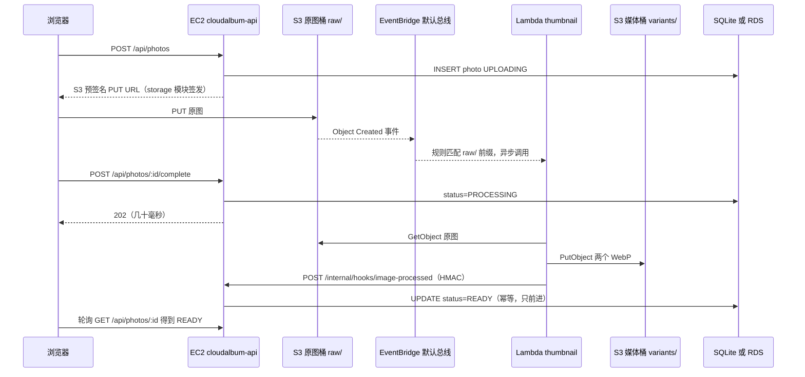
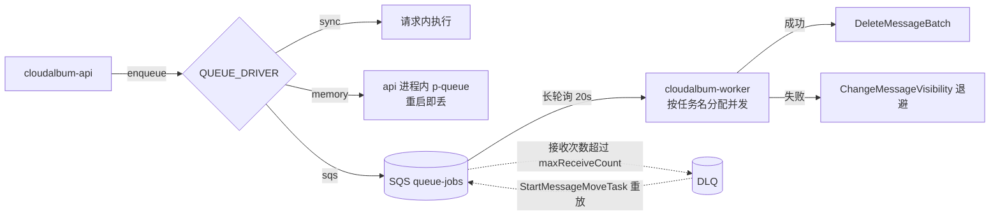
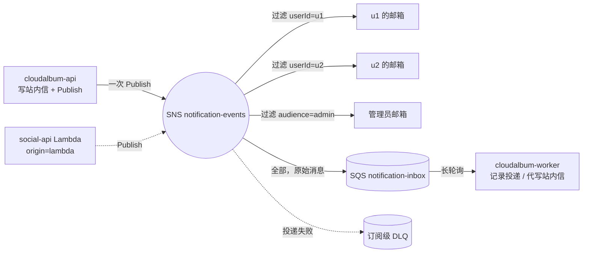
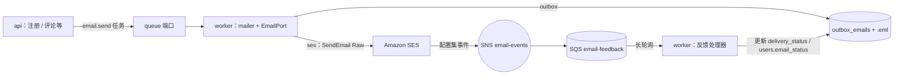
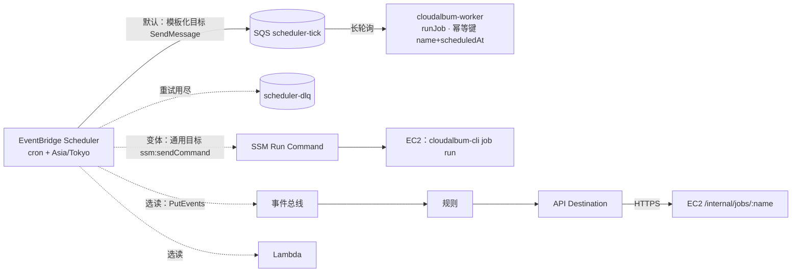
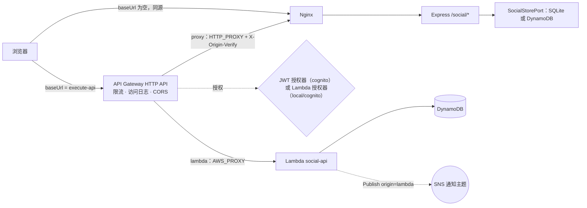

# D 组：计算、异步与通知

本组 7 个模块负责“HTTP 请求之外的工作”：生成缩略图（image-processing ↔ AWS Lambda）、任务排队（queue ↔ Amazon SQS）、通知扇出（notification ↔ Amazon SNS）、发邮件（email ↔ Amazon SES）、定时任务（scheduler ↔ Amazon EventBridge Scheduler）、图片识别与审核（tagging ↔ Amazon Rekognition），以及点赞评论这组社交 API 的托管入口（social-api ↔ Amazon API Gateway）。在 L0（仅 EC2）下，这些机能全部由 EC2 上的 `cloudalbum-api` 和 `cloudalbum-worker` 两个进程完成：sharp 在“上传完成”请求内生成缩略图，后台任务当场同步执行，通知写站内信并把邮件写进本地 outbox，node-cron 触发定时任务，照片只有从元数据算出的基础属性标签，社交接口就是 Express 的 `/social/*` 路由。每启用一个模块，就把其中一项交给 AWS，并且能在 `/lab` 上直接看到差别：上传接口快了多少、EC2 的 CPU 降了多少、重启后任务丢没丢、邮件到底是谁发出去的、EC2 停机时哪些功能还活着。

## 本组模块一览

| 模块 id | 机能 | 主 AWS 服务 | 开关 | 硬依赖 | 能否在 L0 上单独启用 |
|---|---|---|---|---|---|
| image-processing | 图片处理（缩略图） | AWS Lambda | `IMAGE_PROCESSOR=inline\|worker\|lambda`（worker 为本地档） | lambda 档：storage=s3（DEP-003）、工具链栈、回写通道可达；worker 档：`QUEUE_DRIVER≠sync`（DEP-004） | 否：lambda 档需要 storage；本地档 worker 只需 queue 的本地档 memory，不花钱 |
| queue | 异步任务队列 | Amazon SQS | `QUEUE_DRIVER=sync\|memory\|sqs`（memory 为本地档） | 无模块依赖（只需 AWS 凭证与 SQS 端点可达） | 是 |
| notification | 通知扇出 | Amazon SNS | `NOTIFY_DRIVER=db\|sns` | 无模块依赖；需要一个能点击确认的管理员邮箱 | 是 |
| email | 邮件发送 | Amazon SES | `EMAIL_DRIVER=outbox\|ses` | 无模块依赖；前置条件：已验证的发件身份（邮箱或域名） | 是（沙盒期只能发给已验证地址） |
| scheduler | 定时任务 | Amazon EventBridge Scheduler | `SCHEDULER_DRIVER=cron\|eventbridge` | 无模块依赖（tick 队列由本模块自带） | 是 |
| tagging | 图片识别与审核 | Amazon Rekognition | `TAGGER_DRIVER=none\|rekognition` | 无模块依赖（storage=local 时以字节方式调用） | 是 |
| social-api | API 托管（点赞、评论、分享） | Amazon API Gateway（HTTP API） | `SOCIAL_API_BASE_URL`（空 = EC2 上的 Express `/social/*`） | proxy 集成：EC2 源站对公网可达；lambda 集成：social-store=dynamodb，且授权器不为 none | 是（proxy 集成）；lambda 集成否 |

**“能否在 L0 上单独启用”的含义**：“是”表示在 L0 上只满足“AWS 凭证可用”这个通用前提（推荐先 `scripts/module enable iam`，见总纲 CRED-001 与 B 组 iam 模块），不再启用其他任何应用模块，这个模块就能完整运行，对比实验也能做。“否”表示它的 AWS 档还依赖别的应用模块。本组所有“本地档”（`IMAGE_PROCESSOR=worker`、`QUEUE_DRIVER=memory`）都不需要任何 AWS 资源，用 `scripts/module enable <id> --driver <值>` 写入配置，跳过部署栈的步骤。

**本组公共约定**

1. **凭证与权限。** 本组每个 AWS 驱动都要调用 AWS API，启动时由规则 CRED-001 校验凭证。每个模块栈输出一条客户托管策略 `PolicyArn`（含业务所需最小权限和总纲 6.2 所列探针权限），由 `scripts/module` 附加到应用角色上（总纲 9.1、9.2）。本组的 Lambda 函数（缩略图、社交 API、授权器）使用各自栈内的执行角色，不复用应用角色。
2. **模块自带的辅助队列不等于启用 queue 模块。** 为了让每个模块都能在 L0 上单独启用，而且不需要 EC2 开放额外的入站端口，下面几条 SQS 队列由各自模块的栈创建，`/lab` 卡片上标注“模块自带”：

   | 队列 | 所属模块 | 用途 | 谁消费 |
   |---|---|---|---|
   | `cloudalbum-<env>-image-processing-failures` | image-processing | Lambda 异步调用的失败目标、EventBridge 规则的死信队列 | worker：把对应照片标为 FAILED 并记录原因 |
   | `cloudalbum-<env>-image-processing-results` | image-processing（仅 `IMAGE_RESULT_CHANNEL=queue`） | Lambda 处理结果的回写通道 | worker |
   | `cloudalbum-<env>-image-processing-buffer` | image-processing（仅 `IMAGE_TRIGGER=buffer-queue`） | EventBridge → SQS → Lambda 事件源映射的缓冲队列 | Lambda（ESM） |
   | `cloudalbum-<env>-notification-inbox` | notification | SNS 主题的 SQS 订阅者，演示 SNS + SQS 扇出；也承接来自 Lambda 的事件 | worker |
   | `cloudalbum-<env>-email-feedback` | email | SES 投递、退信、投诉事件（经 SNS） | worker |
   | `cloudalbum-<env>-scheduler-tick` | scheduler | EventBridge Scheduler 的目标 | worker |

3. **cloudalbum-worker 的职责随配置装配。** `container.ts` 只装配当前配置需要的轮询器，没有启用的模块不会产生任何后台循环：

   | 后台循环 | 何时装配 | 来源 |
   |---|---|---|
   | queue 消费者 | `QUEUE_DRIVER=sqs` | 总纲 2.6 |
   | node-cron 调度器 | `SCHEDULER_DRIVER=cron`（eventbridge 档只保留对照任务 `lab.heartbeat`） | scheduler |
   | tick 队列轮询器 | `SCHEDULER_DRIVER=eventbridge` | scheduler |
   | 图片结果 / 失败队列轮询器 | `IMAGE_PROCESSOR=lambda` | image-processing |
   | 通知收件队列轮询器 | `NOTIFY_DRIVER=sns` | notification |
   | SES 反馈队列轮询器 | `EMAIL_DRIVER=ses` | email |

   `QUEUE_DRIVER=memory` 的消费者在 api 进程内（总纲 2.6），不在 worker 里。
4. **内部回调端点只有一个。** 本组只开放 `POST /internal/hooks/image-processed`（HMAC 签名，image-processing 的 callback 回写通道）。总纲的 Nginx 主配置没有 `/internal/` 路由，由 image-processing 投放 server 级片段只放行这一个精确路径；其他 `/internal/*` 一律不经 Nginx 暴露。
5. **运行时 A/B 只用总纲定义的旁路键。** 本组用到 `queue`、`image`、`tagger` 三个键（总纲 8.3）。notification、email、scheduler 属于“权威数据或全局状态”，业务流量只做“切换前 / 切换后”；另外各提供一个**只供管理员、不碰业务数据的对照端点**（`POST /api/lab/notification/compare`、`POST /api/lab/email/compare`、调度器的 `lab.heartbeat` 双触发），属于总纲 8.1 中的 `functional` 对比。social-api 用“按 URL 的 A/B”：两个入口同时在线，实验脚本分别请求即可。
6. **`X-CloudAlbum-Path` 结果词表（本组部分，补充总纲 7.2）：**

   | 段 | 取值 |
   |---|---|
   | `image-processing` | `inline:sync`、`worker:async`、`lambda:async`、`lambda:bypass-inline`、`worker:bypass-inline` |
   | `queue` | `sync:inline`、`memory:queued`、`sqs:queued`、`sqs:bypass-inline`、`sqs:error` |
   | `notification` | `db:email`、`db:none`（收件人未开邮件）、`sns:published`、`sns:error` |
   | `email` | `outbox:stored`、`ses:sent`、`ses:rejected`、`ses:suppressed`、`ses:error` |
   | `scheduler` | `cron:manual`、`eventbridge:manual`（只出现在“立即运行”请求上） |
   | `tagging` | `none:basic`、`rekognition@s3:analyzed`、`rekognition@bytes:analyzed`、`rekognition:bypass`、`rekognition:error-basic` |
   | `entry`（social-api） | `apigw>nginx`（proxy 集成）、`apigw>lambda`（lambda 集成，由 Lambda 端的同一套观测库生成） |

7. **Lambda 运行时用 `nodejs22.x`（arm64）。** 统一约定写的是 Node.js 20，但 Lambda 的 `nodejs20.x` 运行时已于 2026-04-30 弃用：控制台不能再新建，CloudFormation / CLI 在“阻止创建”日期之前仍可创建，之后会被阻止（日期以官方运行时页面为准）。本组的 Lambda 代码只用 Node 20 也支持的语法，所以运行时选 `nodejs22.x`（也可选 `nodejs24.x`），不影响与 EC2 共用 `packages/image-core` 和 `backend/src/social/service.ts`。
8. **本组新增的校验规则（建议并入总纲 5.2）。** 规则 ID 用 `D` 前缀，避免与其他组冲突：

   | ID | 级别 | 可覆盖 | 范围 | 违规条件 | 说明 / 修复 |
   |---|---|---|---|---|---|
   | DEP-D01 | error | 否 | 启动 | `IMAGE_PROCESSOR=lambda`、`IMAGE_RESULT_CHANNEL=callback`、`DEPLOY_MODE=asg`，且 `IMAGE_CALLBACK_URL` 的主机不是负载均衡地址 | 回调会打到某一台实例的弹性 IP；改为 ALB 地址，或改用 queue 通道 |
   | DEP-D02 | warn | — | 启动 | `IMAGE_RESULT_CHANNEL=callback` 且 cdn 已启用 | cdn 的源站校验片段必须放行 `/internal/hooks/`（该路径自带 HMAC 校验），否则回调被 403；或改用 queue 通道 |
   | DEP-D03 | warn | — | 启动 | `IMAGE_CALLBACK_URL` 以 `http://` 开头 | 回调走明文：HMAC 能防伪造、防篡改，不能防窃听（载荷只含对象键和宽高） |
   | DEP-D04 | error | 否 | 启动 | social-api 集成档为 `lambda`，但 `SOCIAL_DRIVER≠dynamodb` | Lambda 访问不到 EC2 上的 SQLite（取代总纲 DEP-008 的前半句） |
   | DEP-D05 | error | 否 | 启动 | social-api 授权器为 `jwt`，但 `AUTH_DRIVER≠cognito` | HTTP API 的 JWT 授权器目前只支持 RSA 系列算法，本地令牌是 ES256（见 B 组 auth 模块）；改用 `lambda` 授权器 |
   | DEP-D06 | error | 否 | 启动 | social-api 集成档为 `lambda`，但授权器为 `none` | Lambda 后端拿不到“当前用户是谁” |
   | DEP-D07 | warn | — | 启动 | social-api 集成档为 `lambda`，且 `NOTIFY_DRIVER≠sns`、`QUEUE_DRIVER≠sqs` | 经 Lambda 写入的评论不会产生站内通知，notification 状态标 `degraded` |
   | DEP-D08 | error | 否 | 部署 | scheduler 的 `Target=ssm`，但实例不是 SSM 托管节点 | 先启用 iam（含 `AmazonSSMManagedInstanceCore`）或 shell-access |
   | DEP-D09 | error | 否 | 启动 | `TAGGER_INPUT=s3` 且 `STORAGE_DRIVER≠s3` | 字节方式（`bytes` 或 `auto`）不需要 S3 |

9. **与总纲（`docs/modular-design.md`）的偏差与细化（附理由）**
   - (a) **image-processing 增加回写通道 `queue`**：`IMAGE_RESULT_CHANNEL=callback|queue`，默认 `callback`，与总纲的 HMAC 回调一致。理由：callback 要求 Lambda 能从公网访问 EC2 源站。启用 cdn（源站只认带 `X-Origin-Verify` 的请求）、network 私有放置或者源站没有受信证书时，回调会被挡住或只能走明文；queue 通道不需要任何入站流量，EC2 宕机时结果留在队列里等它恢复。`ImageProcessorPort` 因此多一个可选方法 `acceptResult()`，回调签名参数改为带时间戳的形式。
   - (b) **image-processing 的 lambda 档增加可选触发变体**：`IMAGE_TRIGGER=eventbridge|buffer-queue`。默认仍是总纲的 S3 → EventBridge → Lambda（异步调用）；`buffer-queue` 在中间加一条**模块自带**的 SQS 队列，由 Lambda 事件源映射消费，用来演示批处理、`MaximumConcurrency` 限流和部分批失败。缓冲队列属于 image-processing 栈，不依赖 queue 模块。
   - (c) **scheduler 的任务名增加 `lab.heartbeat`**：一个无副作用的对照任务，可以同时由 node-cron 和 EventBridge 触发，在同一部署中比较两边的准时性、重复与漏跑，而不会让业务任务执行两次。
   - (d) **social-api 的依赖规则调整**（取代总纲 DEP-008）：lambda 集成只硬依赖 social-store=dynamodb，再加上“授权器不为 none”。auth=local 也可以用 lambda 集成，由 Lambda 授权器用 JWKS 公钥校验本地 ES256 令牌，不需要共享任何密钥。理由：B 组文档（`02-identity-security.md`）中，本地认证签发的是 ES256 令牌并发布 `/.well-known/jwks.json`（总纲写的是 HS256）；而 HTTP API 的 JWT 授权器只支持 RSA 系列算法，所以 auth=local 时不能用 JWT 授权器，但可以用 Lambda 授权器。
   - (e) **tagging 的启动探针图片改为不小于 80×80 像素**（本文用 128×128）。总纲 6.2 写的是 64px，但 Rekognition 要求图片的宽和高都不小于 80 像素，64px 的图会被直接拒绝。
   - (f) **Lambda 运行时用 `nodejs22.x`**，理由见第 7 条。
   - (g) **考虑过、但没有采用的取值**：`QUEUE_DRIVER=db`（SQLite 任务表）、`TAGGER_DRIVER=exif`、管理员请求头 `X-Compare-Processor`。一律回到总纲的取值：queue 为 `sync|memory|sqs`；tagging 的 `none` 驱动本身就生成基础属性标签（原先设想的 EXIF 启发式规则并入 `none`）；运行时 A/B 只用 `X-Compare-Bypass: image`。理由：开关取值是跨组共享的契约（zod 模式、规则表、实验清单、前端徽章都依赖它），为单个模块新增取值会让其他组的文档与代码失配。
10. **数量与价格。** 本文所有限额、价格和时延都只给定性描述和数量级；具体数值以官方文档和官方定价页为准。2025 年起 AWS 的免费套餐改为新账号抵扣额度制，“12 个月免费额度”的说法不再普遍适用；Lambda、SQS、SNS 等服务另有长期免费额度。是否覆盖你的账号，以官方定价页为准。

**有 Lambda 与没有 Lambda 的速查（横切本组与其他组）**

本项目里 Lambda 只在 image-processing 中作为**主服务**；在其他模块里它是可选的辅助服务。每个用到 Lambda 的地方都有一个能在 EC2 上运行的替代做法，所以 L0 不需要任何 Lambda。

| 位置 | 所属模块 | 有 Lambda 时 | 没有 Lambda 时（EC2 上的做法） | 能直接看到的区别 |
|---|---|---|---|---|
| 缩略图生成 | image-processing | S3 → EventBridge → Lambda（或经缓冲队列 + ESM），结果经 HMAC 回调或结果队列写回 | inline：上传完成的请求内 sharp；worker：入队后台处理 | 上传接口延迟、EC2 CPU 曲线、突发时“排队”还是“并行”、冷启动 |
| 社交 API 后端 | social-api | API Gateway → Lambda → DynamoDB | API Gateway 代理回源到 Express，或不用网关 | 停掉 `cloudalbum-api` 后点赞评论是否还能用；冷启动 |
| 社交 API 授权 | social-api | Lambda 授权器（校验本地 ES256 或 Cognito 令牌） | JWT 授权器（仅 Cognito），或由 Express 自己校验 | 401 发生在网关还是 EC2 |
| 定时任务 | scheduler | Scheduler → Lambda（选读，要求数据不在 SQLite） | Scheduler → 模块自带 tick 队列 → worker（默认） | 不用 Lambda 也能做到“每个计划时刻只执行一次、宕机后补跑” |
| 打标签 | tagging | 选做变体：EventBridge / SQS → Lambda → Rekognition | worker 执行 `image.tag` 任务调用 Rekognition（默认） | 标签结果相同；差别在由谁消费、能否随积压自动扩展 |
| 退信处理 | email | 可以用 Lambda 订阅 SNS | SNS → 模块自带 SQS → worker（默认） | 功能上没有差别；EC2 不需要入站端口 |
| Cognito 触发器 | auth（B 组） | Pre Sign-up、Pre Token Generation 等 | 应用层校验域名、首次请求时建档 | 见 B 组 auth 模块 |

总体结论（定性）：Lambda 把 CPU 密集、突发的工作从 EC2 上拿走，上传接口延迟和 EC2 CPU 都变得平稳；并发随事件数自动扩展，直到预留并发或账号并发上限；代价是冷启动、额外的部署包与执行角色，以及最重要的一课——**Lambda 读不到 EC2 的 EBS 和 SQLite**，所以一旦用 Lambda，状态就必须外置：文件放 S3，数据放 RDS 或 DynamoDB，结果经队列或签名回调送回。这正是从单机走向云原生的关键一步。

## image-processing：图片处理（缩略图） ↔ AWS Lambda

> 一句话总结：没有 Lambda 时，缩略图由 EC2 上的 sharp 生成——默认 inline 在“上传完成”请求内同步生成，本地档 worker 则入队后台生成，CPU 都由这台 EC2 承担；启用后原图直传 S3，S3 经 EventBridge 触发 Lambda 生成缩略图，结果用 HMAC 签名回调（或结果队列）写回 EC2。最直观的区别：一次批量上传 200 张，“上传完成”接口从秒级降到几十毫秒级，EC2 的 CPU 曲线几乎不动，缩略图几乎同时冒出来，前几张带“冷启动”徽章。

### 1. 基线实现（仅 EC2）

**端口与共用代码**

- 端口：`backend/src/ports/image-processor.ts`（总纲 4.2 定义，本组细化见第 3 节）。
- 适配器：`backend/src/adapters/image-processing/inline.ts`（本地实现，默认）、`worker.ts`（本地档）、`lambda.ts`（AWS 实现）。
- 渲染核心：`packages/image-core`。inline、worker 和 Lambda 都调用同一个 `render()`，保证对比只体现“在哪里算”，不体现“算法不同”：
  - `sharp(input, { limitInputPixels: IMAGE_MAX_PIXELS })`：防解压炸弹。sharp 自带默认上限，这里改成更小的值。
  - `.rotate()`：按 EXIF 方向自动旋转。
  - 生成两种尺寸：`thumb_200`（长边 200px）和 `display_1080`（长边 1080px），都输出 WebP。
  - sharp 默认不把元数据写进输出文件，所以衍生图里没有 GPS 等 EXIF 信息；只有显式调用保留元数据的接口才会写入。
  - 同时读出 `ImageMeta`：宽高、格式、主色（`sharp.stats().dominant`）、拍摄时间（用 `exifr` 解析 `DateTimeOriginal`）。tagging 的本地驱动直接用它生成基础属性标签。
  - 格式白名单：JPEG、PNG、WebP。先检查文件头魔数，不只看扩展名。HEIC 直接拒绝：sharp 的预编译包不含 HEVC 解码器。

**上传流程（L0，与总纲 2.8 的 F6、F7 一致）**

1. `POST /api/photos`，请求体 `{albumId, filename, contentType, size}`：插入 `photos` 行（`status=UPLOADING`，`raw_key=raw/<userId>/<photoId>.<ext>`），调用 `StoragePort(local).createUploadTarget()`，返回 `{photoId, upload: {method: 'PUT', url: '/api/storage/upload?key=…&exp=…&sig=…', headers}}`。
2. 浏览器把原图 PUT 到这个 URL。Nginx 的 `location /api/storage/upload` 关闭了请求缓冲，`client_max_body_size 30m`；Node 校验 HMAC 签名、有效期、大小和 Content-Type 后，把文件流式写入 `/var/lib/cloudalbum/uploads/raw/<userId>/<photoId>.<ext>`。
3. `POST /api/photos/:id/complete`：`PhotoPipeline` 把状态改为 `PROCESSING`，记下 `processing_started_at`，然后调用 `images.submit(job)`。
4. inline 适配器当场执行 `render()`：用 `StoragePort.getObject(raw_key)` 读原图，用 `putObject()` 写出 `variants/<photoId>/thumb_200.webp` 和 `variants/<photoId>/display_1080.webp`，然后执行 `UPDATE photos SET status='READY', thumb_key, display_key, width, height, processed_by, ready_at`。`processed_by` 是 JSON：`{driver, durationMs, host, coldStart}`。
5. 入队 `image.tag`（QUEUE_DRIVER=sync 时也在本请求内执行，见 tagging 模块），最后返回 `200` 和照片对象（状态 READY）。

**并发与资源保护**

- `IMAGE_INLINE_CONCURRENCY`（默认 1）：api 进程内的信号量，再加上 `sharp.concurrency(1)`。超出的“上传完成”请求在信号量上排队。批量上传时请求排长队、甚至被 Nginx `proxy_read_timeout 60s` 截断成 504，正是这里造成的，也是本模块最重要的对照现象。
- 一张 12MP 的照片解码后要占几十 MB 内存。t3.small / t4g.small 只有 2 GiB 内存，所以默认并发设为 1；总纲 2.7 的 1 GiB swap 只是保险。

**本地档 worker（不需要 AWS）**

- 启用方式：`scripts/module enable image-processing --driver worker`（本地档，跳过部署栈）。
- `submit()` 调用 `queue.enqueue('image.process', job, { dedupKey: photoId })`，接口立即返回 `202 {status: 'PROCESSING'}`。由谁执行取决于 `QUEUE_DRIVER`：
  - `memory`（queue 的本地档）：在 api 进程内后台执行，接口立即返回，但 sharp 仍和 API 抢同一台机器、同一个进程的 CPU；进程重启时，排队和在途的任务都会丢失，照片停在 PROCESSING，直到对账任务把它找回。
  - `sqs`：由 `cloudalbum-worker` 进程消费，与 API 进程隔离。
  - `sync`：自相矛盾，规则 DEP-004 直接拒绝启动（退出码 78）。不做“自动改用别的队列”的隐式降级（总纲原则 4）。
- worker 进程的资源隔离：本模块在 worker 档投放 systemd drop-in `/etc/systemd/system/cloudalbum-worker.service.d/50-image-processing.conf`，内容为 `CPUWeight=20`、`Nice=10`、`MemoryMax=1G`。AL2023 使用 cgroup v2，`CPUWeight` 让 CPU 繁忙时 API 进程优先拿到 CPU；`Nice` 只在同一个 cgroup 内起作用，所以两者都要设。
- 并发：`IMAGE_WORKER_CONCURRENCY`（默认 1，在 2 vCPU 的实例上给 API 留出一个核；实验时可以调到 2 做对比）。

**两种本地模式共用的部分**

- **对账**：scheduler 的 `image.reconcile` 任务每分钟调用一次 `images.reconcile(stuckBefore)`。对 PROCESSING 超过 `IMAGE_STUCK_AFTER_SEC` 的照片，按顺序处理：
  1. 如果衍生图已经存在（`StoragePort.headObject`），直接补记为 READY；
  2. 否则在 `processing_attempts < IMAGE_MAX_ATTEMPTS` 时重新提交；
  3. 再否则标为 `FAILED`，并写明原因。
  
  这个任务是 singleton，由 LockPort 保证同一时刻只执行一次。
- **前端**：上传页每张照片有一条阶段时间线（已上传 → 处理中 → 就绪 / 失败），PROCESSING 期间显示灰色占位图；`GET /api/photos/:id` 按退避间隔轮询（1s 起，最长 5s）。照片详情显示徽章“缩略图由 EC2 生成 · {durationMs} ms（inline / worker）”（总纲 12.3）。
- **能力注册**：`image-processing = {driver: 'inline', awsService: 'AWS Lambda', status: 'off', localHealth: 'ok', detail: '缩略图在“上传完成”请求内由 sharp 生成（并发 1）'}`；worker 档的 detail 写“入队 image.process → 由 api 进程内存队列消费 / 由 cloudalbum-worker 经 SQS 消费”。

### 2. AWS 实现

**架构与时序（默认：EventBridge 触发 + callback 回写）**



注意时序里的竞争：S3 事件和浏览器的 complete 请求是并行的，Lambda 可能在 complete 到达之前就处理完、发出回调。所以回写逻辑必须接受 `UPLOADING → READY`；之后 complete 请求看到照片已是 READY，直接返回 200。

**CloudFormation：`infra/modules/image-processing.yaml`**

| 资源 | 关键配置 |
|---|---|
| `ThumbnailFunction`：`cloudalbum-<env>-image-processing-thumbnail` | `nodejs22.x`、`arm64`；内存参数 `MemorySize`（默认 1024MB，用 Lambda Power Tuning 在 1024～1769MB 之间找性价比，1769MB 约等于 1 个 vCPU）；超时 30 秒；`/tmp` 用默认值（不落盘，全程用 Buffer）。代码在 `lambdas/image-thumbnail/`，用 esbuild 打包；sharp 必须按 linux-arm64 安装（`npm install --os=linux --cpu=arm64 sharp`）后一起打进 zip，或做成 Layer。由 `aws cloudformation package` 上传到工具链栈 `cloudalbum-<env>-toolchain` 的制品桶 |
| `ThumbnailLogGroup` | `/aws/lambda/<函数名>`，显式创建并设置保留期（例如 14 天），否则日志永久保存 |
| `ThumbnailInvokeConfig`（`AWS::Lambda::EventInvokeConfig`） | `MaximumRetryAttempts: 2`、`MaximumEventAgeInSeconds: 3600`；`DestinationConfig.OnFailure` 指向 `FailureQueue` |
| 预留并发 | 参数 `ReservedConcurrency`，默认留空（不设置）。只能预留到“未预留账号并发 − 100”；**新账号的并发配额可能远低于 1000**，这时设置任何正数都会失败。设置后它既是保底，也是上限，用来保护回调的下游（EC2 或数据库） |
| `RawObjectCreatedRule`（`AWS::Events::Rule`） | 默认事件总线；事件模式见下方；目标为函数（`Trigger=eventbridge`）或缓冲队列（`Trigger=buffer-queue`）；目标的 `RetryPolicy` 与 `DeadLetterConfig`（指向 `FailureQueue`）只处理“投递给目标失败”的情况 |
| `RulePermission`（`AWS::Lambda::Permission`） | 主体 `events.amazonaws.com`，`SourceArn` 为该规则 |
| `FailureQueue`：`…-image-processing-failures` | 标准队列，SSE-SQS，保留期 14 天；队列策略允许本规则（`events.amazonaws.com`，用 `aws:SourceArn` 限定）发送，Lambda 失败目标与缓冲队列的 redrive 则靠执行角色的 IAM 权限和同账号的队列关系。三种来源的消息格式不同（Lambda 异步调用的失败记录、EventBridge 原始事件、缓冲队列的原消息），worker 按格式分别解析出 `photoId` |
| `BufferQueue` + `BufferMapping`（条件：`Trigger=buffer-queue`） | 规则把事件投进缓冲队列，由 `AWS::Lambda::EventSourceMapping` 消费：`BatchSize: 5`、`MaximumBatchingWindowInSeconds: 2`、`FunctionResponseTypes: [ReportBatchItemFailures]`、`ScalingConfig.MaximumConcurrency`（参数，2～1000）；队列可见性超时取函数超时的 6 倍（180 秒）；`RedrivePolicy.maxReceiveCount: 3` → `FailureQueue` |
| `ResultQueue`（条件：`ResultChannel=queue`） | `…-image-processing-results`，长轮询 20 秒，SSE-SQS；带自己的 DLQ |
| `ThumbnailRole`（执行角色） | `s3:GetObject` 仅限原图桶的 `raw/*`；`s3:PutObject` 仅限媒体桶的 `variants/*`；对 `FailureQueue` 的 `sqs:SendMessage`；queue 通道加对 `ResultQueue` 的 `sqs:SendMessage`；buffer-queue 变体加对 `BufferQueue` 的 `sqs:ReceiveMessage`、`DeleteMessage`、`GetQueueAttributes`；参数 `KmsKeyArn` 非空时加 `kms:Decrypt`、`kms:GenerateDataKey`；写日志的权限只针对上面的日志组 |
| `AppPolicy`（输出为 `PolicyArn`，挂到应用角色） | 探针：`lambda:GetFunctionConfiguration`、`events:DescribeRule`；对账重投：`lambda:InvokeFunction`（只针对本函数）；对 `FailureQueue`、`ResultQueue` 的 `sqs:ReceiveMessage`、`DeleteMessage`、`GetQueueAttributes` |

```yaml
# 规则的事件模式（S3 → EventBridge，由 storage 栈在桶上开启 EventBridgeConfiguration）
EventPattern:
  source: [aws.s3]
  detail-type: [Object Created]
  detail:
    bucket: { name: [!Ref RawBucketName] }
    object: { key: [{ prefix: raw/ }] }
```

- **为什么不用 S3 事件通知**：总纲 3.2 的决定 1 规定原图桶上不能写 `NotificationConfiguration`（规则 MUTEX-004），所有消费者都各自在自己的栈里建 EventBridge 规则。这样 image-processing 和其他想监听上传事件的模块互不干扰，也不会碰到“同一事件类型不能配置前缀重叠的多个目标”的限制。
- **防止递归调用**：输入是原图桶的 `raw/`，输出是媒体桶的 `variants/`，两者不在同一个桶，函数不会被自己的输出再次触发。不要依赖 Lambda 自带的递归循环检测：它只覆盖部分服务组合（以官方文档为准）。
- **参数**（由 `scripts/module` 从其他栈的 Outputs 和本机状态读出后传入）：`RawBucketName`、`MediaBucketName`（storage 栈）、`CallbackUrl`、`CallbackHmacKey`（`NoEcho`；secrets 已启用时改传 `CallbackSecretArn`）、`KmsKeyArn`、`Trigger`、`ResultChannel`、`MemorySize`、`ReservedConcurrency`、`MaxConcurrency`。
- **Outputs**：`EnvImageProcessor=lambda`、`EnvImageLambdaFunction`、`EnvImageTrigger`、`EnvImageResultChannel`、`EnvImageCallbackUrl`、`EnvImageResultQueueUrl`（仅 queue 通道）、`EnvImageFailureQueueUrl`、`InfoRuleName`、`InfoLogGroup`、`PolicyArn`。

**Lambda 函数的处理逻辑（`lambdas/image-thumbnail/handler.ts`）**

1. 解析事件。`Trigger=eventbridge` 时是单个 EventBridge 事件；`buffer-queue` 时是一批 SQS 记录，每条记录的 body 是一个 EventBridge 事件。
2. 从对象键 `raw/<userId>/<photoId>.<ext>` 解析出 `photoId`。先 `HeadObject` 检查大小，再用 `GetObject` 读成 Buffer。
3. 调用 `@cloudalbum/image-core` 的 `render()`，用 `PutObject` 写出两个 WebP。对象元数据带 `x-amz-meta-width` 和 `x-amz-meta-height`，供对账时补记。
4. 记录 `coldStart`：用一个模块级变量，第一次调用时为 true。
5. 按 `ResultChannel` 回写结果：`callback` 时用 HMAC 签名后 POST 到回调地址；`queue` 时 `SendMessage` 到结果队列。
6. 错误分两类：
   - **永久错误**（格式不支持、超过像素上限、文件损坏）：直接回写 `FAILED` 结果，**正常返回**，不抛异常。重试也不会成功，抛出去只会白白消耗重试次数。
   - **暂时错误**（S3 读取超时、回调 5xx）：抛出异常，交给异步重试（`Trigger=eventbridge`）或部分批失败（`buffer-queue`），最终进入 `FailureQueue`。

**回写通道**

- **callback（默认，与总纲一致）**：
  - 地址：`POST {IMAGE_CALLBACK_URL}`，默认是“源站地址 + `/internal/hooks/image-processed`”。源站地址在 L0 是 `http://<EIP>`，启用 load-balancer 后是 ALB 域名。**不要**填 CloudFront 域名。
  - 请求头：`X-CloudAlbum-Timestamp: <unix 秒>`、`X-CloudAlbum-Signature: v1=<hex(HMAC-SHA256(key, timestamp + "." + rawBody))>`。
  - 密钥：总纲 2.7 中 User Data 生成的 `CALLBACK_HMAC_KEY`（SecretsPort 中的逻辑名为 `callback-hmac-key`）。secrets=env 时，经 `NoEcho` 参数注入 Lambda 的环境变量；Lambda 的环境变量静态加密，但任何有 `lambda:GetFunctionConfiguration` 权限的人都能看到，所以 secrets 启用后改为由 Lambda 在初始化时读取 Secrets Manager 并缓存。
  - Express 端（`backend/src/http/routes/internal-hooks.ts`）：读取原始请求体；用 `crypto.timingSafeEqual` 比较签名；只接受 ±300 秒内的时间戳；按“状态只前进”幂等更新。
  - Nginx：本模块投放 server 级片段 `/etc/nginx/cloudalbum.server.d/image-processing-callback.conf`：`location = /internal/hooks/image-processed { limit_req zone=ca_api burst=50 nodelay; client_max_body_size 64k; include /etc/nginx/cloudalbum_proxy.conf; }`。
  - 传输：源站是 `http://` 时，回调走明文（DEP-D03 警告）。载荷只含对象键、宽高和耗时，不含用户数据；HMAC 能防伪造和篡改，不能防窃听。源站有受信证书（tls + load-balancer）时用 `https://`。
  - Lambda 不在 VPC 时出口 IP 不固定，没办法用安全组做白名单，只能靠签名防伪造。
- **queue（本组细化）**：Lambda 把结果 `SendMessage` 到 `ResultQueue`；worker 用 20 秒长轮询接收，调用 `images.acceptResult()`。EC2 不需要任何入站流量；EC2 宕机时结果留在队列里，恢复后继续写回。在以下场景推荐用它：启用了 cdn（源站校验会挡住回调，DEP-D02）、network 私有放置、多实例部署且没有 ALB。`scripts/module enable image-processing` 部署时如果检测到这些情况，会自动选择 queue，并打印原因。
- **兜底（始终开启）**：对账任务对 PROCESSING 超时的照片先 `HeadObject` 媒体桶里的衍生图。如果已经存在，就用对象元数据补记为 READY（回调丢了也能恢复）；不存在则用 `lambda:InvokeFunction`（`InvocationType=Event`，载荷与 EventBridge 事件同构）重投，超过次数后标为 FAILED。worker 同时轮询 `FailureQueue`，把里面的照片标为 FAILED，并在 `/lab` 上显示失败原因。
- **进阶（选做，不在开关里）**：architecture.md 原设计中 Lambda 直接写 RDS 的做法——函数放进 VPC，经 RDS Proxy 执行 `UPDATE photos`。前提是 database 模块已启用，且 VPC 内有 S3 网关终端节点或 NAT，否则函数访问 S3 会一直卡到超时。本模块默认不这样做，因为它会让 image-processing 依赖 database，在 SQLite 下就用不了了。

**API 侧的变化**

- 上传目标改由 storage 模块签发 S3 预签名 PUT URL，浏览器直传原图桶；前端代码没有分支（总纲 12.2）。
- `POST /api/photos/:id/complete` 调用 `lambda.ts` 的 `submit()`：只把状态改为 PROCESSING，记下 `expectedBy = now + IMAGE_STUCK_AFTER_SEC`，然后立即返回 202。真正触发 Lambda 的是 S3 事件，不是这次请求。
- 能力注册的 detail 示例：`lambda@arm64 · 触发 eventbridge · 回写 callback(http) · 最近 5 分钟回调 p95 1.8s · 冷启动 3 次`。探针内容见总纲 6.2：`GetFunctionConfiguration`（检查 `State` 和 `LastUpdateStatus`）以及 `DescribeRule`（检查 `ENABLED`）；有照片 PROCESSING 超时时标为 `degraded`。

### 3. 开关与配置

```bash
# /etc/cloudalbum/modules.d/image-processing.env（L0 没有这个文件 = inline）
MODULE_IMAGE_PROCESSING=on
IMAGE_PROCESSOR=lambda              # inline | worker | lambda（inline = 本地实现 = 默认；worker = 本地档）

# —— 本地实现与本地档共用（写在本文件；缺省时取下列默认值）——
IMAGE_SIZES=thumb_200,display_1080
IMAGE_MAX_PIXELS=40000000           # sharp limitInputPixels
IMAGE_INLINE_CONCURRENCY=1          # inline：api 进程内信号量
IMAGE_WORKER_CONCURRENCY=1          # worker：image.process 的消费并发
IMAGE_STUCK_AFTER_SEC=120           # 对账阈值
IMAGE_MAX_ATTEMPTS=3

# —— lambda 档：由 infra/modules/image-processing.yaml 的 Env* Outputs 生成 ——
IMAGE_LAMBDA_FUNCTION=arn:aws:lambda:ap-northeast-1:<acct>:function:cloudalbum-lab-image-processing-thumbnail
IMAGE_TRIGGER=eventbridge           # eventbridge | buffer-queue
IMAGE_RESULT_CHANNEL=callback       # callback | queue
IMAGE_CALLBACK_URL=http://203.0.113.10/internal/hooks/image-processed
IMAGE_RESULT_QUEUE_URL=             # 仅 queue 通道
IMAGE_FAILURE_QUEUE_URL=https://sqs.ap-northeast-1.amazonaws.com/<acct>/cloudalbum-lab-image-processing-failures
# 回调密钥不写在这里：secrets.env 的 CALLBACK_HMAC_KEY，或 secrets 模块中的 callback-hmac-key
```

本模块的 `ownsEnv` 为 `IMAGE_`。下面是 zod 分段（细化总纲 4.4 中的 `Image`）：

```ts
// backend/src/config/schema.ts（image 分段）
export const Image = section('IMAGE_PROCESSOR', 'inline', z.discriminatedUnion('IMAGE_PROCESSOR', [
  z.object({ IMAGE_PROCESSOR: z.literal('inline'), IMAGE_INLINE_CONCURRENCY: z.coerce.number().int().min(1).default(1) }),
  z.object({ IMAGE_PROCESSOR: z.literal('worker'), IMAGE_WORKER_CONCURRENCY: z.coerce.number().int().min(1).default(1) }),
  z.object({
    IMAGE_PROCESSOR: z.literal('lambda'),
    IMAGE_LAMBDA_FUNCTION: z.string().startsWith('arn:aws:lambda:'),
    IMAGE_TRIGGER: z.enum(['eventbridge', 'buffer-queue']).default('eventbridge'),
    IMAGE_RESULT_CHANNEL: z.enum(['callback', 'queue']).default('callback'),
    IMAGE_CALLBACK_URL: optUrl,
    IMAGE_RESULT_QUEUE_URL: optUrl,
    IMAGE_FAILURE_QUEUE_URL: z.string().url(),
  }).refine((v) => v.IMAGE_RESULT_CHANNEL === 'queue' ? !!v.IMAGE_RESULT_QUEUE_URL : !!v.IMAGE_CALLBACK_URL,
            { message: 'callback 通道需要 IMAGE_CALLBACK_URL；queue 通道需要 IMAGE_RESULT_QUEUE_URL' }),
]));
```

端口接口（总纲 4.2 + 本组细化）：

```ts
// backend/src/ports/image-processor.ts
export interface ImageJob { photoId: string; rawKey: string; ownerId: string; reason?: 'upload' | 'reconcile' | 'backfill' }
export interface ImageResult {
  photoId: string;
  variants: Array<{ name: 'thumb_200' | 'display_1080'; key: string; width: number; height: number; bytes: number }>;
  meta: ImageMeta;
  processedBy: { driver: 'inline' | 'worker' | 'lambda'; durationMs: number; coldStart?: boolean; host: string };
}
export interface ImageFailure { photoId: string; error: string; permanent: boolean; processedBy: ImageResult['processedBy'] }

export interface ImageProcessorPort extends Adapter {
  readonly placement: 'inline' | 'worker' | 'lambda';
  submit(job: ImageJob): Promise<{ mode: 'sync'; result: ImageResult } | { mode: 'async'; expectedBy: string }>;
  /** callback 通道：校验时间戳与签名后交给 acceptResult（细化：签名参数带时间戳） */
  acceptCallback?(rawBody: Buffer, h: { timestamp: string; signature: string }): Promise<ImageResult | ImageFailure>;
  /** 本组细化：callback 与 queue 两个通道共用的幂等写回 */
  acceptResult?(r: ImageResult | ImageFailure): Promise<'applied' | 'ignored-duplicate' | 'ignored-stale'>;
  reconcile(stuckBefore: Date): Promise<{ resubmitted: number; failed: number; recovered: number }>;
}
```

“状态只前进”的写回（仓储层，两种方言通用）：

```ts
// backend/src/repositories/photos.ts（片段）
// READY 可以覆盖 UPLOADING / PROCESSING / FAILED（迟到的成功也能恢复）；永远不覆盖 READY 和 BLOCKED
await db('photos')
  .where({ id: r.photoId })
  .whereIn('status', ['UPLOADING', 'PROCESSING', 'FAILED'])
  .update({ status: 'READY', thumb_key, display_key, width, height,
            processed_by: JSON.stringify(r.processedBy), ready_at: db.fn.now() });
// 受影响行数为 0 → 返回 'ignored-duplicate'（已是 READY）或 'ignored-stale'（已被拦截）
```

运行时旁路（总纲 8.3 的 `image` 键）在 `PhotoPipeline.complete()` 中处理：

```ts
// backend/src/services/photo-pipeline.ts（片段）
const forceInline = ctx.bypass.has('image');          // 只有管理员能带 X-Compare-Bypass: image
const proc = forceInline ? container.inlineImages : container.images;   // inline 适配器始终装配（sharp 始终安装）
const r = await proc.submit(job);
ctx.path.mark('image-processing', forceInline ? `${container.images.placement}:bypass-inline`
                                              : `${proc.placement}:${r.mode === 'sync' ? 'sync' : 'async'}`);
```

### 4. 依赖与组合

**硬依赖**

- AWS 凭证（CRED-001），推荐先启用 iam。
- `IMAGE_PROCESSOR=lambda` 要求 `STORAGE_DRIVER=s3`（DEP-003）：Lambda 读不到 EC2 的 EBS；EFS 方案要把函数放进 VPC，超出本模块范围。storage 栈在原图桶上开启了 `EventBridgeConfiguration`，这是 storage 模块的默认行为。
- 工具链栈 `cloudalbum-<env>-toolchain`（`scripts/module bootstrap` 创建），用来存放 Lambda 部署包。
- 至少一条能用的回写通道：callback 要求 Lambda 能从公网访问 `IMAGE_CALLBACK_URL`（L0 的弹性 IP 满足）；queue 没有额外前提。
- 本地档 worker 要求 `QUEUE_DRIVER≠sync`（DEP-004）。

**与其他模块组合时的行为变化**

| 组合 | 行为 |
|---|---|
| storage=local | 只能用 inline 或 worker；`scripts/module enable image-processing` 的计划校验会因 DEP-003 拒绝 lambda 档 |
| queue=memory / sqs | 决定 worker 档由谁消费（api 进程内 / worker 进程），以及重启时会不会丢任务；lambda 档不经过 queue 模块 |
| tagging | READY 后入队 `image.tag`；tagging 直接使用 `ImageMeta`（`none` 驱动）或衍生图（`rekognition` 驱动的字节方式） |
| kms | 原图桶用 SSE-KMS 时，执行角色需要 `kms:Decrypt`；媒体桶用 SSE-KMS 时，还需要 `kms:GenerateDataKey`。kms 栈的密钥策略把授权委托给 IAM（见 B 组 kms 模块），所以只改本栈的角色即可 |
| secrets | 回调密钥改从 Secrets Manager 读取；轮换密钥后要重新部署本栈（或让函数缓存过期后重新读取） |
| cdn | 衍生图经 CloudFront `/media/*` 提供。照片 READY 之前前端不能请求衍生图 URL，否则 404/403 可能被 CloudFront 的错误缓存缓存住；cdn 模块应把 `/media/*` 的错误缓存 TTL 设得很短。callback 通道还会碰到源站校验（DEP-D02） |
| network（私有放置） | callback 必须经 ALB；推荐改用 queue 通道。worker 访问 SQS 需要 NAT 或 SQS 接口终端节点（总纲 DEP-009） |
| load-balancer / waf | 回调地址改为 ALB；ALB 监听器规则对 `/internal/*` 默认拒绝，只放行 `/internal/hooks/image-processed`（应用仍然校验签名）；WAF 托管规则可能误拦回调的 JSON 请求体，需要为这个路径加排除规则 |
| monitoring | 告警：Lambda 的 `Errors`、`Throttles`、`AsyncEventsDropped`（异步事件被丢弃的次数，指标名以官方文档为准），`FailureQueue` 可见消息数大于 0 |
| tracing | 函数开启 X-Ray 主动追踪；回调请求头带 `traceparent`，Express 端把它接到同一条链路上 |
| logging | Lambda 日志在 `/aws/lambda/<函数名>`，与应用日志组分开 |
| database | 对“写回”没有影响（回写由 EC2 完成）。只有选做的“Lambda 直写 RDS”才依赖它 |

**多实例（ASG）**

- inline / worker 档的 CPU 消耗会触发 ASG 按 CPU 扩容。worker 档必须配合 `QUEUE_DRIVER=sqs`：memory 档会命中 ASG-005。
- lambda 档的扩缩容与 EC2 无关。callback 地址必须是 ALB（DEP-D01），任意一台实例收到回调都能写共享数据库；queue 通道下每台实例的结果轮询器竞争消费，写回是幂等的。
- `image.reconcile` 是 singleton 任务，在多实例下靠 cluster 级的锁（pg 或 redis）保证只执行一次（总纲 ASG-006）。

### 5. 对比实验：有 vs 没有

| 维度 | 没有 Lambda（基线：inline；本地档：worker） | 有 Lambda |
|---|---|---|
| 在哪里算 | inline：api 进程内、请求内；worker：api 进程后台（memory）或 worker 进程（sqs） | Lambda 执行环境，与 EC2 无关 |
| “上传完成”接口延迟 | inline：包含 sharp 处理时间，随像素数增长；worker：只含入队时间 | 只含一次数据库更新 |
| EC2 CPU | inline：被打满，API 一起变慢；worker：仍被打满，但 API 受到的影响较小 | 几乎不动（只处理回调） |
| 突发 200 张 | inline：请求排队，可能 504；worker：队列积压，按固定并发逐步消化 | 并行处理，直到预留并发或账号并发上限，超出部分被限流后由异步队列重试 |
| 缩略图就绪时间 | inline：等于接口响应时间；worker：随积压线性增长 | 大多是秒级，基本不随张数增长；首批有冷启动 |
| 原图存放 | EBS（storage=local）或 S3 | 必须是 S3 |
| 失败处理 | 对账任务重试或标 FAILED | 异步重试 → 失败目标队列；永久错误直接回写 FAILED |
| 扩展方式 | 换更大的实例，或 ASG | 自动，受并发配额约束 |
| 费用模型 | 包含在 EC2 小时费里；T3/T4g 突发会消耗 CPU 积分 | 按请求次数 + GB-秒；冷启动的 INIT 阶段也计费 |
| 运维面 | 一份代码、一个进程 | 多一个部署包、执行角色、日志组、事件规则、失败队列 |

**页面上能直接看到的差异**

- 上传页：每张照片一条阶段时间线（已上传 → 已入队 → 处理中 → 就绪），带徽章 `inline`、`worker`、`lambda`；Lambda 的冷启动会额外标“冷启动”。
  - inline：上传按钮一直转到缩略图生成完；批量上传时整个网站变慢，打开时间线页面明显卡顿。
  - worker：按钮立即返回，先出现灰色占位图，缩略图按顺序陆续出现；网站基本保持流畅，但一批越多，最后几张等得越久。
  - lambda：按钮立即返回，几秒内缩略图几乎同时出现，前几张标“冷启动”。
- 照片详情的“缩略图”徽章：“由 EC2 生成 · 820 ms”或“由 AWS Lambda 生成 · 640 ms · 冷启动”（数值来自 `processed_by`，这里仅为示意）。
- `/lab/m/image-processing` 卡片：EC2 CPU 曲线（LabMetricsStore 的 `lab_host_samples`）与 Lambda `ConcurrentExecutions` 曲线并排显示，lambda 档下 EC2 的 CPU 曲线几乎是一条平线；`FailureQueue` 深度；最近 20 次回调的延迟分布；“被忽略的重复结果”计数（旁路实验时产生）。
- 路径追踪抽屉：`image-processing=inline:sync`、`worker:async`、`lambda:async`、`lambda:bypass-inline`。

**测量指标**

1. “上传完成”接口 `POST /api/photos/:id/complete` 的 p50 / p95 / max，以及 `Server-Timing` 中的 `image-processing;dur`。
2. 缩略图就绪时间：`photos.ready_at − processing_started_at`，取 p50 / p95 / max。总纲 7.3 的 `biz.photo_time_to_ready` 从 `created_at` 算起，包含浏览器上传原图的时间；本模块另用 `processing_started_at` 做起点，把上传带宽的影响排除掉，两个指标都输出。
3. EC2 CPU% 与 steal、load average、事件循环延迟（`lab_host_samples`）；CPU 积分余额（`CPUCreditBalance`，用部署者凭证从 CloudWatch 读取）。
4. 邻居影响：批量处理期间 `GET /api/feed` 的 p95。
5. Lambda：`Duration`、`Init Duration`（冷启动次数与时长）、`ConcurrentExecutions`、`Throttles`、`Errors`、失败队列消息数。
6. 回写延迟：Lambda 结束到数据库变成 READY 的时间（回调或结果队列）。
7. 每千张图片的费用（按公式计算，单价作为参数传入）。

**操作步骤**（脚本都在 `experiments/image-processing/`；`experiment.json` 声明各场景的前置条件，运行器会先校验 `/api/capabilities`）

1. 基线（L0）：`npm run exp -- image-processing --label before --scenario upload-burst --vus 20 --duration 60s`。`upload-burst.k6.js` 用 `_lib/k6/common.js` 生成 4000×3000 的测试 JPEG，以实验管理员身份走完“创建 → PUT → complete → 轮询直到 READY”的全流程。运行器同时采集 `/api/lab/metrics?run=<runId>`。
2. 邻居影响：在第 1 步运行期间，另开一个终端执行 `k6 run -e BASE=http://<EIP> -e RUN=<runId> experiments/image-processing/neighbor.k6.js`，以每秒 5 次的速率持续读取 `/api/feed`。
3. 本地档：
   - `scripts/module enable queue --driver memory && scripts/module enable image-processing --driver worker`，然后用 `--label worker-memory` 重复第 1、2 步；
   - 再 `scripts/module enable queue`（切到 sqs），用 `--label worker-sqs` 重复。
4. 启用 Lambda：`scripts/module enable storage && scripts/module enable image-processing`（如需迁移已有原图，storage 的 enable 会自动迁移），用 `--label after` 重复第 1、2 步。
5. 运行时 A/B：`npm run exp -- image-processing --label after --scenario upload-burst --ab`。k6 交替发送带和不带 `X-Compare-Bypass: image` 的 complete 请求，同一时段、同一批图片，一半由 EC2 当场处理，一半由 Lambda 处理。旁路的那一半 Lambda 也会处理（事件是 S3 发的），它的结果会被幂等忽略，并计入“被忽略的重复结果”。
6. 冷启动：`npx tsx experiments/image-processing/cold-start.ts --idle 15m --samples 3`。脚本闲置 15 分钟后上传 1 张，再连续上传 5 张，并用 CloudWatch Logs Insights 查询：

   ```
   filter @type = "REPORT"
   | stats count(@initDuration) as coldStarts, avg(@initDuration) as avgInit, pct(@duration, 95) as p95 by bin(5m)
   ```

   可选：临时给函数配置预置并发后再测一次，测完立即删除（预置并发按时长计费）。
7. 限流：`npx tsx experiments/image-processing/throttle.ts --reserved 0 --hold 120s`。脚本把预留并发设为 0（等于“暂停”函数，任何账号都允许这样设置），上传 10 张，等待 120 秒后删除预留并发。观察：`Throttles` 上升；照片停在 PROCESSING；恢复后这些事件被 Lambda 的异步队列重试，照片陆续变成 READY（前提是没有超过最大事件年龄）。要演示“限流到 2 个并发”，用 buffer-queue 变体：`scripts/module enable image-processing --param Trigger=buffer-queue --param MaxConcurrency=2`，再跑第 1 步，观察 `ConcurrentExecutions` 被压在 2 以内、缓冲队列积压先升后降。
8. 失败路径：`npx tsx experiments/image-processing/failures.ts`。脚本上传一张损坏的 JPEG（永久错误：应该很快变成 FAILED，没有重试），再在函数环境变量 `FAULT_RATE=0.5` 下上传 10 张（暂时错误：观察重试、`FailureQueue` 中的消息，以及照片最终被对账任务处理）。实验结束后脚本会还原环境变量。
9. 费用：`npx tsx experiments/image-processing/cost.ts --run <runId> --price-request <每百万次请求单价> --price-gbs <每 GB-秒单价> --price-ec2-hour <实例小时单价>`。脚本从 REPORT 日志中汇总 Billed Duration 和内存，按“请求数 × 单价 + Σ(计费时长 × 内存 GB) × GB-秒单价”计算；单价请从官方定价页抄入，脚本不内置任何价格。
10. 报告：`npm run exp:report -- image-processing --before latest --after latest`。

**预期结果（定性 + 数量级）**

- inline：单张“上传完成”的耗时 = sharp 处理时间，为数百毫秒到秒级，随像素数增长。并发 20 时 2 个 vCPU 被占满，上传和浏览接口的延迟一起升到数秒级，队尾请求可能被 Nginx 截断成 504。就绪时间等于接口响应时间。
- worker + memory：接口降到几十毫秒量级，但 CPU 仍然被同一个进程打满，`/api/feed` 的 p95 仍明显上升。重启 api 后，在途任务丢失，照片要等对账任务（分钟级）找回。
- worker + sqs：接口几十毫秒量级，基本不随并发变化。EC2 CPU 仍然被打满，只是从 API 进程挪到了 worker 进程；因为 `CPUWeight` 和 `Nice`，浏览接口受到的影响明显减轻。就绪时间随积压线性增长：200 张、并发 1～2 时为分钟量级。
- lambda：接口几十毫秒量级，EC2 CPU 基本不动。就绪时间大多为秒级，在触及并发上限之前不随张数增长；首批调用有冷启动（加载 sharp，为数百毫秒到 1 秒以上量级）。callback 回写会多出亚秒级的延迟，queue 通道多出秒级（长轮询）。
- 费用：EC2 是固定成本，与张数无关；Lambda 在练习量下通常很低，持续高负载时线性增长，可能超过一台常开的小实例。具体以官方定价为准。

**运行时 A/B 还是切换重启**：inline 与 lambda（或 worker）之间可以运行时 A/B（`X-Compare-Bypass: image`，仅管理员）。worker 与 lambda 之间、memory 与 sqs 之间需要改配置并重启，用“切换前 / 切换后”两次测量。

### 6. 切换、数据迁移与回滚

**启用**：`scripts/module enable image-processing [--param Trigger=eventbridge|buffer-queue] [--param ResultChannel=callback|queue]`

1. 计划校验：DEP-003（storage=s3）、CRED-001、工具链栈存在；callback 通道下检查 DEP-D01、D02、D03，必要时自动改用 queue 通道并说明原因。
2. `aws cloudformation package` → `deploy`，得到 Outputs，附加 `PolicyArn`。
3. 投放 Nginx 片段（仅 callback 通道），然后 `nginx -t && systemctl reload nginx`。
4. 写入 `modules.d/image-processing.env`；先重启 worker（让结果 / 失败队列的轮询器先跑起来），再重启 api。
5. 健康探针：以系统用户 `_probe` 上传 `fixtures/probe.jpg` 到 `raw/_probe/<uuid>.jpg`，等待回调（或结果消息）到达，并确认衍生图已出现在媒体桶。超时则恢复 `.bak` 并重启（退出码 5），栈保留。

**切换瞬间的在途照片**：切换前已经处于 PROCESSING 的照片由对账任务处理。衍生图已存在的直接补记 READY；不存在的按当前驱动重新提交：lambda 档下用 `InvokeFunction` 重投，前提是原图在 S3。如果 storage 刚从 local 迁到 S3，迁移脚本保证键不变（总纲 9.3）。

**历史照片**：不需要迁移，衍生图已经存在。想按新参数（例如新尺寸）重算时，执行 `node dist/cli.js migrate-module image-processing up --backfill --since 30d --rate 10/s`：按速率异步 Invoke，载荷与 EventBridge 事件同构。先加 `--dry-run` 查看张数。

**停用**：`scripts/module disable image-processing`

1. 反向依赖：本模块没有被其他模块硬依赖。
2. 写入新配置（回到 inline，或用 `--driver worker` 回到本地档），然后只重启 api：新上传立即改由 EC2 处理；如果 storage 仍是 s3，EC2 通过 StoragePort 从 S3 读原图。
3. 等待 Lambda 侧在途的照片写回：worker 保持运行，直到没有 `processed_by.driver=lambda` 且仍在 PROCESSING 的照片，并且结果队列清空；剩下的交给对账任务按新驱动重投。然后重启 worker。
4. 导出 `FailureQueue` 中的消息（`node dist/cli.js image failures export`），删除 Nginx 片段，删除栈。Lambda 日志组随栈删除；如需保留，删除前先导出。

**回滚**：衍生图和数据库记录不随驱动变化，切回任何一档都不需要数据迁移；失败时 `scripts/module` 自动恢复 `.bak`。

### 7. SAA 考点

- Lambda 的三种调用模型：同步调用、异步调用、事件源映射（ESM）。本模块的默认路径是 EventBridge → Lambda 的异步调用，buffer-queue 变体是 SQS ESM
- 异步调用的重试次数（0～2）、最大事件年龄、Destinations（成功 / 失败目标）与 DLQ 的区别；ESM 的失败处理靠队列的 redrive 策略，异步调用的失败目标对它不起作用
- S3 事件的三种路由：S3 事件通知（Lambda、SQS、SNS 目标）、S3 → EventBridge、S3 → SNS 扇出；“同一事件类型不能配置前缀重叠的多个目标”的限制，以及为什么本项目统一用 EventBridge
- 内存与 CPU 成比例（1769MB 约等于 1 个 vCPU）；Lambda Power Tuning；arm64（Graviton）的性价比
- 预留并发（同时是保底和上限，最多预留到“未预留并发 − 100”）与预置并发（消除冷启动、按时长计费）；新账号的并发配额可能较低；冷启动与 `Init Duration`
- 最长 15 分钟超时；`/tmp` 512MB～10GB；部署包大小限制；Layer 与容器镜像两种打包方式
- Lambda 放进 VPC 后访问 S3、SQS 需要网关 / 接口终端节点或 NAT；用 RDS Proxy 防止大量并发把数据库连接打满（选做路径）
- 避免递归调用：输出写到不同的桶或前缀
- 作为 ESM 事件源时，SQS 可见性超时至少设为函数超时的 6 倍；`ReportBatchItemFailures`；`MaximumConcurrency`（2～1000）与预留并发的关系
- EC2 与 Lambda 的取舍：稳定的长期负载 vs 突发的事件驱动；T3/T4g 的 CPU 积分与 unlimited 模式
- 预签名 URL 直传，绕过应用服务器
- 执行角色（函数能做什么）与资源策略（谁能调用函数，如 `events.amazonaws.com`）的区别

### 8. 费用与清理

- 本地实现（inline / worker）：包含在 EC2 实例费用里。T3/T4g 默认是 unlimited 模式，长时间高 CPU 会在积分耗尽后产生额外的 CPU 积分费用（以官方文档为准）。
- Lambda：按请求次数和 GB-秒计费，arm64 的单价更低；有长期免费额度。自 2025 年 8 月起，使用托管运行时、以 zip 打包的函数在按需调用时，INIT 阶段（冷启动）的时长也计入计费时长。加载 sharp 的冷启动较重，所以冷启动多的负载会多花一点。
- 其他费用：S3 的 GET / PUT 请求费；AWS 服务事件进入默认事件总线不另收费（以官方定价为准）；失败队列、结果队列、缓冲队列的请求费极低；CloudWatch Logs 的摄取和存储费，务必设置日志保留期。
- 预置并发按时长计费，只在冷启动实验时临时开启，做完立刻删除。
- 清理：`scripts/module disable image-processing` 会删除栈（函数、规则、队列、角色、日志组）。原图和衍生图属于 storage 模块，不受影响。工具链桶里的旧部署包可以按生命周期规则清理。

### 9. 常见坑

- 输出写回触发前缀会导致无限递归调用、费用暴涨：输出一定要写到不同的桶或前缀；给函数设置合理的预留并发上限也能兜底。
- sharp 是原生模块，必须为 linux-arm64（或 x64）构建。在 Windows 或 macOS 本机直接 `npm install` 得到的二进制在 Lambda 上无法加载，表现为初始化失败。
- 新账号的 Lambda 并发配额可能很低：设置正数的预留并发会失败；高并发实验很快就会被限流。先在 Service Quotas 里确认配额。
- S3 事件和 SQS 都是“至少一次”投递，Lambda 异步调用也可能重复执行：写回必须幂等（按 photoId 覆盖，状态只前进）。
- S3 事件可能早于浏览器的 complete 请求到达：写回逻辑必须接受 `UPLOADING → READY`。
- 照片 READY 之前前端就请求衍生图，404/403 可能被 CloudFront 的错误缓存缓存住。
- 原图桶使用 SSE-KMS 时，执行角色缺少 `kms:Decrypt` 会导致 AccessDenied；同时还受 KMS 请求配额约束（以官方文档为准）。
- 回调地址填成 CloudFront 域名，或启用 cdn 后没有放行 `/internal/hooks/`，回调会被 403；回调地址是 `http://` 时载荷走明文。
- 永久错误（格式不支持、文件损坏）不要抛异常，否则会白白重试，最后还要进失败队列。
- 用 SQS ESM 时，失败处理靠队列的 redrive 策略，异步调用的失败目标不起作用，两套机制不要混淆。EventBridge 规则目标的重试策略只处理“投递给 Lambda 失败”，函数执行失败的重试归 Lambda 的异步调用配置管。
- inline 模式解码大图很占内存，t3.small 只有 2 GiB，可能 OOM：务必设置 `limitInputPixels`，并把并发设为 1。
- 没有给 Lambda 日志组设置保留期，日志会永久保存并持续计费。

## queue：异步任务队列 ↔ Amazon SQS

> 一句话总结：没有 SQS 时，后台任务要么在 HTTP 请求里当场执行（sync，默认），要么放进 api 进程的内存队列（本地档 memory，进程一重启就丢）；启用后任务进入 SQS 标准队列，由 `cloudalbum-worker` 长轮询消费，失败自动重试，超过次数进入 DLQ。最直观的区别：批量上传时按钮立即返回；处理到一半 `kill -9` worker，任务一个不丢；故意投递的“坏消息”出现在 DLQ 里，可以一键重放。

### 1. 基线实现（仅 EC2）

**端口**：`backend/src/ports/queue.ts`（总纲 4.2 的 `QueuePort`）。任务名是一个封闭集合：`image.process`、`image.tag`、`notify.fanout`、`email.send`、`analytics.flush`。定时任务（`report.daily` 等）不走队列，归 scheduler 管。handler 在 `backend/src/jobs/*.ts` 中实现，api 和 worker 两个进程启动时都调用 `queue.bind(handlers)`，实际由谁消费取决于驱动的 `semantics.consumer`。

**sync（L0 默认，`adapters/queue/sync.ts`）**

- `enqueue()` 直接 `await handler(job)`，返回 `{mode: 'inline'}`；没有排队，也没有重试。
- 语义：`{durable: false, consumer: 'inline', delivery: 'inline'}`。
- 出错时异常抛回调用方。各调用方按任务的重要性处理：`image.process` 不经过队列（inline 驱动自己处理）；`email.send`、`notify.fanout`、`image.tag`、`analytics.flush` 由调用方捕获，写一行 `failed_jobs`，主流程照常返回。所以 L0 下“邮件没发出去”不会让注册失败，但会在 `/admin/jobs` 里看到。
- 代价：每个请求的延迟 = 自身逻辑 + 所有后续任务的耗时。例如评论接口要等通知邮件写完 outbox 才返回。

**memory（本地档，`adapters/queue/memory.ts`）**

- 启用：`scripts/module enable queue --driver memory`（跳过部署栈）。
- 每个任务名一个 `p-queue` 实例，在 api 进程内后台执行；并发由 `QUEUE_MEMORY_CONCURRENCY` 控制（默认 2，总纲 zod 中的字段），`enqueue()` 立即返回 `{mode: 'queued'}`。
- 失败后按指数退避重试，最多 `QUEUE_MAX_ATTEMPTS` 次；仍失败就写入 `failed_jobs`（本地死信），可以在 `/admin/jobs` 查看和重放。
- 收到 SIGTERM 时停止接收新任务，在 `TimeoutStopSec` 之内尽量把内存队列排空；进程崩溃、`kill -9` 或部署重启时，排队中和执行中的任务全部丢失。
- 语义：`{durable: false, consumer: 'api', delivery: 'at-most-once'}`。不能跨进程（worker 看不到这个队列），也不能跨实例（规则 ASG-005）。

**公共表**（Knex 迁移，SQLite 与 PostgreSQL 都能用）

- `failed_jobs`：`id、name、payload(json)、error、attempts、failed_at、source(sync|memory|sqs-dlq)`。是 sync / memory 的本地死信；sqs 档下导出的 DLQ 消息也落在这里。
- `processed_jobs`：`job_id`（主键）、`name`、`finished_at`。handler 执行前先查这张表，已经处理过的直接跳过。sync 和 memory 用不到它，sqs 的“至少一次”投递要靠它去重；保留 7 天，由 `outbox.retention` 定时任务一并清理。

**观察入口**：`/lab/m/queue` 卡片与 `/admin/jobs` 页面都调用 `queue.stats()`。memory 档读内存计数，sync 档恒为 0。

**为什么没有“SQLite 任务表”档位**：曾考虑过加一个 `QUEUE_DRIVER=db`（SQLite jobs 表 + 轮询），最终不采用，理由有三：开关取值是跨组共享的契约（见本组公共约定 9g）；“持久、可跨进程、至少一次”正是 SQS 要对比的价值，在 SQLite 上自己实现一套，只会把对比变成“两个队列实现谁更好”；SQLite 只有一个写者，任务表的轮询和状态更新会与业务写入争抢写锁，反而干扰其他实验。想看“数据库任务表”的读者可以在 database 模块启用 PostgreSQL 后自行阅读 `SELECT … FOR UPDATE SKIP LOCKED` 的做法，本项目不提供这个驱动。

### 2. AWS 实现

**CloudFormation：`infra/modules/queue.yaml`**

| 资源 | 关键配置 |
|---|---|
| `JobsQueue`：`cloudalbum-<env>-queue-jobs` | 标准队列；`ReceiveMessageWaitTimeSeconds: 20`（长轮询）；`VisibilityTimeout: 120`（参数，取最长任务耗时乘安全系数）；`MessageRetentionPeriod` 4 天；加密：参数 `KmsKeyArn` 为空时 `SqsManagedSseEnabled: true`，否则用 `KmsMasterKeyId` + `KmsDataKeyReusePeriodSeconds`；`RedrivePolicy: {deadLetterTargetArn: DLQ, maxReceiveCount: 3}`（参数） |
| `JobsDlq`：`cloudalbum-<env>-queue-jobs-dlq` | 保留期设为最长（14 天），一定要比源队列长；`RedriveAllowPolicy: {redrivePermission: byQueue, sourceQueueArns: [JobsQueue]}` |
| 队列策略 | **不建**：只有本账号的应用角色收发，IAM 策略就够了。S3、SNS、EventBridge 这类服务要往队列里投递时才需要队列策略，本项目里它们投递的都是各模块自带的队列 |
| `AppPolicy` | 对两个队列的 `sqs:SendMessage`、`ReceiveMessage`、`DeleteMessage`、`ChangeMessageVisibility`、`GetQueueAttributes`；DLQ 重放所需的 `sqs:StartMessageMoveTask`、`ListMessageMoveTasks`、`CancelMessageMoveTask`；卡片读取“最老消息年龄”所需的 `cloudwatch:GetMetricData`（只读）；使用 CMK 时加 `kms:GenerateDataKey`、`kms:Decrypt` |

Outputs：`EnvQueueDriver=sqs`、`EnvSqsQueueUrl`、`EnvSqsDlqUrl`、`EnvSqsWaitTimeSec=20`、`InfoQueueArn`、`InfoDlqArn`、`PolicyArn`。

**为什么只建一条队列**：总纲中 S3 事件走 EventBridge、scheduler 有自己的 tick 队列、Lambda 不消费本队列，所以不需要为不同消费者拆队列。一条队列加按任务名分配并发已经够用。进阶做法是把耗时长的 `image.process` 单独放一条队列，避免它占满消费并发、拖慢邮件（见第 9 节）。

**生产者（`adapters/queue/sqs.ts`）**

- `SendMessage`：消息体是 `JobEnvelope` 的 JSON；消息属性 `name`（便于在控制台筛选）；`delaySec` 映射为 `DelaySeconds`（最多 15 分钟）；有 X-Ray 时把追踪头放进系统属性 `AWSTraceHeader`，W3C `traceparent` 放在消息体里。
- 一次产生多条任务时（例如通知扇出），用 `SendMessageBatch`（每批最多 10 条）减少请求数。
- 消息大小：本项目的消息都只有几百字节。SQS 的单条消息上限已经提高到 1 MiB（2025 年起；以官方文档为准）；计费时每 64KB 算一次请求。

**消费者（cloudalbum-worker 内）**



- 启动 `QUEUE_SQS_POLLERS`（默认 2）个接收循环：`ReceiveMessage(MaxNumberOfMessages=10, WaitTimeSeconds=20, MessageSystemAttributeNames=[ApproximateReceiveCount, SentTimestamp])`。
- 按 `name` 分发给 handler；每个任务名有自己的并发上限 `QUEUE_CONCURRENCY`，超出时消息暂不处理，等可见性超时后重新出现。
- 成功：写 `processed_jobs`，然后 `DeleteMessageBatch`。
- 失败：不删除消息，调用 `ChangeMessageVisibility` 按接收次数退避（例如 10 秒、60 秒、300 秒）；接收次数超过 `maxReceiveCount` 后，SQS 自动把它移进 DLQ。
- 长任务：每隔可见性超时的一半调用一次 `ChangeMessageVisibility`（心跳），避免处理中途消息重新可见、被另一个消费者拿走。
- 收到 SIGTERM：停止接收，等待在途任务完成（不超过 `TimeoutStopSec`）；没完成的消息在可见性超时后自动重新出现。
- 语义：`{durable: true, consumer: 'worker', delivery: 'at-least-once'}`。

**L0 + queue 单独启用的形态**：storage 仍是 local，原图在 EBS 上。`image.process` 的消息体只有 `{photoId, rawKey}`，同一台 EC2 上的 worker 收到后读取本地文件。这时 SQS 只是任务的持久化中转站，但“重启不丢任务、坏消息进 DLQ、接口只含入队时间”这三个差别已经完全可见。要让批量上传走队列，需要同时启用本地档 `IMAGE_PROCESSOR=worker`（见 image-processing）；只启用 queue 时，缩略图仍按 inline 在请求内生成，走队列的只有打标签、邮件、通知等任务。

**能力注册**：`queue = {driver: 'sqs', awsService: 'Amazon SQS', status: 'ok', detail: '可见 12 · 处理中 4 · DLQ 0 · 最老 35s'}`。探针见总纲 6.2：DLQ 深度大于 0，或最老消息超过 5 分钟，标为 `degraded`。

### 3. 开关与配置

```bash
# /etc/cloudalbum/modules.d/queue.env（L0 没有这个文件 = sync）
MODULE_QUEUE=on
QUEUE_DRIVER=sqs                     # sync | memory | sqs（sync = 本地实现 = 默认；memory = 本地档）
QUEUE_MAX_ATTEMPTS=3                 # memory 档的重试次数；sqs 档以队列的 maxReceiveCount 为准
QUEUE_MEMORY_CONCURRENCY=2           # memory 档
QUEUE_CONCURRENCY=image.process:1,image.tag:2,email.send:2,notify.fanout:4,analytics.flush:1
QUEUE_SQS_POLLERS=2
# —— 由 infra/modules/queue.yaml 的 Env* Outputs 生成 ——
SQS_QUEUE_URL=https://sqs.ap-northeast-1.amazonaws.com/<acct>/cloudalbum-lab-queue-jobs
SQS_DLQ_URL=https://sqs.ap-northeast-1.amazonaws.com/<acct>/cloudalbum-lab-queue-jobs-dlq
SQS_WAIT_TIME_SEC=20
```

本模块的 `ownsEnv` 为 `QUEUE_`、`SQS_`。其他模块自带的队列使用自己的前缀（`IMAGE_`、`NOTIFY_`、`SES_`、`SCHEDULER_`），不会与本模块冲突（CFG-002、CFG-003）。

端口接口要点（总纲 4.2，未改动）与 handler 注册：

```ts
// backend/src/ports/queue.ts（节选）
export type JobName = 'image.process' | 'image.tag' | 'notify.fanout' | 'email.send' | 'analytics.flush';
export interface QueuePort extends Adapter {
  readonly semantics: { durable: boolean; consumer: 'inline' | 'api' | 'worker'; delivery: 'inline' | 'at-most-once' | 'at-least-once' };
  bind(handlers: Partial<Record<JobName, JobHandler>>): void;
  enqueue<P>(name: JobName, payload: P, opts?: { delaySec?: number; dedupKey?: string }): Promise<{ jobId: string; mode: 'inline' | 'queued' }>;
  consume(opts: { concurrency: number; signal: AbortSignal }): Promise<void>;
  stats(): Promise<{ depth: number; inFlight: number; dlqDepth?: number; oldestAgeSec?: number }>;
  drain(timeoutSec: number): Promise<{ remaining: number }>;
}

// backend/src/jobs/index.ts —— 两个进程启动时都执行；handler 必须幂等
export function bindJobs(c: Container) {
  c.queue.bind({
    'image.process':  idempotent(c, (j) => imageProcess(c, j)),
    'image.tag':      idempotent(c, (j) => imageTag(c, j)),
    'email.send':     idempotent(c, (j) => emailSend(c, j)),       // dedupKey 防止重复发信
    'notify.fanout':  idempotent(c, (j) => notifyFanout(c, j)),
    'analytics.flush': idempotent(c, (j) => analyticsFlush(c, j)),
  });
}
// idempotent()：先查 processed_jobs（job.id 或 dedupKey），已处理则直接返回；成功后再写入
```

运行时旁路（总纲 8.3 的 `queue` 键）：管理员请求带 `X-Compare-Bypass: queue` 时，`enqueue()` 被 instrument 代理改为当场执行，返回 `mode: 'inline'`，路径头记为 `queue=sqs:bypass-inline`。允许的路由只有 `POST /api/photos/:id/complete` 与发表评论。

### 4. 依赖与组合

**硬依赖**

- AWS 凭证（CRED-001）。
- EC2 能访问 SQS 的区域端点：默认 VPC 的公有子网经 IGW 即可；network 模块把实例放进私有子网后，需要 NAT 或 SQS 接口终端节点（总纲 DEP-009）。
- 不依赖 S3、Lambda、RDS 或其他任何应用模块。

**与其他模块组合时的行为变化**

| 组合 | 行为 |
|---|---|
| image-processing=worker | 必须 `QUEUE_DRIVER≠sync`（DEP-004）；memory 档由 api 进程消费，sqs 档由 worker 进程消费。lambda 档不经过本队列 |
| tagging=rekognition | `image.tag` 走队列；Rekognition 有每秒调用次数配额，靠 `QUEUE_CONCURRENCY` 中 `image.tag` 的并发和退避来平滑请求 |
| email=ses | `email.send` 的消费并发要与 SES 的发送速率匹配；sync 档下 SES 的调用延迟会直接加到注册、评论等请求上 |
| notification | `notify.fanout` 走队列。notification 的 SNS → SQS 扇出用的是它**自带的** inbox 队列，不是本队列 |
| scheduler | 互不依赖：scheduler 的 tick 队列是它自带的 |
| social-api（lambda 集成） | notification 未启用 sns 时，social Lambda 可以把 `notify.fanout` 任务直接投进本队列，由 worker 写站内信（DEP-D07 的两个满足条件之一） |
| database=postgres | 对本模块没有影响；`processed_jobs` 放在共享库里，多实例去重才有效 |
| kms | 队列使用 CMK 时，应用角色需要 `kms:GenerateDataKey`（发送）和 `kms:Decrypt`（接收）。如果以后有 AWS 服务往这条队列投递，密钥策略还要授权该服务主体 |
| monitoring | 告警：`ApproximateAgeOfOldestMessage` 超过阈值；DLQ 的 `ApproximateNumberOfMessagesVisible > 0` |
| tracing | 经 `AWSTraceHeader` 系统属性传播 X-Ray 追踪上下文，生产者与消费者出现在同一条链路里 |
| config | `QUEUE_CONCURRENCY` 属于启动配置，修改后需要重启；只有不改变驱动的参数才允许做成运行时配置（B 组约定 5e） |

**多实例（ASG）**

- memory 档在 ASG 下被 ASG-005 拦截：缩容时任务随进程一起消失。
- sqs 档天然支持多个消费者竞争消费，handler 必须幂等（`processed_jobs` 放在共享数据库中）。
- 可以用“每实例积压 = `ApproximateNumberOfMessagesVisible` ÷ 在服实例数”做自定义指标，配合目标跟踪策略扩缩容（autoscaling 模块的进阶实验）。

### 5. 对比实验：有 vs 没有

| 维度 | 没有 SQS（基线 sync；本地档 memory） | 有 SQS |
|---|---|---|
| 接口延迟 | sync：包含全部后续处理；memory：只含入队 | 只含一次 SendMessage 往返（数毫秒到数十毫秒） |
| 谁来执行 | sync：请求线程；memory：api 进程后台 | 独立的 worker 进程，可单独扩缩 |
| 进程重启 / 崩溃 | sync：正在处理的请求失败；memory：排队和在途任务全部丢失 | 不丢：未删除的消息在可见性超时后重新出现 |
| 重复执行 | 不会 | 可能（至少一次投递），由 `processed_jobs` 吸收 |
| 失败处理 | sync：写 failed_jobs；memory：内存重试后写 failed_jobs | 原生重试 + DLQ + 重放 |
| 削峰 | sync：没有；memory：有，但积压在 api 进程的内存里 | 有，积压在 SQS 里，与进程生命周期无关 |
| 跨进程 / 跨实例 | 否 / 否 | 是 / 是 |
| Lambda 能否消费 | 否 | 能（ESM；本项目在 image-processing 的 buffer-queue 变体中演示） |
| 费用 | 无 | 按请求计费，空闲时几乎为零 |

**页面上能直接看到的差异**

- `/lab/m/queue` 卡片实时显示：待处理数、处理中数、最老任务年龄、死信数，以及每秒入队 / 出队曲线。数据来源随驱动变化（memory 读内存计数；sqs 调 `GetQueueAttributes`，最老消息年龄读 CloudWatch，有分钟级延迟）。
- 批量上传页（配合 `IMAGE_PROCESSOR=worker`）：sync 下按钮转很久；memory、sqs 下按钮立即返回。
- 重启之后：memory 档重启 api 后，一批照片停在“处理中”，直到对账任务把它们找回（分钟级），而同一批照片的“上传成功”通知邮件就真的丢了；sqs 档 `kill -9` worker 后，这些照片在可见性超时后继续完成，邮件一封不少。
- `/admin/jobs` 的 DLQ 列表：每条消息显示接收次数、首次入队时间、最后一次错误，带“重放”按钮。

**测量指标**

1. 突发上传 200 张时 `POST /api/photos/:id/complete` 的 p50 / p95 / max 和错误率（超时、502/504）。
2. 排空时间：从第一张入队到全部 READY。
3. 队列深度与最老消息年龄随时间的曲线。
4. EC2 CPU 的峰值与持续时间。削峰的效果就是峰值被压平、持续时间被拉长。
5. 故障实验中丢失的任务数、重复执行的次数（`biz.jobs_lost`、`biz.jobs_duplicated`）。实验运行期间，入队和完成都会记入 `lab_job_ledger`（只对带 `X-Experiment-Run` 的请求记录），二者之差就是丢失数。
6. 坏消息进入 DLQ 前被接收的次数，以及所用时间。

**操作步骤**（`experiments/queue/`）

1. 基线：L0（`QUEUE_DRIVER=sync`、`IMAGE_PROCESSOR=inline`）。执行 `npm run exp -- queue --label before --scenario upload-burst --vus 10 --duration 60s`。`upload-burst.k6.js` 上传 200 张小图（`_lib/k6/common.js` 生成），记录每个请求的延迟，然后轮询直到全部 READY。
2. 本地档：`scripts/module enable queue --driver memory && scripts/module enable image-processing --driver worker`，然后 `npm run exp -- queue --label memory --scenario upload-burst`。`experiment.json` 中为该场景声明了故障注入：第 30 秒执行 `faults/restart-api.sh`（`sudo systemctl restart cloudalbum-api`）。
3. 启用 SQS：`scripts/module enable queue`，再执行 `npm run exp -- queue --label after --scenario upload-burst`。第 30 秒执行 `faults/kill-worker.sh`（`sudo systemctl kill -s SIGKILL cloudalbum-worker`，systemd 随后会自动拉起）。
4. 坏消息：`npx tsx experiments/queue/poison.ts --count 1`。脚本用部署者凭证直接往 SQS 发一条 `name` 合法、但 payload 格式错误的消息，然后每 10 秒执行一次 `aws sqs get-queue-attributes --attribute-names ApproximateNumberOfMessages ApproximateNumberOfMessagesNotVisible`（同时查源队列和 DLQ），直到消息出现在 DLQ。接着执行 `npx tsx experiments/queue/dlq-replay.ts`：调用 `start-message-move-task` 把它移回源队列（handler 修好之前它会再次进入 DLQ），或者在 `/admin/jobs` 上点“导出到 failed_jobs”。
5. 运行时 A/B：`npm run exp -- queue --label after --scenario upload-burst --ab`。k6 交替发送带和不带 `X-Compare-Bypass: queue` 的 complete 请求，同一时段里一半任务当场执行、一半进 SQS。
6. 控制台对照：SQS 控制台的“监控”页查看 `ApproximateAgeOfOldestMessage`、`NumberOfMessagesSent`、`NumberOfMessagesDeleted`、`NumberOfEmptyReceives`（长轮询能显著减少空接收）。
7. 报告：`npm run exp:report -- queue --before latest --after latest`；memory 那一轮用 `--after <文件名>` 单独对比。

**预期结果（定性 + 数量级）**

- sync：每个请求的延迟等于全部后续处理的时间。并发上传时请求在 Node 和 CPU 上排队，延迟到数秒至数十秒量级，可能出现 504。CPU 峰值最高，但总处理时长最短（没有排队和轮询的开销）。
- memory：接口延迟降到几十毫秒量级；处理仍在 api 进程内，CPU 被打满，API 自己也变慢。第 30 秒重启 api 后，排队和在途任务全部丢失：缩略图由对账任务在分钟级找回，邮件和通知任务就真的丢了，`biz.jobs_lost > 0`。
- sqs：接口几十毫秒量级（多一次 SendMessage 往返）。队列深度先冲高，再被 worker 以固定并发平稳消化，CPU 曲线从尖峰变成平台——这就是削峰。`kill -9` worker 后不丢任务，在途消息要等可见性超时（本项目 120 秒）后才重新出现，所以排空时间会被拉长到分钟量级；少量消息可能被处理两次，由去重表吸收。
- 坏消息：被接收 3 次（每次之间隔着可见性超时和退避）后进入 DLQ，整个过程为分钟量级；重放后如果 handler 没修，会再次进入 DLQ。

**运行时 A/B 还是切换重启**：sync 与 sqs 之间可以运行时 A/B（`X-Compare-Bypass: queue`，仅管理员）。memory 与 sqs 之间需要改配置并重启（消费循环在启动时装配），用“切换前 / 切换后”两次测量；“重启会不会丢任务”的实验要在每个驱动下各做一遍。

### 6. 切换、数据迁移与回滚

**启用**：`scripts/module enable queue`

1. 部署栈、附加策略，写入 `queue.env`。
2. **先重启 worker**（消费者先就位），**再重启 api**（开始往 SQS 生产）。
3. 健康探针：投递一条 `name=analytics.flush`、payload 为 `{probe: true}` 的任务，等待它出现在 `processed_jobs` 中。

**从 memory 切换过来**：消息不迁移（总纲 9.3）。`scripts/module enable queue` 在写入新配置前，先调用管理员接口 `POST /api/admin/queue/drain`（即 `queue.drain(60)`）：api 停止接收新的内存任务，直到队列排空或超时，再报告剩余数量；剩余数量大于 0 时询问是否继续（剩下的任务会丢失）。从 sync 切换过来，不需要排空。

**停用**：`scripts/module disable queue [--driver memory]`

1. 计划校验：如果 `IMAGE_PROCESSOR=worker` 而目标驱动是 sync，DEP-004 会拒绝，需要带 `--driver memory`，或先把 image-processing 切回 inline。
2. 写入新配置后**只重启 api**：新任务从此进入本地驱动，SQS 不再有新消息。
3. worker 仍按旧配置运行，继续消费 SQS，直到可见消息数和处理中消息数都为 0（`scripts/module` 轮询 `GetQueueAttributes`）；然后重启 worker。
4. DLQ 中还有消息时，执行 `node dist/cli.js queue export-dlq`，把它们导入 `failed_jobs`（`source=sqs-dlq`），以后可以在本地重放。
5. 删除栈。

**回滚**：队列里没有权威数据，失败时 `scripts/module` 恢复 `.bak` 并重启即可；已经进入 SQS 的消息在删除栈之前都可以被 worker 消费完。

### 7. SAA 考点

- 标准队列与 FIFO 队列：至少一次投递、尽力排序 vs 恰好一次处理、严格有序，以及吞吐差异
- 可见性超时与 `ChangeMessageVisibility`（心跳、退避）；超时设得比处理时间短会导致重复处理
- 长轮询与短轮询：长轮询减少空响应和请求费
- DLQ、`maxReceiveCount`、`RedriveAllowPolicy`，以及用 DLQ redrive（`StartMessageMoveTask`）重放
- 消息保留期（最长 14 天）；消息大小上限（2025 年起为 1 MiB）；更大的负载放 S3，消息里只放引用（Extended Client 模式）
- 削峰填谷、松耦合、竞争消费者模式；按“每实例积压”给 ASG 做目标跟踪扩缩容
- SQS、SNS、EventBridge、Kinesis 的适用场景对比
- Lambda ESM 消费 SQS：批大小、批处理窗口、部分批处理失败、最大并发（见 image-processing）
- 延迟队列与消息计时器（`DelaySeconds`）
- 加密：SSE-SQS 与 SSE-KMS；使用 CMK 时，生产方服务主体需要密钥策略授权

### 8. 费用与清理

- 按请求计费：一次 API 调用最多 10 条消息，每 64KB 的载荷算一次请求；有长期免费额度。长轮询、批量收发能显著减少请求数。队列空闲时几乎零成本，不按小时收费。
- 每个 worker 接收循环即使队列为空，每 20 秒也会发出一次 ReceiveMessage，一个月下来是一个固定的小数目，大致在免费额度之内（以官方定价为准）。
- SSE-SQS 不另收费；用 CMK 时会产生 KMS 请求费，可以用 `KmsDataKeyReusePeriodSeconds` 降低。
- 清理：`scripts/module disable queue` 删除栈（两条队列和策略）。删除前确认 DLQ 已导出。队列删除后，同名队列要等一段时间才能重新创建（以官方文档为准），频繁启用 / 停用时要注意。

### 9. 常见坑

- 可见性超时短于处理时间，同一任务会被多个消费者重复处理；长任务要做心跳。
- 标准队列至少投递一次，handler 必须幂等；邮件这类有外部副作用的任务尤其要用 `dedupKey`。
- DLQ 的保留期要比源队列长：标准队列的消息进入 DLQ 后，过期时间仍从最初入队时算起（以官方文档为准）。
- 队列用 CMK 加密时，如果密钥策略没有授权 S3、SNS、EventBridge 等生产方服务，消息会投递失败，而且不容易发现；使用 AWS 托管密钥 `aws/sqs` 时根本无法给这些服务授权。
- memory 档在 systemd 重启、部署时会丢任务，不能用于多实例或生产环境。
- 消费循环不处理 SIGTERM，在途任务会被强杀；要配合 `TimeoutStopSec` 做优雅退出。
- 一条队列承载所有任务时，慢任务可能占满消费并发，拖慢邮件这类快任务：按任务名限制并发，或者把慢任务拆到单独的队列。
- `ApproximateNumberOfMessages` 是近似值，而且 CloudWatch 指标有分钟级延迟，不要用它们做精确的业务判断。
- 在 sync 档下，后台任务的失败也会体现在请求延迟上（例如 SES 超时），排查慢请求时先看 `Server-Timing` 里的 `queue` 段。

## notification：通知扇出 ↔ Amazon SNS

> 一句话总结：没有 SNS 时，“有人评论了你的照片”这类事件由 EC2 自己写站内信，再逐个调用 EmailPort 发邮件，每多一个接收人、每多一种渠道，EC2 就多干一份活；启用后 EC2 只调用一次 SNS `Publish`，SNS 按订阅过滤策略把消息推给邮件订阅者、模块自带的 SQS 收件队列等多个端点。最直观的区别：在设置页打开“邮件通知”后，先收到一封 AWS 发来的“确认订阅”邮件；`/lab` 上能看到一次 Publish 被扇出成多份投递，未确认的订阅、被过滤掉的消息一目了然。

### 1. 基线实现（仅 EC2）

**站内信与驱动无关**（总纲 4.2：站内信始终由核心服务写库，端口只负责站外渠道）

- 核心服务 `backend/src/services/notifications.ts` 在事件发生时写入 `notifications` 表：`id、user_id、type、title、body、link、data(json)、read_at、created_at`。
- 前端铃铛：每 30 秒轮询 `GET /api/notifications/unread-count`；列表 `GET /api/notifications`；标记已读 `POST /api/notifications/:id/read`。
- 事件类型（总纲 `NotificationEvent`）：`comment.created`、`like.created`、`photo.blocked`（来自 tagging）、`report.ready`（来自 scheduler 的日报）。
- 写完站内信后入队 `notify.fanout` 任务（QUEUE_DRIVER=sync 时在请求内执行），由它调用 `NotifierPort.publish(evt)` 完成站外扇出。

**本地驱动 db（`adapters/notification/db.ts`）**

- 收件人是普通用户：查 `notification_prefs` 表，`email_enabled=true` 时调用 `EmailPort.send({category: 'notification', …})`，返回 `channels: ['email']`；未开启则返回 `[]`，路径头记为 `notification=db:none`。
- 收件人是管理员（`audience='admin'`，例如日报完成、照片被拦截）：查出全部 admin 用户，**逐个**发邮件。
- 用户在设置页打开或关闭“邮件通知”只是改一个布尔值，不需要任何确认。
- 表：`notification_prefs(user_id 主键, email_enabled, sns_subscription_arn, sns_status, updated_at)`；`notification_deliveries(id, event_id, channel, target, status, detail, at)`，记录每次站外投递，供 `/lab` 对比。
- 局限：所有渠道都由应用代码实现、在 EC2 上串行执行，接收人越多、渠道越多，耗时和 CPU 越多；没有短信、移动推送；每增加一种渠道都要改代码、发版本。

### 2. AWS 实现

`NOTIFY_DRIVER=sns`，适配器 `adapters/notification/sns.ts`（`@aws-sdk/client-sns`）。

**CloudFormation：`infra/modules/notification.yaml`**

| 资源 | 关键配置 |
|---|---|
| `EventsTopic`：`cloudalbum-<env>-notification-events` | 标准主题；`DisplayName: CloudAlbum`；参数 `KmsKeyArn` 非空时设置 `KmsMasterKeyId`。不建主题策略（只有本账号的应用角色发布，IAM 足够），以后有 AWS 服务需要发布时，再加带 `aws:SourceAccount` / `aws:SourceArn` 条件的语句 |
| `AdminEmailSubscription` | 协议 `email`，端点为参数 `AdminEmail`；过滤策略 `{"audience": ["admin"]}`（作用范围 `MessageAttributes`）；创建后处于 `PendingConfirmation`，管理员点了确认邮件里的链接才开始投递 |
| `InboxQueue`：`…-notification-inbox` | SQS 标准队列，SSE-SQS；队列策略只允许本主题（`aws:SourceArn`）以 `sns.amazonaws.com` 身份发送 |
| `InboxSubscription` | 协议 `sqs`，开启原始消息传递（`RawMessageDelivery: true`），不设过滤策略（接收全部事件）；订阅级 `RedrivePolicy` 指向 `…-notification-dlq`，演示“订阅级 DLQ” |
| `NotificationDlq` | 接收 SNS 投递失败的消息；队列策略同样只允许本主题 |
| `AppPolicy` | `sns:Publish`、`sns:Subscribe`、`sns:Unsubscribe`、`sns:GetSubscriptionAttributes`、`sns:SetSubscriptionAttributes`、`sns:ListSubscriptionsByTopic`、`sns:GetTopicAttributes`（均限本主题）；对 `InboxQueue`、`NotificationDlq` 的 `sqs:ReceiveMessage`、`DeleteMessage`、`GetQueueAttributes`；卡片读指标用的 `cloudwatch:GetMetricData`；使用 CMK 时加 `kms:GenerateDataKey`、`kms:Decrypt` |

Outputs：`EnvNotifyDriver=sns`、`EnvNotifyTopicArn`、`EnvNotifyInboxQueueUrl`、`EnvNotifyDlqUrl`、`PolicyArn`。

**发布**

- `Publish` 的消息属性：`eventType`（String）、`userId`（String，接收人）、`audience`（`user` 或 `admin`）、`origin`（`ec2` 或 `lambda`）、`eventId`。
- 使用 `MessageStructure=json`，为不同协议提供不同文本：`default` 为纯文本摘要；`email` 为稍长的纯文本（SNS 邮件订阅只能发纯文本，不能用 HTML 模板）；`sqs` 为完整的事件 JSON，供 worker 解析。`Subject` 用于邮件标题。
- 用户级邮件订阅：用户在设置页打开“邮件通知”时，API 调用 `Subscribe(Protocol=email, Endpoint=<用户邮箱>, Attributes={FilterPolicy: {"userId": ["<id>"]}, FilterPolicyScope: MessageAttributes}, ReturnSubscriptionArn=true)`。`ReturnSubscriptionArn=true` 让 API 在订阅还没确认时就拿到订阅 ARN，存入 `notification_prefs`，`sns_status=pending`。管理员用户的过滤策略写成 `{"$or": [{"userId": ["<id>"]}, {"audience": ["admin"]}]}`，这样管理员广播也能送到每一位管理员，与 db 驱动“逐个发给全部管理员”的行为一致（`$or` 运算符的支持情况以官方文档为准）；用户被加入或移出 admin 组时，API 调用 `SetSubscriptionAttributes` 更新过滤策略。参数 `AdminEmail` 的订阅是给运维人员的兜底地址。
- 确认状态同步：worker 每 5 分钟对 `pending` 的订阅调用 `GetSubscriptionAttributes`，检查 `PendingConfirmation` 是否变成 false；用户点了邮件底部的退订链接后，订阅会消失，worker 发现后把 `email_enabled` 置为 false，并写一条站内信说明“你已通过邮件中的链接退订”。
- 收件队列消费（worker）：每条消息都写一行 `notification_deliveries`（`channel=sqs-copy`），这样 `/lab` 能看到“一次 Publish 产生了几份投递”；`origin≠ec2` 的事件（例如 social-api 的 Lambda 写入的评论）由 worker 代为写入 `notifications` 表，因为 Lambda 写不了 EC2 上的数据库。按 `eventId` 去重。



**什么交给 SNS，什么不交给 SNS**

| 场景 | 交给谁 | 原因 |
|---|---|---|
| 铃铛未读数、通知列表 | 本地 `notifications` 表 | SNS 只负责推送，不保存消息，也没有“未读列表” |
| 评论 / 点赞提醒（用户已开通邮件通知） | SNS 邮件订阅 + `userId` 过滤策略 | 一次发布；渠道由订阅决定，不需要应用代码（总纲 F10） |
| 日报完成、照片被拦截（发给全部管理员） | SNS 邮件订阅 + `audience=admin` 过滤策略 | 一对多广播，正是 SNS 的强项 |
| 注册验证码、找回密码、带 HTML 模板的个性化邮件 | email 模块（SES） | SNS 邮件订阅要求收件人先确认；发件人固定为 AWS Notifications；只能发纯文本；每封都带退订尾注 |
| 运维告警（CloudWatch 告警） | monitoring 模块自带的告警主题 | 总纲 3.2：monitoring 的辅助服务包含它自带的 SNS 主题，本模块不重复建 |

**可选的扩展（文档说明，模板不实现）**：短信订阅（账号默认处在 SMS 沙盒，只能发给验证过的号码，还有每月花费上限；部分国家对发送方身份有额外要求，以官方文档为准）；移动推送（需要 APNs / FCM 凭证）；HTTPS 订阅到 EC2（端点必须处理 `SubscriptionConfirmation`，并校验 SNS 消息签名，否则容易被伪造）；Lambda 订阅。

**能力注册**：`notification = {driver: 'sns', status: 'ok', detail: '主题 1 · 已确认订阅 5 · 待确认 2 · 最近 1 小时被过滤 18'}`，探针 `GetTopicAttributes`（总纲 6.2）。

### 3. 开关与配置

```bash
# /etc/cloudalbum/modules.d/notification.env（L0 没有这个文件 = db）
MODULE_NOTIFICATION=on
NOTIFY_DRIVER=sns                   # db | sns（db = 本地实现 = 默认）
NOTIFY_STATUS_SYNC_SEC=300          # pending 订阅的确认状态同步间隔
# —— 由 infra/modules/notification.yaml 的 Env* Outputs 生成 ——
NOTIFY_TOPIC_ARN=arn:aws:sns:ap-northeast-1:<acct>:cloudalbum-lab-notification-events
NOTIFY_INBOX_QUEUE_URL=https://sqs.ap-northeast-1.amazonaws.com/<acct>/cloudalbum-lab-notification-inbox
NOTIFY_DLQ_URL=https://sqs.ap-northeast-1.amazonaws.com/<acct>/cloudalbum-lab-notification-dlq
```

本模块的 `ownsEnv` 为 `NOTIFY_`。端口接口（总纲 4.2，加一个可选字段）：

```ts
// backend/src/ports/notifier.ts
export interface NotificationEvent {
  type: 'comment.created' | 'like.created' | 'photo.blocked' | 'report.ready';
  recipientUserId: string;           // audience='admin' 时为 '*'
  audience?: 'user' | 'admin';       // 本组细化：管理员广播
  eventId?: string;                  // 本组细化：跨 EC2 / Lambda 去重
  origin?: 'ec2' | 'lambda';
  title: string; body: string; link?: string; data?: Record<string, string>;
}
export interface NotifierPort extends Adapter {
  publish(evt: NotificationEvent): Promise<{ deliveryId: string; channels: Array<'email' | 'sns'> }>;
  subscribeEmail(userId: string, address: string): Promise<{ pendingConfirmation: boolean }>;
  unsubscribe(userId: string): Promise<void>;
}
```

```ts
// adapters/notification/sns.ts（publish 片段）
await sns.send(new PublishCommand({
  TopicArn: cfg.NOTIFY_TOPIC_ARN,
  Subject: evt.title.slice(0, 100),
  MessageStructure: 'json',
  Message: JSON.stringify({ default: evt.body, email: renderPlainText(evt), sqs: JSON.stringify(evt) }),
  MessageAttributes: {
    eventType: { DataType: 'String', StringValue: evt.type },
    userId:    { DataType: 'String', StringValue: evt.recipientUserId },
    audience:  { DataType: 'String', StringValue: evt.audience ?? 'user' },
    origin:    { DataType: 'String', StringValue: evt.origin ?? 'ec2' },
    eventId:   { DataType: 'String', StringValue: evt.eventId ?? ulid() },
  },
}));
```

### 4. 依赖与组合

**硬依赖**

- AWS 凭证（CRED-001）。
- 一个能点击确认链接的管理员邮箱（参数 `AdminEmail`）。不确认也能启用，只是管理员广播不会投递，卡片上显示“待确认”。
- 不依赖 queue、email 或其他任何应用模块；SNS → SQS 扇出用的是本模块自带的收件队列。

**与其他模块组合时的行为变化**

| 组合 | 行为 |
|---|---|
| email | db 驱动的站外渠道就是 EmailPort（outbox 或 SES）；sns 驱动不经过 SES，邮件由 SNS 发出。注册验证、找回密码永远走 email 模块 |
| queue | `notify.fanout` 任务走队列；sync 下 Publish 的延迟算在发表评论的请求里（十几到几十毫秒量级），db 驱动下则是 N 次 EmailPort 调用的总和 |
| social-api（lambda 集成） | Lambda 写评论后直接 Publish（`origin=lambda`），worker 从收件队列取到后代写站内信。这是 DEP-D07 推荐的满足方式 |
| tagging | `photo.blocked` 同时通知照片主人（`userId`）和管理员（`audience=admin`） |
| scheduler | 日报完成后发布 `report.ready`（`audience=admin`） |
| monitoring | 运维告警走 monitoring 自带的主题，与本主题无关；可以给本主题的 `NumberOfNotificationsFailed` 设告警 |
| kms | 主题用 CMK 时，应用角色需要 `kms:GenerateDataKey`；收件队列如果也改用 CMK，**密钥策略必须授权 `sns.amazonaws.com`**，否则 SNS 投递到队列会静默失败。默认的 SSE-SQS 不存在这个问题 |
| cache | 铃铛用轮询，不需要 Redis；改用 SSE 推送且有多实例时，才需要 Redis pub/sub |

**多实例（ASG）**：Publish 没有状态，任何实例都可以发；`notifications`、`notification_prefs` 必须在共享数据库里；收件队列由各实例的 worker 竞争消费，按 `eventId` 去重；确认状态同步任务只需一个实例执行（用 LockPort）。

### 5. 对比实验：有 vs 没有

| 维度 | 没有 SNS（基线 db） | 有 SNS |
|---|---|---|
| 一次事件的站外投递 | EC2 逐个调用 EmailPort | EC2 调用一次 Publish，SNS 负责逐个投递 |
| 耗时与接收人数的关系 | 线性增长 | Publish 耗时基本不变 |
| 渠道 | 只有邮件（应用代码实现） | 邮件、SQS，以及短信、移动推送、HTTPS、Lambda、Firehose 等协议 |
| 开通邮件通知 | 改一个开关，立即生效 | 先收到 AWS 的确认邮件，点击后才投递 |
| 内容 | 可以是 HTML 模板、个性化 | 纯文本，同一条消息对所有订阅者相同，带退订尾注 |
| 过滤 | 应用代码判断 | 订阅过滤策略（按消息属性或消息体） |
| 失败重试 | 由 queue 驱动决定 | SNS 按协议的重试策略重试，失败后进订阅级 DLQ |
| 站内信 | 本地表 | 仍是本地表（SNS 不保存消息） |
| worker 停止时 | 如果 `notify.fanout` 由 worker 消费（queue=sqs），邮件暂停 | 已发布的消息照常投递到邮箱；只有收件队列会积压 |

**页面上能直接看到的差异**

- 设置页“邮件通知”开关：db 下立即生效；sns 下显示“等待确认（请查收 AWS Notifications 的邮件）”，确认后变为“已开启”。
- 收到的邮件：db 下是应用模板（发件人是 CloudAlbum，outbox 或 SES 发出）；sns 下发件人是 AWS Notifications，纯文本，底部有退订链接。
- `/lab/m/notification` 卡片：订阅列表（已确认 / 待确认 / 过滤策略）、最近事件的投递扇出图（一条事件 → N 份投递）、CloudWatch 中的 `NumberOfMessagesPublished`、`NumberOfNotificationsDelivered`、`NumberOfNotificationsFailed`、`NumberOfNotificationsFilteredOut`。
- “发送测试事件”按钮（`POST /api/lab/notification/compare`，仅管理员）：把同一个 `report.ready` 测试事件分别经 db 驱动（逐个调用 EmailPort）和 sns 驱动（一次 Publish）各发一次，并排显示两边的耗时、调用次数和最终送达情况。db 驱动在 sns 档下按需临时构造（本地驱动没有外部依赖），测试事件不写入站内信。

**测量指标**

1. 发布调用的延迟（`Server-Timing` 中的 `notification` 段）。
2. 对 N 个接收人完成扇出所需的总时间，以及期间 EC2 发出的请求数。
3. 过滤是否正确：不相关的订阅者是否收不到。
4. 从开通到第一次送达经过了多少步（确认邮件）。
5. SNS 的 CloudWatch 指标（见上）。

**操作步骤**（`experiments/notification/`）

1. 准备收件地址：用同一个邮箱的若干 `+alias` 别名（例如 `you+u1@example.com`），在 L0 下注册 N 个测试用户（`npx tsx experiments/notification/seed-users.ts --count 5 --email you@example.com`），全部打开邮件通知；再把它们设为管理员，用来测广播。
2. 基线：`npm run exp -- notification --label before --scenario fanout`。`fanout.ts` 依次发布 `report.ready`（发给 5 个管理员）和 20 条 `comment.created`（随机分给 5 个用户），记录每次发布的耗时和 `notification_deliveries` 中的记录数。email=outbox 时，到 `/admin/outbox` 核对邮件数。
3. 启用 SNS：`scripts/module enable notification --param AdminEmail=you+admin@example.com`，到邮箱确认管理员订阅；然后执行 `node dist/cli.js migrate-module notification up`，为已开通邮件通知的用户创建订阅，并逐个点击确认邮件（5 封）。
4. `npm run exp -- notification --label after --scenario fanout`。
5. 过滤策略：`npx tsx experiments/notification/filter.ts --user u1`。只给 u1 发布一条事件，检查只有 u1 的邮箱收到；CloudWatch 中的 `NumberOfNotificationsFilteredOut` 增加。
6. 功能对照：`npx tsx experiments/notification/compare.ts`，调用 `/api/lab/notification/compare`，输出两种驱动的耗时和调用次数。
7. worker 停止：`sudo systemctl stop cloudalbum-worker`，再发布几条事件：邮件照常到达，收件队列深度上升；`start` 之后积压被消费，站内信补齐（只有 `origin=lambda` 的事件需要补）。
8. 报告：`npm run exp:report -- notification`。

**预期结果（定性 + 数量级）**

- db：站内信即时出现；站外邮件由应用逐个发送，总耗时与接收人数成正比（outbox 每封毫秒级，SES 每封数十毫秒量级）；sync 档下这些时间全部算在发评论的请求里。
- sns：一次 Publish 为十几到几十毫秒量级，与订阅者数量无关；邮件通常在秒到分钟量级送达；订阅者必须先确认；内容是纯文本，不适合个性化；过滤策略让不相关的订阅者收不到消息。
- worker 停止时，SNS 的邮件投递不受影响。

**运行时 A/B 还是切换重启**：业务流量只能“切换前 / 切换后”（通知属于全局状态，一半请求走 A、一半走 B 会让用户的订阅状态混乱）。`/api/lab/notification/compare` 是不碰业务数据的功能对照。

### 6. 切换、数据迁移与回滚

**启用**：`scripts/module enable notification --param AdminEmail=<邮箱>`

1. 部署栈、附加策略、写 env、重启 api 和 worker。
2. 健康探针：发布一条带消息属性 `probe=true` 的消息。管理员订阅的过滤策略只匹配 `audience`，不会收到它；收件队列会收到。探针等待 worker 在 `notification_deliveries` 中记下这条消息。
3. 提醒管理员去邮箱确认订阅。

**迁移已有的邮件通知设置**：`node dist/cli.js migrate-module notification up` 为每个 `email_enabled=true` 的用户创建带 `userId` 过滤策略的邮件订阅（总纲 9.3）。**每个订阅都会给用户发一封确认邮件**，要提前告知用户；用户确认之前，他的站外通知是中断的。每个主题的订阅数上限以官方文档为准。

**停用**：`scripts/module disable notification`

1. 写入新配置（回到 db），重启 api：站外通知立即恢复为 EmailPort 发送；`notification_prefs.email_enabled` 一直保留在本地，所以用户设置不受影响。
2. `migrate-module notification down`：删除全部用户订阅（`Unsubscribe`）。
3. 等 worker 把收件队列消费完，再重启 worker。
4. 删除栈：主题删除后，剩下的订阅随之删除。

**回滚**：站内信和用户偏好都在本地，切换驱动不影响它们。

### 7. SAA 考点

- SNS 扇出（SNS + SQS fan-out），以及它与“SQS 竞争消费”的区别（推送式一对多 vs 拉取式多选一）
- 订阅过滤策略：基于消息属性或基于消息体（`FilterPolicyScope`）
- 订阅协议：HTTP/S、Email、Email-JSON、SQS、Lambda、SMS、移动推送、Firehose
- 邮件订阅需要确认；原始消息传递（Raw Message Delivery）
- SNS FIFO 主题 + SQS FIFO 队列，用于需要顺序和去重的扇出
- 投递重试策略（按协议不同）；订阅级 DLQ
- CloudWatch 告警动作 → SNS（本项目由 monitoring 模块演示）
- SNS、SES、EventBridge 的适用场景对比
- 加密：SSE-KMS 主题；CloudWatch、EventBridge 等服务向加密主题发布时，必须用 CMK，并在密钥策略中授权服务主体
- 主题策略与 `aws:SourceArn` / `aws:SourceAccount`（防止混淆代理人问题）

### 8. 费用与清理

- 按发布请求数和投递数计费，不同协议的单价不同：投递到 SQS 和 Lambda 很便宜，邮件贵一些，短信最贵（按目标国家计价，默认有每月花费上限）。有长期免费额度。主题空闲时没有费用。
- 收件队列和 DLQ 的 SQS 费用极低。
- 清理：`scripts/module disable notification` 删除栈；确认 `migrate-module notification down` 已删除全部用户订阅。

### 9. 常见坑

- SNS 不保存消息：订阅端不可用时，按重试策略重试完就丢弃（可以给订阅配 DLQ）。站内信必须落库。
- 邮件订阅在收件人点击确认之前处于 `PendingConfirmation`，不会投递；确认邮件发件人是 AWS Notifications，容易被当成垃圾邮件。所以 SNS 不适合发注册验证这类事务性邮件。
- 过滤策略默认匹配**消息属性**：发布时忘了带 `userId` 属性，所有用户的订阅都收不到。
- 不带过滤策略的邮件订阅会收到主题上的全部消息——把一个用户订阅到主题上却忘了加过滤策略，他会收到所有人的评论提醒，这是隐私事故。
- 收件队列用 CMK 加密却没在密钥策略里授权 `sns.amazonaws.com`，SNS 投递会静默失败，只能从 `NumberOfNotificationsFailed` 看出来。
- 加密主题时，CloudWatch 告警不能使用 AWS 托管密钥 `aws/sns`，必须用 CMK，并在密钥策略里允许 `cloudwatch.amazonaws.com`（monitoring 模块会遇到）。
- SMS 默认在沙盒，还有每月花费上限；部分国家对发送方身份有额外要求（以官方文档为准）。
- HTTPS 订阅端点要校验 SNS 消息签名，并正确处理 `SubscriptionConfirmation`，否则容易被伪造请求。
- 用户点了邮件里的退订链接，SNS 侧的订阅就没了，应用要定期同步状态，否则设置页会一直显示“已开启”。

## email：邮件发送 ↔ Amazon SES

> 一句话总结：没有 SES 时，所有邮件（注册验证、找回密码、评论提醒、日报）都只写进 EC2 上的 outbox（`.eml` 文件 + `outbox_emails` 表），由管理员在 `/admin/outbox` 代为查看，用户的真实邮箱什么也收不到；启用后同一份 MIME 内容经 SES API 真正发出，投递、退信、投诉事件经模块自带的 SNS → SQS 回流到 EC2。最直观的区别：注册后真实邮箱收到验证邮件，邮件原文里有 `DKIM-Signature`；沙盒期发给未验证的地址会被拒绝，并在 `/admin/outbox` 中标红。

### 1. 基线实现（仅 EC2）

**端口**：`backend/src/ports/email.ts`（总纲 4.2 的 `EmailPort`：`send(msg)` 与 `listRecent(limit)`）。端口只接收渲染好的 `subject/text/html`；模板渲染在 `backend/src/services/mailer.ts` 中完成：

- 模板位于 `backend/src/email/templates/{verify,reset,comment,digest,daily-report}.hbs`，用 handlebars 渲染 HTML，再用 `html-to-text` 生成纯文本版本。
- outbox 与 ses 两种驱动共用同一套模板，也共用同一份 MIME 构造代码（nodemailer 的 `MailComposer`），差别只在“写文件”还是“交给 SES”。对比时内容完全一致。

**本地驱动 outbox（`adapters/email/outbox.ts`）**

- 用 MailComposer 生成标准的 RFC 822 邮件，保存为 `/var/lib/cloudalbum/outbox/<yyyy-mm-dd>/<messageId>.eml`（总纲 2.4）。
- 同时写 `outbox_emails` 表：`id、message_id、to_addrs、subject、category、transport(outbox|ses)、status(queued|sent|failed)、delivery_status(none|delivered|bounced|complained|rejected|delayed)、provider_message_id、error、user_id、eml_path、created_at、sent_at`。
- `send()` 返回 `{messageId, transport: 'outbox', delivered: false}`：`delivered=false` 明确表示“邮件没有真正发出去”。
- 发送经 queue 端口的 `email.send` 任务执行（QUEUE_DRIVER=sync 时在请求内完成），任务带 `dedupKey`，防止至少一次投递导致重复发信。
- `/admin/outbox` 页面（仅管理员，总纲 12.2；B 组文档中称 `/lab/outbox`，指的是同一个页面）：
  - 按收件人、类别、状态筛选；
  - 用 `iframe sandbox` + `srcdoc` 预览 HTML，并设置 CSP 禁止脚本和外部资源；
  - 可以下载 `.eml`；
  - 邮件里的验证链接可以直接点击，这就是 L0 下“收到邮件”的等价物。
- auth=local 的注册流程（见 B 组 auth 模块）：注册成功页提示“本站未启用真实邮件，验证邮件已写入 outbox，请联系管理员”。
- 保留期：`outbox.retention` 定时任务删除超过 `OUTBOX_RETENTION_DAYS` 的 `.eml` 和记录。outbox 里有验证链接等敏感令牌，不能无限期保存。
- **不在 EC2 上自建 postfix 直接投递**：EC2 默认限制出站 25 端口（可以申请解除）；而且从 EC2 弹性 IP 直接发出的邮件信誉很差，大概率进垃圾箱。这正是 SES 要解决的问题。
- `users.email_status`（`ok|bounced|complained`）在 L0 下恒为 `ok`；启用 SES 后由反馈事件更新。

### 2. AWS 实现

`EMAIL_DRIVER=ses`，适配器 `adapters/email/ses.ts`（`@aws-sdk/client-sesv2` 的 `SendEmail`）。

**发信**

- 用 `Content.Raw` 发送 MailComposer 生成的同一份 MIME，保证与 outbox 中的内容逐字节一致（只多了 SES 加上的签名和头部）。
- `FromEmailAddress`：`EMAIL_FROM`；`ConfigurationSetName`：`SES_CONFIGURATION_SET`；`EmailTags`：`category=<类别>`，方便在指标里分类统计。
- 发送前检查 `users.email_status`：状态为 `bounced` 或 `complained` 的地址，只发 `verification` 和 `password-reset` 两类必要邮件，其他一律跳过，记为 `ses:suppressed`。
- 每次发送仍然写一行 `outbox_emails`（`transport=ses`、`provider_message_id=<SES MessageId>`，不保存 `.eml`），所以 `/admin/outbox` 变成统一的发送日志。`listRecent()` 在 ses 档下不返回正文（总纲 4.2）。
- 限速：`email.send` 的消费者按 `EMAIL_SEND_RATE_PER_SEC` 限速，不超过账号的最大发送速率。沙盒期的上限很低（官方文档写的是每秒 1 封、每 24 小时 200 封，以官方文档为准）。

**CloudFormation：`infra/modules/email.yaml`**

| 资源 | 关键配置 |
|---|---|
| `SenderIdentity`（`AWS::SES::EmailIdentity`） | 二选一。**域名身份**（参数 `Domain`，例如 `mail.example.com`）：开启 Easy DKIM（`DkimSigningAttributes.NextSigningKeyLength: RSA_2048_BIT`），SES 生成 3 条 CNAME。参数 `HostedZoneId` 非空时（dns 模块已启用），本栈用 `AWS::Route53::RecordSet` 自动写入这 3 条记录；否则在 `Info*` 输出中列出，需要手动到 DNS 服务商添加。**邮箱身份**（参数 `Email`）：没有域名时使用，收到 AWS 的验证邮件后点击链接即可 |
| 自定义 MAIL FROM（可选，仅域名身份） | `MailFromAttributes.MailFromDomain: bounce.mail.example.com`，`BehaviorOnMxFailure: USE_DEFAULT_VALUE`；需要 1 条 MX 和 1 条 SPF TXT，让 SPF 与发件域对齐。另外建议添加 DMARC TXT 记录（`_dmarc.mail.example.com`） |
| `ConfigSet`（`AWS::SES::ConfigurationSet`）：`cloudalbum-<env>-email` | 开启信誉指标；`SuppressionOptions.SuppressedReasons: [BOUNCE, COMPLAINT]`（配置集级抑制） |
| `EventsTopic`：`…-email-events` + `ConfigSetSnsDestination` | 事件类型：发送、投递、退信、投诉、拒绝、投递延迟；主题策略允许 `ses.amazonaws.com` 发布，并用 `aws:SourceAccount` 限定来源 |
| `ConfigSetCloudWatchDestination` | 以 `category` 标签作为维度，把发送事件写成 CloudWatch 指标 |
| `FeedbackQueue`：`…-email-feedback`（+ DLQ） | 订阅 `EventsTopic`，原始消息传递；队列策略只允许该主题。worker 用长轮询消费 |
| `CognitoSendingPolicy`（条件：参数 `AllowCognito=true`） | 在发件身份上添加发送授权策略，允许 Cognito 用这个身份发信。由 auth 栈的 `EmailViaSes` 参数配合使用；身份所在区域需要满足 Cognito 的要求（以官方文档为准） |
| `AppPolicy` | `ses:SendEmail`，用条件 `ses:FromAddress` 限定为本身份的地址，资源限定为本身份和本配置集；探针所需的 `ses:GetAccount`、`ses:GetEmailIdentity`；对 `FeedbackQueue` 的 `sqs:ReceiveMessage`、`DeleteMessage`、`GetQueueAttributes` |

Outputs：`EnvEmailDriver=ses`、`EnvEmailFrom`、`EnvSesIdentity`、`EnvSesConfigurationSet`、`EnvSesFeedbackQueueUrl`、`InfoIdentityArn`、`InfoDkimRecords`、`PolicyArn`。

**反馈处理**



- 投递事件：`outbox_emails.delivery_status=delivered`。
- 硬退信（`bounceType=Permanent`）或投诉：更新这一行的状态，并把 `users.email_status` 置为 `bounced` 或 `complained`。之后只给该地址发必要邮件；用户在个人资料页修改邮箱后恢复为 `ok`。
- 软退信、投递延迟：只记录，不改用户状态。
- 这两个资源（主题和队列）都由本模块自带，不要求启用 notification 或 queue 模块，EC2 也不需要任何入站端口。账户级抑制列表作为第二道保护（沙盒期部分批量操作不可用，以官方文档为准）。

**沙盒与生产访问**

- 新账号的 SES 处于沙盒，**按区域**分别计算：只能发给已验证的地址、域名或 SES 邮箱模拟器，发送量和发送速率都很低。生产访问要在控制台或 CLI 申请，由人工审核，通常 24 小时内给出初步答复。
- `/api/capabilities` 的探针调用 `GetAccount`，读取 `ProductionAccessEnabled`、`SendingEnabled`、`SendQuota`。仍在沙盒时 `status=degraded`，detail 写“沙盒：只能发给已验证地址 · 今日已发 37 / 上限 200”（上限数字来自 `GetAccount`，不是写死的）。
- SES 邮箱模拟器（`success@`、`bounce@`、`complaint@`、`suppressionlist@`、`ooto@simulator.amazonses.com`）在沙盒中也能用，用来演练退信和投诉，而且不会损害发件信誉。

**与 Cognito 的关系**（详见 B 组 auth 模块）：auth=cognito 时，验证码和重置密码邮件由 Cognito 自己发送，不经过 EmailPort。Cognito 默认邮件功能的每日额度很低，发件人也是通用地址（以官方文档为准）。设置 `AllowCognito=true`，并在 auth 栈设置 `EmailViaSes=true` 后，Cognito 改用本模块的身份发送。应用自己的邮件（评论提醒、日报等）始终走 EmailPort。

**不使用 SMTP 接口**：走 SES API（HTTPS）不需要 SMTP 凭证。只有改用 SMTP 接口（587 端口）时，才需要从 IAM 用户派生 SMTP 密码，并交给 secrets 模块保存。

### 3. 开关与配置

```bash
# /etc/cloudalbum/modules.d/email.env（L0 没有这个文件 = outbox）
MODULE_EMAIL=on
EMAIL_DRIVER=ses                    # outbox | ses（outbox = 本地实现 = 默认）
EMAIL_SEND_RATE_PER_SEC=1           # 消费者限速，不超过 SES 账号的最大发送速率
EMAIL_SANDBOX_POLICY=fail           # fail（被拒记为 failed，在 /admin/outbox 标红）| outbox（被拒时改写 outbox，便于演示）
# —— 由 infra/modules/email.yaml 的 Env* Outputs 生成 ——
EMAIL_FROM=CloudAlbum <no-reply@mail.example.com>
SES_IDENTITY=mail.example.com
SES_CONFIGURATION_SET=cloudalbum-lab-email
SES_FEEDBACK_QUEUE_URL=https://sqs.ap-northeast-1.amazonaws.com/<acct>/cloudalbum-lab-email-feedback
```

```bash
# /etc/cloudalbum/cloudalbum.env（基础配置，与驱动无关）
OUTBOX_DIR=/var/lib/cloudalbum/outbox
OUTBOX_RETENTION_DAYS=30
```

本模块的 `ownsEnv` 为 `EMAIL_`、`SES_`。端口接口（总纲 4.2，未改动）与 mailer 片段：

```ts
// backend/src/ports/email.ts
export interface EmailMessage {
  to: string[]; subject: string; text: string; html?: string;
  category: 'verification' | 'password-reset' | 'notification' | 'report' | 'system';
  tags?: Record<string, string>;
}
export interface EmailPort extends Adapter {
  send(msg: EmailMessage): Promise<{ messageId: string; transport: 'outbox' | 'ses'; delivered: boolean }>;
  listRecent(limit: number): Promise<Array<{ messageId: string; to: string[]; subject: string; category: string; at: string; status: string }>>;
}

// backend/src/services/mailer.ts —— 业务代码只调用它，不直接调用 EmailPort
export async function sendTemplate(c: Container, t: Template, to: string, vars: object, category: EmailMessage['category']) {
  const { subject, html, text } = await render(t, vars);                 // handlebars + html-to-text
  if (category !== 'verification' && category !== 'password-reset' && await isSuppressed(c, to)) {
    requestContext()?.path.mark('email', `${c.email.meta.driver}:suppressed`); return;
  }
  await c.queue.enqueue('email.send', { to: [to], subject, html, text, category }, { dedupKey: `${t}:${to}:${hash(vars)}` });
}
```

### 4. 依赖与组合

**硬依赖**

- AWS 凭证（CRED-001）。
- 至少一个已验证的发件身份：邮箱身份要点击验证邮件；域名身份要能写 DNS（dns 模块，或在外部 DNS 服务商手动添加 DKIM CNAME）。
- 想给任意用户发信，必须先申请生产访问；沙盒期收件人也必须是已验证的地址。
- 不依赖 notification、queue 或其他任何应用模块。

**与其他模块组合时的行为变化**

| 组合 | 行为 |
|---|---|
| auth=local | 注册验证、找回密码完全依赖 EmailPort。沙盒期新用户收不到验证邮件，所以本模块启用后，`EMAIL_SANDBOX_POLICY=outbox` 可以让被拒的邮件改写 outbox，演示时不至于卡住 |
| auth=cognito | 认证邮件由 Cognito 发送；`AllowCognito=true` + auth 栈 `EmailViaSes=true` 后经本模块的身份发送。总纲 DEP-013 会提示“auth=cognito 且 email=outbox 时，outbox 里看不到验证码” |
| notification | 个性化邮件归本模块，广播和 SNS 邮件订阅归 notification；notification 的 db 驱动经本模块发信 |
| queue | `email.send` 的消费速率要匹配 SES 的发送速率；sync 档下 SES 的调用延迟会计入注册、评论等请求的延迟 |
| scheduler | 日报、每周摘要邮件 |
| dns | 自动写入 DKIM、MAIL FROM、DMARC 记录 |
| secrets | 只有改用 SMTP 接口时才需要 |
| kms | 事件主题和反馈队列如果改用 CMK，密钥策略要授权 `ses.amazonaws.com` 和 `sns.amazonaws.com` |
| monitoring | 对 `Reputation.BounceRate` 和 `Reputation.ComplaintRate` 设告警；这两个比率过高时，账号会被审查甚至暂停发送（阈值以官方文档为准） |
| network（私有子网） | 需要 NAT，或可用的 SES 接口终端节点（支持情况以官方文档为准） |

**多实例（ASG）**：`.eml` 文件只在生成它的那台实例上（总纲 ASG-011），`/admin/outbox` 以 `outbox_emails` 表为准，`.eml` 下载可能拿不到（可以改为经 StoragePort 存储）；反馈队列由各实例的 worker 竞争消费，更新操作是幂等的。

### 5. 对比实验：有 vs 没有

| 维度 | 没有 SES（基线 outbox） | 有 SES |
|---|---|---|
| 用户能否收到邮件 | 不能，管理员在 `/admin/outbox` 代看 | 能（沙盒期只能发给已验证地址） |
| 发送耗时 | 写文件和数据库，毫秒级 | 一次 HTTPS API 调用，几十到上百毫秒量级 |
| 发信信誉 | 不涉及（没有真正发出） | SES 的 IP 信誉 + DKIM 签名 + SPF/DMARC 对齐 |
| 退信 / 投诉 | 不存在 | 事件回流，自动停止给无效地址发信 |
| 限额 | 只受磁盘限制 | 沙盒 / 生产配额、最大发送速率 |
| 内容 | 完全相同（同一份 MIME） | 完全相同，另有 SES 加的签名头 |
| 费用 | 无 | 按封计费 |

**页面上能直接看到的差异**

- 注册后：outbox 档提示“验证邮件已写入 outbox”，管理员在 `/admin/outbox` 里打开这封邮件并点击链接；ses 档下邮件真正到达收件箱。
- 沙盒中发给未验证的地址：`/admin/outbox` 中这一行显示 `failed`，错误为 `MessageRejected`，并附带原因。
- 在邮箱客户端选择“显示原始邮件”：能看到 `DKIM-Signature`，`Authentication-Results` 中为 `dkim=pass`；配好自定义 MAIL FROM 后，还能看到 `spf=pass`。
- `/admin/outbox` 中每封邮件显示 transport、SES MessageId、投递状态徽章（已投递 / 退信 / 投诉 / 拒绝）。
- 能力徽章：“邮件未真正发出（本地 outbox）”→“已通过 Amazon SES 发送 · 沙盒”或“… · 生产”（总纲 12.3）。

**测量指标**

1. 发送调用的延迟（`Server-Timing` 中的 `email` 段，以及 `email.send` 任务的执行时间）。
2. 进了收件箱还是垃圾箱；SPF、DKIM、DMARC 的检查结果。
3. 退信、投诉事件从发生到回流到应用的延迟。
4. 沙盒中被拒绝的比例。
5. 配额使用情况（`GetAccount` 的 `SentLast24Hours` 与 `Max24HourSend`）。
6. QUEUE_DRIVER=sync 时注册接口的延迟。

**操作步骤**（`experiments/email/`）

1. 基线：`npm run exp -- email --label before --scenario send-matrix`。`send-matrix.ts` 先用下面 4 个地址注册测试用户，再走正常的业务路径（触发“找回密码”）给它们各发一封：`success@simulator.amazonses.com`、`bounce@simulator.amazonses.com`、`complaint@simulator.amazonses.com`，以及一个你自己的、已验证的邮箱。outbox 档下全部写入 outbox。
2. 启用：`scripts/module enable email --param Domain=mail.example.com`（或 `--param Email=you@example.com`），并在你的个人邮箱上完成收件人验证（沙盒要求）。
3. `npm run exp -- email --label after --scenario send-matrix`：脚本轮询 `/api/admin/outbox`，记录每封邮件的发送延迟和最终投递状态（success → 已投递，bounce → 退信，complaint → 投诉）。
4. 功能对照：`npx tsx experiments/email/compare.ts --to you@example.com`，调用 `POST /api/lab/email/compare`（仅管理员）：用同一模板分别经 outbox 驱动和 ses 驱动各发一次，并排显示耗时与结果。
5. 认证结果：在 Gmail 或其他客户端用“显示原始邮件”检查 SPF、DKIM、DMARC。
6. 沙盒限制：`npx tsx experiments/email/sandbox.ts --to someone-unverified@example.com`，观察 `MessageRejected`；再执行 `aws sesv2 get-account` 查看沙盒状态和配额。
7. 同步链路的代价：`k6 run -e BASE=http://<EIP> experiments/email/register.k6.js`，在 `QUEUE_DRIVER=sync` 下分别对 outbox、ses 两种驱动测注册接口的延迟；再在 `QUEUE_DRIVER=sqs` 下重复一遍。
8. 报告：`npm run exp:report -- email`。

**预期结果（定性 + 数量级）**

- outbox：写数据库和文件，毫秒级；用户收不到任何邮件，只能由管理员代看。功能能闭环，但不能对外服务。
- ses：每封多一次 HTTPS API 调用，几十到上百毫秒量级；放进 SQS 队列后，用户感觉不到这段延迟（sync 档下注册接口会相应变慢）。模拟器产生的退信、投诉在秒到分钟量级回流，并被标记出来。DKIM 签名通过；配好 DMARC 和自定义 MAIL FROM 后，进垃圾箱的概率明显降低。沙盒期发给未验证地址的邮件会被拒绝。

**运行时 A/B 还是切换重启**：业务流量只能“切换前 / 切换后”（邮件是对外的副作用，不能让一半请求假装发信）。`/api/lab/email/compare` 是只发给管理员指定地址的功能对照。

### 6. 切换、数据迁移与回滚

**启用**：`scripts/module enable email --param Domain=<域名>`（或 `--param Email=<邮箱>`）

1. 部署栈。dns 模块已启用时自动写入 DKIM 记录，否则打印需要手动添加的记录。
2. 等待身份的验证状态和 DKIM 状态都变成成功：DNS 生效需要几分钟到更久，以官方文档为准。`scripts/module` 轮询 `GetEmailIdentity`，超时则提示稍后重试，不写 env。
3. 写入 env，重启 api 和 worker。
4. 健康探针：发一封邮件到 `success@simulator.amazonses.com`，等待反馈队列收到它的投递事件。
5. 提醒：生产访问需要另外申请（人工审核）；让 Cognito 走 SES 是单独的一步：`scripts/module enable email --param AllowCognito=true`，然后 `scripts/module enable auth --param EmailViaSes=true`。

**切换瞬间**：已经在队列里的 `email.send` 任务，被消费时使用当时的驱动。没有数据需要迁移，`outbox_emails` 的历史记录原样保留（总纲 9.3）。

**停用**：`scripts/module disable email`

1. 反向依赖检查：Cognito 用户池还在使用本身份（auth 栈 `EmailViaSes=true`）时拒绝，否则 Cognito 的邮件会中断。
2. 写入新配置（回到 outbox），重启。
3. 等 worker 把反馈队列消费完，删除栈。域名身份删除后，DKIM 记录如果是本栈写入 Route 53 的，会一并删除。

**回滚**：把 `EMAIL_DRIVER` 改回 outbox 即可，历史发送记录保留。

### 7. SAA 考点

- SES 身份验证（域名或邮箱）、Easy DKIM、SPF、DMARC、自定义 MAIL FROM
- 沙盒与生产访问（按区域）；发送配额与最大发送速率
- 配置集与事件目标（SNS、CloudWatch、Firehose、EventBridge 等）
- 退信和投诉处理、账户级与配置集级抑制列表、信誉指标与账号审查
- SES 与 SNS 邮件订阅的区别（事务性邮件 vs 广播订阅）
- EC2 默认限制出站 25 端口
- Cognito 默认邮件与经 SES 发送的区别
- SES 的 SMTP 接口（凭证由 IAM 派生）与 API 接口的区别
- 用“SNS + SQS”把 AWS 服务的异步事件安全地送回应用（不需要入站端口）

### 8. 费用与清理

- 按发送的邮件封数计费，附件和数据量另计；免费额度的条件近年有调整，以官方定价为准。专用 IP、Virtual Deliverability Manager 等功能另外收费，本项目不使用。
- 模块自带的 SNS 主题和 SQS 队列费用极低；Route 53 记录只占用已有托管区域，不另收托管区域费。
- outbox 驱动没有费用，但会占用 EBS 空间，由保留期任务清理。
- 清理：`scripts/module disable email` 删除栈。如果手动在外部 DNS 服务商添加过 DKIM 记录，记得手动删除。

### 9. 常见坑

- 沙盒中收件人也必须先验证，演示时最常见的报错就是 `Email address is not verified` / `MessageRejected`。沙盒状态按区域区分，换区域后要重新申请。
- 域名验证依赖 DNS 记录：DKIM 的 CNAME 生效之前，发送会失败，或者邮件不带签名。
- 退信率或投诉率过高会导致账号被审查甚至暂停发送：必须处理反馈事件，停止给退信地址发信。
- 从 EC2 直接用 25 端口发信会被限流，而且容易进垃圾箱；应该走 SES API（HTTPS），或 SMTP 的 587 端口。
- Cognito 走 SES 时，SES 身份所在的区域必须在 Cognito 支持的范围内，身份上还要有允许 Cognito 使用的授权策略（以官方文档为准）。
- `/admin/outbox` 里有验证链接等敏感令牌，只能让管理员看到，并且要定期清理。
- 多实例时 `.eml` 文件只在生成它的那台实例上，outbox 页面要以数据库记录为准。
- 邮件任务至少一次投递：没有 `dedupKey` 时，worker 被杀后的重投会让用户收到两封同样的邮件。

## scheduler：定时任务 ↔ Amazon EventBridge Scheduler

> 一句话总结：没有 EventBridge Scheduler 时，定时任务由 `cloudalbum-worker` 进程里的 node-cron 触发——触发那一刻 worker 不在线，这一次就漏掉了；多实例时每台各跑一次。启用后由 EventBridge Scheduler 按时间（含时区）把 tick 消息投进模块自带的 SQS 队列，worker 取到才执行：宕机期间的 tick 在队列里等着补跑，多实例时只有一台能拿到。最直观的区别：`/admin/jobs` 的运行记录里 trigger 从 `cron` 变成 `eventbridge`；停掉 worker 跨过一个触发点再启动，cron 档这一次标红“漏跑”，eventbridge 档随后补跑。

### 1. 基线实现（仅 EC2）

**端口**：`backend/src/ports/scheduler.ts`（总纲 4.2 的 `SchedulerPort`：`register`、`start`、`triggerNow`、`listRuns`、`diffRemote`）。驱动：`adapters/scheduler/cron.ts`（本地实现，默认）、`eventbridge.ts`。

**任务注册表**（`backend/src/jobs/schedule.ts`；全部使用时区 `Asia/Tokyo`）

| 任务 | 表达式（node-cron 写法） | singleton | 作用 |
|---|---|---|---|
| `report.daily` | `0 9 * * *` | 是 | 统计前一天的上传数、点赞数、评论数、活跃用户数，生成 CSV，经 StoragePort 写入 `reports/daily/<日期>.csv`；然后发布 `report.ready`（发给管理员）（F13） |
| `share.cleanup` | `0 * * * *` | 是 | 清理过期分享链接（social-store=db 时；dynamodb 驱动返回 0，交给 TTL） |
| `image.reconcile` | `* * * * *` | 是 | 处理 PROCESSING 超时的照片（见 image-processing） |
| `outbox.retention` | `30 3 * * *` | 是 | 清理过期的 outbox 邮件、`processed_jobs` 等 |
| `lab.compact` | `0 4 * * *` | 是 | 把 2 天前的实验指标压缩为小时级（总纲 7.3） |
| `lab.heartbeat`（本组新增） | `*/5 * * * *` | 否 | 无副作用的对照任务，只写一行 `job_runs`；仅在 `SCHEDULER_COMPARE_HEARTBEAT=on` 时注册 |

**cron 驱动**

- 在 worker 进程内用 node-cron 注册上表中的任务。不放在 api 进程里，避免与 api 的多进程、多实例叠加。
- 每次触发调用统一入口 `runJob(name, {trigger, scheduledAt})`：
  1. singleton 任务先调用 `LockPort.tryAcquire(name)`。L0 下是文件锁（`flock /run/cloudalbum`），作用范围是本机；拿不到锁就记为 `skipped-locked`。
  2. 插入一行 `job_runs`（`run_id、name、scheduled_at、started_at、finished_at、status、host、trigger、error`）。`(name, scheduled_at)` 上有唯一索引，重复插入的记为 `skipped-duplicate`。
  3. 执行 handler，回写状态。
- 已知局限：
  - 触发时刻 worker 不在线（重启、部署、崩溃），node-cron 不会补跑，这一次就丢了。`SCHEDULER_CATCHUP=report.daily` 时，worker 启动时检查“昨天的日报是否成功生成过”，没有就补跑一次（`trigger=manual`）。默认关闭，以便在对比实验中看到漏跑。
  - 多实例时每台实例都会触发。只有 LockPort 是 cluster 级（pg 或 redis）时才能保证只执行一次，否则命中 ASG-006。
  - 时间完全取决于实例的时钟（AL2023 默认用 chrony 同步时间）。
- `/admin/jobs` 页面：注册表、每个任务的下次触发时间、最近的运行记录（trigger、host、计划时间与实际开始时间的差值、状态），以及“立即运行”按钮（`triggerNow`，`trigger=manual`）。
- 说明：AL2023 默认没有 cronie，所以“系统级定时”（基线备份）用 systemd timer 实现，属于 backup 模块；本模块只管应用内的定时任务（总纲 2.4）。

### 2. AWS 实现

`SCHEDULER_DRIVER=eventbridge`，适配器 `adapters/scheduler/eventbridge.ts`。

**CloudFormation：`infra/modules/scheduler.yaml`**

| 资源 | 关键配置 |
|---|---|
| `ScheduleGroup`（`AWS::Scheduler::ScheduleGroup`） | 名称 `cloudalbum-<env>`；删除分组会删除其中所有 schedule |
| `TickQueue`：`…-scheduler-tick` | 标准队列，SSE-SQS，长轮询 20 秒，可见性超时 300 秒；`RedrivePolicy` → `TickDlq`（`maxReceiveCount: 3`） |
| `SchedulerDlq`：`…-scheduler-dlq` | Scheduler 在重试用尽后把调用失败的事件投进这里（`DeadLetterConfig`） |
| `ScheduleRole`（执行角色） | 信任 `scheduler.amazonaws.com`，条件 `aws:SourceAccount` 为本账号；权限：对 `TickQueue` 和 `SchedulerDlq` 的 `sqs:SendMessage`；用 CMK 时加 `kms:GenerateDataKey` |
| 每个任务一个 `AWS::Scheduler::Schedule`（固定 6 个，与注册表一一对应） | `ScheduleExpression`：参数（默认值与注册表一致，例如 `cron(0 9 * * ? *)`）；`ScheduleExpressionTimezone: Asia/Tokyo`；`FlexibleTimeWindow`：`report.daily` 为 `OFF`，清理类任务为 `FLEXIBLE`（`MaximumWindowInMinutes: 5`，把触发时间打散）；`State`：参数（首次部署为 `DISABLED`）；`Target`：见下；`RetryPolicy`：`MaximumRetryAttempts` 与 `MaximumEventAgeInSeconds` 设为较小的值（例如 10 次、1 小时），`DeadLetterConfig` → `SchedulerDlq` |
| `AppPolicy` | 对 `TickQueue`、`TickDlq`、`SchedulerDlq` 的 `sqs:ReceiveMessage`、`DeleteMessage`、`GetQueueAttributes`；探针和 `diffRemote` 所需的 `scheduler:GetSchedule`、`scheduler:ListSchedules` |

```yaml
# 默认目标：模板化目标 SQS SendMessage，用上下文属性把计划时间传给 worker
Target:
  Arn: !GetAtt TickQueue.Arn
  RoleArn: !GetAtt ScheduleRole.Arn
  Input: '{"job":"report.daily","scheduledAt":"<aws.scheduler.scheduled-time>","executionId":"<aws.scheduler.execution-id>","attempt":"<aws.scheduler.attempt-number>"}'
  RetryPolicy: { MaximumRetryAttempts: 10, MaximumEventAgeInSeconds: 3600 }
  DeadLetterConfig: { Arn: !GetAtt SchedulerDlq.Arn }
```

Outputs：`EnvSchedulerDriver=eventbridge`、`EnvSchedulerGroup`、`EnvSchedulerTarget`、`EnvSchedulerTickQueueUrl`、`EnvSchedulerDlqUrl`、`PolicyArn`。

**worker 侧（tick 队列轮询器）**

- 启用后，worker 对注册表中的任务**不再注册 node-cron**（只有 `lab.heartbeat` 在对照模式下保留），改为长轮询 `TickQueue`。
- 收到 tick 后调用 `runJob(job, {trigger: 'eventbridge', scheduledAt})`。幂等键是 `(name, scheduledAt)`（总纲 4.2）：Scheduler 的重试、SQS 的至少一次投递都可能带来重复的 tick，第二次插入 `job_runs` 时撞上唯一索引，记为 `skipped-duplicate`。
- 任务执行完、写完 `job_runs` 之后才删除消息。耗时可能超过可见性超时的任务（如日报）要定期延长可见性。
- 多实例时，一条 tick 只会被一台实例的 worker 拿到，天然只执行一次；不再依赖 cluster 级的锁。
- 宕机时 tick 留在队列里（保留期 4 天），worker 恢复后补跑，`started_at − scheduled_at` 会很大，但不会丢。
- `diffRemote()`：逐个 `GetSchedule`，比较表达式、时区、状态与代码中的注册表，不一致时卡片显示“漂移”，探针标为 `degraded`。



**目标变体**（参数 `Target`）

- `tick-queue`（默认）：如上。不需要入站端口，不需要 Lambda，也不依赖 queue 模块（总纲 3.2 的决定 2）。
- `ssm`：通用目标 `arn:aws:scheduler:::aws-sdk:ssm:sendCommand`，`Input` 中指定 `DocumentName: AWS-RunShellScript`、`InstanceIds: [<实例 ID>]`，命令为 `sudo -u cloudalbum node /opt/cloudalbum/backend/dist/cli.js job run <name> --trigger eventbridge`。不需要队列，演示“通用目标可以调用任意 AWS API”。前提是实例是 SSM 托管节点（DEP-D08）。指定 `InstanceIds` 而不是按标签选实例，避免 ASG 下所有实例都执行；即便如此，命令里仍然先抢 cluster 锁。实例停机时 SendCommand 本身会成功，但命令在实例上执行不了，**不会补跑**。在 `Input` 中嵌入上下文属性的支持范围以官方文档为准，所以这个变体由 CLI 自己取当前时间作为 `scheduledAt`。

**选读（模板不实现）**

| 目标 | 做法 | 需要入站端口 | EC2 宕机时 | 本项目为什么不默认用 |
|---|---|---|---|---|
| API Destination | Scheduler 不能直接以 API Destination 为目标，要绕一层：Scheduler → `PutEvents` → 自定义事件总线 → 规则 → API Destination（Connection 的凭证由 EventBridge 存进 Secrets Manager） | 是（公网 HTTPS，且需受信证书） | 重试后进 DLQ，不补跑 | L0 没有受信证书；还要新开一个内部端点 |
| Lambda | Scheduler → Lambda 函数执行日报 | 否 | 不受影响 | 函数必须能读到数据：数据仍在 EC2 的 SQLite 时根本做不到 |
| 一次性调度 | `at(2026-10-20T09:00:00)` + `ActionAfterCompletion: DELETE` | 视目标而定 | — | 本项目用它做健康探针（见第 6 节）；业务上的“分享链接到期提醒”可作为扩展练习 |

**EventBridge Scheduler 与 EventBridge 定时规则的区别**：旧式的“定时规则”是事件总线上的一种规则，没有时区设置（按 UTC），也没有一次性调度、灵活时间窗口和单个调度的重试 / DLQ 配置；Scheduler 是独立的服务，能支撑海量调度，支持时区、一次性调度和通用目标。新设计优先用 Scheduler。

**能力注册**：`scheduler = {driver: 'eventbridge', status: 'ok', detail: '6 个 schedule 均 ENABLED · tick 积压 0 · DLQ 0 · 无漂移'}`，探针见总纲 6.2。

### 3. 开关与配置

```bash
# /etc/cloudalbum/modules.d/scheduler.env（L0 没有这个文件 = cron）
MODULE_SCHEDULER=on
SCHEDULER_DRIVER=eventbridge         # cron | eventbridge（cron = 本地实现 = 默认）
SCHEDULER_TIMEZONE=Asia/Tokyo
SCHEDULER_CATCHUP=                   # 例 report.daily：cron 档启动时补跑漏掉的那一次（默认关闭）
SCHEDULER_COMPARE_HEARTBEAT=on       # lab.heartbeat 同时由 node-cron 和 EventBridge 触发
# —— 由 infra/modules/scheduler.yaml 的 Env* Outputs 生成 ——
SCHEDULER_TARGET=tick-queue          # tick-queue | ssm
SCHEDULER_GROUP=cloudalbum-lab
SCHEDULER_TICK_QUEUE_URL=https://sqs.ap-northeast-1.amazonaws.com/<acct>/cloudalbum-lab-scheduler-tick
SCHEDULER_DLQ_URL=https://sqs.ap-northeast-1.amazonaws.com/<acct>/cloudalbum-lab-scheduler-dlq
```

本模块的 `ownsEnv` 为 `SCHEDULER_`。端口要点（总纲 4.2 + 本组新增的 `lab.heartbeat`）：

```ts
// backend/src/ports/scheduler.ts（节选）
export type ScheduledJobName = 'report.daily' | 'share.cleanup' | 'image.reconcile' | 'outbox.retention' | 'lab.compact'
                             | 'lab.heartbeat';   // 本组新增：无副作用的对照任务
export interface ScheduledJobDef {
  name: ScheduledJobName; cron: string; timezone: string; singleton: boolean;
  handler: (run: { scheduledAt: Date; runId: string }) => Promise<void>;
}
export interface SchedulerPort extends Adapter {
  register(defs: ScheduledJobDef[]): void;
  start(signal: AbortSignal): Promise<void>;            // 只在 worker 中调用
  triggerNow(name: ScheduledJobName): Promise<JobRun>;
  listRuns(limit: number): Promise<JobRun[]>;
  diffRemote?(): Promise<Array<{ name: ScheduledJobName; local: string; remote?: string; state?: string }>>;
}
```

node-cron 表达式与 EventBridge 表达式的转换由 `node dist/cli.js scheduler export` 完成，它输出部署参数：

```text
$ node dist/cli.js scheduler export --format cfn-params
ReportDailyExpression=cron(0 9 * * ? *)        # EventBridge：6 个字段，日与星期必须有一个写成 ?
ShareCleanupExpression=cron(0 * * * ? *)
ImageReconcileExpression=rate(1 minute)
OutboxRetentionExpression=cron(30 3 * * ? *)
LabCompactExpression=cron(0 4 * * ? *)
LabHeartbeatExpression=rate(5 minutes)
```

### 4. 依赖与组合

**硬依赖**

- AWS 凭证（CRED-001）：worker 需要从 tick 队列接收、删除消息，读取 schedule 的定义。
- 默认目标 `tick-queue` 没有其他依赖。
- `ssm` 变体要求实例是 SSM 托管节点：实例角色带 `AmazonSSMManagedInstanceCore`，或启用了账号级的 Default Host Management Configuration（DEP-D08，与 shell-access 的前提相同）。

**与其他模块组合时的行为变化**

| 组合 | 行为 |
|---|---|
| autoscaling | cron 档 + 文件锁命中 ASG-006（每台实例各跑一次日报，管理员收到 N 封）；database=postgres 或 cache=redis 时 LockPort 自动变为 cluster 级，cron 档也能只执行一次；eventbridge 档不依赖锁 |
| database / cache | 决定 LockPort 的范围（总纲 4.1：postgres > redis > 文件锁） |
| queue | 互不依赖。scheduler 的 tick 队列是自带的；日报生成后发出的邮件、通知任务才走 queue |
| storage | 日报 CSV 经 StoragePort 写入 `reports/daily/`（S3 或 EBS） |
| notification / email | 日报完成后通知管理员 |
| social-store=dynamodb | DynamoDB 有原生 TTL，`share.cleanup` 什么也不做（返回 0）；TTL 删除是后台异步的，读取时仍要比较过期时间（总纲 4.2） |
| image-processing | `image.reconcile` 是图片处理的兜底，lambda 档尤其依赖它 |
| backup | 基线备份是 systemd timer，属于 backup 模块，不在本注册表里 |
| monitoring | Scheduler 的调用、失败、进入 DLQ 等指标（名称以官方文档为准）；可以给“日报超过 26 小时没有成功”设告警（worker 每次成功时写自定义指标） |
| kms | tick 队列用 CMK 时，密钥策略或 IAM 需要允许 Scheduler 的执行角色使用该密钥 |
| shell-access | `ssm` 变体依赖 SSM Agent 在线 |

**多实例（ASG）**：eventbridge + tick-queue 是“单一调度器 + 队列”的标准解法，无论多少台实例，每个计划时刻只执行一次；`/admin/jobs` 的 host 列能看到每次分别落在哪台实例上。

### 5. 对比实验：有 vs 没有

| 维度 | 没有 EventBridge Scheduler（基线 cron） | 有 EventBridge Scheduler（tick-queue） |
|---|---|---|
| 谁来计时 | worker 进程内的 node-cron，依赖实例时钟 | AWS 托管的调度服务 |
| 触发精度 | 单实例时秒级准时 | 秒到数十秒量级（加上长轮询，以及灵活时间窗口的打散） |
| worker 不在线时 | 这一次漏跑（除非开启补跑） | tick 在队列里等待，恢复后补跑 |
| 多实例 | 每台各执行一次（除非有 cluster 锁） | 只执行一次 |
| 重复投递 | 不会 | 可能，由 `(name, scheduledAt)` 唯一索引吸收 |
| 修改计划 | 改代码、重启 | 改注册表后重新部署栈；控制台改了会被识别为漂移 |
| 费用 | 无 | 按调用次数计费；本项目每分钟一次的对账任务加上其他任务，每天约两千次调用，费用可以忽略 |

**页面上能直接看到的差异**

- `/admin/jobs` 表格的 trigger 列：`cron` / `eventbridge` / `manual`；“延迟”列（实际开始时间 − 计划时间）；状态 `skipped-duplicate`、`skipped-locked` 用灰色标出；漏跑的计划时刻用红色占位行显示（页面根据注册表推算出“应该有但没有”的行）。
- `/lab/m/scheduler` 卡片：`lab.heartbeat` 的双触发时间线——同一个计划时刻，cron 和 eventbridge 各有一个点，横向偏移就是两者的触发延迟差；还有 tick 队列积压数、DLQ 数、漂移状态，以及从 EventBridge 读取的下次触发时间。

**测量指标**

1. 每个计划时刻的执行次数（期望为 1）。
2. 漏跑次数。
3. 触发延迟：`started_at − scheduled_at` 的分布。
4. 重复 tick 数（`skipped-duplicate`）、DLQ 消息数。
5. EventBridge Scheduler 的调用与失败指标。

**操作步骤**（`experiments/scheduler/`）

1. 准备：L0 下设置 `SCHEDULER_COMPARE_HEARTBEAT=on`（写入 `cloudalbum.env`），重启 worker，先跑 1 小时只有 cron 的基线：`npm run exp -- scheduler --label before --scenario heartbeat --duration 60m`。`heartbeat.ts` 每分钟查询 `/api/admin/jobs/runs?name=lab.heartbeat`，统计每个时刻的行数和延迟分布。
2. 启用：`scripts/module enable scheduler`，然后 `npm run exp -- scheduler --label after --scenario heartbeat --duration 60m`：同一个时刻 cron 与 eventbridge 各触发一次，在同一张图上比较。
3. 漏跑实验：`bash experiments/scheduler/missed-run.sh --job lab.heartbeat`。脚本在下一个触发点前 1 分钟执行 `sudo systemctl stop cloudalbum-worker`，触发点过去 3 分钟后再 `start`，然后检查这个时刻 cron 档是否缺失、eventbridge 档是否补跑（`started_at − scheduled_at` 约为 3 分钟）。
4. 重复执行实验：`bash experiments/scheduler/second-worker.sh`。用 `systemd-run --unit cloudalbum-worker-2 --uid cloudalbum` 在同一台机器上临时启动第二个 worker，并设置 `LOCK_FILE_DIR=/run/cloudalbum-2`，模拟“另一台主机上的文件锁”。观察 cron 档的 singleton 任务在同一时刻出现两行（命中 ASG-006 的情形），eventbridge 档仍然只有一行。实验结束后脚本会停止这个临时单元。有 autoscaling 模块时，直接把 desired 设为 2 做同样的观察。
5. 目标失败：`bash experiments/scheduler/dlq-fault.sh`。脚本临时给执行角色加一条显式拒绝 `sqs:SendMessage`（只针对 tick 队列）的内联策略，等待两个 heartbeat 周期后删除。观察 Scheduler 的重试，以及事件最终进入 `scheduler-dlq`（时间取决于 `MaximumEventAgeInSeconds`）。
6. 命令行对照：`aws scheduler list-schedules --group-name cloudalbum-lab`；`aws scheduler get-schedule --group-name cloudalbum-lab --name report-daily`；`aws sqs get-queue-attributes --queue-url <tick 队列> --attribute-names ApproximateNumberOfMessages`。
7. 报告：`npm run exp:report -- scheduler`。

**预期结果（定性 + 数量级）**

- cron：单实例时准时，秒级；多实例（或用第 4 步模拟）时，singleton 任务在没有 cluster 锁的情况下重复执行 N 次；停机期间的触发直接丢失。
- eventbridge + tick-queue：触发延迟为秒到数十秒量级（Scheduler 投递 + 长轮询，FLEXIBLE 任务还会在窗口内被打散）。每个计划时刻恰好执行一次，极少数重复投递被幂等键吸收。停机期间的 tick 在队列里等待，恢复后补跑。
- 目标失败时：事件按重试策略重试，超过最大事件年龄后进入 DLQ，对应的计划时刻在 `/admin/jobs` 中显示为漏跑。
- ssm 变体：实例停机时命令不执行，也不会补跑，体现了“直接调用”与“经队列缓冲”的差别。

**运行时 A/B 还是切换重启**：`lab.heartbeat` 可以在同一部署中同时由两边触发，做运行时对比。业务任务（`report.daily` 等）同一时刻只能由一个驱动管理，否则会重复执行，要用“切换前 / 切换后”两次测量。

### 6. 切换、数据迁移与回滚

**启用**：`scripts/module enable scheduler`

1. `node dist/cli.js scheduler export --format cfn-params`，从注册表生成表达式参数。
2. 部署栈，**所有 schedule 先以 `State=DISABLED` 创建**。
3. 写入 env（`SCHEDULER_DRIVER=eventbridge`），重启 worker：被托管的任务不再注册 node-cron。
4. 由 `scripts/module` 用部署者凭证把 6 个 schedule 更新为 `ENABLED`（通过栈参数更新）。
5. 健康探针：用部署者凭证创建一个一次性调度 `probe-<时间戳>`（`at(<当前时间 + 1 分钟>)`、`ActionAfterCompletion: DELETE`，目标为 tick 队列，任务 `lab.heartbeat`），等待 `job_runs` 中出现一行 `trigger=eventbridge` 的记录。

先以 DISABLED 预建、切换开关后再启用，可以避免切换窗口里“两边都执行”或“两边都不执行”。切换前后各差几分钟的任务（例如每分钟一次的对账）可能在切换窗口里多执行或少执行一次，它们本身是幂等的，影响可以忽略。

**数据**：没有需要迁移的数据，`job_runs` 原地保留（总纲 9.3）。

**修改注册表**：改了代码里的任务或表达式之后，必须重新执行 `scripts/module enable scheduler`（栈更新），否则代码与云端配置会漂移；`scripts/module status scheduler` 调用 `diffRemote()` 报告漂移。

**停用**：`scripts/module disable scheduler`

1. 把所有 schedule 更新为 `DISABLED`。
2. 写入新配置（回到 cron），重启 worker：node-cron 接管。
3. 把 tick 队列里剩余的 tick 消费完（它们按幂等键去重），检查 DLQ。
4. 删除栈（删除分组会一并删除其中的 schedule）。

**回滚**：失败时恢复 `.bak` 并重启 worker，node-cron 立即接管；栈保留，schedule 仍是 DISABLED，不会重复执行。

### 7. SAA 考点

- EventBridge Scheduler 与 EventBridge 定时规则的区别（时区、一次性调度、规模、目标类型）
- `cron`、`rate`、`at` 三种表达式；EventBridge 的 cron 是 6 个字段，日与星期必须有一个写成 `?`；时区设置；灵活时间窗口
- 重试策略（最大重试次数、最大事件年龄）与 DLQ
- 模板化目标与通用目标（`arn:aws:scheduler:::aws-sdk:<service>:<apiAction>`，不支持只读类 API）
- 上下文属性：`<aws.scheduler.scheduled-time>`、`<aws.scheduler.execution-id>`、`<aws.scheduler.attempt-number>`
- 执行角色：调用目标的权限在 Scheduler 的执行角色上，不在 EC2 角色上
- API Destination 与 Connection（凭证存放在 Secrets Manager）
- 多实例 cron 重复执行的问题，以及“单一调度器 + 队列”的解法
- SSM Run Command 作为“不开端口在实例上执行命令”的手段
- Lambda 作为定时任务目标时的 15 分钟执行时长上限，以及“数据必须可达”的前提

### 8. 费用与清理

- Scheduler 按调用次数计费，有每月免费额度；本项目每天约两千次调用（主要来自每分钟一次的 `image.reconcile`），远在免费额度量级之内，费用可以忽略。tick 队列和两个 DLQ 的 SQS 费用极低。SSM Run Command 的标准用法没有额外费用。具体以官方定价为准。
- 清理：`scripts/module disable scheduler` 删除栈；探针创建的一次性调度执行后自动删除（`ActionAfterCompletion: DELETE`），如果探针失败，用 `aws scheduler list-schedules --name-prefix probe-` 检查残留。

### 9. 常见坑

- EventBridge 的 cron 表达式与 Linux crontab 不同：6 个字段，日与星期必须有一个写成 `?`；不显式设置时区就按 UTC 执行，东京时间 9 点的日报会在下午 6 点生成。
- Scheduler 没有直接的 API Destination 目标，必须经过事件总线，或改用定时规则。
- SSM 目标按标签选择实例时，ASG 下所有实例都会执行；要指定实例 ID，或让命令自己抢锁。
- 切换时先删 cron 再建 schedule 会漏跑，先建 schedule 再删 cron 又可能重复；正确做法是先以 DISABLED 预建，再切换。
- 调用目标的权限在 Scheduler 的执行角色上；tick 队列用 CMK 时，这个角色还要能使用该密钥，否则所有调用都失败并进入 DLQ。
- 投递是至少一次，任务必须按 `(name, scheduledAt)` 做幂等。
- 在控制台直接修改 schedule 会造成与代码的漂移；修改要走注册表 + 栈更新。
- 删除 schedule 分组会删除其中的全部 schedule，不要把手工创建的 schedule 放进项目的分组。

## tagging：图片识别与审核 ↔ Amazon Rekognition

> 一句话总结：没有 Rekognition 时，照片只有 EC2 从图片元数据算出的“基础属性标签”（横图 / 竖图、主色、分辨率档、拍摄年份和季节），审核结论恒为通过，违规内容只能靠用户举报加管理员复核；启用后每张照片调用一次 DetectLabels 和一次 DetectModerationLabels，出现“狗 98%”“海滩 91%”这样的内容标签，可以按标签搜索，疑似违规的照片自动进入复核或被拦截。最直观的区别：照片详情页的标签 chips，以及“已被自动审核拦截”的占位图。

### 1. 基线实现（仅 EC2）

**端口**：`backend/src/ports/tagger.ts`（总纲 4.2 的 `TaggerPort.analyze()`）。驱动：`adapters/tagging/none.ts`（本地实现，默认）、`rekognition.ts`。

**none 驱动：基础属性标签**（总纲 2.8 的 F8；EXIF 启发式规则也放在这里，不另设开关取值）

- 输入是 image-processing 产出的 `ImageMeta`，**不读图片字节**，耗时为微秒到毫秒级：
  - `orientation:landscape|portrait|square`：按宽高比判断；
  - `color:<名称>`：把主色映射到一个 12 色的命名调色板（例如 `color:blue`）；
  - `res:<档位>`：按像素数分为 `small`、`hd`、`4k+`；
  - `year:<yyyy>`、`season:<spring|summer|autumn|winter>`：来自拍摄时间（按北半球月份划分，没有拍摄时间就不生成）；
  - `format:<jpeg|png|webp>`。
- 每个标签的置信度记为 100，`source='basic'`；审核结论恒为 `pass`；`analyzedBy = {driver: 'none', input: 'metadata'}`。
- 执行时机：照片 READY 后入队 `image.tag` 任务（QUEUE_DRIVER=sync 时在“上传完成”请求内执行，所以 inline + sync 的上传延迟里也包含它，但 none 驱动几乎不耗时）。
- 存储：
  - `photo_labels(photo_id, name, confidence, source, created_at)`，主键 `(photo_id, name, source)`，`name` 上有索引；
  - `moderation_results(photo_id, verdict, labels(json), analyzed_by(json), created_at)`；
  - `photos.labels`：冗余一份 JSON，供列表页快速显示。
- 搜索：`GET /api/search?tag=color:blue`，走 `photo_labels` 的索引（SQLite 与 PostgreSQL 写法相同）。
- 人工审核：照片详情页的“举报”按钮写入 `reports` 表；管理员在 `/admin/reviews` 复核，可以把照片置为 `BLOCKED` 或恢复。被拦截的照片对其他用户显示占位图，并拒绝新的点赞和评论（由 social 服务检查）。

### 2. AWS 实现

`TAGGER_DRIVER=rekognition`，适配器 `adapters/tagging/rekognition.ts`（`@aws-sdk/client-rekognition`）。

**每张照片两次调用**

- `DetectLabels`：`MaxLabels=TAGGER_MAX_LABELS`、`MinConfidence=TAGGER_MIN_CONFIDENCE`、`Features=[GENERAL_LABELS]`。`IMAGE_PROPERTIES`（颜色、清晰度等）另外计费，默认不开。返回的标签带父级（例如 `Dog` 的父级是 `Animal`、`Pet`），展示时去重。
- `DetectModerationLabels`：`MinConfidence=TAGGER_MODERATION_MIN`。审核标签分三级，顶级类别包括 Explicit、Non-Explicit Nudity of Intimate parts and Kissing、Swimwear or Underwear、Violence、Visually Disturbing、Drugs & Tobacco、Alcohol、Rude Gestures、Gambling、Hate Symbols（以官方文档当前版本的分类为准）。

**判定规则**

1. 对每个审核标签，沿父级找到它的顶级类别。
2. 顶级类别在 `TAGGER_BLOCK_CATEGORIES` 中，且置信度不低于 `TAGGER_MODERATION_BLOCK` → `block`。
3. 置信度不低于 `TAGGER_MODERATION_REVIEW` → `review`，进入 `/admin/reviews`，照片暂时只对上传者可见。
4. 其余 → `pass`。

`TAGGER_MODERATION_ACTION=log` 时只记录结论，不改变照片状态，适合先观察误判率。

**输入方式**（`TAGGER_INPUT=auto|bytes|s3`；auto 时按下面的规则选择）

| 条件 | 方式 | 说明 |
|---|---|---|
| storage=s3，原图是 JPEG 或 PNG，且不超过 15MB | `Image.S3Object = {Bucket: 原图桶, Name: raw_key}` | EC2 不传输图片字节。Rekognition **以调用者的身份**读取对象，所以调用者需要 `s3:GetObject`（SSE-KMS 时还需要 `kms:Decrypt`），而且桶必须与 Rekognition 端点在同一区域 |
| 其他情况（storage=local，或原图是 WebP，或原图过大） | `Image.Bytes` | 读取 `display_1080.webp`，用 sharp 在内存中转成 JPEG（质量 85），远小于 5MB 的字节上限 |

- Rekognition 只接受 JPEG 和 PNG。本项目的衍生图都是 WebP，**不能**把 S3Object 指向衍生图；原图是 WebP 时也只能走字节方式。
- 图片的宽和高都不能小于 80 像素，也不能大于 10000 像素（以官方文档为准）。1080px 的展示图满足要求；极端长宽比的原图在转换时会被等比缩放到范围内。

**限流**：Rekognition 对每个账号、每个 API 都有每秒调用次数（TPS）配额（以官方文档和 Service Quotas 为准）。`image.tag` 任务的消费并发由 queue 的 `QUEUE_CONCURRENCY` 控制（默认 2）；SDK 使用 `adaptive` 重试模式，遇到 `ThrottlingException`、`ProvisionedThroughputExceededException` 时退避重试。

**运行时故障**：tagger 是非权威端口（总纲原则 4），Rekognition 不可用时不阻塞照片：
- sync 档下当场退回基础标签，路径头记为 `tagging=rekognition:error-basic`，模块状态置为 `degraded`；
- 队列档下让任务重试，超过次数后保留基础标签，并在照片上记 `analyzed_by.driver='none'`、`fallback=true`。

**探针**（修正总纲 6.2）：被动统计最近 5 分钟真实调用的成功率与延迟；启动时对内置的 **128×128** JPEG 调用一次 `DetectLabels`（总纲写的 64px 低于 Rekognition 的 80px 下限，会被拒绝）。`TAGGER_STARTUP_PROBE=off` 可以关闭，以免每次重启都产生一次计费调用。

**CloudFormation：`infra/modules/tagging.yaml`**

本模块没有托管资源需要创建，栈里只有一条策略：

| 资源 | 内容 |
|---|---|
| `AppPolicy` | `rekognition:DetectLabels`、`rekognition:DetectModerationLabels`：这两个 API 不支持资源级权限，`Resource` 只能写 `*`。参数 `RawBucketName` 非空时，加对 `raw/*` 的 `s3:GetObject`；参数 `KmsKeyArn` 非空时加 `kms:Decrypt` |

Outputs：`EnvTaggerDriver=rekognition`、`EnvTaggerRegion`、`PolicyArn`。

**数据使用**：AWS 可能使用部分 AI 服务处理的内容来改进服务，可以通过 AWS Organizations 的“AI 服务退出策略”关闭（适用范围以官方文档为准）。上传测试图片前要知道这一点。

**变体（选做，模板不实现）**：architecture.md 原设计的 “S3 → SQS → Lambda → Rekognition” 打标签。在本项目中可以这样做：image-processing 的规则再加一个目标，指向一条打标签队列，由 `lambdas/image-labeler` 用 ESM 消费，结果经 image-processing 的回写通道送回 EC2。它把“谁来消费”从 worker 换成 Lambda，标签结果完全一样，所以默认不做，作为 ESM 的补充练习。

**能力注册**：`tagging = {driver: 'rekognition', status: 'ok', detail: '最近 5 分钟 42 次调用，成功率 100%，p95 610ms · 输入方式 bytes'}`。

### 3. 开关与配置

```bash
# /etc/cloudalbum/modules.d/tagging.env（L0 没有这个文件 = none）
MODULE_TAGGING=on
TAGGER_DRIVER=rekognition            # none | rekognition（none = 本地实现 = 默认）
TAGGER_INPUT=auto                    # auto | bytes | s3（s3 需要 storage=s3，DEP-D09）
TAGGER_MIN_CONFIDENCE=75
TAGGER_MAX_LABELS=15
TAGGER_MODERATION_MIN=60
TAGGER_MODERATION_REVIEW=60
TAGGER_MODERATION_BLOCK=85
TAGGER_BLOCK_CATEGORIES=Explicit,Violence,Visually Disturbing
TAGGER_MODERATION_ACTION=enforce     # enforce | log
TAGGER_STARTUP_PROBE=on
# —— 由 infra/modules/tagging.yaml 的 Env* Outputs 生成 ——
TAGGER_REGION=ap-northeast-1
```

本模块的 `ownsEnv` 为 `TAGGER_`。端口（总纲 4.2，未改动）：

```ts
// backend/src/ports/tagger.ts
export interface TagResult {
  labels: Array<{ name: string; confidence: number; source: 'basic' | 'rekognition' }>;
  moderation: { verdict: 'pass' | 'review' | 'block'; labels: Array<{ name: string; confidence: number }> };
  analyzedBy: { driver: 'none' | 'rekognition'; durationMs: number; input: 'metadata' | 's3-object' | 'bytes' };
}
export interface TaggerPort extends Adapter {
  analyze(input: { photoId: string; storageKey: string; meta: ImageMeta; bytes: () => Promise<Buffer> }): Promise<TagResult>;
}
```

rekognition 驱动永远**同时**输出基础标签（`source='basic'`）和内容标签（`source='rekognition'`）：基础标签几乎不花时间，这样切换驱动时，搜索 `color:blue` 这类查询不会失效。

```ts
// adapters/tagging/rekognition.ts（输入选择片段）
const useS3 = cfg.TAGGER_INPUT === 's3' ||
  (cfg.TAGGER_INPUT === 'auto' && storage.meta.driver === 's3' &&
   ['jpeg', 'png'].includes(input.meta.format) && rawSize <= 15 * 1024 * 1024);
const image = useS3
  ? { S3Object: { Bucket: cfg.rawBucket, Name: input.storageKey } }
  : { Bytes: await sharp(await input.bytes()).jpeg({ quality: 85 }).toBuffer() };
```

### 4. 依赖与组合

**硬依赖**

- AWS 凭证（CRED-001）。
- 所选区域提供 Rekognition 图像 API（ap-northeast-1 提供，以官方区域表为准）。如果改用其他区域（`TAGGER_REGION`），只能用字节方式：S3Object 要求桶与端点在同一区域。
- 不依赖 storage、queue、Lambda 或其他任何应用模块。

**与其他模块组合时的行为变化**

| 组合 | 行为 |
|---|---|
| image-processing | 在 READY 之后执行，使用它产出的 `ImageMeta` 和展示图；lambda 档下展示图在 S3，字节方式经 StoragePort 读取 |
| queue | sync 档下两次 Rekognition 调用的延迟（每次百毫秒量级）加在“上传完成”请求上；队列档下由消费并发平滑 TPS，避免限流 |
| storage=s3 | 原图是 JPEG / PNG 时可以用 S3Object 方式，EC2 不传输字节 |
| kms | SSE-KMS 的对象需要调用者有 `kms:Decrypt` |
| notification | `photo.blocked` 同时通知照片主人和管理员 |
| cdn | 照片在事后被拦截时，CloudFront 已缓存的衍生图仍然可以访问，需要对 `/media/variants/<photoId>/*` 创建失效，或者让 `/media` 使用签名 URL（cdn 模块负责） |
| social-store / social-api | `BLOCKED` 的照片拒绝新的评论和点赞；lambda 集成的社交 API 需要能读到照片状态（DynamoDB 中的照片摘要项，由 social-store 维护） |
| analytics | 可以按标签统计浏览量 |
| monitoring | Rekognition 的成功次数、限流次数、响应时间等指标（名称以官方文档为准）；被拦截数的自定义指标 |
| tracing | Rekognition 调用记为子段 |

**多实例（ASG）**：无状态，任何实例的 worker 都可以消费 `image.tag`；标签表在共享数据库中；Rekognition 的 TPS 配额是账号级的，实例越多越要靠队列统一限速。

### 5. 对比实验：有 vs 没有

| 维度 | 没有 Rekognition（基线 none） | 有 Rekognition |
|---|---|---|
| 标签内容 | 只有元数据：方向、主色、分辨率、年份、季节 | 内容标签（物体、场景、动作）+ 基础标签 |
| 按内容搜索 | 不行（搜不到“狗”） | 可以（`/search?tag=Dog`） |
| 自动审核 | 没有，审核结论恒为通过 | 自动拦截 / 进入复核，存在误判 |
| 每张耗时 | 微秒到毫秒级 | 两次 API 调用，百毫秒到秒级 |
| EC2 负载 | 几乎为零 | 字节方式需要一次 JPEG 转码和上传；S3Object 方式几乎为零 |
| 费用 | 无 | 按处理的图片数计费，每张照片两次调用 |
| 隐私 | 图片不出 EC2 | 图片发送给 AWS 的 AI 服务（注意 AI 服务退出策略） |

**页面上能直接看到的差异**

- 照片详情页的标签 chips：none 档只有“横图 · 偏蓝 · 4K · 2024 · 夏季”；rekognition 档出现“狗 98% · 海滩 91% · 户外 88%”，每个 chip 带来源徽章（“基础属性标签（本地）”/“标签来自 Amazon Rekognition”，总纲 12.3）。前端用映射表把英文标签翻译成中文显示。
- 搜索页：输入“狗”，none 档没有结果，rekognition 档列出含狗的照片。
- 审核：上传一张会触发审核的测试图（用无害的替代素材，例如玩具枪的图片，可能命中 Violence 下的武器类标签，以实际结果为准），rekognition 档下照片显示“已被自动审核拦截”占位图，或进入 `/admin/reviews`；none 档下照片照常公开，只能靠举报。
- `/lab/m/tagging` 卡片的“并排分析”：上传一张图，同时显示两种驱动的标签、审核结论和耗时。

**测量指标**

1. 每张图的标签数量。
2. 与人工标注对比的命中率（精确率、召回率），用自带人工标注的测试集计算。
3. 调用延迟：bytes 方式 vs s3 方式（`Server-Timing` 中的 `tagging` 段）。
4. 审核拦截数和误判数。
5. 绕过队列直接高并发调用时出现的限流异常次数，以及改走队列后的对比。
6. 每张图的调用次数（2 次）与估算费用。

**操作步骤**（`experiments/tagging/`）

1. 准备测试集：`experiments/tagging/fixtures/` 放约 30 张 CC0 授权的图片（来源和许可证记录在 `fixtures/SOURCES.md`），`fixtures/labels.json` 是“文件名 → 期望标签”的人工标注。
2. 并排分析（运行时 A/B）：启用 tagging 后执行 `npx tsx experiments/tagging/eval.ts`。脚本对每张图调用两次 `POST /api/lab/tagger/analyze`：一次带 `X-Compare-Bypass: tagger`（只生成基础标签），一次不带（调用 Rekognition）。这个实验专用端点的结果**不落库**（总纲 8.3）。脚本输出两种驱动的命中率、延迟 CSV 和误判样例。加 `--input bytes|s3` 可以分别测量两种输入方式（s3 需要 storage=s3）。
3. 业务流程对比：`npm run exp -- tagging --label before --scenario upload-and-search`（L0）与 `--label after`（启用后）。场景内容：上传测试集，然后按 `labels.json` 中的标签搜索，统计搜到的比例。
4. 限流：`npx tsx experiments/tagging/throttle.ts --concurrency 20 --count 100`。先绕过队列直接调用适配器（经 `/api/lab/tagger/analyze` 并发请求），统计限流异常；再改为上传照片、经 `image.tag` 队列处理，对比两次结果。
5. 审核：`npx tsx experiments/tagging/moderation.ts --action log`。先在 `log` 模式下跑一遍测试集，看会误判多少张；再切到 `enforce`。
6. 回填估算：`node dist/cli.js migrate-module tagging up --backfill --since 30d --dry-run`，输出“需要调用次数 = 张数 × 2”。
7. 报告：`npm run exp:report -- tagging`。

**预期结果（定性 + 数量级）**

- none：毫秒以下到毫秒级，没有费用，只有元数据标签；对图片内容几乎命不中，也没有自动审核。
- rekognition：每张图百毫秒到秒级（字节方式还受 EC2 上传带宽影响，S3Object 方式省掉了这段传输）。内容标签的命中率明显提高；审核能自动拦截明显违规的内容，但会有误判，所以需要 review 档位和人工复核。直接高并发调用会被限流，经队列限速后保持平稳。

**运行时 A/B 还是切换重启**：分析结果可以运行时 A/B（`X-Compare-Bypass: tagger`，只在实验端点上有效）。业务流程（上传后自动打标签、搜索）用“切换前 / 切换后”两次测量。

### 6. 切换、数据迁移与回滚

**启用**：`scripts/module enable tagging`

1. 部署栈（只有策略），附加到应用角色；storage=s3 时自动传入原图桶名。
2. 写 env，重启 api 和 worker。
3. 健康探针：对内置的 128×128 JPEG 调用一次 `DetectLabels`（会产生一次计费调用）。

**历史照片回填**：`node dist/cli.js migrate-module tagging up --backfill --since 30d --limit 500`。务必先加 `--dry-run` 估算调用次数（总纲 9.3 提示：Rekognition 按调用计费）。正式执行时，回填任务经 queue 分批提交，受消费并发限速。

**停用**：`scripts/module disable tagging`

1. 写入新配置（回到 none），重启：新照片只生成基础标签。
2. 已有的 Rekognition 标签保留（`source` 列可以区分来源），搜索仍然能用；已被拦截的照片保持 `BLOCKED`，直到管理员复核。
3. 删除栈（只有策略）。

**回滚**：标签表与驱动无关，切换不需要迁移数据。

### 7. SAA 考点

- Rekognition 图像 API（DetectLabels、DetectModerationLabels）与视频 API（异步作业，结果经 SNS 通知）的区别
- 托管 AI 服务与自建模型的取舍
- Rekognition 以调用者的权限读取 S3 对象，并要求同区域；SSE-KMS 对象需要 `kms:Decrypt`
- 字节输入与 S3 对象输入的大小上限不同；只支持 JPEG / PNG
- 服务配额（TPS）与限流，用队列削峰
- AI 服务的数据使用，以及 AWS Organizations 的 AI 服务退出策略
- 事件驱动的处理链（S3 → EventBridge / SQS → 计算 → AI 服务）
- Rekognition、Textract、Comprehend、Transcribe 等 AI 服务的定位区别；内容审核的人工复核（Amazon Augmented AI）
- 不支持资源级权限的 API，策略中 `Resource` 只能写 `*`

### 8. 费用与清理

- 按处理的图片数计费：每次 API 调用按一张图计，DetectLabels 和 DetectModerationLabels 各算一次。`IMAGE_PROPERTIES` 等可选特性另外计费。免费额度的条件近年有调整，以官方定价为准。回填历史照片之前一定要先估算。
- 启动探针每次重启产生一次调用；频繁重启的实验环境可以设 `TAGGER_STARTUP_PROBE=off`。
- none 驱动没有费用。
- 清理：`scripts/module disable tagging` 删除策略；Rekognition 本身没有需要清理的资源（本项目不建人脸集合）。

### 9. 常见坑

- 不支持 WebP、HEIC、GIF，必须先转成 JPEG 或 PNG；把 S3Object 指向 WebP 衍生图会直接报错。
- 图片小于 80×80 像素会被拒绝（探针图别用太小的）；字节方式和 S3 方式的大小上限不同，超出直接报错（以官方文档为准）。
- 审核结果会有误判，直接拦截会误伤用户：要有 review 档位和申诉渠道，上线前先用 `log` 模式观察。
- 照片在事后被拦截时，CloudFront 已缓存的衍生图仍然可以访问。
- 回填历史照片的调用量 = 张数 × 2，容易产生意外费用。
- 不要使用人脸相关的 API，有隐私与合规风险；本项目只用标签和审核。
- 标签名是英文，前端需要翻译映射表；同一物体会有父子多级标签，展示时要去重。
- 换到别的区域调用 Rekognition 时，S3Object 方式会失败（桶必须与端点同区域）。
- sync 档下，Rekognition 的延迟和故障都会体现在上传接口上；要么接受退回基础标签，要么启用队列。

## social-api：API 托管（点赞、评论、分享） ↔ Amazon API Gateway

> 一句话总结：没有 API Gateway 时，点赞、评论、分享接口就是 EC2 上 Express 的 `/social/*` 路由，同源访问，限流靠 Nginx 和 express-rate-limit，所有请求（包括恶意的、未登录的）都会打到 EC2；启用后前端改为调用 API Gateway HTTP API——proxy 集成时网关在前面做限流、授权和访问日志，再回源到 EC2；lambda 集成时请求根本不经过 EC2，由 Lambda 读写 DynamoDB。最直观的区别：浏览器网络面板里请求的域名变成 `execute-api`，响应头多了 `apigw-requestid`；狂点赞时 429 由网关返回，EC2 的 Nginx 日志里根本看不到这些请求；lambda 集成下停掉 `cloudalbum-api`，点赞评论照常可用。

### 1. 基线实现（仅 EC2）

**路由**：`backend/src/http/routes/social.ts`，挂在 `/social/*`；Nginx 的 `location /social/` 反向代理到 `127.0.0.1:3000`，并做 `limit_req` 限流（总纲 2.5）。

| 方法与路径 | 是否需要登录 | 说明 |
|---|---|---|
| `GET /social/photos/:id/comments?cursor=` | 否（公开相册）/ 是（私有相册） | 评论列表 |
| `POST /social/photos/:id/comments` | 是 | 发表评论；写入后触发 `comment.created` 通知 |
| `DELETE /social/comments/:id` | 是 | 只能删自己的评论，或照片主人删除 |
| `POST` / `DELETE /social/photos/:id/like` | 是 | 点赞 / 取消，幂等 |
| `GET /social/photos/:id/counters` | 否 | 点赞数、评论数 |
| `POST /social/shares` | 是 | 创建带有效期的分享链接（F11） |
| `GET /social/shares/:token` | 否 | 解析分享链接 |
| `GET /social/health` | 否 | 健康检查（网关探针也用它） |

**实现要点**

- 业务逻辑放在独立的 `backend/src/social/service.ts`，只依赖 `SocialStorePort`（由 social-store 模块决定是 db 还是 dynamodb）和一个 `PhotoAccess` 接口（判断照片是否存在、是否可见、是否已被拦截）。Lambda 直接复用这个文件，保证两种实现的逻辑一致。
- 认证：沿用 B 组 auth 模块的会话模型。同源请求带 HttpOnly Cookie `ca_at`；跨域请求带 `Authorization: Bearer <token>`，令牌由前端调用 `GET /api/auth/session` 取得，只保存在内存里。Express 的认证中间件两种都接受，统一调用 `AuthPort.verifyAccessToken()`。Bearer 请求不受 CSRF 影响；Cookie 请求沿用 B 组的双提交 CSRF 校验。
- 限流：`express-rate-limit`，按“用户 + IP”计数，上限为 `SOCIAL_RATE_LIMIT_PER_MIN`。计数存在 `CachePort.incr()` 里：none 或 memory 时按进程计数；cache=redis 时多实例共享（总纲 ASG-013）。
- 参数校验用 zod；被拦截（`BLOCKED`）的照片拒绝新的评论和点赞。
- 前端：`frontend/src/api/social.ts` 读取 capabilities 中的 `social-api.public.baseUrl`，为空时使用同源相对路径 `/social`，不需要 CORS（总纲 12.2）。
- 能力注册：`social-api = {driver: null, status: 'off', detail: '点赞/评论由 EC2 上的 Express /social 路由提供', public: {baseUrl: ''}}`。

### 2. AWS 实现

**CloudFormation：`infra/modules/social-api.yaml`**

模板参数：`Integration=proxy|lambda`、`Authorizer=none|jwt|lambda`、`ProxyOrigin`（proxy 集成的回源地址）、`ThrottleRate`、`ThrottleBurst`、`AppOrigin`（CORS 允许的前端源）、`UserPoolId` / `UserPoolClientId`（jwt 授权器）、`JwksJson`（Lambda 授权器校验本地令牌用的公钥）、`SocialTableName`（lambda 集成）、`NotifyTopicArn`（可选）、`OriginVerifyValue`（`NoEcho`）。

| 资源 | 关键配置 |
|---|---|
| `HttpApi`（`AWS::ApiGatewayV2::Api`）：`cloudalbum-<env>-social-api` | 协议 HTTP；CORS：`AllowOrigins: [AppOrigin]`、`AllowHeaders: [authorization, content-type]`、`ExposeHeaders: [Server-Timing, X-CloudAlbum-Path, X-CloudAlbum-Request-Id]`、不允许携带凭证（用 Bearer 令牌，不用 Cookie） |
| `$default` 阶段 | 自动部署；`DefaultRouteSettings` 设置 `ThrottlingRateLimit` / `ThrottlingBurstLimit`；写操作的路由可以单独设更低的值。账号级（每区域）还有一个总的限流上限，以官方文档为准 |
| `AccessLogGroup`：`/cloudalbum/<env>/social-api/access` | JSON 格式，字段包括 `$context.requestId`、`routeKey`、`status`、`integrationLatency`、`responseLatency`、`authorizer.error`、`integrationErrorMessage`；保留 14 天 |
| 路由 | 每个接口一条显式路由，这样可以按路由决定是否需要授权：GET 类与 `/social/health` 不挂授权器，写操作挂授权器 |
| proxy 集成（`Integration=proxy`） | `HTTP_PROXY`，`IntegrationUri: ProxyOrigin`；参数映射 `overwrite:path = $request.path`（原样转发路径），`overwrite:header.X-CloudAlbum-Via = apigw`（总纲 3.3 的感知头），`overwrite:header.X-Origin-Verify = OriginVerifyValue`（见下文“源站校验”）；超时上限 30 秒（以官方文档为准） |
| lambda 集成（`Integration=lambda`） | `AWS_PROXY`，`PayloadFormatVersion: 2.0`，指向函数别名 `live`。函数 `cloudalbum-<env>-social-api-handler`：`nodejs22.x`、`arm64`、256MB、超时 10 秒；代码在 `lambdas/social-api/`，用 esbuild 打包 `backend/src/social/service.ts` 与 social-store 的 dynamodb 适配器；执行角色只允许对 `SocialTableName` 及其索引执行读写，以及可选的对 `NotifyTopicArn` 的 `sns:Publish`；参数 `ReservedConcurrency` 默认留空（新账号的并发配额可能很低） |
| `JwtAuthorizer`（`Authorizer=jwt`，仅 auth=cognito） | `IdentitySource: $request.header.Authorization`；`Issuer: https://cognito-idp.<region>.amazonaws.com/<UserPoolId>`；`Audience: [UserPoolClientId]` |
| `LambdaAuthorizer`（`Authorizer=lambda`） | `REQUEST` 类型，载荷 2.0，`EnableSimpleResponses: true`，`IdentitySource: $request.header.Authorization`，结果缓存 300 秒。函数 `…-social-api-authorizer` 用 `jose` 校验签名：auth=local 时用参数 `JwksJson`（EC2 `/.well-known/jwks.json` 中的 ES256 公钥）；auth=cognito 时从 User Pool 的 JWKS 地址拉取并缓存。返回 `{isAuthorized, context: {userId, groups}}`。**只用公钥，不需要任何共享密钥** |
| `AppPolicy` | 只有探针用的 `apigateway:GET`（读取本 API 的配置）。proxy 集成下 EC2 运行时不需要其他 AWS 权限 |

Outputs：`EnvSocialApiBaseUrl`（`https://<apiId>.execute-api.<region>.amazonaws.com`）、`EnvSocialApiIntegration`、`EnvSocialApiAuthorizer`、`EnvSocialApiId`、`InfoAccessLogGroup`、`PolicyArn`。

**组合矩阵**

| # | auth | 集成 | 授权器 | 需要 Lambda | 其他前提 | 说明 |
|---|---|---|---|---|---|---|
| 1 | local 或 cognito | proxy → EC2 | none（由 Express 校验） | 否 | EC2 源站公网可达 | **L0 上单独启用的形态**：网关只负责限流、日志和指标 |
| 2 | local | proxy → EC2 | lambda（ES256 + JWKS） | 是（仅授权器） | 部署时传入本地 JWKS | 未登录的写请求在网关层被拦截 |
| 3 | cognito | proxy → EC2 | jwt | 否 | 无 | 常用的“不写 Lambda”的网关授权方案 |
| 4 | cognito | lambda | jwt | 是 | social-store=dynamodb；身份映射（见下） | 目标架构 F9；EC2 宕机时社交功能仍可用 |
| 5 | local | lambda | lambda | 是 | social-store=dynamodb | 不用 Cognito 的全 Serverless 社交 API |
| — | local | 任意 | jwt | — | — | **不可行**：HTTP API 的 JWT 授权器目前只支持 RSA 系列算法，本地令牌是 ES256（DEP-D05） |

**lambda 集成的两个前提：身份映射与照片访问**

Lambda 读不到 EC2 上的 `users` 表和 `photos` 表，而社交数据（点赞、评论）用的是内部用户 ID `users.id`（总纲 3.2 的决定 4），权限判断又需要知道照片是否可见、是否被拦截。所以：

- **用户 ID**：
  - auth=local：令牌的 `sub` 就是内部用户 ID（本地驱动直接以 `users.id` 作为 subject），Lambda 授权器把它放进 `context.userId`。
  - auth=cognito：令牌里只有 Cognito 的 `sub`。约定 EC2 在首次登录建档（JIT）时调用 `AdminUpdateUserAttributes`，把内部 ID 写入自定义属性 `custom:app_uid`；前端调用社交 API 时使用 ID 令牌（它包含自定义属性），Lambda 从 `event.requestContext.authorizer.jwt.claims['custom:app_uid']` 读取。没有这个声明时返回 `403 IDENTITY_NOT_LINKED`，提示用户回主站重新登录一次。这需要 auth 栈声明这个自定义属性，并允许应用客户端读取它，属于跨模块约定。
- **照片访问**：social-store=dynamodb 时，EC2 在照片创建、可见性变化、被拦截时，经 SocialStorePort 写一条照片摘要项（`PHOTO#<id> / META`：owner、visibility、status）。Lambda 的 `PhotoAccess` 实现读这一项；Express 的实现读数据库。这需要 social-store 模块提供该项，属于跨模块约定。
- **通知**：Lambda 写入评论后直接 `Publish` 到 notification 的主题（`origin=lambda`），由 worker 代写站内信；notification 未启用 sns 而 queue=sqs 时，改为把 `notify.fanout` 任务投进 queue 的队列；两者都没有时，经 Lambda 写入的评论不产生通知（DEP-D07，notification 状态为 `degraded`）。
- **显示名**：评论项只存 `userId`；前端用 `GET /api/users/brief?ids=…` 向 EC2 批量查询显示名（有缓存）。EC2 停机时显示名退化为“用户 xxxx”，这本身也是一个看得见的差异。

**源站校验与传输安全（proxy 集成）**

- API Gateway 回源时注入 `X-Origin-Verify`，它的值与 cdn 模块使用的是**同一个**逻辑密钥 `origin-verify`（SecretsPort 中的名称，总纲 4.2）。这样启用 cdn 之后，Nginx 上 cdn 的源站校验片段也会放行网关的回源请求。
- `SOCIAL_API_REQUIRE_GATEWAY=true` 时，Express 对没有正确 `X-Origin-Verify` 的 `/social/*` 请求返回 `403 GATEWAY_REQUIRED`，防止攻击者绕过网关直连 EC2。只有在 `SOCIAL_API_BASE_URL` 已经生效之后才能打开它，否则前端自己的同源请求也会被拒。
- L0 的源站是 `http://<EIP>`：网关到 EC2 这一段经过公网，而且是明文，Bearer 令牌也在其中（L0 下浏览器到 EC2 本来就是明文，总纲 SEC-005）。HTTP API 回源到 HTTPS 地址时，要求后端证书由受信任的 CA 签发（以官方文档为准），L0 的自签名证书不行。启用 tls + load-balancer 之后，把 `ProxyOrigin` 改为 ALB 的 HTTPS 域名。私有源站改用 VPC Link（需要 load-balancer 模块）。

**可选：经 CloudFront 同源访问**：cdn 模块为 `/social/*` 增加一个行为，源站为 `execute-api` 域名，缓存策略 `CachingDisabled`，源请求策略 `AllViewerExceptHostHeader`（转发 Host 头会导致 API Gateway 返回 403）。这样前端仍然同源访问，WAF 挂在 CloudFront 上（HTTP API 不能直接关联 WAF）。



**感知与探针**：参数型模块（A·P），没有适配器切换代码。感知器统计最近 5 分钟带 `X-CloudAlbum-Via: apigw` 的请求占比（proxy 集成）；探针请求 `GET {SOCIAL_API_BASE_URL}/social/health`，经网关绕一圈（总纲 6.2）；lambda 集成下由 Lambda 自己生成路径头 `entry=apigw>lambda;social-store=dynamodb`（用与 EC2 相同的观测库）。

### 3. 开关与配置

```bash
# /etc/cloudalbum/modules.d/social-api.env（L0 没有这个文件 = Express /social）
MODULE_SOCIAL_API=on
SOCIAL_API_BASE_URL=https://abc123.execute-api.ap-northeast-1.amazonaws.com   # 空 = EC2 上的 Express
SOCIAL_API_INTEGRATION=proxy         # proxy | lambda
SOCIAL_API_AUTHORIZER=none           # none | jwt | lambda
SOCIAL_API_ID=abc123
SOCIAL_API_REQUIRE_GATEWAY=false     # true：拒绝没有正确 X-Origin-Verify 的 /social 直连请求
```

```bash
# /etc/cloudalbum/cloudalbum.env（基础配置，Express 基线限流）
SOCIAL_RATE_LIMIT_PER_MIN=60
```

```bash
# 部署参数示例（L0 上单独启用：组合矩阵第 1 行）
scripts/module enable social-api --param Integration=proxy --param Authorizer=none \
  --param ThrottleRate=20 --param ThrottleBurst=40
# ProxyOrigin 默认取源站地址（L0 为 http://<EIP>；启用 load-balancer 后为 ALB 地址），无需手填
```

本模块的 `ownsEnv` 为 `SOCIAL_API_`（`SOCIAL_API_BASE_URL` 同时是总纲 Core 分段中的参数型开关）。前端选址与网关校验的关键代码：

```ts
// frontend/src/api/social.ts
const base = caps.modules['social-api'].public?.baseUrl ?? '';
export async function socialFetch(path: string, init: RequestInit = {}) {
  const crossOrigin = base !== '';
  const headers = new Headers(init.headers);
  // GET /api/auth/session?for=social，只存内存：通常是访问令牌；auth=cognito 且 lambda 集成时返回 ID 令牌（含 custom:app_uid）
  if (crossOrigin) headers.set('Authorization', `Bearer ${await session.socialToken()}`);
  return apiClient(`${base}/social${path}`, { ...init, headers, credentials: crossOrigin ? 'omit' : 'same-origin' });
}

// backend/src/http/middleware/require-gateway.ts（仅 SOCIAL_API_REQUIRE_GATEWAY=true 时挂在 /social 上）
export const requireGateway = (secrets: SecretsPort): RequestHandler => async (req, res, next) => {
  const expected = Buffer.from(await secrets.get('origin-verify'));
  const got = Buffer.from(req.get('x-origin-verify') ?? '');
  if (got.length === expected.length && timingSafeEqual(got, expected)) return next();
  res.status(403).json({ code: 'GATEWAY_REQUIRED' });
};
```

### 4. 依赖与组合

**硬依赖**

- 部署时需要部署者凭证；proxy 集成下 EC2 运行时只需要探针权限 `apigateway:GET`。
- proxy 集成：EC2 源站对 API Gateway 公网可达（L0 的弹性 IP 即可）；私有源站要经 VPC Link（需要 load-balancer 模块）。
- lambda 集成：social-store=dynamodb（DEP-D04），授权器不为 none（DEP-D06），工具链栈（部署包）；auth=cognito 时还需要身份映射约定（`custom:app_uid`）。
- jwt 授权器：auth=cognito（DEP-D05）。
- lambda 授权器：auth=local 时，部署时传入本地 JWKS；本地签名密钥轮换后要重新部署本栈（或让授权器从 HTTPS 地址拉取 JWKS）。

**与其他模块组合时的行为变化**

| 组合 | 行为 |
|---|---|
| auth | 决定能用哪种授权器（见组合矩阵）；Cognito 的访问令牌没有 `aud`、只有 `client_id`，API Gateway 在 `aud` 缺失时会改为校验 `client_id`，所以 `Audience` 填应用客户端 ID，对 ID 令牌和访问令牌都有效 |
| social-store | lambda 集成要求 dynamodb；proxy 集成时 social-store 是 db 还是 dynamodb 都可以 |
| cdn | 同源 `/social/*` 行为必须用 `AllViewerExceptHostHeader`；网关回源要带与 cdn 相同的 `X-Origin-Verify` |
| waf | HTTP API 不能直接关联 WAF，要经 CloudFront 挂；一定要在 API 上挂 WAF，就改用 REST API |
| notification / queue | lambda 集成下评论通知的两条路径（DEP-D07） |
| tagging | 被拦截的照片拒绝新的互动；lambda 集成下依赖照片摘要项中的状态 |
| cache | Express 的限流计数在 Redis 中多实例共享；HTTP API 本身没有响应缓存（REST API 才有） |
| load-balancer / autoscaling | `ProxyOrigin` 改为 ALB；多实例时不能指向单台实例的弹性 IP |
| dns / tls | 自定义域名 `api.example.com` 需要**同区域**的 ACM 证书（区域型端点），与 CloudFront 要求的 us-east-1 不同 |
| logging / monitoring | 访问日志组；API Gateway 的 `Count`、`4xx`、`5xx`、`Latency`、`IntegrationLatency` 指标 |
| tracing | HTTP API 不支持 X-Ray 主动追踪（REST API 支持），只能在 Lambda 或 Express 一侧追踪 |
| secrets | `origin-verify` 的值来自 SecretsPort；secrets 未启用时，`scripts/module` 从 `secrets.env` 读出后作为 `NoEcho` 参数传入 |

**多实例（ASG）**：proxy 回源必须指向 ALB；Express 的限流计数要用 Redis 才准确；lambda 集成与 EC2 的实例数无关。

### 5. 对比实验：有 vs 没有

| 维度 | 没有 API Gateway（基线：Express `/social/*`） | 有 API Gateway |
|---|---|---|
| 入口 | 同源，经 Nginx 到 Express | `execute-api` 域名（或经 CloudFront 同源） |
| 限流 | Nginx `limit_req` + express-rate-limit，请求已经到达 EC2 | 网关返回 429，被拦截的请求不到达 EC2 |
| 未登录的写请求 | EC2 返回 401 | 有授权器时网关返回 401，EC2 看不到 |
| 访问日志与指标 | Nginx JSON 日志 + 本地指标 | 网关访问日志 + CloudWatch 指标（Latency 与 IntegrationLatency 分开） |
| 延迟 | 基线 | proxy：多一跳；lambda：热调用与 Express 同一量级，冷启动更慢 |
| EC2 停机时 | 社交功能不可用 | proxy：不可用（网关返回 5xx）；lambda：仍然可用 |
| 费用 | 包含在 EC2 中 | 按请求计费；lambda 集成另有 Lambda 费用 |

**页面上能直接看到的差异**

- 点赞和评论的功能完全相同。
- 浏览器网络面板：请求域名从同源变为 `execute-api`（经 CloudFront 时仍是同源）；响应头多了 `apigw-requestid`；路径头 `entry` 从 `nginx` 变为 `apigw>nginx` 或 `apigw>lambda`。
- 评论区徽章：“评论存于 EC2 数据库 · 经 Express”→“评论存于 DynamoDB · 经 API Gateway”（总纲 12.3）。
- `/lab/m/social-api` 卡片显示当前链路：浏览器 → Nginx → Express，或浏览器 → API Gateway → EC2 / Lambda → DynamoDB；还有“入口切换”开关（只影响当前浏览器，保存在 localStorage 中，覆盖 `baseUrl`），方便管理员现场对比。
- 限流演示：连续狂点赞时，网关直接返回 429，EC2 的 Nginx 日志里看不到这些请求；Express 基线也返回 429，但请求已经打到了 EC2。
- lambda 集成下停掉 `cloudalbum-api`：首页打不开，但已打开的照片页仍然可以点赞、评论（评论者显示名退化为“用户 xxxx”）。

**测量指标**

1. 端到端延迟 p50 / p95：多一跳的开销，以及 Lambda 冷启动。
2. 网关自身的开销：`Latency − IntegrationLatency`。
3. 超出限流时，EC2 实际收到的请求数（`lab_origin_samples`）和 CPU。
4. 401 和 429 分别发生在哪一层。
5. EC2 停机时社交功能是否可用。
6. 按请求数估算的费用。

**操作步骤**（`experiments/social-api/`）

1. 基线：`npm run exp -- social-api --label before --scenario mixed`。`mixed.k6.js` 的场景为读评论 70%、点赞 20%、发评论 10%，目标是 `http://<EIP>/social`。
2. 启用：`scripts/module enable social-api --param Integration=proxy --param Authorizer=none`。
3. 按 URL 的 A/B：`k6 run -e BASE_A=http://<EIP>/social -e BASE_B=<SOCIAL_API_BASE_URL>/social experiments/social-api/compare.k6.js`。同一次运行中交替请求两个入口，输出两边的 p50 / p95 和错误率。
4. 限流：`k6 run -e BASE=<SOCIAL_API_BASE_URL>/social -e RATE=100 experiments/social-api/throttle.k6.js`，速率超过 `ThrottleRate`。同时运行 `npx tsx experiments/social-api/origin-count.ts --since 2m`，从 `/api/lab/metrics` 读取 EC2 实际收到的 `/social` 请求数；对照组用 `BASE=http://<EIP>/social` 再跑一遍。
5. 授权位置：改用组合矩阵第 2 或第 3 行（`--param Authorizer=lambda` 或 `jwt`），执行 `k6 run experiments/social-api/unauth.k6.js`，不带令牌发写请求，记录 401 的响应头（网关返回的 401 没有 `X-CloudAlbum-Path`）。
6. lambda 集成（需要 social-store=dynamodb）：`scripts/module enable social-api --param Integration=lambda --param Authorizer=lambda`（auth=local）或 `--param Authorizer=jwt`（auth=cognito）。然后：
   - 冷启动：`npx tsx experiments/social-api/cold-start.ts --idle 15m`；
   - 可用性：`bash experiments/social-api/ec2-down.sh`，脚本执行 `sudo systemctl stop cloudalbum-api` 后运行 `smoke.k6.js`（点赞、评论、读评论），记录成功率，最后自动 `start`。
7. 报告：`npm run exp:report -- social-api`。

**预期结果（定性 + 数量级）**

- proxy：比 Express 直连多一跳，延迟增加几毫秒到几十毫秒量级（客户端和 EC2 都在东京时增加得更少）。这种模式的价值在于网关层的限流、授权和日志，而不是性能。
- lambda：热调用的延迟与 Express 同一量级（DynamoDB 单次读写为个位数毫秒级）；冷启动时首个请求多出数百毫秒量级。EC2 停机时社交功能仍然可用。
- 限流：超出部分由网关直接返回 429，EC2 的请求数和 CPU 都不受影响；Express 基线下这些请求全部到达 EC2。
- 授权器：缓存命中后授权开销接近零；JWT 授权器的公钥缓存未命中时，那一次请求会多一次拉取 JWKS 的延迟。

**运行时 A/B 还是切换重启**：两个入口同时在线（Express `/social` 一直保留），实验脚本直接分别请求两个地址，属于“按 URL 的 A/B”（总纲 8.3），不需要旁路头。前端默认走哪个入口，要改 `SOCIAL_API_BASE_URL` 并重启 api（前端刷新时从 capabilities 读到新地址，不需要重新构建）。

### 6. 切换、数据迁移与回滚

**启用**：`scripts/module enable social-api --param Integration=… --param Authorizer=…`

1. 计划校验：DEP-D04、D05、D06、D07；proxy 集成检查回源地址可达。
2. 部署栈（lambda 集成或 Lambda 授权器的部署包经工具链桶上传）。auth=local + Lambda 授权器时，`scripts/module` 先从实例读取 `/.well-known/jwks.json`，作为 `JwksJson` 参数传入。
3. 写 env（含 `SOCIAL_API_BASE_URL`），重启 api：前端下次加载 capabilities 时改用新地址。
4. 健康探针：经网关请求 `GET <base>/social/health`，确认响应头中的路径为 `entry=apigw>…`。

**数据**：本模块没有数据。社交数据从 db 迁到 dynamodb 是 social-store 模块的职责（总纲 9.3）。

**Lambda 发布**：新版本发布到别名 `live`，可以用别名的权重路由做 90/10 灰度。

**停用 / 回滚**：`scripts/module disable social-api`。先把 `SOCIAL_API_BASE_URL` 置空并重启 api，前端立刻回到 Express；如果打开过 `SOCIAL_API_REQUIRE_GATEWAY`，这一步同时把它关掉。确认网关上已经没有流量（访问日志），再删除栈。

### 7. SAA 考点

- API Gateway 的 HTTP API、REST API、WebSocket API 的区别：API Key、使用计划（按客户端限流）、响应缓存、请求校验、WAF 关联、X-Ray 追踪、私有 API 端点都只有 REST API 支持；HTTP API 更便宜，支持 JWT 授权器
- 集成类型：Lambda 代理、HTTP 代理、私有集成（VPC Link 到 ALB / NLB / Cloud Map）
- 授权方式：JWT 授权器（只支持 RSA 系列算法，校验 `iss`、`aud` 或 `client_id`、`exp`、scope）、Lambda 授权器（简单响应、结果缓存）、IAM 授权，以及 REST API 的 Cognito 用户池授权器
- 限流（账号级、阶段级、路由级）与 429
- 集成超时上限（HTTP API 30 秒；以官方文档为准）
- CORS；在 API 前面加 CloudFront 和 WAF（`AllViewerExceptHostHeader`）
- ALB 与 API Gateway 作为 API 入口的取舍
- 区域型自定义域名需要同区域的 ACM 证书
- Lambda 预留并发，以及用别名做加权发布
- 按请求付费与按小时付费的成本模型

### 8. 费用与清理

- HTTP API 按请求数计费，单价低于 REST API，有免费额度；闲置时几乎为零，不按小时收费。
- Lambda（集成函数和授权器）按请求数加 GB-秒计费；授权器结果缓存能显著减少授权器的调用次数。
- 访问日志写入 CloudWatch Logs，按摄取和存储计费，务必设置保留期。
- 数据传出另外计费；proxy 集成下，网关到 EC2 这一段的流量由 EC2 承担。具体以官方定价为准。
- 清理：`scripts/module disable social-api` 删除栈（API、函数、授权器、日志组）。

### 9. 常见坑

- CloudFront 回源 API Gateway 时转发了 Host 头，会得到 403，要用 `AllViewerExceptHostHeader` 源请求策略。
- HTTP API 不能直接挂 WAF，也不支持 X-Ray 主动追踪、API Key 和使用计划；需要这些功能时改用 REST API，或在前面加 CloudFront。
- JWT 授权器只支持 RSA 系列算法，而且必须能通过 HTTPS 从 issuer 取得公钥：本地 ES256 令牌不能用它，要改用 Lambda 授权器。
- 公钥轮换：API Gateway 会把公钥缓存最长约 2 小时（以官方文档为准），轮换时新旧公钥要同时有效一段时间。
- Lambda 授权器开启结果缓存后，吊销令牌、禁用用户、修改用户组都不会立刻生效；本地认证的 `token_version` 吊销机制在网关层也看不到，要等令牌过期。
- proxy 回源到 EC2 时，EC2 仍然暴露在公网，攻击者可以绕过网关直连：应打开 `SOCIAL_API_REQUIRE_GATEWAY`，或改用 VPC Link + 私有 ALB。
- L0 下网关到 EC2 是明文 HTTP，Bearer 令牌在公网上传输；正式使用前一定要换成受信证书的 HTTPS 源站。
- lambda 集成而 social-store 仍是 SQLite 时根本无法工作，`scripts/module` 必须拒绝（DEP-D04）。
- auth=cognito + lambda 集成时，忘了在 JIT 建档时写入 `custom:app_uid`，所有写请求都会返回 `IDENTITY_NOT_LINKED`。
- 跨域调用时浏览器不会带上主站的 HttpOnly Cookie：要用 `Authorization` 头，并且不要为了图方便把令牌存进 localStorage。
