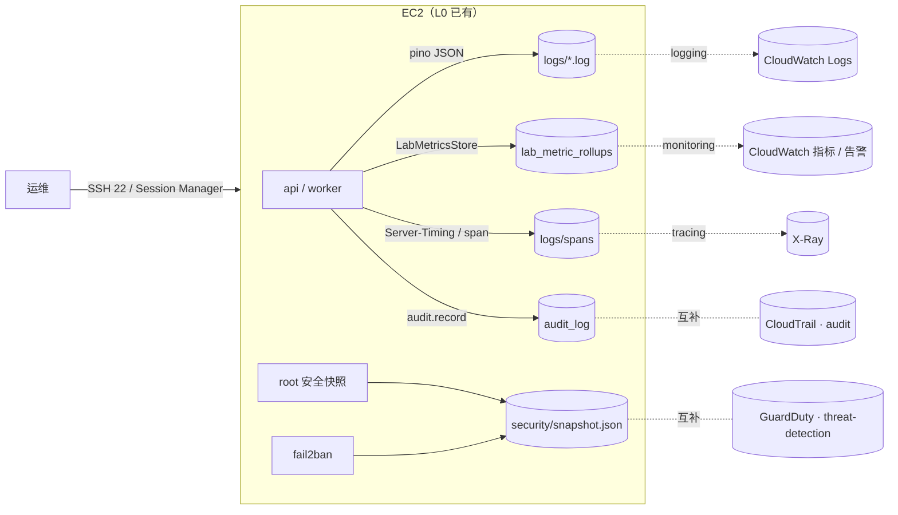
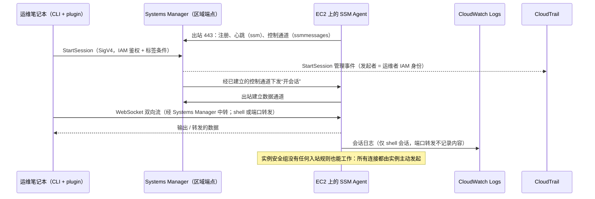
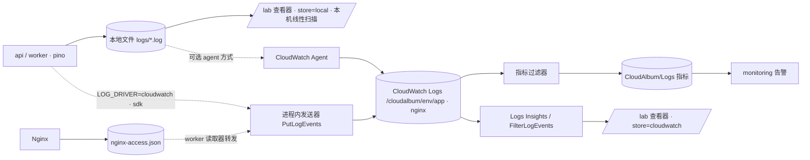
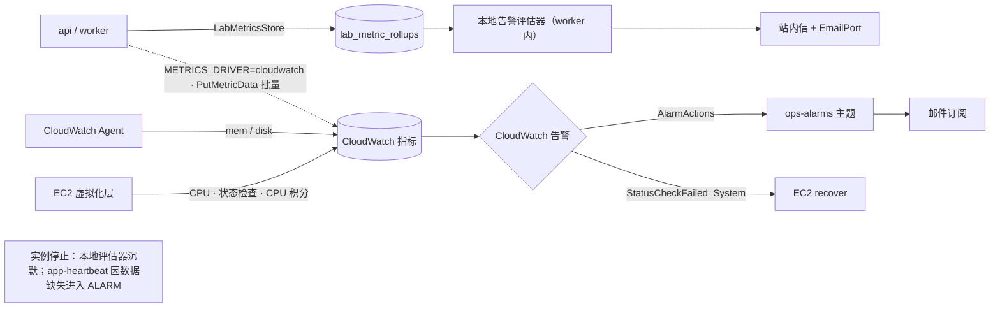
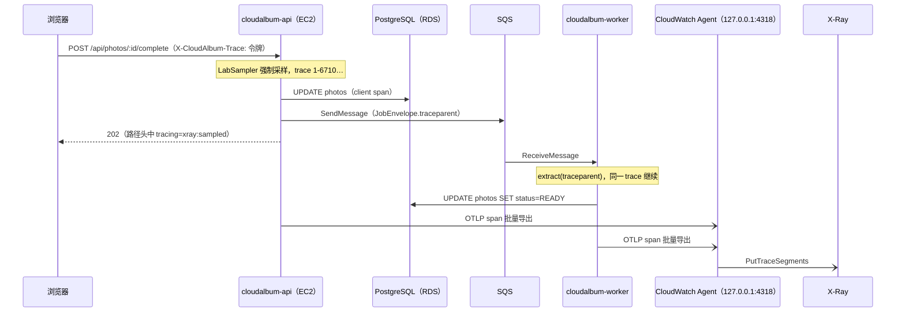
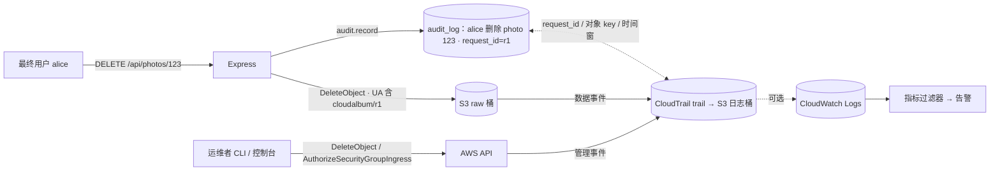
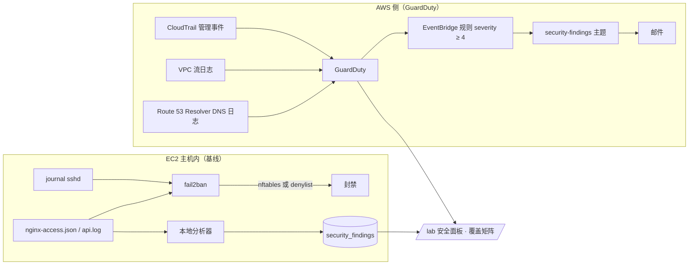

# E 组：运维、监控与安全检测

本组 6 个模块回答“系统运行起来以后发生了什么”：运维人员怎么登录（shell-access）、发生过什么（logging）、现在健康吗、坏了谁来报警（monitoring）、一次请求慢在哪一段（tracing）、谁动过 AWS 资源（audit）、有没有人在攻击（threat-detection）。在 L0（仅 EC2）下，这些机能全部由 EC2 本地实现：SSH 22 端口 + 密钥对、EBS 上的日志文件 + logrotate、LabMetricsStore + 本地告警评估器、Server-Timing（可选本地 span）、应用内 `audit_log` 表、fail2ban + 本地分析器。它们都不改变业务功能，所以对比点集中在三件事上：实例坏了、被替换了以后还看不看得见；出事时谁来报警；事后能不能追溯到人。

## 本组模块一览

| 模块 id | 机能 | 主 AWS 服务 | 开关 | 硬依赖 | 能否在 L0 上单独启用 |
|---|---|---|---|---|---|
| shell-access | 运维登录 | AWS Systems Manager Session Manager | `MODULE_SHELL_ACCESS`（纯基础设施型；不存在 = SSH 22 + 密钥对） | iam（role 模式，实例配置文件角色，规则 DEP-001）；实例出站 443 可达 ssm、ssmmessages 端点 | 否（最小依赖集合 {iam}） |
| logging | 日志 | Amazon CloudWatch Logs | `LOG_DRIVER=file\|cloudwatch` | AWS 凭证（推荐 iam）；实例出站可达 logs 端点 | 是（需 AWS 凭证） |
| monitoring | 指标、告警、仪表板 | Amazon CloudWatch | `METRICS_DRIVER=local\|cloudwatch` | AWS 凭证；实例出站可达 monitoring 端点（内存、磁盘指标需要 CloudWatch Agent，缺失时 degraded） | 是（需 AWS 凭证） |
| tracing | 分布式链路追踪 | AWS X-Ray | `TRACING_DRIVER=none\|local\|xray`（`local` 是本地档，不需要 AWS） | xray 档：AWS 凭证 + 本机收集器（CloudWatch Agent 的 traces 段或 ADOT Collector）+ 出站可达 xray 端点 | 是（需 AWS 凭证） |
| audit | AWS API 操作审计 | AWS CloudTrail | `MODULE_AUDIT`（纯基础设施型；不存在 = 应用 `audit_log` 表 + 有凭证时只读 Event History） | 无模块级依赖；应用侧展示需要 AWS 凭证与 cloudtrail 只读权限 | 是 |
| threat-detection | 威胁检测 | Amazon GuardDuty | `MODULE_THREAT_DETECTION`（纯基础设施型；不存在 = fail2ban + 本地分析器） | 无模块级依赖；应用侧展示需要 AWS 凭证与 guardduty 只读权限 | 是 |

**“能否在 L0 上单独启用”的含义**：与总纲（[modular-design.md](../modular-design.md) §10.3）和 B 组一致——“是”表示 L0 + 本模块 + “AWS 凭证可用”这个通用前提（推荐启用 iam 的 role 模式，免费、几分钟即可完成）就能完整运行、通过健康探针并做对比实验；“否”表示还必须先启用别的模块。shell-access 是本组唯一的“否”：Session Manager 只认实例角色（或账号级 DHMC），不能用应用的静态访问密钥。

**本组公共约定**

1. **与总纲对齐，以及本组的偏差（附理由）**
   - (a) 端口沿用总纲 §4.2：`LoggerPort`（`ports/logger.ts`）、`MetricsPort`（`ports/metrics.ts`）、`TracerPort`（`ports/tracer.ts`），写入侧签名不变。本组只在同一文件里**追加只读侧接口** `LogReader`、`MetricsReader`、`TraceReader`，供 `/lab` 查询使用。不另设 `LoggingPort`、`TracingPort` 之类的新端口。
   - (b) shell-access、audit、threat-detection 是纯基础设施型（总纲 §3.1 类型 I）：没有 `*_DRIVER` 开关，开关就是 `modules.d/<id>.env` 中的 `MODULE_<ID>=on`（文件不存在 = 本地实现）；应用侧只写感知器 `backend/src/modules/detectors/<id>.ts`。也不设 `SHELL_ACCESS`、`AUDIT_TRAIL`、`THREAT_DETECTION` 之类的开关变量。
   - (c) **偏差：tracing 增加本地档 `local`。** 总纲中 `TRACING_DRIVER=none` 是空操作 span、只保留 Server-Timing。为了把“OpenTelemetry 插桩本身的开销与能力”和“X-Ray 托管后端带来的差异”拆开对比，增加一个不需要任何 AWS 资源的 `local` 档（OTel SDK + 本地 span 文件 + /lab 瀑布图），性质与 `CACHE_DRIVER=memory`、`QUEUE_DRIVER=memory` 相同。需要同步修改总纲 §3.2 的开关列和 §4.2 中 TracerPort 的驱动列表。
   - (d) monitoring 与 threat-detection **各自带一个 SNS 主题**（总纲 §3.2 已规定 monitoring“模块自带主题”），不依赖 notification 模块。notification 的 SNS 主题只用于终端用户通知（F10）。
   - (e) 只读与实验接口统一放在 `/api/lab/` 下（仅管理员，例如 `/api/lab/logs`、`/api/lab/traces`、`/api/lab/monitoring/alarms`、`/api/lab/shell-access`、`/api/lab/faults`），与总纲 §7.3、§8 的 `/api/lab/*` 一致；审计页面是 `/admin/audit`，接口 `GET /api/admin/audit`。不使用 `/api/admin/lab/*`、`/api/admin/logs` 之类的路径。
   - (f) 文件布局沿用总纲 §2.4：`/var/lib/cloudalbum/logs/` 下的 `api.log`、`worker.log`、`audit.log`、`nginx-access.json`（总纲 §2.5 已定义的 `cloudalbum_json` 格式），logrotate 每日轮转、保留 14 天。Nginx 错误日志用 AL2023 默认路径 `/var/log/nginx/error.log`。本组新增两个目录：`logs/spans/`（tracing 的 local 档）和 `/var/lib/cloudalbum/security/`（安全快照与 denylist）。
   - (g) 已启用模块要更新栈参数（例如 monitoring 需要其他模块新出现的资源 ID），一律“**再执行一次** `scripts/module enable <id>`”，它等价于栈更新（总纲 §10.1）。不新增 `scripts/module refresh` 子命令；`scripts/module` 在任何模块启停后打印提示“建议重新 enable monitoring / audit / tracing”。

2. **共享一个 CloudWatch Agent。** monitoring（metrics 段：内存、磁盘；可选 EMF 接收端口）、tracing（traces 段：OTLP 接收 + X-Ray 采样代理）以及 logging 的可选 agent 投递方式，共用一个 `amazon-cloudwatch-agent` 进程。规则：
   - 每个模块的片段放在发布包的 `infra/modules/<id>/cwagent.json`，注册表新增字段 `cwAgentFragment` 声明（需补充到总纲 §3.4）。
   - 投递时执行 `amazon-cloudwatch-agent-ctl -a append-config -m ec2 -s -c file:/opt/cloudalbum/infra/modules/<id>/cwagent.json`；禁用时执行 `-a remove-config -c file:<同一路径> -s`；最后一个片段被移除后执行 `-a stop`。
   - 第一个需要 Agent 的模块负责 `dnf install -y amazon-cloudwatch-agent`；L0 的 User Data **不安装** Agent，保持“只有 EC2”时的纯净。
   - 各片段只写自己的段，不写 `agent` 全局段，避免合并冲突（多个片段同时含 `logs` 段时的合并行为以官方文档为准，在沙箱中先验证）。
   - Agent 默认使用实例配置文件的凭证。iam 处于 keys 模式时，Agent **不会**读取应用的密钥文件，需要在 `/opt/aws/amazon-cloudwatch-agent/etc/common-config.toml` 中另配 shared credentials（等于再落盘一份长期密钥，见 B 组 iam 模块）。
   - 版本：X-Ray 接收 W3C 格式 trace ID 需要 Agent 1.300030.0 或更新（以官方文档为准）；scripts/module 安装后检查版本。

3. **root 安全快照（L0 自带，shell-access 与 threat-detection 共用）。** API 进程以 `cloudalbum` 用户运行，读不到 journal 和 fail2ban。L0 的 User Data 安装一个以 root 运行的 `cloudalbum-security-snapshot.timer`（每 2 分钟），执行 `/usr/local/lib/cloudalbum/security-snapshot.sh`，把以下内容写入 `/var/lib/cloudalbum/security/snapshot.json`（属主 `root:cloudalbum`，权限 0640）：监听端口（`ss -ltn`）、sshd 近 24 小时失败次数和最近 20 次成功登录（含公钥指纹与来源 IP）、`fail2ban-client status` 中每个 jail 的当前封禁和累计封禁数、fail2ban 是否可用。感知器只读这个文件。

4. **告警与安全事件的送达路径**（对比点之一，见 monitoring 与 threat-detection）：

   | 场景 | 谁在判断 | 怎么送达 | 实例宕机时 |
   |---|---|---|---|
   | L0 | worker 中的本地告警评估器、本地安全分析器 | 管理员站内信（`notifications` 表）+ EmailPort（outbox 或 ses） | 全部沉默 |
   | monitoring 启用 | CloudWatch 告警 | 告警动作 → monitoring 自带的 SNS 主题 `cloudalbum-<env>-ops-alarms` → 邮件订阅 | 心跳告警、状态检查告警照常触发 |
   | threat-detection 启用 | GuardDuty | EventBridge 规则 → 自带的 SNS 主题 `cloudalbum-<env>-security-findings` → 邮件订阅 | 不受影响（检测在 AWS 侧） |

   SNS 主题如果要加密，必须用客户托管密钥（kms 模块），并在密钥策略里允许 `cloudwatch.amazonaws.com`、`events.amazonaws.com` 使用；AWS 托管密钥 `aws/sns` 不行。邮件订阅需要收件人点击确认。

5. **凭证前提与命名。** B 组 iam 定稿的开关是 `IAM_CREDENTIALS=none|role|keys`，总纲 §4.4 写的是 `AWS_CREDENTIALS_SOURCE=static|instance-profile`，两者命名尚未统一（见未决问题）。本文统一称“role 模式”“keys 模式”。shell-access 必须是 role 模式；logging、monitoring、tracing、audit、threat-detection 在 keys 模式下应用侧也能工作，但 CloudWatch Agent 需要另配凭证，并会触发 CRED-002 警告。

6. **私有子网（network 模块 `NETWORK_PLACEMENT=private`）所需的端点。** 统一走 NAT Gateway 时不需要额外配置；不用 NAT 时，在 network 栈中按下表创建 Interface Endpoint（开启 Private DNS）。各模块在模板 `Metadata.CloudAlbum.endpointsIfPrivate` 中声明，由 `scripts/module` 在计划校验阶段统一检查（对应 DEP-009）。

   | 模块 | 需要的端点 |
   |---|---|
   | shell-access | `ssm`、`ssmmessages`、`ec2messages`（Agent 3.3.40.0 起优先走 ssmmessages，官方称可不再需要 ec2messages，但本项目仍建议创建，以官方文档为准）；会话日志加 `logs`；会话加密加 `kms` |
   | logging | `logs` |
   | monitoring | `monitoring`；EMF 方式加 `logs`；Agent 读取 ASG 名称需要 `ec2` |
   | tracing | `xray` |
   | audit、threat-detection（仅应用侧只读展示） | `cloudtrail`、`guardduty`；CloudTrail 和 GuardDuty 本身的数据采集不经过你的 VPC |

7. **多实例（autoscaling）。** 本组所有基线数据都是“每台实例一份”：本地日志文件、本地 span 文件、fail2ban 封禁列表、sshd 记录；LabMetricsStore 的分钟汇总写入共享数据库（总纲 ASG-010），原始样本仍按实例分散。`/lab` 上凡是来自本地文件的数据都要显示“数据来自 i-xxxx”徽章。这正是 logging、monitoring、tracing 的核心对比点。审计表在数据库中，多实例需要 `DB_DRIVER=postgres`（ASG-002 本来就要求），哈希链需要串行写入。规则 ASG-009（`LOG_DRIVER=file`）、ASG-010（`METRICS_DRIVER=local`）只产生警告。

8. **远程执行通道。** 总纲 §9.2 规定 `scripts/module` 在 L0 通过 ssh 投递配置、重启服务，启用 shell-access 后改用 SSM Run Command（`AWS-RunShellScript`）。shell-access 的启用流程必须保证：在关闭 22 端口之前，SSM 通道已经验证可用。

9. **共享的故障注入设施（本组提出，需补充到总纲 §8）。** logging、monitoring、tracing 的实验都需要“可控地制造错误和延迟”。统一提供管理员接口 `POST /api/lab/faults`：
   - 请求体：`{"type":"error5xx|latency|mem|cpu","target":"database|cache|storage","rate":0.2,"ms":300,"durationSec":300}`，`target` 与 `ms` 只用于 `latency`。
   - 总开关是运行时配置 `featureFlags["lab.faults"]`（ConfigPort，可热关闭，默认 false）；只允许管理员调用；`durationSec` 上限 900 秒，到期自动解除；`mem` 类型的分配上限是 512 MiB（t3.small 只有 2 GiB 内存）。
   - 每次注入写入 `audit_log`，生效期间 `/lab` 顶部显示红色横幅“故障注入进行中”。
   - 实现：`backend/src/observability/faults.ts`，在 instrument 代理和 Express 中间件里生效，业务代码不感知。

10. **本组新增的后台任务。** 告警评估（30 秒一次）和安全分析（5 分钟一次）是 worker 进程内的循环，不经过 SchedulerPort（EventBridge Scheduler 的最小粒度和 tick 队列不适合 30 秒级任务），由 LockPort 保证集群内只有一个实例在执行。审计保留期清理是一个新的定时任务 `audit.retention`（每日一次，经 SchedulerPort），需要把它加入总纲 §4.2 的 `ScheduledJobName`。

11. **注册表摘要**（`modules/registry.yaml` 中本组的关键字段，模块文档以它为准）：

```yaml
shell-access:
  type: infra
  switch: { var: MODULE_SHELL_ACCESS }
  ownsEnv: [SSM_SESSION_, SHELL_ACCESS_]
  requires: [iam]                          # DEP-001
  baseParams: { SshIngressCidr: '' }       # 关闭 22 端口；SHELL_ACCESS_KEEP_SSH=true 时不下发
  stacks: [{ name: main, template: infra/modules/shell-access.yaml }]
  detector: detectors/shell-access.ts
  lab: { compare: before-after, experiments: [probe-port, ssh-noise, session-audit] }
logging:
  type: adapter
  port: LoggerPort
  switch: { var: LOG_DRIVER, values: [file, cloudwatch], ownedValues: [cloudwatch], localTiers: [] }
  ownsEnv: [LOG_CW_]
  authoritative: false
  multiInstanceSafe: { file: false, cloudwatch: true }       # file 只是警告（ASG-009）
  cwAgentFragment: infra/modules/logging/cwagent.json         # 仅 LOG_CW_SHIPPER=agent 时投递
  lab: { compare: before-after, experiments: [ingest-lag, query-compare, instance-loss] }
monitoring:
  type: adapter
  port: MetricsPort
  switch: { var: METRICS_DRIVER, values: [local, cloudwatch], ownedValues: [cloudwatch] }
  ownsEnv: [METRICS_CW_]
  authoritative: false
  cwAgentFragment: infra/modules/monitoring/cwagent.json
  baseParams: { DetailedMonitoring: 'false' }                 # --param DetailedMonitoring=true 时改为 true
  lab: { compare: fault, experiments: [time-to-alert, kill-test, mem-visibility, resolution] }
tracing:
  type: adapter
  port: TracerPort
  switch: { var: TRACING_DRIVER, values: [none, local, xray], ownedValues: [xray], localTiers: [local] }
  ownsEnv: [TRACING_]
  authoritative: false
  bypass: [tracing]
  cwAgentFragment: infra/modules/tracing/cwagent.json
  systemdDropIn: infra/modules/tracing/systemd/50-tracing.conf   # local 与 xray 档都投放
  lab: { compare: runtime-ab, experiments: [walkthrough, slow-hunt, overhead, propagation] }
audit:
  type: infra
  switch: { var: MODULE_AUDIT }
  ownsEnv: [CLOUDTRAIL_]
  requires: []
  detector: detectors/audit.ts
  lab: { compare: functional, experiments: [who-deleted, validate-logs, chain-tamper] }
threat-detection:
  type: infra
  switch: { var: MODULE_THREAT_DETECTION }
  ownsEnv: [GUARDDUTY_]
  requires: []
  detector: detectors/threat-detection.ts
  lab: { compare: functional, experiments: [sample-findings, login-bruteforce, web-scan, dns-canary] }
```

12. **推荐启用顺序（非强制）**：iam → shell-access → logging → monitoring → audit → threat-detection → tracing。tracing 放在最后，是因为它在 queue、storage、database 等模块启用之后才最有看头。

13. **对现有文档的修正**：
    - labs.md Lab 10 的验收标准“X-Ray 中能看到 CloudFront → ALB → EC2 → RDS 的完整链路”不成立：CloudFront 和 ALB 都不会成为 X-Ray 节点（ALB 只注入 `X-Amzn-Trace-Id` 头）。应改为“X-Ray 服务地图中能看到 cloudalbum-api → RDS / S3 / SQS → cloudalbum-worker；Lambda 缩略图是另一条 trace，可按 `photo_id` 注解关联”。另外 API Gateway HTTP API 不支持 X-Ray，只有 REST API 支持。
    - labs.md Lab 0 第 4 步已经创建了一个多区域 trail。启用 audit 模块前必须先检测，避免在同一区域产生第二份**收费**的管理事件副本（见 audit 模块）。
    - GuardDuty 不需要事先开启 VPC Flow Logs，也不需要创建 trail；CloudTrail Event History 不需要创建 trail 就存在（90 天管理事件）。
    - 总纲 §2.7 的 User Data 注释“AL2023 不支持 EPEL，fail2ban 能否直接安装以官方文档为准”需要更新：AL2023 自 2023.6.20241010 版本起，核心仓库提供 fail2ban 1.1.0（子包 `fail2ban-server`、`fail2ban-systemd` 等，以实例上 `dnf info` 的结果为准）。
    - AL2023 默认没有 rsyslog，也没有 `/var/log/secure`，sshd 日志只在 journal 里。

14. **安全**：`/api/lab/*`、`/api/admin/*` 只允许管理员；`/metrics` 只允许本机访问（总纲 §2.5）；日志、审计、span 的脱敏规则统一放在 `backend/src/observability/redact.ts`（Authorization、Cookie、密码、令牌、预签名 URL 的签名参数、`X-CloudAlbum-Trace` 强制采样令牌）。

15. 本文中的限额、价格、时延都只给定性描述和数量级，具体数值以官方文档为准。



## shell-access：运维登录 ↔ AWS Systems Manager Session Manager

> 一句话总结：没有它时，运维用 SSH（22 端口 + 密钥对）登录 EC2，安全组必须对运维 IP 开放 22 端口，事后只能知道“哪把钥匙从哪个 IP 登录过”；启用后，实例上的 SSM Agent 主动向外建立 443 长连接，运维用自己的 IAM 身份经 Session Manager 登录和做端口转发，安全组可以没有任何管理端口入站，每次会话都能追溯到 IAM 身份，会话内的命令和输出写进 CloudWatch Logs。最直观的区别：/lab 的 shell-access 卡片从红色徽章“入站 22/tcp ← 203.0.113.10/32”变成绿色“无管理端口入站 · SSM Agent Online”；从公网探测 22 端口，结果从 open 变成超时（filtered）。

### 1. 基线实现（仅 EC2）

- **入口与密钥**：基础栈 `infra/modules/ec2.yaml` 启动实例时指定密钥对（参数 `KeyName`，默认 `cloudalbum-key`）。安全组的 22/tcp 入站规则由基础栈参数 `SshIngressCidr` 控制（总纲 §2.3）：取值是运维者的公网 IP/32，**不提供 `0.0.0.0/0` 作为默认值**；为空字符串时模板的 Condition 不创建 22 端口规则。
- **sshd 加固**（L0 User Data 写入 `/etc/ssh/sshd_config.d/40-cloudalbum.conf`）：

  ```text
  PasswordAuthentication no
  KbdInteractiveAuthentication no
  PermitRootLogin no
  MaxAuthTries 3
  AllowUsers ec2-user
  LogLevel VERBOSE          # 日志里记录登录所用公钥的指纹
  ```

  文件名用 `40-` 前缀：AL2023 自带 `50-redhat.conf`，而 sshd 对同一选项“先读到的值生效”，必须排在它前面。写入后执行 `sshd -t && systemctl reload sshd`。
- **审计**：AL2023 默认不装 rsyslog，没有 `/var/log/secure`，sshd 日志只在 systemd journal 里（`journalctl -u sshd`）；`last` 读取 wtmp 显示登录历史。能知道的只有“哪把公钥（指纹）从哪个 IP、什么时间登录”，**不知道登录后执行了什么**（bash history 由用户自己控制，不能算审计）。
- **防爆破**：`MaxAuthTries 3`，加上 threat-detection 基线中 fail2ban 的 `sshd` jail（`backend = systemd`）。
- **端口转发**：`ssh -i cloudalbum-key.pem -L 13000:127.0.0.1:3000 ec2-user@<EIP>`，然后在本机访问 `http://localhost:13000/api/health/ready`。
- **状态采集**：使用本组公共约定 3 的 root 安全快照（每 2 分钟），其中与本模块有关的字段：`sshd.listening`、`sshd.failures24h`（`journalctl -u sshd --since -24h -o cat | grep -cE 'Failed|Invalid user'`）、`sshd.recentLogins[]`（来自 `Accepted publickey` 行，含指纹与来源 IP）。
- **感知器** `backend/src/modules/detectors/shell-access.ts`：未启用时 `status=off`，`localHealth` 由快照决定（sshd 在监听且快照不超过 5 分钟为 ok）。/lab 卡片显示“sshd 监听 22 · 近 24 小时失败 N 次 · 最近登录列表”。安全组规则只有在“有 AWS 凭证且有 `ec2:DescribeSecurityGroups` 权限”时才能确认（`confirmed`）；L0 没有凭证，卡片显示由基础栈参数推断的结果（`inferred`）。
- **投递通道**：`scripts/module` 用 `ssh` 写 env 文件、重启服务（总纲 §9.2）。
- **局限**：私钥要分发、轮换，丢了要换密钥对；运维 IP 一变就要改安全组；没有命令级审计；实例进了私有子网就要另建堡垒机。

### 2. AWS 实现

**前提**：AL2023 官方 AMI 预装并默认启用 `amazon-ssm-agent`（systemd 服务）。实例拿到角色凭证、并且能连上 SSM 端点后，会自动注册为“托管节点”，`PingStatus` 变为 `Online`。

**CloudFormation：`infra/modules/shell-access.yaml`**

| 资源 | 说明 |
|---|---|
| `AppPolicy`（`AWS::IAM::ManagedPolicy`） | 输出为 `PolicyArn`，**模板不把它附加到任何角色**，由 `scripts/module` 附加到 `CloudAlbumAppRole`（总纲 §9.1）。内容：① Agent 核心权限，等价于 AWS 托管策略 `AmazonSSMManagedInstanceCore` 中会话所需的部分：`ssm:UpdateInstanceInformation`、`ssm:ListInstanceAssociations`、`ssm:DescribeAssociation`、`ssm:GetDocument`、`ssm:DescribeDocument`、`ssm:UpdateInstanceAssociationStatus`、`ssmmessages:CreateControlChannel/CreateDataChannel/OpenControlChannel/OpenDataChannel`、`ec2messages:*`；② 写会话日志：`logs:CreateLogStream`、`logs:PutLogEvents`（资源限定为会话日志组），`logs:DescribeLogGroups`、`logs:DescribeLogStreams`（这两个不支持限定到单个日志组，Resource 只能写 `*`）；③ 可选：会话加密密钥上的 `kms:Decrypt`、`kms:GenerateDataKey`，S3 归档的 `s3:PutObject`、`s3:GetEncryptionConfiguration`；④ 感知器只读：`ssm:DescribeInstanceInformation`、`ssm:DescribeSessions`、`ec2:DescribeSecurityGroups` |
| `SessionLogGroup` | `/cloudalbum/<env>/ssm-sessions`；`RetentionInDays` 用参数控制（默认 30）；有 `KmsKeyArn` 时加密；`DeletionPolicy: Retain` + `UpdateReplacePolicy: Retain` |
| `OperatorPolicy` | 给“人”用的客户托管策略 `cloudalbum-<env>-operator-session`（见第 3 节），以 `InfoOperatorPolicyArn` 输出；由运维者自己挂到 Identity Center 权限集或自己的角色上，模板不挂 |
| Outputs | `ModuleId`、`ModuleVersion`、`PolicyArn`、`EnvSsmSessionLogGroup`、`EnvSsmSessionRunAs`、`InfoOperatorPolicyArn`、`InfoSessionHistoryUrl`（控制台会话历史链接） |

为什么不直接附加 `AmazonSSMManagedInstanceCore`：省事，但它还授予了对**所有** Parameter Store 参数的 `ssm:GetParameter(s)` 等权限，对一个只需要会话功能的实例来说过宽。`scripts/module enable shell-access --managed-core` 保留这个选项，用来对比“托管策略 vs 最小权限”。

**基础栈参数**：注册表声明 `baseParams: { SshIngressCidr: '' }`。`scripts/module` 在 SSM 通道验证成功后更新基础栈，模板的 Condition 删除 22 端口入站规则；原来的 CIDR 记在 `.cloudalbum/state.json` 中，供回滚使用。`SHELL_ACCESS_KEEP_SSH=true`（过渡期或并排对比）时不下发该参数，此时状态为 `degraded`，并触发 SEC-003 警告。

**会话首选项**：`SSM-SessionManagerRunShell` 是**每个账号每个区域一份**的单例文档，修改它会影响该区域所有会话；如果用 CloudFormation 直接创建，文档已存在时会冲突。所以由 `scripts/module` 处理：先 `aws ssm get-document` 备份到 `.cloudalbum/backup/SSM-SessionManagerRunShell-<时间>.json`，存在则 `aws ssm update-document --document-version '$LATEST'`，不存在则 `create-document --document-type Session`，最后把新版本设为默认版本。写入的内容见第 3 节，要点：
- `cloudWatchLogGroupName` 指向会话日志组，`cloudWatchStreamingEnabled=true`（边执行边上传；false 则会话结束时一次性上传）。
- `cloudWatchEncryptionEnabled=false`：这个选项的含义是“只允许写入已加密的日志组”。日志组没有 KMS 加密时如果它为 true，会话日志会写入失败。启用 kms 模块并给日志组设置了 `KmsKeyId` 后再改为 true。
- `runAsEnabled=true`、`runAsDefaultUser=cloudalbum-ops`：默认的 `ssm-user` 有免密 sudo，AL2023 上的 `ec2-user` 同样有免密 sudo，**改成 ec2-user 并不能降低权限**。所以启用流程会创建专用 OS 用户 `cloudalbum-ops`，它的 sudoers 片段只允许 `systemctl status|restart cloudalbum-*`、`journalctl -u cloudalbum-*`、`nginx -t`、`systemctl reload nginx`。确实需要 root 的管理员，在自己的 IAM 角色（或身份中心会话标签）上加标签 `SSMSessionRunAs=ec2-user`，会话就以 ec2-user 身份打开（标签方式以官方文档为准）。
- `idleSessionTimeout=20`（分钟）、`maxSessionDuration=120`（分钟）。
- 可选 `kmsKeyId`：开启会话数据加密（来自 kms 模块），此时实例角色需要该密钥的 `kms:Decrypt`，运维者需要 `kms:GenerateDataKey`。
- 注意：Run Command（`AWS-RunShellScript`）总是以 root 执行，不受 runAs 影响；`scripts/module` 的投递通道正是用它。

**感知器**（`confidence=confirmed`）：
- `ssm:DescribeInstanceInformation`（过滤本实例 ID）：`PingStatus`、`AgentVersion`、`LastPingDateTime`。
- `ec2:DescribeSecurityGroups`：实例安全组是否还有 22 端口入站规则。
- `ssm:DescribeSessions --state History`：最近 20 次会话（`Owner` 是运维者的 IAM ARN，另有开始和结束时间）。结果缓存 60 秒。
- 状态判定：`ok` = Agent Online 且没有 22 端口规则且会话首选项指向本模块的日志组；`degraded` = Agent Online，但 22 端口仍开放（`SHELL_ACCESS_KEEP_SSH=true` 或 SEC-003）或会话首选项被别人改掉；`error` = Agent 未注册或 `ConnectionLost`，或感知器 AccessDenied。

**运维者使用方式**（运维侧需要 AWS CLI v2 和 Session Manager plugin）：

```bash
# 登录（以 cloudalbum-ops 身份打开 shell）
aws ssm start-session --target i-0123456789abcdef0

# 端口转发：本机 13000 → 实例 127.0.0.1:3000
aws ssm start-session --target i-0123456789abcdef0 \
  --document-name AWS-StartPortForwardingSession \
  --parameters '{"portNumber":["3000"],"localPortNumber":["13000"]}'

# database=rds 时：经实例转发到私有 RDS，不必把 5432 开放给运维 IP
aws ssm start-session --target i-0123456789abcdef0 \
  --document-name AWS-StartPortForwardingSessionToRemoteHost \
  --parameters '{"host":["<rds-endpoint>"],"portNumber":["5432"],"localPortNumber":["15432"]}'

# scripts/module 的远程执行通道（Run Command，以 root 执行）
aws ssm send-command --instance-ids i-0123456789abcdef0 --document-name AWS-RunShellScript \
  --parameters 'commands=["systemctl restart cloudalbum-api cloudalbum-worker"]'
```



**私有子网**（启用 network 后最有说服力的场景）：实例没有公网 IP、安全组没有入站规则，照样能登录。前提是有 NAT Gateway，或者有 `ssm`、`ssmmessages`（以及建议保留的 `ec2messages`）Interface Endpoint；写会话日志还要 `logs` 端点，会话加密还要 `kms` 端点。漏建 `ssmmessages` 时，实例可能显示 Online，但打不开会话。

### 3. 开关与配置

```bash
# /etc/cloudalbum/modules.d/shell-access.env
# 由 scripts/module enable shell-access 写入；文件不存在 = 本地实现（SSH 22 + 密钥对）
MODULE_SHELL_ACCESS=on
MODULE_SHELL_ACCESS_VERSION=1
SSM_SESSION_LOG_GROUP=/cloudalbum/lab/ssm-sessions   # 来自 Outputs.EnvSsmSessionLogGroup
SSM_SESSION_RUN_AS=cloudalbum-ops                   # 来自 Outputs.EnvSsmSessionRunAs
SHELL_ACCESS_KEEP_SSH=false                         # true = 过渡期保留 22 端口（状态 degraded，SEC-003）
```

- 运维 IP（`SshIngressCidr`）是基础栈参数，不属于本模块的 env，记录在运维机的 `.cloudalbum/state.json` 中。
- 本模块是纯基础设施型，应用侧没有端口和驱动，只有感知器。

会话首选项（`scripts/module` 写入 `SSM-SessionManagerRunShell`）：

```json
{
  "schemaVersion": "1.0",
  "description": "CloudAlbum session preferences (managed by scripts/module)",
  "sessionType": "Standard_Stream",
  "inputs": {
    "cloudWatchLogGroupName": "/cloudalbum/lab/ssm-sessions",
    "cloudWatchStreamingEnabled": true,
    "cloudWatchEncryptionEnabled": false,
    "s3BucketName": "",
    "s3EncryptionEnabled": false,
    "kmsKeyId": "",
    "runAsEnabled": true,
    "runAsDefaultUser": "cloudalbum-ops",
    "idleSessionTimeout": "20",
    "maxSessionDuration": "120"
  }
}
```

运维者的最小权限示例（`OperatorPolicy`；结构参照官方示例策略）：

```json
{
  "Version": "2012-10-17",
  "Statement": [
    { "Sid": "StartOnTaggedInstances",
      "Effect": "Allow", "Action": "ssm:StartSession",
      "Resource": "arn:aws:ec2:ap-northeast-1:<acct>:instance/*",
      "Condition": { "StringEquals": { "ssm:resourceTag/Project": "CloudAlbum" },
                     "BoolIfExists": { "ssm:SessionDocumentAccessCheck": "true" } } },
    { "Sid": "AllowedSessionDocuments",
      "Effect": "Allow", "Action": "ssm:StartSession",
      "Resource": [
        "arn:aws:ssm:ap-northeast-1:<acct>:document/SSM-SessionManagerRunShell",
        "arn:aws:ssm:ap-northeast-1::document/AWS-StartPortForwardingSession",
        "arn:aws:ssm:ap-northeast-1::document/AWS-StartPortForwardingSessionToRemoteHost" ] },
    { "Sid": "OwnSessionsOnly",
      "Effect": "Allow", "Action": ["ssm:TerminateSession", "ssm:ResumeSession"],
      "Resource": "arn:aws:ssm:*:*:session/${aws:userid}-*" },
    { "Sid": "ReadOnlyForConsoleAndCli",
      "Effect": "Allow",
      "Action": ["ssm:DescribeSessions", "ssm:GetConnectionStatus", "ssm:DescribeInstanceInformation", "ec2:DescribeInstances"],
      "Resource": "*" }
  ]
}
```

- AWS 自有文档（`AWS-StartPortForwardingSession*`）的 ARN 中账号字段为空。
- 会话 ID 的前缀取决于发起者的身份类型（IAM 用户、Identity Center、联合身份），`${aws:userid}` 是官方示例的写法，务必用自己的身份实测（以官方文档为准）。
- 用了会话数据加密（`kmsKeyId`）时，再加上该密钥的 `kms:GenerateDataKey`。

感知器要点：

```ts
// backend/src/modules/detectors/shell-access.ts（要点）
export const shellAccessDetector: DetectorFactory = (cfg, aws) => ({
  module: 'shell-access',
  async detect({ deep }) {
    const snap = await readSecuritySnapshot();                 // /var/lib/cloudalbum/security/snapshot.json
    if (!cfg.modules.on('shell-access')) {
      return { status: 'ok', detail: `SSH 基线 · 近24h失败 ${snap.sshd.failures24h} 次`, confidence: 'inferred', data: { snap } };
    }                                                           // capabilities 层把 off 模块的结果记为 localHealth
    const info = await aws.ssm().describeInstanceInformation({ Filters: [{ Key: 'InstanceIds', Values: [cfg.instanceId] }] });
    const ping = info.InstanceInformationList?.[0]?.PingStatus ?? 'NotRegistered';
    const open22 = await hasIngress22(aws.ec2(), cfg.instanceSecurityGroupId);
    const sessions = deep ? await recentSessions(aws.ssm(), cfg.instanceId, 20) : undefined;   // 结果缓存 60s
    if (ping !== 'Online') return { status: 'error', detail: `SSM Agent ${ping}`, confidence: 'confirmed' };
    if (open22) return { status: 'degraded', detail: 'Agent Online，但安全组仍开放 22（SEC-003）', confidence: 'confirmed' };
    return { status: 'ok', detail: `Agent Online · 无管理端口入站 · 会话日志 → ${cfg.env.SSM_SESSION_LOG_GROUP}`,
             confidence: 'confirmed', data: { sessions } };
  },
});
```

capabilities 示例：

```json
"shell-access": { "driver": null, "awsService": "AWS Systems Manager Session Manager", "type": "infra",
  "status": "ok", "detail": "Agent Online · 无管理端口入站 · 会话日志 → /cloudalbum/lab/ssm-sessions",
  "confidence": "confirmed" }
```

### 4. 依赖与组合

**硬依赖**
- **iam（role 模式）**：实例挂着实例配置文件角色 `CloudAlbumAppRole`，本模块把 `PolicyArn` 附加到它上面（规则 DEP-001）。keys 模式不行：SSM Agent 在 EC2 上取的是 IMDS 中的角色凭证，不读应用的密钥文件。替代方案是账号级的 Default Host Management Configuration（DHMC）：它要求 IMDSv2 和较新的 Agent，并且影响整个区域的实例，不建议在共享账号中使用，本项目不采用。
- **SSM Agent 在运行**：AL2023 官方 AMI 已预装；自制 AMI 要自己安装并 `systemctl enable --now amazon-ssm-agent`。
- **IMDS 可用**：Agent 通过 IMDS 获取角色凭证，可以强制 IMDSv2，但不能关闭 IMDS（`HttpEndpoint=enabled`）。
- **出站网络**：实例能以 HTTPS 443 访问 `ssm`、`ssmmessages`（以及建议保留的 `ec2messages`）端点。L0 的默认 VPC 公有子网 + 弹性 IP 天然满足；私有子网见公共约定 6。
- **运维侧前提**（不属于模块依赖）：AWS CLI v2 + Session Manager plugin（只用控制台可以不装）；运维者的 IAM 身份要有 `OperatorPolicy` 中的权限。
- **启用校验**：关闭 22 端口之前，`scripts/module` 必须确认 `PingStatus=Online`，并用 `send-command` 冒烟成功，否则拒绝继续，22 端口保持不变（防止把自己锁在外面）。

**与其他模块组合**
- **iam**：启用后，CloudTrail 中 `StartSession` 的发起者是运维者的 IAM 身份，而不是“某一把 SSH 私钥”。
- **network**：私有子网中，实例没有公网 IP、没有任何入站规则也能登录（前提是 NAT 或端点）；否则 Agent 显示 `ConnectionLost`。
- **autoscaling**：ASG 中的实例没有固定 IP，也不应该分发私钥。按标签 `Project=CloudAlbum` 授权登录；Run Command 可以对整个 ASG 批量执行（`--targets Key=tag:aws:autoscaling:groupName,Values=<asg>`）。/lab 卡片按实例列出各自的 `PingStatus`。启动模板不再需要 `KeyName`。
- **threat-detection**：关闭 22 端口后，fail2ban 的 `sshd` jail 不再触发；GuardDuty 中 `UnauthorizedAccess:EC2/SSHBruteForce` 和针对 22 端口的 `Recon:EC2/PortProbeUnprotectedPort` 这类发现会逐渐消失。这是两个模块联动时最直观的对比。
- **audit**：`StartSession`、`ResumeSession`、`TerminateSession` 都是管理事件，Event History 默认就能查到；会话里执行的命令只在会话日志里，不进 CloudTrail。
- **logging**：会话日志写入本模块自建的日志组，不依赖 logging；logging 启用后可以在同一次 Logs Insights 查询中联合查询应用日志和会话日志。
- **kms**：会话数据加密和日志组加密；密钥策略要允许实例角色、运维者以及 `logs.ap-northeast-1.amazonaws.com` 服务主体。
- **database（RDS）**：用 `AWS-StartPortForwardingSessionToRemoteHost` 经实例转发到私有 RDS，取代“堡垒机”或“临时把 5432 开给运维 IP”。
- **config（ssm）**：B 组 config 模块的“restart 类配置”在多实例下由 Run Command 做滚动重启。
- **load-balancer、cdn**：互不影响，它们只涉及 80/443。
- **scripts/module 与实验运行器**：本模块决定所有模块共用的远程执行通道和故障注入通道（总纲 §8.2 第 5 步）。

### 5. 对比实验：有 vs 没有

| 维度 | 没有 Session Manager（基线：SSH） | 有 Session Manager |
|---|---|---|
| 管理端口入站 | 22/tcp 对运维 IP 开放 | 无任何入站规则 |
| 长期凭证 | SSH 私钥（要分发、轮换、防丢） | 无；用 IAM 身份（Identity Center 临时凭证） |
| 授权粒度 | 有私钥就能登录 | IAM 策略 + 资源标签条件，可按实例、按文档（shell / 端口转发）授权 |
| 登录审计 | journal 中的“公钥指纹 + IP” | CloudTrail `StartSession`（IAM 身份、时间、来源） |
| 命令审计 | 无 | 会话日志（命令与输出，CloudWatch Logs / S3） |
| 运维 IP 变化 | 要改安全组 | 无影响 |
| 私有子网实例 | 需要堡垒机 | NAT 或端点即可 |
| 批量执行 | 自己写 ssh 循环 | Run Command 按标签批量 |
| 爆破噪声 | 22 端口暴露就会有 | 无（端口关闭） |
| 登录体验 | 直连，最快 | 需要先建立 WebSocket 通道，稍慢（秒级以内） |
| 费用 | 无 AWS 费用 | Session Manager 对 EC2 不额外收费；日志与端点另计 |

**页面上能直接看到的差异**
- /lab 的 shell-access 卡片：
  - 基线：红色徽章“入站 22/tcp ← 203.0.113.10/32”；“近 24 小时 sshd 失败 N 次”；“登录审计：仅 journal 中的 Accepted publickey，无命令记录”；最近登录列表（指纹 + IP）。
  - 启用后：绿色徽章“无管理端口入站”；“SSM Agent: Online（版本 x.y.z）”；最近会话列表（操作者 IAM ARN、开始和结束时间、时长、会话日志链接）。
  - 过渡期（`SHELL_ACCESS_KEEP_SSH=true`）：黄色徽章，两种记录并排列出。
- 控制台：Systems Manager → Session Manager → 会话历史；CloudWatch Logs 的 `/cloudalbum/<env>/ssm-sessions` 中有完整的命令和输出。
- `scripts/module status` 显示投递通道从 `ssh` 变成 `ssm`。

**测量指标**
1. 从公网探测 22 端口的结果（open / filtered）；2. 24 小时内 sshd 认证失败次数；3. 能否回答“哪个 IAM 身份在什么时间执行了哪些命令”（能 / 不能）；4. 需要分发和轮换的长期凭证数量；5. 私有子网中无公网 IP 实例能否登录（需要 network）；6. 同期 fail2ban `sshd` 封禁数与 GuardDuty 中 SSH 相关发现数（需要 threat-detection）；7. 建立会话所需时间（数量级）。

**操作步骤**（`experiments/shell-access/`，切换前后各跑一次；`--label before|after`）
1. 端口探测：在运维机上运行 `npm run exp -- shell-access --label before --scenario probe-port`。`probe-port.ts` 用 Node 的 `net.connect` 对 `<EIP>:22` 和 `:443` 各尝试 5 次（超时 3 秒），记录 open / refused / timeout。也可以手工执行 `nc -vz -w 3 <EIP> 22`。
2. 爆破噪声：`npm run exp -- shell-access --label before --scenario ssh-noise`。`ssh-noise.ts` 每小时读取一次 `GET /api/lab/shell-access`（快照中的 `failures24h` 与 fail2ban 封禁数），持续 24 小时后输出曲线。要观察“来自互联网的真实噪声”，必须把 `SshIngressCidr` 临时改为 `0.0.0.0/0`，只能在自己的实验实例上做，做完立即改回。
3. 会话与端口转发（手工，步骤写在 `experiments/shell-access/README.md`）：`aws ssm start-session` 登录，执行 `id`（应为 `cloudalbum-ops`）和 `sudo systemctl status cloudalbum-api`（允许）、`sudo cat /etc/cloudalbum/secrets.env`（拒绝）；再用端口转发访问 `http://localhost:13000/api/health/ready`。
4. 审计链：`npm run exp -- shell-access --label after --scenario session-audit`。`session-audit.ts` 依次调用 `ssm:DescribeSessions --state History`、读取会话日志组最近 1 小时的事件、调用 `experiments/_lib/cloudtrail.ts --attr EventName=StartSession`（B 组共用的辅助脚本），把三者按会话 ID 对齐打印。CloudTrail 事件有几分钟延迟，脚本会轮询。
5. 私有子网（可选，需要 network）：在 app 子网启动一台没有公网 IP、安全组没有入站规则、挂着同一角色的临时实例，用 Session Manager 登录；再删掉 `ssmmessages` 端点，观察“Online 但打不开会话”。做完删除临时实例和端点。

**预期结果**
- 切换前：22 端口探测为 open。如果 CIDR 是 `0.0.0.0/0`，通常几小时内 journal 里就会出现来自互联网的扫描和爆破，每天数十到上千次，取决于所在 IP 段；只对自己 IP 开放时失败次数基本为零，但运维 IP 一变就要改安全组。
- 切换后：探测结果为超时（filtered），sshd 失败次数归零；每次会话都能追溯到 IAM 身份和时间，并有命令记录；不再需要分发私钥；端口转发取代“临时开放 3000 / 5432 端口”。
- 建立会话比 SSH 慢一点，差别在秒级以内。

**运行时 A/B 还是切换重启**：不涉及业务请求，不使用请求头 A/B。过渡模式（`SHELL_ACCESS_KEEP_SSH=true`）下两种登录方式同时可用，可以并排比较登录方式、端口转发和审计记录；“安全组没有任何入站规则”“爆破尝试归零”只能在关闭 22 端口之后测量，属于切换前 / 切换后对比。

### 6. 切换、数据迁移与回滚

**启用**：`scripts/module enable shell-access`
1. 计划校验：iam 已启用且为 role 模式（DEP-001），`CloudAlbumAppRole` 已挂在实例上；当前投递通道（ssh）可用。
2. 部署 `infra/modules/shell-access.yaml`（策略、会话日志组、运维者策略）。
3. 把 `PolicyArn` 附加到 `CloudAlbumAppRole`。
4. 经当前通道（ssh）在实例上：创建 `cloudalbum-ops` 用户与 sudoers 片段（`visudo -cf` 校验）；执行 `systemctl restart amazon-ssm-agent` 加快注册。
5. 轮询 `aws ssm describe-instance-information`，直到 `PingStatus=Online`（最长 5 分钟）；超时则中止，22 端口保持不变，退出码 5。
6. 冒烟：`aws ssm send-command` 执行 `AWS-RunShellScript`（`id; systemctl is-active cloudalbum-api`），确认返回成功。
7. 备份并更新会话首选项 `SSM-SessionManagerRunShell`。
8. 写入 `modules.d/shell-access.env`；`.cloudalbum/state.json` 中的投递通道改为 `ssm`；经 SSM 重启 api 和 worker。
9. 如果 `SHELL_ACCESS_KEEP_SSH=false`：下发 `baseParams`（`SshIngressCidr=''`），更新基础栈，删除 22 端口规则。可选 `--stop-sshd`：在实例上 `systemctl disable --now sshd`（默认不做，保留 sshd 便于回滚）。
10. 健康探针：从运维机探测 22 端口应为 filtered；发起一次测试会话；`/api/capabilities?deep=1` 中 shell-access 为 `ok`。

**禁用**：`scripts/module disable shell-access --reopen-ssh`（重新开放 22 端口必须显式确认，总纲 §9.2）
1. 询问当前运维 IP（可能已经变了），更新基础栈 `SshIngressCidr`；用 ssh 验证可以连通，失败则中止并保留 SSM 通道。
2. 投递通道改回 `ssh`。
3. 用备份还原会话首选项。
4. 删除 env，重启服务；分离 `PolicyArn`；删除栈。会话日志组因 `DeletionPolicy: Retain` 保留，`--purge` 时才删除。

**迁移**：没有应用数据需要迁移。

**防锁死**：L0 实例必须带密钥对启动，否则禁用本模块后无法回到 SSH。万一 SSM 不可用、22 端口又已关闭：在控制台临时给安全组加一条 22 规则（只对自己的 IP）后用 SSH 登录；EC2 Instance Connect（浏览器方式）同样需要 22 端口对其服务地址段开放，不能救急；最后手段是停止实例，把独立的数据卷挂到用基础栈新建的实例上（数据卷 `DeleteOnTermination: false`，见总纲 §2.2）。

### 7. SAA 考点

- Session Manager、堡垒机、EC2 Instance Connect、EC2 Instance Connect Endpoint 的对比：哪个需要开 22 端口、哪个需要公网 IP、各自怎么审计。
- SSM 托管节点的三个前提：SSM Agent、IAM 实例配置文件（或 DHMC）、到 SSM 端点的网络通路。
- 私有子网访问 AWS 服务：NAT Gateway 与 Interface Endpoint（PrivateLink）的区别；Session Manager 需要的端点。
- 最小暴露面：安全组没有任何入站规则也能管理实例；安全组是有状态的，Agent 主动发起的出站连接的回包自动放行。
- 会话日志（S3 / CloudWatch Logs）+ CloudTrail 记录 `StartSession`，构成完整的审计链。
- 用 IAM 条件键（`ssm:resourceTag/*`）控制谁能登录哪些实例；按文档控制能否做端口转发。
- 用 Session Manager 端口转发访问私有 RDS，取代堡垒机。
- Systems Manager 家族的分工：Session Manager、Run Command、Patch Manager、Parameter Store、Fleet Manager、State Manager。
- AWS 托管策略（`AmazonSSMManagedInstanceCore`）与客户托管策略的取舍。

### 8. 费用与清理

- Session Manager 对 EC2 实例不额外收费（以官方定价为准）。
- 可能产生费用的部分：会话日志写入 CloudWatch Logs 的摄取和存储（量很小），或写入 S3 的存储费；私有子网中的 Interface Endpoint 按“端点 × 可用区 × 小时”计费，另收数据处理费，三四个端点乘以 AZ 数，在学习环境中往往是本模块最大的成本；KMS 会话加密有少量 API 调用费。
- 对比基线：SSH 没有额外 AWS 费用，但要承担私钥管理和端口暴露的成本。
- 清理：`scripts/module disable shell-access --reopen-ssh` → 删除为实验创建的 Interface Endpoint 和临时实例 → 需要时 `--purge` 删除会话日志组。

### 9. 常见坑

- 关闭 22 端口之前必须确认 SSM 通道可用，否则会把自己锁在外面。脚本强制校验 `PingStatus=Online` 并做 `send-command` 冒烟。
- 给实例新挂角色或补充权限后，Agent 可能要等一段时间才注册成功，重启 `amazon-ssm-agent` 可以加快。反过来，撤掉权限后 Agent 也不会立刻掉线（官方说法是最长可能约一小时），实验时不要误判。
- `SSM-SessionManagerRunShell` 是区域级单例，修改会影响该区域所有会话；用 CloudFormation 直接创建会与已存在的文档冲突。由脚本更新，并保留旧版本以便回滚。
- 默认的 `ssm-user` 和 AL2023 的 `ec2-user` 都有免密 sudo，把 runAs 改成 ec2-user 不等于降权；要用专用用户 + 受限 sudoers。
- `cloudWatchEncryptionEnabled=true` 但日志组没有加密时，会话日志会写不进去（会话本身可能照常打开，日志却是空的）。
- 私有子网漏建 `ssmmessages` 端点时，实例显示 Online，但开不了会话。
- 会话日志不记录端口转发和 SSH-over-SSM 会话的数据内容；vim、top 这类全屏程序的日志会很乱。
- `logs:DescribeLogGroups` 不能限定到单个日志组，写成具体 ARN 会导致会话日志静默失败。
- 运维者策略漏掉 `SSM-SessionManagerRunShell` 文档或端口转发文档时，症状是 `AccessDeniedException`，与实例无关；先用 `aws iam simulate-principal-policy` 排查。
- 关闭 22 端口后，浏览器版 EC2 Instance Connect 也连不上。
- 运维笔记本需要安装 session-manager-plugin；公司代理可能拦截 WebSocket。
- sshd 加固片段放在 `50-redhat.conf` 之后不会生效（先读到的值生效）。
- Interface Endpoint 按小时计费，练完要删除。

## logging：日志 ↔ Amazon CloudWatch Logs

> 一句话总结：没有 CloudWatch Logs 时，API、worker、审计和 Nginx 的日志只写在 EBS 数据卷的文件里，/lab 日志查看器在本机线性扫描，实例被终止或数据卷损坏后日志就没了；启用后，应用把同一份结构化日志批量发送到 CloudWatch Logs（本地文件照写），可以跨实例检索、用 Logs Insights 聚合、用指标过滤器把日志变成指标，实例没了日志还在。最直观的区别：日志查看器顶部徽章从“本地文件 · 仅 i-0abc”变成“CloudWatch Logs · 3 个实例”，多出“Logs Insights”页签；搜索刚发出的请求 ID 时，本地立即可见，CloudWatch 侧要“等待摄取…”几秒。

### 1. 基线实现（仅 EC2）

**写入**
- 日志库用 pino，每行一个 JSON 对象。字段约定（LoggerPort 自动附加，总纲 §4.2）：`ts`（ISO 8601，`timestamp: pino.stdTimeFunctions.isoTime` 并把键名改为 `ts`）、`level`（字符串 `debug|info|warn|error`，通过 `formatters.level` 输出标签而不是 pino 默认的数字）、`msg`、`role`（api / worker）、`instanceId`、`requestId`、`traceId`、`path`（`X-CloudAlbum-Path`）；HTTP 请求日志另有 `route`（路由模板）、`method`、`status`、`durMs`；业务事件有 `event`（如 `auth.login_failed`）和 `ip`（按 trust proxy 链取得的客户端 IP）。
- 请求 ID 贯通：Nginx 生成 `$request_id`，经 `proxy_set_header X-Request-Id` 传给 Node（总纲 §2.5 已配置）；应用沿用它作为 `requestId`（没有这个头时自己生成 ULID），并在响应头 `X-CloudAlbum-Request-Id` 中返回。于是 Nginx 访问日志的 `rid` 字段与应用日志的 `requestId` 是同一个值，一个请求能在两边对上。
- 脱敏：`backend/src/observability/redact.ts` 统一定义 pino `redact` 路径（`req.headers.authorization`、`req.headers.cookie`、`*.password`、`*.token`、预签名 URL 的 `X-Amz-Signature` 查询参数等）。
- 文件（总纲 §2.4）：`/var/lib/cloudalbum/logs/api.log`、`worker.log`、`audit.log`（`audit_log` 表的镜像，见 audit 模块）、`nginx-access.json`（Nginx，总纲 §2.5 的 `cloudalbum_json` 格式）。Nginx 错误日志沿用 AL2023 默认的 `/var/log/nginx/error.log`。本模块**不重新定义** Nginx 的 `log_format`（重名会让 `nginx -t` 失败，也违反“模块不得改写主配置”的约定）。
- 写入方式：`pino.destination({ dest, sync: false, mkdir: true })` 异步写入；进程收到 `SIGUSR2` 时调用 `destination.reopen()`。stdout 只输出 warn 及以上，由 journald 收集，用于进程崩溃时排查（`journalctl -u cloudalbum-api`）。
- 轮转：`/etc/logrotate.d/cloudalbum`（总纲 §2.7 安装）：`daily`、`rotate 14`、`compress`、`delaycompress`、`missingok`；`postrotate` 中执行 `systemctl kill -s USR2 cloudalbum-api cloudalbum-worker` 和 `kill -USR1 $(cat /run/nginx.pid)`（Nginx 收到 USR1 会重新打开日志文件）。journald 容量上限写在 `/etc/systemd/journald.conf.d/cloudalbum.conf`（`SystemMaxUse=200M`）。

**查询**
- `backend/src/adapters/logging/file.ts` 同时实现 LoggerPort（写）和 LogReader（读）。读取时从文件尾部倒序扫描当前文件和已轮转的 `.1` 文件（不解压 `.gz`），逐行 `JSON.parse` 后过滤，达到 `limit` 或扫描字节上限（默认 50 MiB）就停止，并返回 `truncated: true`。
- 接口（仅管理员）：`GET /api/lab/logs?source=api|worker|audit|nginx&level=&q=&requestId=&traceId=&since=&limit=&store=local|cloudwatch`；实时追踪用 SSE：`GET /api/lab/logs/stream`（`fs.watch` + 增量读取；通过 inode 变化识别轮转）。
- 错误计数：Logger 每写一条 warn / error，就给 LabMetricsStore 的计数器 `log.events{level}` 加一。monitoring 的本地告警规则读这个计数器，因此 logging 与 monitoring 之间没有代码耦合。

**/lab 日志查看器**（`frontend/src/lab/LogViewer.tsx`）：来源、级别、关键字、时间范围筛选；点击 `requestId` 一键过滤同一请求在 Nginx、api、worker 中的全部日志；点击 `traceId` 跳转到 /lab/tracing 的瀑布图；顶部徽章显示“本地文件 · 仅 i-0abc · 扫描 N MB · 用时 M ms”。

**局限**：只能看到本机日志；实例终止或数据卷损坏后日志随之丢失；检索靠线性扫描，耗时随文件大小线性增长；只覆盖最近两天（当前文件 + `.1`）；Lambda 的日志不在本地。

### 2. AWS 实现

**写入侧：`backend/src/adapters/logging/cloudwatch.ts`（`CwLogger`）**
- 本地文件**照写**（总纲 §4.2：cloudwatch 档以本地文件兜底），同时由进程内发送器批量调用 `PutLogEvents`：
  - 缓冲区按时间排序；每 `LOG_CW_FLUSH_MS`（默认 2 秒）或缓冲达到约 1 MiB / 5000 条时发送一批，低于 PutLogEvents 的单批上限（大小、条数、时间跨度上限以官方文档为准）。
  - 日志流名 `{instanceId}/{role}`（例如 `i-0abc…/api`），启动时 `CreateLogStream`（已存在则忽略）；日志组由 CloudFormation 创建，应用不建组。现在的 PutLogEvents 不再需要 sequence token。
  - 失败按指数退避重试；积压超过 `LOG_CW_MAX_BACKLOG`（默认 10000 条）时丢弃最旧的事件并计入 `dropped`。日志是非权威端口，远端故障绝不阻塞请求（总纲 §1.2 原则 4），只把状态置为 `degraded`。
  - 收到 SIGTERM 时 `flush()`（systemd 的 `TimeoutStopSec=20` 足够发送最后一批）。
- **Nginx 访问日志**：worker 已经在增量读取 `nginx-access.json`，用来统计源站卸载（总纲 §7.3 的 `lab_origin_samples`）；cloudwatch 档下，同一个读取器把这些行转发到 `/cloudalbum/<env>/nginx` 日志组的 `{instanceId}/access` 流。Nginx 错误日志在 sdk 方式下不上传。
- **可选的 agent 投递方式**（`LOG_CW_SHIPPER=agent`）：用来学习 CloudWatch Agent（考点）。应用只写本地文件、不启动进程内发送器；Agent 片段 `infra/modules/logging/cwagent.json` 采集 `api.log`、`worker.log`、`audit.log`、`nginx-access.json` 和 `/var/log/nginx/error.log`。这时 LoggerPort 的 `stats()` 取不到积压数据，探针改用 `DescribeLogStreams` 的最近摄取时间判断。

```json
{"logs":{"logs_collected":{"files":{"collect_list":[
  {"file_path":"/var/lib/cloudalbum/logs/api.log","log_group_name":"/cloudalbum/lab/app","log_stream_name":"{instance_id}/api"},
  {"file_path":"/var/lib/cloudalbum/logs/worker.log","log_group_name":"/cloudalbum/lab/app","log_stream_name":"{instance_id}/worker"},
  {"file_path":"/var/lib/cloudalbum/logs/audit.log","log_group_name":"/cloudalbum/lab/app","log_stream_name":"{instance_id}/audit"},
  {"file_path":"/var/lib/cloudalbum/logs/nginx-access.json","log_group_name":"/cloudalbum/lab/nginx","log_stream_name":"{instance_id}/access"},
  {"file_path":"/var/log/nginx/error.log","log_group_name":"/cloudalbum/lab/nginx","log_stream_name":"{instance_id}/error"}]}}}}
```

（字段以 CloudWatch Agent 官方文档为准；`<env>` 由 scripts/module 渲染时替换，这里以 `lab` 为例。）

**CloudFormation：`infra/modules/logging.yaml`**

| 资源 | 说明 |
|---|---|
| `AppLogGroup` `/cloudalbum/<env>/app` | 日志流 `{instanceId}/api`、`/worker`、`/audit`；`RetentionInDays` 参数默认 14；日志类别 `STANDARD`（创建后不能改）；有 `KmsKeyArn` 时加密；`DeletionPolicy: Retain` + `UpdateReplacePolicy: Retain` |
| `NginxLogGroup` `/cloudalbum/<env>/nginx` | 日志流 `{instanceId}/access`、`/error`；同上 |
| 指标过滤器 | `AppErrors`：`{ $.level = "error" }` → 命名空间 `CloudAlbum/Logs`，指标值 1、默认值 0；`Nginx5xx`：`{ $.status >= 500 }`；`AuthLoginFailed`：`{ $.event = "auth.login_failed" }` |
| `AWS::Logs::QueryDefinition` × 4 | 按路由统计错误、按路由统计 p95 耗时、按 requestId 追踪单个请求、按 `path` 统计缓存命中（见第 3 节） |
| `AppPolicy` | 写：`logs:CreateLogStream`、`logs:PutLogEvents`、`logs:DescribeLogStreams`（限定两个日志组）；读：`logs:FilterLogEvents`、`logs:StartQuery`、`logs:StopQuery`（限定两个日志组，以及 `/aws/lambda/cloudalbum-<env>-*`），`logs:GetQueryResults`（不支持资源级限制，Resource 为 `*`）；agent 方式额外需要 Agent 的写权限（等价于 `CloudWatchAgentServerPolicy` 中 logs 部分） |
| Outputs | `ModuleId`、`ModuleVersion`、`PolicyArn`、`EnvLogCwGroupApp`、`EnvLogCwGroupNginx`、`EnvLogCwRetentionDays`、`InfoInsightsUrl` |

**读取侧：同一个 `cloudwatch.ts` 实现 LogReader**
- 按 `requestId` / `traceId` 精确查找：`FilterLogEvents`，过滤模式 `{ $.requestId = "<id>" }`，跨所有日志流。
- 聚合查询：Logs Insights，`StartQuery` 后轮询 `GetQueryResults`，从 `statistics.bytesScanned` 取扫描字节数。
- 每个结果带 `engine`（`filter-log-events` / `logs-insights`）、`tookMs`、`scannedBytes`、`instances`（结果中出现的实例 ID），供 /lab 对比。
- cloudwatch 档下 container 额外构造一个本地文件读取器，所以 /lab 能对同一个查询分别在“本地 / CloudWatch”执行（`store=local|cloudwatch`）。
- Lambda 日志：Lambda 总是自动写入 `/aws/lambda/<函数名>`（不受 `LOG_DRIVER` 控制）。cloudwatch 档的查看器可以把 `cloudalbum-<env>-*` 函数的日志组一并纳入查询。

**可选**：订阅过滤器把日志实时送到 Data Firehose → S3 做长期归档（与 analytics 模块的点击流分开）；或用 `CreateExportTask` 批量导出到 S3（非实时，同一时间只能有一个导出任务在运行，以官方文档为准）。



### 3. 开关与配置

```bash
# /etc/cloudalbum/modules.d/logging.env（启用时由 scripts/module 写入；不存在 = LOG_DRIVER=file）
MODULE_LOGGING=on
MODULE_LOGGING_VERSION=1
LOG_DRIVER=cloudwatch                    # file | cloudwatch（第一个是本地实现）
LOG_CW_SHIPPER=sdk                       # sdk（默认：应用内批量 PutLogEvents）| agent（CloudWatch Agent 采集文件）
LOG_CW_GROUP_APP=/cloudalbum/lab/app     # Outputs.EnvLogCwGroupApp
LOG_CW_GROUP_NGINX=/cloudalbum/lab/nginx # Outputs.EnvLogCwGroupNginx
LOG_CW_RETENTION_DAYS=14                 # 仅展示用；真正生效的是日志组的保留期
LOG_CW_FLUSH_MS=2000
LOG_CW_MAX_BACKLOG=10000
```

- 本地文件在两种驱动下都写：它是 cloudwatch 档的兜底，也是 fail2ban 的输入。
- 日志级别不是启动配置，而是运行时配置（ConfigPort 的热更新键 `logLevel`，B 组 config 模块中列为 hot 键）：config=ssm 时可以在 Parameter Store 中把级别临时调成 debug，观察摄取量与费用的变化。

端口接口要点（写入侧沿用总纲 §4.2 的 LoggerPort，只追加只读侧）：

```ts
// backend/src/ports/logger.ts（追加部分）
export type LogSource = 'api' | 'worker' | 'audit' | 'nginx' | 'lambda';
export interface LogRecord {
  ts: string; level: LogLevel; source: LogSource; instanceId?: string; msg: string;
  requestId?: string; traceId?: string; fields: Record<string, unknown>;
}
export interface LogQuery {
  sources?: LogSource[]; minLevel?: LogLevel; text?: string; requestId?: string; traceId?: string;
  since: Date; until?: Date; limit?: number;
}
export interface LogQueryResult {
  records: LogRecord[];
  engine: 'local-scan' | 'filter-log-events' | 'logs-insights';
  tookMs: number; scannedBytes?: number; instances: string[]; truncated: boolean;
}
export interface LogReader {
  readonly store: 'local' | 'cloudwatch';
  query(q: LogQuery): Promise<LogQueryResult>;
  /** 仅 cloudwatch：Logs Insights 查询语句 */
  insights?(queryString: string, range: { since: Date; until?: Date }): Promise<LogQueryResult>;
  tail(q: Pick<LogQuery, 'sources' | 'minLevel'>, signal: AbortSignal): AsyncIterable<LogRecord>;
}
// container：c.logReaders = { local: FileLogReader, cloudwatch?: CwLogReader }；LoggerPort 本身不变
```

保存的 Logs Insights 查询（`QueryDefinition`）：

```text
# 按路由统计错误
fields @timestamp, route, status, requestId
| filter level = "error"
| stats count(*) as errors by route
| sort errors desc

# 按路由统计 p95 耗时（5 分钟一桶）
filter ispresent(durMs)
| stats pct(durMs, 95) as p95, count(*) as n by route, bin(5m)

# 单个请求的全部日志
fields @timestamp, @logStream, level, msg, path
| filter requestId = "REPLACE_ME"
| sort @timestamp asc

# 缓存命中情况（来自 X-CloudAlbum-Path）
filter ispresent(path)
| parse path /cache=(?<cache>[^;]+)/
| stats count(*) by cache
```

### 4. 依赖与组合

**硬依赖**
- AWS 凭证：推荐 iam 的 role 模式；keys 模式也可以（sdk 方式直接用应用凭证；agent 方式需要给 Agent 另配凭证）。
- 实例能出站访问 `logs.ap-northeast-1.amazonaws.com`。L0 满足；私有子网需要 NAT 或 `logs` Interface Endpoint。
- 实例时钟准确（AL2023 默认 chronyd + Amazon Time Sync）。PutLogEvents 会拒绝时间戳太旧或在未来的事件。
- 日志组用 KMS 加密时需要 kms 模块，密钥策略要允许 `logs.ap-northeast-1.amazonaws.com` 服务主体。
- agent 方式需要安装 CloudWatch Agent（`scripts/module` 自动 `dnf install`）。

**与其他模块组合**
- **monitoring**：指标过滤器生成的 `CloudAlbum/Logs` 指标可以被 monitoring 用来告警和画仪表板（monitoring 以参数方式可选引用，没有硬依赖）；agent 方式下两者共用同一个 Agent 进程。
- **tracing**：pino 的 mixin 把 `traceId`、`spanId` 写进每行日志；cloudwatch 档下可以在 Logs Insights 中按 traceId 查日志，/lab 中可以从 trace 跳到日志。
- **autoscaling**：多实例时，本地查看器只能看到处理当前请求的那台实例（页面上标“仅 i-xxxx”），并触发 ASG-009 警告；CloudWatch 按 `{instanceId}` 分流，汇总所有实例，实例终止后日志仍在。这是本模块最核心的对比点。
- **threat-detection**：fail2ban 读本地 `api.log`、`nginx-access.json` 和 Nginx 错误日志，所以本地文件必须一直保留（本设计中总是保留）。
- **shell-access**：会话日志在它自建的日志组中，启用 logging 后可以一起查询。
- **image-processing（lambda）、social-api（lambda 集成）**：Lambda 日志不受 `LOG_DRIVER` 控制；file 档的查看器要明确提示“Lambda 日志不在本地”。
- **audit**：CloudTrail 可以投递到 `/cloudalbum/<env>/cloudtrail`，在同一个 Logs Insights 中查询。
- **waf**：WAF 日志如果写 CloudWatch Logs，日志组名必须以 `aws-waf-logs-` 开头（由 waf 模块负责）。
- **config（ssm）**：`logLevel` 远程热更新。
- **kms**：日志组加密及其密钥策略。
- **network**：私有子网需要 `logs` 端点或 NAT。
- **backup**：本地日志在数据卷上，会随 EBS 快照一起备份；CloudWatch 中的日志由保留期控制，不归 AWS Backup 管。
- **analytics**：两条独立的数据管道，互不依赖。

### 5. 对比实验：有 vs 没有

| 维度 | 没有 CloudWatch Logs（基线：本地文件） | 有 CloudWatch Logs |
|---|---|---|
| 存放位置 | EBS 数据卷 | CloudWatch Logs（本地文件仍保留） |
| 实例终止 / 数据卷损坏后 | 日志丢失 | 仍可查 |
| 多实例 | 每台各看各的 | 按实例分流、集中查询 |
| 检索 | 线性扫描，只覆盖最近两天 | FilterLogEvents、Logs Insights，按保留期 |
| 聚合分析 | 自己写代码 | Logs Insights 查询语言（stats、pct、bin） |
| 日志变指标、告警 | LabMetricsStore 本地计数 | 指标过滤器 → CloudWatch 指标 → 告警 |
| 可见延迟 | 立即 | 摄取延迟，秒级到数十秒 |
| 保留 | logrotate 14 天 | 日志组保留期（默认永不过期，本模块设为 14 天） |
| Lambda 日志 | 看不到 | 能一起查 |
| 费用 | 无 AWS 费用（占用数据卷空间） | 按摄取量、存储量、Insights 扫描量计费 |

**页面上能直接看到的差异**
- /lab 日志查看器顶部的数据源徽章：“本地文件 · 仅 i-0abc”或“CloudWatch Logs · 3 个实例”；结果每行带 `instanceId`。
- cloudwatch 档多出“Logs Insights”页签（可直接运行保存的查询）和“错误数（指标过滤器）”小图。
- 搜索刚发出的请求 ID：本地立即可见；CloudWatch 侧先显示“等待摄取… n 秒”，直到日志出现。
- 每次查询显示 `engine`、用时、扫描字节数、覆盖的实例数。
- 实例终止后，本地模式再也查不到该实例的日志，CloudWatch 模式仍然可以。

**测量指标**
摄取延迟（从请求完成到能在 CloudWatch 查到的秒数，中位数和最大值）；同一个聚合查询的耗时与扫描字节数；跨实例覆盖情况（能看到几个实例）；实例终止后日志是否可得；发送器开销（api 进程 CPU 和事件循环延迟的变化，agent 方式则看 Agent 的 CPU 和内存）；每日摄取量（GB，用来估算费用）。

**操作步骤**（`experiments/logging/`）
1. 摄取延迟：`npm run exp -- logging --label after --scenario ingest-lag`。`ingest-lag.ts` 发送 20 个带实验头 `X-Experiment-Run` 的请求，从响应头 `X-CloudAlbum-Request-Id` 取得每个请求的 ID（Nginx 的 `$request_id` 总是自己生成，客户端传入的 `X-Request-Id` 不会被沿用），然后轮询 `GET /api/lab/logs?store=cloudwatch&requestId=...`，记录每条日志首次出现的时间，输出中位数和最大值。
2. 查询对比：先用故障注入制造错误：`POST /api/lab/faults {"type":"error5xx","rate":0.2,"durationSec":120}`，同时用 `experiments/logging/load.k6.js` 施加恒定负载；然后 `npm run exp -- logging --label after --scenario query-compare`。`query-compare.ts` 对 `store=local` 和 `store=cloudwatch` 分别执行“近 1 小时按路由统计错误”和“按 requestId 查找”，打印 `tookMs`、`scannedBytes`、结果条数、实例数。切换前（`--label before`）只能跑 local 一侧。
3. 实例丢失：启用 autoscaling 时执行 `aws autoscaling terminate-instance-in-auto-scaling-group --instance-id <id> --no-should-decrement-desired-capacity`；单实例时按 shell-access 第 6 节“防锁死”中的方法把数据卷换到新实例上，模拟“旧实例没了”。然后用旧实例上产生的 requestId 分别在两侧查询（`npm run exp -- logging --label after --scenario instance-loss -- --request-id <id>`）。
4. 控制台：CloudWatch → Logs Insights 运行保存的查询；命令行 `aws logs tail /cloudalbum/lab/app --follow --format short`。
5. 开销：sdk 方式比较开启前后 `/api/lab/metrics` 中 api 进程的 CPU 与事件循环延迟 p99；agent 方式用 `top -p $(pgrep -f amazon-cloudwatch-agent)`。
6. 费用感知（可选）：用 config 模块把 `logLevel` 改成 debug 10 分钟，对比 CloudWatch 控制台中该日志组的 `IncomingBytes` 指标。

**预期结果**
- 单实例、数据量小时，本地查询最快（毫秒到百毫秒级），而且没有延迟；本地扫描的耗时随文件大小线性增长，只覆盖本机最近两天。
- CloudWatch 有秒级到数十秒级的摄取延迟（sdk 方式取决于 `LOG_CW_FLUSH_MS`，agent 方式默认约 5 秒刷新一次）；Insights 查询一般需要几秒，并返回扫描字节数。
- CloudWatch 覆盖所有实例，实例终止后仍可查。
- 错误数在 CloudWatch 中以指标形式出现，可以直接接 monitoring 模块的告警。
- 发送器开销很小，在 CPU 曲线上通常看不出差别；Agent 的内存占用在数十 MB 量级。
- debug 级别会让摄取量上升一个数量级左右。

**运行时 A/B 还是切换重启**：`LOG_DRIVER` 的切换必须重启（总纲 §8.3：logging 不做请求级 A/B）。但启用后本地文件与 CloudWatch 两份数据同时存在，可以在同一部署中对同一查询并排对比（`store=local|cloudwatch`，仅管理员）。“实例终止后还能不能查到日志”需要替换实例，属于切换前 / 切换后对比。

### 6. 切换、数据迁移与回滚

**启用**：`scripts/module enable logging [--param RetentionInDays=14] [--param Shipper=agent]`
1. 计划校验：AWS 凭证可用（CRED-001）；私有子网时检查 `logs` 端点或 NAT。
2. 部署 `infra/modules/logging.yaml`（日志组、保留期、指标过滤器、保存的查询、策略）；附加 `PolicyArn`。
3. agent 方式：安装或复用 CloudWatch Agent，`append-config` 投递 logging 片段。
4. 写入 `modules.d/logging.env`，重启 api 和 worker（写入侧换成 CwLogger）。
5. 健康探针：写一条带唯一 ID 的 canary 日志，轮询 `FilterLogEvents` 直到查到；把测得的摄取延迟写入 capabilities 的 `detail`。

**历史日志**：默认不迁移。确实需要时，`experiments/logging/backfill.ts` 可以把本地文件通过 PutLogEvents 回填，但 PutLogEvents 拒绝过旧的事件（大约两周以前，以官方文档为准），所以只能回填最近的部分。

**禁用**：`scripts/module disable logging`：`LOG_DRIVER` 改回 file（删除 env）→ 重启 → agent 方式执行 `remove-config`（没有其他片段时停止 Agent）→ 分离策略 → 删除栈。日志组因 `DeletionPolicy: Retain` 保留，到保留期后自然过期；`--purge` 才删除。本地文件从未停止写入，回滚没有数据缺口。

### 7. SAA 考点

- 日志组、日志流、保留期（默认永不过期）、KMS 加密；日志类别 Standard 与 Infrequent Access。
- EC2 上的应用日志默认不会进入 CloudWatch，需要 CloudWatch Agent 或 SDK；Lambda 的日志会自动进入。
- 统一 CloudWatch Agent（可同时采集日志和指标）与旧的 CloudWatch Logs Agent 的区别。
- 指标过滤器把日志变成指标再接告警；指标过滤器只对创建之后摄取的日志生效，不回溯。
- Logs Insights（交互式查询，按扫描量计费）、订阅过滤器（实时送到 Kinesis Data Streams / Data Firehose / Lambda）、导出到 S3（批量、非实时）三者的区别。
- 集中式日志对无状态、可替换的 ASG 实例的意义。
- VPC Flow Logs、ALB 访问日志、CloudFront 日志、CloudTrail 各自可以投递到哪里（CloudWatch Logs、S3、Firehose）。
- CloudWatch Logs（应用和系统运行日志）与 CloudTrail（AWS API 调用审计）的区别。

### 8. 费用与清理

- 按摄取量（GB）、存储量（GB-月，压缩后计）和 Logs Insights 扫描量（GB）计费；订阅过滤器、导出另有下游费用。以官方定价为准。
- 单台 EC2、低流量时每月费用很少；打开 debug 级别、上传全量 Nginx 访问日志、使用 EMF（monitoring 的可选方式）都会让摄取量明显上升。
- 一定要给日志组设置保留期，否则默认永不过期，存储费只增不减。
- CloudWatch Agent 本身免费。
- 清理：`scripts/module disable logging --purge` 删除日志组；`--purge` 之前可以先 `CreateExportTask` 导出到 S3。

### 9. 常见坑

- 日志组默认永不过期，必须设置 `RetentionInDays`。
- 指标过滤器只对创建之后的日志生效；JSON 过滤模式中字符串要加引号（`{ $.level = "error" }`），数字比较不加。
- 日志类别在创建日志组后不能修改；Infrequent Access 不支持 Live Tail 等功能，指标过滤器、订阅过滤器的支持情况以官方的功能对照表为准。本模块统一用 Standard。
- Logs Insights 按扫描量计费：缩小时间范围、只选需要的日志组、先 `filter` 再 `stats`。
- PutLogEvents 对批大小、条数和批内时间跨度都有限制，sdk 方式在进程退出前必须 flush，否则会丢最后一批。
- logrotate 用 `create` 方式轮转时，Node 必须重新打开文件（SIGUSR2），否则会继续写已经改名的旧文件；改用 `copytruncate` 又可能丢几行。
- 日志里不能出现 Authorization、Cookie、密码和预签名 URL 的签名参数，统一在 `redact.ts` 中屏蔽；进入 CloudWatch 后就很难彻底删除。
- 多行堆栈会被 Agent 拆成多条事件。坚持输出单行 JSON（pino 默认如此），或者为 agent 方式配置 `multi_line_start_pattern`。
- 不要在模块里重新定义 Nginx 的 `log_format cloudalbum_json`，重名会让 `nginx -t` 失败；字段以总纲 §2.5 为准（请求 ID 字段叫 `rid`）。
- Nginx 的 `$request_id` 总是自己生成，不会沿用客户端传入的 `X-Request-Id`；实验脚本要从响应头 `X-CloudAlbum-Request-Id` 取 ID。
- 本地查看器只扫描当前文件和 `.1` 文件，查不到更早的日志。这本身就是对比点，但要在 UI 上写清楚。
- AL2023 的 SELinux 默认是 permissive；如果改成 enforcing，Nginx 写 `/var/lib/cloudalbum/logs` 需要正确的文件上下文。
- Lambda 日志总是自动进入 CloudWatch Logs，不受 `LOG_DRIVER` 控制；file 档要在 /lab 上明确提示“Lambda 日志不在本地”。
- `logs:GetQueryResults` 不支持资源级权限，写成具体日志组 ARN 会导致 Insights 查询 AccessDenied。

## monitoring：指标、告警与仪表板 ↔ Amazon CloudWatch

> 一句话总结：没有 CloudWatch 时，指标由每个进程的 LabMetricsStore 写进本机数据库，worker 里的本地告警评估器判断阈值，再发站内信和 outbox 邮件——进程或实例一挂，告警也跟着沉默，而且看不到内存以外的虚拟化层信息（状态检查、CPU 积分）；启用后，同样的指标再批量发一份到 CloudWatch，CloudWatch Agent 补上内存和磁盘，告警由 AWS 侧评估，经模块自带的 SNS 主题发邮件，心跳缺失和状态检查告警在实例停止时照样触发。最直观的区别：做“停掉实例”实验时，基线没有任何通知；启用后几分钟内收到“cloudalbum-lab-app-heartbeat 进入 ALARM”的邮件，/lab/monitoring 也多出内存、磁盘、状态检查、CPU 积分几张图。

### 1. 基线实现（仅 EC2）

**采集：LabMetricsStore（总纲 §7.3，始终开启）**
- 每个进程内置，与 `METRICS_DRIVER` 无关：请求记录（路由模板、状态码、耗时、路径签名）、端口调用（模块、驱动、方法、耗时、错误）、进程与主机采样（每 10 秒：进程 CPU、RSS、事件循环延迟、`loadavg`、`/proc/stat` 的 steal、网卡收发字节、数据卷用量）、业务时延、源站卸载。分钟级汇总写入共享数据库的 `lab_metric_rollups`、`lab_host_samples`，保留 14 天，`lab.compact` 把 2 天前的数据压缩为小时级。
- 本模块对它的细化：主机采样增加内存使用率（读 `/proc/meminfo` 的 `MemTotal` 与 `MemAvailable`），写入 `host.memUsedRatio`。
- `MetricsPort` 的 local 驱动（`backend/src/adapters/monitoring/local.ts`）把业务自定义指标也写进 LabMetricsStore：`photo.uploads`、`thumbnail.generated{driver}`、`job.duration{job}`、`queue.depth`（worker 每 30 秒采样一次 `QueuePort.stats()`）、`cache.requests{outcome}`、`log.events{level}`（由 Logger 计数，见 logging 模块）、`process.heartbeat`（每个进程每 10 秒一次）。
- `GET /metrics` 输出 Prometheus 文本格式，只允许本机访问（Nginx `allow 127.0.0.1; deny all;`，总纲 §2.5）；管理员通过 `GET /api/lab/metrics` 查询汇总数据（总纲 §7.3）。

**告警：本地告警评估器**
- worker 进程内的循环（每 30 秒），用 LockPort 取单例锁（多实例时只有一个实例在评估）。规则来自 L0 文件 `/etc/cloudalbum/alerts.yaml`（`root:cloudalbum`，0640），状态有 `OK`、`ALARM`、`INSUFFICIENT_DATA` 三种，状态变化写入 `alert_events` 表。
- 通知：状态变化时，给所有管理员写站内信（`notifications` 表），并调用 EmailPort 发给 `alertEmail`（基线是 outbox，即写一个 `.eml` 文件；email 模块启用后经 SES 真正发出）。

```yaml
# /etc/cloudalbum/alerts.yaml（L0 默认规则，阈值是示例）
evaluateEverySec: 30
alertEmail: admin@example.com
rules:
  - { name: app-5xx-rate,    kind: ratio,    num: "route.count{status=5xx}", den: "route.count", window: 5m, op: ">", threshold: 0.05 }
  - { name: app-p95-latency, kind: quantile, metric: "route.latency", q: 0.95, window: 5m, op: ">", threshold: 1000 }
  - { name: data-disk-high,  kind: gauge,    metric: "host.dataVolumeUsedRatio", window: 5m, op: ">", threshold: 0.85 }
  - { name: host-mem-high,   kind: gauge,    metric: "host.memUsedRatio", window: 5m, op: ">", threshold: 0.90 }
  - { name: api-heartbeat,   kind: absent,   metric: "process.heartbeat{role=api}", window: 2m }
  - { name: log-errors,      kind: sum,      metric: "log.events{level=error}", window: 5m, op: ">", threshold: 20 }
```

**仪表板**：`/lab/monitoring`（`frontend/src/lab/Monitoring.tsx`，uPlot 绘图），数据来自 `GET /api/lab/metrics` 与 `GET /api/lab/monitoring/alarms`；每张图标注“数据来自 i-xxxx”（主机类指标按实例分散）。

**局限**：评估器和被监控的应用跑在同一台机器上——worker 挂了没人评估，实例挂了没人报警（`api-heartbeat` 只能发现 api 进程死亡）；只有本机视角，没有 EC2 状态检查、CPU 积分余额这类虚拟化层指标；数据最多保留 14 天。

### 2. AWS 实现

**写入侧：`backend/src/adapters/monitoring/cloudwatch.ts`**
- `cloudwatch = local + 批量上报`（总纲 §4.2）：LabMetricsStore 和本地告警评估器继续工作，同样的指标每 `METRICS_CW_FLUSH_SEC`（默认 60 秒）批量 `PutMetricData` 一次，命名空间 `CloudAlbum/App`。
- 维度只允许总纲的白名单 `route | module | driver | outcome | job`（在 CloudWatch 中写作 `Route`、`Module`、`Driver`、`Outcome`、`Job`，`route` 是路由模板）。`requestId`、`userId`、`photoId` 这类高基数字段**永远不当维度**——每种维度组合都是一个单独计费的自定义指标。
- 延迟类直方图用 `Values` + `Counts` 数组上报原始分布，CloudWatch 才能算 p95；如果用 `StatisticValues`（统计集）上报，就拿不到百分位（以官方文档为准）。
- 上报的指标：`Requests`、`Http5xx`（各两份：不带维度的总量，以及按 `Route`）、`Latency`（毫秒，按 `Route`）、`PortLatency`（按 `Module`、`Driver`）、`CacheRequests`（按 `Outcome`）、`JobDuration`（按 `Job`）、`QueueDepth`、`AppHeartbeat`、`WorkerHeartbeat`（每个进程每分钟 1，不带维度）。
- 可选 `METRICS_CW_MODE=emf`：改用 `aws-embedded-metrics` 把同样的数据以 EMF 格式发到本机 CloudWatch Agent 的 `tcp://127.0.0.1:25888`，由 CloudWatch Logs 从日志中抽取指标（日志组 `/cloudalbum/<env>/metrics-emf`）。好处是 requestId、traceId 可以作为属性留在日志里供 Logs Insights 检索；代价是多一份日志摄取费。要显式设置 Agent 端点，不要依赖库的环境自动探测。
- 远端失败只把状态置为 `degraded`，本地数据不受影响（非权威端口）。

**CloudWatch Agent 片段：`infra/modules/monitoring/cwagent.json`**

```json
{"metrics":{"namespace":"CWAgent",
  "append_dimensions":{"InstanceId":"${aws:InstanceId}","AutoScalingGroupName":"${aws:AutoScalingGroupName}"},
  "aggregation_dimensions":[["AutoScalingGroupName"],["InstanceId"]],
  "metrics_collected":{
    "mem":{"measurement":["mem_used_percent"]},
    "disk":{"measurement":["used_percent"],"resources":["/","/var/lib/cloudalbum"],"ignore_file_system_types":["tmpfs","devtmpfs"]}}}}
```

`METRICS_CW_MODE=emf` 时再追加 `{"logs":{"metrics_collected":{"emf":{}}}}`（新版 Agent 文档把 `emf` 标为旧字段，是否仍需显式开启以官方文档为准）。`append_dimensions` 只支持 `ImageId`、`InstanceId`、`InstanceType`、`AutoScalingGroupName` 四个键，并且需要 `ec2:DescribeTags` 权限才能取到 ASG 名称。没有 Agent 时，适配器照常工作，但缺少内存和磁盘指标，状态为 `degraded`。

**CloudFormation：`infra/modules/monitoring.yaml`**

| 资源 | 说明 |
|---|---|
| `OpsAlarmTopic` | SNS 主题 `cloudalbum-<env>-ops-alarms`；参数 `AlertEmail` 不为空时创建邮件订阅（需要收件人确认）；参数 `KmsKeyArn` 不为空时用客户托管密钥加密（密钥策略须允许 `cloudwatch.amazonaws.com`） |
| `Dashboard` `CloudAlbum-<env>-Overview` | EC2 CPU、状态检查、CPU 积分；CWAgent 内存与磁盘；应用延迟、错误率、吞吐、心跳；其他模块启用后按 Condition 追加 ALB、RDS、SQS、Lambda、ElastiCache、API Gateway 部件 |
| 告警（见下表） | 名称前缀 `cloudalbum-<env>-`；所有告警的 `AlarmActions`、`OKActions` 指向 `OpsAlarmTopic` |
| `AppPolicy` | `cloudwatch:PutMetricData`（条件 `cloudwatch:namespace` 只允许 `CloudAlbum/App` 和 `CWAgent`）；`cloudwatch:GetMetricData`、`cloudwatch:DescribeAlarms`、`cloudwatch:DescribeAlarmHistory`（读，Resource `*`）；Agent 需要的 `ec2:DescribeTags`、`ec2:DescribeVolumes`；EMF 方式加上 EMF 日志组的 `logs:CreateLogStream`、`logs:PutLogEvents`、`logs:DescribeLogStreams` |
| Outputs | `ModuleId`、`ModuleVersion`、`PolicyArn`、`EnvMetricsCwNamespace`、`EnvMetricsCwAlarmTopicArn`、`EnvMetricsCwAlarmPrefix`、`EnvMetricsCwDashboard`、`InfoDashboardUrl` |

参数：`InstanceId`、`AlertEmail`、`KmsKeyArn`，以及其他模块的资源标识（`AlbFullName`、`TargetGroupFullName`、`DbInstanceId`、`QueueName`、`DlqName`、`CacheClusterId`、`ThumbFunctionName`、`SocialApiId`、`LogErrorsNamespace`），默认都为空。`scripts/module` 从已启用模块的状态中读取并传入；其他模块启停后**重新执行** `scripts/module enable monitoring` 即可刷新。基础栈参数 `DetailedMonitoring` 在 `--param DetailedMonitoring=true` 时经 `baseParams` 下发（开启 1 分钟粒度的 EC2 指标，单独计费）。

**告警清单**

| 告警 | 指标 | 配置要点 |
|---|---|---|
| `ec2-status-system` | `AWS/EC2 StatusCheckFailed_System` | 1 分钟 × 2；动作：EC2 `recover`（`arn:aws:automate:<region>:ec2:recover`）+ SNS |
| `ec2-status-instance` | `AWS/EC2 StatusCheckFailed_Instance` | 1 分钟 × 3；动作：SNS（可选 `reboot`） |
| `cpu-high` | `AWS/EC2 CPUUtilization` | 基础监控 5 分钟一个点，详细监控 1 分钟 |
| `cpu-credits-low` | `AWS/EC2 CPUCreditBalance` | 仅 T 系列；5 分钟粒度；与 image-processing 的 inline 档对比时很有用 |
| `mem-high` | `CWAgent mem_used_percent` | 必须有 Agent |
| `data-disk-high` | `CWAgent disk_used_percent`（path=/var/lib/cloudalbum） | SQLite、上传文件都在这块盘上 |
| `app-5xx-rate` | 指标数学 `Http5xx / Requests` | 1 分钟周期，5 个数据点中 3 个超阈值才告警 |
| `app-p95-latency` | `CloudAlbum/App Latency` p95 | 需要原始值上报（Values/Counts） |
| `app-heartbeat` | `CloudAlbum/App AppHeartbeat` 的 SampleCount | 1 分钟 × 3，`TreatMissingData=breaching`：进程死亡或实例停止时数据缺失即告警 |
| `worker-heartbeat` | `WorkerHeartbeat` | 同上 |
| `app-unhealthy` | 复合告警 | `ALARM(app-heartbeat) OR ALARM(ec2-status-system) OR (ALARM(app-5xx-rate) AND ALARM(app-p95-latency))`；复合告警只能发 SNS，不能执行 EC2 动作 |
| `log-errors` | `CloudAlbum/Logs AppErrors` | 仅当 logging 已启用（参数 `LogErrorsNamespace` 非空） |
| 按条件创建 | ALB `HTTPCode_Target_5XX_Count`、`TargetResponseTime`；SQS `ApproximateAgeOfOldestMessage`、DLQ 深度；RDS `CPUUtilization`、`FreeStorageSpace`；ElastiCache `CPUUtilization`、`Evictions`；Lambda `Errors`、`Throttles`；API Gateway `5xx` | 对应模块启用后重新 enable monitoring |

关于 `recover`：t3 / t4g 等只用 EBS 的实例支持恢复动作；较新的实例类型还默认启用了“简化自动恢复”（以官方文档为准），告警动作 `recover` 在这里主要用来演示 SAA 考点，并与 SNS 通知组合。



**/lab 的变化**：每张图右上角出现“本地 / CloudWatch / 并排”切换（`GET /api/lab/metrics?...&source=local|cloudwatch`，cloudwatch 一侧经 `GetMetricData` 读取，结果缓存 60 秒）；告警面板同时列出本地规则与 CloudWatch 告警的状态和最近的状态变化历史（`DescribeAlarmHistory`），并标出送达路径：“SNS（实例宕机也能发出）”或“本地（实例宕机即失效）”。

### 3. 开关与配置

```bash
# /etc/cloudalbum/modules.d/monitoring.env（启用时由 scripts/module 写入；不存在 = METRICS_DRIVER=local）
MODULE_MONITORING=on
MODULE_MONITORING_VERSION=1
METRICS_DRIVER=cloudwatch                     # local | cloudwatch（第一个是本地实现）
METRICS_CW_MODE=putmetricdata                 # putmetricdata | emf
METRICS_CW_NAMESPACE=CloudAlbum/App           # Outputs.EnvMetricsCwNamespace
METRICS_CW_FLUSH_SEC=60
METRICS_CW_EMF_ENDPOINT=tcp://127.0.0.1:25888 # 仅 emf
METRICS_CW_ALARM_PREFIX=cloudalbum-lab-
METRICS_CW_ALARM_TOPIC_ARN=arn:aws:sns:ap-northeast-1:<acct>:cloudalbum-lab-ops-alarms
METRICS_CW_DASHBOARD=CloudAlbum-lab-Overview
```

- 本地告警规则在 `/etc/cloudalbum/alerts.yaml`（L0 文件，不属于模块 env）；config=ssm 时阈值可以改为从 Parameter Store 读取。
- 告警邮件地址是栈参数 `AlertEmail`，由 `scripts/module enable monitoring --param AlertEmail=you@example.com` 传入。

端口接口要点（写入侧沿用总纲 §4.2 的 MetricsPort，只追加只读侧）：

```ts
// backend/src/ports/metrics.ts（追加部分）
export interface SeriesQuery {
  name: string; stat: 'avg' | 'sum' | 'max' | 'p95'; periodSec: number;
  since: Date; until?: Date; dims?: Dims; source: 'local' | 'cloudwatch';
}
export interface AlarmView {
  name: string; state: 'OK' | 'ALARM' | 'INSUFFICIENT_DATA'; since: string;
  source: 'local' | 'cloudwatch'; delivery: 'local' | 'sns'; reason?: string;
}
export interface MetricsReader {
  series(q: SeriesQuery): Promise<Array<{ t: number; v: number }>>;   // cloudwatch 源走 GetMetricData
  alarms(): Promise<AlarmView[]>;                                       // local：alert_events；cloudwatch：DescribeAlarms
  history(name: string, limit: number): Promise<Array<{ at: string; from: string; to: string; reason: string }>>;
}
```

```ts
// backend/src/adapters/monitoring/cloudwatch.ts（要点）
const DIM_NAMES = { route: 'Route', module: 'Module', driver: 'Driver', outcome: 'Outcome', job: 'Job' } as const;
histogram(name, value, unit, dims) {
  this.local.histogram(name, value, unit, dims);          // LabMetricsStore 照写
  this.buf.addValue(name, dims, value, unit);             // 按 (name, dims) 聚合成 Values/Counts
}
async flush() {                                            // 每 METRICS_CW_FLUSH_SEC 一次；SIGTERM 时也调用
  for (const batch of this.buf.drainBatches()) {           // 每批的指标数与负载大小低于官方上限
    await this.cw.putMetricData({ Namespace: this.ns, MetricData: batch }).catch((e) => this.health.remoteFailed(e));
  }
}
```

### 4. 依赖与组合

**硬依赖**
- AWS 凭证（推荐 iam 的 role 模式；keys 模式下 Agent 需另配凭证）和上面列出的权限。
- 实例能出站访问 `monitoring` 端点（EMF 方式还需要 `logs`）；私有子网需要 NAT 或对应的 Interface Endpoint。
- 软依赖（缺失时 `degraded`，不拒绝启动）：CloudWatch Agent（内存、磁盘指标）；`AlertEmail` 订阅已确认（否则告警只在控制台和 /lab 可见）。
- EC2 `recover` 动作要求实例类型支持且只使用 EBS 卷，t3 / t4g 满足（以官方文档为准）。

**与其他模块组合**
- **autoscaling**：ASG 的扩缩容策略依赖 CloudWatch 指标。`AWS/EC2 CPUUtilization` 和 `ALBRequestCountPerTarget` 不需要本模块就存在；要用应用自定义指标做目标跟踪（例如每实例在途请求数），就必须 `METRICS_DRIVER=cloudwatch`，并为这一个指标额外发布一份带 `AutoScalingGroupName` 维度的版本（对维度白名单的唯一例外，需要写进注册表）。建议在启动模板中开启详细监控，扩容反应更快。目标跟踪策略自动创建的告警不要手动修改。多实例时 LabMetricsStore 的主机样本按实例分散（ASG-010 警告），CWAgent 指标按 `AutoScalingGroupName` 聚合。
- **logging**：logging 启用后，它的指标过滤器 `CloudAlbum/Logs AppErrors` 可以加入告警和仪表板；不启用时，本地规则用 `log.events{level=error}` 计数，两者之间没有硬依赖。agent 方式下两者共用一个 Agent 进程。
- **notification、email**：不需要 notification（告警主题由本模块自带）。基线的本地告警经 EmailPort 发出，email=ses 时真正送达邮箱；但这条路径仍然依赖实例存活。
- **load-balancer、queue、database、cache、image-processing、social-api**：启用后重新执行 `scripts/module enable monitoring`，按 Condition 追加告警和仪表板部件。
- **image-processing**：inline 档在 T 系列实例上会消耗 CPU 积分，`CPUCreditBalance` 曲线是“有无 Lambda”对比中的旁证。
- **tracing**：互补。指标回答“有没有问题、有多严重”，追踪回答“慢在哪一段”；EMF 方式下指标记录带 `traceId` 属性，可以从 Insights 跳到 trace。
- **config（ssm）**：本地告警阈值、CloudWatch Agent 配置都可以放在 Parameter Store（Agent 支持 `-c ssm:<参数名>`）。
- **threat-detection、audit**：可选，对 GuardDuty 发现数量、CloudTrail 指标过滤器（root 登录、安全组变更）做告警，把它们的告警动作指向本模块的主题。
- **kms**：主题加密必须用客户托管密钥，并授权 `cloudwatch.amazonaws.com`。

### 5. 对比实验：有 vs 没有

| 维度 | 没有 CloudWatch（基线：LabMetricsStore + 本地评估器） | 有 CloudWatch |
|---|---|---|
| 谁评估告警 | worker 进程（与应用同机） | AWS 侧，与实例解耦 |
| 进程 / 实例宕机 | 告警沉默 | 心跳缺失告警（breaching）、状态检查告警照常触发 |
| 通知 | 站内信 + outbox（或 SES） | SNS 原生动作 → 邮件等订阅 |
| 内存、磁盘 | 本机读取 `/proc` 与 `statfs` | CWAgent 指标（EC2 默认没有内存指标） |
| 虚拟化层指标 | 没有（只能用 steal 时间近似） | 状态检查、CPU 积分、EBS 指标 |
| 粒度 | 主机样本 10 秒；汇总 1 分钟 | 自定义指标 1 分钟；EC2 基础监控 5 分钟 / 详细监控 1 分钟 |
| 出现延迟 | 秒级 | 分钟级 |
| 多实例 | 主机数据按实例分散 | 按 ASG 聚合 |
| 保留 | 14 天（后期为小时级） | 最长约 15 个月，粒度随时间降低（以官方文档为准） |
| 自动动作 | 无 | EC2 recover / reboot、ASG 策略 |
| 费用 | 无 AWS 费用 | 自定义指标、告警、详细监控、API 调用按量计费 |

**页面上能直接看到的差异**
- /lab/monitoring 每张图右上角“本地 / CloudWatch / 并排”：并排时，本地曲线的点更密且实时；CloudWatch 曲线 1 分钟一个点，最新的点要晚一两分钟才出现；EC2 CPU 在基础监控下 5 分钟一个点。
- cloudwatch 档多出的图：内存与磁盘（CWAgent）、EC2 状态检查、CPU 积分余额、按 ASG 聚合的指标。
- 告警面板中每个告警的状态、最近状态变化和“送达路径”标签。
- 收件箱：基线时 `/admin/outbox` 中出现告警邮件（`.eml`）；启用后真实邮箱收到 SNS 邮件。

**测量指标**
告警检测时间（从注入故障到进入 ALARM）；通知送达时间；进程宕机、实例停止两种情况下能否告警；指标粒度与出现延迟；内存、磁盘指标是否可得；Agent 开销；每月自定义指标数量（费用的主要驱动因素）。

**操作步骤**（`experiments/monitoring/`）
1. 告警时延：`npm run exp -- monitoring --label after --scenario time-to-alert`。`time-to-alert.ts` 调用 `POST /api/lab/faults {"type":"error5xx","rate":0.5,"durationSec":600}`，同时用 `load.k6.js` 施加恒定负载；记录注入时刻，轮询 `GET /api/lab/monitoring/alarms`（本地）与 `aws cloudwatch describe-alarm-history --alarm-name cloudalbum-lab-app-5xx-rate`（CloudWatch），以及管理员站内信、outbox 的到达时间。可选 `--sqs-probe`：脚本给 ops-alarms 主题临时加一个 SQS 订阅，自动记录 SNS 送达时间，结束后删除。切换前（`--label before`）只测本地一侧。
2. 宕机实验：`npm run exp -- monitoring --label after --scenario kill-test`。第一阶段执行故障脚本 `faults/stop-app.sh`（经投递通道执行 `systemctl stop cloudalbum-api cloudalbum-worker`）；第二阶段执行 `faults/stop-instance.sh`（`aws ec2 stop-instances`）。分别观察：本地评估器是否发出通知（不会）、`app-heartbeat` 多久进入 ALARM、邮件何时到达。实验结束后脚本自动启动实例和服务。
3. 内存可见性：`POST /api/lab/faults {"type":"mem","durationSec":300}`，然后 `npm run exp -- monitoring --label after --scenario mem-visibility`：对比 `AWS/EC2` 命名空间（没有内存指标）、`CWAgent mem_used_percent` 和本地 `host.memUsedRatio` 三条曲线。
4. 粒度：`npm run exp -- monitoring --label after --scenario resolution`：施加一段 3 分钟的 CPU 尖峰（`{"type":"cpu","durationSec":180}`），并排画出本地 10 秒样本、`AWS/EC2 CPUUtilization` 在基础监控和详细监控（`--param DetailedMonitoring=true` 后重做一次）下的曲线。
5. 通知链路：`aws cloudwatch set-alarm-state --alarm-name cloudalbum-lab-app-5xx-rate --state-value ALARM --state-reason "lab test"`，确认邮件送达；随后告警会在下一个评估周期按真实数据回到 OK。
6. 控制台：CloudWatch → 告警；仪表板 `CloudAlbum-lab-Overview`。

**预期结果**
- 本地告警检测更快（秒级到数十秒，取决于 30 秒评估间隔和窗口），但进程或实例宕机时完全沉默。
- CloudWatch 告警的延迟是分钟级，由“周期 × 评估期”和指标出现延迟共同决定；心跳缺失告警和状态检查告警在实例停止或挂掉时仍会触发，经 SNS 送达。
- EC2 默认只有 CPU、网络、磁盘 I/O、状态检查等虚拟化层指标，内存和文件系统使用率必须靠 Agent。
- 同一个 3 分钟尖峰，在 5 分钟基础监控里可能被“平均”成不起眼的小坡；1 分钟详细监控和本地样本能看清。
- 自定义指标的数量取决于维度组合，坚持白名单时在几十个量级。

**运行时 A/B 还是切换重启**：`METRICS_DRIVER` 的切换需要重启（总纲 §8.3）。启用后本地与 CloudWatch 双写，可以在同一部署中并排比较粒度和出现延迟；“实例宕机时谁还能告警”、基础监控与详细监控的对比需要停服务、停实例或改基础栈参数，属于切换前 / 切换后测量。

### 6. 切换、数据迁移与回滚

**启用**：`scripts/module enable monitoring --param AlertEmail=you@example.com [--param DetailedMonitoring=true] [--param Mode=emf]`
1. 计划校验：AWS 凭证可用；私有子网时检查端点。
2. 安装或复用 CloudWatch Agent，`append-config` 投递 monitoring 片段（emf 方式额外投递 emf 段）。
3. 部署 `infra/modules/monitoring.yaml`，参数包括 `AlertEmail` 和其他已启用模块的资源标识；附加 `PolicyArn`；有 `DetailedMonitoring` 时经 `baseParams` 更新基础栈。
4. 写入 `modules.d/monitoring.env`，重启 api 和 worker。
5. 探针：上报一个 `LabProbe` 指标，轮询 `GetMetricData` 直到它出现（分钟级）；`DescribeAlarms` 能列出本模块的告警。提示收件人去确认 SNS 订阅邮件。

**迁移**：没有数据需要迁移。LabMetricsStore 与 `/metrics` 继续保留；本地历史数据不回填到 CloudWatch。

**禁用**：`scripts/module disable monitoring`：删除 env，`METRICS_DRIVER` 回到 local → 重启 → `remove-config` 移除 Agent 片段（没有其他片段时停止 Agent）→ 分离策略 → 删除栈（告警、仪表板、SNS 主题随之删除）→ 如开过详细监控，`baseParams` 还原为 false。已经上报的自定义指标无法删除，停止上报后按保留策略自然过期。

### 7. SAA 考点

- EC2 基础监控（5 分钟）与详细监控（1 分钟）；默认没有内存和磁盘使用率指标，需要 CloudWatch Agent；状态检查（系统 / 实例）。
- 自定义指标：标准分辨率与高分辨率、维度与基数、PutMetricData 与 EMF 的区别；统计集拿不到百分位。
- 告警的三种状态、周期与评估期（M of N）、缺失数据的处理（`TreatMissingData`）、指标数学告警、复合告警。
- 告警动作：SNS 通知；EC2 动作（stop / terminate / reboot / recover）；触发 Auto Scaling 策略。
- ASG 的扩缩容策略（目标跟踪、步进、简单、预定、预测）都依赖 CloudWatch 指标；目标跟踪的告警由 AWS 自动管理。
- T 系列的 CPU 积分余额指标与“无限模式”。
- CloudWatch（性能）、CloudTrail（API 审计）、AWS Config（配置合规）的区别。
- 指标保留期随粒度降低；仪表板可以跨区域、跨账户。
- 监控系统要和被监控对象解耦：用心跳缺失告警和状态检查告警发现实例死亡。

### 8. 费用与清理

- EC2 基础监控和状态检查指标免费。计费项：详细监控（按实例）；自定义指标（按指标数，维度组合越多指标越多）；告警（按告警数，标准、高分辨率、复合告警价格不同）；超出免费数量的仪表板；`GetMetricData` 等 API 调用；EMF 方式产生的日志摄取费；SNS 邮件通知在免费额度内通常可以忽略。CloudWatch Agent 本身免费。以官方定价为准。
- 最大的风险是把高基数字段当成维度，导致指标数量暴涨。
- 清理：`scripts/module disable monitoring`；详细监控记得关；如做过 `--sqs-probe` 实验，确认临时队列已删除。

### 9. 常见坑

- 把 userId、requestId、photoId 当作维度，自定义指标数量会爆炸，费用随之上升；高基数字段只能放在 EMF 属性或日志里。
- EC2 默认没有内存指标——这是常考点，也是新手最常见的疑问。
- CloudWatch 告警不能发布到用 AWS 托管密钥 `aws/sns` 加密的主题；要用客户托管密钥，并在密钥策略中授权 `cloudwatch.amazonaws.com`。
- SNS 邮件订阅需要收件人点击确认，否则告警发出去也收不到。
- `TreatMissingData` 默认是 `missing`。心跳告警必须设为 `breaching`，否则实例死掉后告警会停在 `INSUFFICIENT_DATA`。
- 用 `StatisticValues` 上报的指标算不出 p95；要用原始值或 `Values`/`Counts`。
- 不要手动修改或删除目标跟踪策略自动创建的告警。
- 复合告警只能执行 SNS 等通知类动作，不能执行 EC2 动作；`recover` 要挂在 `StatusCheckFailed_System` 这个指标告警上。
- EMF 本质上是日志，会产生 CloudWatch Logs 摄取费；EMF 日志组也要设置保留期。`aws-embedded-metrics` 在 EC2 上要显式配置 Agent 端点。
- Agent 的 `append_dimensions` 取 ASG 名称需要 `ec2:DescribeTags`；`PutMetricData` 的命名空间条件要同时放行 `CWAgent`，否则 Agent 的指标会 AccessDenied。
- 本地告警评估器和被监控的应用跑在同一台机器上，实例一死就不会告警，要在 UI 上明确标注。
- 同一组阈值在 1 分钟和 5 分钟粒度下的触发行为不同，对比实验时要固定周期。
- `set-alarm-state` 只是临时改状态，下一次评估会按真实数据改回来，不要误以为告警“自己恢复了”。

## tracing：分布式链路追踪 ↔ AWS X-Ray

> 一句话总结：没有 X-Ray 时，EC2 只能给每个响应加 `Server-Timing`，说明这次请求在本进程内各端口花了多少时间（单跳）；本地档 `local` 再加上 OpenTelemetry 的本地 span 文件和 /lab 瀑布图，但仍只看得到本机进程。启用 xray 后，同一套 OTel 插桩把 span 经本机 CloudWatch Agent 导出到 X-Ray：跨进程（api → SQS → worker）和跨 AWS 服务（S3、DynamoDB、RDS、Rekognition……）的调用被串成一条 trace，并汇总成服务地图。最直观的区别：响应头 `X-CloudAlbum-Path` 中出现 `tracing=xray:sampled`，/lab/tracing 出现“在 X-Ray 中打开”和服务地图；注入数据库延迟后，地图上的 PostgreSQL 节点变色，点进去就是那条慢 trace。

### 1. 基线实现（仅 EC2）

**`TRACING_DRIVER=none`（L0 默认，总纲 §4.2）**
- 请求 ID：Nginx 的 `$request_id` → `X-Request-Id` → 应用 `requestId` → 响应头 `X-CloudAlbum-Request-Id`（与 logging 模块相同）。
- `Server-Timing` 与 `X-CloudAlbum-Path` 由 `observability/` 的 instrument 代理统一生成（总纲 §7.1、§7.2），**不依赖 TracerPort**，所以在任何档位都存在，例如：`Server-Timing: total;dur=48.7, database;dur=21.3;desc="sqlite x3", app;dur=16.4, storage;dur=9.8;desc="local:accel"`。
- TracerPort 的 none 驱动（`adapters/tracing/none.ts`）：span 是空操作，`currentTraceId()` 返回 undefined，`inject`/`extract` 什么也不做；进程不加载任何 OpenTelemetry 包。
- 前端 /lab/trace（总纲 §7.4）根据 `Server-Timing` 和浏览器 Resource Timing 画“浏览器 → 入口 → 本进程各模块”的单跳瀑布图。

**`TRACING_DRIVER=local`（本地档，本组新增，不需要 AWS）**
- 用 OpenTelemetry Node SDK（`@opentelemetry/sdk-node` + `@opentelemetry/auto-instrumentations-node`，覆盖 http、express、knex、pg、ioredis、aws-sdk、undici；关闭噪声很大的 fs 插桩）生成真正的 span。
- 导出器是自研的 `FileSpanExporter`（配合 `BatchSpanProcessor`），写入 `/var/lib/cloudalbum/logs/spans/spans-YYYYMMDD.jsonl`，保留 3 天（worker 每日清理）。
- 采样：`ParentBased(TraceIdRatioBased(TRACING_LOCAL_SAMPLE_RATIO))`，实验时默认 1.0。
- 跨进程：QueuePort 的 `JobEnvelope.traceparent`（总纲 §4.2 已预留）由 `TracerPort.inject` 写入、worker 消费时 `extract` 恢复，所以 `QUEUE_DRIVER=memory` 时也能在本地看到 api → worker 的链路。
- 预加载：OTel 必须在 express、pg 等模块被加载之前初始化。本模块投放 systemd drop-in `/etc/systemd/system/cloudalbum-{api,worker}.service.d/50-tracing.conf`：

  ```ini
  [Service]
  Environment=NODE_OPTIONS=--import /opt/cloudalbum/backend/dist/telemetry/register.js
  ```

  L0 的单元文件保持不变（总纲 §2.6 规定模块只能用 drop-in 扩展 systemd）；`none` 档不投放这个 drop-in，进程完全不加载 OTel。
- 查询与展示：`GET /api/lab/traces?traceId=|requestId=|minDurMs=&limit=` 扫描 jsonl 文件；/lab/tracing 按父子关系和时间轴画瀑布图。

**局限**：只看得到本机进程内的 span；Lambda、API Gateway 等 AWS 侧的环节是空白；多实例时 span 文件分散在各台机器上；没有服务地图和按条件检索。

### 2. AWS 实现

**同一套插桩，只换后端。** `register.ts` 发现 `TRACING_DRIVER=xray` 时做以下替换：
1. **ID 生成器**：`AWSXRayIdGenerator`（`@opentelemetry/id-generator-aws-xray`），trace ID 的前 8 位十六进制是秒级时间戳，与 ALB 注入的 `X-Amzn-Trace-Id`、Lambda 的追踪头格式天然兼容。自 2023 年 10 月起，X-Ray 也接受随机生成的 W3C trace ID（由 CloudWatch Agent 1.300030.0+ 或 ADOT Collector 0.34.0+ 转换格式，以官方文档为准），所以它不是硬性要求，而是推荐做法。
2. **传播器**：`CompositePropagator([AWSXRayPropagator, W3CTraceContextPropagator])`，能识别 ALB 注入的 `X-Amzn-Trace-Id`，也能与 W3C `traceparent` 互通。
3. **导出器**：OTLP/HTTP 发到 `127.0.0.1:4318`，由本机 CloudWatch Agent 的 traces 段接收后转发给 X-Ray（也可以改用 ADOT Collector）。
4. **资源**：`@opentelemetry/resource-detector-aws` 的 EC2 检测器（使用 IMDSv2）给 span 标注实例 ID、可用区；`service.name` 为 `cloudalbum-api` 或 `cloudalbum-worker`。
5. **采样**：X-Ray 中央采样规则（`@opentelemetry/sampler-aws-xray` 的远程采样器，经 Agent 在 `127.0.0.1:2000` 提供的采样代理拉取规则），外面再包一层 `LabSampler`：
   - 请求带 `X-CloudAlbum-Trace: <令牌>` 时强制采样（RECORD_AND_SAMPLED）。令牌 = `HMAC-SHA256(CALLBACK_HMAC_KEY, "tracing-force:" + 当天日期)` 的前 16 位，只在管理员的 /lab 页面上显示，每天自动更换。采样决策发生在 JWT 校验之前，所以必须用令牌，而不能靠“是否管理员”。
   - 请求带 `X-Compare-Bypass: tracing`（总纲 §8.3 的旁路键）时不记录（NOT_RECORD）。之后的 `bypassGuard` 中间件会对非管理员返回 403，所以这个头无法被滥用。
   - 其余请求交给 X-Ray 规则。
6. **本地 span 文件可以同时保留**（`TRACING_LOCAL_SPANS=on`），用来并排比较“本地能看到几段、X-Ray 能看到几段”。
7. **注解**：`photo_id`、`route`、`drivers`（如 `database=postgres@rds`）作为可检索的属性写入 span。OTel 属性默认进入 X-Ray 的 metadata（不建索引），要成为 annotation 需要在收集器侧配置索引属性（具体配置项以 CloudWatch Agent / ADOT 官方文档为准）。

**哪些环节能串成一条 trace**

| 链路 | 能否同一条 trace | 说明 |
|---|---|---|
| ALB → EC2 | 是（ALB 不是节点） | ALB 只注入 `X-Amzn-Trace-Id` 头，本身不产生 segment；传播器沿用这个 ID，trace 能和 ALB 访问日志对上 |
| CloudFront → EC2 | 否 | CloudFront 不参与 X-Ray |
| api → S3 / DynamoDB / SQS / SNS / SES / Rekognition / Secrets Manager / KMS | 是 | aws-sdk 插桩生成 client span，服务地图上出现对应的 AWS 服务节点 |
| api → S3 预签名 | 不产生 S3 节点 | 预签名是本地计算，没有网络调用；浏览器直传 S3 的 PUT 不在 trace 里 |
| api → PostgreSQL（自建或 RDS）、Redis（自建或 ElastiCache） | 是 | pg、ioredis 插桩生成 client span，X-Ray 显示为远端节点 |
| api → SQLite | 只有进程内 span | knex span，没有独立节点 |
| api → SQS → worker（`QUEUE_DRIVER=sqs`） | 是 | `JobEnvelope.traceparent` 随消息传递，worker 接着同一条 trace 继续 |
| 上传 → S3 → EventBridge → 缩略图 Lambda（`IMAGE_PROCESSOR=lambda`） | **否，是两条 trace** | 总纲决定 S3 事件统一经 EventBridge 路由，S3 事件不携带追踪上下文。Lambda 开启主动追踪后自己开始一条新 trace；它的 HMAC 回调请求携带追踪头，EC2 上的回调处理接着 **Lambda 的** trace。两条 trace 用注解 `photo_id` 关联 |
| scheduler=eventbridge 的 tick → worker | 每次运行一条新 trace | — |
| social-api：API Gateway HTTP API | 不支持 X-Ray | proxy 集成时 trace 从 EC2 开始；lambda 集成时从 Lambda（主动追踪）开始。只有 REST API 才能开启 stage 追踪 |

**CloudFormation：`infra/modules/tracing.yaml`**

| 资源 | 说明 |
|---|---|
| `DefaultSamplingRule` | `cloudalbum-<env>-default`：`ServiceName: cloudalbum-*`，每秒 1 个蓄水池名额 + 较低的固定比例（示例 5%，不代表性能数据） |
| `HealthSamplingRule` | `cloudalbum-<env>-health`：`URLPath: /api/health/*`，`FixedRate: 0`、`ReservoirSize: 0`，排除健康检查（ALB 每个目标、每个周期都会请求一次） |
| `XRayGroup` | `cloudalbum-<env>`：过滤表达式 `service("cloudalbum-api") OR service("cloudalbum-worker")`；可选开启 Insights（额外计费） |
| `AppPolicy` | 写（Agent 用实例角色写入）：`xray:PutTraceSegments`、`xray:PutTelemetryRecords`、`xray:GetSamplingRules`、`xray:GetSamplingTargets`、`xray:GetSamplingStatisticSummaries`；读（/lab 用）：`xray:BatchGetTraces`、`xray:GetTraceSummaries`、`xray:GetServiceGraph`、`xray:GetTraceGraph` |
| Outputs | `ModuleId`、`ModuleVersion`、`PolicyArn`、`EnvTracingDriver`（= xray）、`EnvTracingXrayGroup`、`InfoTraceMapUrl` |

**CloudWatch Agent 片段：`infra/modules/tracing/cwagent.json`**

```json
{"traces":{"traces_collected":{
  "otlp":{"grpc_endpoint":"127.0.0.1:4317","http_endpoint":"127.0.0.1:4318"},
  "xray":{"bind_address":"127.0.0.1:2000","tcp_proxy":{"bind_address":"127.0.0.1:2000"}}}}}
```

（字段与默认端口以 CloudWatch Agent 官方文档为准；只监听本机地址，不对外暴露。）

**跨模块设置**：image-processing 的 lambda 档要开启 Lambda 主动追踪（`TracingConfig: Active`，执行角色需要 X-Ray 写权限）。这属于 image-processing 栈的参数：本模块启用后提示执行 `scripts/module enable image-processing --param Tracing=Active`（重新 enable = 栈更新），不直接改别人的栈。

**/lab 的变化**：xray 档下，瀑布图页面显示“在 X-Ray 中打开”链接（trace ID 已经是 `1-xxxxxxxx-xxxxxxxxxxxxxxxxxxxxxxxx` 格式），并嵌入根据 `GetServiceGraph` 画出的简化服务地图（节点、错误率、平均延迟，结果缓存 60 秒）。`X-CloudAlbum-Path` 中的 `tracing` 段取值见第 3 节；对管理员，`Server-Timing` 还会追加 `tracing;desc="1-…"`（没有 `dur`）。

**替代方案（了解）**：X-Ray 也提供 OTLP 端点（`https://xray.<region>.amazonaws.com/v1/traces`），需要先开启 CloudWatch Transaction Search，span 以结构化日志形式进入 `aws/spans` 日志组，计费方式不同（以官方文档为准）。本项目用本机 Agent 转发，便于与 monitoring 共用 Agent。旧的 X-Ray SDK（`aws-xray-sdk-express`）和 X-Ray Daemon 已于 2026-02-25 进入维护模式，计划 2027-02-25 结束支持（以官方公告为准），本项目不使用。



### 3. 开关与配置

```bash
# /etc/cloudalbum/modules.d/tracing.env
# xray 档由 scripts/module enable tracing 写入；local 档由 enable tracing --driver local 写入（不部署栈）；
# 文件不存在 = none
MODULE_TRACING=on                       # 仅 xray 档写这一行（local 是本地档）
MODULE_TRACING_VERSION=1
TRACING_DRIVER=xray                     # none | local | xray（第一个是本地实现）
TRACING_LOCAL_SPANS=on                  # xray 档是否同时写本地 span 文件
TRACING_LOCAL_SAMPLE_RATIO=1.0          # local 档或本地文件的采样比例
TRACING_OTLP_ENDPOINT=http://127.0.0.1:4318/v1/traces
TRACING_SAMPLING_ENDPOINT=http://127.0.0.1:2000
TRACING_XRAY_GROUP=cloudalbum-lab       # Outputs.EnvTracingXrayGroup
```

- 强制采样令牌不是配置项，而是每天由 `CALLBACK_HMAC_KEY` 派生，不需要新增密钥。
- `X-CloudAlbum-Path` 的 `tracing` 段：`none` 档不出现；`local:recorded`、`local:unsampled`；`xray:sampled`、`xray:unsampled`、`xray:bypass`。
- 采样比例（local 档）可以作为运行时配置热更新；xray 档以 X-Ray 中央采样规则为准，修改规则不需要重启。

端口接口要点（写入侧沿用总纲 §4.2 的 TracerPort，驱动增加 `local`；只追加只读侧）：

```ts
// backend/src/ports/tracer.ts（追加部分）
export interface SpanRecord {
  traceId: string; spanId: string; parentId?: string; name: string; service: string;
  startMs: number; durMs: number; kind: string; status: 'ok' | 'error'; attrs: Record<string, unknown>;
}
export interface TraceReader {
  readonly backend: 'none' | 'local' | 'xray';
  localTrace(q: { traceId?: string; requestId?: string }): Promise<SpanRecord[]>;   // 读本地 span 文件
  recent(q: { minDurMs?: number; limit: number }): Promise<Array<{ traceId: string; root: string; durMs: number; error: boolean; at: string }>>;
  consoleLink?(traceId: string): string;                                            // 仅 xray
  serviceGraph?(range: { since: Date; until?: Date }): Promise<{
    nodes: Array<{ name: string; type: string; errorRate: number; avgMs: number }>;
    edges: Array<{ from: string; to: string; count: number }>;
  }>;                                                                               // 仅 xray，GetServiceGraph
}
```

预加载入口（SDK 在这里初始化；container 只包装全局 tracer）：

```ts
// backend/src/telemetry/register.ts（草图）
import { register } from 'node:module';
register('@opentelemetry/instrumentation/hook.mjs', import.meta.url);   // ESM 下的自动插桩钩子（import-in-the-middle），以 OTel JS 官方文档为准

const driver = process.env.TRACING_DRIVER ?? 'none';
if (driver !== 'none') {
  const { NodeSDK } = await import('@opentelemetry/sdk-node');
  const processors = [];
  if (driver === 'local' || process.env.TRACING_LOCAL_SPANS !== 'off')
    processors.push(new BatchSpanProcessor(new FileSpanExporter('/var/lib/cloudalbum/logs/spans')));
  if (driver === 'xray')
    processors.push(new BatchSpanProcessor(new OTLPTraceExporter({ url: process.env.TRACING_OTLP_ENDPOINT })));
  const sdk = new NodeSDK({
    serviceName: process.env.CLOUDALBUM_ROLE === 'worker' ? 'cloudalbum-worker' : 'cloudalbum-api',
    spanProcessors: processors,
    instrumentations: [getNodeAutoInstrumentations({ '@opentelemetry/instrumentation-fs': { enabled: false } })],
    sampler: new LabSampler(driver === 'xray'
      ? new AWSXRayRemoteSampler({ endpoint: process.env.TRACING_SAMPLING_ENDPOINT })
      : new ParentBasedSampler({ root: new TraceIdRatioBasedSampler(Number(process.env.TRACING_LOCAL_SAMPLE_RATIO ?? 1)) })),
    ...(driver === 'xray' ? {
      idGenerator: new AWSXRayIdGenerator(),
      textMapPropagator: new CompositePropagator({ propagators: [new AWSXRayPropagator(), new W3CTraceContextPropagator()] }),
      resourceDetectors: [awsEc2DetectorSync],
    } : {}),
  });
  sdk.start();
  process.once('SIGTERM', () => sdk.shutdown());   // 退出前导出最后一批 span
}
```

如果后端编译为 CommonJS，改用 `--require` 预加载，不需要 `hook.mjs`。

### 4. 依赖与组合

**硬依赖**
- `local` 档：无 AWS 依赖；只需要 systemd drop-in（预加载）。
- `xray` 档：AWS 凭证（推荐 role 模式：Agent 用实例角色写 X-Ray）；本机收集器（CloudWatch Agent 的 traces 段，`scripts/module` 负责安装与投递；或 ADOT Collector）；实例能出站访问 `xray` 端点（私有子网需要 NAT 或 `xray` Interface Endpoint）；进程以 `--import` 预加载 OTel。

**与其他模块组合**
- **queue**：sync / memory 档下，worker 的处理在同一进程或同一台机器上，本地瀑布图就能看到；sqs 档下，追踪上下文随消息传递，服务地图上出现 SQS 节点。
- **image-processing**：lambda 档时开启 Lambda 主动追踪，服务地图上出现 Lambda 节点，但它是**另一条 trace**（见上表），用 `photo_id` 注解关联；inline / worker 档没有这个节点。
- **social-api**：API Gateway HTTP API 不支持 X-Ray（REST API 才支持）。
- **load-balancer**：ALB 注入 `X-Amzn-Trace-Id`，不作为节点出现；**cdn**：CloudFront 不参与 X-Ray。
- **database、cache、storage、social-store、tagging、secrets、kms**：对应的插桩把 RDS、Redis、S3、DynamoDB、Rekognition、Secrets Manager、KMS 显示为下游节点；SQLite 只以进程内 knex span 出现。
- **logging**：pino 的 mixin 把 `traceId`、`spanId` 写进每行日志；cloudwatch 档可以在 Logs Insights 中按 traceId 查日志，/lab 中能从 trace 跳到日志。
- **monitoring**：互补，见 monitoring 模块。与 monitoring、logging（agent 方式）共用一个 Agent 进程。
- **autoscaling**：本地 span 文件每台实例一份，/lab 只能看到处理当前请求的那台；X-Ray 天然汇总所有实例。
- **config（ssm）**：local 档的采样比例可作为远程开关；xray 档用中央采样规则。

### 5. 对比实验：有 vs 没有

| 维度 | 没有 X-Ray（基线：none 仅 Server-Timing；本地档 local 加 OTel 本地 span） | 有 X-Ray（xray） |
|---|---|---|
| 能看到的范围 | none：本进程内各端口的累计耗时；local：本机进程内的 span 树，经队列到同机 worker | 跨进程、跨实例、跨 AWS 服务 |
| 服务地图 | 无 | 有（节点、错误率、延迟） |
| 跨实例 | none 不适用；local 每台实例各一份 span 文件 | 自动汇总 |
| Lambda / AWS 服务段 | none 看不到；local 只看到本进程发出的 client span | 看到 AWS 服务节点；Lambda 有自己的 trace，按 `photo_id` 关联 |
| 检索 | none 按请求 ID 看单个响应头；local 扫描本地文件 | 过滤表达式、按注解检索、组 |
| 采样 | none 不适用；local 固定比例 | 中央采样规则，改规则不重启 |
| 开销 | none 最小；local 增加 span 创建与本地写文件 | span 创建 + OTLP 导出（异步批量） |
| 费用 | 无 AWS 费用 | 按记录和检索的 trace 数计费 |

**页面上能直接看到的差异**
- 同一次“上传照片”请求：
  - none：/lab/trace 的单跳瀑布图——`total`、`database`、`storage`、`app` 几段。
  - local：/lab/tracing 的 span 树——http → express → knex/pg → aws-sdk（如有）；`QUEUE_DRIVER=memory` 时还能看到 worker 的 span；Lambda 那一段是空白。
  - xray：X-Ray 控制台和 /lab 嵌入的服务地图显示 `client → cloudalbum-api → RDS / S3 / SQS → cloudalbum-worker`，每个节点带错误和故障比例；Lambda 缩略图在另一条 trace 中，可按 `photo_id` 找到。
- 响应头 `X-CloudAlbum-Path` 中的 `tracing` 段从缺省变为 `local:recorded`，再变为 `xray:sampled` / `xray:unsampled`。
- 注入延迟故障后，服务地图上对应的节点变色。

**测量指标**
定位慢请求根因所需的步骤数和时间；能看到的跨进程、跨服务段数；追踪带来的额外延迟（p50 / p95）与 CPU；trace 发出后多久能在 X-Ray 中查到；每天记录的 trace 数（由采样规则决定，直接决定费用）。

**操作步骤**（`experiments/tracing/`）
1. 走查：`npm run exp -- tracing --label after --scenario walkthrough`。`walkthrough.ts` 以管理员身份、带强制采样令牌上传一张图片，打印 trace ID、本地瀑布图 URL 和 X-Ray 控制台 URL，并轮询 `xray:BatchGetTraces` 直到这条 trace 出现，记录出现耗时。
2. 找慢点：先 `POST /api/lab/faults {"type":"latency","target":"database","ms":300,"rate":0.3,"durationSec":600}`，然后 `npm run exp -- tracing --label <before|after> --scenario slow-hunt`。脚本分两轮输出线索：第一轮只用 `Server-Timing` 和本地瀑布图（none / local 档），第二轮用 X-Ray 服务地图和 `GetTraceSummaries`（过滤表达式 `responsetime > 0.3`），由实验者记录各自定位到“数据库慢”所需的步骤。
3. 开销（运行时 A/B）：`npm run exp -- tracing --label after --scenario overhead --ab`。k6 脚本 `overhead.k6.js` 在同一次压测中交替发送 A 组（带强制采样令牌，100% 记录并导出）和 B 组（带 `X-Compare-Bypass: tracing`，完全不记录），按标签分别统计 p50 / p95；同时从 `/api/lab/metrics` 读取 api 进程 CPU。再在 `TRACING_DRIVER=none` 下跑一次同样的负载（`--label before`），得到“完全没有 OTel”的基准。
4. 传播检查：`npm run exp -- tracing --label after --scenario propagation`。`QUEUE_DRIVER=sqs` 时验证 worker 的 span 与 api 的 span 属于同一个 trace ID；`IMAGE_PROCESSOR=lambda` 时验证会得到两条 trace，且两者都带同一个 `photo_id`。
5. 控制台：CloudWatch → X-Ray traces → Trace Map；用组 `cloudalbum-lab` 过滤。

**预期结果**
- 单个进程内的慢点，三种方式都能找到，`Server-Timing` 已足够做粗略定位。
- 链路一旦跨进程、跨 AWS 服务（SQS、S3 重试、DynamoDB 限流），只有 X-Ray 能把它们串成一条 trace 并在服务地图上汇总。
- 追踪带来的延迟开销相对请求本身很小，通常在亚毫秒到数毫秒量级（导出是异步批量的）；100% 采样时 CPU 略有上升。
- trace 要过几秒到几十秒才会出现在 X-Ray 中。
- CloudFront、ALB 不会以节点的形式出现；上传到缩略图就绪会是两条 trace。

**运行时 A/B 还是切换重启**：追踪开销可以在同一部署中运行时 A/B（强制采样 vs `X-Compare-Bypass: tracing`，仅管理员）；修改 X-Ray 采样规则不需要重启。`none`、`local`、`xray` 之间的切换需要改配置并重启（OTel 在进程启动时初始化），属于切换前 / 切换后测量。

### 6. 切换、数据迁移与回滚

**启用本地档**：`scripts/module enable tracing --driver local`（本地档，不部署栈、不附加策略）：投放 systemd drop-in → 写入 `TRACING_DRIVER=local` → `systemctl daemon-reload` → 重启 api 和 worker → 探针：发一个请求，确认本地 span 文件中出现对应的 traceId。

**启用 xray**：`scripts/module enable tracing`
1. 计划校验：AWS 凭证可用；私有子网时检查 `xray` 端点。
2. 安装或复用 CloudWatch Agent（检查版本），`append-config` 投递 traces 片段。
3. 部署 `infra/modules/tracing.yaml`（采样规则、组、策略），附加 `PolicyArn`。
4. 投放 systemd drop-in，写入 env，`daemon-reload`，重启 api 和 worker。
5. 如果 `IMAGE_PROCESSOR=lambda`，提示执行 `scripts/module enable image-processing --param Tracing=Active`。
6. 探针：带强制采样令牌发一个请求，轮询 `BatchGetTraces` 直到这条 trace 出现（秒级到数十秒）；同时检查 Agent 的本机健康状态和导出错误计数。

**迁移**：没有数据需要迁移；本地 span 文件保留 3 天，可随时对比。

**禁用**：`scripts/module disable tracing`：删除 env 和 drop-in → `daemon-reload` → 重启（回到 none，进程不再加载 OTel）→ `remove-config` 移除 traces 片段（没有其他片段时停止 Agent）→ 分离策略 → 删除栈（采样规则和组随之删除）。X-Ray 中已有的 trace 按保留期自然过期（30 天，以官方文档为准）。image-processing 的 `Tracing` 参数如已改为 Active，提示是否改回。

### 7. SAA 考点

- X-Ray 的基本概念：trace、segment、subsegment；annotation（建索引，可用于过滤表达式）与 metadata（不建索引）的区别；组（Group）。
- 采样规则：蓄水池 + 固定比例，集中修改，不需要重新部署。
- 服务地图（Trace Map）：定位延迟和错误发生在哪一段。
- Lambda 主动追踪；API Gateway REST API 的 stage 追踪（HTTP API 不支持）；SQS 的追踪头传播。
- ALB 和 CloudFront 不产生 X-Ray segment，ALB 只注入 `X-Amzn-Trace-Id`。
- X-Ray（链路追踪）、CloudWatch（指标和日志）、CloudTrail（API 审计）的区别。
- 采集方式：X-Ray Daemon（维护模式）、ADOT / OpenTelemetry、CloudWatch Agent；在 EC2 上需要实例角色有 X-Ray 写权限。

### 8. 费用与清理

- 按记录的 trace 数和检索、扫描的 trace 数计费，有免费额度；采样规则直接决定费用。CloudWatch Agent、ADOT 免费；X-Ray Insights、Transaction Search 另行计费。学习环境流量低，用默认采样时通常在免费额度量级。以官方定价为准。
- local 档没有 AWS 费用，只占少量磁盘（span 文件保留 3 天）。
- 清理：`scripts/module disable tracing`；如开启过 X-Ray Insights 或 Transaction Search，在控制台关闭；image-processing 的 Lambda 主动追踪按需关闭。

### 9. 常见坑

- OTel 必须在 express、pg 等模块加载之前初始化：用 `NODE_OPTIONS=--import` 预加载，不要在 `server.ts` 中途 import。后端如果是 ESM，还要注册 `import-in-the-middle` 钩子，否则自动插桩对 ESM 模块无效。
- ALB 的健康检查会产生大量无用的 trace，要用 `FixedRate=0` 的采样规则排除 `/api/health/*`。
- 以为能在 X-Ray 中看到 CloudFront → ALB → EC2 的链路——实际上 CloudFront 和 ALB 都不会出现（labs.md Lab 10 的验收标准需要修正）。
- 以为“上传 → 缩略图 Lambda”是一条 trace：S3 事件不携带追踪上下文，Lambda 会开始新的 trace，要靠注解关联。
- API Gateway HTTP API 不支持 X-Ray。
- 异步边界（队列、定时器、部分连接池回调）可能丢失 AsyncLocalStorage 上下文，导致 trace 断开；队列消息要显式 inject / extract。
- 用了随机 W3C trace ID 又用了旧版 Agent / Collector 时，X-Ray 可能拒收；用 `AWSXRayIdGenerator` 或升级收集器（版本要求以官方文档为准）。
- 100% 采样只适合实验：费用和开销都随流量线性增长。
- 强制采样头必须校验令牌，否则任何人都能让每个请求都被采样、抬高费用；trace ID 只在管理员的 `Server-Timing` 中返回。
- 不要再用 `aws-xray-sdk-express` 和 X-Ray Daemon：已进入维护模式。
- trace 要过几秒到几十秒才出现在控制台，实验脚本要轮询，不能发完请求就立刻查。
- span 属性里不能放密码、令牌、完整的预签名 URL；`redact.ts` 同样作用于 span 属性。

## audit：AWS API 操作审计 ↔ AWS CloudTrail

> 一句话总结：没有 CloudTrail trail 时，审计只有应用内的 `audit_log` 表（谁在 CloudAlbum 里做了什么，带哈希链防篡改），外加 AWS 默认就有的 Event History（只读、90 天、只有管理事件、按区域查看）；启用后，多区域 trail 把管理事件（可选 S3 数据事件）长期投递到专用 S3 桶，带日志文件完整性校验，还可以投递到 CloudWatch Logs 做告警。两层审计是互补关系：应用审计知道“哪个最终用户”，CloudTrail 知道“哪个 AWS 身份”。最直观的区别：在“谁删了这张照片”实验中，基线只能看到“alice 通过 API 删除了 photo 123”，运维用 CLI 直接删掉的对象无迹可寻；启用 trail + S3 数据事件后，几分钟后就能在 CloudTrail 中查到这次 `DeleteObject` 和调用者身份。

### 1. 基线实现（仅 EC2）

**应用审计表 `audit_log`**（总纲 §2.8 X22；Knex 迁移，SQLite 与 PostgreSQL 都可执行）
- 只允许追加：
  - SQLite：`BEFORE UPDATE` 触发器一律拒绝；`BEFORE DELETE` 触发器只允许删除超过保留期的行（见第 3 节 DDL）。保留天数写在触发器里，修改 `AUDIT_RETENTION_DAYS` 时由迁移重建触发器。
  - PostgreSQL：同样的触发器；如果 database 模块使用独立的迁移账号，再对应用账号 `REVOKE UPDATE, DELETE`（应用账号就是表的所有者时，它可以删掉触发器——这正是下面“哈希链只能发现、不能防止”的原因）。
- 哈希链：每行保存 `prev_hash` 和 `hash = sha256(prev_hash || 规范化 JSON(本行业务字段))`。写入在一个事务中“读最后一行的 hash → 插入新行”：SQLite 天然单写者；PostgreSQL 用 `pg_advisory_xact_lock` 串行化。`GET /api/admin/audit/verify` 从头校验整条链，返回第一处断点。
- 写入点：`backend/src/services/audit.ts` 提供 `audit.record(action, target, result, details)`，由路由和管理操作显式调用；中间件自动补全 `actor_type`、`actor_id`、`actor_email`、`source_ip`（按 trust proxy 链取值）、`user_agent`、`request_id`、`trace_id`，以及 `aws_principal`——本次请求中应用调用 AWS 时使用的身份（iam 模块 `whoami()` 的缓存值，例如 `assumed-role/CloudAlbumAppRole/i-0abc…`；L0 为空）。
- 覆盖的事件：用户（`user.register`、`user.login`、`user.login_failed`、`user.logout`、`user.password_reset`、`user.mfa_enabled`）；相册与照片（`album.create/update/delete`、`photo.upload_requested`、`photo.upload_completed`、`photo.delete`、`photo.blocked`）；分享与评论（`share.create/revoke`、`comment.create/delete`）；管理（`admin.user.disable`、`admin.user.role_change`、`config.change`）；实验（`lab.bypass`——总纲 §8.3 要求每个旁路请求入审计、`lab.fault`）；模块启停（`module.enable`、`module.disable`，由 `scripts/module` 经投递通道调用 `node dist/cli.js audit:record` 写入）。
- 文件镜像：每条记录同时以 `source=audit` 写入 `/var/lib/cloudalbum/logs/audit.log`（总纲 §2.4），logging 启用后随之进入 CloudWatch Logs。这个文件参与 logrotate，所以**不**加 `chattr +a`（追加属性会让 logrotate 无法改名）。
- 保留期：新定时任务 `audit.retention`（每日，经 SchedulerPort）删除超过 `AUDIT_RETENTION_DAYS` 的行。
- 页面 `/admin/audit`：“应用审计”页签按 actor、action、target、时间过滤，可导出 CSV；顶部显示哈希链校验结果。

**AWS Event History（只读，不属于本模块，但在基线中展示）**
- 只要应用有 AWS 凭证且有 `cloudtrail:LookupEvents` 权限（B 组 iam 模块的基础策略已包含），`/admin/audit` 的“AWS 事件”页签就调用 `LookupEvents` 读取默认的 Event History，并标注“仅管理事件 · 90 天 · 仅本区域（IAM、STS 等全局服务事件在 us-east-1）”。`LookupEvents` 每个账号每个区域每秒只能调用约 2 次（以官方文档为准），所以结果缓存 60 秒并带退避。
- 纯 L0（没有凭证）时这个页签隐藏，并说明原因。

**感知器** `backend/src/modules/detectors/audit.ts`：未启用时 `status=off`，`localHealth` = 哈希链最近一次校验结果 + 表可写。

**局限**：看不到绕过应用的操作（运维用 CLI、控制台直接改 AWS 资源）；拥有 root 或数据库所有者权限的人可以把整条链重算一遍；Event History 没有数据事件、只有 90 天、要逐个区域查看。

### 2. AWS 实现

**先检查已有 trail。** labs.md Lab 0 已经要求创建一个多区域 trail；同一区域的第二份管理事件副本是**收费**的。`scripts/module enable audit` 先执行 `aws cloudtrail describe-trails --include-shadow-trails`：
- 已有多区域 trail 或组织 trail：默认进入**只读接入**模式（模板参数 `CreateTrail=false`：不建桶、不建 trail，只创建应用只读策略并输出已有 trail 的信息；给已有 trail 加 CloudWatch Logs 投递属于修改别人的资源，本模块不做，需要时由该 trail 的所有者配置）。env 写 `CLOUDTRAIL_MANAGED=false` 和已有 trail 的 ARN、桶名。只要它正在记录，状态就是 `ok`（`detail` 标注“外部 trail”）。
- 没有：创建本模块的 trail。

**CloudFormation：`infra/modules/audit.yaml`**

| 资源 | 说明 |
|---|---|
| `TrailBucket` `cloudalbum-<env>-trail-<acct>-<region>` | 阻止公有访问；`ObjectOwnership: BucketOwnerEnforced`；默认加密 SSE-S3，有 `KmsKeyArn` 时 SSE-KMS；开启版本控制；生命周期：只设过期（例如 365 天）和旧版本过期，**不做存储类别转换**（CloudTrail 日志文件都很小，Standard-IA 等类别有最小计费对象大小和最短存储期，转换后反而更贵，以官方文档为准）；可选对象锁（参数 `ObjectLockDays`，治理模式，学习环境保留期设短）；`DeletionPolicy: Retain` + `UpdateReplacePolicy: Retain` |
| `TrailBucketPolicy` | 按官方模板：`cloudtrail.amazonaws.com` 的 `s3:GetBucketAcl`（桶）与 `s3:PutObject`（`AWSLogs/<acct>/*`，条件 `s3:x-amz-acl = bucket-owner-full-control` 且 `aws:SourceArn = <trail ARN>`）；另加拒绝非 TLS 访问 |
| `Trail` `cloudalbum-<env>-trail` | `IsMultiRegionTrail: true`、`IncludeGlobalServiceEvents: true`、`EnableLogFileValidation: true`、`IsLogging: true`；`DependsOn: TrailBucketPolicy`；`AdvancedEventSelectors` 见下 |
| 事件选择器 | ① 管理事件（读和写）；参数 `ExcludeKmsEvents`（默认 false，因为 kms 模块的实验要看 KMS 调用）为 true 时加 `eventSource NotEquals kms.amazonaws.com`。② 参数 `DataEventBuckets` 非空时追加 S3 数据事件：`resources.type = AWS::S3::Object`、`resources.ARN StartsWith arn:aws:s3:::<桶>/`，默认只记录写事件（`readOnly = false`）——媒体桶会被 CloudFront 大量读取，记录读事件费用很高。**绝不能**把 trail 日志桶自己选为数据事件来源 |
| CloudWatch Logs 投递（参数 `DeliverToLogs=true`） | 日志组 `/cloudalbum/<env>/cloudtrail`（保留期参数化，Retain）+ 供 `cloudtrail.amazonaws.com` 承担的投递角色（`logs:CreateLogStream`、`logs:PutLogEvents`）；指标过滤器（命名空间 `CloudAlbum/Audit`）：root 账号使用、安全组变更、IAM 策略变更、`AccessDenied` / `UnauthorizedOperation` 激增、CloudTrail 配置变更 |
| 告警（可选） | 参数 `AlarmTopicArn` 非空时（取 monitoring 的 `METRICS_CW_ALARM_TOPIC_ARN`），对上述指标创建告警；为空则只有指标 |
| `AppPolicy` | 只读：`cloudtrail:LookupEvents`、`cloudtrail:DescribeTrails`、`cloudtrail:GetTrailStatus`、`cloudtrail:GetEventSelectors`；投递了 CloudWatch Logs 时加 `logs:StartQuery`、`logs:FilterLogEvents`（限定该日志组）与 `logs:GetQueryResults` |
| Outputs | `ModuleId`、`ModuleVersion`、`PolicyArn`、`EnvCloudtrailTrailArn`、`EnvCloudtrailBucket`、`EnvCloudtrailLogGroup`、`EnvCloudtrailManaged`、`InfoEventHistoryUrl` |

可选：CloudTrail Insights（`ApiCallRateInsight`、`ApiErrorRateInsight`，额外计费）；用 Athena 建 CloudTrail 表做长期查询（可以与 analytics 模块共用工作组）；CloudTrail Lake 只作了解。

**应用侧（不改业务逻辑）**
- 感知器 `detectors/audit.ts`：`GetTrailStatus`（`IsLogging`、`LatestDeliveryTime`、`LatestDigestDeliveryTime`）、`GetEventSelectors`（是否含 S3 数据事件）。`ok` = 正在记录且最近一小时内有投递；`degraded` = 正在记录但超过一小时没有投递，或 `DataEventBuckets` 与当前 storage 桶不一致；`error` = trail 停止记录或 AccessDenied。
- 读取器放在 `backend/src/modules/detectors/audit-reader.ts`（总纲原则 6：AWS SDK 只允许出现在适配器和感知器目录）：Event History 用 `LookupEvents`；投递了 CloudWatch Logs 时，数据事件用 Logs Insights 查询（`filter eventSource = "s3.amazonaws.com" and eventName = "DeleteObject"`）。
- **关联视图**：`/admin/audit` 的第三个页签把应用审计行与 CloudTrail 事件按 `request_id`、对象 key 和时间窗对齐。为此，`backend/src/adapters/aws/clients.ts` 给所有 SDK 客户端加一个 build 阶段的中间件，从 AsyncLocalStorage 取当前请求 ID，把 `cloudalbum/<requestId>` 追加到 User-Agent；CloudTrail 事件的 `userAgent` 字段会把它记录下来。浏览器凭预签名 URL 直接访问 S3 时，UA 是浏览器的，只能按对象 key 和时间窗关联。



### 3. 开关与配置

```bash
# /etc/cloudalbum/modules.d/audit.env（启用时由 scripts/module 写入；不存在 = 只有应用审计 + Event History）
MODULE_AUDIT=on
MODULE_AUDIT_VERSION=1
CLOUDTRAIL_MANAGED=true                    # false = 复用账号已有的 trail（只读接入）
CLOUDTRAIL_TRAIL_ARN=arn:aws:cloudtrail:ap-northeast-1:<acct>:trail/cloudalbum-lab-trail
CLOUDTRAIL_BUCKET=cloudalbum-lab-trail-<acct>-ap-northeast-1
CLOUDTRAIL_LOG_GROUP=/cloudalbum/lab/cloudtrail   # 可选，DeliverToLogs=true 时才有
```

应用审计属于 L0 核心机能，配置放在基础配置 `/etc/cloudalbum/cloudalbum.env`，不属于本模块（需要补充到总纲 §4.4 的 Core 段）：

```bash
AUDIT_RETENTION_DAYS=365
AUDIT_HASH_CHAIN=on
```

`audit_log` 的 SQLite DDL（Knex 迁移生成；PostgreSQL 版本用 `BIGSERIAL` 和 plpgsql 触发器）：

```sql
CREATE TABLE audit_log (
  id            INTEGER PRIMARY KEY AUTOINCREMENT,
  ts            TEXT NOT NULL,              -- ISO 8601 UTC
  actor_type    TEXT NOT NULL,              -- user | admin | system | anonymous
  actor_id      TEXT, actor_email TEXT,
  action        TEXT NOT NULL,              -- photo.delete、user.login_failed、module.enable ...
  target_type   TEXT, target_id TEXT,
  result        TEXT NOT NULL,              -- success | denied | error
  source_ip     TEXT, user_agent TEXT, request_id TEXT, trace_id TEXT,
  aws_principal TEXT,                       -- 应用这次调用 AWS 时使用的身份，用来和 CloudTrail 对照
  details       TEXT,                       -- JSON；不得含密码、令牌、完整预签名 URL
  prev_hash     TEXT,
  hash          TEXT NOT NULL
);
CREATE INDEX audit_log_ts ON audit_log(ts);
CREATE INDEX audit_log_actor ON audit_log(actor_id, ts);
CREATE TRIGGER audit_log_no_update BEFORE UPDATE ON audit_log
BEGIN SELECT RAISE(ABORT, 'audit_log is append-only'); END;
CREATE TRIGGER audit_log_no_early_delete BEFORE DELETE ON audit_log
WHEN OLD.ts > strftime('%Y-%m-%dT%H:%M:%SZ', 'now', '-365 days')   -- 由迁移按 AUDIT_RETENTION_DAYS 生成
BEGIN SELECT RAISE(ABORT, 'audit_log row within retention'); END;
```

本模块是纯基础设施型，应用侧没有端口和驱动，只有感知器与读取器。

### 4. 依赖与组合

**硬依赖**
- 无模块级硬依赖。trail 由部署者身份创建（需要创建 trail、S3 桶和桶策略的权限，应用角色不需要这些权限），即使应用没有 AWS 凭证，trail 也照常记录。
- 应用侧展示（感知器、关联视图）需要 AWS 凭证（推荐 iam）和第 2 节列出的只读权限。
- 使用 SSE-KMS 时需要 kms 模块：密钥策略要允许 `cloudtrail.amazonaws.com` 加密（带 `aws:SourceArn` 条件），并允许读取者解密。
- 开启 S3 数据事件的前提是 storage=s3（否则没有业务桶可选）。
- 投递到 CloudWatch Logs 需要本栈创建的投递角色；对这些指标告警需要 monitoring 的告警主题（软依赖）。

**与其他模块组合**
- **iam**：凭证方式直接改变 CloudTrail 中的身份：keys 模式显示为 `IAMUser cloudalbum-…`（AKIA）；role 模式显示为 `AssumedRole CloudAlbumAppRole/i-0abc…`（ASIA，会话名是实例 ID）。访问密钥被盗用时，只有 CloudTrail 能看出“同一把钥匙在从陌生 IP 调用 API”。
- **storage**：开启 raw / media 桶的写数据事件后，浏览器通过预签名 URL 上传的 `PutObject` 也会被记录，身份是签发 URL 的那个角色。storage 启用或禁用后，重新执行 `scripts/module enable audit` 更新 `DataEventBuckets`。
- **identity-pool**：浏览器直接用临时凭证上传时，CloudTrail 中的身份是 Identity Pool 已认证角色的会话（可追溯到 Cognito identity ID），这是唯一能在 AWS 层看到“最终用户”的场景。
- **auth（cognito）**：Cognito 用户池的 API 调用（包括 `SignUp`、`InitiateAuth` 等由终端用户触发的调用）会作为管理事件进入 CloudTrail，敏感字段会被隐去（以官方文档为准）；应用审计表照样记录 `user.login`，两者可以对照。
- **logging、monitoring**：trail 投递到 `/cloudalbum/<env>/cloudtrail` 后，在其上建指标过滤器并告警（root 登录、安全组变更、IAM 策略变更、AccessDenied 激增），即 CIS 基准中的做法。
- **threat-detection**：GuardDuty 独立读取 CloudTrail 管理事件，**不需要**本模块的 trail。两者互补：trail 负责留存和取证，GuardDuty 负责检测。
- **shell-access**：`StartSession` 等事件进入 CloudTrail；会话中执行的命令在会话日志里。
- **kms**：KMS 的 `Decrypt`、`GenerateDataKey` 是管理事件（读），数量可能很大；`ExcludeKmsEvents=true` 可降噪，但 Event History 不受 trail 选择器影响，kms 模块的实验照样能查。
- **analytics**：可以用同一个 Athena 工作组查询 trail 日志。
- **database、autoscaling**：应用审计表随 `DB_DRIVER` 存放；多实例必须是 postgres，哈希链用 advisory lock 串行写入。
- **backup**：审计表随数据库一起备份；trail 桶有版本控制，可加对象锁。

### 5. 对比实验：有 vs 没有

| 维度 | 没有 CloudTrail trail（基线：应用审计 + Event History） | 有 CloudTrail trail |
|---|---|---|
| 应用内操作（谁是最终用户） | 应用审计表能回答 | 应用审计表仍是唯一来源（CloudTrail 只知道 AWS 身份） |
| 绕过应用的 AWS 操作 | 只有 Event History 中的管理事件 | 管理事件 + 可选数据事件，全部长期留存 |
| S3 对象级操作 | 看不到 | 开启数据事件后可见 |
| 保留期 | Event History 90 天 | 由日志桶生命周期决定 |
| 区域 | Event History 按区域查看，全局服务在 us-east-1 | 多区域 trail 汇总到一个桶 |
| 完整性 | 应用表有哈希链（能发现，防不住 root 重写） | 日志文件完整性验证（digest 文件）+ 可选对象锁 |
| 告警 | 无 | 投递到 CloudWatch Logs 后用指标过滤器告警 |
| 查询 | `LookupEvents`（过滤条件有限、调用频率低） | Logs Insights、Athena、CloudTrail Lake |
| 费用 | 免费 | 第一份管理事件免费；数据事件、额外副本、S3 存储、CloudWatch Logs 摄取收费 |

**页面上能直接看到的差异**
- `/admin/audit` 三个页签：“应用审计”两种模式都有；“AWS 事件”基线下来自 Event History（标注“仅管理事件 · 90 天 · 本区域”），启用后改读 trail（标注“多区域 · 含 S3 写数据事件 · 保留期由桶决定 · 完整性已验证”）；“关联视图”把两边的记录对齐显示。
- /lab 的 audit 卡片：trail 状态（`IsLogging`、`LatestDeliveryTime`）、数据事件桶列表、最近一次 `validate-logs` 的结果；外部 trail 时显示“复用已有 trail”。

**测量指标**
每个场景下的可追溯性（能否回答“谁”“做了什么”“从哪里”）；事件多久之后能查到（Event History、trail 的 S3 投递、CloudWatch Logs 投递）；保留期；完整性验证结果（篡改后能否被发现）；数据事件条数（费用驱动因素）。

**操作步骤**（`experiments/audit/`，启用 trail 前后各跑一次）
1. “谁删了这张照片”：`npm run exp -- audit --label <before|after> --scenario who-deleted`。`who-deleted.ts` 依次执行四个场景并记录时间点：
   1) 以测试用户 alice 的身份调用 `DELETE /api/photos/:id`；
   2) 以运维者身份执行 `aws s3 rm s3://<raw 桶>/<key>`（storage=s3 时；storage=local 时改为删除一条无害的 SSM 参数或给日志桶打标签，作为“绕过应用的 AWS 操作”）；
   3) `aws ec2 authorize-security-group-ingress` 加一条无害规则，随后 `revoke`；
   4) 临时从 `CloudAlbumAppRole` 上分离 storage 模块的策略，触发一次上传制造 AccessDenied，然后恢复（对应 saa-coverage.md 故障演练第 12 项）。
   之后每分钟查询一次两侧，直到超时（20 分钟）：`GET /api/admin/audit?since=...`；`aws cloudtrail lookup-events --lookup-attributes AttributeKey=EventName,AttributeValue=AuthorizeSecurityGroupIngress`（经 `experiments/_lib/cloudtrail.ts`）；trail 模式下再用 Logs Insights 查 `DeleteObject`（或用 Athena）。输出“场景 × 来源”的可追溯矩阵和首次可见时间。
2. 日志完整性：`npm run exp -- audit --label after --scenario validate-logs`。脚本执行 `aws cloudtrail validate-logs --trail-arn <arn> --start-time <1 小时前>`；然后把某个日志对象**复制到一个测试前缀**、修改内容，再对测试副本做同样的 digest 校验演示（不篡改真正的日志）。
3. 哈希链篡改：在实例上执行 `faults/tamper-audit.sh`：停服务 → 用 `sqlite3` 删除 `audit_log_no_update` 触发器并修改一行 → 恢复触发器 → 启动服务；随后调用 `GET /api/admin/audit/verify`，应报告断点位置。再演示“重算整条链”也能骗过校验，说明为什么需要外部不可变存储。

**预期结果**
- 应用审计能回答“是哪个最终用户”，但看不到绕过应用的操作；CloudTrail 只看到 AWS 身份（应用角色或运维者），看不到最终用户。两者互补，关联视图通过 request_id、对象 key 或时间窗把它们拼在一起。
- Event History 能看到安全组变更和 AccessDenied 这类管理事件，但看不到 S3 对象级操作，而且只保留 90 天；IAM 等全局服务的事件要到 us-east-1 去查。
- trail 投递一般有分钟级延迟（官方说法是平均约 5 分钟，不保证）。
- `validate-logs` 能发现被修改或删除的日志文件。
- 本地哈希链能发现被修改的行，但拥有 root 或数据库所有者权限的人可以重写整条链——这说明审计日志为什么要放在应用之外（S3 + 对象锁）。

**运行时 A/B 还是切换重启**：两层审计本来就同时存在，不需要请求级 A/B。同一个场景脚本在启用 trail 前后各跑一次，比较哪些事件能查到、能保留多久、能否验证完整性（功能对比）。

### 6. 切换、数据迁移与回滚

**启用**：`scripts/module enable audit [--param DataEventBuckets=auto] [--param DeliverToLogs=true] [--param KmsKeyArn=…]`
1. `describe-trails` 检查已有 trail：有多区域或组织 trail 时询问是否复用（默认复用，`CreateTrail=false`）。
2. 部署 `infra/modules/audit.yaml`：先建桶和桶策略，再建 trail（`DependsOn`）。`DataEventBuckets=auto` 时从 storage 模块的状态中读取 raw、media 桶名。
3. 附加 `PolicyArn`；写入 `modules.d/audit.env`；重启 api（只影响感知器与读取器）。
4. 探针：`GetTrailStatus` 返回 `IsLogging=true`；执行一个无害的写操作（给日志桶打一个标签），等待 `LatestDeliveryTime` 更新（几分钟）。

**迁移**：应用审计表不受影响，不需要迁移。trail 只记录启用之后的事件；启用之前的管理事件只能在 90 天内通过 Event History 查到。

**禁用**：`scripts/module disable audit`：删除 env → 分离策略 → 删除栈（trail 随之删除；只读接入模式下只删除本栈创建的附加资源，不动已有 trail）。日志桶和日志组因 `DeletionPolicy: Retain` 保留；开启了对象锁的对象在保留期内无法删除。`/admin/audit` 的“AWS 事件”页签回到 Event History。

### 7. SAA 考点

- CloudTrail Event History（默认开启、90 天、仅管理事件）与 trail（长期留存、可多区域、可组织级）的区别。
- 管理事件、数据事件（S3 对象级、Lambda Invoke、DynamoDB 条目级等）、Insights 事件的区别；读事件与写事件。
- 保护审计日志：日志文件完整性验证（digest 文件）、SSE-KMS、S3 对象锁（现在也可以在已有桶上开启，开启后不可关闭）、MFA Delete、单独的日志账号。
- trail 投递到 CloudWatch Logs，再用指标过滤器和告警监控敏感 API（root 登录、安全组变更）。
- 用 Athena 查询 CloudTrail 日志；CloudTrail Lake。
- CloudTrail（谁调用了 API）、AWS Config（资源配置随时间的变化与合规）、CloudWatch（性能）的区别。
- 排查 AccessDenied：在 CloudTrail 中查看 `errorCode` 与调用者身份。
- 组织 trail（Organizations）：集中审计多个账号。
- 全局服务（IAM、STS、CloudFront）的事件记录在 us-east-1。

### 8. 费用与清理

- Event History 免费。每个区域第一份管理事件的 trail 投递免费；额外的副本（例如 Lab 0 的 trail + 本模块的 trail）和数据事件按事件数计费，上传量大时 S3 数据事件可能成为主要费用。另有 S3 存储和请求费；投递到 CloudWatch Logs 要付摄取费；Insights 事件和 CloudTrail Lake 另行计费。应用审计表没有 AWS 费用。以官方定价为准。
- 清理：`scripts/module disable audit`；确实不需要日志时再 `--purge`（对象锁保留期内删不掉，学习环境不要设长保留期）；确认没有留下第二个收费的 trail。

### 9. 常见坑

- 以为没建 trail 就没有审计记录：Event History 默认就有，只是只包含管理事件、只保留 90 天、只能看当前区域。
- 重复建 trail：Lab 0 已经建过一个多区域 trail，再建一个就是收费的第二份副本。
- S3 数据事件不在 Event History 中，必须建 trail 并显式选择。
- 绝不能把 trail 日志桶自己选为数据事件来源，否则写日志又产生新的日志，费用失控；媒体桶只记录写事件。
- 桶策略必须先于 trail 存在（CloudFormation 中用 `DependsOn`），并按官方模板加 `aws:SourceArn` 条件。
- trail 投递有分钟级延迟，实验时不要立刻去查。
- `LookupEvents` 的调用频率限制很低，`/admin/audit` 必须缓存并退避。
- 在东京区域的 Event History 里找不到 IAM 的 `CreateUser`——全局服务事件在 us-east-1。
- CloudTrail 日志文件很小，给它们配“转 Standard-IA”的生命周期规则反而更贵。
- 对象锁开启后不可关闭，合规模式下连 root 都删不掉；学习环境用治理模式和短保留期。
- 应用审计表的哈希链只能发现篡改，防不住拥有 root 或表所有者权限的人整体重写，需要外部不可变存储兜底。
- 多实例并发写入时哈希链会冲突，要用 advisory lock 串行化，或者每个实例维护一条单独的链。
- 审计的 `details` 字段不能写入密码、令牌或完整的预签名 URL。
- `audit.log` 参与 logrotate，不能加 `chattr +a`。

## threat-detection：威胁检测 ↔ Amazon GuardDuty

> 一句话总结：没有 GuardDuty 时，EC2 上的 fail2ban 和本地分析器只看得见本机日志：能在秒级封禁 SSH 爆破、登录爆破和扫描路径，但看不见 DNS 查询、网络流量模式、AWS API 调用和凭证滥用；启用后，GuardDuty 在 AWS 侧独立分析 CloudTrail 管理事件、VPC 流日志和 DNS 日志，给出分级的发现（finding），经 EventBridge → SNS 通知——但它只告警、不阻断。最直观的区别：/lab 安全面板右栏出现 GuardDuty 发现，下方的覆盖矩阵里，“实例访问挖矿域名”“实例凭证在 AWS 外部被使用”“异常的 AWS API 调用”这几行只有右栏能打勾，而“应用登录爆破”“Web 扫描路径”只有左栏能打勾。

### 1. 基线实现（仅 EC2）

**fail2ban（以 root 运行的 systemd 服务，L0 User Data 安装）**
- 安装：AL2023 自 2023.6.20241010 版本起，核心仓库提供 fail2ban 1.1.0（以实例上 `dnf info fail2ban-server` 的结果为准）。安装 `dnf install -y fail2ban-server fail2ban-systemd nftables`，不装 `fail2ban` 元包，以免把不需要的 firewalld 子包拉进来（依赖关系以仓库实际为准）。如果固定使用了更早的 AMI 而仓库中没有这个包，退回到“sshd `MaxAuthTries` + Nginx `limit_req`”，安全面板显示“fail2ban 不可用”。不需要再从 GitHub 下载源码安装。
- 配置由 `/usr/local/lib/cloudalbum/render-fail2ban.sh`（root）渲染到 `/etc/fail2ban/jail.d/cloudalbum.local`，`scripts/module` 在任何模块启停之后都会执行一次（用来切换封禁方式，见下文）。jail：
  - `sshd`：`backend = systemd`（AL2023 没有 `/var/log/secure`），封禁方式固定为 nftables（SSH 不经过代理）。
  - `nginx-limit-req`：读取 `/var/log/nginx/error.log`，配合 L0 Nginx 的 `limit_req`（总纲 §2.5）。
  - `cloudalbum-auth`：自定义过滤器，匹配 `api.log` 中 `"event":"auth.login_failed"` 的 JSON 行（Logger 保证 `event` 字段写在 `ip` 字段之前）。
  - `cloudalbum-scan`：自定义过滤器，匹配 `nginx-access.json` 中请求扫描器常用路径（`/.env`、`/.git/`、`/wp-login.php`、`/phpmyadmin`、`/cgi-bin/` 等）的行。fail2ban 自带的 `nginx-botsearch` 针对的是 combined 文本格式，读不了总纲的 JSON 访问日志。
  - `ignoreip` 包含运维者 IP（来自 `.cloudalbum/state.json`），防止自测时把自己封掉。
- **封禁方式随入口自动切换**：
  - 直连（L0）：`nftables-multiport`，在内核层丢弃攻击源的包。
  - 在 CloudFront 或 ALB 后面（`modules.d/cdn.env` 或 `load-balancer.env` 存在）：TCP 连接来自代理，在 nftables 层封禁等于封掉代理、也就是封掉所有用户。所以渲染脚本把 HTTP 类 jail 的封禁动作改为 `cloudalbum-denylist`：把 IP 写入 `/var/lib/cloudalbum/security/denylist.conf`，由 Nginx 的 `geo` 块读取并返回 403；一个 systemd path 单元在文件变化时 `nginx -t && systemctl reload nginx`。前提是 cdn / load-balancer 模块已经投放了真实 IP 恢复片段（`set_real_ip_from`，总纲 §3.3），否则 `geo` 看到的仍是代理地址。
- **本地分析器**：worker 内的循环（每 5 分钟，LockPort 单例），增量读取 `nginx-access.json`（复用 LabMetricsStore 统计源站卸载时的读取器与偏移量），规则包括：同一 IP 短时间内大量 4xx、请求扫描器路径、登录失败突增、可疑 User-Agent。结果写入 `security_findings` 表，字段仿照 GuardDuty：`type`（如 `Recon:WebScan`、`UnauthorizedAccess:AppLoginBruteForce`）、`severity`（1–10）、`resource`、`count`、`first_seen`、`last_seen`、`sample`、`source=local`。严重度 ≥ 7 的新发现给管理员发站内信并经 EmailPort 发邮件。
- **状态采集**：与 shell-access 共用 root 安全快照（本组公共约定 3），其中 `fail2ban.jails[]` 记录每个 jail 的当前封禁 IP 与累计封禁数。
- **感知器** `backend/src/modules/detectors/threat-detection.ts`：未启用时 `status=off`，`localHealth` = fail2ban 是否可用 + 快照是否新鲜 + 封禁方式是否与入口匹配（在代理后面却仍用 nftables 时为 `degraded`）。
- **/lab 安全面板**左栏“主机内视角”：当前封禁的 IP、各 jail 计数、本地 `security_findings`。

**局限**：只能看到本机的日志；看不到 DNS 查询、出站流量模式、AWS API 调用和凭证滥用；封禁列表每台实例一份。

### 2. AWS 实现

**先检查已有 detector**：每个账号每个区域只能有一个 GuardDuty detector。`scripts/module enable threat-detection` 先执行 `aws guardduty list-detectors`：
- 没有：由本模块的栈创建。
- 有，且带标签 `ManagedBy=scripts/module`（本模块以前创建、禁用时被暂停的）：恢复它（`update-detector --enable`），模板参数 `CreateDetector=false`。
- 有，但不是本模块创建的（以前手动开过，或由组织的委派管理员管理）：**只读接入**模式，`GUARDDUTY_MANAGED=false`，不创建也不删除 detector，只建通知规则和主题。

**基础数据源**（由 GuardDuty 独立采集，**不需要**你开 VPC Flow Logs、也不需要建 trail）：CloudTrail 管理事件、VPC 流日志、Route 53 Resolver DNS 查询日志。可选的保护计划另行计费：S3 Protection（S3 数据事件，storage=s3 时才有意义）、Runtime Monitoring（需要在 EC2 上部署 GuardDuty 安全代理，自动部署依赖实例是 SSM 托管节点）、Malware Protection for EC2（发现可疑行为时扫描 EBS 快照）。

**CloudFormation：`infra/modules/threat-detection.yaml`**

| 资源 | 说明 |
|---|---|
| `Detector`（Condition `CreateDetector`） | `Enable: true`；`FindingPublishingFrequency: FIFTEEN_MINUTES`（只影响**已有发现的更新**多久推送一次，新发现照常尽快发出）；`Features`：`S3_DATA_EVENTS`、`RUNTIME_MONITORING`、`EBS_MALWARE_PROTECTION` 由参数控制，默认 `DISABLED`（特性名以官方文档为准）；标签 `ManagedBy=scripts/module`；`DeletionPolicy: Retain`（发现属于数据，见第 6 节） |
| `FindingsTopic` | SNS 主题 `cloudalbum-<env>-security-findings`；参数 `AlertEmail` 非空时建邮件订阅；主题策略允许 `events.amazonaws.com` 发布（条件 `aws:SourceArn` = 下面的规则）；加密时必须用客户托管密钥并授权 `events.amazonaws.com` |
| `FindingsRule` | EventBridge 规则 `cloudalbum-<env>-guardduty-findings`，事件模式见第 3 节；目标是 `FindingsTopic`，用 InputTransformer 生成可读的邮件正文（类型、严重度、资源、控制台链接） |
| `AppPolicy` | 只读：`guardduty:ListDetectors`、`GetDetector`、`ListFindings`、`GetFindings`、`GetFindingsStatistics`；管理员按钮所需：`guardduty:CreateSampleFindings`、`guardduty:ArchiveFindings`（只在仅管理员可调用的 `/api/lab/threat-detection/*` 路径中使用） |
| Outputs | `ModuleId`、`ModuleVersion`、`PolicyArn`、`EnvGuarddutyDetectorId`、`EnvGuarddutyManaged`、`EnvGuarddutyMinSeverity`、`EnvGuarddutyFindingsTopicArn`、`InfoFindingsUrl` |

可选：把发现导出到 S3（publishing destination，需要 kms 模块的密钥）；自动响应作为进阶练习，不放进模板：EventBridge → Lambda → 把攻击 IP 加入 WAF IP set（waf 模块）或网络 ACL 的 deny 规则（network 模块）。

**应用侧**
- 感知器：`GetDetector`（`Status`、各特性状态）、`GetFindingsStatistics`（按严重度计数）。`ok` = detector `ENABLED`、规则存在、主题至少有一个已确认订阅；`degraded` = 只读接入且无本模块规则、没有已确认订阅、或在代理后面仍用 nftables 封禁；`error` = detector 被暂停或 AccessDenied。
- `backend/src/modules/detectors/security-reader.ts`：把本地 `security_findings` 与 GuardDuty 发现合并成统一结构（`source`、`type`、`severity`、`resource`、`firstSeen`、`lastSeen`、`isSample`），`ListFindings` 只取 `updatedAt` 晚于上次查询的部分，结果缓存 60 秒。
- 不需要应用侧的转发作业：通知由 EventBridge → SNS 原生完成，实例宕机也不受影响。



### 3. 开关与配置

```bash
# /etc/cloudalbum/modules.d/threat-detection.env（启用时由 scripts/module 写入；不存在 = fail2ban + 本地分析器）
MODULE_THREAT_DETECTION=on
MODULE_THREAT_DETECTION_VERSION=1
GUARDDUTY_DETECTOR_ID=<detector-id>
GUARDDUTY_MANAGED=true                  # false = 账号中已有不归本模块管理的 detector，只读接入
GUARDDUTY_MIN_SEVERITY=4                # 与 EventBridge 规则一致，仅展示
GUARDDUTY_FINDINGS_TOPIC_ARN=arn:aws:sns:ap-northeast-1:<acct>:cloudalbum-lab-security-findings
```

- fail2ban 与本地分析器属于 L0 基线，在 GuardDuty 启用后**继续运行**（两者互补），它们的配置不在本模块 env 中。

基线配置（由 `render-fail2ban.sh` 渲染；直连时的结果）：

```ini
# /etc/fail2ban/jail.d/cloudalbum.local
[DEFAULT]
banaction = nftables-multiport          ; 代理后面时 HTTP 类 jail 改为 cloudalbum-denylist
ignoreip  = 127.0.0.1/8 ::1 203.0.113.10/32
findtime  = 10m
bantime   = 1h
maxretry  = 5

[sshd]
enabled   = true
backend   = systemd
banaction = nftables-multiport          ; SSH 不经过代理，始终在内核层封禁

[nginx-limit-req]
enabled = true
logpath = /var/log/nginx/error.log

[cloudalbum-auth]
enabled = true
filter  = cloudalbum-auth
logpath = /var/lib/cloudalbum/logs/api.log

[cloudalbum-scan]
enabled  = true
filter   = cloudalbum-scan
logpath  = /var/lib/cloudalbum/logs/nginx-access.json
maxretry = 3
bantime  = 6h
```

```ini
# /etc/fail2ban/filter.d/cloudalbum-auth.conf
[Definition]
failregex   = "event":"auth\.login_failed".*"ip":"<HOST>"
datepattern = "ts":"%%Y-%%m-%%dT%%H:%%M:%%S

# /etc/fail2ban/filter.d/cloudalbum-scan.conf（字段顺序见总纲 §2.5 的 cloudalbum_json：ts、rid、ip、…、uri）
[Definition]
failregex   = "ip":"<HOST>".*"uri":"/(?:\.env|\.git/|wp-login\.php|wp-admin|phpmyadmin|cgi-bin/|vendor/phpunit)
datepattern = "ts":"%%Y-%%m-%%dT%%H:%%M:%%S

# /etc/fail2ban/action.d/cloudalbum-denylist.conf
[Definition]
actionban   = echo "<ip> 1;" >> /var/lib/cloudalbum/security/denylist.conf
actionunban = sed -i "/^<ip> 1;$/d" /var/lib/cloudalbum/security/denylist.conf
```

（JSON 日志必须配置 `datepattern`，否则 fail2ban 找不到时间戳会忽略这些行；配置文件中的 `%` 要写成 `%%`。）

```nginx
# /etc/nginx/cloudalbum.d/threat-denylist.conf（http 级片段，L0 即投放，初始为空列表）
geo $ca_denied {
    default 0;
    include /var/lib/cloudalbum/security/denylist.conf;
}
# /etc/nginx/cloudalbum.server.d/threat-denylist.conf（server 级片段）
if ($ca_denied) { return 403; }
```

EventBridge 事件模式：

```json
{"source":["aws.guardduty"],"detail-type":["GuardDuty Finding"],"detail":{"severity":[{"numeric":[">=",4]}]}}
```

### 4. 依赖与组合

**硬依赖**
- 无模块级硬依赖；每个账号每个区域只能有一个 detector（已存在时进入只读接入或恢复模式）。
- 应用读取发现需要 AWS 凭证（推荐 iam）和 guardduty 只读权限；没有凭证时 GuardDuty 照样工作，只是 /lab 看不到（`confidence=inferred`）。
- DNS 类发现要求实例使用 Amazon 提供的 DNS 解析器（Route 53 Resolver）。默认 VPC 满足；改用自建 DNS 会让这类检测失效。
- 基线需要以 root 安装 fail2ban、nftables（L0 User Data 完成）。在 cdn 或 load-balancer 后面时，必须先有真实 IP 恢复，HTTP 类 jail 改用 denylist 封禁。
- 要把发现推送给人，需要确认 SNS 邮件订阅；否则只在控制台和 /lab 可见（`degraded`）。

**与其他模块组合**
- **shell-access**：基线（22 端口对公网开放）时，fail2ban 的 `sshd` jail 与 GuardDuty 的 `UnauthorizedAccess:EC2/SSHBruteForce`、`Recon:EC2/PortProbeUnprotectedPort` 都会有真实数据；启用 shell-access 并关闭 22 端口后，两边都安静下来——最直观的“缩小攻击面”对比。Runtime Monitoring 的代理自动部署也依赖实例是 SSM 托管节点。
- **cdn、load-balancer**：Nginx 看到的源 IP 变成 CloudFront 或 ALB 的地址。不先恢复真实 IP，fail2ban 会封掉代理地址（等于封掉所有用户）；恢复后也只能用 denylist（L7）封禁。cdn 模块把实例安全组限制为只允许 CloudFront 前缀列表后，直连的扫描基本消失。
- **waf**：WAF 在边缘拦截 L7 攻击（托管规则、限速），fail2ban 的 nginx 类 jail 触发次数会减少。三者分工：WAF 防护 Web 请求，GuardDuty 检测账号与网络层威胁，fail2ban 做主机层封禁。
- **auth（cognito）**：登录发生在 Cognito，暴力破解请求不经过 Express，`cloudalbum-auth` jail 不再触发；相应能力由 Cognito 的威胁防护提供（Plus 层级，额外收费，见 B 组 auth 模块）。
- **autoscaling**：fail2ban 的封禁只对单台实例有效，攻击者换一台实例就能继续；多实例时应把封禁列表放到共享位置（cache=redis 的集合，或 WAF IP set）。GuardDuty 天然覆盖所有实例。
- **audit**：GuardDuty 自己读取 CloudTrail 管理事件，不依赖 trail；出现发现后，用 trail 做取证，查清攻击者调用了哪些 API。
- **iam**：role 模式下，实例角色凭证在 AWS 外部被使用时，GuardDuty 产生 `UnauthorizedAccess:IAMUser/InstanceCredentialExfiltration.OutsideAWS`；keys 模式下对应的是 IAM 用户类的异常发现。
- **storage**：S3 Protection 只在 storage=s3 时有意义。
- **logging**：fail2ban 依赖本地日志文件，logging 的设计保证本地文件一直写。
- **monitoring**：可选，对 GuardDuty 发现数量做告警。
- **network**：私有子网 + NAT 时，发现仍然关联到实例的网卡。

### 5. 对比实验：有 vs 没有

| 维度 | 没有 GuardDuty（基线：fail2ban + 本地分析器） | 有 GuardDuty |
|---|---|---|
| 数据来源 | 本机 sshd、Nginx、应用日志 | CloudTrail 管理事件、VPC 流日志、DNS 日志（AWS 侧独立采集） |
| 能否阻断 | 能（秒级封禁） | 不能，只告警；阻断要靠 EventBridge 自动化 |
| 应用登录爆破、Web 扫描路径 | 能 | 不能（不分析应用日志和 HTTP 内容） |
| DNS（挖矿、C&C 域名） | 不能 | 能 |
| 凭证外泄、异常 API 调用 | 不能 | 能 |
| 实例宕机 / 被攻陷后 | 检测随之失效 | 不受影响 |
| 多实例 | 每台各管各的 | 账号级、区域级覆盖 |
| 通知 | 站内信 + EmailPort（依赖实例） | EventBridge → SNS |
| 费用 | 无 AWS 费用 | 按分析的数据量计费，新账号 / 新区域有 30 天免费试用 |

**覆盖矩阵**（显示在 /lab 安全面板下方，每次实验后自动打勾）

| 场景 | fail2ban / 本地分析器 | GuardDuty |
|---|---|---|
| SSH 爆破（22 端口开放时） | 能检测，秒级封禁 | 能检测（`SSHBruteForce`），分钟级，只告警 |
| 端口扫描 | 部分（只有 sshd 和 Nginx 记录到的） | 能检测（`Recon:EC2/PortProbeUnprotectedPort` 等） |
| 应用登录爆破（HTTP 401） | 能检测（`cloudalbum-auth`） | 不能 |
| Web 扫描路径（`/.env` 等） | 能检测（`cloudalbum-scan`、本地分析器） | 不能（属于 WAF 的范畴） |
| 实例访问挖矿或 C&C 域名 | 不能 | 能检测（依赖 DNS 日志） |
| 实例凭证在 AWS 外部被使用 | 不能 | 能检测（`InstanceCredentialExfiltration`） |
| 异常的 AWS API 调用 | 不能 | 能检测（依赖 CloudTrail 管理事件） |
| S3 异常访问 | 不能 | 能检测（需要开启 S3 Protection） |

**页面上能直接看到的差异**
- /lab 安全面板分两栏：左栏“主机内视角”（封禁的 IP、jail 计数、本地发现）；右栏“AWS 视角”（发现的类型、严重度颜色、资源、首次和最近出现时间、是否 `[SAMPLE]`），右栏有“生成示例发现”和“归档示例发现”按钮（仅管理员）。
- 收件箱收到 EventBridge → SNS 发来的发现邮件。

**测量指标**
每个场景能否被检出（覆盖率）；检出耗时（从攻击开始到出现封禁或发现）；能否自动阻断；误报（例如把 CloudFront 或 ALB 的地址封掉）；通知送达时间。

**操作步骤**（`experiments/threat-detection/`；所有测试只针对自己的资源，并遵守 AWS 渗透测试政策）
1. 示例发现：`npm run exp -- threat-detection --label after --scenario sample-findings`。脚本调用 `aws guardduty create-sample-findings --detector-id <id> --finding-types "UnauthorizedAccess:EC2/SSHBruteForce" "Recon:EC2/PortProbeUnprotectedPort" "CryptoCurrency:EC2/BitcoinTool.B!DNS" "UnauthorizedAccess:IAMUser/InstanceCredentialExfiltration.OutsideAWS"`，然后轮询 /lab 右栏与邮件到达时间；结束时归档这些示例发现。
2. 登录爆破：从一台**不在** `ignoreip` 中的测试机（例如 CloudShell）运行 `k6 run -e BASE=http://<EIP> experiments/threat-detection/login-bruteforce.k6.js`，用错误密码连续调用 `/api/auth/login`（AUTH_DRIVER=local 时有效）。记录 `cloudalbum-auth` 封禁的时刻；GuardDuty 一侧应无发现。
3. Web 扫描：同一测试机运行 `npm run exp -- threat-detection --label <before|after> --scenario web-scan`，依次请求 `/.env`、`/wp-login.php`、`/phpmyadmin` 等路径；观察 `cloudalbum-scan` 封禁和本地分析器的 `Recon:WebScan` 发现。在 cdn 后面重做一次，验证 denylist 模式返回 403，而其他用户不受影响。
4. DNS 金丝雀（可选）：经投递通道在实例上执行 `dig <官方文档中的 GuardDuty 测试域名>`（例如 `guarddutyc2activityb.com`，以官方文档为准），等待 DNS 类发现出现；这是一条**真实**发现，实验后归档。
5. SSH 爆破（仅在启用 shell-access 之前）：从测试机用错误的密钥多次尝试登录，观察 `sshd` jail；GuardDuty 的 `SSHBruteForce` 需要一定规模的真实攻击才会产生，实验中不一定能复现，用第 1 步的示例发现演示。

**预期结果**
- HTTP 层的登录爆破和扫描路径只有 fail2ban 和本地分析器能发现，并能在秒级封禁。
- 实例访问恶意域名、凭证在外部被使用、异常的 API 调用只有 GuardDuty 能发现。
- GuardDuty 只告警不阻断，新发现通常在几分钟内出现（以官方文档为准）；通知经 EventBridge → SNS 送达，与实例状态无关。
- 示例发现带 `[SAMPLE]` 标记，不代表真实威胁。
- 在代理后面误用 nftables 封禁时，会看到“所有用户都被 403/超时”的误报——这是要刻意演示的坑。

**运行时 A/B 还是切换重启**：启用 GuardDuty 后 fail2ban 继续运行，两者在同一部署中并排工作，每个攻击场景执行一次即可同时看到两侧结果（功能对比）。与 shell-access 相关的场景（22 端口开或关）需要切换前后分别测量。

### 6. 切换、数据迁移与回滚

**启用**：`scripts/module enable threat-detection [--param AlertEmail=…] [--param S3Protection=ENABLED] [--with-sample]`
1. `list-detectors`：决定新建、恢复（带本模块标签的暂停 detector）还是只读接入。
2. 部署 `infra/modules/threat-detection.yaml`（detector、主题、规则、策略），附加 `PolicyArn`。
3. 写入 `modules.d/threat-detection.env`，重启 api 和 worker（只影响感知器与读取器）。
4. 探针：`GetDetector` 返回 `Status=ENABLED`。`--with-sample` 时调用 `CreateSampleFindings` 生成一条示例发现，确认 /lab 和邮件都能收到，再归档。

**迁移**：fail2ban 与本地 `security_findings` 表保持不变，不需要迁移。

**禁用**：`scripts/module disable threat-detection`
- 默认：删除栈（规则、主题随之删除），detector 因 `DeletionPolicy: Retain` 保留，`scripts/module` 随后执行 `update-detector --no-enable` 把它**暂停**：已有发现保留，暂停期间不再监控、不再计费。下次启用时恢复它。
- `--purge`：在暂停之后执行 `delete-detector`，所有发现随之删除（删除前可以先导出）。
- 只读接入模式：只删除本栈的规则、主题和策略，不动已有的 detector。

### 7. SAA 考点

- GuardDuty 的基础数据源：CloudTrail 管理事件、VPC 流日志、DNS 日志，由 GuardDuty 独立采集，不需要自己开启。
- GuardDuty 只检测、不阻断；自动响应靠 EventBridge 触发 SNS、Lambda（例如更新 WAF IP set 或网络 ACL）。
- 发现的严重度分级；示例发现；多账户下的委派管理员；按区域启用。
- GuardDuty、Amazon Inspector（漏洞扫描）、Amazon Macie（S3 敏感数据）、Amazon Detective（调查）、AWS Security Hub（汇总）的区别。
- GuardDuty、AWS WAF、AWS Shield、AWS Network Firewall、安全组 / 网络 ACL 的区别，以及各自管哪一层。
- 可选的保护计划：S3 Protection、Runtime Monitoring、Malware Protection，以及 RDS、Lambda、EKS 保护。
- 在 CloudFront / ALB 后面获取真实客户端 IP（`X-Forwarded-For`）的意义。

### 8. 费用与清理

- GuardDuty 按分析的 CloudTrail 事件数、VPC 流日志和 DNS 日志的数据量计费；可选的保护计划另行计费。新账号或新区域开启时有 30 天免费试用，控制台的 Usage 页面可以查看预估费用。单台 EC2 的学习环境通常费用很低，但不用时应暂停或删除 detector。SNS、EventBridge 在这个量级下通常可以忽略。fail2ban 没有 AWS 费用。以官方定价为准。
- 清理：`scripts/module disable threat-detection`（暂停）或加 `--purge`（删除 detector 与发现）；归档或删除实验产生的示例发现和 DNS 金丝雀发现。

### 9. 常见坑

- 每个账号每个区域只能有一个 detector；已经存在时用 CloudFormation 直接创建会失败，脚本要先检测。
- GuardDuty 不阻止任何流量。只开 GuardDuty 而不配通知，就等于没人看。
- 示例发现带 `[SAMPLE]` 标记，演示完要归档，免得与真实发现混在一起。
- 新发现通常在几分钟内出现，同一发现的后续更新按 `FindingPublishingFrequency` 合并推送；实验时不要期待秒级响应。
- SSH 爆破类发现需要一定规模的真实攻击才会产生，实验中不一定能复现，用示例发现演示。
- 在 CloudFront 或 ALB 后面直接用 fail2ban 的 nftables 封禁 HTTP 攻击，会封掉代理地址，等于封掉所有用户；必须先恢复真实 IP，再改用 L7 denylist。
- fail2ban 的 `ignoreip` 一定要包含运维 IP，否则自测时会把自己封掉。
- AL2023 没有 rsyslog 和 `/var/log/secure`，`sshd` jail 必须用 `backend = systemd`。
- JSON 日志要配 `datepattern`，且过滤正则依赖字段顺序；fail2ban 自带的 nginx 过滤器针对的是文本格式日志。
- 攻击模拟只能针对自己的资源，并遵守 AWS 渗透测试政策，不要扫描别人的地址。
- EventBridge 发布到 KMS 加密的 SNS 主题时，必须用客户托管密钥，并在密钥策略中授权 `events.amazonaws.com`。
- 禁用时只删栈而不暂停 detector（它被 Retain 了），会一直计费；`scripts/module` 负责暂停，手工删栈时要记得。
