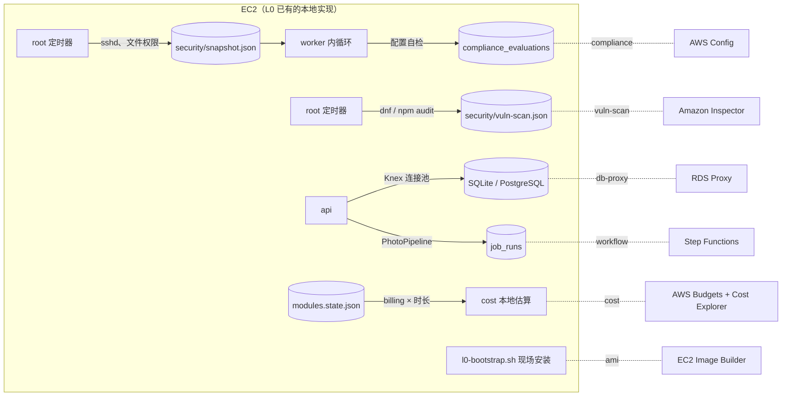
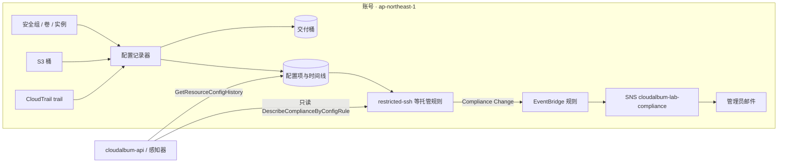
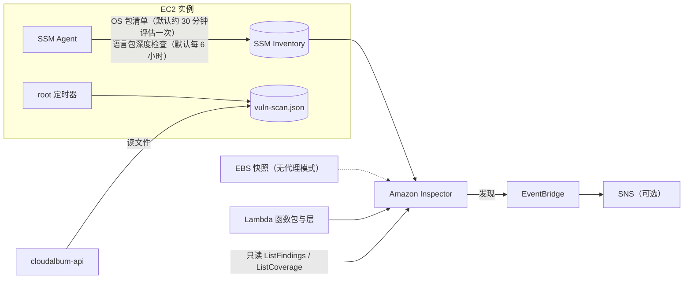
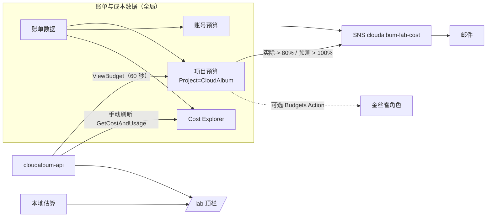
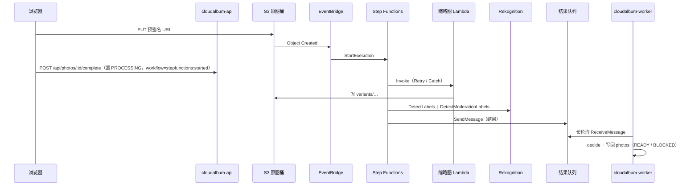
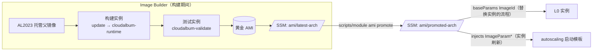

# F 组：治理、成本与扩展

本组 6 个模块是完整性评审建议、主设计者按 D11 拍板新增的模块。它们回答的问题不再是“业务功能由谁提供”，而是“这套系统本身是否被管好”：配置有没有漂移、违反基线（compliance ↔ AWS Config）；装的软件有没有已知漏洞（vuln-scan ↔ Amazon Inspector）；钱花在哪里、超支前谁来提醒（cost ↔ AWS Budgets）；数据库连接会不会被扩容打满（db-proxy ↔ Amazon RDS Proxy）；上传后的多个处理步骤由谁编排、出错时能不能看见重试（workflow ↔ AWS Step Functions）；新实例从“裸 AMI + 现场安装”启动，还是从预先烘焙的黄金镜像启动（ami ↔ EC2 Image Builder）。

在 L0（仅 EC2）下，这 6 个机能全部有可用的本地实现：worker 内的配置自检规则集、root 定时器执行的 `dnf` 安全公告与 `npm audit`、按 registry `billing` 字段与启用时长推导的计费资源清单（学员填写单价后才显示金额）、应用内 Knex 连接池（本地档：EC2 上自建 PgBouncer）、进程内的 `PhotoPipeline` 编排、`l0-bootstrap.sh` 现场安装。每启用一个模块，就把其中一项交给 AWS 托管服务，并能在 `/lab` 上看到前后差别。

本文遵循 [modular-design.md](../modular-design.md)（下称“总纲”）的框架，是 D10 规定的分组文档。总纲 3.2、3.3、5.2、6.2、10.x 已经为本组写下了开关、硬依赖、规则 DEP-032～035 与 MUTEX-005、感知器与探针要点、Lab 编排；本文是这些条目的展开，**只细化、不推翻**，需要总纲配合的地方列在文末“修订记录”。

- **ec2 基础契约不在本文定义。** 数据卷布局、`security/snapshot.json` 与 `security/vuln-scan.json` 的位置、root 定时器 `cloudalbum-security-snapshot.timer` / `cloudalbum-vuln-scan.timer`、`l0-bootstrap.sh` 的 `install` / `postattach` 两阶段、基础栈参数 `ImageId` 的固定方式（00 的 E1），统一以 [00-ec2-base.md](00-ec2-base.md) 与总纲第 2 节为准（D5、D6）。本文只声明各模块通过 `baseParams`、`hostSetup`、`injects` 改动什么，以及 `vuln-scan.sh` 的内容（00 已把它交给本文）。
- **锚点。** 每个模块的二级标题前有显式锚点（`#compliance`、`#vuln-scan`、`#cost`、`#db-proxy`、`#workflow`、`#ami`），registry 的 `doc` 字段写成 `docs/modules/06-governance-cost.md#<id>`（D10）。今后若把 db-proxy、workflow、ami 移回 03、04、01，只改 `doc` 字段。
- **每个模块的结构**严格按总纲附录 A（第 3 轮定稿，与 01～05 组一致）：“0. 元数据（registry 摘录）”，然后 1～9 节（基线实现、AWS 实现、开关与配置、依赖与组合、对比实验、切换迁移回滚、SAA 考点、费用与清理、常见坑），最后“10. 探针”（含感知器）与“11. 前端徽章”（含 `/lab` 卡片）。上一轮写在第 2 节末尾的“2.x 探针与感知器”与第 5 节末尾的“5.x 前端徽章”已分别移到第 10、11 节。

## 本组模块一览

“凭证”列取自 registry 的 `credentials` 字段（D1）：`required` = 开关取 AWS 值时应用必须调用 AWS API，`IAM_CREDENTIALS=none` 时触发 CRED-001（error）；`optional` = 应用只在控制面展示、感知器或刷新按钮里调用 AWS API，缺凭证时这些子功能关闭并给出 CRED-004（warn），模块照常工作。

| 模块 id | 机能 | 主 AWS 服务（辅助服务） | 开关（首个取值 = 本地实现 = 默认） | 类型 | 凭证 | 硬依赖（规则 ID） | 能否在 L0 上单独启用 | 所在 Lab |
|---|---|---|---|---|---|---|---|---|
| `compliance` | 配置合规与漂移检测 | AWS Config（托管规则、可选一致性包、EventBridge、模块自带 SNS 主题与交付桶） | `COMPLIANCE_MODE=local\|config` | I | optional | —（已有客户托管记录器时只读接入） | 能 | Lab 25（可选） |
| `vuln-scan` | 漏洞扫描 | Amazon Inspector（Systems Manager 托管节点与 Inventory、EventBridge、可选 SNS 主题） | `VULN_SCAN_MODE=dnf\|inspector` | I | required（必须 role） | iam(role)（DEP-035） | 否：{iam(role)} | Lab 25（可选） |
| `cost` | 费用护栏与告警 | AWS Budgets（Cost Explorer、成本分配标签、模块自带 SNS 主题） | `COST_MODE=local\|budgets` | I | optional | —（人工前置：激活成本分配标签、确认订阅） | 能 | **Lab 1**（与 iam 一起） |
| `db-proxy` | 数据库连接池 | Amazon RDS Proxy | `DB_PROXY_MODE=none\|pgbouncer\|rds-proxy`（本地档 pgbouncer） | A（Knex 连接目标特例） | required | `pgbouncer`：`DB_DRIVER=postgres`（DEP-033）；`rds-proxy`：iam、database(RDS)、secrets(secretsmanager)（DEP-032、033；IAM 端到端认证变体改为 DEP-036） | `none` 是；`pgbouncer` 需 `DB_DRIVER=postgres`（自建 PG 即可，不花钱）；`rds-proxy` 否：{iam, database, secrets} | Lab 15 扩展 |
| `workflow` | 照片处理流程编排 | AWS Step Functions（缩略图 Lambda、EventBridge 规则、模块自带 SQS 结果队列；Rekognition SDK 集成由 tagging 注入开启） | `WORKFLOW_DRIVER=inline\|stepfunctions` | A | required | iam、storage(s3)、工具链栈（DEP-034）；与 `IMAGE_PROCESSOR=lambda` 互斥（MUTEX-005） | 否：{iam, storage} + 工具链栈 | Lab 11 扩展 |
| `ami` | 启动镜像构建 | EC2 Image Builder（SSM 参数、Image Builder 托管的 AL2023 基础镜像、EBS 快照） | `AMI_SOURCE=userdata\|golden` | I | optional | —（每个所需架构都要有可用的已晋升黄金 AMI，DEP-037；单实例切换会替换实例） | 能（+ 一次停机窗口） | Lab 21 前置或扩展 |

**一个机能 ↔ 一个主服务（R3）**：db-proxy（RDS **Proxy**）与 database（RDS for PostgreSQL）同属 RDS 家族，按子服务区分；workflow 的主服务是 Step Functions，它自带的缩略图 Lambda、经 tagging 注入开启的 Rekognition 调用只是辅助服务（Lambda 的主机能仍归 image-processing，Rekognition 的主机能仍归 tagging）；ami 用到的 SSM 参数、Inspector 镜像扫描也只是辅助。compliance（Config）、vuln-scan（Inspector）、threat-detection（GuardDuty，05）、audit（CloudTrail，05）四者是考试中最常被拿来比较的一组，本组文档在各自第 7 节给出区分。

**本组共同约定**

**约定 1：与总纲的关系、类型与开关（D9、D10）**

- 6 个模块各有一个开关，第一个取值是本地实现，也是默认值（总纲 3.1）。compliance、vuln-scan、cost、ami 是纯基础设施型（I），开关是声明型开关：它不切换业务代码，只决定感知器的预期结果、capabilities 的展示，以及 root 定时器 / worker 内循环是否继续运行。db-proxy 是 Knex **连接目标**的特例（与 database 一样不设端口，总纲 4.3）；workflow 是应用适配器型，端口 `WorkflowPort`（`ports/workflow.ts`，驱动 `adapters/workflow/{inline,stepfunctions}.ts`）。
- `MODULE_<ID>=on` 只在开关取 AWS 值时写入 `modules.d/<id>.env` 的第一行（`MODULE_COMPLIANCE`、`MODULE_VULN_SCAN`、`MODULE_COST`、`MODULE_DB_PROXY`、`MODULE_WORKFLOW`、`MODULE_AMI`）。本组唯一的本地档是 db-proxy 的 `pgbouncer`：写入 `modules.d/db-proxy.env` 但不含 `MODULE_DB_PROXY=on`，由 `switch.localTiers: [pgbouncer]` 与 `selfHosted.match: { DB_PROXY_ENDPOINT: loopback }` 豁免 CFG-004。
- 各模块的 `ownsEnv`：compliance → `COMPLIANCE_`；vuln-scan → `VULN_SCAN_`；cost → `COST_`；db-proxy → `DB_PROXY_`（按总纲 3.5 的“最长前缀”从 database 的 `DB_` 中划出）；workflow → `WORKFLOW_`；ami → `AMI_`。L0 不写本组任何 env 文件，全部取 zod 默认值。

**约定 2：凭证是统一前置，不是模块依赖（D1）**

- 开关只有 iam 的 `IAM_CREDENTIALS=none|role|keys`。本组 `credentials: required` 的是 vuln-scan、db-proxy、workflow；`optional` 的是 compliance、cost、ami。CRED-001（error，退出码 78）、CRED-002（`keys` 时 warn）、CRED-004（optional 模块无凭证时 warn）由规则引擎统一生成，不写进 `requires`。
- vuln-scan 必须是 `role`（DEP-035）：Inspector 的基于代理的扫描依赖 SSM Agent 把实例注册为托管节点，而 SSM Agent 不读取 `secrets.env` 里的 `IAM_KEYS_*`（总纲 3.2 决定 6）。
- **账号级资源的创建者是部署者，不是应用。** Config 记录器、Inspector 的账号级激活、Budgets、Image Builder 管道都由 `scripts/module` 以部署者身份创建；应用角色 `CloudAlbumAppRole` 只拿到只读与本模块业务所需的最小权限（每个模块一条 `PolicyArn`）。cost 读取 Cost Explorer 时的全局端点、Budgets 的全局资源属于 CRED-003 的例外清单（总纲 5.2）。

**约定 3：策略与跨模块参数（D2）**

禁止 CloudFormation `Export` / `Fn::ImportValue`；模块栈只创建并输出 `PolicyArn`（`cloudalbum-<env>-<id>`，含业务权限与第 10 节所列探针权限），由 `scripts/module` 附加到 `CloudAlbumAppRole`（keys 模式附加到演示用户），附加关系记入 `.cloudalbum/state.json`。跨模块参数只用提供方在 registry 中声明的 `injects`。与本组有关的注入：

| 提供方 | 被注入的模块栈 | 参数 | 声明位置 |
|---|---|---|---|
| network | db-proxy | `VpcId`、`SubnetIds`（data 子网，至少两个 AZ） | 01 network（已声明） |
| network | ami | `VpcId`（构建实例的只出不进安全组）、`SubnetId`（构建实例所在子网：public 子网，或有 NAT 的 app 子网） | 01 network（已声明） |
| database | db-proxy | `DbInstanceIdentifier`、`DbSecretArn` | 03 database（已声明，参数名以本文为准） |
| db-proxy | database | `ClientSecurityGroupIds`（数据库安全组放行 Proxy 安全组的 5432）；`DB_PROXY_AUTH=iam` 时另注入 `IamDatabaseAuthentication=true` | 本文 db-proxy 第 0 节 |
| storage | workflow | `RawBucketName`、`MediaBucketName` | 03 storage（已声明） |
| tagging | workflow | `EnableRekognition=true` | 04 tagging（已声明，本文 workflow 接收） |
| kms | workflow、db-proxy、compliance、cost、vuln-scan、ami | `KmsKeyArn`（`target: "*"`；本组只用于给本模块的 SNS 主题、结果队列、黄金 AMI 快照加密，或授予解密 DbSecret 的权限） | 02 kms（已声明） |
| tracing | workflow | `Tracing=Active`（`TRACING_DRIVER=xray` 时；状态机 `TracingConfiguration` 与缩略图任务函数） | 05 tracing（已声明，本文 workflow 接收） |
| workflow | monitoring | `StateMachineArn`（告警维度：失败执行数） | 本文 workflow 第 0 节（05 monitoring 已接收） |
| ami | autoscaling | `ImageParamArm64`、`ImageParamX8664`（已晋升黄金 AMI 的 SSM 参数**名**） | 本文 ami 第 0 节（01 autoscaling 已接收：启动模板引用它们，为空时引用固定参数 `/cloudalbum/<env>/ec2/image-id`） |

`baseParams`：只有 ami 声明 `ImageId`（改为已晋升黄金 AMI 的参数名，触发 9.2 的“替换实例的流程”）。vuln-scan 不改基础栈；它让实例成为 SSM 托管节点所需的权限放在自己的 `PolicyArn` 里（附加到实例角色），与 shell-access 的做法相同。

**约定 4：本组相关的校验规则（统一编号，D3）**

全部规则只写在 `backend/src/rules/rules.ts` 一张表里，依赖只用 registry 的 `requires` / `conflicts` 表达式书写；结构或语义错误一律退出码 78，并一次性打印全部错误和修复命令。总纲 5.2 为本组编好 DEP-032～035 与 MUTEX-005；本文上一轮提出的 5 条规则（DEP-036、DEP-037、MUTEX-006、ASG-016、CFG-010）与 DEP-032 的修订条件已由总纲第 3 轮收录，下表与总纲 5.2 逐字一致：

| ID | 级别 | 可覆盖 | 范围 | 违规条件 | 说明 / 修复 | 状态 |
|---|---|---|---|---|---|---|
| CRED-001 | error | 否 | 启动 | vuln-scan(inspector)、db-proxy(rds-proxy)、workflow(stepfunctions) 之一已启用，而 `IAM_CREDENTIALS=none` | `scripts/module enable iam`（role） | 总纲已有 |
| CRED-004 | warn | — | 启动 | compliance、cost、ami 已启用，而 `IAM_CREDENTIALS=none` | 控制面展示关闭，感知器降为 observed / inferred | 总纲已有 |
| DEP-032（**修订条件**） | error | 否 | 启动 | `DB_PROXY_MODE=rds-proxy`，但 database 未启用（`DB_HOST` 不是 RDS）；或 **`DB_PROXY_AUTH=secrets`（默认）** 且 `SECRETS_DRIVER≠secretsmanager` | RDS Proxy 只能代理 RDS / Aurora；默认认证方式从 Secrets Manager 读取数据库凭证。`DB_PROXY_AUTH=iam`（2025-09 新能力）不需要 secrets，改由 DEP-036 约束 | 总纲已收录（第 3 轮修订条件） |
| DEP-033 | error | 否 | 启动 | `DB_PROXY_MODE≠none`，但 `DB_DRIVER≠postgres` | 连接池代理只对 PostgreSQL 有意义 | 总纲已有 |
| DEP-034 | error | 否 | 启动 / 部署 | `WORKFLOW_DRIVER=stepfunctions`，但 `STORAGE_DRIVER≠s3`，或工具链栈不存在 | 状态机由 S3 → EventBridge 启动；缩略图任务的部署包在工具链桶 | 总纲已有 |
| DEP-035 | error | 否 | 部署 | `VULN_SCAN_MODE=inspector`，但 `IAM_CREDENTIALS≠role` | 基于代理的 EC2 扫描与深度检查依赖 SSM 托管节点（无代理 / 混合模式见 vuln-scan 第 4 节） | 总纲已有 |
| MUTEX-005 | error | 否 | 启动 | `WORKFLOW_DRIVER=stepfunctions` 且 `IMAGE_PROCESSOR=lambda` | 状态机与缩略图 Lambda 消费同一个 S3 事件，会重复处理 | 总纲已有 |
| **DEP-036** | error | 否 | 启动 / 部署 | `DB_PROXY_MODE=rds-proxy` 且 `DB_PROXY_AUTH=iam`，但 database 未启用，或部署前检查发现 RDS 实例未开启 IAM 数据库认证、应用数据库用户未授予 `rds_iam` | 端到端 IAM 认证要求“客户端 → Proxy”与“Proxy → 数据库”两段都用 IAM；db-proxy 通过 `injects` 让 database 栈开启 IAM 认证，迁移步骤给用户授权（db-proxy 第 6 节） | 总纲已收录 |
| **DEP-037** | error | 否 | 部署 | `AMI_SOURCE=golden`，但某个所需架构（基础栈 `Arch`；autoscaling 混合实例覆盖中的每个架构）没有状态为 `AVAILABLE` 的**已晋升**黄金 AMI | 防止用错误架构的 AMI 替换实例，或在管道从未成功时切换；修复：`scripts/module ami build --arch <arch>` 后 `ami promote` | 总纲已收录 |
| **MUTEX-006** | error | 否 | 启动 | db-proxy 已启用（`MODULE_DB_PROXY=on`，即 RDS Proxy），但 `DB_PROXY_ENDPOINT` 是回环地址（本机 PgBouncer） | 与 MUTEX-002、MUTEX-003 同一模式：本地档 PgBouncer 与 RDS Proxy 二选一 | 总纲已收录 |
| **ASG-016** | warn | — | 启动 | `DEPLOY_MODE=asg` 且 `DB_PROXY_MODE=pgbouncer` | 每台实例各有一个 PgBouncer，总连接数仍随实例数线性增长——这正是 RDS Proxy 要解决的问题。**ASG-015 是作废编号，不复用**（统一值已把旧注释中的 ASG-015 改为 ASG-013，复用会让残留引用指向错误的规则） | 总纲已收录 |
| **CFG-010** | warn | — | 启动 | `/etc/cloudalbum/cost-rates.yaml` 存在，但某些条目缺少 `source`（官方定价页 URL）或 `retrievedAt`（抄录日期），或 `resource` 与 registry `billing.resource` 对不上 | 这些条目不参与金额估算，cost 卡片标注“单价未注明出处”；落实 D14“不编造价格”：金额只来自学员自己注明出处的抄录 | 总纲已收录 |

考虑过、但没有设为规则的情况（只在对应模块的第 4 节说明，避免把合法组合标成 `degraded`）：RDS Proxy 只能关联写实例，`DB_READ_HOST` 的只读副本连接不经过代理；workflow 启用而 tagging 仍是 `none` 时状态机跳过 Rekognition 分支；Inspector 深度检查的自定义路径没有覆盖 `/opt/cloudalbum-releases`（作为 vuln-scan 的 `preflight: inspector-deep-paths` 与感知器的 `degraded` 判据处理）。

**约定 5：机密（D5）**

- 本组模块都不新增 SecretName。db-proxy 的 `rds-proxy` 档从 Secrets Manager 读取 database 已有的 `db-password`（RDS 托管主密码，或 secrets 栈创建的 `cloudalbum/<env>/db-password`），应用照旧用 `SecretsPort('db-password')` 连代理。
- 本地档 PgBouncer 必须知道数据库密码。它的 `userlist.txt` 与 `pgbouncer.ini` 由 `ExecStartPre`（root）在每次启动时从 `secrets.env` 渲染到 **tmpfs** `/run/cloudalbum-pgbouncer/`（`pgbouncer` 用户 0600），不落在根卷或数据卷上；这属于总纲 1.4 D5 的“派生副本”例外（优先 `/run`、可按重放契约重新生成），leak-scan 会把它列出（与 cdn 的槽位文件 `slot-origin-verify.inc` 同类，01 cdn）。
- ami 的黄金镜像**不得包含**任何机密或本地配置：`install --bake` 只装软件包与发布包，`/etc/cloudalbum` 在烘焙时不存在（它是指向数据卷的符号链接，postattach 才建立）。
- compliance、cost、vuln-scan 的 SNS 主题、workflow 的结果队列不承载机密；需要加密时用 kms 注入的 CMK（SNS 主题若被 EventBridge、Budgets 发布，CMK 的密钥策略要允许对应服务主体，见各模块常见坑）。

**约定 6：运行时（D4）与本机事实的来源**

- workflow 的缩略图任务 Lambda 一律 `nodejs22.x`、arm64，复用 `packages/image-core`，经工具链栈的制品桶打包（总纲 9.1）；ami 的黄金镜像预装 AL2023 的 `nodejs22`，并执行 `alternatives --set node /usr/bin/node-22`，与 `l0-bootstrap.sh` 完全相同。
- 应用进程以 `cloudalbum` 用户运行，读不到 sshd 生效配置、软件包数据库等主机事实。本组的本地实现一律**只读** root 定时器产出的两个文件：`security/snapshot.json`（ec2 定义，compliance 读取其中的 `compliance` 段）与 `security/vuln-scan.json`（vuln-scan 定义内容，ec2 的定时器执行）。两者都是 `root:cloudalbum 0640`。

**约定 7：端口、权威分类与路径头（D9）**

- 权威：workflow（`WorkflowPort`，总纲 4.1 已标为权威：状态机或结果队列不可用时，`complete` 返回 503，不悄悄改回进程内编排）；db-proxy 没有端口，但经代理的连接失败按 database（权威）处理——返回 503，**不**悄悄改走直连 `DB_HOST`。compliance、vuln-scan、cost、ami 是纯基础设施型，只有感知器，故障只让本模块 `degraded` / `error`，不影响 `/api/health/ready`。
- `X-CloudAlbum-Path`：workflow 段取值 `inline:sync`、`inline:async`、`stepfunctions:started`（总纲 7.2 已收录，见 workflow 第 3 节）；db-proxy 不单独成段，体现在 database 段的主机类别上：`postgres@pgbouncer`、`postgres@rds-proxy`（总纲 7.2 已收录）。compliance、vuln-scan、cost、ami 不在请求路径上，不出现在路径头中，差异写在 capabilities 与 `/lab` 卡片里。
- 本组不新增 `X-Compare-Bypass` 键：workflow 属于“权威数据或全局状态”，只做切换前 / 切换后；db-proxy 另提供一个**只读的功能对照端点** `GET /api/lab/db-proxy/compare`（直连与经代理各执行一次 `select 1`，不碰业务数据；总纲 8.3 已登记）。

**约定 8：“谁创建谁清理”与只读接入**

compliance、vuln-scan、cost 涉及**账号级、区域级**的唯一资源或开关：Config 的客户托管记录器（每个账号每个区域一个）、Inspector 的账号级激活与深度检查自定义路径、成本分配标签的激活状态。约定：

1. `scripts/module enable` 先执行 `preflight`（`existing-config-recorder`、`existing-inspector`），发现已存在时**只读接入**：不创建、不修改，`state.json` 记 `createdBy: external`；本模块 `disable` 时原样保留。
2. 由本项目创建的，记 `createdBy: project`，`disable` 时按记录停止或删除；带有数据的（Config 交付桶、Inspector 发现历史）按总纲 9.1 的 `Retain` 处理，`--purge` 才删除。
3. 成本分配标签一旦激活就不在 `disable cost` 时停用：它影响整个账号的账单视图，停用会让 Cost Explorer 中按标签的历史分组出现断档。

**约定 9：Lab 顺序与预设档位（D11、D12）**

| Lab | 本组模块 | 所在预设 | 说明 |
|---|---|---|---|
| Lab 0 | （cost 的本地实现、compliance 与 vuln-scan 的本地实现在 L0 就运行） | l0-ec2 | 本地实现不花钱，`/lab` 顶栏从第一天起就显示“当前计费资源”；本地档 PgBouncer 可放进 l0-plus-local-tiers（`DB_PROXY_MODE=pgbouncer`，需自建 PG） |
| **Lab 1** | **cost**（与 iam 一起） | l1-ops | 成本护栏最先就位：L0 时只有本地估算；`COST_MODE=budgets` 后由 Budgets 发出实际与预测告警。人工前置：激活成本分配标签、确认订阅邮件 |
| Lab 11 扩展 | workflow | x-workflow | `IMAGE_PROCESSOR=worker`、`WORKFLOW_DRIVER=stepfunctions`（与 `IMAGE_PROCESSOR=lambda` 互斥） |
| Lab 15 扩展 | db-proxy | l6-data（`--with-optional`） | 先做本地档 PgBouncer，再换 RDS Proxy |
| Lab 21 前置或扩展 | ami | l8-ha（`--with-optional`） | 先单实例“替换实例”测启动耗时，再进 ASG 测扩容与实例刷新 |
| Lab 25（可选） | compliance、vuln-scan | l9-full（`--with-optional`） | 与 Lab 23 的 audit、threat-detection 形成“四个安全服务”对照 |

`profiles/single/<id>.env`：vuln-scan、db-proxy、workflow 自动并入 iam(role)；db-proxy(rds-proxy) 的最小集合是 {iam, database, secrets}，workflow 是 {iam, storage} + 工具链栈；cost 的“激活成本分配标签”、compliance 与 cost 的“确认订阅邮件”在冒烟矩阵中标为“需人工”。

**约定 10：数量与价格（D14）**

本文所有限额、价格和时延都只给定性描述和数量级；具体数值以官方文档与官方定价页为准。本文引用的新近事实都注明了核实日期（2026-10-13），集中列在文末修订记录。自 2025-07-15 起新注册的账号改为“免费计划 / 付费计划”与抵扣额度制，免费计划有期限且到期后需升级，老账号仍按原免费套餐（以官方 Free Tier 页面为准）；这直接影响 cost 模块的护栏设定，见 cost 第 9 节。




<a id="compliance"></a>
## compliance：配置合规与漂移检测 ↔ AWS Config

> 一句话总结：没有它时，worker 每 5 分钟按一张本地规则表给**这台实例**打分——sshd 是否允许密码登录、IMDSv2 是否强制、机密文件权限、`modules.d` 里有没有机密……但安全组、EBS 加密、S3 桶策略、CloudTrail 这些**账号层面**的配置，本机一概看不到，只能显示“未知”。启用后，AWS Config 记录项目资源的配置变化，用托管规则持续评估，不合规时经 EventBridge 发邮件，还能回放“这个安全组在什么时候被谁改成了 0.0.0.0/0”。最直观的区别：`/lab` 合规卡片上“未知（需要控制面）”的那一列被 Config 的评估结果填满；故意建一个开放 22 端口的金丝雀安全组，几分钟内收到不合规邮件，而本地自检毫无察觉。

### 0. 元数据（registry 摘录）

```yaml
# modules/registry.yaml 中 compliance 的条目（摘录；不一致时以 registry 为准，并同步本节）
compliance:
  group: F
  function: 配置合规与漂移检测
  awsService: AWS Config
  auxServices: [Config 托管规则, Config 一致性包（可选）, Amazon EventBridge, 模块自带 SNS 主题, 模块自带交付桶]
  type: infra
  switch: { var: COMPLIANCE_MODE, values: [local, config], ownedValues: [config], localTiers: [] }
  ownsEnv: [COMPLIANCE_]
  credentials: optional                  # 应用只读评估结果；记录器与规则由部署者创建
  prerequisites: [confirm-email]         # 不合规通知的订阅邮件需要人工确认
  requires: []                           # 没有模块级硬依赖
  soft: [audit, shell-access, storage, kms]   # audit：时间线关联 CloudTrail；storage(s3)：桶类规则才有评估对象
  conflicts: []
  authoritative: false
  multiInstanceSafe: { local: true, config: true }
  bypass: []
  stacks: [{ name: main, template: infra/modules/compliance.yaml }]
  preflight: [existing-config-recorder, policy-quota]
  detector: detectors/compliance.ts
  migration: null                        # 无业务数据
  billing:
    - { resource: "Config 记录的配置项", dimension: usage }
    - { resource: "Config 规则评估（逐条部署的规则）", dimension: usage }
    - { resource: "一致性包评估（一致性包内规则对资源的评估，与规则评估分开计价）", dimension: usage }
    - { resource: "交付桶中的配置快照与历史（S3）", dimension: usage }
  lab:
    summary:
      local: "worker 内的配置自检规则集：读 root 安全快照与应用配置，只看得到本机"
      aws: "AWS Config 记录项目资源配置，托管规则持续评估，不合规经 EventBridge → SNS 通知"
    compare: functional                  # 两侧同时运行，对照覆盖矩阵
    keyMetrics: ["可评估检查项数 / 未知项数", "金丝雀不合规的发现时延", "不合规项数（按严重程度）"]
    hourlyBilled: false
    diagram:
      before: "flowchart LR; SNAP[root 快照]-->CHK[本地自检]-->DB[(compliance_evaluations)]"
      after:  "flowchart LR; RES[SG/卷/桶/trail]-->REC[Config 记录器]-->RULES[托管规则]-->EB[EventBridge]-->SNS[邮件]"
    experiments: [coverage-matrix, ssh-canary, host-drift, tls-canary-bucket, timeline]
    badges: { local: "本地自检（只看得到本机）", aws: "AWS Config 规则", degraded: "合规评估不完整", error: "合规评估不可用" }
  doc: docs/modules/06-governance-cost.md#compliance
```

- 纯基础设施型（I），声明型开关 `COMPLIANCE_MODE`；`config` 时写 `MODULE_COMPLIANCE=on`。
- 本地自检**始终运行**（`config` 档也不停），这样 `/lab` 能把两侧结果并排放在同一张矩阵里，与 threat-detection“GuardDuty 启用后 fail2ban 继续运行”的做法一致（05）。

### 1. 基线实现（仅 EC2）

**本地配置自检规则集**：`backend/src/services/compliance-check.ts`（规则表）+ worker 内循环（默认每 300 秒，`COMPLIANCE_LOCAL_INTERVAL_SEC`）。主机类检查按实例执行（锁名带实例 ID），所以多实例时每台实例各评估自己；单实例时与总纲 2.6 的“LockPort 单例”等价。

- **输入（全部只读）**：`security/snapshot.json`（root 定时器每 2 分钟采集；本文需要 ec2 在其中增加 `compliance` 段：`sshd -T` 的 `passwordauthentication`、`permitrootlogin`、`pubkeyauthentication`，`/etc/cloudalbum` 是否为指向数据卷的符号链接，`secrets.env` 与 `keys/*.pem` 的属主和权限，Nginx 的 `server_tokens`）；ec2 探针的检查项（`imdsv2`、`time-sync`、`timers`）；进程内已加载的分层配置（`modules.d` 键名、`IAM_CREDENTIALS`、`EXPOSE_PATH_HEADERS`）；capabilities 的 `https.trusted`；`security/vuln-scan.json`（存在时）。
- **规则表**（编号 `C-Lnn`，每条给出“本地能否评估”和对照的 Config 托管规则；托管规则名称已于 2026-10-13 在官方列表中核对）：

| 编号 | 检查项 | 本地数据来源 | 严重程度 | 本地能否评估 | 对照的 Config 托管规则 |
|---|---|---|---|---|---|
| C-L01 | sshd 在监听，且允许密码登录或 root 登录 | 快照 `compliance.sshd` + `listening` | high | 能 | 无（Config 看不到操作系统内部） |
| C-L02 | 安全组对 `0.0.0.0/0` 开放 22 端口 | — | high | **未知**（安全组在实例外） | `restricted-ssh` |
| C-L03 | IMDSv2 强制 | ec2 探针 `imdsv2` | high | 能 | `ec2-imdsv2-check` |
| C-L04 | EBS 卷已加密 | — | high | **未知**（操作系统看不到卷是否加密） | `encrypted-volumes` |
| C-L05 | `/etc/cloudalbum` 指向数据卷；`secrets.env`、`keys/*.pem` 为 `root:cloudalbum 0640` | 快照 `compliance.files` | high | 能 | 无 |
| C-L06 | `modules.d` 中没有机密类键（CFG-002 的运行期复查） | 进程内配置 | high | 能 | 无 |
| C-L07 | 长期访问密钥落盘（`IAM_CREDENTIALS=keys`） | 进程内配置 | high | 能 | `access-keys-rotated`（只能看轮换周期，看不到密钥落在哪里） |
| C-L08 | 站点不是受信 HTTPS（`https.trusted=false`，且不是 localhost） | capabilities | medium | 能 | `alb-http-to-https-redirection-check` 等（只覆盖 ALB / CloudFront） |
| C-L09 | 本地备份 26 小时内成功过 | `backup/last-run.json` | medium | 能 | 无（AWS Backup 有自己的规则，可选） |
| C-L10 | 有待安装的安全更新 | `security/vuln-scan.json` | medium | 能（文件不存在时“未知”） | 无（属于 vuln-scan / Inspector） |
| C-L11 | fail2ban 在运行 | 快照 `fail2ban` | low | 能 | 无 |
| C-L12 | 时间已同步 | ec2 探针 `time-sync` | low | 能 | 无 |
| C-L13 | `EXPOSE_PATH_HEADERS=all` 且站点是 HTTPS 公网域名（SEC-004） | 进程内配置 | low | 能 | 无 |
| C-L14 | S3 桶强制 TLS、禁止公开读 | — | high | **未知**（需要 S3 控制面） | `s3-bucket-ssl-requests-only`、`s3-bucket-public-read-prohibited` |
| C-L15 | CloudTrail 已开启 | — | medium | **未知** | `cloudtrail-enabled` |
| C-L16 | 项目资源带 `Project` 标签 | IMDS 实例标签（只看得到本实例） | low | 部分 | `required-tags` |

- **评分**：只对“能评估”与“部分”的项计分（high 3 分、medium 2 分、low 1 分；“部分”项在卡片上注明只覆盖本实例），“未知”项单独计数并显示原因。按上表，L0 下是“可评估 12 项（其中 C-L16 只看本实例）、未知 4 项（C-L02、C-L04、C-L14、C-L15）”——这一列“未知”正是 Config 要填补的部分。
- **漂移记录**：每条检查项的**状态变化**（而不是每次评估）写入表 `compliance_evaluations`（`rule_id、resource、status、source=local|config、evaluated_at、detail`；由 `db/migrations` 创建，SQLite 与 PostgreSQL 都可），`/lab` 据此画“本机配置漂移时间线”。实例被替换后历史仍在数据库里，但主机事实从新实例重新开始采集。
- **通知**：high 级检查项从合规变为不合规时，给管理员写站内信并调用 EmailPort（outbox 或 ses），与本地告警评估器同一条送达路径（05 约定 4）。
- **只检测，不修复**：自检器以 `cloudalbum` 用户运行，没有权限改 sshd 或文件权限；卡片上给出修复命令，由运维执行。
- L0 下 `/api/capabilities` 返回 `compliance = { driver: 'local', status: 'off', localHealth: 'ok', detail: '本地自检：可评估 12 项，合规 10 项；未知 4 项（需要控制面）' }`（数字只是示例）。

### 2. AWS 实现

**栈** `infra/modules/compliance.yaml`（栈名 `cloudalbum-<env>-compliance`）：

| 资源 | 关键配置 |
|---|---|
| `AWS::Config::ConfigurationRecorder`（条件 `CreateRecorder=true`） | 只记录与本项目有关的资源类型（参数 `ResourceTypes`，默认 `AWS::EC2::SecurityGroup`、`AWS::EC2::Instance`、`AWS::EC2::Volume`、`AWS::S3::Bucket`、`AWS::RDS::DBInstance`、`AWS::CloudTrail::Trail`）；`RecordingMode.RecordingFrequency` 参数化：`CONTINUOUS`（默认，变化即记录）或 `DAILY`（每 24 小时最多一个配置项，便宜但发现慢）；记录器角色用 Config 的服务关联角色（不存在时由 `scripts/module` 先创建） |
| 交付桶 `cloudalbum-<env>-config-<acct>` + 桶策略（条件同上） | 只允许 `config.amazonaws.com` 写入本账号前缀；`BucketOwnerEnforced`、阻止公共访问、强制 TLS；生命周期只设过期；`DeletionPolicy: Retain` |
| `AWS::Config::DeliveryChannel`（条件同上） | 指向交付桶；配置快照周期参数化 |
| `AWS::Config::ConfigRule` × 8（名称前缀 `cloudalbum-<env>-`） | 托管规则：`restricted-ssh`、`ec2-imdsv2-check`、`encrypted-volumes`、`s3-bucket-ssl-requests-only`、`s3-bucket-public-read-prohibited`、`rds-storage-encrypted`、`cloudtrail-enabled`（周期触发）、`required-tags`（`tag1Key=Project`）；`Source.SourceIdentifier` 取官方规则页列出的 Identifier（例如 `s3-bucket-public-read-prohibited` 对应 `S3_BUCKET_PUBLIC_READ_PROHIBITED`）；支持标签范围的规则设 `Scope: {TagKey: Project, TagValue: CloudAlbum}`，避免评估账号里与本项目无关的资源 |
| `AWS::Config::ConformancePack`（条件 `UseConformancePack=true`，默认 false） | 把同样 8 条规则打成一致性包，作为“规则逐条部署 vs 一致性包”的考点对照；二者不同时启用 |
| `AWS::Config::RemediationConfiguration`（条件 `CanaryRemediation=true`） | 只挂在 `restricted-ssh` 上，`Automatic: false`，目标文档 `AWS-DisablePublicAccessForSecurityGroup`（SSM Automation，名称以官方文档为准），修复角色在本栈；**只在实验中对金丝雀安全组手动执行**（第 5 节） |
| `AWS::Events::Rule` | `source: aws.config`、`detail-type: Config Rules Compliance Change`、`newEvaluationResult.complianceType: NON_COMPLIANT`、`configRuleName` 前缀为本项目 → 目标为本模块的 SNS 主题 |
| SNS 主题 `cloudalbum-<env>-compliance` + 邮件订阅（`AlertEmail`） | 主题策略允许 `events.amazonaws.com` 发布；需要加密时用 kms 注入的 CMK（AWS 托管的 `aws/sns` 不行） |
| 托管策略（`PolicyArn`） | `config:DescribeConfigurationRecorders`、`DescribeConfigurationRecorderStatus`、`DescribeConfigRules`、`DescribeComplianceByConfigRule`、`GetComplianceDetailsByConfigRule`、`GetResourceConfigHistory`（时间线）；`sns:GetTopicAttributes`（订阅确认状态） |

**Outputs**：`EnvComplianceMode = config`、`EnvComplianceRecorder = created|external`、`EnvComplianceRulePrefix`、`EnvComplianceTopicArn`、`InfoRecorderName`、`InfoDeliveryBucket`、`InfoConformancePackName`、`PolicyArn`。

**已有记录器时只读接入**：每个账号每个区域只能有一个**客户托管**的配置记录器（另外还可能有由其他服务管理的“服务关联记录器”，它们的设置只能经对应服务修改；2026-10-13 核实官方文档）。`preflight: existing-config-recorder` 发现已有客户托管记录器时，栈参数 `CreateRecorder=false`：不建记录器、交付通道与交付桶，只建规则、EventBridge 规则与 SNS 主题；`EnvComplianceRecorder=external`。如果现有记录器没有记录规则所需的资源类型，规则不会产生评估结果，感知器把本模块标为 `degraded` 并写明缺哪些类型——**不**去修改别人的记录器。



**应用侧**：感知器 `backend/src/modules/detectors/compliance.ts`；管理员接口 `GET /api/lab/compliance`（合并后的覆盖矩阵：每个 `C-Lnn` 的本地结果 + 对应 Config 规则的结果）、`GET /api/lab/compliance/timeline?resource=<id>`（Config 资源时间线；有 audit 模块时附上相关 CloudTrail 事件的链接）。结果缓存 60 秒，避免频繁调用控制面。

### 3. 开关与配置

```bash
# L0：没有 modules.d/compliance.env；COMPLIANCE_MODE 默认 local，以下本地参数取 zod 默认值
# COMPLIANCE_LOCAL_INTERVAL_SEC=300
```

```bash
# /etc/cloudalbum/modules.d/compliance.env（scripts/module enable compliance 写入；root:cloudalbum 0640）
MODULE_COMPLIANCE=on
MODULE_COMPLIANCE_VERSION=1
COMPLIANCE_MODE=config
COMPLIANCE_RECORDER=created                  # created | external（只读接入已有记录器）
COMPLIANCE_RULE_PREFIX=cloudalbum-lab-
COMPLIANCE_TOPIC_ARN=arn:aws:sns:ap-northeast-1:123456789012:cloudalbum-lab-compliance
COMPLIANCE_LOCAL_INTERVAL_SEC=300            # 本地自检在 config 档继续运行
```

zod：`COMPLIANCE_MODE` 在 Core 的声明型开关中；`COMPLIANCE_LOCAL_INTERVAL_SEC`、`COMPLIANCE_RECORDER`、`COMPLIANCE_RULE_PREFIX`、`COMPLIANCE_TOPIC_ARN` 已由总纲 4.4 的 `InfraOptions` 收录（第 3 轮）；`config` 档要求 `COMPLIANCE_RULE_PREFIX` 非空、`COMPLIANCE_RECORDER ∈ {created, external}`。

CloudFormation 参数：`Env`、`ModuleVersion`、`CreateRecorder`（由 preflight 决定）、`ResourceTypes`、`RecordingFrequency=CONTINUOUS|DAILY`、`UseConformancePack=false`、`CanaryRemediation=false`、`AlertEmail`、`KmsKeyArn`（kms 注入）。

本模块不投放 Nginx 片段与 systemd drop-in；主机侧只依赖 ec2 的 root 安全快照（需要 ec2 增加 `compliance` 段，见修订记录）。

### 4. 依赖与组合

**硬依赖**：无。L0 + compliance 即可运行，控制面展示需要凭证（`credentials: optional`，缺凭证时 CRED-004）。部署者需要 `config:*` 中创建规则、记录器、交付通道的权限，以及创建 Config 服务关联角色的权限。

| 组合 | 行为变化 |
|---|---|
| + shell-access | 启用后基础栈 `SshIngressCidr` 置空：Config 时间线上能看到实例安全组的 22 端口规则被删除（前提是 compliance 早于 shell-access 启用；按默认 Lab 顺序 Lab 2 远早于 Lab 25，记录器启动前的变化 Config 看不到，所以第 5 节的时间线实验改用金丝雀安全组）；`restricted-ssh` 本来就只认 `0.0.0.0/0`（管理员 IP/32 不算违规），这是“规则口径”的考点 |
| + storage(s3) | 两条桶规则才有评估对象；storage 栈已经强制 TLS，所以 `s3-bucket-ssl-requests-only` 预期合规 |
| + kms | 卷、RDS、桶的加密规则与 kms 的 `KMS_APPLY_TO` 对照：`encrypted-volumes` 只看“是否加密”，不区分 AWS 托管密钥还是 CMK |
| + audit | Config 资源时间线中的变更可以链接到 CloudTrail 事件，回答“谁改的”；Config 回答“改成了什么、是否违规”，CloudTrail 回答“谁、何时、调用了什么 API”（考点） |
| + threat-detection、vuln-scan | 四个安全服务分工不同：Config 管配置合规，GuardDuty 管威胁行为，Inspector 管软件漏洞，CloudTrail 管 API 审计；`/lab` 的 F 组面板把四者并排 |
| + network | 私有子网时应用调用 `config` API 需要 NAT 或对应 Interface Endpoint（DEP-009 的出网检查）；Config 自身的记录不经过你的 VPC |
| + autoscaling | 主机类检查在每台实例上各自运行（结果带实例 ID）；Config 的 `ec2-imdsv2-check` 对整组实例统一评估——集中视图是 Config 的优势 |

### 5. 对比实验：有 vs 没有

| 维度 | 没有 Config（本地自检） | 有 Config |
|---|---|---|
| 看得见什么 | 本机操作系统与应用配置（sshd、文件权限、IMDS、应用开关） | 被记录的 AWS 资源配置（安全组、卷、桶、trail、RDS）；看不到操作系统内部 |
| 安全组 22 对全网开放 | 看不到（“未知”） | `restricted-ssh` 分钟级变为不合规（CONTINUOUS 记录时） |
| sshd 改成允许密码登录 | 下一个评估周期（数分钟）内发现 | 看不到 |
| 历史 | 本机检查项的状态变化 | 每个资源的配置时间线，可关联 CloudTrail |
| 实例被替换后 | 主机事实从新实例重新开始 | 不受影响 |
| 通知 | 站内信 + EmailPort（实例宕机则沉默） | EventBridge → SNS（与实例无关） |
| 修复 | 人工 | 修复配置（SSM Automation），可手动或自动 |
| 多实例 / 多账号 | 每台各自评估 | 集中评估；聚合器与组织级一致性包（了解） |
| 费用 | 无 | 按记录的配置项与规则评估计费 |

**页面上能直接看到的差异**

- `/lab` 合规卡片是一张覆盖矩阵：行是 `C-L01～C-L16`，列是“本地自检”“AWS Config”。L0 时右列全部灰色；启用后 C-L02、C-L04、C-L14、C-L15 等“未知”格被填上，而 C-L01、C-L05、C-L06 等只有左列有结果——两者互补，而不是替代。
- 管理后台“安全与合规”徽章：“本地自检评分 10/12” → “AWS Config 规则：合规 7 · 不合规 1”（数字只是示例）。

**测量指标**：可评估项数与未知项数；金丝雀从创建到收到邮件的时延；本机漂移从发生到被发现的时延；每条规则的评估次数（来自 Config 控制台，用于理解计费维度）。

**操作步骤**（`experiments/compliance/`）

1. 覆盖矩阵：`npm run exp -- compliance --label before --scenario coverage-matrix`（L0），启用后 `--label after`。场景只调用 `GET /api/lab/compliance` 并保存矩阵快照；报告逐格对比。
2. SSH 金丝雀（只动实验自己创建的资源）：`faults/open-ssh-canary.sh` 用部署者身份在本 VPC 建安全组 `cloudalbum-<env>-canary-ssh`（入站 22 来自 `0.0.0.0/0`，打 `Project=CloudAlbum` 标签，不挂到任何实例），记录时间 T0；运行器轮询 `GET /api/lab/compliance` 直到 `restricted-ssh` 出现该资源，同时记录邮件到达时间（人工记录）。然后用 `aws configservice start-remediation-execution` **只对这个安全组**执行修复（`CanaryRemediation=true` 时），观察它回到合规；最后删除金丝雀。基线对照：同样的操作在 L0 下本地自检完全看不到。
3. 主机漂移：`faults/sshd-password-on.sh`（经投递通道以 root 执行）放入 `/etc/ssh/sshd_config.d/99-canary.conf`（`PasswordAuthentication yes`）并 `sshd -t && systemctl reload sshd`，记录本地自检发现的时延；Config 侧没有变化。实验结束立即删除该文件并 reload。
4. 桶的 TLS 金丝雀（可选，不依赖 storage）：`faults/tls-canary-bucket.sh` 建一个**不带** `aws:SecureTransport` 拒绝语句的空桶（保持阻止公共访问，并打 `Project=CloudAlbum` 标签，否则落不进规则的标签范围），观察 `s3-bucket-ssl-requests-only` 不合规；实验后删除。不做“把桶改成公开”的演练：账号级阻止公共访问会挡住它，而且风险与收益不对等。
5. 时间线：查看第 2 步金丝雀安全组的 Config 时间线，`GET /api/lab/compliance/timeline?resource=<canary-sg-id>`：创建 → 加入 22/0.0.0.0/0 规则 → 修复删除该规则，三个配置项依次出现；有 audit 时点开关联的 CloudTrail 事件（`CreateSecurityGroup`、`AuthorizeSecurityGroupIngress`、修复角色的 `RevokeSecurityGroupIngress`）。不用 Lab 2 的 shell-access 做时间线：按默认顺序那时 Config 记录器还不存在（只有在 Lab 2 之前就启用 compliance 的学员才能回看那一次变化）。

**预期结果**（定性）

- 覆盖矩阵：本地只覆盖主机侧；Config 只覆盖 AWS 资源侧；两侧交集很小（IMDSv2 是少数两边都能看到的项）。
- SSH 金丝雀：CONTINUOUS 记录下，配置变更通常在分钟级被记录并评估，邮件随后到达（具体时延以实测为准）；`DAILY` 记录时可能要到下一个记录周期。本地自检始终看不到。
- 主机漂移：本地自检在一个评估周期内发现；Config 看不到操作系统内部——这正是“Config 不是主机加固工具”的直观证据。

**对比方式**：功能对比（两侧同时运行），不涉及业务流量，没有运行时 A/B。

### 6. 切换、数据迁移与回滚

- **enable**：`preflight: existing-config-recorder`（决定 `CreateRecorder`）→ 必要时创建 Config 服务关联角色 → 部署栈 → 附加 `PolicyArn` → 写 `compliance.env` → 重启 → 探针等到记录器 `recording=true` 且规则出现首轮评估（首轮评估需要一些时间，探针超时前为 `degraded` 属正常）→ 提醒确认订阅邮件。
- **disable**：删除规则、EventBridge 规则与 SNS 主题；`COMPLIANCE_RECORDER=created` 时停止并删除本项目创建的记录器与交付通道，交付桶按 `Retain` 保留（`--purge` 才清空删除）；`external` 时完全不碰现有记录器。`compliance_evaluations` 表原地保留。
- **数据**：无业务数据迁移。回滚就是 disable；本地自检从未停止，所以切回后没有空窗。

### 7. SAA 考点

- Config、CloudTrail、CloudWatch 的分工：配置与合规（是什么状态、是否违规）/ API 审计（谁做了什么）/ 指标与日志（运行得怎样）。
- 配置记录器：每账号每区域一个客户托管记录器；记录的资源类型；全局资源类型（如 IAM）只在一个区域记录以避免重复；`CONTINUOUS` 与 `DAILY` 记录频率的取舍。
- 规则：托管规则与自定义规则（Lambda、Guard）；触发方式（配置变更触发与周期触发）；规则范围（资源类型、标签）。
- 一致性包（Conformance Pack）与组织级部署；聚合器（Aggregator）汇总多账号多区域。
- 修复：修复配置调用 SSM Automation 文档，手动或自动；自动修复的副作用（会改动别的栈管理的资源，引起 CloudFormation 漂移）。
- Config 是**检测型**控制；预防型控制是 SCP、IAM、S3 阻止公共访问等。
- 与 Security Hub 的关系（汇总 Config、GuardDuty、Inspector 等的发现，了解）。

### 8. 费用与清理

- 计费维度：记录的配置项数量（`CONTINUOUS` 与 `DAILY` 单价不同；`DAILY` 下每个资源每天最多一个配置项）、逐条部署的规则评估次数、**一致性包评估次数**（一致性包内规则对资源的评估，在定价页上是独立于规则评估的计费项，2026-10-13 核实官方定价页）、交付桶的 S3 存储与请求、SNS 邮件。**不按小时计费**，但 CONTINUOUS 记录高频变化的资源类型会持续产生费用，所以本模块只记录与项目有关的少数类型；单价见官方定价页。
- 清理：`scripts/module disable compliance`（只删除本项目创建的东西）；`--purge` 清空并删除交付桶。之后在 Config 控制台确认没有遗留的本项目规则；若曾创建记录器，确认已删除，避免继续按配置项计费。

### 9. 常见坑

- **每个区域只有一个客户托管记录器**。账号里已有记录器（例如由 Control Tower 或安全团队创建）时，删除或修改它会破坏别人的合规体系；本模块只读接入（约定 8）。
- 记录器没有记录规则所需的资源类型时，规则不会报错，只是一直没有评估结果——看起来像“全部合规”。感知器专门检查这一点。
- 记录全部资源类型、用 CONTINUOUS 频率，在资源变化频繁的账号里费用会明显上升；学习环境限定资源类型，或改用 `DAILY`。
- 全局资源类型在多个区域重复记录会重复计费。
- 自动修复会改动别的模块栈管理的资源（例如基础栈的安全组），下一次栈更新又会改回去，形成拉锯；本项目只对实验自己的金丝雀资源手动修复。
- `restricted-ssh` 只检查对 `0.0.0.0/0`（及 IPv6 全网）开放的 22 端口；对管理员 IP/32 开放不算违规——不要误以为“合规 = 22 端口关闭”。
- EventBridge 发布到加密的 SNS 主题时，CMK 的密钥策略必须允许 `events.amazonaws.com`；`aws/sns` 托管密钥不能用于这种场景。
- 交付桶如果用 SSE-KMS，Config 的服务关联角色需要对该密钥的使用权限；交付桶不要开启“仅限 TLS 以外”的苛刻策略而忘了放行 Config 服务主体。
- 部分规则（如 `cloudtrail-enabled`）是账号级的周期规则，不支持按标签限定范围。
- Config 评估存在时延，不能当作实时阻断手段。
- 托管规则的名称、Identifier、参数以官方规则页为准（本文的规则名于 2026-10-13 核对）。

### 10. 探针

| 信号 | 方法 | 说明 |
|---|---|---|
| 被动（请求头） | — | 不在请求路径上 |
| 本机 | 最近一次本地评估的时间、评分、未知项数 | `local` 与 `config` 两档都有 |
| 控制面（常规，60 秒） | `config:DescribeConfigurationRecorderStatus`（`recording=true`、最近状态 `SUCCESS`）；`DescribeComplianceByConfigRule`（本项目规则的合规 / 不合规 / 数据不足计数） | 无凭证时降为 `inferred`（CRED-004） |
| 控制面（深度） | `GetComplianceDetailsByConfigRule`（不合规资源清单）；`DescribeConfigurationRecorders`（记录的资源类型是否覆盖规则所需） | 管理员 `?deep=1` |

| 状态 | 判据 |
|---|---|
| `off` | `COMPLIANCE_MODE=local`；本地自检的健康放在 `localHealth`（快照超过 5 分钟未更新时为 `degraded`，检查项改记“未知”） |
| `ok` | 记录器在记录，规则都有评估结果 |
| `degraded` | 记录器停止或最近一次记录失败；有规则处于“数据不足”（记录器未覆盖所需资源类型）；订阅未确认；无凭证（CRED-004） |
| `error` | 控制面确认本项目规则不存在，或 AccessDenied |

注意：**发现不合规不会让模块变成 `degraded`**。模块状态描述的是“合规评估这件事是否在正常工作”；不合规项数写在 `detail` 与卡片上，high 级不合规另在 `/lab` 顶部显示提示条。所需权限全部在本模块 `PolicyArn` 中。

### 11. 前端徽章

| 位置 | 本地实现（local） | AWS 实现（config） | 数据来源 |
|---|---|---|---|
| `/lab` F 组 compliance 卡片 | 灰色“本地自检 · 可评估 12 / 未知 4” | 橙色“AWS Config · 规则 8 条 · 不合规 1” | capabilities：compliance |
| 管理后台 · 安全与合规 | 本地自检评分 | AWS Config 规则合规状态 | 总纲 12.3 |
| `/lab` 顶部提示条 | high 级本地检查项不合规时出现 | high 级规则不合规时出现 | `/api/lab/compliance` |

registry `lab.badges`：`{ local: "本地自检（只看得到本机）", aws: "AWS Config 规则", degraded: "合规评估不完整", error: "合规评估不可用" }`。卡片的“本地实现 / AWS 实现”两行取自 `lab.summary`。


<a id="vuln-scan"></a>
## vuln-scan：漏洞扫描 ↔ Amazon Inspector

> 一句话总结：没有它时，root 定时器每天在本机执行一次 `dnf updateinfo` 与 `npm audit`，把“这台实例的系统包、发布包里的 npm 依赖有哪些已知漏洞”写进 `security/vuln-scan.json`；扫描范围只有这一台机器，节奏是一天一次，还要实例能访问软件仓库和 npm registry。启用后，Amazon Inspector 在账号层面持续扫描本项目的 EC2 实例和 Lambda 函数，新漏洞公布时自动重新评估，还给出“哪些端口从互联网可达”的网络可达性发现。最直观的区别：`/lab` 漏洞卡片从“本机 · 昨天 03:30 扫描 · 待修复 N 项”变成“Inspector · 持续扫描 · EC2 1 台 + Lambda 4 个”，并且多了 Lambda 函数和网络可达性两栏。

### 0. 元数据（registry 摘录）

```yaml
# modules/registry.yaml 中 vuln-scan 的条目（摘录）
vuln-scan:
  group: F
  function: 漏洞扫描
  awsService: Amazon Inspector
  auxServices: [Systems Manager（托管节点、Inventory，Inspector 自动创建的 SSM 关联）, Amazon EventBridge, 模块自带 SNS 主题（可选）]
  type: infra
  switch: { var: VULN_SCAN_MODE, values: [dnf, inspector], ownedValues: [inspector], localTiers: [] }
  ownsEnv: [VULN_SCAN_]
  credentials: required                  # 必须是 role（DEP-035）
  prerequisites: [ssm-managed-node]
  requires:
    - { rule: DEP-035, when: { VULN_SCAN_MODE: inspector }, need: ["IAM_CREDENTIALS=role"] }
  soft: [shell-access, image-processing, workflow, social-api, ami]   # Lambda 类模块启用后才有函数可扫
  conflicts: []
  authoritative: false
  multiInstanceSafe: { dnf: true, inspector: true }
  bypass: []
  stacks: [{ name: main, template: infra/modules/vuln-scan.yaml }]
  preflight: [existing-inspector, inspector-deep-paths, policy-quota]
  detector: detectors/vuln-scan.ts
  migration: null
  billing:
    - { resource: "Inspector EC2 扫描（按实例计）", dimension: usage }
    - { resource: "Inspector Lambda 扫描（按函数计；代码扫描另计）", dimension: usage }
  lab:
    summary:
      local: "root 定时器每天执行 dnf 安全公告与 npm audit，只扫本机与发布包"
      aws: "Amazon Inspector 持续扫描本项目的 EC2 与 Lambda，并给出网络可达性发现"
    compare: functional
    keyMetrics: ["扫描覆盖的对象数", "从漏洞出现到被发现的时延", "按严重程度的待修复数"]
    hourlyBilled: false
    diagram:
      before: "flowchart LR; T[root 定时器]-->D[dnf updateinfo]; T-->N[npm audit]; D-->J[(vuln-scan.json)]; N-->J"
      after:  "flowchart LR; SSM[SSM Agent 清单]-->I[Inspector]; L[Lambda 包]-->I; I-->F[发现]; F-->EB[EventBridge]"
    experiments: [coverage-matrix, canary-package, time-to-detect, network-reachability]
    badges: { local: "本机扫描（dnf + npm audit）", aws: "Amazon Inspector 持续扫描", degraded: "扫描覆盖不完整", error: "漏洞扫描不可用" }
  doc: docs/modules/06-governance-cost.md#vuln-scan
```

- 纯基础设施型（I），声明型开关 `VULN_SCAN_MODE`；`inspector` 时写 `MODULE_VULN_SCAN=on`。本地扫描由 ec2 的 `cloudalbum-vuln-scan.timer` 执行，**`inspector` 档也继续运行**，作为对照。

### 1. 基线实现（仅 EC2）

**root 定时器**：`cloudalbum-vuln-scan.timer`（ec2 安装，每天一次，`OnCalendar` 带 `Asia/Tokyo`）执行 `/usr/local/lib/cloudalbum/vuln-scan.sh`（脚本内容归本模块，00 第 6.5 节）。脚本以 root 运行、幂等、失败不影响业务：

1. **系统包**：`dnf -q updateinfo list --security`（本机已安装的包中有安全公告的更新）与 `dnf check-release-update`（是否有更新的 AL2023 发布版本）。AL2023 的软件仓库默认**锁定在 AMI 对应的发布版本**，所以前者只能看到锁定版本内的更新，后者提示“仓库之外还有更新的版本”（以 AL2023 官方文档为准）。
2. **应用依赖**：对发布包 `/opt/cloudalbum/backend` 执行 `npm audit --omit=dev --json`（只看生产依赖；以非特权用户运行，不执行任何安装脚本）；对发布包中随附的 Lambda 代码锁文件（`/opt/cloudalbum/lambda/*/package-lock.json`，如 image-processing、workflow 的任务包）做同样的静态审计。`npm audit` 需要访问 npm registry；访问不到时该项记为 `error`，不影响系统包部分。
3. **输出**：原子写入 `security/vuln-scan.json`（`root:cloudalbum 0640`）：

```json
{
  "schemaVersion": 1,
  "generatedAt": "2026-10-13T03:30:12+09:00",
  "host": {
    "instanceId": "i-0123456789abcdef0",
    "releasever": "2023.x.yyyymmdd",
    "newerReleasever": "2023.x.yyyymmdd 或 null",
    "dnf": { "advisories": [{ "id": "ALAS2023-…", "severity": "important", "packages": ["…"] }], "error": null }
  },
  "npm": [
    { "project": "/opt/cloudalbum/backend", "counts": { "critical": 0, "high": 0, "moderate": 0, "low": 0 }, "advisories": [], "error": null },
    { "project": "/opt/cloudalbum/lambda/workflow-tasks", "counts": {}, "advisories": [], "error": null }
  ]
}
```

（示例只说明结构，不是真实结果。）

- **按需扫描**：管理员在 `/lab` 点“立即扫描”时，应用在 `security/`（2770，`cloudalbum` 组可写）中写入 `vuln-scan.request`，由 path 单元 `cloudalbum-vuln-scan.path` 触发同一个服务（需要 00 增加这个 path 单元，见修订记录）。应用自己不获得 root 权限。
- **只检测，不修复**：卡片给出修复建议（升级到新的发布版本、升级 npm 依赖后重新发布），由运维执行。
- L0 下 `/api/capabilities` 返回 `vuln-scan = { driver: 'dnf', status: 'off', localHealth: 'ok', detail: '本机扫描 · 2026-10-13 03:30 · 系统包公告 2 条 · npm 高危 0' }`；扫描文件超过 26 小时未更新时 `localHealth=degraded`。

### 2. AWS 实现

Inspector 的“启用”是**账号级、区域级**的开关，不是某个 CloudFormation 资源。因此本模块分两部分：

**带外操作**（`scripts/module` 以部署者身份执行，记入 `state.json`）：

1. `preflight: existing-inspector`：`inspector2 batch-get-account-status` 查看本区域 EC2 / Lambda 扫描是否已经启用。已启用 → 只读接入（`VULN_SCAN_ACTIVATION=external`），不改动任何账号设置。
2. 未启用 → `aws inspector2 enable --resource-types EC2 LAMBDA`（`VULN_SCAN_ACTIVATION=project`）。官方用户指南写明首次激活时账号自动进入**混合扫描模式**：SSM 托管实例走基于代理的扫描，其余符合条件（EBS 支撑、ext3/ext4/xfs、卷数与总容量在上限内）的实例每 24 小时做一次基于 EBS 快照的无代理扫描（无代理扫描 2024-04 正式可用）。同一页面另有“新激活账号默认为基于代理模式”的表述，二者不一致，`scripts/module` 激活后用 `inspector2 get-configuration` 读出实际的扫描模式写入 `state.json`，以它为准（2026-10-13 核实官方文档）。
3. `preflight: inspector-deep-paths`：深度检查（扫描编程语言包）默认只看 `/usr/lib`、`/usr/lib64`、`/usr/local/lib`、`/usr/local/lib64`，不包含本项目的 `/opt/cloudalbum-releases`。项目激活时用 `update-ec2-deep-inspection-configuration --package-paths /opt/cloudalbum-releases` 加入自定义路径（每个账号最多 5 条，2026-10-13 核实）；只读接入时只提示，不改别人的设置。

**栈** `infra/modules/vuln-scan.yaml`（栈名 `cloudalbum-<env>-vuln-scan`）：

| 资源 | 关键配置 |
|---|---|
| 托管策略（`PolicyArn`，附加到实例角色） | ① 读 Inspector：`inspector2:BatchGetAccountStatus`、`ListCoverage`、`ListFindings`、`ListFindingAggregations`、`GetEc2DeepInspectionConfiguration`；② 让实例成为 SSM 托管节点并支持深度检查：参照 AWS 托管策略 `AmazonSSMManagedInstanceCore` 的最小集合（`ssm:UpdateInstanceInformation`、关联与清单相关的 `ssm:*` 动作、`ssmmessages:*`、`ec2messages:*`），外加深度检查要求的 `ssm:PutInventory`、`ssm:GetParameter`（以官方文档为准）。与 shell-access 的策略有重叠，重复授予无害 |
| `AWS::Events::Rule`（条件 `HasNotify`） | `source: aws.inspector2`、`detail-type: Inspector2 Finding`、`severity: [HIGH, CRITICAL]`、资源标签 `Project=CloudAlbum` → 本模块 SNS 主题 |
| SNS 主题 `cloudalbum-<env>-vuln-findings` + 邮件订阅（条件 `HasNotify`） | 可选；主题策略允许 `events.amazonaws.com` |

**Outputs**：`EnvVulnScanMode = inspector`、`EnvVulnScanTopicArn`（可空）、`InfoConsoleUrl`、`PolicyArn`；`scripts/module` 另写入 `VULN_SCAN_ACTIVATION`、`VULN_SCAN_DEEP_PATHS`（带外操作的结果）。

**扫描对象**：本区域**所有** EC2 实例与 Lambda 函数（Inspector 的激活是账号级的）；应用侧只展示带 `Project=CloudAlbum` 标签的资源：本实例（以及 ASG 实例）、image-processing / workflow / social-api 的函数与 auth、secrets 的内联函数。

**应用侧**：感知器 `backend/src/modules/detectors/vuln-scan.ts`；管理员接口 `GET /api/lab/vuln-scan`（本地结果与 Inspector 发现并排）。查询按 `resourceTags` 过滤，结果缓存 5 分钟。



### 3. 开关与配置

```bash
# L0：没有 modules.d/vuln-scan.env；VULN_SCAN_MODE 默认 dnf；本地扫描由 ec2 的定时器执行，不需要任何配置
```

```bash
# /etc/cloudalbum/modules.d/vuln-scan.env（scripts/module enable vuln-scan 写入）
MODULE_VULN_SCAN=on
MODULE_VULN_SCAN_VERSION=1
VULN_SCAN_MODE=inspector
VULN_SCAN_ACTIVATION=project                 # project | external（账号里原本就启用了 Inspector）
VULN_SCAN_RESOURCE_TYPES=ec2,lambda
VULN_SCAN_DEEP_PATHS=/opt/cloudalbum-releases
VULN_SCAN_TOPIC_ARN=                         # 可选
```

CloudFormation 参数：`Env`、`ModuleVersion`、`NotifyEmail`（空 = 不建主题）、`MinSeverity=HIGH`、`KmsKeyArn`（kms 注入）。

主机侧：`vuln-scan.sh` 的内容（本节第 1 节）随发布包更新；定时器与（建议新增的）path 单元归 ec2。本模块不投放 Nginx 片段与 drop-in。

### 4. 依赖与组合

**硬依赖**：iam 且为 `role`（DEP-035）。理由：基于代理的扫描与深度检查都依赖 SSM Agent 把实例注册为托管节点，而 SSM Agent 只使用实例配置文件（或账号级的默认主机管理配置）的凭证，不读应用的 `IAM_KEYS_*`。

- **关于无代理 / 混合模式**：2024 年起 Inspector 可以对未被 SSM 管理的实例做基于 EBS 快照的无代理扫描（混合模式下每 24 小时一次，并且扫描所有路径的语言包，不受深度检查路径限制）。也就是说，混合模式下即使 `IAM_CREDENTIALS=none`，L0 实例也会被扫描——只是应用读不到结果。本项目仍保留 DEP-035，原因有三：持续扫描（新软件、新 CVE 即时重评）只有基于代理的方式才有；扫描模式由账号设置决定，不能假定一定是混合模式；`/lab` 的“覆盖”对比以基于代理的扫描为准。DEP-035 的“依赖 SSM 托管节点”前提在新能力下可以放宽，这一点与总纲 DEP-035 的注释一致（以官方文档为准）。官方还推出了“增强型 EC2 扫描”（Inspector VM Scanner）等新的扫描方式，本文不依赖它们。
- 部署者需要 `inspector2:Enable`、`UpdateEc2DeepInspectionConfiguration` 等权限；Inspector 首次启用会创建服务关联角色。

| 组合 | 行为变化 |
|---|---|
| + shell-access | 二者都让实例成为托管节点；shell-access 已启用时托管节点早已在线，vuln-scan 的覆盖几乎立即生效 |
| + image-processing(lambda)、workflow、social-api(lambda) | 这些模块的函数自动进入 Lambda 扫描范围；本地扫描只能静态审计随发布包附带的锁文件，看不到实际部署的函数版本 |
| + ami | 黄金 AMI 越旧，新实例一启动就带着越多待修复漏洞；Image Builder 可以在构建时用 Inspector 扫描镜像（ami 第 4 节），管道应定期重建 |
| + autoscaling | 新扩出来的实例自动进入覆盖范围；本地扫描是每台实例各自一份文件 |
| + network(private) | 本地 `npm audit` 需要访问 npm registry，没有 NAT 时该项失败；SSM 需要 `ssm`、`ssmmessages`、`ec2messages` 端点或 NAT（DEP-009 的出网检查） |
| + compliance | C-L10 读取本地扫描文件；Inspector 的发现不进入 Config 规则（二者职责不同） |
| + threat-detection | GuardDuty 回答“有没有人在攻击”，Inspector 回答“有没有可被利用的漏洞”，两者互补 |

### 5. 对比实验：有 vs 没有

| 维度 | 没有 Inspector（dnf + npm audit） | 有 Inspector |
|---|---|---|
| 扫描对象 | 本实例的系统包；发布包里的 npm 生产依赖（含随附的 Lambda 锁文件，静态） | 本项目所有 EC2（含 ASG 新实例）与已部署的 Lambda 函数和层 |
| 节奏 | 每天一次，或手动触发 | 基于代理：持续——新实例启动、安装新软件、新 CVE 入库时自动重新评估；OS 包清单默认约每 30 分钟评估一次，语言包（深度检查）清单默认每 6 小时采集一次。无代理：每 24 小时一次。网络可达性：每 12 小时一次（2026-10-13 核实官方文档） |
| 漏洞来源 | AL2023 安全公告（受发布版本锁定影响）、npm 安全公告 | Inspector 的漏洞情报，附评分与是否可利用等上下文 |
| 网络可达性 | 无 | EC2 网络可达性发现：哪些端口经哪条路径从互联网可达 |
| 前提 | 实例能访问软件仓库与 npm registry | SSM 托管节点（或无代理模式的快照）；账号级激活 |
| 多实例 | 各扫各的 | 集中视图 |
| 动作 | 只检测 | 只检测；可经 EventBridge 驱动自动化（如 Patch Manager，了解） |
| 费用 | 无 | 按实例、按函数计费；新激活通常有试用期（以官方为准） |

**页面上能直接看到的差异**

- `/lab` 漏洞卡片：左栏“本机扫描”（生成时间、系统包公告数、npm 各级漏洞数），右栏“Inspector”（覆盖的实例数与函数数、按严重程度的发现、网络可达性）；同一漏洞两侧都发现时并排标出。
- 管理后台“安全与合规”徽章：“dnf 安全公告 2 条” → “Amazon Inspector 发现：高危 1 · 中危 3”。

**测量指标**：覆盖对象数（实例、函数、语言包目录）；金丝雀包从植入到被发现的时延；同一时刻两侧的漏洞计数差异。

**操作步骤**（`experiments/vuln-scan/`）

1. 覆盖矩阵：L0 下 `npm run exp -- vuln-scan --label before --scenario coverage-matrix`（调用 `GET /api/lab/vuln-scan` 保存快照）；启用并等待首轮扫描完成后 `--label after`。
2. 金丝雀包：`faults/plant-canary.sh` 在 `/opt/cloudalbum-releases/canary/` 写入一个只声明依赖的 `package.json`，依赖版本取实验 README 指定的、在 GitHub Advisory Database 中**已公开通告存在漏洞**的旧版本，用 `npm install --ignore-scripts --omit=dev` 安装（不执行任何脚本，不被应用加载）。然后分别触发本地扫描（`vuln-scan.request`）、等待 Inspector 下一次**深度检查**清单采集（npm 包属于语言包，默认每 6 小时一次；不建议为了实验把关联 `InvokeInspectorLinuxSsmPlugin-do-not-delete` 的间隔调短，官方提示可能超出每日清单上限），记录两侧发现的时间。实验结束执行 `faults/remove-canary.sh` 删除目录，观察两侧发现关闭的时间。
3. 新漏洞公布的时延：无法人为制造，改为观察——启用后保持一周，记录 Inspector 的发现中“首次发现时间晚于实例启动时间”的条目，与本地每天一次的结果对照。
4. 网络可达性（`network-reachability`）：按默认 Lab 顺序，L0 实例的 22 端口在 Lab 2 就已关闭，所以改用临时实例。`experiments/vuln-scan/reachability-canary.ts` 以部署者身份在同一子网启动一台最小规格的 AL2023 临时实例（不带密钥对、不挂实例角色），挂上 compliance 实验同款的金丝雀安全组（入站 22 来自 `0.0.0.0/0`，打 `Project=CloudAlbum` 标签）；等待下一轮网络可达性扫描（每 12 小时一次）出现“22 端口可从互联网经 IGW 访问”的发现后立即终止实例并删除安全组，观察发现随之关闭。本地扫描没有这一维度。只在 Lab 2 之前就启用了 vuln-scan 的学员，可以直接对照 L0 实例关闭 22 端口前后的发现。

**预期结果**（定性）

- 本地扫描在植入后的下一次运行（手动触发则几分钟内）发现金丝雀；Inspector 在下一次深度检查清单采集与评估后发现（语言包默认每 6 小时采集一次）。差别不在“谁更快”，而在**覆盖面与持续性**：Inspector 同时覆盖所有实例与函数，并在新漏洞公布时无需重新扫描就能更新结论。
- 没有加自定义路径时，Inspector 发现不了 `/opt/cloudalbum-releases` 下的金丝雀，`vuln-scan` 为 `degraded`——这是本模块最重要的“坑”之一。

**对比方式**：功能对比（两侧同时运行），没有运行时 A/B。

### 6. 切换、数据迁移与回滚

- **enable**：计划校验（DEP-035 要求 role）→ `preflight: existing-inspector` → 部署栈、附加 `PolicyArn`（实例角色因此获得托管节点权限）→ 等待实例在 SSM 中 `PingStatus=Online` → 账号未启用时 `inspector2 enable` → 设置深度检查路径 → 写 `vuln-scan.env` → 重启 → 探针等待本实例覆盖状态为 `ACTIVE`（首轮扫描需要一段时间，期间为 `degraded`）。
- **disable**：`VULN_SCAN_ACTIVATION=project` 时，提示“Inspector 的停用是账号级的，会停止本区域所有实例与函数的扫描”，确认后执行 `inspector2 disable` 并恢复原来的深度检查路径；`external` 时完全不动账号设置。分离 `PolicyArn`（若 shell-access 未启用，实例随之不再是托管节点），删除栈。
- **数据**：无业务数据迁移；本地扫描文件保留。Inspector 的历史发现随停用而关闭（以官方文档为准）。

### 7. SAA 考点

- Inspector、GuardDuty、Macie、Config、Detective、Security Hub 的区分：漏洞 / 威胁 / 敏感数据 / 配置合规 / 调查 / 汇总。
- Inspector（新版）对 EC2 的扫描依赖 SSM Agent（基于代理），以及基于 EBS 快照的无代理扫描；ECR 镜像扫描与 Lambda 函数扫描；扫描是持续的，不需要手动发起评估。
- Inspector Classic（旧版，需要安装 Inspector 代理、按评估模板运行）已于 2026-05-20 停止支持（2026-10-13 核实官方迁移页）；题库中涉及“评估模板、Inspector 代理”的说法属于旧版。
- 发现经 EventBridge 驱动自动化；修补由 Systems Manager Patch Manager 完成（Inspector 只发现，不修补）。
- 网络可达性分析与安全组、NACL、路由的关系。
- 黄金 AMI 的漏洞管理：Image Builder 管道定期重建并扫描。

### 8. 费用与清理

- 计费维度：按被扫描的 EC2 实例（按月折算）、Lambda 函数，Lambda 代码扫描另计；新激活通常有试用期，单价与试用规则见官方定价页。**账号级激活意味着本区域所有实例与函数都会被扫描和计费**，不仅是本项目的资源。
- 清理：`scripts/module disable vuln-scan`；由本项目激活的，在 Inspector 控制台确认本区域 EC2、Lambda 扫描已停用；确认深度检查路径已恢复。

### 9. 常见坑

- **深度检查默认不扫 `/opt`**：基于代理的深度检查默认只看 `/usr/lib`、`/usr/lib64`、`/usr/local/lib`、`/usr/local/lib64`，应用依赖装在 `/opt/cloudalbum-releases` 下，不加自定义路径就扫不到（每个账号最多 5 条自定义路径）。无代理扫描反而扫描所有路径，所以同一台实例在托管 / 未托管两种状态下的发现可能不同（官方文档明确提示）。
- AL2023 的**发布版本锁定**：`dnf updateinfo` 只看锁定版本内的更新，而 Inspector 可能报告“只在更新的发布版本中修复”的漏洞，两侧计数不一致属正常；升级到新发布版本要显式操作（以 AL2023 官方文档为准）。
- `npm audit` 需要访问 npm registry；私有子网没有 NAT 时只有系统包部分有结果。不要为了让它工作而在实例上配置外部代理凭证。
- keys 模式下 SSM Agent 不使用应用的访问密钥，实例永远不会成为托管节点，所以 DEP-035 直接拒绝。
- Inspector 激活是账号级的：在共享账号里启用会扫描并计费别人的资源；停用也会影响别人。本模块默认只读接入已有激活。
- 无代理扫描基于 EBS 快照；卷使用 CMK 加密时，快照访问需要相应的密钥权限（以官方文档为准）。
- 网上很多教程针对的是 Inspector Classic（安装代理、创建评估模板），与新版完全不同。
- 黄金 AMI 构建得越早，新实例启动时带的待修复漏洞越多；“镜像构建后就不管”是常见反模式。
- Lambda 运行时（`nodejs22.x`）是否在 Inspector 的支持列表中、语言包类型的支持范围，以官方“支持的操作系统与编程语言”页面为准。

### 10. 探针

| 信号 | 方法 | 说明 |
|---|---|---|
| 本机 | `security/vuln-scan.json` 的生成时间、各部分 `error` | 两档都有 |
| 控制面（常规，60 秒） | `inspector2:BatchGetAccountStatus`（EC2、LAMBDA 为 `ENABLED`）；`ListCoverage`（本实例 `scanStatus` 为 `ACTIVE`、扫描类型；本项目函数的覆盖情况） | |
| 控制面（深度） | `ListFindingAggregations`（按严重程度计数）；`GetEc2DeepInspectionConfiguration`（自定义路径是否包含 `/opt/cloudalbum-releases`） | 管理员 `?deep=1` |

| 状态 | 判据 |
|---|---|
| `off` | `VULN_SCAN_MODE=dnf`；`localHealth` 看扫描文件新鲜度 |
| `ok` | 账号状态 `ENABLED`，本实例与本项目函数都在覆盖范围内 |
| `degraded` | 本实例未被覆盖（不是托管节点，且未走无代理扫描）；深度检查路径不含 `/opt/cloudalbum-releases`；本地扫描文件过期 |
| `error` | 账号状态为未启用或已暂停；AccessDenied |

与 compliance 相同：**发现漏洞不会让模块变成 `degraded`**，漏洞数写在 `detail` 与卡片上。

### 11. 前端徽章

| 位置 | 本地实现（dnf） | AWS 实现（inspector） | 数据来源 |
|---|---|---|---|
| `/lab` F 组 vuln-scan 卡片 | 灰色“本机扫描 · 昨天 03:30 · 公告 2 · npm 高危 0” | 橙色“Inspector · EC2 1 · Lambda 4 · 高危 1” | capabilities：vuln-scan |
| 管理后台 · 安全与合规 | dnf 安全公告 | Amazon Inspector 发现 | 总纲 12.3 |

registry `lab.badges`：`{ local: "本机扫描（dnf + npm audit）", aws: "Amazon Inspector 持续扫描", degraded: "扫描覆盖不完整", error: "漏洞扫描不可用" }`。


<a id="cost"></a>
## cost：费用护栏与告警 ↔ AWS Budgets

> 一句话总结：没有它时，应用根据 registry 里每个模块声明的计费维度（`billing`）和模块启停记录，列出“现在有哪些按小时计费的资源、各开了多久”，某个按小时计费的资源长时间开着又没人做实验时提醒管理员；只有学员自己从官方定价页抄录了单价（注明出处与日期）时才显示估算金额。它能**立即**看到“RDS 刚被打开”，但看不到真实账单。启用后，AWS Budgets 按 `Project=CloudAlbum` 成本分配标签和账号总额各建一个月度预算，实际花费超过阈值或**预测**会超支时发邮件和 SNS 通知；Cost Explorer 按模块标签给出真实费用分布。最直观的区别：`/lab` 顶栏的“当前计费资源：ElastiCache 节点 ×1（已开 3 小时）”旁边多出“本月实际 / 预测 / 预算”三个数，以及一封真正来自 AWS 的预算告警邮件——但它们比本地清单晚了几个小时。

### 0. 元数据（registry 摘录）

```yaml
# modules/registry.yaml 中 cost 的条目（摘录）
cost:
  group: F
  function: 费用护栏与告警
  awsService: AWS Budgets
  auxServices: [AWS Cost Explorer, 成本分配标签, 模块自带 SNS 主题]
  type: infra
  switch: { var: COST_MODE, values: [local, budgets], ownedValues: [budgets], localTiers: [] }
  ownsEnv: [COST_]
  credentials: optional                  # 预算由部署者创建；应用只读预算与（手动刷新时）Cost Explorer
  prerequisites: [cost-allocation-tag, confirm-email]
  requires: []
  soft: []
  conflicts: []
  authoritative: false
  multiInstanceSafe: { local: true, budgets: true }
  bypass: []
  stacks: [{ name: main, template: infra/modules/cost.yaml }]   # 预算是全局资源；栈部署在 AWS_REGION（CRED-003 例外：cost 的全局类资源）
  preflight: [cost-allocation-tag-active, policy-quota]
  detector: detectors/cost.ts
  migration: null
  billing:
    - { resource: "启用了 Actions 的预算（每月前两个免费，之后按天计费；普通预算的监控与通知免费）", dimension: usage }
    - { resource: "Cost Explorer API 请求", dimension: request }
  lab:
    summary:
      local: "按 registry 计费维度 × 模块启用时长列出计费资源；学员注明出处抄录单价后才估算金额；长时间空开时提醒"
      aws: "AWS Budgets 按项目标签与账号总额设月度预算，实际与预测超阈值时邮件 + SNS 告警；Cost Explorer 按模块标签看真实费用"
    compare: functional
    keyMetrics: ["计费资源出现在清单中的时延", "费用出现在 Budgets / Cost Explorer 中的时延", "无标签费用占比"]
    hourlyBilled: false
    diagram:
      before: "flowchart LR; REG[registry billing]-->EST[本地估算]; MS[(modules.state.json)]-->EST; EST-->BAR[/lab 顶栏/]"
      after:  "flowchart LR; BILL[账单数据]-->BUD[Budgets]-->SNS[邮件 / SNS]; BILL-->CE[Cost Explorer]-->BAR[/lab 顶栏/]"
    experiments: [visibility-lag, tag-coverage, threshold-alert, idle-reminder, budget-action-canary]
    badges: { local: "本地估算（不是账单）", aws: "AWS Budgets 预算", degraded: "预算数据不完整", error: "预算不可用" }
  doc: docs/modules/06-governance-cost.md#cost
```

- 纯基础设施型（I），声明型开关 `COST_MODE`；`budgets` 时写 `MODULE_COST=on`。本地估算**始终运行**（`budgets` 档也继续），二者并排展示“即时但不准”与“准确但滞后”。
- 按 D11 提前到 **Lab 1**，与 iam 一起做：它不依赖任何其他模块，只要部署者身份就能创建，是后续所有按小时计费模块之前的护栏。

### 1. 基线实现（仅 EC2）

**输入（只读）**：

- 发布包内置的 registry（`modules/registry.json`）中每个模块的 `billing` 条目（`resource`、`dimension: hour|usage|request`、`hourly`），以及 ec2 基础模块自己的 `billing`（实例、公网 IPv4、EBS 等，00 第 1 节）。
- 实例侧的 `/etc/cloudalbum/modules.state.json`（`scripts/module` 维护，总纲 2.4）：每个模块的当前驱动、`enabledAt`，以及本月的启停历史 `history[]`（本文要求的字段，见修订记录）。本地档（自建 PG、PgBouncer、memory 缓存等）没有 AWS 费用，不进入清单。
- 可选的 `/etc/cloudalbum/cost-rates.yaml`（学员从官方定价页抄录，**项目不提供任何默认单价**）：

```yaml
# /etc/cloudalbum/cost-rates.yaml（可选；root:cloudalbum 0640，实际位于数据卷）
currency: USD
region: ap-northeast-1
entries:
  - resource: "RDS 实例（Multi-AZ 备库与只读副本各按一个实例计）"   # 必须与 registry billing.resource 逐字一致
    unit: hour
    rate: <学员从官方定价页抄录>
    source: https://aws.amazon.com/rds/postgresql/pricing/
    retrievedAt: 2026-10-01
```

缺 `source` 或 `retrievedAt`、或 `resource` 对不上 registry 的条目不参与估算（CFG-010，warn）。

**计算**（`backend/src/services/cost-estimate.ts`，总纲 §11 已列出该文件）：

1. **计费资源清单**：当前已启用（开关取 AWS 值）的模块中 `hourly: true` 的条目 + ec2 基础条目，逐行显示“资源、所属模块、已连续启用时长、本月累计小时”。`dimension: usage|request` 的条目只显示“按用量计费，本机无法估算”。
2. **估算金额**（仅当 `cost-rates.yaml` 中有合格条目）：`rate × 本月累计小时`，只对按小时计费的部分，标注“估算 · 单价来源 … · 抄录于 …”；没有合格条目时显示“未填写单价，不显示金额”。
3. **资源小时预算**（本地的“预算”）：可选 `COST_LOCAL_HOURS_BUDGET`（单位“计费资源·小时”，由学员自定，例如“本月最多 100 资源小时”），达到 80% 与 100% 时提醒。它度量的是“开了多久”，不是钱，所以不涉及价格。
4. **空开提醒**：worker 内循环（LockPort 单例，每 10 分钟）发现某个按小时计费的资源已连续启用超过 `COST_LOCAL_IDLE_HOURS`（默认 4 小时），且这段时间内没有实验运行（`lab_results`、LabMetricsStore 的 run 记录）时，给管理员写站内信并调用 EmailPort，每个资源每天最多一次；`/lab` 顶部出现黄色提示条“RDS 实例已启用 6 小时，最近 4 小时没有实验。练完可以 `scripts/module profile apply l0-ec2`”。

**局限（也是对比点）**：只知道经 `scripts/module` 启用的本项目模块，看不到控制台手工创建的资源、数据传输与请求类费用、税费、抵扣额度，也看不到账号里其他项目的花费；实例停机时提醒也随之停止。

L0 下 `/api/capabilities` 返回 `cost = { driver: 'local', status: 'off', localHealth: 'ok', detail: '当前按小时计费的资源：EC2 实例 ×1、公网 IPv4 ×1（已启用 52 小时；未填写 cost-rates.yaml，不显示金额）' }`；该 `detail` 同时显示在 `/lab` 顶栏（总纲 8.1、12.2）。

### 2. AWS 实现

**栈** `infra/modules/cost.yaml`（栈名 `cloudalbum-<env>-cost`）：

| 资源 | 关键配置 |
|---|---|
| SNS 主题 `cloudalbum-<env>-cost` + 邮件订阅（`AlertEmail`） | 主题策略允许 `budgets.amazonaws.com` 执行 `SNS:Publish`，并以 `aws:SourceAccount` 限定本账号；需要加密时用 kms 注入的 CMK，并在密钥策略中允许 Budgets 使用（以官方文档为准） |
| `AWS::Budgets::Budget`：`cloudalbum-<env>-project-monthly` | `BudgetType: COST`、`TimeUnit: MONTHLY`；金额取参数 `ProjectBudgetLimit`（**没有默认值**，由学员按自己的承受能力填写）；按成本分配标签 `Project=CloudAlbum` 筛选（标签筛选的写法以 CloudFormation 模板参考为准）；`CostTypes` 中**不计入抵扣额度**（见常见坑）；通知：实际花费 > 80%、预测花费 > 100%，订阅者为邮件 + SNS 主题 |
| `AWS::Budgets::Budget`：`cloudalbum-<env>-account-monthly` | 不筛选，金额取参数 `AccountBudgetLimit`；兜住没有标签的费用与账号里的其他花费；通知同上 |
| `AWS::Budgets::BudgetsAction` 与金丝雀角色 `cloudalbum-<env>-cost-canary`（条件 `EnableBudgetAction=true`，默认 false） | 动作类型“附加 IAM 策略”：超过阈值时把一条拒绝策略附加到**金丝雀角色**（本项目没有任何组件使用它）；Budgets 执行角色只被允许操作这个角色。只用于演示 Budgets Actions，**绝不**指向 `CloudAlbumAppRole` 或 L0 实例 |
| 托管策略（`PolicyArn`） | `budgets:ViewBudget`（读取预算的实际与预测金额）、`ce:GetCostAndUsage`、`ce:GetCostForecast`、`ce:ListCostAllocationTags`（检查标签是否已激活）、`sns:GetTopicAttributes`；Budgets 与 Cost Explorer 走全局端点（SDK 客户端区域为 us-east-1，以官方文档为准） |

**Outputs**：`EnvCostMode = budgets`、`EnvCostBudgetNames`、`EnvCostTopicArn`、`EnvCostTagKey = Project`、`EnvCostTagValue = CloudAlbum`、`InfoBudgetsConsoleUrl`、`PolicyArn`。

**带外操作**（`scripts/module`，部署者身份，记入 `state.json`）：

1. **激活成本分配标签** `Project` 与 `Module`（所有模块栈都以栈级标签带上它们，总纲 9.1）：`aws ce update-cost-allocation-tags-status`。在 AWS Organizations 中只有管理账号能激活。官方说明：给资源打上标签后，最多约 24 小时标签键才出现在可激活列表，激活后最多再约 24 小时生效（2026-10-13 核实）。`preflight: cost-allocation-tag-active` 在标签未生效时只警告、不阻止部署，项目预算在标签生效前会显示为 0——这本身就是对比点。
2. Cost Explorer 需要先在账号中启用（首次启用后要等一段时间才有数据，以官方文档为准）。

**应用侧**：感知器 `backend/src/modules/detectors/cost.ts`；`GET /api/lab/cost`（本地清单 + 两个预算的实际 / 预测 / 上限）；`POST /api/lab/cost/refresh`（仅管理员，调用一次 `ce:GetCostAndUsage`，本月按天、按 `Module` 标签分组，结果缓存 12 小时）。Cost Explorer API 按请求计费，所以 `COST_CE_QUERY=manual`（默认）时只有手动刷新才调用，绝不轮询。



### 3. 开关与配置

```bash
# L0：没有 modules.d/cost.env；COST_MODE 默认 local；以下本地参数取 zod 默认值
# COST_LOCAL_IDLE_HOURS=4
# COST_LOCAL_HOURS_BUDGET=          # 空 = 不设资源小时预算
# COST_RATES_FILE=/etc/cloudalbum/cost-rates.yaml
```

```bash
# /etc/cloudalbum/modules.d/cost.env（scripts/module enable cost 写入）
MODULE_COST=on
MODULE_COST_VERSION=1
COST_MODE=budgets
COST_BUDGET_NAMES=cloudalbum-lab-project-monthly,cloudalbum-lab-account-monthly
COST_TOPIC_ARN=arn:aws:sns:ap-northeast-1:123456789012:cloudalbum-lab-cost
COST_TAG_KEY=Project
COST_TAG_VALUE=CloudAlbum
COST_CE_QUERY=manual                  # manual | off（Cost Explorer API 按请求计费，不轮询）
COST_LOCAL_IDLE_HOURS=4               # 本地空开提醒在 budgets 档继续运行
```

CloudFormation 参数：`Env`、`ModuleVersion`、`ProjectBudgetLimit`（必填，无默认）、`AccountBudgetLimit`（必填，无默认）、`AlertEmail`、`ActualThresholdPercent=80`、`ForecastThresholdPercent=100`、`EnableBudgetAction=false`、`KmsKeyArn`（kms 注入）。

本模块不投放主机产物。`scripts/module enable cost` 在确认步骤中会提示学员填写两个预算金额，并说明“金额请根据自己的承受能力决定；本项目不提供参考价格”。

### 4. 依赖与组合

**硬依赖**：无。L0 + cost 即可运行；控制面展示需要凭证（`credentials: optional`）。人工前置：激活成本分配标签（`cost-allocation-tag`）、确认订阅邮件（`confirm-email`）；部署者需要 `budgets:*`（创建预算与动作）、`ce:UpdateCostAllocationTagsStatus` 权限；IAM 身份能否在控制台查看账单页面，取决于账号是否开启了“IAM 用户和角色访问账单信息”（以官方文档为准）。

| 组合 | 行为变化 |
|---|---|
| 任何按小时计费的模块（database、cache、db-proxy、load-balancer、network 的 NAT / Interface Endpoint、autoscaling…） | 启用瞬间出现在本地清单；数小时到一天后才出现在 Budgets 与 Cost Explorer。cost 是“早于它们启用”的护栏，所以排在 Lab 1 |
| + monitoring | 二者都发告警，但维度不同：monitoring 看运行指标，cost 看钱；CloudWatch 的 `EstimatedCharges` 账单告警是旧做法（只在 us-east-1、需开启账单告警），作为考点对照 |
| + autoscaling | 扩容会让实例小时数增加；本地清单按 ASG 的期望容量计实例数（来自 InstanceLifecyclePort），Budgets 则看实际账单 |
| + compliance | `required-tags` 规则检查资源是否带 `Project` 标签——标签缺失的资源不会进入项目预算 |
| 所有模块 | 依赖总纲 9.1 规定的栈级标签 `Project`、`Module`；不带标签的费用只能被账号预算兜住 |

### 5. 对比实验：有 vs 没有

| 维度 | 没有 Budgets（本地估算） | 有 Budgets（+ Cost Explorer） |
|---|---|---|
| 依据 | registry 计费维度 × 模块启用时长 | 实际账单数据 |
| 时效 | 启用即出现 | 滞后数小时到一天（以官方为准） |
| 金额 | 只有学员抄录单价后才估算，且只覆盖按小时计费的部分 | 实际金额 + 月末预测 |
| 覆盖 | 只有经 `scripts/module` 启用的本项目模块 | 账号内全部费用（项目预算按标签；账号预算不筛选） |
| 告警 | 站内信 + EmailPort；实例停机则沉默 | 邮件 + SNS，与实例无关；支持“预测超支”告警（需要约 5 周的用量历史才会生成预测，新账号前几周只有实际花费告警） |
| 动作 | 只提醒 | Budgets Actions：附加 IAM 策略或 SCP、停止 EC2 / RDS 实例（经 SSM） |
| 前置 | 无 | 激活成本分配标签、确认订阅 |
| 费用 | 无 | 预算的监控与通知免费；启用 Actions 的预算每月前两个免费、之后计费；Cost Explorer API 按请求计费 |

**页面上能直接看到的差异**：`/lab` 顶栏左侧是本地清单（立即更新），右侧在 `budgets` 档多出“本月实际 / 预测 / 预算上限”；cost 卡片在手动刷新后显示按 `Module` 分组的每日费用柱状图，其中“无标签”一组单独着色。

**测量指标**：同一资源出现在本地清单与 Budgets / Cost Explorer 中的时间差；无标签费用占比；预算告警邮件到达时间；空开提醒触发时间。

**操作步骤**（`experiments/cost/`）

1. 可见性时延（`visibility-lag`）：在 Lab 15 或 Lab 16 启用一个按小时计费的模块时，运行器记录 T0；`GET /api/lab/cost` 立即应出现该资源；之后每隔数小时手动刷新一次 Cost Explorer（每次都按请求计费，所以不要高频），记录该服务费用首次出现的时间。
2. 标签覆盖（`tag-coverage`）：刷新 Cost Explorer，按 `Module` 标签分组，观察“无标签”一组的大小与构成；对比项目预算与账号预算的差额。
3. 阈值告警（`threshold-alert`）：学员把 `ProjectBudgetLimit` 设成一个很小的金额后重新 `enable cost`，等待“实际花费超过 80%”的邮件与 SNS 消息（受账单数据刷新节奏影响，可能要等到第二天）；实验后改回。**不以“预测超支”作为必做步骤**：Budgets 需要约 5 周的用量历史才会生成预测，新账号或刚开始打标签的项目在此之前不会发出预测告警（2026-10-13 核实官方文档）；有足够历史的学员可以顺带观察预测告警。
4. 空开提醒（`idle-reminder`）：在 `local.override.env` 中临时设 `COST_LOCAL_IDLE_HOURS=1`（触发 CFG-005 横幅），启用一个按小时计费的模块后不做实验，观察 1 小时后的站内信与顶栏提示；实验后删除覆盖文件。
5. 预算动作（`budget-action-canary`，可选）：`--param EnableBudgetAction=true` 并设一个很低的动作阈值；触发后用 `aws iam list-attached-role-policies --role-name cloudalbum-<env>-cost-canary` 看到拒绝策略被附加；实验后在 Budgets 控制台撤销动作并关闭参数。

**预期结果**（定性）：本地清单“快而粗”，Budgets“准而慢”；不带标签的费用只出现在账号预算里；有了足够的用量历史后，预测告警能在月中提前发出，而本地提醒只能基于“开了多久”。

**对比方式**：功能对比（两侧同时运行）。

### 6. 切换、数据迁移与回滚

- **enable**：确认步骤要求填写两个预算金额 → 激活成本分配标签（带外）→ 部署栈 → 附加 `PolicyArn` → 写 `cost.env` → 重启 → 探针（标签未生效时为 `degraded`，属正常）→ 提醒确认订阅邮件。
- **disable**：删除预算、预算动作、金丝雀角色与 SNS 主题；成本分配标签保持激活（约定 8）。本地估算从未停止，没有空窗。
- **数据**：无业务数据迁移；`modules.state.json` 的历史由 `scripts/module` 维护，与本模块启停无关。

### 7. SAA 考点

- AWS Budgets（成本、用量、RI / Savings Plans 利用率与覆盖率预算；实际与预测告警；Budgets Actions）与 Cost Explorer（分析与预测）、成本与使用情况报告 / 数据导出、Cost Anomaly Detection、Pricing Calculator 的区分。
- 成本分配标签：用户定义标签与 AWS 生成标签；必须激活；激活有延迟；组织中由管理账号激活。
- CloudWatch 账单告警（`EstimatedCharges`，us-east-1）与 Budgets 的对比。
- 降本手段：按需 / Savings Plans / 预留实例 / Spot；合理选型（Compute Optimizer）；Trusted Advisor 的成本检查；关闭空闲资源（本模块的空开提醒就是“人肉”版）。
- AWS Organizations 的合并账单与 SCP（Budgets Actions 可以附加 SCP）。
- 公网 IPv4 地址按小时计费、NAT Gateway 与 Interface Endpoint 按小时计费——“按小时计费资源”的识别。

### 8. 费用与清理

- 计费维度：预算的监控与通知免费；启用了 Actions 的预算每月前两个免费，之后按天计费（本模块默认 `EnableBudgetAction=false`，开启也只有一个）；预算报告按份计费（本模块不使用）；Cost Explorer API 按请求计费；SNS 邮件通知（2026-10-13 核实官方定价页）。**不按小时计费**，单价以官方定价页为准。
- 清理：`scripts/module disable cost`；在 Billing 控制台确认两个预算与金丝雀角色已删除。成本分配标签不需要停用。

### 9. 常见坑

- **标签激活有两段延迟**（标签出现约 24 小时 + 激活生效约 24 小时，以官方为准）；在此之前项目预算显示为 0，容易误以为“没花钱”。激活之前的费用默认不会按该标签分组（是否支持回填以官方文档为准）。
- **Budgets 不是实时的**：它依据的账单数据至少每天更新一次（以官方为准），告警可能在资源已经运行了几个小时甚至一天之后才到。它适合“月度护栏”，不适合“开了一小时忘关”——后者靠本地空开提醒。
- **预测告警需要历史**：Budgets 需要约 5 周的用量数据才能生成预测，此前设置的“预测超支”通知不会触发；新账号的护栏前几周只能靠实际花费阈值与本地清单。
- **抵扣额度会掩盖真实用量**：2025-07-15 之后注册的新账号使用抵扣额度制（免费计划在额度用完或期满后需要升级，否则账号会被关闭，以官方 Free Tier 页面为准）。预算若计入抵扣额度，净花费可能一直接近 0、告警永远不响，而额度正在被消耗；本模块的预算设为不计入抵扣额度（`CostTypes` 的写法以模板参考为准）。
- SNS 主题策略必须允许 `budgets.amazonaws.com` 发布，否则预算通知静默失败；订阅邮件要人工确认。
- Budgets Actions 停止 ASG 中的实例时，Auto Scaling 会立刻补一台新的（官方文档明确提示）；本项目只把 Actions 用在金丝雀角色上，绝不指向应用角色或 L0 实例，避免“护栏把自己关掉”。
- Cost Explorer API 每次调用都计费，不要做成轮询；`/lab` 只在手动刷新时调用并缓存。
- 本地估算不是账单：数据传输、请求类费用、税费、手工创建的资源都不在其中；单价必须由学员注明出处与日期抄录（CFG-010），本项目不内置任何价格。
- Budgets 与 Cost Explorer 是全局服务，应用侧 SDK 客户端的区域与业务模块不同（CRED-003 的例外清单包含 cost），不要把它们当作区域资源去找。
- 预算金额以美元等账单币种计，与本地估算的币种可能不一致。

### 10. 探针

| 信号 | 方法 | 说明 |
|---|---|---|
| 本机 | 本地估算是否能读到 `modules.state.json` 与 registry；`cost-rates.yaml` 是否合格（CFG-010） | 两档都有 |
| 控制面（常规，60 秒） | `budgets:ViewBudget`（两个预算存在，读取实际、预测、上限） | 无凭证时降为 `inferred`（CRED-004） |
| 控制面（深度） | `ce:ListCostAllocationTags`（`Project` 是否为 Active）；`sns:GetTopicAttributes`（订阅是否已确认） | 管理员 `?deep=1`；不调用按请求计费的 `GetCostAndUsage` |

| 状态 | 判据 |
|---|---|
| `off` | `COST_MODE=local`；`localHealth` 看本地估算的输入是否可读 |
| `ok` | 两个预算存在且可读，标签已激活，订阅已确认 |
| `degraded` | 成本分配标签尚未生效（项目预算会一直显示 0）；订阅未确认；本地清单显示有按小时计费的资源已运行超过 48 小时而项目预算的实际花费仍为 0（推断标签或数据有问题，`inferred`）；无凭证 |
| `error` | 控制面确认预算不存在，或 AccessDenied |

超支本身**不**改变模块状态，它写在 `detail` 与顶栏，并由 Budgets 自己发通知。

### 11. 前端徽章

| 位置 | 本地实现（local） | AWS 实现（budgets） | 数据来源 |
|---|---|---|---|
| `/lab` 顶栏 | “当前计费资源：RDS 实例 ×1（3 小时）· 未填写单价” | 同左 + “本月实际 · 预测 · 预算上限（AWS Budgets）” | capabilities：`cost.detail`（总纲 12.2） |
| `/lab` F 组 cost 卡片 | 灰色“本地估算（不是账单）” | 橙色“AWS Budgets · 预算 2 个 · 预测未超支” | capabilities：cost |
| `/lab` 顶部提示条 | 空开提醒（黄色） | 同左；另有“预算告警已发送”（来自预算状态） | `/api/lab/cost` |

registry `lab.badges`：`{ local: "本地估算（不是账单）", aws: "AWS Budgets 预算", degraded: "预算数据不完整", error: "预算不可用" }`。


<a id="db-proxy"></a>
## db-proxy：数据库连接池 ↔ Amazon RDS Proxy

> 一句话总结：没有它时，每个 Node 进程各自维护一个 Knex 连接池，数据库看到的连接数 ≈ 实例数 ×（api + worker 进程数）× `DB_POOL_MAX`，扩容或连接风暴时很容易打满 `max_connections`；数据库故障转移时，每个进程都要自己发现旧连接断了、等 DNS 指向新主库后重连。本地档在 EC2 上自建 PgBouncer，把一台机器上的连接收拢到一个池里。启用 RDS Proxy 后，所有进程连到一个托管的代理端点，代理在事务之间复用少量数据库连接、在故障转移时保持客户端连接并把请求转给新主库。最直观的区别：`/lab` 的 db-proxy 卡片上，数据库实际看到的连接数从“随进程数线性增长”变成“一条平稳的线”，`pg_stat_activity` 里的客户端地址从 EC2 的私有 IP 变成代理的网卡地址；故障转移演练中写失败的区间变短。

### 0. 元数据（registry 摘录）

```yaml
# modules/registry.yaml 中 db-proxy 的条目（摘录）
db-proxy:
  group: F
  function: 数据库连接池
  awsService: Amazon RDS Proxy
  auxServices: []
  type: adapter                          # Knex 连接目标特例，不设端口（总纲 4.3）；探针在 modules/database-probe.ts
  switch: { var: DB_PROXY_MODE, values: [none, pgbouncer, rds-proxy], ownedValues: [rds-proxy], localTiers: [pgbouncer] }
  ownsEnv: [DB_PROXY_]                   # 按“最长前缀”从 database 的 DB_ 中划出
  credentials: required                  # 深度探针；DB_PROXY_AUTH=iam 时生成 IAM 认证令牌
  prerequisites: []
  requires:
    - { rule: DEP-033, when: { DB_PROXY_MODE: pgbouncer }, need: ["DB_DRIVER=postgres"] }
    - { rule: DEP-033, when: { DB_PROXY_MODE: rds-proxy }, need: ["DB_DRIVER=postgres"] }
    - { rule: DEP-032, when: { DB_PROXY_MODE: rds-proxy }, need: ["database"] }
    - { rule: DEP-032, when: { DB_PROXY_MODE: rds-proxy, DB_PROXY_AUTH: secrets }, need: ["SECRETS_DRIVER=secretsmanager"] }
    - { rule: DEP-036, when: { DB_PROXY_MODE: rds-proxy, DB_PROXY_AUTH: iam }, need: ["database"] }   # + deployCheck：RDS 已开启 IAM 数据库认证、用户已授予 rds_iam
  conflicts:                             # RDS Proxy 与本机 PgBouncer 二选一；条件按总纲 5.1 写在 registry，loopback 与 selfHosted.match 同义
    - { rule: MUTEX-006, when: { DB_PROXY_MODE: rds-proxy }, need: ["DB_PROXY_ENDPOINT!=loopback"] }
  soft: [secrets, kms, monitoring, autoscaling]
  selfHosted:                            # 本地档：EC2 上自建 PgBouncer（命中 match 时不要求 MODULE_DB_PROXY=on）
    driver: pgbouncer
    installer: scripts/selfhost/pgbouncer.sh
    match: { DB_PROXY_ENDPOINT: loopback }
  hostSetup: scripts/selfhost/pgbouncer.sh   # 仅 pgbouncer 档；满足总纲 2.7 不变量 5 的“重放契约”
  authoritative: true                    # 没有端口；经代理的连接失败按 database（权威）处理，不回退直连
  multiInstanceSafe: { none: true, pgbouncer: true, rds-proxy: true }   # pgbouncer 在 ASG 下由 ASG-016 警告
  bypass: []
  stacks: [{ name: main, template: infra/modules/db-proxy.yaml }]
  injects:
    - { target: database, params: { ClientSecurityGroupIds: "${Out.InfoProxySecurityGroupId}" } }
    - { target: database, params: { IamDatabaseAuthentication: "true" }, when: { DB_PROXY_AUTH: iam } }
  # 本栈接收的注入：VpcId、SubnetIds（network；未启用时为默认 VPC 中至少两个 AZ 的子网）；
  #                 DbInstanceIdentifier、DbSecretArn（database）；KmsKeyArn（kms，DbSecret 使用 CMK 时授予解密）
  # VPC 绑定模块：network 改变 VpcId 时受 DEP-016 约束（总纲已列入）
  preflight: [policy-quota, rds-iam-auth]
  migration: null                        # 无数据；只切换连接目标
  probe: { kind: active, method: "经代理 select 1", intervalSec: 30 }
  billing:
    - { resource: "RDS Proxy（按底层数据库实例的 vCPU 计时）", dimension: hour, hourly: true }
    - { resource: "RDS Proxy 附加端点（经 PrivateLink 接口端点计费）", dimension: hour, hourly: true }
  lab:
    summary:
      local: "每个进程一个 Knex 连接池（本地档：EC2 自建 PgBouncer，事务级复用）"
      aws: "RDS Proxy 托管连接池：事务级复用、故障转移时保持客户端连接、可强制 IAM 认证"
    compare: before-after
    keyMetrics: ["数据库实际连接数峰值", "连接风暴下的错误率与建连延迟", "故障转移期间写失败区间", "被钉住（pinned）的会话数"]
    hourlyBilled: true
    diagram:
      before: "flowchart LR; P1[api]-->DB[(RDS)]; P2[api@3001]-->DB; W[worker]-->DB"
      after:  "flowchart LR; P1[api]-->PX[RDS Proxy]; P2[api@3001]-->PX; W[worker]-->PX; PX-->DB[(RDS)]"
    experiments: [conn-storm, conn-churn, failover-proxy, pinning, hop-latency]
    badges: { local: "应用内连接池", aws: "经 RDS Proxy", degraded: "代理目标不健康", error: "代理不可达" }
  doc: docs/modules/06-governance-cost.md#db-proxy
```

- 本模块不改 database 的开关与栈结构，只改写**连接目标**：`db/knex.ts` 在 `DB_PROXY_MODE≠none` 时把主连接池指向 `DB_PROXY_ENDPOINT:DB_PROXY_PORT`（总纲 4.3）。
- 本地档 `pgbouncer` 写入 `modules.d/db-proxy.env`，不含 `MODULE_DB_PROXY=on`（CFG-004 由 `localTiers` 与 `selfHosted.match` 豁免）。

### 1. 基线实现（仅 EC2）

**`DB_PROXY_MODE=none`：应用内连接池**（L0 默认）。

- 每个进程一个 Knex 连接池，上限 `DB_POOL_MAX`（database 的键）；池满时请求在 `acquireConnectionTimeout` 内排队，超时返回 503（错误码 `DB_POOL_EXHAUSTED`，权威端口语义，不静默挂起）。LabMetricsStore 每 10 秒记录每个进程的池状态（使用中、空闲、排队），`/lab` 卡片显示“进程数 × 池上限 = 理论最大连接数”。
- **SQLite 下连接问题不存在**：`better-sqlite3` 的池只有一个连接、单写者——L0 的局限在“单写者”，不在“连接数”。本模块的对比从 `DB_DRIVER=postgres`（自建 PG 或 RDS）开始才有意义，这一点在卡片上明确标注。
- postgres 时，`GET /api/lab/db-proxy/compare`（仅管理员、只读）返回数据库视角的连接情况：`select count(*), client_addr from pg_stat_activity where datname = current_database() group by client_addr`，不依赖 CloudWatch。

**本地档 `DB_PROXY_MODE=pgbouncer`：EC2 上自建 PgBouncer**（`scripts/module enable db-proxy --driver pgbouncer`，不部署栈、不花钱）。

- `scripts/selfhost/pgbouncer.sh`（root，幂等，作为 `hostSetup` 在 postattach 时重放）：安装 PgBouncer（包名与可用性以 AL2023 仓库为准），安装单元 `cloudalbum-pgbouncer.service`；只监听 `127.0.0.1:6432`；`pool_mode = transaction`；每个数据库的服务端连接数设得很小（例如 10，可调）。
- **机密不落盘**（约定 5）：`ExecStartPre`（root）在每次启动时从 `secrets.env` 的 `DB_PASSWORD`（或经 SecretsPort 取得的值）渲染 `pgbouncer.ini` 与 `userlist.txt` 到 tmpfs `/run/cloudalbum-pgbouncer/`（`pgbouncer` 用户 0600）。
- 上游可以是自建 PG（`DB_HOST=127.0.0.1`，放进 l0-plus-local-tiers）或 RDS（`DB_HOST` 为 RDS 端点，`server_tls_sslmode=verify-full` 并使用 `DB_SSL_CA`）。
- 写入 `DB_PROXY_MODE=pgbouncer`、`DB_PROXY_ENDPOINT=127.0.0.1`、`DB_PROXY_PORT=6432`、`DB_PROXY_POOL_MODE=transaction`。
- 它把“一台机器上多个进程”的连接收拢到一个池里，但**多台实例仍各有一个池**（ASG-016），这正是 RDS Proxy 的对照点。

**两档共同的连接规则**（`db/knex.ts`，本文的细化，待总纲 4.5 登记）：

- 主连接池 `db` 指向代理（`DB_PROXY_ENDPOINT`）；只读池 `dbRead` 仍按 `DB_READ_HOST` 直连副本（RDS Proxy 只能关联写实例，见第 4 节）。
- 新增一个很小的直连池 `dbDirect`（上限 2，直连 `DB_HOST`），专供 **LockPort 的 pg 驱动**（会话级 advisory lock）与 `db:migrate`：事务级复用会让会话级锁落到别的服务端连接上、或在事务结束后失效；在 RDS Proxy 上还会导致会话被“钉住”。
- 连接建立后不执行会话级 `SET`（`afterCreate` 中的 `SET statement_timeout` 等改为数据库用户级默认值 `ALTER ROLE … SET`，或事务内 `SET LOCAL`）；否则 PgBouncer 事务模式下设置会泄漏到别的客户端，RDS Proxy 下会钉住会话。

### 2. AWS 实现

**栈** `infra/modules/db-proxy.yaml`（栈名 `cloudalbum-<env>-db-proxy`）：

| 资源 | 关键配置 |
|---|---|
| 安全组 `cloudalbum-<env>-db-proxy-sg` | 入站 TCP 5432，来源只允许实例安全组；出站到数据库 5432。数据库安全组放行它的规则由 database 栈创建（db-proxy 的 `injects` 注入 `ClientSecurityGroupIds`，不修改别人的资源） |
| 代理角色 `cloudalbum-<env>-db-proxy-role` | 信任 `rds.amazonaws.com`；`DB_PROXY_AUTH=secrets`：`secretsmanager:GetSecretValue`（只限 `DbSecretArn`）+ 该 secret 所用 KMS 密钥的 `kms:Decrypt`（`kms:ViaService` 限定 secretsmanager）；`DB_PROXY_AUTH=iam`：`rds-db:connect`（只限本数据库实例的应用用户） |
| `AWS::RDS::DBProxy` | `EngineFamily: POSTGRESQL`；`RequireTLS: true`；`VpcSubnetIds`：至少两个 AZ 的子网（network 启用后为 data 子网；默认 VPC 时为默认子网）；`VpcSecurityGroupIds`：上面的安全组；认证：`DB_PROXY_AUTH=secrets`（默认）时 `Auth: [{ AuthScheme: SECRETS, SecretArn: DbSecretArn, IAMAuth: DISABLED, ClientPasswordAuthType: POSTGRES_SCRAM_SHA_256 }]` 并设 `RoleArn`；`DB_PROXY_AUTH=iam` 时设 `DefaultAuthScheme: IAM_AUTH`（端到端 IAM，不需要 `Auth` 里的 secret；2026-10-13 核实 CloudFormation 模板参考）；`IdleClientTimeout` 参数化 |
| `AWS::RDS::DBProxyTargetGroup`（`default`） | `DBInstanceIdentifiers: [DbInstanceIdentifier]`（只能是写实例）；连接池配置 `MaxConnectionsPercent`、`MaxIdleConnectionsPercent`、`ConnectionBorrowTimeout` 参数化；可选初始化查询（代替应用的会话级 `SET`） |
| 托管策略（`PolicyArn`） | `rds:DescribeDBProxies`、`rds:DescribeDBProxyTargets`、`rds:DescribeDBProxyTargetGroups`（探针）；`DB_PROXY_AUTH=iam` 时加 `rds-db:connect`（资源为本代理的资源 ID 与应用用户） |

**Outputs**：`EnvDbProxyMode = rds-proxy`、`EnvDbProxyEndpoint`、`EnvDbProxyPort = 5432`、`EnvDbProxyAuth = secrets|iam`、`EnvDbProxySslCa = /etc/cloudalbum/amazon-trust-ca.pem`、`InfoDbProxyName`、`InfoDbProxyArn`、`InfoProxySecurityGroupId`、`PolicyArn`。

**TLS**：RDS Proxy 使用 ACM 签发的证书，客户端校验证书链时要用 **Amazon Trust Services** 的根证书，而不是 RDS 的 CA 包（2026-10-13 核实官方文档）。`scripts/module` 下载根证书合并为 `/etc/cloudalbum/amazon-trust-ca.pem`，`db/knex.ts` 在连代理时用 `DB_PROXY_SSL_CA`，连 `dbDirect` 与 `dbRead` 时仍用 `DB_SSL_CA`。

**两栏：考试结论 / 2025 新能力**（参照总纲对 tls 的写法）：

| 考试结论（常见出题口径） | 2025 新能力（已核实，以官方文档为准） |
|---|---|
| RDS Proxy 从 Secrets Manager 读取数据库凭证；可以对客户端强制 IAM 认证，而代理到数据库仍用 Secrets Manager 中的密码 | 2025-09-12 发布**端到端 IAM 认证**（只支持 MySQL 与 PostgreSQL 引擎家族，不支持 RDS for SQL Server）：客户端到代理、代理到数据库都用 IAM，不再需要 Secrets Manager 中的凭证；代理角色需要对 `dbuser:<数据库实例资源 ID>/<用户>` 的 `rds-db:connect`，数据库用户需配置为 IAM 认证（2026-10-13 核实官方用户指南与发布公告） |

本项目默认 `DB_PROXY_AUTH=secrets`（与考试口径一致，最小依赖 {iam, database, secrets}）；`DB_PROXY_AUTH=iam` 是可选变体，最小依赖降为 {iam, database}，由 DEP-036 约束（总纲 5.2 已把 DEP-032 的 secrets 条件改为“`DB_PROXY_AUTH=secrets` 时”，3.2 与 10.4 同步注明 IAM 变体的最小集合）。

```mermaid
flowchart LR
  subgraph VPC [同一 VPC]
    subgraph EC2 [EC2]
      A1[api :3000] & A2[api@3001] & W[worker]
    end
    A1 & A2 & W -->|TLS 5432<br/>Amazon Trust Services CA| PX[RDS Proxy<br/>默认端点跨 2 个 AZ]
    PX -->|复用的少量连接| P[(RDS 主库)]
    P -. Multi-AZ .- S[(备库)]
    LOCK[LockPort / db:migrate] -->|dbDirect 直连| P
    RD[dbRead] -->|直连| RR[(只读副本)]
  end
  PX -->|GetSecretValue| SM[Secrets Manager]
```

### 3. 开关与配置

```bash
# L0：没有 modules.d/db-proxy.env；DB_PROXY_MODE 默认 none（SQLite 时本模块无意义）
```

```bash
# 本地档：/etc/cloudalbum/modules.d/db-proxy.env（scripts/module enable db-proxy --driver pgbouncer 写入；无 MODULE_DB_PROXY）
DB_PROXY_MODE=pgbouncer
DB_PROXY_ENDPOINT=127.0.0.1
DB_PROXY_PORT=6432
DB_PROXY_POOL_MODE=transaction
```

```bash
# AWS 实现：/etc/cloudalbum/modules.d/db-proxy.env（scripts/module enable db-proxy 写入）
MODULE_DB_PROXY=on
MODULE_DB_PROXY_VERSION=1
DB_PROXY_MODE=rds-proxy
DB_PROXY_ENDPOINT=cloudalbum-lab-db-proxy.proxy-xxxxxxxxxxxx.ap-northeast-1.rds.amazonaws.com
DB_PROXY_PORT=5432
DB_PROXY_AUTH=secrets                        # secrets（默认）| iam（端到端 IAM 认证变体）
DB_PROXY_SSL_CA=/etc/cloudalbum/amazon-trust-ca.pem
DB_PROXY_NAME=cloudalbum-lab-db-proxy
# 密码不在这里：DB_PROXY_AUTH=secrets 时应用仍经 SecretsPort('db-password') 读取（与 database 相同）
```

zod：总纲 4.4 的 Database 分段已收录 `DB_PROXY_MODE`、`DB_PROXY_ENDPOINT`、`DB_PROXY_PORT`（默认 5432）、`DB_PROXY_AUTH=secrets|iam`（默认 secrets，只在 `rds-proxy` 时有意义）、`DB_PROXY_SSL_CA`、`DB_PROXY_NAME`、`DB_PROXY_POOL_MODE`（只在 `pgbouncer` 时有意义），并在 `superRefine` 中校验“`pgbouncer` 时端点必须是回环地址”（第 3 轮）。

CloudFormation 参数：`Env`、`ModuleVersion`、`VpcId`、`SubnetIds`、`InstanceSecurityGroupId`（基础上下文 / network 注入）、`DbInstanceIdentifier`、`DbSecretArn`（database 注入）、`KmsKeyArn`（kms 注入）、`ProxyAuth=secrets|iam`（映射为上表的 `Auth` 或 `DefaultAuthScheme: IAM_AUTH`）、`IamDbUser=cloudalbum_iam`（仅 iam 变体）、`IdleClientTimeout`、`MaxConnectionsPercent`、`MaxIdleConnectionsPercent`、`ConnectionBorrowTimeout`、`InitQuery`（可选）。

`X-CloudAlbum-Path` / `Server-Timing`：db-proxy 不单独成段，体现在 database 段：`database=postgres@pgbouncer`、`database=postgres@rds-proxy`；`Server-Timing: database;dur=…;desc="postgres@rds-proxy x3"`（总纲 7.2）。

### 4. 依赖与组合

**硬依赖**：`DB_DRIVER=postgres`（DEP-033）；`rds-proxy` 档还需要 iam（`credentials: required`）、database 已启用（RDS，DEP-032）、默认认证方式下 `SECRETS_DRIVER=secretsmanager`（DEP-032）；`DB_PROXY_AUTH=iam` 时改由 DEP-036 检查 RDS 的 IAM 数据库认证。代理与数据库必须在**同一个 VPC**，且代理不能公开访问（2026-10-13 核实）——EC2 与 RDS 已在同一 VPC，满足。

**为什么默认要求 secrets(secretsmanager)**：代理从 Secrets Manager 读密码，应用也必须用同一份密码连代理。secrets 未启用时应用的密码在 `secrets.env`，若再为代理单独建一份 Secrets Manager 中的副本，两份会在轮换时分叉。要求 secrets 已启用（RDS 托管主密码，或 secrets 栈的 `cloudalbum/<env>/db-password`），保证只有一个事实来源。

| 组合 | 行为变化 |
|---|---|
| + database（Multi-AZ） | 故障转移时代理保持客户端连接，自动把请求转到新主库，客户端不受 DNS 传播与本地 DNS 缓存影响；只有正在执行中的事务会失败（官方文档） |
| + database（只读副本，`DB_READ_HOST`） | RDS 实例的代理只能关联**写实例**，副本读取仍直连，不经过代理；卡片上把 `dbRead` 标为“直连” |
| + secrets | RDS 托管密码轮换后，代理用新密码建立新的数据库连接；应用侧遇到认证失败（`28P01`）时刷新 secret 并重建连接池（03 database 的既有逻辑） |
| + kms | secret 使用 CMK 时，代理角色需要该密钥的 `kms:Decrypt`（`kms:ViaService` 限定 secretsmanager），由 kms 注入 `KmsKeyArn` |
| + load-balancer 本地档（`LB_LOCAL_WORKERS=2`） | 单机多进程的连接数实验复用它（总纲 C18 统一值） |
| + autoscaling | 本模块的主要动机：实例数增加时，代理后面的数据库连接数基本不变；`pgbouncer` 档每台实例各一个池，ASG-016 警告 |
| + network | 代理是 VPC 绑定模块（DEP-016）；network 改变 `VpcId` 前必须先禁用；私有放置时应用调用 `rds:Describe*` 需要 NAT 或 Interface Endpoint（只影响深度探针） |
| + image-processing、social-api 的 Lambda | 本项目的 Lambda **不直连数据库**（总纲附录 B #4），所以“Lambda 打满连接”的经典场景用 `conn-churn` 实验在 EC2 上模拟 |
| + monitoring | 代理有自己的 CloudWatch 指标（客户端连接数、数据库连接数、被钉住的会话数、查询响应延迟等，指标名以官方文档为准），可以与 RDS 的 `DatabaseConnections` 同图对比 |

### 5. 对比实验：有 vs 没有

| 维度 | 没有代理（应用内连接池；本地档 PgBouncer） | 有 RDS Proxy |
|---|---|---|
| 数据库看到的连接数 | 进程数 × `DB_POOL_MAX`（PgBouncer：每台实例收拢为一个池） | 代理维护的少量连接，基本不随客户端数增长 |
| 新建连接的代价 | 每次都要 TLS 握手与认证，落在数据库上 | 握手终止在代理，数据库侧复用已有连接 |
| 连接风暴 | 超过 `max_connections` 后新连接失败 | 代理排队、限流，超过借用超时才拒绝（可见的削峰） |
| 故障转移 | 每个进程自己发现断连、等 DNS、重连 | 代理保持客户端连接并转给新主库，写失败区间更短（以实测为准） |
| 认证 | 数据库密码 | 可强制客户端 IAM 认证；2025 起可端到端 IAM |
| 代价 | 无（PgBouncer 要自己装、配、补丁） | 多一跳网络延迟；会话状态会导致“钉住”；按小时计费 |

**页面上能直接看到的差异**

- `/lab` db-proxy 卡片：一张“连接数”图，三条线——客户端连接数（应用侧各池使用中的总和）、数据库实际连接数（`pg_stat_activity`，不依赖 CloudWatch）、`max_connections`；切换后第二条线变平。表格列出 `pg_stat_activity` 的客户端地址分组：EC2 私有 IP → 代理网卡地址。
- 管理后台 · 数据库徽章：“Amazon RDS for PostgreSQL” → “Amazon RDS for PostgreSQL · 经 RDS Proxy”（本地档“经 PgBouncer”）（总纲 12.3）。
- 响应头：`database=postgres@rds` → `database=postgres@rds-proxy`。

**测量指标**：数据库连接数峰值；连接风暴期间的错误率与 p95；建连延迟；故障转移期间写失败区间；被钉住的会话数；单次查询多出的网络延迟。

**操作步骤**（`experiments/db-proxy/`；前提 `DB_DRIVER=postgres`，RDS 档在 Lab 15 之后）

1. 连接风暴（`conn-storm`，与 03 database 的同名场景共用 k6 脚本）：`LB_LOCAL_WORKERS=2`，`--param DB_POOL_MAX=10,30,60` 逐级运行，`npm run exp -- db-proxy --label before|pgbouncer|after --scenario conn-storm`。每档记录 `pg_stat_activity` 计数、错误率、p95；RDS 档另看 CloudWatch 的 `DatabaseConnections`。
2. 短连接风暴（`conn-churn`，模拟“每个请求新建一次连接”的 Lambda 式客户端）：`experiments/db-proxy/conn-churn.ts` 在 EC2 上以给定速率反复“建连 → `select 1` → 断开”，分别直连与经代理，比较建连延迟 p95 与数据库 CPU。
3. 故障转移（`failover-proxy`）：复用 03 database 的 `failover-probe.ts`（每 200 ms 写一行再读回），RDS 以 `MultiAz=true` 部署，在第 30 秒强制故障转移；分别在直连与经代理两种配置下运行，比较写失败区间。
4. 钉住（`pinning`）：`GET /api/lab/db-proxy/compare?mode=pin`（仅管理员）在一个会话中执行会话级 `SET` 后反复查询，观察代理的“被钉住会话数”指标上升；再改为事务内 `SET LOCAL`，指标回落。说明为什么本模块要求应用不做会话级设置。
5. 多一跳的代价（`hop-latency`）：`GET /api/lab/db-proxy/compare` 直连与经代理各执行 N 次 `select 1`，比较延迟分布。

**预期结果**（定性）：连接风暴下，无代理时数据库连接数随进程数与池大小线性增长并最终报错；PgBouncer 把单机收拢；RDS Proxy 后数据库连接数平稳，超出能力时在代理层排队或拒绝。短连接风暴下经代理的建连延迟与数据库 CPU 更低。故障转移中经代理的写失败区间更短（具体时长以实测为准）。单次查询经代理会多出一跳的延迟（亚毫秒到毫秒级，以实测为准）——代理不是“让查询变快”的工具。

**对比方式**：切换前 / 切换后（权威数据，不做一半一半的运行时 A/B）；`/api/lab/db-proxy/compare` 是只读的功能对照端点。

### 6. 切换、数据迁移与回滚

**enable（rds-proxy）**：

1. 计划校验：DEP-032 / 033 / 036、MUTEX-006；database 已启用（RDS）；默认认证方式下 secrets 已启用。
2. 部署栈（参数含 database 注入的 `DbInstanceIdentifier`、`DbSecretArn`）；执行本模块的 `injects`：更新 database 栈的 `ClientSecurityGroupIds`（数据库安全组放行代理安全组）。
3. 等待代理与目标就绪（目标健康为可用状态）。
4. 下载 Amazon Trust Services 根证书到 `/etc/cloudalbum/amazon-trust-ca.pem`；从实例上 `node dist/cli.js db:verify --host <代理端点> --ca <该文件>` 验证连通与 TLS。
5. 写 `db-proxy.env`，按 `LB_LOCAL_WORKERS` 逐个重启 api，再重启 worker（滚动，避免全站同时断连）。
6. 探针：数据库主机分类变为 RDS Proxy，`select 1` 正常。

**`DB_PROXY_AUTH=iam` 变体的额外步骤**：db-proxy 的 `injects` 让 database 栈开启 IAM 数据库认证（实例修改的生效方式以官方文档为准）；经 `dbDirect` 以主用户创建一个**单独的** IAM 认证用户 `cloudalbum_iam`（继承应用权限，`GRANT rds_iam`）——不要直接给 `cloudalbum` 授予 `rds_iam`：在 RDS for PostgreSQL 上，授予后该用户的密码登录会被 IAM 认证取代（以官方文档为准），`dbDirect` 与迁移就无法再用密码连接。应用连代理时用 `@aws-sdk/rds-signer` 按需生成短期令牌作为密码（凭证来自 iam，CRED-001 已保证）。DEP-036 的部署检查确认以上两点。

**enable（pgbouncer）**：`--driver pgbouncer` → 执行 `hostSetup` 安装并启动 PgBouncer → `db:verify --host 127.0.0.1 --port 6432` → 写 env → 滚动重启。不部署栈。

**disable**：删除 `db-proxy.env` → 滚动重启（连接目标回到 `DB_HOST`）→ 用空值更新 database 栈的 `ClientSecurityGroupIds`（IAM 变体另把 `IamDatabaseAuthentication` 还原，`cloudalbum_iam` 用户保留或按提示删除）→ 删除栈。pgbouncer 档执行 `hostSetup revert`（停用并卸载单元）。

**数据**：无数据迁移（总纲 9.3：只切换连接目标，切换前排空连接池）。回滚就是 disable，数据库本身不受影响。

### 7. SAA 考点

- RDS Proxy 解决的问题：Lambda 或 Auto Scaling 扩容时连接数暴涨；频繁建连的开销；故障转移时间（绕过 DNS 传播）。
- 支持的引擎：RDS for MySQL、MariaDB、PostgreSQL、SQL Server 与 Aurora MySQL / PostgreSQL（版本与区域以官方支持表为准）；不支持 EC2 上自建的数据库——那正是本地档 PgBouncer 的位置。
- 与 Secrets Manager、IAM 认证的集成：客户端可被强制使用 IAM 认证；2025 起支持端到端 IAM 认证。
- 约束：与数据库同一 VPC、不能公开访问；RDS 实例只能关联写实例（Aurora 可以有读端点）；默认端点跨两个 AZ；每账号默认最多 20 个代理（2026-10-13 核实，可申请提额）。
- 连接复用与“钉住”（pinning）；事务级复用。
- 与自建 PgBouncer、应用内连接池、Aurora Serverless / Data API 的取舍（了解）。
- 计费：按底层数据库实例的 vCPU 计时（Aurora Serverless 按容量单位），属于按小时计费的资源。

### 8. 费用与清理

- `rds-proxy`：按底层数据库实例的 vCPU 小时计费，创建、启动、修改等可计费状态变化后有最低计费时长；额外创建的端点经 PrivateLink 接口端点另行计费（2026-10-13 核实官方定价页的计费维度；单价见定价页）。**按小时计费**，练完建议 `disable` 或回到 `l0-ec2`。
- `pgbouncer`：不产生 AWS 费用，只占用 EC2 的少量内存。
- 清理：`scripts/module disable db-proxy`；确认 database 栈中放行代理安全组的规则已随注入清空；代理删除后其安全组随栈删除。

### 9. 常见坑

- **证书链不同**：连 RDS Proxy 要用 Amazon Trust Services 的根证书，用 RDS 的 CA 包做 `verify-full` 会失败；反过来 `dbDirect` 仍要用 RDS 的 CA 包。
- **会话状态导致钉住**：会话级 `SET`、advisory lock、临时表等会让代理把会话固定在一个数据库连接上，复用失效；超过约 16 KB 的语句也会导致钉住（官方文档）。PostgreSQL 不支持钉住过滤器。
- **PgBouncer 事务模式**下会话级 advisory lock、`LISTEN/NOTIFY`、会话级 `SET` 都不可靠——本项目让 LockPort 与迁移走 `dbDirect` 直连。
- RDS Proxy 对 PostgreSQL 不支持客户端发出的 `CancelRequest`（例如在 psql 中按 Ctrl+C 取消长查询）；`lastval()` 的结果不一定准确，改用 `INSERT … RETURNING`；默认的 `postgres` 数据库必须存在（2026-10-13 核实官方文档）。
- 不要修改或删除代理自动创建的 `rdsproxyadmin` 数据库用户，否则代理会完全不可用。
- 只读副本不能作为 RDS 实例代理的目标；以为“开了代理读也被池化了”是误解。
- `IdleClientTimeout` 会关闭长时间空闲的客户端连接；Knex 池的空闲回收时间应短于它，否则会拿到已被关闭的连接。
- 连接借用超时（`ConnectionBorrowTimeout`）设得太短，连接风暴时会大量报错；太长则请求长时间挂起——这是可调的“削峰”旋钮。
- 代理要求子网至少覆盖两个 AZ；部分区域有不支持代理的 AZ（以官方文档为准）。
- PgBouncer 必须知道数据库密码：本项目把渲染结果放在 tmpfs，不要把 `userlist.txt` 写到磁盘上或提交进仓库。
- 多实例下每台实例一个 PgBouncer 并不能控制总连接数（ASG-016）。
- 端到端 IAM 认证时，不要把 `rds_iam` 授予需要密码登录的用户。
- 官方限制：代理所关联的 RDS 实例开启了 IAM 数据库认证后，连接该代理的客户端必须使用 IAM 认证（2026-10-13 核实）。因此从 `iam` 变体切回 `secrets` 不做原地切换，而是按“disable db-proxy（应用回到直连 `DB_HOST`、用密码）→ 经 `injects` 还原 database 栈的 `IamDatabaseAuthentication` → 以 `secrets` 方式重新 enable”的顺序进行，否则密码客户端连不上代理。

### 10. 探针

| 驱动 | 常规探针（30 秒） | 深度探针 | `degraded` 判据 | `error` 判据 | 所需权限 |
|---|---|---|---|---|---|
| `none` | 由 database 探针负责；本模块 `status=off`，`localHealth` 看池排队是否持续 | — | 池排队持续超过 1 分钟 | — | — |
| `pgbouncer`（本地档） | 经 `127.0.0.1:6432` 执行 `select 1`；`cloudalbum-pgbouncer.service` 状态（快照） | — | 延迟 > 200ms；服务重启过 | 连接失败（数据库调用随之 503） | — |
| `rds-proxy` | 经代理 `select 1`（数据库探针的主机分类为 `*.proxy-*.rds.amazonaws.com` → RDS Proxy，总纲 4.3） | `rds:DescribeDBProxyTargets`（目标健康状态）、`DescribeDBProxies`（状态、认证方式） | 有目标不是可用状态；连接借用超时计数上升 | 代理端点连接失败；代理不存在 | 本模块 `PolicyArn` |

经代理的连接失败时，database 的权威端口语义生效：`/api/health/ready` 返回 503，数据库相关接口返回 503，**不**悄悄改走直连 `DB_HOST`（那会让“代理坏了”被掩盖）。

### 11. 前端徽章

| 位置 | 本地实现（none / pgbouncer） | AWS 实现（rds-proxy） | 数据来源 |
|---|---|---|---|
| 管理后台 · 数据库 | “PostgreSQL（EC2 自建）/ 经 PgBouncer” | “Amazon RDS for PostgreSQL · 经 RDS Proxy” | capabilities：database、db-proxy（总纲 12.3） |
| `/lab` F 组 db-proxy 卡片 | 灰色“应用内连接池 · 3 个进程 × 10” | 橙色“RDS Proxy · 目标健康 · 数据库连接 8” | capabilities：db-proxy |
| 请求级 | `database=postgres@rds` | `database=postgres@rds-proxy` | 路径头 |

registry `lab.badges`：`{ local: "应用内连接池", aws: "经 RDS Proxy", degraded: "代理目标不健康", error: "代理不可达" }`。


<a id="workflow"></a>
## workflow：照片处理流程编排 ↔ AWS Step Functions

> 一句话总结：没有它时，上传完成后的“缩略图 → 打标签与审核 → 决定可见性 → 必要时通知”由 EC2 进程内的 `PhotoPipeline` 按顺序调用各个端口完成，每一步写一行 `job_runs`；编排状态在进程里，进程或实例中途倒下，照片就停在 `PROCESSING`，要靠对账任务兜底，重试过几次只能去查表。启用后，S3 → EventBridge 直接启动一个 Step Functions Standard 状态机：缩略图任务（模块自带的 Lambda，与 EC2 共用 `packages/image-core`）→（tagging 为 rekognition 时）并行调用 Rekognition → 决定 READY / BLOCKED → 把结果写进模块自带的 SQS 结果队列，worker 消费后更新照片状态。最直观的区别：照片详情页的“处理流程”从一张 `job_runs` 表格变成 Step Functions 的执行图（每一步的输入输出、重试次数一目了然）；处理中途停掉 EC2 上的 worker，状态机照样跑完，worker 恢复后结果从队列里补写回来。

### 0. 元数据（registry 摘录）

```yaml
# modules/registry.yaml 中 workflow 的条目（摘录）
workflow:
  group: F
  function: 照片处理流程编排
  awsService: AWS Step Functions
  auxServices: [AWS Lambda（缩略图任务，复用 image-core）, Amazon EventBridge 规则, 模块自带 SQS 结果队列与 DLQ, Amazon Rekognition（SDK 集成，由 tagging 注入开启）]
  type: adapter
  port: WorkflowPort                     # ports/workflow.ts；adapters/workflow/{inline,stepfunctions}.ts
  switch: { var: WORKFLOW_DRIVER, values: [inline, stepfunctions], ownedValues: [stepfunctions], localTiers: [] }
  ownsEnv: [WORKFLOW_]
  credentials: required
  prerequisites: [toolchain]             # 缩略图任务的部署包在工具链栈的制品桶
  requires:
    - { rule: DEP-034, when: { WORKFLOW_DRIVER: stepfunctions }, need: ["STORAGE_DRIVER=s3"] }   # 工具链栈是否存在由 rules.ts 的 deployCheck() 检查
  conflicts:
    - { rule: MUTEX-005, when: { WORKFLOW_DRIVER: stepfunctions }, need: ["IMAGE_PROCESSOR!=lambda"] }
  soft: [tagging, kms, tracing, monitoring]
  authoritative: true                    # 状态机或结果队列不可用时 complete 返回 503，不改回进程内编排
  multiInstanceSafe: { inline: true, stepfunctions: true }
  bypass: []                             # 运行时 A/B 只用 image 键（属于 image-processing）
  stacks: [{ name: main, template: infra/modules/workflow.yaml }]
  auxQueues:
    - { name: workflow-results, purpose: "状态机的结果回写与失败回报（Standard 的执行状态变更事件经 EventBridge 投递；带 DLQ workflow-results-dlq）" }
    - { name: workflow-start-dlq, purpose: "EventBridge 规则启动执行失败时的 DLQ" }
  injects:
    - { target: monitoring, params: { StateMachineArn: "${Out.InfoStateMachineArn}" } }   # 告警维度：失败执行数
  # 本栈接收的注入：RawBucketName、MediaBucketName（storage）；EnableRekognition（tagging）；KmsKeyArn（kms）；Tracing（tracing，xray 时 Active）
  migration: null                        # 无数据；切换前排空结果队列（总纲 9.3）
  probe: { kind: active, method: "states:DescribeStateMachine + events:DescribeRule + sqs:GetQueueAttributes", intervalSec: 30 }
  billing:
    - { resource: "Step Functions 状态转换（Standard）或请求与时长（Express）", dimension: usage }
    - { resource: "缩略图任务 Lambda 的请求与时长", dimension: usage }
    - { resource: "结果队列 SQS 请求", dimension: request }
  lab:
    summary:
      local: "PhotoPipeline 在进程内按顺序编排，每步写 job_runs；进程倒下要靠对账兜底"
      aws: "S3 → EventBridge 启动 Step Functions 状态机：缩略图 Lambda →（Rekognition）→ 决定 → 结果队列"
    compare: before-after
    keyMetrics: ["缩略图就绪时间 p95", "EC2 CPU 峰值", "worker 停机期间完成的照片数", "重试是否可见"]
    hourlyBilled: false
    diagram:
      before: "flowchart LR; C[complete]-->PP[PhotoPipeline]-->T[缩略图]-->G[标签]-->D[决定]-->DB[(photos)]"
      after:  "flowchart LR; S3-->EB[EventBridge]-->SF[状态机]-->L[缩略图 Lambda]; SF-->RK[Rekognition]; SF-->Q[结果队列]-->W[worker]-->DB[(photos)]"
    experiments: [upload-burst, retry-visibility, worker-down, express-vs-standard, redrive]
    badges: { local: "处理流程由 EC2 进程内编排", aws: "处理流程由 AWS Step Functions 编排", degraded: "编排有失败执行", error: "编排不可用" }
  doc: docs/modules/06-governance-cost.md#workflow
```

- 与 image-processing 的分工（总纲 3.2 决定 10）：image-processing 回答“缩略图在哪里算”，workflow 回答“上传后的多个步骤由谁编排”。`WORKFLOW_DRIVER=stepfunctions` 时缩略图在 workflow 自带的 Lambda 里算，`IMAGE_PROCESSOR` 只能是 `inline` 或 `worker`（MUTEX-005），用于 `X-Compare-Bypass: image` 与对账重试。
- 结果只走**队列**，不提供 HMAC 回调通道：所以本模块不声明 `internalEndpoints`，也天然避开 DEP-019～021（cdn 源站校验挡住回调、ASG 下回调落到某一台实例等问题）。

### 1. 基线实现（仅 EC2）

**`WORKFLOW_DRIVER=inline`：进程内编排**（`adapters/workflow/inline.ts` + `services/photo-pipeline.ts`）。

| 步骤 | 调用的端口 | 失败时 |
|---|---|---|
| `thumbnail` | ImageProcessorPort（`inline`：本请求内同步；`worker`：入队后由消费者执行） | 按 `WORKFLOW_LOCAL_MAX_ATTEMPTS`（默认 3）指数退避重试；用尽后照片 `FAILED` |
| `tag` | TaggerPort（`none`：基础属性标签；`rekognition`：内容标签与审核标签） | 非权威：退回基础标签，路径头 `tagging=rekognition:error-basic`（04 tagging） |
| `decide` | 纯函数：审核标签置信度 ≥ 阈值 → `BLOCKED`，否则 `READY`（`none` 时恒为 `READY`） | — |
| `finalize` | 仓储层写 `photos.status`、`labels`，写回规则与 image-processing 相同：`READY` 可覆盖 `UPLOADING` / `PROCESSING` / `FAILED`，永不覆盖 `READY` / `BLOCKED` | — |
| `notify` | 仅 `BLOCKED` 时：NotifierPort 通知照片主人与管理员 | 非权威，失败只计数 |

- 每一步写一行 `job_runs`：`name = pipeline.<step>`、`subject_id = <photoId>`、`attempt`、`executor = inline|worker`、`status`、起止时间、错误。`scheduled_at` 留空——PostgreSQL 与 SQLite 的唯一索引都把 NULL 视为互不相同，不会与 scheduler 的 `(name, scheduled_at)` 幂等键冲突。`subject_id`、`attempt`、`executor` 三列是本文对 `job_runs` 的细化（见修订记录）。
- `inline` 驱动在 `IMAGE_PROCESSOR=inline` 时整条流水线在 `complete` 请求内完成（路径头 `workflow=inline:sync`）；`IMAGE_PROCESSOR=worker` 时后续步骤在 worker 消费任务的上下文里依次执行（路径头 `workflow=inline:async`，总纲 7.2 已收录）。
- **局限（对比点）**：编排状态只在进程内；api 或 worker 在两步之间倒下，照片停在 `PROCESSING`，直到定时任务 `image.reconcile` 发现超时并重新提交；重试与耗时只能查 `job_runs`；整条流程无法“等待几天”（例如人工复核）。
- L0 下 `/api/capabilities` 返回 `workflow = { driver: 'inline', status: 'off', localHealth: 'ok', detail: '进程内编排 · 最近 1 小时 42 张照片 · 重试 3 次 · 失败 0' }`；照片详情页的“处理流程”抽屉画出该照片 `job_runs` 中各步骤的时间线。

### 2. AWS 实现

**栈** `infra/modules/workflow.yaml`（栈名 `cloudalbum-<env>-workflow`）：

| 资源 | 关键配置 |
|---|---|
| 缩略图任务 Lambda `cloudalbum-<env>-workflow-thumb` | `nodejs22.x`、arm64（D4）；代码 `lambda/workflow-tasks`（复用 `packages/image-core`，sharp 按 linux-arm64 构建），经 `aws cloudformation package` 放在工具链桶；读原图桶 `raw/*`、写媒体桶 `variants/*`；参数 `FaultRate`（默认 0，只用于重试实验）；可选 `Tracing=Active` |
| 状态机 `cloudalbum-<env>-photo-pipeline` | 参数 `StateMachineType`：`STANDARD`（默认）或 `EXPRESS`；定义见下；`DefinitionSubstitutions` 注入函数 ARN 与结果队列 URL（`EnableRekognition` 不走这里，见下一行的输入模板）；日志组 `/aws/vendedlogs/states/cloudalbum-<env>-photo-pipeline`（Express 的执行历史只在这里，日志级别需 `ALL` 并包含执行数据） |
| 状态机执行角色 | `lambda:InvokeFunction`（本栈函数）；`EnableRekognition=true` 时 `rekognition:DetectLabels`、`DetectModerationLabels`，以及读取原图的 `s3:GetObject`（Rekognition 以调用者身份读取 S3 对象）；`sqs:SendMessage`（结果队列）；使用 CMK 时 `kms:Decrypt` / `GenerateDataKey`；写日志 |
| EventBridge 规则（启动） | `source: aws.s3`、`detail-type: Object Created`、桶 = `RawBucketName`、键前缀 `raw/`（包含 Copy，所以经 identity-pool 导入的照片也会被处理）；目标 = 状态机（`states:StartExecution` 的角色）；输入转换只传 `bucket`、`key`、`eventTime`，外加常量 `enableRekognition`（输入模板由 CloudFormation 按栈参数 `EnableRekognition` 渲染；tagging 的 `injects` 改变它时 `scripts/module` 更新本栈）；目标的重试与 DLQ 指向 `workflow-start-dlq` |
| EventBridge 规则（失败回报，仅 Standard） | `source: aws.states`、`detail-type: Step Functions Execution Status Change`、`status: [FAILED, TIMED_OUT, ABORTED]`、`stateMachineArn` = 本状态机 → 目标为结果队列，输入转换生成 `{"kind":"execution-failed","executionArn":…,"status":…,"input":…}`。只有 Standard 会向 EventBridge 发送执行状态变更事件（2026-10-13 核实官方文档）；Express 的失败只能从日志组与指标看到，照片由 `image.reconcile` 超时兜底 |
| 结果队列 `cloudalbum-<env>-workflow-results` + `-results-dlq` | 队列策略允许 `events.amazonaws.com` 以上面那条规则的 ARN 为条件 `sqs:SendMessage`；可见性超时大于 worker 处理一条结果的时间；DLQ `maxReceiveCount` 3；保留期设长（worker 可能长时间停机，默认保留期以官方文档为准） |
| 托管策略（`PolicyArn`） | `states:DescribeStateMachine`；Standard 用 `ListExecutions`、`DescribeExecution`、`GetExecutionHistory`（`describe()` 与探针；这三个 API **不支持 Express 状态机**，2026-10-13 核实 API 参考）；`StartExecution`（只用于 `--backfill` 与“重新处理”按钮）；`cloudwatch:GetMetricData`（`AWS/States` 的 `ExecutionsFailed` / `ExecutionsTimedOut`，两种类型都发布）；`events:DescribeRule`；结果队列的 `sqs:ReceiveMessage`、`DeleteMessage`、`ChangeMessageVisibility`、`GetQueueAttributes`；Express 时加日志组的 `logs:FilterLogEvents` |

**Outputs**：`EnvWorkflowDriver = stepfunctions`、`EnvWorkflowStateMachineArn`、`EnvWorkflowResultQueueUrl`、`EnvWorkflowType = standard|express`、`InfoStateMachineArn`、`InfoThumbFunctionName`、`InfoRuleName`、`PolicyArn`。

**状态机定义**（ASL 节选，JSONPath 写法；字段细节以官方文档为准）：

```yaml
# infra/modules/workflow/photo-pipeline.asl.yaml（节选）
StartAt: Validate
States:
  Validate:                       # 只处理 raw/ 下支持的格式；其余直接回报 FAILED（永久错误不重试）
    Type: Choice
    Choices:
      - { Variable: "$.key", StringMatches: "raw/*", Next: Thumbnail }
    Default: SendFailure
  Thumbnail:
    Type: Task
    Resource: "arn:aws:states:::lambda:invoke"
    Parameters: { FunctionName: "${ThumbFunctionArn}", "Payload.$": "$" }
    ResultSelector: { "thumb.$": "$.Payload" }
    ResultPath: "$.result"
    Retry:                          # 格式不支持等永久错误由函数返回 { status: FAILED }，不抛异常，所以这里抛出的都按暂时性错误重试
      - { ErrorEquals: [Lambda.ServiceException, Lambda.TooManyRequestsException, Lambda.SdkClientException, States.TaskFailed],
          IntervalSeconds: 2, MaxAttempts: 3, BackoffRate: 2 }
    # 刻意不写 Catch: [States.ALL]：重试用尽后让执行以 FAILED 结束——这样失败执行在控制台、ExecutionsFailed 指标里可见，
    # Standard 还可以在 14 天内 redrive 从本步骤继续。失败由“失败回报”EventBridge 规则写进结果队列（见上表）。
    # 若用 Catch 接住再走 SendFailure，执行会以 SUCCEEDED 结束，失败被“吞掉”，也无法 redrive。
    Next: WantRekognition
  WantRekognition:                  # tagging=rekognition 且原图为 JPEG / PNG 时才调用（Rekognition 的 S3Object 输入只支持这两种）
    Type: Choice
    Choices:
      - And: [{ Variable: "$.result.thumb.rekognitionEligible", BooleanEquals: true },
              { Variable: "$$.Execution.Input.enableRekognition", BooleanEquals: true }]
        Next: Analyze
    Default: SendResult
  Analyze:
    Type: Parallel
    Branches:
      - { StartAt: Labels, States: { Labels: { Type: Task, Resource: "arn:aws:states:::aws-sdk:rekognition:detectLabels", End: true, Parameters: { "Image": { "S3Object": { "Bucket.$": "$.bucket", "Name.$": "$.key" } }, "MaxLabels": 20 } } } }
      - { StartAt: Moderation, States: { Moderation: { Type: Task, Resource: "arn:aws:states:::aws-sdk:rekognition:detectModerationLabels", End: true, Parameters: { "Image": { "S3Object": { "Bucket.$": "$.bucket", "Name.$": "$.key" } } } } } }
    ResultPath: "$.result.analysis"
    Retry: [{ ErrorEquals: [Rekognition.ThrottlingException, Rekognition.ProvisionedThroughputExceededException], IntervalSeconds: 2, MaxAttempts: 4, BackoffRate: 2 }]
    Catch: [{ ErrorEquals: [States.ALL], ResultPath: "$.result.analysisError", Next: SendResult }]   # 标签非权威：失败只降级
    Next: SendResult
  SendResult:                       # 决定 READY / BLOCKED 由 worker 按同一个纯函数计算，保证与 inline 一致
    Type: Task
    Resource: "arn:aws:states:::sqs:sendMessage"
    Parameters: { QueueUrl: "${ResultQueueUrl}", MessageBody: { kind: result, "executionArn.$": "$$.Execution.Id", "payload.$": "$" } }
    End: true
  SendFailure:                      # 只用于 Validate 拒绝的输入（非 raw/ 键）：属于“输入无效”，不是执行失败
    Type: Task
    Resource: "arn:aws:states:::sqs:sendMessage"
    Parameters: { QueueUrl: "${ResultQueueUrl}", MessageBody: { kind: rejected, "executionArn.$": "$$.Execution.Id", "payload.$": "$" } }
    End: true
# kind 放在消息体里而不是消息属性里：失败回报规则由 EventBridge 投递到 SQS，无法设置消息属性，三种消息统一按消息体的 kind 区分
```

- 状态机的输入由启动规则的输入转换生成，`enableRekognition` 是输入模板里的常量，所以定义里用 `$$.Execution.Input.enableRekognition` 读取（redrive 沿用原输入，因此 redrive 不会采纳之后才打开的 Rekognition）。
- `decide` 不放在状态机里：worker 收到结果后调用与 inline 相同的纯函数计算 READY / BLOCKED，保证两种编排的业务判断完全一致，对比只体现“谁来编排”。

**应用侧**（`adapters/workflow/stepfunctions.ts`）：

- `start(photo)`：`complete` 时把照片置为 `PROCESSING`，**不调用** `StartExecution`（执行已由 S3 事件启动），只登记“等待结果”，返回 `{ mode: 'async' }`；路径头 `workflow=stepfunctions:started`。
- 结果队列轮询器（worker 内循环，04 约定 5 已列出）→ `acceptResult()`：按消息体 `kind` 分三类——`result`：解析照片 ID（来自键 `raw/<userId>/<photoId>.<ext>`）→ 计算决定 → 按写回规则更新；`execution-failed`（失败回报规则投递，`input` 里有键）：照片置 `FAILED`；`rejected`：只计数。随后把执行 ARN 与各步骤摘要写进 `job_runs`（`executor = stepfunctions`），`BLOCKED` 时经 NotifierPort 通知。写回规则允许 `READY` 覆盖 `FAILED`，所以 redrive 成功后照片会从 `FAILED` 变为 `READY`。重复结果（Express 至少一次、S3 事件重复投递）被写回规则天然去重，并计数 `workflow.result.duplicate`。
- `describe(executionId)`：Standard 用 `GetExecutionHistory`；Express 从日志组查询。照片详情页的“处理流程”抽屉画出步骤、耗时、重试次数，并给出控制台执行图的链接。
- `X-Compare-Bypass: image`：本次 `complete` 在 API 进程内同步跑完整条 inline 流水线，照片立即 `READY`；随后到来的状态机结果被写回规则忽略并计数 `workflow.result.ignored`。



### 3. 开关与配置

```bash
# L0：没有 modules.d/workflow.env；WORKFLOW_DRIVER 默认 inline；本地参数取 zod 默认值
# WORKFLOW_LOCAL_MAX_ATTEMPTS=3
# WORKFLOW_LOCAL_BACKOFF_MS=2000
```

```bash
# /etc/cloudalbum/modules.d/workflow.env（scripts/module enable workflow 写入）
MODULE_WORKFLOW=on
MODULE_WORKFLOW_VERSION=1
WORKFLOW_DRIVER=stepfunctions
WORKFLOW_STATE_MACHINE_ARN=arn:aws:states:ap-northeast-1:123456789012:stateMachine:cloudalbum-lab-photo-pipeline
WORKFLOW_RESULT_QUEUE_URL=https://sqs.ap-northeast-1.amazonaws.com/123456789012/cloudalbum-lab-workflow-results
WORKFLOW_TYPE=standard                       # standard | express（来自栈参数，只读展示）
WORKFLOW_RESULT_WAIT_SEC=20                  # 结果队列长轮询
```

zod：总纲 4.4 的 Workflow 分段已有前两项；本文追加 `WORKFLOW_TYPE`（默认 standard）、`WORKFLOW_RESULT_WAIT_SEC`（0～20）、`WORKFLOW_LOCAL_MAX_ATTEMPTS`、`WORKFLOW_LOCAL_BACKOFF_MS`（inline 分支）。

CloudFormation 参数：`Env`、`ModuleVersion`、`RawBucketName`、`MediaBucketName`（storage 注入）、`EnableRekognition`（tagging 注入，默认 false；渲染进启动规则的输入模板）、`KmsKeyArn`（kms 注入）、`Tracing=PassThrough|Active`（tracing 注入）、`StateMachineType`、`FaultRate=0`、`CodeS3Key`（工具链桶中的部署包）。审核阈值不是栈参数：`decide` 在 worker 中执行，与 inline 读同一个配置。

`X-CloudAlbum-Path` 的 workflow 段：`inline:sync`、`inline:async`、`stepfunctions:started`（总纲 7.2）。`Server-Timing` 中 workflow 项只包含 `start()` 本身的耗时（stepfunctions 档接近 0），处理时长看“缩略图就绪时间”指标。

### 4. 依赖与组合

**硬依赖**：iam（`credentials: required`）、`STORAGE_DRIVER=s3`（状态机由 S3 事件启动，Lambda 读不到 EBS）、工具链栈（DEP-034）；与 `IMAGE_PROCESSOR=lambda` 互斥（MUTEX-005）。最小集合 {iam, storage} + 工具链栈（`scripts/module bootstrap`）。

| 组合 | 行为变化 |
|---|---|
| + image-processing | 二选一负责缩略图：`IMAGE_PROCESSOR=lambda` 与本模块互斥；启用本模块前若是 lambda 档，`scripts/module` 拒绝并提示先 `enable image-processing --driver worker`（档位 `x-workflow` 已如此设置）。inline / worker 继续用于 `X-Compare-Bypass: image` 与对账重试 |
| + tagging（rekognition） | tagging 的 `injects` 打开状态机中的 Rekognition 并行分支；EC2 侧在结果里已有标签时不再调用 TaggerPort（避免重复计费）。非 JPEG / PNG 的原图由 EC2 侧按 tagging 的规则补算（04 tagging） |
| tagging 仍是 none | 状态机跳过 Rekognition 分支，worker 生成基础属性标签；不是错误 |
| + storage | 原图桶必须开启 EventBridge 投递（03 storage 已开启，MUTEX-004）；规则订阅 `Object Created`（含 Copy） |
| + identity-pool | 经暂存桶导入的原图是 `CopyObject` 产生的，同样触发状态机 |
| + cdn | 结果走队列，不受 cdn 源站校验影响（没有 DEP-020 的问题） |
| + kms | 桶使用 SSE-KMS 时，Lambda 与状态机角色（Rekognition 以调用者身份读对象）都需要该密钥的权限，由 kms 注入 `KmsKeyArn` |
| + tracing | Step Functions 与 Lambda 可开启 X-Ray；与 image-processing 一样，S3 事件不携带追踪上下文，执行是一条独立的 trace，用 `photo_id` 注解与 API 的 trace 关联（05 tracing） |
| + monitoring | 本模块注入 `StateMachineArn`，monitoring 可以对失败执行数建告警（05 已接收） |
| + network(private) | worker 轮询结果队列、`describe()` 调用 Step Functions，需要 NAT 或 `sqs`、`states` 的 Interface Endpoint（DEP-009 的出网检查）；Lambda 与状态机本身不在 VPC 内 |
| + autoscaling | 任意一台实例的 worker 都可以消费结果，写回规则保证幂等 |
| + queue | 不需要：结果队列是本模块自带的 `auxQueues`，不属于 queue 模块（总纲 3.2 决定 2） |

### 5. 对比实验：有 vs 没有

| 维度 | 没有 Step Functions（进程内编排） | 有 Step Functions |
|---|---|---|
| 编排状态在哪里 | 进程内存 + `job_runs` | 状态机执行（Standard 的执行历史保存在服务中，期限以官方配额为准；Express 只在 CloudWatch Logs） |
| 重试 | 代码里的循环，结果只能查表 | `Retry` / `Catch` 声明在定义里，执行图上逐次可见；Standard 的失败执行可以在 14 天内重新驱动（redrive），从失败的步骤继续 |
| EC2 宕机时 | 流程停在半路，靠对账任务重新提交 | 状态机照常跑完，结果留在队列里，worker 恢复后补写 |
| CPU 消耗 | inline：在 EC2 上；worker：仍在 EC2 上 | 缩略图在 Lambda，EC2 只做结果写回 |
| 长时间等待 | 不支持 | Standard 单次执行最长可达一年（可做人工复核等等待步骤，本项目未使用）；Express 最长 5 分钟（本流水线远低于此） |
| 一致性语义 | 取决于代码 | Standard 恰好一次（除非配置了重试）；Express 异步执行（EventBridge 启动属于这种）至少一次，同步执行至多一次（2026-10-13 核实） |
| 失败的可见性 | `job_runs` 表 | Standard：执行图、`ListExecutions`、EventBridge 状态变更事件；Express：只有日志组与 `AWS/States` 指标，`DescribeExecution`、`ListExecutions`、redrive 都不支持 |
| 费用 | 无额外费用 | Standard 按状态转换；Express 按请求与时长 |

**页面上能直接看到的差异**

- 照片详情 · 处理流程：“处理流程由 EC2 进程内编排”（`job_runs` 时间线）→“处理流程由 AWS Step Functions 编排 · 执行 ID · 重试次数”（总纲 12.3），点开可以跳到控制台的执行图。
- `/lab` workflow 卡片：最近 1 小时执行数、失败数、DLQ 深度；“worker 停机期间完成的照片数”。

**测量指标**：缩略图就绪时间 p95；上传突发时 EC2 CPU 峰值；worker 停机期间状态机完成的照片数与恢复后的补写时间；可见的重试次数；Express 下的重复结果数。

**操作步骤**（`experiments/workflow/`；前提 storage=s3，档位 `x-workflow`）

1. 上传突发（`upload-burst`，复用 04 image-processing 的 k6 脚本）：`--label before`（`WORKFLOW_DRIVER=inline`、`IMAGE_PROCESSOR=worker`）与 `--label after`（stepfunctions），比较 EC2 CPU、就绪时间。
2. 重试可见性（`retry-visibility`）：以 `--param FaultRate=0.3` 重新 enable，再上传 20 张；在控制台执行图中数出重试，在 `job_runs` 中对照 inline 档同样注入故障（`POST /api/lab/faults` 的 `error5xx` 作用于 image 端口，总纲 8.4）时的重试记录——同样的重试，两边的“可见性”完全不同。
3. worker 停机（`worker-down`）：上传 20 张后立即 `faults/stop-worker.sh`（经投递通道 `systemctl stop cloudalbum-worker`），等待 2 分钟后启动。inline + worker 档：照片停在 `PROCESSING`，恢复后由队列或对账继续；stepfunctions 档：执行全部成功，结果在队列里等着，worker 启动后几秒内补写完成。
4. Standard 与 Express（`express-vs-standard`）：以 `--param StateMachineType=EXPRESS` 重新 enable，重复第 1 步与第 2 步；观察执行历史的位置（Express 只在日志组）、计费维度的差异、`workflow.result.duplicate` 计数，以及失败时的区别——Express 没有状态变更事件，失败照片不会被立即置为 `FAILED`，要等 `image.reconcile` 超时兜底。做完改回 `STANDARD`（第 5 步只适用于 Standard）。
5. 重新驱动（`redrive`，仅 Standard）：`--param FaultRate=1` 重新 enable 后上传 5 张，缩略图任务重试用尽、执行以 `FAILED` 结束，失败回报规则把照片置为 `FAILED`；再以 `FaultRate=0` 重新 enable（只改函数环境变量，状态机定义不变），用部署者身份执行 `aws stepfunctions redrive-execution --execution-arn <arn>`（失败后 14 天内有效）。观察执行从 `Thumbnail` 继续而不是从头开始，重试计数归零，照片由 `FAILED` 变为 `READY`。对照：若定义里用 `Catch: [States.ALL]` 接住错误，执行会以 `SUCCEEDED` 结束，既看不到失败，也不能 redrive——这正是 ASL 中刻意不写兜底 `Catch` 的原因。

**预期结果**（定性）：stepfunctions 档 EC2 CPU 平稳，就绪时间包含 Lambda 冷启动的尾部；worker 停机不丢照片；重试与错误在执行图上逐次可见。inline 档最简单、没有额外费用，但流程状态与进程同生共死。

**对比方式**：切换前 / 切换后（总纲 8.3：workflow 属于不做运行时 A/B 的模块）；`X-Compare-Bypass: image` 可以对单次上传强制走 inline，用于观察两者的写回幂等。

### 6. 切换、数据迁移与回滚

- **enable**：计划校验（DEP-034、MUTEX-005）→ `scripts/module bootstrap`（工具链栈不存在时）→ 打包缩略图任务上传到工具链桶 → 部署栈（参数含 storage、tagging、kms 的注入）→ 附加 `PolicyArn` → 写 `workflow.env` → 重启 api 与 worker → 探针 → 冒烟：上传一张测试图片，等待 `READY` 且 `job_runs.executor = stepfunctions`。
- **disable**：先禁用启动规则（不再启动新执行；失败回报规则保留到最后）→ 等待进行中的执行结束、结果队列排空（总纲 9.3）→ 删除 `workflow.env` → 重启 → 删除栈（日志组按 `Retain` 保留）。仍停在 `PROCESSING` 的照片由 `image.reconcile` 用本地驱动重新处理。
- **数据**：无数据迁移；可选 `migrate-module workflow --backfill` 用状态机重新处理全部照片（Rekognition 按调用计费，执行前提示）。回滚就是 disable。

### 7. SAA 考点

- 编排（orchestration，Step Functions）与编舞（choreography，EventBridge / SNS / SQS 串联）的区别与取舍。
- Standard 与 Express：最长一年 vs 五分钟；恰好一次 vs 至少一次；按状态转换 vs 按请求与时长计费；执行历史的位置（2026-10-13 核实官方说明）。
- 状态类型：Task、Choice、Parallel、Map（含分布式 Map）、Wait、Pass、Succeed、Fail；`Retry` / `Catch`；内置错误名（`States.ALL`、`States.TaskFailed`、`States.Timeout`）。
- 服务集成模式：请求响应、`.sync`（等待作业完成）、`.waitForTaskToken`（回调）；优化集成与 AWS SDK 集成的区别。
- 触发方式：EventBridge 规则、API Gateway、SDK；**S3 事件通知不能直接以 Step Functions 为目标**，要经 EventBridge。
- 幂等与重复投递；DLQ；失败执行的重新驱动（redrive）。
- 与 SWF（旧服务）、Lambda 互相调用链的对比；Step Functions 的 X-Ray 集成。

### 8. 费用与清理

- 计费维度：Standard 按状态转换次数，Express 按请求次数与执行时长 / 内存；缩略图 Lambda 按请求与时长；结果队列按请求；日志组按摄取与存储；Rekognition 按调用（属于 tagging 的计费，但由本模块触发）。**不按小时计费**；单价见官方定价页。
- 清理：`scripts/module disable workflow`；确认状态机、函数、规则、队列已删除；日志组按需手动删除。

### 9. 常见坑

- **MUTEX-005**：状态机与缩略图 Lambda 同时订阅同一个 S3 事件，会重复生成缩略图、重复调用 Rekognition（重复计费）。
- S3 → EventBridge 的事件可能重复投递，Express 本身也是至少一次：写回必须幂等（本项目沿用 image-processing 的写回规则）。
- 永久错误（格式不支持、文件损坏）不要抛异常让状态机重试，应返回结构化的 FAILED 结果；只对暂时性错误配置 `Retry`。
- Rekognition 的 S3Object 输入只支持 JPEG / PNG、对象必须与 Rekognition 同区域，并且由**状态机执行角色**读取对象——忘了给执行角色 `s3:GetObject`（以及 SSE-KMS 的解密权限）是最常见的 AccessDenied 来源。
- 状态之间传递的数据有大小上限（以官方配额为准）：只传桶名与键，不要把图片或大量标签结果塞进状态。
- Express 的执行历史只在 CloudWatch Logs，没开日志就“什么也看不到”；`ListExecutions`、`DescribeExecution`、`GetExecutionHistory`、redrive 与 EventBridge 执行状态变更事件都只适用于 Standard，按 Standard 写的探针与告警换成 Express 后会直接报错或沉默。
- 用 `Catch: [States.ALL]` 把所有错误接住再“正常结束”，执行状态会是 `SUCCEEDED`：失败执行指标不涨、告警不响、也不能 redrive。只接住确实要走另一条业务分支的错误。
- 修改状态机定义不影响正在运行的执行；需要严格的版本管理时使用版本与别名（了解）。
- 结果队列的保留期要长于 worker 可能的停机时间，否则结果会在补写前过期。
- 缩略图 Lambda 的 sharp 必须按 linux-arm64 构建；与 image-processing 共用的 `image-core` 要两边一起升级。
- EventBridge 规则的目标角色缺少 `states:StartExecution`、或目标没有配置 DLQ，执行启动失败时将无声无息；失败回报规则投递到结果队列时，队列策略必须允许 `events.amazonaws.com`（以规则 ARN 为条件），否则失败照片一直停在 `PROCESSING`。
- 启用本模块前忘了把 `IMAGE_PROCESSOR` 从 lambda 改回 worker：计划校验会直接拒绝（MUTEX-005）。

### 10. 探针

| 驱动 | 常规探针（30 秒） | 深度探针 | `degraded` 判据 | `error` 判据 | 所需权限 |
|---|---|---|---|---|---|
| `inline` | 本地：最近 1 小时 `job_runs` 中流水线步骤的失败与重试计数；`status=off` | — | 失败率升高（`localHealth`） | — | — |
| `stepfunctions` | `DescribeStateMachine`（`ACTIVE`）；两条 EventBridge 规则 `ENABLED`；结果队列与两个 DLQ 的深度 | 最近 1 小时失败执行数：两种类型都读 `AWS/States` 的 `ExecutionsFailed` / `ExecutionsTimedOut`（`GetMetricData`，按 `StateMachineArn`）；Standard 另用 `ListExecutions`（`statusFilter=FAILED`）列出可 redrive 的执行。`ListExecutions` 不支持 Express | 有失败执行；DLQ 深度 > 0；有照片 `PROCESSING` 超时 | 状态机不存在；规则被禁用；结果队列不可访问 | 本模块 `PolicyArn`（总纲 6.2 的列表需补 `DescribeExecution`、`GetExecutionHistory`、`cloudwatch:GetMetricData`，并注明 Express 走指标） |

workflow 是权威端口：结果队列或状态机不可用时，`complete` 返回 503 并把模块置为 `error`，不悄悄改回进程内编排（否则同一张照片会被两套流程处理）。

### 11. 前端徽章

| 位置 | 本地实现（inline） | AWS 实现（stepfunctions） | 数据来源 |
|---|---|---|---|
| 照片详情 · 处理流程 | “处理流程由 EC2 进程内编排” + `job_runs` 时间线 | “处理流程由 AWS Step Functions 编排 · 执行 ID · 重试次数” | `job_runs.executor`、`describe()`（总纲 12.3） |
| `/lab` F 组 workflow 卡片 | 灰色“进程内编排 · 重试 3 · 失败 0” | 橙色“Step Functions（Standard）· 执行 42 · 失败 0 · DLQ 0” | capabilities：workflow |
| 请求级 | `workflow=inline:sync` | `workflow=stepfunctions:started` | 路径头 |

registry `lab.badges`：`{ local: "处理流程由 EC2 进程内编排", aws: "处理流程由 AWS Step Functions 编排", degraded: "编排有失败执行", error: "编排不可用" }`。


<a id="ami"></a>
## ami：启动镜像构建 ↔ EC2 Image Builder

> 一句话总结：没有它时，每台新实例都从 AL2023 公共 AMI 启动，再由 `l0-bootstrap.sh` 现场 `dnf install` 软件包、从 GitHub Release 下载发布包——启动慢、依赖软件仓库与 GitHub 在那一刻可用、相隔一周启动的两台实例装到的软件版本可能不同。启用后，EC2 Image Builder 管道把同一套安装步骤提前“烘焙”进黄金 AMI，经测试后写入 SSM 参数；`scripts/module` 把通过验证的镜像“晋升”后，基础栈（单实例时走替换实例的流程）与 autoscaling 的启动模板都改用它，新实例启动时跳过安装。最直观的区别：`/lab` 的 ec2 卡片上“AMI 来源”从“AL2023 公共 AMI”变成“黄金 AMI · 构建于 … · 发布版本 …”，用同一份引导脚本启动的测试实例，从开机到“安装完成”的耗时明显缩短；切断测试实例对 GitHub 的出网，现场安装失败，而黄金 AMI 照样启动。

### 0. 元数据（registry 摘录）

```yaml
# modules/registry.yaml 中 ami 的条目（摘录）
ami:
  group: F
  function: 启动镜像构建
  awsService: EC2 Image Builder
  auxServices: [SSM Parameter Store（AMI ID 参数）, Image Builder 托管的 AL2023 基础镜像, EBS 快照]
  type: infra
  switch: { var: AMI_SOURCE, values: [userdata, golden], ownedValues: [golden], localTiers: [] }
  ownsEnv: [AMI_]
  credentials: optional                  # 构建实例用本栈自带的实例配置文件；应用只读管道状态
  prerequisites: []
  requires:
    - { rule: DEP-037, when: { AMI_SOURCE: golden }, need: [] }   # 条件见 rules.ts 的 deployCheck()：每个所需架构都有 AVAILABLE 的已晋升黄金 AMI
  soft: [autoscaling, vuln-scan, network, kms]
  conflicts: []
  authoritative: false
  multiInstanceSafe: { userdata: true, golden: true }
  bypass: []
  stacks: [{ name: main, template: infra/modules/ami.yaml }]
  baseParams: { ImageId: "/cloudalbum/${Env}/ami/promoted-${Arch}" }   # 已晋升黄金 AMI 的参数名；变化即触发替换实例的流程
  injects:
    - { target: autoscaling, params: { ImageParamArm64: "/cloudalbum/${Env}/ami/promoted-arm64", ImageParamX8664: "/cloudalbum/${Env}/ami/promoted-x86_64" } }
  # 本栈接收的注入：VpcId、SubnetId（network，构建实例的安全组与子网；network 未启用时取默认 VPC）；KmsKeyArn（kms，AMI 快照加密）
  preflight: [golden-image-available, ec2-replacement-staged, policy-quota]
  detector: detectors/ami.ts
  migration: null                        # 无应用数据；单实例切换走替换实例的流程
  billing:
    - { resource: "构建与测试用 EC2 实例（只在构建期间运行）", dimension: usage }
    - { resource: "黄金 AMI 的 EBS 快照（每个架构 × 保留的版本数）", dimension: usage }
  lab:
    summary:
      local: "每台实例从 AL2023 公共 AMI 启动，l0-bootstrap.sh 现场安装软件包与发布包"
      aws: "Image Builder 管道把安装步骤烘焙进黄金 AMI，经测试与晋升后供基础栈与启动模板使用"
    compare: before-after
    keyMetrics: ["开机到安装完成的耗时", "开机到 InService 的耗时（ASG）", "实例刷新总时长", "启动时对外部依赖的数量"]
    hourlyBilled: false
    diagram:
      before: "flowchart LR; AMI[AL2023 公共 AMI]-->BOOT[开机]-->DNF[dnf install]-->GH[下载发布包]-->RUN[运行]"
      after:  "flowchart LR; IB[Image Builder 管道]-->GOLD[黄金 AMI]-->BOOT[开机]-->RUN[运行]"
    experiments: [boot-time, rebuild-swap, scale-out, dependency-failure, staleness]
    badges: { local: "AL2023 公共 AMI + 现场安装", aws: "黄金 AMI（EC2 Image Builder）", degraded: "黄金 AMI 未生效或已过期", error: "镜像管道不可用" }
  doc: docs/modules/06-governance-cost.md#ami
```

- 纯基础设施型（I），声明型开关 `AMI_SOURCE`；`golden` 时写 `MODULE_AMI=on`。
- `baseParams.ImageId` 写的是**已晋升**参数的名字，而不是管道每次构建都会改写的 `latest` 参数：基础栈 `ImageId` 是 SSM 参数类型，每次栈更新都会重新解析（00 的 E1），指向会变的参数会让任意一次无关的栈更新顺带替换实例。只有显式“晋升”才改变 `promoted` 参数的值，随后按 9.2 的“替换实例的流程”切换。

### 1. 基线实现（仅 EC2）

**`AMI_SOURCE=userdata`：公共 AMI + 现场安装**（00-ec2-base.md 的现状）。

- 基础栈 `ImageId` 指向 `scripts/module` 首次部署时固定的 `/cloudalbum/<env>/ec2/image-id`（AL2023 公共 AMI 当时的 ID，00 的 E1）。
- 每次新建实例（首次部署、`rebuild-instance`、network 迁移、ASG 扩容）都执行 `l0-bootstrap.sh install`：`dnf install` 一组软件包（Node.js 22、Nginx、SQLite、fail2ban 等）、`alternatives --set node`、建用户、从 GitHub Release 下载并校验发布包、安装主机文件。
- **本地可观测性**（本文对 00 的细化）：引导脚本把各阶段耗时写入 `/var/log/cloudalbum-bootstrap-timing.json`，并向控制台输出一行 `CLOUDALBUM_TIMING phase=install seconds=<n> source=userdata`（不需要任何凭证，部署者可以用 `aws ec2 get-console-output` 读取）。ami 感知器读取前者，卡片上显示“上次引导：安装阶段耗时 N 秒”。
- **局限（对比点）**：启动慢（安装耗时随软件包数量与网络而变）；启动时依赖 dnf 仓库与 GitHub 在那一刻可用；不同时间启动的实例软件版本可能不同；补丁只能在运行中的实例上 `dnf upgrade`。
- L0 下 `/api/capabilities` 返回 `ami = { driver: 'userdata', status: 'off', localHealth: 'ok', detail: 'AL2023 公共 AMI ami-0… · 上次引导安装阶段 N 秒（bootstrap-timing.json）' }`。

### 2. AWS 实现

**栈** `infra/modules/ami.yaml`（栈名 `cloudalbum-<env>-ami`）：

| 资源 | 关键配置 |
|---|---|
| 组件 `cloudalbum-runtime`（`AWS::ImageBuilder::Component`，Linux） | build 阶段：下载与 L0 **相同**的发布包（参数 `AppArchiveUrl`、`AppArchiveSha256`）并校验，执行其中的 `infra/userdata/l0-bootstrap.sh install --bake`：只做 `install_phase`（软件包、Node 固定、uid/gid 2001 的 `cloudalbum` 用户、nginx 入组、发布包、主机文件），**不**挂数据卷、**不**生成机密、**不**启用服务；最后写 `/opt/cloudalbum/.image-manifest.json`（`source=image-builder`、配方版本、发布版本、`archiveSha256`、基础镜像、架构、构建时间） |
| 组件 `cloudalbum-validate`（test 阶段） | `node --version` 主版本为 22；`node /opt/cloudalbum/backend/dist/cli.js --version` 可运行；`nginx -v`；manifest 存在且 `archiveSha256` 与参数一致；**`/etc/cloudalbum` 与 `/var/lib/cloudalbum` 下没有任何文件**（证明镜像里没有机密与数据）。不执行 `nginx -t`：完整配置引用的证书在数据卷上，烘焙时不存在 |
| 镜像配方（每个架构一个） | 父镜像：Image Builder 托管的 AL2023 镜像（`amazon-linux-2023-arm64` / `-x86`，取最新补丁版本；ARN 写法以官方文档为准）；组件顺序：AWS 托管的系统更新组件（名称以官方为准）→ `cloudalbum-runtime` → `cloudalbum-validate`；根卷 gp3、加密（`KmsKeyArn` 非空时用 CMK） |
| 基础设施配置 | 实例配置文件：本栈自带的构建角色（附加 AWS 托管策略 `EC2InstanceProfileForImageBuilder` 与 `AmazonSSMManagedInstanceCore`）；实例类型 t4g.small / t3.small；子网：默认 VPC 的公有子网，network 启用后由其注入（必须能出网访问软件仓库与 GitHub）；安全组只出不进；失败时终止构建实例；构建日志进 CloudWatch Logs |
| 分发配置 | AMI 名称 `cloudalbum-<env>-golden-<arch>-{{imagebuilder:buildDate}}`；AMI 标签 `Project`、`Module=ami`、`Release`；**把输出的 AMI ID 写入 SSM 参数** `/cloudalbum/<env>/ami/latest-<arch>`（数据类型 `aws:ec2:image`；Image Builder 的执行角色需要 `ssm:PutParameter` 与 `ec2:DescribeImages`，2026-10-13 核实官方文档） |
| 镜像管道（每个架构一个） | `cloudalbum-<env>-golden-<arch>`；调度参数 `PipelineSchedule=manual`（默认，由 `scripts/module ami build` 触发）或每周；vuln-scan 启用时打开镜像扫描配置（用 Inspector 扫描输出镜像，以官方文档为准） |
| 生命周期策略（可选，`AWS::ImageBuilder::LifecyclePolicy`） | 只保留最近 N 个版本，较旧的 AMI 与快照弃用并删除（以官方文档为准），控制快照存储费用 |
| 托管策略（`PolicyArn`） | `imagebuilder:GetImagePipeline`、`ListImagePipelineImages`、`GetImage`；`ssm:GetParameter`（限 `/cloudalbum/<env>/ami/*`）；`ec2:DescribeImages` |

**Outputs**：`EnvAmiSource = golden`、`EnvAmiPipelineArns`、`EnvAmiPromotedParamPrefix = /cloudalbum/<env>/ami/promoted-`、`InfoPipelineArnArm64`、`InfoPipelineArnX8664`、`InfoLatestParamPrefix`、`PolicyArn`。

**带外操作**（`scripts/module`，部署者身份，记入 `state.json`）：

- `scripts/module ami build [--arch arm64|x86_64]`：`start-image-pipeline-execution` 并等待镜像状态为 `AVAILABLE`（构建加测试通常需要数十分钟，以实测为准）。
- `scripts/module ami promote [--arch …]`：把 `latest-<arch>` 的当前值写入 `/cloudalbum/<env>/ami/promoted-<arch>`（`put-parameter --data-type aws:ec2:image`），把旧值记入 `state.json` 以便回滚，并更新 `ami.env` 中的 `AMI_EXPECTED_IMAGE_ID`。晋升参数在栈外维护，与 00 的 E1 固定参数同一做法。

**引导脚本在黄金 AMI 上的行为**（需要 00 配合修改）：`install_phase` 只在 `.image-manifest.json` 的 `archiveSha256` **等于**本次 `APP_ARCHIVE_SHA256` 时跳过软件包安装与发布包下载；不相等（黄金镜像烘焙后又发布了新版本）时仍跳过软件包安装，但下载并切换到新的发布包。00 当前的写法是“manifest 存在就整体跳过”，在 `scripts/deploy` 发布新版本后，用旧黄金 AMI 重建的实例会**悄悄运行旧版本**。



### 3. 开关与配置

```bash
# L0：没有 modules.d/ami.env；AMI_SOURCE 默认 userdata
```

```bash
# /etc/cloudalbum/modules.d/ami.env（scripts/module enable ami 写入；ami promote 时更新 EXPECTED）
MODULE_AMI=on
MODULE_AMI_VERSION=1
AMI_SOURCE=golden
AMI_PROMOTED_PARAM_PREFIX=/cloudalbum/lab/ami/promoted-
AMI_EXPECTED_IMAGE_ID=ami-0123456789abcdef0  # 本实例架构对应的已晋升黄金 AMI
AMI_PIPELINE_ARNS=arn:aws:imagebuilder:ap-northeast-1:123456789012:image-pipeline/cloudalbum-lab-golden-arm64
AMI_MAX_AGE_DAYS=30
```

CloudFormation 参数：`Env`、`ModuleVersion`、`Architectures=arm64`（可加 `x86_64`，供 ASG 混合实例）、`AppArchiveUrl`、`AppArchiveSha256`、`SubnetId`（network 注入或默认子网）、`KmsKeyArn`（kms 注入）、`PipelineSchedule=manual`、`EnableImageScanning=false`、`KeepImages=3`。

本模块不投放 Nginx 片段与 drop-in；它对主机的唯一要求是 00 的引导脚本支持 `install --bake` 与按 `archiveSha256` 判断是否跳过（见修订记录）。

### 4. 依赖与组合

**硬依赖**：无模块级硬依赖（`credentials: optional`：构建实例使用本栈自带的实例配置文件，应用运行时不调用 Image Builder）。切换前由 DEP-037 检查每个所需架构都有 `AVAILABLE` 的已晋升镜像。单实例切换会**替换实例**（有停机窗口，走总纲 9.2 的流程，密钥指纹前后必须一致）。

| 组合 | 行为变化 |
|---|---|
| + autoscaling | 主要受益者：`injects` 把启动模板的 `ImageId` 改为 `resolve:ssm:/cloudalbum/<env>/ami/promoted-<arch>`，扩容与实例刷新跳过安装；混合实例策略跨 x86 与 arm64 时，每个架构都要有黄金镜像（DEP-037）。晋升后由 `scripts/module` 触发实例刷新 |
| + network | 构建实例必须能出网：默认使用 public 子网（或有 NAT 的 app 子网），由 network 注入 `SubnetId`；network 迁移与 ami 切换都会替换实例，不要同时进行 |
| + vuln-scan | Image Builder 可在构建时用 Inspector 扫描镜像；Inspector 的 EC2 扫描会显示“黄金镜像越旧，新实例一启动就带着越多漏洞”——管道要定期重建 |
| + kms | AMI 快照用 CMK 加密时，ASG 的服务关联角色需要该密钥的使用权限，否则扩容启动失败（常见坑） |
| + backup | AWS Backup 的 EC2 恢复点也是 AMI，但它是“某台实例某一刻的备份”；黄金 AMI 是“可重复构建的模板”，二者用途不同 |
| + compliance | `ec2-imdsv2-check` 等规则对新实例同样适用；黄金镜像不改变 L0 的 `MetadataOptions`（由基础栈与启动模板设置） |

### 5. 对比实验：有 vs 没有

| 维度 | 没有黄金 AMI（公共 AMI + 现场安装） | 有黄金 AMI |
|---|---|---|
| 开机到可服务 | 包含软件包安装与发布包下载 | 只剩配置与启动（发布版本一致时） |
| 启动时的外部依赖 | dnf 仓库、GitHub Release | 无（发布版本一致时） |
| 一致性 | 不同时间启动的实例，软件版本可能不同 | 同一镜像启动的实例完全一致 |
| 补丁节奏 | 运行中 `dnf upgrade`；新实例装到当时的最新 | 定期重建镜像并晋升；不重建就会“老化” |
| 维护成本 | 只有一份引导脚本 | 管道、配方、测试、晋升与清理 |
| 回滚 | 无（每次都是现场装） | 晋升上一版本参数即可 |

**页面上能直接看到的差异**：`/lab` ami 卡片显示 AMI 来源、构建时间、发布版本、最近一次引导的安装耗时；ec2 卡片的“AMI 来源”字段（00 第 10 节）随之变化；ASG 场景下，autoscaling 卡片的“启动到 InService”时间线变短。

**测量指标**：开机到“安装完成”的秒数；开机到 `/api/health/ready?scope=instance` 返回 200 的秒数（替换实例时）；ASG 扩容与实例刷新的总时长；启动时外部依赖不可用时的成败。

**操作步骤**（`experiments/ami/`）

1. 启动耗时（`boot-time`，不影响 L0 实例）：`experiments/ami/boot-time.ts` 以部署者身份在同一子网各启动一台临时实例——分别用公共 AMI 与黄金 AMI，User Data 都只执行 `l0-bootstrap.sh install`（不挂数据卷、不启动服务）；用 `ec2 get-console-output` 读取 `CLOUDALBUM_TIMING` 行，记录开机到安装完成的耗时；重复 3 次后终止实例。
2. 替换实例（`rebuild-swap`）：`scripts/module rebuild-instance` 分别在 `userdata` 与 `golden` 下执行一次，记录停机时长（实验运行器从外部每秒探测一次 `/api/health/live`）。
3. 扩容（`scale-out`，Lab 21，与 01 autoscaling 第 5 节第 8 步相同）：比较新实例从 `Pending` 到目标组 `healthy` 的耗时与实例刷新总时长。
4. 外部依赖故障（`dependency-failure`）：第 1 步的临时实例改用一个实验专用安全组启动——出站只放行到本区域 S3 的 AWS 托管前缀列表（`com.amazonaws.<region>.s3`）的 443，其余出站全部不放行（安全组不能按域名过滤，AL2023 软件仓库托管在区域 S3 上，GitHub 不在该前缀列表里）：公共 AMI 的 `dnf install` 成功、下载发布包时失败；黄金 AMI（发布版本一致）不需要下载，照常完成。
5. 老化（`staleness`）：用一个 30 天前的黄金 AMI 与新建镜像各启动一台临时实例，比较 `dnf check-update` 的待更新数（有 vuln-scan 时再看 Inspector 发现数）。

**预期结果**（定性）：黄金 AMI 显著缩短“安装”这一段，并消除启动时对 GitHub 的依赖；但镜像会随时间老化，必须有重建与晋升的节奏。具体秒数取决于实例类型、网络与软件包数量，以实测为准。

**对比方式**：切换前 / 切换后（第 1、4、5 步用临时实例，不影响 L0）。

### 6. 切换、数据迁移与回滚

- **enable**：部署栈 → `ami build`（所需的每个架构）→ 等待 `AVAILABLE` → `ami promote` → DEP-037 → 写 `ami.env` → 按 `baseParams` 更新基础栈的 `ImageId`，进入**替换实例的流程**（只读窗口 + 快照 → 记录密钥指纹 → predetach → 换 AMI 新建实例 → 改挂数据卷 → postattach → 比对指纹 → L0 冒烟测试；有停机窗口，确认步骤中提示）→ autoscaling 已启用时同时执行 `injects` 并触发实例刷新。
- `--no-switch`：只构建、晋升并注入 autoscaling，不替换 L0 实例（Lab 21 扩展的常用方式）。
- **更新镜像**：`ami build` → `ami promote` → `scripts/module rebuild-instance`（单实例）或实例刷新（ASG）。
- **回滚**：`ami promote --previous` 把晋升参数恢复为上一版本，再替换实例 / 实例刷新。
- **disable**：基础栈 `ImageId` 改回 `/cloudalbum/<env>/ec2/image-id`（替换实例）→ autoscaling 注入空值并刷新 → 删除栈。管道产出的 AMI 与快照不随栈删除，`--purge` 时注销本项目的 AMI、删除快照与 `ami/*` SSM 参数。
- **数据**：无应用数据；数据卷在替换前后不动（00 第 8 节）。

### 7. SAA 考点

- 黄金 AMI 与 User Data 现场安装的取舍：启动速度、一致性、灵活性；与暖池（Warm Pool）、容器镜像的对比。
- EC2 Image Builder 的组成：组件、配方、基础设施配置、分发配置、管道；测试阶段；跨区域、跨账号分发；服务本身免费，只为构建实例与存储付费。
- AMI 的区域性：跨区域使用要复制；共享加密 AMI 需要共享 CMK；AMI 注销不会自动删除快照。
- 用 SSM 参数发布 AMI ID（包括 AWS 发布的公共 AMI 参数）；启动模板版本与实例刷新。
- 启动模板中 `resolve:ssm:` 的解析时机；CloudFormation 中 SSM 参数类型在每次栈更新时重新解析（00 的 E1）。
- 不可变基础设施：替换而不是修补。

### 8. 费用与清理

- 计费维度：Image Builder 本身不收费；构建与测试实例只在构建期间按实例时间计费；每个保留的黄金 AMI 版本占用 EBS 快照存储（按架构与版本数累加）；可选的镜像扫描按 Inspector 计费；SSM 标准参数的费用以官方为准。**不是持续按小时计费的资源**，但快照会一直累积，所以默认只保留最近几个版本。
- 清理：`scripts/module disable ami --purge`；在 EC2 控制台确认没有遗留的 `cloudalbum-<env>-golden-*` AMI 与其快照、没有残留的构建实例。

### 9. 常见坑

- **SSM 参数类型的 `ImageId` 会在每次栈更新时重新解析**：基础栈若直接指向管道的 `latest` 参数，任意一次无关的更新都会替换实例。本模块只让基础栈指向“已晋升”参数，并通过 `ec2-replacement-staged` 预检强制走分阶段替换。
- **架构不匹配**：t4g 需要 arm64 镜像，t3 需要 x86_64 镜像；混合实例策略必须为每个架构准备镜像并按实例类型覆盖启动模板（DEP-037）。
- **镜像里混进机密或数据**：`/etc/cloudalbum` 在烘焙时绝不能存在；测试组件专门检查。SSH 主机密钥与 cloud-init 状态的清理以 Image Builder 官方说明为准。
- **发布版本漂移**：黄金镜像烘焙了某个发布版本，之后又发布了新版本——引导脚本必须按 `archiveSha256` 判断，而不是“有 manifest 就跳过”，否则新实例会运行旧代码（需要 00 修改）。
- 烘焙时不要启动依赖数据卷的服务，也不要在测试阶段执行完整的 `nginx -t`（证书在数据卷上）。
- 构建实例需要出网（软件仓库、GitHub、SSM 端点）和带 `EC2InstanceProfileForImageBuilder`、`AmazonSSMManagedInstanceCore` 的实例配置文件；放在没有 NAT 的私有子网里会构建失败。
- 分发到 SSM 参数时，执行角色缺少 `ssm:PutParameter` 或 `ec2:DescribeImages` 会导致分发失败（2026-10-13 核实）。
- AMI 快照用 CMK 加密时，Auto Scaling 的服务关联角色没有该密钥的权限，扩容会启动失败。
- 注销 AMI 不会删除它的快照，长期会悄悄累积存储费用；用生命周期策略或 `--purge` 清理。
- 不要用 CloudFormation 的“在栈创建时直接构建镜像”的资源来生成黄金 AMI：它会让栈部署挂起数十分钟，失败时还会回滚整个栈；本项目用管道 + `scripts/module ami build`。
- 黄金镜像会老化：不重建就意味着新实例一启动就落后于安全更新（与 vuln-scan 联动观察）。

### 10. 探针

| 信号 | 方法 | 说明 |
|---|---|---|
| 本机 | IMDS `ami-id`；`/opt/cloudalbum/.image-manifest.json`（来源、发布版本、构建时间）；`bootstrap-timing.json` | 两档都有 |
| 控制面（常规，60 秒） | `ssm:GetParameter`（`promoted-<arch>` 的值，与 IMDS `ami-id` 比较）；`imagebuilder:GetImagePipeline`（管道存在、启用） | 无凭证时只能看本机信号，降为 `observed` |
| 控制面（深度） | `ListImagePipelineImages`（最近一次构建状态与时间）；`GetImage`（测试结果） | 管理员 `?deep=1` |

| 状态 | 判据 |
|---|---|
| `off` | `AMI_SOURCE=userdata` |
| `ok` | 实例的 `ami-id` 等于已晋升的黄金 AMI；manifest 的发布版本等于正在运行的版本 |
| `degraded` | 声明 `golden` 但实例仍由公共 AMI 启动（还没执行替换或实例刷新）；manifest 的发布版本落后于运行版本（引导时下载了新版本，黄金镜像已过期）；最近一次构建失败；黄金镜像构建时间早于 `AMI_MAX_AGE_DAYS`（默认 30 天）；无凭证 |
| `error` | 管道不存在，或已晋升参数指向的镜像已被注销 |

### 11. 前端徽章

| 位置 | 本地实现（userdata） | AWS 实现（golden） | 数据来源 |
|---|---|---|---|
| `/lab` F 组 ami 卡片 | 灰色“AL2023 公共 AMI + 现场安装 · 安装 N 秒” | 橙色“黄金 AMI · 构建于 … · 发布版本 …” | capabilities：ami |
| `/lab` ec2 卡片 · 实例信息 | “AMI 来源：AL2023 公共 AMI” | “AMI 来源：黄金 AMI（EC2 Image Builder）” | `.image-manifest.json`（00 第 10 节） |

registry `lab.badges`：`{ local: "AL2023 公共 AMI + 现场安装", aws: "黄金 AMI（EC2 Image Builder）", degraded: "黄金 AMI 未生效或已过期", error: "镜像管道不可用" }`。


## 修订记录

### 2026-10-13 · 第 1 版（新建，D10、D11）

**改了什么**

- 新建本文件，按总纲附录 A（元数据 + 1～9 节，2.x 探针与感知器、5.x 前端徽章与 `/lab` 卡片）写出 D11 的 6 个新模块：compliance（AWS Config）、vuln-scan（Amazon Inspector）、cost（AWS Budgets，辅助 Cost Explorer、成本分配标签）、db-proxy（Amazon RDS Proxy）、workflow（AWS Step Functions）、ami（EC2 Image Builder）。每个模块都有非空的 L0 本地实现：本地配置自检规则集（C-L01～C-L16，区分“本机可评估 / 未知”）、root 定时器的 `dnf` 安全公告 + `npm audit`、按 registry `billing` × 启用时长的计费资源清单与空开提醒（金额只来自学员注明出处的单价）、应用内 Knex 连接池（本地档 EC2 自建 PgBouncer）、进程内 `PhotoPipeline` 编排、`l0-bootstrap.sh` 现场安装与引导耗时记录。
- 本组共同约定：开关与 `ownsEnv`、凭证（D1）、`PolicyArn` 与 `injects` 表（D2）、规则表（D3）、机密（D5，PgBouncer 渲染到 tmpfs、黄金镜像不含 `/etc/cloudalbum`）、Node.js 22（D4）、权威分类与路径头（D9）、账号级资源“谁创建谁清理 / 只读接入”、Lab 与档位（D11、D12：cost 在 Lab 1，db-proxy 为 Lab 15 扩展，workflow 为 Lab 11 扩展，ami 为 Lab 21 前置或扩展，compliance 与 vuln-scan 在 Lab 25）。
- **新增规则（供总纲 5.2 汇总）**：DEP-036（db-proxy 端到端 IAM 认证变体的前提）、DEP-037（黄金 AMI 的架构与可用性）、MUTEX-006（RDS Proxy 与本机 PgBouncer 二选一）、ASG-016（多实例下本地 PgBouncer 不能控制总连接数；**ASG-015 作为作废编号不复用**）、CFG-010（`cost-rates.yaml` 条目缺出处或日期时不参与估算）。**修订条件**：DEP-032 的 secrets 条件改为“`DB_PROXY_AUTH=secrets` 时”。沿用总纲已有的 DEP-032～035、MUTEX-005，没有另起编号。
- 核实记录（2026-10-13，官方来源）：RDS Proxy 端到端 IAM 认证（2025-09 发布，用户指南“Configuring IAM authentication for RDS Proxy”）；RDS Proxy 的限制（与数据库同 VPC 且不可公开访问、RDS 实例只能关联写实例、默认端点跨两个 AZ、每账号默认 20 个代理、超过 16 KB 的语句会钉住会话、PostgreSQL 不支持钉住过滤器与 `CancelRequest`、默认 `postgres` 库必须存在、不要改动 `rdsproxyadmin`）、使用 ACM 证书与 Amazon Trust Services 根证书、计费维度（按底层实例 vCPU 计时、状态变化后的最低计费时长、附加端点经 PrivateLink 计费）；AWS Config 每账号每区域一个客户托管记录器、服务关联记录器、`CONTINUOUS` 与 `DAILY` 记录频率，以及本文引用的托管规则名称；Inspector 无代理扫描（2024-04 正式可用）与新激活默认混合模式、深度检查默认路径与每账号 5 条自定义路径、语言包（深度检查）清单每 6 小时采集、Inspector Classic 于 2026-05-20 停止支持（第 2 版对扫描节奏做了更正与补充，见下）；Image Builder 分发配置写 SSM 参数所需的 `ssm:PutParameter` 与 `ec2:DescribeImages`、服务本身不收费；Budgets 通知需要 SNS 主题允许 `budgets.amazonaws.com`、Budgets Actions 的动作类型与“停止 ASG 中实例会被补回”的提示、成本分配标签约 24 + 24 小时的延迟；2025-07-15 起新账号的免费计划与抵扣额度制；Step Functions Standard 与 Express 的时长上限、执行语义与计费维度。

**没有采纳或做了调整的评审意见**

1. compliance 的通知：评审建议“经 EventBridge 发到 monitoring 的告警主题”；本文按总纲修订记录第 5 条，compliance 自带 SNS 主题，避免模块间依赖（与 threat-detection 一致）。评审建议的“可与 Lab 23 合做”不采纳，按 D11 放在 Lab 25。
2. vuln-scan 的硬依赖：评审给出 iam(role)，本文保留（DEP-035），但写明 2024 年起的无代理 / 混合扫描在官方层面放宽了“必须是托管节点”的前提；保留理由是深度检查的自定义路径与持续扫描都走 SSM 插件。
3. cost 的本地实现：评审写“只列计费资源清单与启用时长、不写金额”，D11 写“按已启用模块估算小时费用”；本文按总纲的折中执行——始终估算“资源小时”，只有学员自己抄录并注明出处与日期的单价才换算成金额（CFG-010 把关），项目不内置任何价格（D14）。
4. db-proxy 的硬依赖：评审给出 database(RDS) + secrets(secretsmanager)；本文保留为默认（`DB_PROXY_AUTH=secrets`，与考试口径一致），另增 2025-09 的端到端 IAM 认证变体（不需要 secrets），因此需要总纲修订 DEP-032 的条件并新增 DEP-036。
5. workflow 的 SNS 发布：评审建议状态机直接“发布 SNS 消息”；本文按总纲 3.2 决定 10，通知仍由 EC2 侧 NotifierPort 发出，状态机只把结果写进自带队列，避免 workflow 依赖 notification 模块。READY / BLOCKED 的判定也放在 worker 中，与 inline 共用同一个纯函数，保证对比只体现“谁来编排”。
6. ami 的硬依赖：评审矩阵写“iam”；本文按总纲定为 `credentials: optional`、无硬依赖。评审写“供 ec2 基础栈和启动模板使用”，本文进一步规定只使用“已晋升”参数，不直接指向管道每次改写的参数——否则会触发 00 的 E1 问题（任意栈更新顺带替换实例）。
7. 文档位置：评审建议把 6 个模块分别放进 01 / 03 / 04 / 05；本文按 D10 统一放在 06（F 组），registry 的 `doc` 字段可以随时改指向。
8. OpenSearch、Macie：按 D11 不建模块，本文不涉及（只在 saa-coverage.md 中作为“可选扩展”提及，由负责该文件的流程处理）。

**仍需其他文件配合的事项**

- **总纲（modular-design.md）**：5.2 收录 DEP-036、DEP-037、MUTEX-006、ASG-016、CFG-010，修订 DEP-032 条件，并注明 ASG-015 为作废编号；4.4 zod 追加 `DB_PROXY_PORT`、`DB_PROXY_AUTH`、`DB_PROXY_SSL_CA`、`DB_PROXY_NAME`、`DB_PROXY_POOL_MODE`，Workflow 分段追加 `WORKFLOW_TYPE`、`WORKFLOW_RESULT_WAIT_SEC`、`WORKFLOW_LOCAL_*`，以及 `COMPLIANCE_*`、`VULN_SCAN_*`、`COST_*`、`AMI_*` 的子配置；4.5 container 增加直连池 `dbDirect`（LockPort 的 pg 驱动与 `db:migrate` 使用）；6.2 workflow 探针权限补 `states:DescribeExecution`、`GetExecutionHistory`；7.2 workflow 段补 `inline:async`；8.3 登记只读功能对照端点 `GET /api/lab/db-proxy/compare`；3.5 的 `preflight` 名称补 `existing-inspector`、`inspector-deep-paths`、`cost-allocation-tag-active`、`rds-iam-auth`、`golden-image-available`，`injects` 的取值允许引用 `${Env}`、`${Arch}`；`job_runs` 增加 `subject_id`、`attempt`、`executor` 三列（`scheduled_at` 允许为空）；新表 `compliance_evaluations`。
- **00-ec2-base.md**：`security/snapshot.json` 增加 `compliance` 段（`sshd -T` 的三个键、`/etc/cloudalbum` 符号链接与机密文件的属主权限、Nginx `server_tokens`）；`vuln-scan.sh` 按本文 vuln-scan 第 1 节实现，并新增 `cloudalbum-vuln-scan.path`（监视 `security/vuln-scan.request`）；引导脚本支持 `install --bake`，在黄金 AMI 上按 `archiveSha256` 判断是否跳过发布包下载（而不是“manifest 存在就整体跳过”），并输出 `bootstrap-timing.json` 与 `CLOUDALBUM_TIMING` 控制台行；`modules.state.json` 记录每个模块的 `enabledAt` 与本月启停历史 `history[]`（cost 本地估算的输入）。
- **03-data-storage.md**：database 栈接收 db-proxy 注入的 `ClientSecurityGroupIds` 与 `IamDatabaseAuthentication`；database 向 db-proxy 注入的参数名确定为 `DbInstanceIdentifier`、`DbSecretArn`（与 03 现有声明一致）；`db/knex.ts` 不在 `afterCreate` 中执行会话级 `SET`；conn-storm 步骤中残留的 `API_CLUSTER_WORKERS` 应改为 `LB_LOCAL_WORKERS=2`（统一值 C18）。
- **04-compute-async.md**：`auxQueues` 表中 workflow 的物理队列名为 `…-workflow-results`（带 `-results-dlq`）与 `…-workflow-start-dlq`；image-processing 与 workflow 共用写回规则（建议抽出 `services/photo-writeback.ts`）；tagging 向 workflow 注入 `EnableRekognition` 已声明，本文已接收。
- **01-edge-network-scaling.md**：autoscaling 栈接收 ami 注入的 `ImageParamArm64`、`ImageParamX8664`（为空时用 AL2023 公共参数），晋升后由 `scripts/module` 触发实例刷新；network 向 ami 注入 `SubnetId`（构建实例所在子网）需要在约定 9 追加一行。
- **05-ops-observability.md**：monitoring 接收 workflow 注入的 `StateMachineArn`（失败执行告警）；E 组的“四个安全服务”对照可引用本文 compliance、vuln-scan 第 7 节。
- **02-identity-security.md**：vuln-scan 与 shell-access 都会给实例角色附加 SSM 托管节点权限，`policy-quota` 预检需要把本组新增的策略数计入（全部模块启用时更容易超出角色的托管策略配额，进入打包模式）。
- labs.md、saa-coverage.md 的 Lab 1（iam + cost）、Lab 11 / 15 / 21 扩展与 Lab 25 由负责这些文件的流程同步；README 由主设计者负责；ui-design.md 与 ui-prototype 本轮未改（D15）。
- 待实测或以官方文档为准：RDS Proxy 能否直接使用 RDS 托管主密码的 secret（端到端 IAM 的 CloudFormation 写法已在第 2 版核实为 `DefaultAuthScheme: IAM_AUTH`）；在 RDS for PostgreSQL 上授予 `rds_iam` 后密码登录的行为；Config 托管规则的 Identifier 与参数；Inspector 对 `nodejs22.x` Lambda 与 AL2023 的支持范围、无代理扫描对 CMK 加密卷的要求；Budgets 中标签筛选与“不计入抵扣额度”的 CloudFormation 写法、成本分配标签能否回填；Image Builder 托管 AL2023 父镜像的 ARN 写法、AWS 托管更新组件的名称、生命周期策略资源；Step Functions 执行历史的保留期与状态间数据大小上限；各服务的单价与免费额度。

### 2026-10-13 · 第 2 版（对抗式审查：AWS 事实、L0 可行性、依赖、实验可操作性、D1～D15）

**改了什么**（新近事实均于 2026-10-13 在 AWS 官方文档 / 定价页 / API 参考核实）

1. **workflow（Step Functions）**：
   - `ListExecutions`、`DescribeExecution`、`GetExecutionHistory` 不支持 Express，redrive 只适用于 Standard（失败后 14 天内），EventBridge 执行状态变更事件也只有 Standard 发送。探针改为两种类型都读 `AWS/States` 的 `ExecutionsFailed` / `ExecutionsTimedOut` 指标，Standard 另用 `ListExecutions`；`PolicyArn` 增加 `cloudwatch:GetMetricData`。
   - 原 ASL 在 `Thumbnail` 上用 `Catch: [States.ALL]` 转到 `SendFailure` 并正常结束，执行状态会是 `SUCCEEDED`：失败执行指标不涨，原第 5 步的 redrive 实验也无法进行（redrive 不适用于 `SUCCEEDED`，从 Fail 状态 redrive 只会再次失败）。改为：去掉兜底 `Catch`，重试用尽后执行以 `FAILED` 结束；新增“失败回报”EventBridge 规则（仅 Standard），把执行状态变更投递到结果队列，并给结果队列加上允许 `events.amazonaws.com` 的队列策略。消息类型改为放在消息体里的 `kind`（`result`、`execution-failed`、`rejected`），因为 EventBridge 投递到 SQS 时无法设置消息属性。redrive 实验按 Standard 重写；Express 的失败由 `image.reconcile` 兜底，这一差异写入对比表与常见坑。
   - `enableRekognition` 原文写由 `DefinitionSubstitutions` 注入，而 ASL 读的是 `$$.Execution.Input`，二者矛盾。改为由启动规则的输入模板按栈参数渲染。同时删去状态机并未使用的 `ModerationThreshold` 参数。
   - 补 Express 最长 5 分钟、异步 Express 至少一次 / 同步 Express 至多一次；接收 05 tracing 已声明的 `Tracing` 注入（约定 3 表格同步）。
2. **vuln-scan（Inspector）**：
   - 原文“EC2 应用清单每 6 小时采集”只适用于语言包（深度检查）。OS 包的 SSM 清单默认约每 30 分钟评估一次，无代理扫描每 24 小时一次，网络可达性扫描每 12 小时一次；对比表、示意图与预期结果都已改正。
   - 官方页面对新账号的默认扫描模式有两种互相矛盾的表述，改为激活后读出实际模式。补充：混合模式下未托管的 L0 实例也会被无代理扫描；无代理扫描覆盖所有路径。
   - 原第 4 步“在 Lab 2 关闭 22 端口前后对比”与 Lab 顺序冲突（vuln-scan 在 Lab 25），改为使用带金丝雀安全组的临时实例。
3. **cost（Budgets）**：
   - 普通预算的监控与通知**免费**，只有启用了 Actions 的预算超过每月 2 个后才计费，预算报告按份计费。原 billing 条目、第 5 节与第 8 节写的“超出免费数量的预算计费”是错误的，已改正。
   - Budgets 需要约 5 周用量历史才生成预测，所以原必做步骤“预测告警”在新账号上不可操作，改为 `threshold-alert`（实际花费阈值），预测告警作为选做项。账单数据的刷新节奏改为“至少每天一次”。
4. **compliance（Config）**：
   - 一致性包评估在定价页上是独立于规则评估的计费项，原文写“计入规则评估”，已改正。
   - L0 评分计数与规则表不一致（应为可评估 12 项、未知 4 项），已同步到 capabilities、徽章与卡片。
   - 时间线实验原本依赖 Lab 2（那时还没有 Config 记录器），改用金丝雀安全组的时间线；TLS 金丝雀桶补上 `Project` 标签，否则落不进规则的标签范围。
5. **db-proxy（RDS Proxy）**：
   - 端到端 IAM 已核实：2025-09-12 发布，只支持 MySQL / PostgreSQL 引擎家族，CloudFormation 写法为 `DefaultAuthScheme: IAM_AUTH`。secrets 方式补上完整的 `Auth` 写法，栈参数改为 `ProxyAuth`。
   - SAA 考点补充支持的引擎列表。补充官方限制：实例开启 IAM 数据库认证后，连接代理的客户端必须使用 IAM。因此从 iam 变体切回 secrets 时，按“disable → 还原 → 重新 enable”的顺序进行。
   - MUTEX-006 的条件按总纲 5.1 写回 registry 表达式，不再只写在 `rules.ts` 里。
6. **ami（Image Builder）**：
   - 构建实例带有只出不进的安全组，所以 network 注入 `VpcId` 与 `SubnetId` 两项（约定 3 表格同步）。kms 注入的作用对象中加入 ami。
   - `dependency-failure` 实验原文写“用安全组 / NACL 只放行 S3、不放行 GitHub”，但安全组不能按域名过滤，改为只放行区域 S3 托管前缀列表的可操作做法。

**审查后保留、未改动的判断**：

- DEP-035 保留（总纲已有；持续扫描只有基于代理的方式才有）。
- ASG-016 跳过作废编号 ASG-015。
- cost 的金额只来自学员注明出处的抄录单价（D14）。
- compliance 与 cost 的 `credentials: optional`；ami 没有硬依赖。
- 6 个模块的 Lab 与档位编排与总纲第 10 节一致（D11、D12）。
- 全文没有改动 ui-design.md、ui-prototype 与 README（D15）。

**新增需要其他文件配合的事项**：

- 总纲 6.2 的 workflow 行：注明 Express 用 `AWS/States` 指标代替 `ListExecutions`，权限补 `cloudwatch:GetMetricData`。
- 总纲 5.1 的表达式语法：确认 `VAR!=loopback`（与 `selfHosted.match` 的 `loopback` 同义）可用于 MUTEX-006。
- 01 network：向 ami 注入 `VpcId`、`SubnetId`。
- 04：workflow 结果队列的消息体约定 `kind`，与 image-processing 共用写回规则。

### 2026-10-13 · 第 3 版（审计修复）

- **规则收录**：约定 4 的 DEP-036、DEP-037、MUTEX-006、ASG-016、CFG-010 与 DEP-032 的修订条件已由总纲 5.2 收录（DEP-032 = “`rds-proxy` 且 database 未启用；或 `rds-proxy`、`DB_PROXY_AUTH=secrets` 且 `SECRETS_DRIVER≠secretsmanager`”），“状态”列统一改为“总纲已收录”；总纲 3.2 db-proxy 行与 10.4 注明 IAM 变体的最小集合 {iam, database}（DEP-036）；4.4 Database 分段增加 `DB_PROXY_AUTH`、`DB_PROXY_PORT`、`DB_PROXY_SSL_CA`、`DB_PROXY_NAME`、`DB_PROXY_POOL_MODE`；5.1 确认 `VAR!=loopback` 的写法。
- **模板结构**：总纲附录 A 第 3 轮按 01～05 组的实际结构定稿，6 个模块的“2.x 探针与感知器”“5.x 前端徽章与 `/lab` 卡片”移到第 10 节“探针”、第 11 节“前端徽章”，内容不变。
- **注入对齐**：network → ami 的 `VpcId`、`SubnetId` 已由 01 声明；workflow → monitoring 的 `StateMachineArn` 已由 05 接收；ami → autoscaling 的 `ImageParam*` 已由 01 接收（为空时启动模板引用固定参数 `/cloudalbum/<env>/ec2/image-id`，不再引用 AL2023 公共参数）；kms 的 `target: "*"` 与 02 的声明一致。约定 3 中“待 01 追加 / 待 05 接收 / 待 01 接收”字样删除。
- **登记**：`workflow=inline:async`（总纲 7.2）、`GET /api/lab/db-proxy/compare`（总纲 8.3）、`scripts/module ami build | ami promote`（总纲 9.2 与 §11 的 `ami.ts`）、`COMPLIANCE_*`（总纲 4.4 `InfraOptions`）、3.5 允许 `${Env}`、`${Arch}`，相应的“待总纲登记”字样改为已收录。
- **机密**：PgBouncer 的 tmpfs 副本按总纲 1.4 D5 新增的“派生副本”例外说明。

仍需其他文件配合：第 1、2 版列出的总纲 4.4 Workflow 分段（`WORKFLOW_TYPE`、`WORKFLOW_RESULT_WAIT_SEC`、`WORKFLOW_LOCAL_*`）与 `VULN_SCAN_*`、`COST_*`、`AMI_*` 子配置、4.5 的 `dbDirect`、6.2 的 workflow 探针权限、3.5 `preflight` 名称清单、`job_runs` 新列与 `compliance_evaluations` 表，以及 00 的 `compliance` 快照段、`install --bake`、`modules.state.json` 的 `history[]`，本轮仍未落地。
