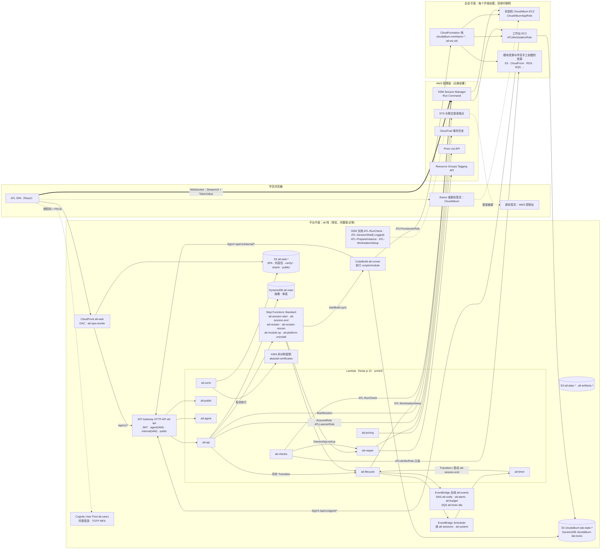
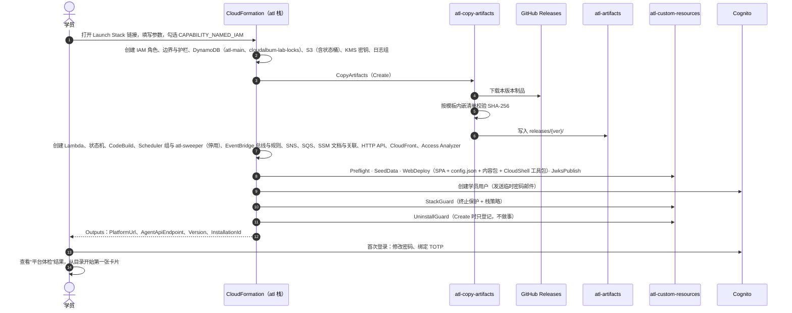
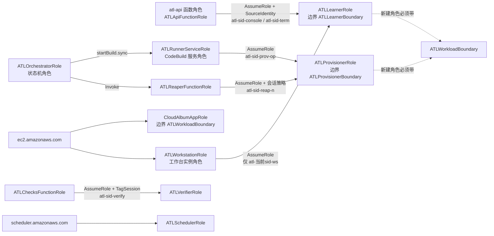

# 01 · 平台总体架构与部署（AWS Training Lab）

> **文档定位**：本文是 AWS Training Lab（简称 **ATL**，中文“实验平台”）的总体架构文档，也是平台侧**唯一的名称表**：实体与 DynamoDB 键、API 路由、Lambda 函数、状态机、调度、`ATL_OP`、IAM 角色与策略、标签、事件名，一律以本文为准（汇总见第 14 节）。其他平台文档只引用这些名称，不另行定义；需要新名称时先在本文登记。02～04 依赖的全部组件及其 IAM 权限都收录在第 3 节与第 6 节。
>
> **状态**：设计稿（v1），第二轮修订：按主设计者裁决 C1～C8 统一了 01～05 与卡片目录之间的分歧，修订见第 17 节。**适用范围**：ATL v1 —— 单租户、自托管、部署在学员自己的 AWS 账号里。
>
> **同组文档**（本文只引用主题，不展开）：
>
> | 编号 | 文档 | 本文引用的主题 |
> |---|---|---|
> | 02 | `02-lab-lifecycle.md` | 开始、结束两条短编排的步骤与 ASL、状态转换表、倒计时、延长与保留、环境复用、回收器算法、定向扫描、待人工处理清单、卸载编排 |
> | 03 | `03-workspace-terminal.md` | 分屏工作台、SSM WebSocket 终端协议、工作台 EC2 的镜像与引导（`ATL-WorkstationSetup`）、控制台联合登录、应用预览 |
> | 04 | `04-lab-format-checks-reports.md` | `lab.yaml` v2（以卡片为单位）、检查定义与 `ATL-RunCheck` 的内部实现、判定与进度、报告与证书的**内容** |
> | 05 | `05-lab-catalog.md` | 卡片目录（权威）：目录页信息架构、56 张卡片的元数据汇总、Lab 0～25 → 卡片 id 的映射 |
> | cards | `cards/*.md` | 逐卡设计（`svc-*` 40 张、`sc-*` 16 张）；学习路径、掌握度、徽章、证书模型以 `cards/tracks-and-catalog.md` 为准 |
> | 06 | `06-cloudalbum-platform-mode.md` | CloudAlbum 侧平台模式的**唯一**实现清单（本文第 9 节只列接口名与平台侧约定） |
> | 07 | `07-aws-verification-plan.md` | 需要真实 AWS 才能确认的事项（本文标“以官方文档为准”“待验证”的条目汇总在那里） |
>
> **上位约束**：README.md 与主设计决策 P1～P13；主设计者裁决 C1～C8（第 17 节第二轮记录）。CloudAlbum 现有设计（`docs/modular-design.md`、`docs/modules/*`）需要配合的改动以 06 为唯一清单，本文第 16 节只保留历史回写条目的索引与更正。
>
> **写作约束**：不写价格，只写计费维度；不编造性能数字；不确定的 AWS 限制写“以官方文档为准”，并列入 07。

---

## 目录

- [0. 一页摘要](#0-一页摘要)
- [1. 目标、约束与术语](#1-目标约束与术语)
- [2. 总体架构](#2-总体架构)
- [3. 组件清单与选型](#3-组件清单与选型)
- [4. 一键安装、升级与卸载](#4-一键安装升级与卸载)
- [5. 平台登录与权限](#5-平台登录与权限)
- [6. IAM 角色与策略](#6-iam-角色与策略)
- [7. DynamoDB 单表 atl-main](#7-dynamodb-单表-atl-main)
- [8. API（/api/v1）](#8-apiapiv1)
- [9. 平台与 CloudAlbum 的接口](#9-平台与-cloudalbum-的接口)
- [10. 安全](#10-安全)
- [11. 成本构成（只写计费维度）](#11-成本构成只写计费维度)
- [12. 未来扩展选项](#12-未来扩展选项)
- [13. 代码目录 platform/](#13-代码目录-platform)
- [14. 名称表（唯一权威）](#14-名称表唯一权威)
- [15. 相对 P1～P13 的细化与偏离](#15-相对-p1p13-的细化与偏离)
- [16. 需要回写到现有文档的改动](#16-需要回写到现有文档的改动)
- [17. 审稿修订记录](#17-审稿修订记录)

---

## 0. 一页摘要

- **形态**：ATL 是一个部署在学员自己账号里的 Serverless Web 应用。学员点一个 **Launch Stack** 链接，用 CloudFormation 单栈 `atl` 装好平台；删除这个栈即卸载，但卸载前必须先结束并回收所有会话（4.8）。平台不持有任何其他账号的凭证。
- **目录**：实验目录由 56 张卡片组成：单服务卡 `svc-<module-id>` 40 张、场景卡 `sc-<slug>` 16 张（05）。原 Lab 0～25 成为学习路径 `saa-main` 的步骤。完成一张卡片得到徽章，完成一条学习路径可以领取证书（`cards/tracks-and-catalog.md`）。
- **开始实验**：确认报价 → 状态机 `atl-session-start`：抢活动环境锁、账号预检、CodeBuild `atl-runner` 并行部署 L0 与工作台、应用卡片的起始状态（L0 + iam(role) + 目标模块硬依赖的闭包，构建期由 `scripts/module plan --start-of <card>` 推导，运行期以 `plan --profile` 复核，3.9）与测试数据种子、部署卡片自带栈（有 `deploy: start` 时）、等待 SSM、工作台接线、健康门 → `READY`。倒计时由 EventBridge Scheduler 中带版本号的一次性调度驱动。
- **结束实验**：到期、学员结束或保留到期时由状态机 `atl-session-end` 执行：先收回学员访问，再定稿报告，再由 `atl-runner` 拆除栈，再由 `atl-reclaim` 回收学员手工创建的资源并校验；CloudTrail 投递延迟由 `atl-reclaim-rescan` 按时间点复扫兜底。所有状态转换都由 `atl-lifecycle` 的 `Transition` 完成（单一写入者）。
- **闲置成本接近零**：平台常驻部分只有 S3、CloudFront、API Gateway HTTP API、Lambda、DynamoDB 按需、Cognito、Step Functions、Scheduler、CodeBuild、EventBridge、SNS、SQS、SSM 文档、KMS 非对称密钥。没有常驻 EC2、NAT、ALB。唯一固定按月计费的是 KMS 密钥（以及学员自选开启的可选项）。
- **环境**：每个实验环境有自己的 `envName`（`e` + 7 位小写字母数字），CloudAlbum 栈名为 `cloudalbum-<envName>-<module>`。同一时刻只允许一个活动环境（`ActiveEnvironmentLock`）。`scripts/module` 的 `state.json` 与环境操作锁放在平台栈创建、学员可访问的状态桶 `cloudalbum-lab-state-<acct>-<region>` 与锁表 `cloudalbum-lab-locks` 中（3.11）。
- **权限三层**：学员身份（`ATLLearnerRole`，带权限边界 `ATLLearnerBoundary` 与护栏 `ATLLearnerGuardrails`、`ATLLearnerCostGuards`）、平台执行身份（`ATLProvisionerRole`、`ATLVerifierRole`）、工作负载身份（`CloudAlbumAppRole` 与学员或模块创建的角色，一律带 `ATLWorkloadBoundary`）。所有触碰实验资源的 AWS 会话都使用 `atl-<sid>-<用途>` 形式的角色会话名，回收器与定向扫描据此在 CloudTrail 事件历史里找出学员手工创建的资源。
- **数据**：DynamoDB 单表 `atl-main`，PK/SK + 两个通用 GSI + TTL（第 7 节）。
- **API**：`/api/v1`，四种鉴权：Cognito JWT（浏览器）、AWS_IAM 的 agent 路由（工作台，`atl-<sid>-ws`）、AWS_IAM 的 internal 路由（运行器，`atl-<sid>-prov-<op>`）、公开（证书验证的便捷查询）。
- **与 CloudAlbum 的接口**：平台用 SSM Run Command 的白名单文档 `ATL-RunCheck` 调用实验机上的固定入口 `/opt/atl/bin/atl-check`（检查包随 CloudAlbum 发布包分发），带探测令牌 `X-ATL-Probe-Token` 读取 `/api/capabilities` 与 `/api/lab/probe/*`；对比实验由工作台按“登记 → 上传 → 轮询”协议经 agent 路由上传。CloudAlbum 侧的全部改动见 06。

---

## 1. 目标、约束与术语

### 1.1 目标

| # | 目标 | 可验证的验收标准 |
|---|---|---|
| A1 | 一键安装、一键卸载 | 只用浏览器：打开 Launch Stack 链接 → 填写邮箱 → 勾选 IAM 能力确认 → 创建。卸载：平台内“准备卸载”通过后，在 CloudFormation 删除 `atl` 栈，账号内不残留 `atl-*`、`ATL*`、`cloudalbum-*` 资源（含状态桶与锁表；学员明确选择保留的除外） |
| A2 | 闲置成本接近零 | 没有会话时，账号中不存在按小时计费的平台资源；按月固定费用只有 KMS 密钥一项（可选项默认关闭） |
| A3 | 会话资源可完全回收 | 平台创建的、学员用 CLI/控制台创建的资源，在会话结束后被删除，或出现在“待人工处理清单”中，并附带删除指引 |
| A4 | 学员凭证有护栏 | 学员在工作台和联合登录控制台里无法修改平台自身资源、调用平台的运行器路由、创建 IAM 用户、改组织与账单、离开允许的区域、启动超出白名单的实例类型、创建删不掉的存储（合规模式锁） |
| A5 | 平台本身是学习材料 | 每个平台组件都能对应到 SAA-C03 考点（3.1 表最后一列） |
| A6 | 可演进 | 键设计、AWS 调用入口为未来的多租户与沙箱账号池预留扩展点（12.4） |

### 1.2 硬约束（摘自 P1～P13，本文据此展开）

1. 单租户、自托管；平台与实验资源在同一个账号、同一个区域（另加 `us-east-1` 的边缘类服务与一个可选的灾备区域）。
2. 技术选型固定：S3 + CloudFront（OAC）、Cognito User Pool、API Gateway HTTP API + Lambda（Node.js 22、arm64）、DynamoDB 按需、Step Functions Standard、EventBridge Scheduler、CodeBuild `atl-runner`、SSM（Session Manager、Run Command）、CloudTrail、KMS 非对称密钥。
3. 会话状态名：`REQUESTED`、`PROVISIONING`、`READY`、`RUNNING`、`EXPIRING`、`ENDING`、`CLEANING`、`ENDED`、`FAILED`、`CLEANUP_FAILED`；02 按 P11 增补 `KEPT`。
4. 会话资源标签：`atl:session-id`、`atl:lab-id`、`Project=CloudAlbum`；本文增补 `atl:env-id` 与 `atl:component=env`（3.9）。
5. 实验机始终带实例配置文件 `CloudAlbumAppRole`，只预置 `AmazonSSMManagedInstanceCore`（平台管理通道）；应用在 L0 仍是 `IAM_CREDENTIALS=none`。
6. 实验机终端：浏览器用 `StartSession` 返回的 `StreamUrl` + `TokenValue` 直连，不开 22 端口，不经平台转发。

### 1.3 非目标（v1 不做）

- 托管多租户、跨账号访问、沙箱账号池（见第 12 节，列为未来扩展）。
- 同一安装内多个并行的实验环境（单活动环境，3.9）。
- 官方认证或可被第三方信任的证书（见 10.5、P10）。
- 在平台里转发终端流量或代理 CloudAlbum 页面。
- 把 AWS 控制台嵌进 iframe（AWS 控制台不允许被嵌入）。

### 1.4 术语

| 术语 | 含义 |
|---|---|
| 平台（ATL） | `platform/` 下的代码与 `atl` 栈部署出的全部资源 |
| 平台平面 | 安装后常驻的平台资源，闲置时几乎不产生费用 |
| 会话平面 | 每个实验环境创建、回收时删除的资源：CloudAlbum 各模块栈与工具链栈、工作台、学员手工创建的资源 |
| 卡片 | 目录中的一个实验单元，id 为 `svc-<module-id>`（单服务卡）或 `sc-<slug>`（场景卡），由 05 与 `cards/` 定义。本文的 `labId` 一律指卡片 id；原 Lab 0～25 只作为学习路径 `saa-main` 的步骤编号出现 |
| 学习路径 | 一组按顺序排列的卡片（例如 `saa-main`），模型以 `cards/tracks-and-catalog.md` 为准 |
| 会话（`LabSession`） | 学员对某张卡片的一次实验尝试：从“开始实验”到资源释放或环境交接为止，ID 记作 `sid` |
| 实验环境（`Environment`） | 会话使用的一组 AWS 资源。选择“保留环境”后，一个环境可以先后服务多个会话（02 §8.4），ID 记作 `envId` |
| 环境名（`envName`） | 平台模式下传给 CloudAlbum 模板的 `Env` 参数，每个环境唯一（3.9） |
| 起始状态（startProfile） | 卡片开始时由平台自动部署的状态：L0 + iam(role) + 目标模块硬依赖的闭包（`svc-ec2`、`svc-iam` 不预置 iam）。由 `scripts/module plan --start-of <card>` 推导，生成档位 `atl/<card-id>/<variant>`（3.9、9.6） |
| 目标模块 | 卡片要求学员亲手启用或改变取值的模块，写作 `{id, from, to}` |
| 实验机 | 运行 CloudAlbum 的 EC2（ASG 模式下可能是多台），标签 `atl:role=lab-app` |
| 工作台 | 每个会话一台的小型 EC2，预装 AWS CLI、Node、k6、仓库与 `scripts/module`，OS 用户 `labuser`，标签 `atl:role=workstation` |
| 平台动作 | 由平台代为执行的 `scripts/module` 操作（在 `atl-runner` 中运行，`ATL_OP=module-op`），只接受卡片声明的 `actionId`，区别于学员在工作台上自己执行的命令 |
| 回收器 | 找出并删除会话资源的组件：状态机 `atl-reclaim` + 函数 `atl-reaper`，算法见 02 第 7 节 |
| 定向扫描（`OwnershipLookup`） | 会话进行中对某个指定资源做一次 CloudTrail 归属查询，供检查判定“这个资源是不是本会话建的”（3.12，02） |
| 活动环境锁 | 单例 `ActiveEnvironmentLock`，保证同一时刻只有一个实验环境（3.9、7.5） |
| 环境操作锁 | `scripts/module` 层的锁，存放在 `cloudalbum-lab-locks` 表中，防止运行器与学员在工作台上同时修改同一个环境（3.11） |

---

## 2. 总体架构

### 2.1 架构图



（图只画主要调用；完整的调用与权限见 3.2 与 6.9。）

### 2.2 三个平面

| 平面 | 包含 | 生命周期 | 闲置时是否计费 |
|---|---|---|---|
| 浏览器 | ATL SPA；新标签页里的 AWS 控制台；CloudAlbum 页面 | — | — |
| 平台平面 | `atl` 栈中的全部资源（第 3 节），包括学员可访问的状态桶与锁表（3.11） | 安装 → 卸载 | 只有存储类与 KMS 密钥的按月费用 |
| 会话平面 | `cloudalbum-<envName>-*` 模块栈与工具链栈、工作台栈 `atl-ws-<sid>`、模块资源、学员手工创建的资源 | 环境创建 → 回收完成（保留环境时跨越多个会话） | 环境存在期间按各资源维度计费（第 11 节） |

### 2.3 主要链路一览

| 链路 | 路径 | 身份 / 鉴权 | 细节 |
|---|---|---|---|
| 打开平台 | 浏览器 → CloudFront → S3（OAC） | 无 | 3.8 |
| 平台登录 | 浏览器 ↔ Cognito 托管登录（授权码 + PKCE） | 密码 + TOTP MFA | 第 5 节 |
| 平台 API | 浏览器 → CloudFront `/api/v1/*` → HTTP API → Lambda | Cognito 访问令牌（JWT 授权器） | 第 8 节 |
| 报价与开始 | `atl-api`（`POST /labs/{labId}/quotes`、`POST /sessions`）→ `atl-lifecycle` 的 `Transition` 写入 `REQUESTED` → 启动 `atl-session-start`（执行名 `start-<sid>`） | Cognito；编排用 `ATLOrchestratorRole` | 02 §3、§4 |
| 部署起始状态 | `atl-session-start` → `atl-runner`（`base-deploy` 与 `workstation-up` 并行，再 `profile-apply`）→ CloudFormation | `ATLProvisionerRole`（`atl-<sid>-prov-<op>`） | 3.4、02 §4.3 |
| 运行器上报 | `atl-runner` → execute-api `/api/v1/internal/*` → `atl-agent` | SigV4（`ATLProvisionerRole`） | 5.3 |
| 工作台接线 | `atl-lifecycle` 以 `ATL-WorkstationSetup` 向工作台下发命令 → 工作台以 `atl-<sid>-ws` 调用 `GET /api/v1/agent/sessions/{sid}/context`（此时会话仍在 `PROVISIONING`） | SigV4（`ATLLearnerRole`） | 5.3、03 §4.6 |
| 倒计时与到期 | `atl-lifecycle` 创建带版本号的一次性调度 → 到点调用 `atl-timer` → `Transition` 或启动 `atl-session-end` | `ATLSchedulerRole` | 3.5、02 §5 |
| 实验机 / 工作台终端 | `atl-api` 以 `ATLLearnerRole` 调用 `ssm:StartSession` → 浏览器用 WebSocket 直连 `ssmmessages` | 会话令牌（一次性、短期） | 03 |
| AWS 控制台 | `atl-api` 以 `ATLLearnerRole` 取得临时凭证 → 联合登录端点换登录链接 → 新标签页（表单 POST 到 `signin.aws.amazon.com`） | 登录链接 | 03 §5 |
| 学员 CLI | 工作台 `labuser` 的 `~/.aws/config` 以实例角色链式扮演 `ATLLearnerRole` | `atl-<sid>-ws` 会话 | 6.3、03 §4.6 |
| 学员启停模块 | 工作台上的 `scripts/module --platform` → CloudFormation；`state.json` 与锁在状态桶与锁表中 | `atl-<sid>-ws` 会话 | 3.11、9.6 |
| 应用预览 | 浏览器 → CloudAlbum 有效入口（受信 HTTPS 时 iframe，否则新标签页） | CloudAlbum 自身登录 | 9.7、03 §6 |
| 检测 | `atl-checks` → 扮演 `ATLVerifierRole` → AWS 只读 API；或 `ssm:SendCommand ATL-RunCheck` → 实验机 | `atl-<sid>-verify` 会话 | 9.3、04 |
| 归属定向扫描 | `atl-checks` → `atl-reaper` 的 `OwnershipLookup` → `cloudtrail:LookupEvents`（平台区域与 `us-east-1`） | 回收器函数角色（只读） | 3.12、02 |
| 对比实验上传 | 工作台 `npm run exp -- … --upload` → execute-api `/api/v1/agent/*`：登记 → `PUT …/result` → 轮询 | SigV4（`ATLLearnerRole`） | 9.5、04 §7 |
| 结束与回收 | `atl-session-end`：收回访问 → 定稿（`atl-checks` 的 `FinalizeAttempt`）→ `atl-runner destroy` → `atl-reclaim`（`.sync:2`）→ `Conclude`；之后 `atl-reclaim-rescan` 按时间点复扫 | `ATLProvisionerRole` + 会话策略 | 6.7、02 §6、§7 |
| 证书与验证 | `atl-certs` 签名并把 `verify/`、`.well-known/atl/`、`public/` 写入 `atl-web` → 任何人打开 `/verify/<certId>` 在浏览器中本地验签 | 无 | 8.3、04 §10 |
| 卸载 | `POST /platform/uninstall/prepare` → `atl-platform-uninstall`；删栈时 `UninstallGuard` 再启动一次并清理运行期内联策略 | 学员 + 平台 | 4.8、02 §10.5 |

**为什么浏览器用轮询而不是推送**：HTTP API 不支持 WebSocket 和流式响应。若用 API Gateway WebSocket API 推送，需要额外维护连接表与断线重连，收益只是省掉几秒的轮询延迟。v1 用 `GET /api/v1/sessions/{sid}/events?after=<游标>` 短轮询（服务端返回 `pollAfterMs` 建议间隔：开通中和检测中较短，空闲时较长；页面不可见时暂停）。WebSocket API 列为后续可选项。

### 2.4 会话状态与主导组件（概览）

精确的转移条件、超时与重试由 02 定义（02 §2.3 的 T01～T21）。本表只说明每个状态由哪个组件推进、是否持有活动环境锁。**状态只有一个写入者**：`atl-lifecycle` 的 `Transition` 动作（条件更新，7.5）；`atl-api`、`atl-timer`、状态机都通过它推进状态，包括 T01（创建）、T07、T09 这类由 API 触发的转换。

| 状态 | 一句话语义 | 推进者 | 持有 `ActiveEnvironmentLock` | 会话资源 |
|---|---|---|---|---|
| `REQUESTED` | 已受理，正在校验报价、抢锁、预检；尚未创建资源 | `atl-session-start` | 抢锁中 | 无 |
| `PROVISIONING` | 部署 L0、工作台与起始状态，等待 SSM，工作台接线，健康门 | `atl-session-start` → `atl-runner` | 是 | 创建中 |
| `READY` | 环境就绪，倒计时已开始，学员尚未进入工作台 | `atl-session-start` / `atl-api` / `atl-timer` | 是 | 运行中 |
| `RUNNING` | 实验进行中 | `atl-api`（心跳）/ `atl-timer` | 是 | 运行中 |
| `EXPIRING` | 剩余 ≤ 15 分钟 | `atl-timer` / `atl-api`（延长后回退） | 是 | 运行中 |
| `ENDING` | 已撤销计时器、收回学员访问，正在定稿 | `atl-session-end` | 是 | 运行中 |
| `KEPT`（02 增补） | 实验已结束、学员确认保留环境，到 `keep.until` 自动释放或被下一张卡片复用 | `atl-session-end` / `atl-timer` | 是 | 运行中（节省模式下减少） |
| `CLEANING` | 拆除与回收中（T19 重试进入的 `CLEANING` 不重新取锁） | `atl-session-end` → `atl-reclaim` | 是（重试除外） | 删除中 |
| `ENDED` | 资源已释放，或环境已交接给下一个会话 | `atl-session-end` | 否 | 无（或学员确认保留的条目） |
| `FAILED` | 没能进入 `READY`，补偿回收已完成 | `atl-session-end` | 否 | 无 |
| `CLEANUP_FAILED` | 有确认未删除的残留，已生成待人工处理清单并告警 | `atl-session-end` / `atl-reclaim-rescan` | **否**：锁在 `Conclude` 时已释放；开始新会话时按 `residualAck` 规则确认（02 §9.2） | 部分存在 |

`ENDED`、`FAILED` 在复扫窗口内可以降级为 `CLEANUP_FAILED`（02 T21），窗口结束后才是真正的终态。“保留环境”的参数存放在 `LabSession.keep`（7.3）。

---

## 3. 组件清单与选型

本节是平台模板的**资源清单**：02、03、04 依赖的每一个平台组件都必须出现在这里，并在 6.9 中有对应的权限。CI 用 `platform/infra/test/inventory.test.ts` 校验“合并后的模板资源 ⊇ 本节清单”与“每个函数角色只含 6.9 列出的操作”（13）。

### 3.1 组件总表（职责 · 选型理由 · SAA 考点）

| 组件 | AWS 服务 | 职责 | 为什么这样选（与替代方案比较） | 对应 SAA 考点 |
|---|---|---|---|---|
| 前端托管 | S3 + CloudFront（OAC） | 托管 SPA、内容包、证书验证页与分享页；同源转发 `/api/v1/*` | 没有服务器，闲置不计时；同源省掉 CORS。S3 静态网站端点不支持 HTTPS，且要求桶公开；Amplify Hosting 多一层构建流水线，对教学没有增益 | OAC 与 OAI；S3 阻止公有访问；CloudFront 行为、缓存策略、源请求策略与响应头策略；CloudFront Functions 与 Lambda@Edge；价格等级 |
| 平台登录 | Cognito User Pool | 学员 / 助教 / 观察者登录；TOTP MFA；为 API 签发 JWT | 托管的密码、MFA、找回密码，JWT 可被 HTTP API 原生校验。IAM Identity Center 面向“人访问 AWS 账号”，需要先建实例与权限集，不适合作为应用登录；本平台改用 STS 联合登录进入控制台（12.4 讨论用 Identity Center 替代） | User Pool 与 Identity Pool；JWT 授权器；MFA；身份联合 |
| API | API Gateway HTTP API | 四类路由（JWT、agent、internal、公开）、节流 | 比 REST API 便宜、延迟低、原生 JWT。REST API 的使用计划、请求校验、私有 API、缓存、直接关联 WAF，本平台都用不上；ALB + Lambda 有小时费；Lambda 函数 URL 只支持 IAM 鉴权，不支持 JWT | HTTP API 与 REST API；授权方式（JWT、IAM）；节流；集成超时（以官方文档为准）导致的异步模式 |
| 业务计算 | Lambda（Node.js 22，arm64） | 全部 API 与后台任务，按权限域拆成多个函数 | 零闲置；Graviton 性价比；每个函数一个最小权限角色。Fargate / EC2 都有常驻成本 | Lambda 超时与并发；arm64；执行角色最小权限 |
| 数据 | DynamoDB 按需，单表 `atl-main` | 全部平台状态 | 零闲置（只付存储与请求）；条件写入适合状态机与锁；TTL 自动清理。RDS 有小时费；Aurora Serverless 有最小容量与冷启动问题 | 单表设计、GSI、条件写入、事务、TTL；按需与预置；`dynamodb:LeadingKeys` 细粒度访问 |
| 生命周期编排 | Step Functions Standard | 开始、结束两条短编排；回收、复扫、平台动作、卸载各一条（3.3） | 每条编排都短而有界：执行历史与重放边界可控，保留环境的数天等待不占用执行；补偿与正常结束共用同一条回收路径。需要 `.sync` 集成（CodeBuild、子执行）与完整执行历史（审计与排错）。Express 工作流最长 5 分钟；“SQS + Lambda 编舞”缺少全局可见性 | Standard 与 Express；编排与编舞；`.sync` 集成；Saga 式补偿 |
| 倒计时 | EventBridge Scheduler（一次性调度） | 到期前提醒、到期、就绪空闲、保留截止、分享链接到期；会话期间的兜底巡检 | `at()` 一次性调度，执行后自动删除（`ActionAfterCompletion: DELETE`），带重试与死信队列。调度名带版本号，延长时“先建新、后删旧”。若用状态机 Wait 状态，延长需要取消并重算等待；EventBridge 规则只适合周期性任务；DynamoDB TTL 的删除时间不精确，不能当定时器 | Scheduler 与 EventBridge 规则；事件驱动架构；死信队列 |
| 事件与通知 | EventBridge 自定义总线、SNS、SQS | 平台事件总线 `atl-events`；学员通知、告警、预算通知；调度投递失败的死信 | 自定义总线把生命周期与进度事件解耦给多个消费者；SNS 邮件订阅只需确认，无需验证发件域名；闲置无费用 | 事件总线与规则；SNS 扇出；SQS 死信队列 |
| 执行 `scripts/module` | CodeBuild `atl-runner` | 部署 / 删除 CloudAlbum 模块栈与工作台栈、执行平台动作 | 单次操作可能长达数十分钟（CloudFront、RDS 的创建与删除），超过 Lambda 15 分钟上限；托管构建镜像自带 CLI 与 Node；按分钟计费，无需 VPC。Fargate 需要子网与公网出口；常驻 EC2 违背零闲置 | 按任务时长选计算服务；托管 CI 服务 |
| 实验环境状态 | S3（版本控制 + 条件写）与 DynamoDB（条件写锁） | `scripts/module` 的 `state.json`、带外资源的备份、环境操作锁（3.11） | 学员（工作台）与运行器两处执行 `scripts/module`，需要共享状态与互斥。平台自己的 `atl-*` 资源被学员边界整体拒绝，所以单独建一组学员可访问、名称不以 `atl-` 开头的存储；放在平台栈而不是会话栈，避免“会话栈未建好就要读状态”的先后问题 | S3 版本控制与条件写入；DynamoDB 条件写入与 TTL；乐观锁与租约锁 |
| 终端与检查通道 | SSM Session Manager、Run Command、State Manager、Parameter Store | 网页终端；白名单检查；实例准备；会话级参数 | 不开 22 端口、IAM 授权、可审计；Run Command 免费且可以限制到单个文档；Parameter Store 标准参数免费 | Session Manager 与堡垒机；Run Command；State Manager；Parameter Store 与 Secrets Manager |
| 资源追溯 | CloudTrail 事件历史（`LookupEvents`） | 回收时找出学员手工创建的资源；会话中对指定资源做定向扫描（3.12） | 无需建 trail、不额外收费、保留 90 天管理事件（以官方文档为准）；按角色会话名（查找属性 `Username`）或资源名（`ResourceName`）检索。自建 trail 会让 audit 卡片的“创建 trail”失去意义，且有存储成本，所以默认不建（4.3 参数 `PlatformTrail`）。**限制**：事件历史按区域保存与查询，IAM、CloudFront、Route 53 等全局服务的事件记录在 `us-east-1`；每次调用只能用一个查找属性、精确匹配；`LookupEvents` 有账号级、每区域的调用频率限制，`atl-reaper` 与 `atl-checks` 的调用共用一个令牌桶；事件出现在事件历史中有投递延迟（官方描述为通常数分钟，不作保证，以官方文档为准） | 管理事件与数据事件；事件历史与 trail；投递延迟 |
| 资源发现 | Resource Groups Tagging API | 按 `atl:env-id` 列出带标签的资源 | 按区域分页查询，一个请求覆盖多种服务。**限制**：同样按区域查询（全局资源在 `us-east-1`）；不返回 IAM 用户与角色，对部分类型（例如 Auto Scaling 组）覆盖不全，刚删除的资源可能短时间内仍被列出（以官方文档为准）。盲区靠服务自身的列举接口、栈删除与 CloudTrail 盘点兜底 | 标签策略；成本分配标签 |
| 外部访问分析 | IAM Access Analyzer（外部访问分析器 `atl-external-access`） | 发现会话中出现的“信任外部账号的角色、公开或跨账号的桶与密钥策略” | 权限边界检查不了信任策略与资源策略的内容；外部访问分析器按账号与区域持续分析，结果进入会话报告与告警，回收器优先删除这类资源。外部访问分析器的计费以官方定价为准；未使用访问分析器另行计费，不启用 | Access Analyzer；资源策略与跨账号访问 |
| 证书签名 | KMS 非对称密钥（`ECC_NIST_P256`，`SIGN_VERIFY`） | 给证书与吊销列表签名；发布公钥 | 私钥从不离开 KMS。把私钥放在 Secrets Manager 里由 Lambda 签名，私钥可能被导出 | 对称与非对称密钥；密钥策略；非对称密钥不支持自动轮换（以官方文档为准） |
| 控制台联合登录 | STS + 联合登录端点 | 生成 AWS 控制台登录链接 | 无需 IAM 用户；临时凭证 + `SourceIdentity` 便于审计。`atl-api` 用自身角色扮演 `ATLLearnerRole` 属于角色链：调用 `getSigninToken` 时**不得**传 `SessionDuration`（否则调用失败），控制台会话时长等于这组凭证的剩余有效期（不超过 1 小时）；登录 URL 生成后只在 15 分钟内可用 | AssumeRole；角色链最长 1 小时；会话策略；`SourceIdentity` |
| 学员护栏 | IAM 权限边界 + 客户托管的护栏策略 | 限制学员与其创建的角色能做什么 | 委派管理的标准模式：允许学员建角色，但新角色必须带指定边界；边界有字符上限，部分 Deny 外移到护栏策略（6.5） | 权限边界；有效权限的计算；`iam:PermissionsBoundary`、`aws:CalledVia` 条件键 |
| 费用估算 | Price List Query API | 开始、延长、保留前显示预计每小时费用 | 官方价格数据，按卡片声明的计费维度计算。Price List Query API 只在少数区域提供端点（以官方文档为准），`atl-pricing` 固定调用其中一个端点（例如 `us-east-1`），查询条件中的 `regionCode` 才是实验区域 | 成本估算；Pricing Calculator 与 Price List API |
| 费用兜底 | AWS Budgets（可选） | 月度预算 `atl-platform-guard`，超限时按 `BudgetEnforcement` 处理 | 账号级月度护栏；数据有延迟（以官方文档为准），不能代替会话倒计时 | Budgets 与预算动作；成本分配标签 |
| 安装 | CloudFormation 单栈 + 自定义资源 | 一键安装、升级、卸载 | 见 4.4 | 栈策略、变更集、终止保护、自定义资源、`DeletionPolicy` |

### 3.2 Lambda 函数

全部函数：Node.js 22（`nodejs22.x`）、arm64、结构化 JSON 日志、日志保留期由参数 `LogRetentionDays` 决定；日志组由平台栈预先创建（4.6）。按**权限域**拆分函数，而不是按路由拆分：同一权限域内的路由与动作合并在一个函数里（单函数路由，按 `action` 分派），减少冷启动与资源数量；不同权限域分开，保证最小权限。动作名由定义它的文档决定（02 的生命周期与回收动作、04 的检查与定稿动作），本文只登记函数、触发与权限。

| 函数 | 触发 | 职责 | 关键权限（完整列表见 6.9） | 超时量级 |
|---|---|---|---|---|
| `atl-api` | HTTP API（JWT 路由） | 浏览器的全部 `/api/v1/*` 请求（公开、agent、internal 路由除外）；报价、开始、延长、结束、保留；终端与控制台链接；检测请求；报告、分享、证书请求；成员与设置 | `atl-main` 读写（`LabSession` 的状态与时间类字段只经 `atl-lifecycle` 写入，7.5）；同步调用 `atl-lifecycle`、`atl-pricing`，异步调用 `atl-checks`、`atl-certs`、`atl-reaper`；启动 `atl-session-start`、`atl-session-end`、`atl-module-op`、`atl-platform-uninstall`；扮演 `ATLLearnerRole`（`-console`、`-term`）；Cognito 成员管理；读 `/cloudalbum/*/atl/app-admin-password`；读小测题库 `private/quiz/*`；读状态桶；`ce:GetCostAndUsage`（学员确认后才调用）；出站 HTTPS（预览探测，经共享出站库，10.3） | 秒级（受 HTTP API 集成超时约束，以官方文档为准） |
| `atl-public` | HTTP API（公开路由） | 证书与公钥的便捷查询、健康检查 | 只能读 `CERT#*`、`KEY#*` 分区（`dynamodb:LeadingKeys`） | 秒级 |
| `atl-agent` | HTTP API（AWS_IAM：agent 路由与 internal 路由） | agent：工作台的会话上下文（`atl.agent-context/v1`，8.2）、对比实验登记 / 上传 / 轮询 / 附件、模块操作上报；internal：运行器的进度上报与模块操作上报。按路由前缀分别校验调用方（5.3） | `atl-main` 写 `ExperimentRun`、`ModuleOp`、`RunnerRun`、`SessionEvent`；读 `LabSession`、`Environment`、`PlatformConfig`（组装会话上下文）；为 `atl-data` 生成 `experiments/*` 的预签名 PUT；异步调用 `atl-checks`（交叉校验）；`events:PutEvents` | 秒级 |
| `atl-checks` | `atl-api` 异步调用；状态机任务 | 执行检查（4 类自动来源），写 `CheckRun` 与 `StepResult`；账号预检与基线清点（02 §3.5）；健康门（`base.ready`、`caps.profile`、`ws.ready`）；定稿 `FinalizeAttempt`（02 §6.4、04 §8.5）；对比实验交叉校验 | 扮演 `ATLVerifierRole`（带会话标签，`atl-<sid>-verify`）；`atl-main` 读写；写 `atl-data` 的 `evidence/*`；读 `atl-web` 的 `content/*` 与状态桶；异步调用 `atl-certs`（报告）、调用 `atl-reaper` 的 `OwnershipLookup`；出站 HTTPS（外部探针，经共享出站库） | 分钟级 |
| `atl-lifecycle` | 状态机任务；`atl-api`、`atl-timer` 同步调用；SNS `atl-budget` 订阅；EventBridge 规则 `atl-sfn-failed` | `LabSession` 状态的**唯一写入者**（`Transition`）；报价校验、抢锁、环境上下文、计时器创建与撤销、延长（`Extend`）、工作台接线（`WireWorkstation`）、SSM 补救、收回与封存访问（`CloseLearnerAccess`、`SealRevocation`）、运行器失败分类、结论（`Conclude`）、预算状态（`BudgetAlert`）、执行失败处理 | `atl-main`；Scheduler（组 `atl-sessions`、`atl-system`）+ `iam:PassRole ATLSchedulerRole`；`ssm:SendCommand`（`ATL-WorkstationSetup` → 工作台实例）、`DescribeSessions`、`TerminateSession`；维护 `ATLLearnerRole` 的 `ATLRevokedSessions`、`ATLWorkstationRole` 的 `atl:active-session-id` 标签（终端录制策略由平台栈按参数 `TerminalRecording` 管理，运行期不写，4.3）；停止开始编排与运行中的构建；`events:PutEvents`；`sns:Publish` | 秒级～分钟级 |
| `atl-timer` | EventBridge Scheduler | 处理 `WARN_15`、`WARN_5`、`EXPIRE`、`READY_IDLE`、`KEEP_WARN_60`、`KEEP_WARN_15`、`KEEP_EXPIRE`、`SHARE_EXPIRE` 与周期巡检 `SWEEP`（即 02 的 watchdog：到期补触发、状态超时、调度对账、锁一致性、死信、环境轻量体检、`CLEANUP_FAILED` 自动重试、吊销条目清理、复扫补做） | 同步调用 `atl-lifecycle`；启动 `atl-session-end`、`atl-reclaim`、`atl-reclaim-rescan`；Scheduler（补建与对账，组 `atl-sessions`，以及 `atl-sweeper` 的启停）+ `iam:PassRole ATLSchedulerRole`；消费 `atl-timer-dlq`；异步调用 `atl-certs`（分享到期）；`sns:Publish` | 秒级 |
| `atl-reaper` | `atl-reclaim` 的任务；`atl-session-start` 的 `CaptureLedger`；`atl-checks` 的 `OwnershipLookup`；`atl-api` 的“我已处理”复核 | 回收器的发现、删除、轮询、校验；`CloudAlbumAppRole` 的复位；定向扫描；台账写入 | `cloudtrail:LookupEvents`（扫描区域全部）；`tag:GetResources`；清点与存在性确认所需的 `Describe*`/`List*`（生成）；`access-analyzer` 只读；以会话策略扮演 `ATLProvisionerRole`（`atl-<sid>-reap-<n>`）；`atl-main` 写 `SessionResource`、`ReclaimPass`、`InventorySnapshot`；读状态桶与 `atl-data/runs/*` | 单次调用控制在 15 分钟内，长删除由状态机等待循环完成 |
| `atl-certs` | `atl-api`、`atl-checks`、`atl-timer` 异步调用 | 渲染报告（HTML / JSON）、导出、分享副本；签发与撤销证书；签发吊销列表；发布 `jwks.json` 与公开证书文件 | `kms:Sign`（只此函数）、`kms:GetPublicKey`；`atl-data` 读写 `reports/*`、`exports/*`，读 `evidence/*`；写 `atl-web` 的 `verify/`、`.well-known/atl/`、`public/`、`share/`；`cloudfront:CreateInvalidation`；`atl-main` | 分钟级 |
| `atl-pricing` | `atl-api` 同步调用 | 用 Price List 计算报价，结果缓存 | `pricing:GetProducts`；`atl-main` 的 `PRICE`、`QUOTE` 实体 | 秒级 |
| `atl-custom-resources` | CloudFormation 自定义资源；`atl-platform-uninstall` 的任务（`lambda:invoke`） | `Preflight`、`SeedData`、`WebDeploy`、`JwksPublish`、`SchemaMigrator`、`StackGuard`、`UninstallGuard`、`BucketEmptier`；另有动作 `UninstallRoleCleanup`：由卸载编排在全部回收完成后调用，执行角色清理并向 CloudFormation 的响应 URL 回调 `SUCCESS` / `FAILED`（4.8） | 见 6.9 | 分钟级 |
| `atl-copy-artifacts` | CloudFormation 自定义资源 | 从发布源下载制品、校验 SHA-256、写入 `atl-artifacts`（**内联代码**，见 4.5） | `atl-artifacts` 写 | 分钟级 |
| `atl-tagger`（可选） | EventBridge 规则 `atl-tagger-api-calls`（只在 `PlatformTrail=enabled` 时部署） | 实时给学员会话创建的资源打 `atl:session-id`、`atl:lab-id`、`atl:env-id` 标签并登记台账（02 §7.1 的 `REALTIME` 来源） | 按提取器表生成的各服务打标签动作（`aws:TagKeys` 限上述三个键）；`atl-main` 写 `SessionResource` | 秒级 |

另有一个 CloudFront Function `atl-spa-rewrite`（查看器请求阶段，规则见 3.8）。不用 CloudFront 的“自定义错误响应”做 SPA 回退，因为它会把 `/api/v1/*` 的 403/404 也改写成首页，吞掉 API 错误。

**共享出站库**：`atl-api` 的预览探测（03 §6.1）与 `atl-checks` 的外部 HTTP 探针共用 `platform/api/src/net/safe-fetch.ts`：目标只能是服务端解析出的枚举值；解析后拒绝私网、回环、链路本地（含 `169.254.0.0/16`）、IPv6 ULA 与链路本地地址；端口白名单（80、443、8080，及卡片声明的少数端口）；直接连接已校验的 IP（TLS 仍按原主机名校验证书），不跟随重定向，响应体有读取上限。契约测试覆盖 DNS 重绑定与各类地址段，两处调用不得各自实现。

### 3.3 Step Functions 状态机

全部为 Standard 类型，ASL 在 `platform/workflows/statemachines/`，步骤与超时由 02 定义。

| 状态机 | 职责（细节见 02） | 启动者 | 执行名 |
|---|---|---|---|
| `atl-session-start` | 开始实验：报价校验 → 抢锁 → 预检 → `PROVISIONING` → 并行 `base-deploy`（或 `resume`）与 `workstation-up` → `profile-apply`（含测试数据种子）→ 卡片自带栈 `extra-stack`（只在卡片有 `deploy: start` 的栈时）→ 等待 SSM → 工作台接线 → 健康门 → 台账 → 计时器 → `READY`；失败时启动 `atl-session-end` 做补偿 | `atl-api`（T01 之后） | `start-<sid>` |
| `atl-session-end` | 结束实验：撤销计时器 → 收回访问 → 定稿 → 封存吊销 → `KEPT`（保留）或 `CLEANING` → `destroy` → `atl-reclaim` → `Conclude` → 启动复扫 | `atl-api`、`atl-timer`、`atl-session-start`（补偿）、`atl-platform-uninstall` | `end-<sid>-1`（首次结束、取消、补偿、预算、卸载）、`end-<sid>-rel`（保留环境的释放）、`end-<sid>-retry-<k>`（回收重试） |
| `atl-reclaim` | 一轮回收：发现 → 分阶段删除 → 校验 | `atl-session-end`、`atl-reclaim-rescan`、`atl-platform-uninstall`（`.sync:2`）；`atl-timer`（补做复扫） | `reclaim-<envId>-<mode>-<n>` |
| `atl-reclaim-rescan` | 按 `revokedAt` 起算的时间点等待并复扫 | `atl-session-end` | `rescan-<envId>` |
| `atl-module-op` | 平台动作：串行化同一会话的平台动作，以 `ATL_OP=module-op` 调用 `atl-runner`；卡片自带栈在步骤中部署（`deploy: step:<id>`，动作 id `xstk-<stackId>`）时改以 `ATL_OP=extra-stack` 调用 | `atl-api` | `modop-<sid>-<n>` |
| `atl-platform-uninstall` | 卸载前强制回收：结束全部非终态会话、释放保留环境、重试 `CLEANUP_FAILED`、补做复扫、等待吊销条目过期；由守卫启动时，最后以 `lambda:invoke` 调用 `atl-custom-resources` 的 `UninstallRoleCleanup` 完成角色清理并回调 CloudFormation（4.8） | `atl-api`（`POST /platform/uninstall/prepare`）、`UninstallGuard` | `uninstall-<n>` |

约定：

- **不使用 `.waitForTaskToken`**，也没有横跨整个会话的长执行。等待学员的动作（延长、结束、保留）由 API 经 `atl-lifecycle` 直接做条件转换，需要执行流程时再启动对应的短编排。执行名确定且按“结束阶段”区分（02 §2.7）：Standard 工作流的执行名在一段时间内不能复用（以官方文档为准），同名不同输入或已结束时返回 `ExecutionAlreadyExists`。
- **状态机本身不扮演 `ATLProvisionerRole`**。修改实验资源的动作只在两处执行：`atl-runner`（CodeBuild，经 `startBuild.sync` 调用）与 `atl-reaper`（Lambda）。它们在代码中显式调用 `AssumeRole`，并指定会话名 `atl-<sid>-prov-<op>` / `atl-<sid>-reap-<n>`。状态机只用自身角色 `ATLOrchestratorRole` 做编排（调用 Lambda、启动构建、启动子执行）。
  - 不使用 Task 的 `Credentials` 字段的原因：Step Functions 代为扮演角色时，角色会话名由服务决定，模板无法指定（以官方文档为准）。这样既满足不了 `ATLProvisionerRole` 信任策略中的会话名条件（6.2），也不符合 P5 的检索约定。
- `.sync` 集成（`startBuild.sync`、`startExecution.sync:2`）要求编排角色另有对应的 `Describe`/`Stop` 权限，以及托管规则 `StepFunctionsGetEventForCodeBuildStartBuildRule`、`StepFunctionsGetEventsForStepFunctionsExecutionRule` 的 `events:PutTargets` / `PutRule` / `DescribeRule` 权限（规则名以官方文档为准）。
- 执行失败兜底：默认事件总线上的规则 `atl-sfn-failed` 匹配 `Step Functions Execution Status Change`（`FAILED`、`TIMED_OUT`、`ABORTED`，限 `atl-*` 状态机），目标 `atl-lifecycle`（02 §2.6 的第二层兜底）。
- 状态机日志级别 `ERROR`，写入 `/aws/vendedlogs/states/atl-*`（平台栈预先创建）；完整过程依赖执行历史。

### 3.4 CodeBuild `atl-runner`

| 项 | 取值 |
|---|---|
| 计算 | ARM 容器，最小规格；托管的 Amazon Linux aarch64 标准镜像（具体镜像版本以官方文档为准）。不放入 VPC |
| 源码 | `atl-artifacts` 中当前版本的 `releases/<ver>/cloudalbum-infra.zip`（含 `infra/modules`、`scripts/module`、`modules/registry.yaml`、`experiments/`、检查包）。**不从学员可写的位置读取 buildspec**，也不使用 `NO_SOURCE` + 内联 buildspec |
| buildspec | `platform/workflows/runner/buildspec.yml`，随发布包固定 |
| 起始档位 | `profile-apply` 前从内容发布 `atl-web` 的 `content/<catalogVersion>/profiles/atl/<card-id>/<variant>.env` 下载档位文件，按内容包 `manifest.json` 校验 SHA-256，放到工作目录的同名相对路径 `profiles/atl/<card-id>/<variant>.env`；然后执行 `scripts/module plan --profile atl/<card-id>/<variant> --platform --json` 复核：输出的 `digest`（与 `plan --start-of` 同一算法，06 PM-32、PM-33）必须等于档位中的 `PROFILE_PLAN_DIGEST` 与 `LabSession.startProfileDigest`，否则判为不可重试的 `PROFILE_DIGEST_MISMATCH`。**运行期不执行 `plan --start-of`**：它要读 `labs/<card-id>/lab.yaml`，而源码包 `cloudalbum-infra.zip` 与内容发布都不含 `lab.yaml`（内容发布只有展开后的 `labs/<card-id>.json`）。卡片自带栈的模板从同一内容发布的 `stacks/<card-id>/<stackId>.yaml` 下载，同样按 `manifest.json` 校验 |
| 服务角色 | `ATLRunnerServiceRole`（只能写日志、读制品、档位与卡片自带栈模板、扮演 `ATLProvisionerRole`）；构建开始时以会话名 `atl-<sid>-prov-<op>` 扮演 `ATLProvisionerRole`。这属于角色链，凭证最长 1 小时：buildspec 用 CLI 配置文件（`role_arn` + `credential_source = EcsContainer` + `role_session_name`）让 CLI 和 SDK 自动续期，不把一次性取得的凭证导出为环境变量。长时间栈操作与调用者凭证有效期的关系见 6.7 第 6 条 |
| 环境变量 | `ATL_OP`（枚举，见下）、`ATL_RUN_ID`（`<sid>-<op 缩写>-<n>[-<m>]`，对应 `RunnerRun` 与 `atl-data/runs/<runId>/`）、`ATL_SESSION_ID`、`ATL_ENV_ID`、`ATL_LAB_ID`、`ATL_ARGS`（base64url 编码的 JSON，经 schema 校验）、`ATL_RELEASE`、`ATL_REGION`。区域、`envName`、状态桶位置、标签集合、平台 API 地址由 buildspec 从 `Environment` 记录读取，不经编排传递 |
| 产物 | `atl-data/runs/<runId>/`：`result.json`（失败分类的唯一依据，02 §4.3）、`ledger.json`、`progress.jsonl`；`destroy` 前把 `state.json` 副本归档到 `atl-data/archive/<sid>/` |
| 上报 | `--progress-jsonl` 的每一行与模块操作，经 `POST /api/v1/internal/runs/{runId}/events`、`POST /api/v1/internal/sessions/{sid}/module-ops` 上报（SigV4，5.3）；上报失败不影响构建结果 |
| 超时 | 按操作由 02 的部署 / 回收预算决定（`TimeoutInMinutesOverride`）；参数 `RunnerTimeoutMinutes` 是单次构建的上限 |
| 并发 | 项目并发上限 2（开始编排的 `base-deploy` 与 `workstation-up` 并行会占满；此时到来的回收重试进入排队，进度页显示“排队中”）。账号级 CodeBuild 并发配额以 Service Quotas 为准（4.1） |
| 日志 | `/aws/codebuild/atl-runner`（平台栈预先创建）；平台 UI 只展示脱敏后的摘要与日志链接 |

**`ATL_OP` 枚举**（唯一取值表；实际命令行与失败分类见 02 §4.3、§6.5）：

| `ATL_OP` | 含义 |
|---|---|
| `base-deploy` | 新环境的基础部署，按顺序：工具链栈 `cloudalbum-<envName>-toolchain`（`scripts/module bootstrap`）→ 基础栈 `cloudalbum-<envName>-ec2`（实例配置文件 `CloudAlbumAppRole`，投递通道 SSM）→ 写 `/etc/cloudalbum/platform.env` → 在实验机本机生成探针令牌 → 非交互初始化管理员（只下发 argon2id 哈希，明文写入 `/cloudalbum/<envName>/atl/app-admin-password`）→ 创建会话密钥对 `cloudalbum-<envName>-key`（`ec2:CreateKeyPair`，私钥写入 `/cloudalbum/<envName>/atl/ssh-key`）。每一步失败的分类由 02 定义。**测试数据种子不在这一步执行**（第三轮修订）：`gps-sample-photos` 要经应用的 StoragePort 写入、`cognito-test-users` 依赖 auth 的状态，而 `base-deploy` 时 storage、auth 都还没有启用；种子统一放在 `profile-apply` 的最后 |
| `resume` | 复用保留环境：唤醒节省模式下停止的实例与数据库（02 §8.2） |
| `profile-apply` | 应用起始状态，按顺序：⓪ 仅复用环境时，经 SSM 执行 `cloudalbum platform:apply-env` 更新会话事实（`ATL_SESSION_ID`、`ATL_LAB_ID`、`ATL_VARIANT`，06 PM-02）→ ① 下载并校验档位、`plan --profile atl/<card-id>/<variant>` 复核摘要（见上表“起始档位”）→ ② `profile apply atl/<card-id>/<variant> --platform --mode fresh\|additive [--repair]` → ③ 按档位 `PROFILE_SEEDS` 的顺序执行 `scripts/module seed <id> --platform`（持锁；失败重试 1 次，仍失败则继续，结果写入 `result.json` 并在健康门中报告，06 PM-43）。卡片自带栈不在这一步部署（见 `extra-stack`） |
| `workstation-up` / `workstation-down` | 创建 / 删除工作台栈 `atl-ws-<sid>`（模板与参数由 03 定义） |
| `module-op` | 平台动作：`ATL_ARGS` 只含 `actionId`，模块与参数只能来自 registry 的 `platformActions` 白名单（例如 iam 的 `revokeOlderSessions`、`refreshInstanceCredentials`，cost 的 `activateCostAllocationTags`，以及 keys 模式的切换） |
| `suspend` | 保留环境的节省模式（02 §8.2） |
| `destroy` | `scripts/module env destroy --platform --fast --ledger-out …`：栈级拆除并记账，资源级删除交给回收器。取代原 `session-teardown` 与 `scripts/teardown` |
| `repair` | 环境修复（`POST /environments/{envId}/repair`）：重装当前发布包与检查包，`profile apply --repair` |
| `diagnose` | 只读诊断 |
| `extra-stack` | 部署 / 删除卡片自带栈（04 `lab.yaml` v2 的 `extraStacks[]`；第三轮由“预留”改为启用）。`ATL_ARGS` 含 `action: deploy\|destroy`、`stackIds[]`。栈名 `cloudalbum-<envName>-x-<stackId>`，区域按 `extraStacks[].region`（`app` = 实验区域、`us-east-1`、`dr-region` = 安装参数 `DrRegion`）；栈级标签 = 环境标签（含 `atl:component=env`、会话类标签）+ `atl:card-stack=<stackId>`；模板参数中的 `{{ … }}` 由运行器从栈输出与会话变量解析，输出按 `outputs` 写回会话变量（04 §3.2.15）。**唯一的部署者**：`deploy: start` 的栈由 `atl-session-start` 在 `profile-apply` 成功之后调用一次（动作 `deploy`，按声明顺序）；`deploy: step:<stepId>` 的栈由 `atl-module-op` 在学员点击该步骤的“部署”后调用（平台动作 id `xstk-<stackId>`，由 `labs:build` 自动生成，04）。**删除**：会话结束时由 `destroy` 按 `reclaim.phase` 删除（复用同一实现，02 §6.5）；`action: destroy` 只用于单独重试。会话策略见 6.7 第 6 条 |

### 3.5 EventBridge Scheduler

载荷一律为 `{ "kind", "sessionId", "deadlineVersion" | "keepVersion" }`（分享到期为 `{ "kind": "SHARE_EXPIRE", "shareId" }`）。`atl-timer` 比对版本号，旧版本的触发直接丢弃。

| 调度名 | 组 | 类型 | `kind` | 说明 |
|---|---|---|---|---|
| `atl-<sid>-w15-v<N>` | `atl-sessions` | 一次性 | `WARN_15` | `deadlineAt` 前 15 分钟；进入 `EXPIRING` |
| `atl-<sid>-w5-v<N>` | `atl-sessions` | 一次性 | `WARN_5` | `deadlineAt` 前 5 分钟 |
| `atl-<sid>-exp-v<N>` | `atl-sessions` | 一次性 | `EXPIRE` | 到期；提前触发时补建 `atl-<sid>-exp-v<N>-r<k>`（最多 3 次） |
| `atl-<sid>-idle-v1` | `atl-sessions` | 一次性 | `READY_IDLE` | `readyAt` + 就绪空闲上限 |
| `atl-<sid>-kw60-v<K>`、`atl-<sid>-kw15-v<K>` | `atl-sessions` | 一次性 | `KEEP_WARN_60`、`KEEP_WARN_15` | 保留截止前 60、15 分钟 |
| `atl-<sid>-kexp-v<K>` | `atl-sessions` | 一次性 | `KEEP_EXPIRE` | 保留截止；有复用预留时补建 `atl-<sid>-kexp-v<K>-r<k>` |
| `atl-share-<shareId>-exp` | `atl-system` | 一次性 | `SHARE_EXPIRE` | 报告分享链接到期（04 §9.5） |
| `atl-sweeper` | `atl-system` | 周期（`rate(5 minutes)`） | `SWEEP` | 兜底巡检。**只在存在巡检对象时启用**（非终态会话、`KEPT` 环境、待自动重试的 `CLEANUP_FAILED`、复扫窗口内的会话）；`atl-api` 写入新会话后确保启用，巡检发现无事可做时停用，闲置时不运行 |

- 一次性调度设置 `ActionAfterCompletion: DELETE`、`FlexibleTimeWindow: OFF`、`ScheduleExpressionTimezone: UTC`，重试策略与死信队列 `atl-timer-dlq`（Scheduler 以执行角色投递死信，以官方文档为准）。`deadlineAt` 与全部提醒时间对齐整分钟，`at()` 的秒数恒为 `00`（02 §5.2）。
- 延长与保留延长时“先建新版本调度、后删旧版本调度”；处理器比对版本，所以中间状态不会提前结束会话，缺失的调度由 `SWEEP` 对账补建。
- 调度执行角色 `ATLSchedulerRole` 只能调用 `atl-timer`，并向 `atl-timer-dlq` 发送死信。
- `CreateSchedule` 与 `UpdateSchedule` 都要求调用方对目标执行角色有 `iam:PassRole`（条件 `iam:PassedToService = scheduler.amazonaws.com`）。`UpdateSchedule` 需要提交完整定义，所以启停 `atl-sweeper` 时先 `GetSchedule`，再整体更新。
- `ActionAfterCompletion: DELETE` 的调度执行后自动删除，因此不在 `LabSession` 中保存调度列表；调度是否存在一律按名称 `GetSchedule` 判断。
- 调度名最长 64 个字符：`atl-` + 13 位 `sid` + 最长后缀 `-kexp-v<K>-r<k>`，长度足够。

### 3.6 Systems Manager

| 资源 | 类型 | 用途 | 要点 |
|---|---|---|---|
| `ATL-RunCheck` | Command 文档 | 在实验机 / 工作台上执行白名单检查 | 参数 `CheckId`、`ArgsB64`、`RunToken`、`SessionId`、`BundleDigest`、`TimeoutSec`，`allowedPattern` 与内部实现由 04 §6 定义。本文规定 3 条安全性质：① 每个参数都有收紧的 `allowedPattern`，结构化参数一律 base64url 编码，**不允许出现原始 JSON**；② 参数全部用 `interpolationType: ENV_VAR` 以环境变量 `SSM_<参数名>` 传给脚本，命令文本中不出现 `{{ }}` 替换（对 SSM Agent 的最低版本有要求，以官方文档为准，实验机与工作台镜像需满足）；③ 机密不作为参数传递（Run Command 的命令历史会保留参数值）。文档只调用固定入口 `/opt/atl/bin/atl-check`（9.3），**不执行任意命令**；发布时登记文档版本与 `DocumentHash` |
| `ATL-SessionShell` | Session 文档 | 平台发起的终端会话 | `StartSession` 显式指定本文档，不依赖账号级单例 `SSM-SessionManagerRunShell`（shell-access 模块会修改那个单例）。内容由 03 定义 |
| `ATL-SessionShell-Logged` | Session 文档 | 安装参数 `TerminalRecording=cloudwatch` 时使用 | 输出写入日志组 `/atl-recordings/terminal-sessions`；实验机无法访问 CloudWatch Logs 时 03 自动退回 `ATL-SessionShell` |
| `ATL-PrepareInstance` | Command 文档 | 准备实验机与工作台的终端用户与集成（03 §3.4） | 由 State Manager 关联执行 |
| `atl-prepare-instance` | State Manager 关联 | 目标 `tag:atl:role` ∈ {`lab-app`, `workstation`} | 关联 ID 在安装时已知，由 `Fn::Sub` 注入护栏的 `DenyPlatformByArn`（6.5）；Image Builder 构建实例与实验临时实例不得带这两个 `atl:role` 值 |
| `ATL-WorkstationSetup` | Command 文档 | 工作台接线（03 §4.6） | `atl-lifecycle` 在等待 SSM 之后调用（`WireWorkstation`）；参数与 `ATL-RunCheck` 同样使用 `ENV_VAR`，参数清单以 03 为准 |
| `/cloudalbum/<envName>/atl/*` | SecureString 参数 | 会话级机密：`app-admin-password`（CloudAlbum 管理员初始密码）、`ssh-key`（会话密钥对的私钥） | 会话资源（带会话标签），学员可读，回收时删除；默认的 `aws/ssm` 密钥，标准参数。`AmazonSSMManagedInstanceCore` 含对 `*` 的 `ssm:GetParameter(s)`，因此 `ATLWorkloadBoundary` 以 `DenySessionSecrets` 拒绝工作负载身份读取 `parameter/cloudalbum/*/atl/*` 与 `parameter/ec2/keypair/*`（6.6）。CloudAlbum 各模块自己的参数不得使用 `atl/` 子路径 |
| `/cloudalbum/<envName>/iam/demo-keys` | SecureString 参数 | keys 模式访问密钥的一次性交接 | 由 `atl-runner` 写入，实验机读出后由 `atl-runner` 删除（9.2） |
| `/atl/*` | String 参数 | 平台级**非机密**配置（版本、安装 ID） | 平台资源，学员不可写。**硬约束**：`/atl/*` 下只能放非机密值（`ATLWorkstationRole` 与实验机的 SSM 核心策略都能读取账号内参数），CI 校验模板与代码中写入 `/atl/*` 的值都不是 SecureString、名称不含 `secret`、`password`、`token`、`key` |
| `/atl-recordings/terminal-sessions` | 日志组 | 终端录制 | **条件资源**：只在安装参数 `TerminalRecording=cloudwatch` 时由平台栈创建（4.3），保留期 `LogRetentionDays`；学员与工作负载身份都不能删除或改保留期（6.5、6.6） |
| `atl-terminal-recording` | 内联策略（`AWS::IAM::RolePolicy`，条件资源） | 让 SSM Agent 把会话输出写入录制日志组 | 与上一行同一条件，由平台栈分别创建在 `CloudAlbumAppRole` 与 `ATLWorkstationRole` 上：`logs:CreateLogStream`、`logs:PutLogEvents` 于 `/atl-recordings/terminal-sessions:*`，`logs:DescribeLogGroups`、`logs:DescribeLogStreams` 于 `*`（03 §3.3）。**由栈管理**，运行期没有任何函数写入或删除它；回收器复位 `CloudAlbumAppRole` 时保留它（6.6）；卸载时随栈删除 |

### 3.7 S3 桶

| 桶 | 用途与前缀 | 关键配置 |
|---|---|---|
| `atl-web-<acct>-<region>` | `/`：SPA 与 `config.json`；`content/<catalogVersion>/`：内容包（含 `profiles/atl/<card-id>/<variant>.env`、卡片自带栈模板 `stacks/<card-id>/<stackId>.yaml` 与 `manifest.json`）；`verify/`：验证页独立入口；`.well-known/atl/jwks.json`；`public/`：`revocations.jws` 与学员选择公开的 `certs/<certId>.jws`；`share/<shareId>/`：脱敏的报告分享副本；`kit/cloudshell/<ver>/`：省钱模式的 CloudShell 工具包（不含机密，03 §4.9） | 阻止公有访问；只允许 CloudFront OAC 读取；SSE-S3。`WebDeploy` 发布 SPA 时**不得**删除 `verify/`、`.well-known/atl/`、`public/`、`share/` 下的对象 |
| `atl-artifacts-<acct>-<region>` | `releases/<ver>/…`：Lambda 包、SPA 包、内容包、CloudAlbum 发布包（含检查包）、`cloudalbum-infra.zip`、工作台引导包、`SHA256SUMS`；`releases/<ver>/private/quiz/`：小测题库与答案（只给 `atl-api` 读） | 版本控制；生命周期：只保留最近 N 个平台版本；学员不可访问 |
| `atl-data-<acct>-<region>` | `reports/<sid>/…`；`experiments/<sid>/<runId>.json` 与附件；`evidence/<sid>/<runId>/<checkKey>.json`（大于 4 KB 的检查证据，04）；`runs/<runId>/`（运行器产物）；`archive/<sid>/`（拆除前归档的 `state.json`、模块操作摘要）；`exports/…`（卸载前导出的学习档案） | 阻止公有访问；SSE-S3；只通过预签名 URL 下载；`archive/`、`runs/` 设生命周期过期 |
| `cloudalbum-lab-state-<acct>-<region>` | `<envName>/state.json`、`<envName>/backups/…`（3.11） | 学员可访问的平台资源，见 3.11 |
| `atl-trail-<acct>-<region>`（可选） | 平台 trail 的日志文件 | 只在 `PlatformTrail=enabled` 时创建（3.12）；阻止公有访问；生命周期过期 |

不使用 KMS 客户托管密钥加密平台数据：CMK 有按月费用，会破坏“闲置接近零”。平台数据的敏感度（学习记录）用 AWS 托管加密已足够。

### 3.8 CloudFront 分配 `atl-web`

| 行为 | 源 | 缓存策略 | 响应头策略 | 其他 |
|---|---|---|---|---|
| 默认（`*`） | `atl-web` 桶（OAC） | 托管 CachingOptimized；`index.html`、`config.json` 设 `no-cache` | `atl-web-spa`（10.6 的 SPA CSP） | 查看器请求函数 `atl-spa-rewrite` |
| `/content/*` | `atl-web` 桶（OAC） | 长缓存（路径含版本） | `atl-web-spa` | — |
| `/verify/*` | `atl-web` 桶（OAC） | 短 TTL | `atl-web-verify`（04 §10.6 的 CSP） | `atl-spa-rewrite` 改写到 `/verify/index.html` |
| `/.well-known/atl/*`、`/public/*` | `atl-web` 桶（OAC） | 短 TTL，更新时由 `atl-certs` 创建失效 | `atl-web-verify` | 不改写 |
| `/share/*` | `atl-web` 桶（OAC） | 短 TTL（撤销后尽快失效） | `atl-web-share`（`X-Robots-Tag: noindex, nofollow`、`Referrer-Policy: no-referrer`、04 §9.5 的严格 CSP） | 不改写；链接直接带 `index.html` |
| `/kit/*` | `atl-web` 桶（OAC） | 长缓存（路径含版本） | `atl-web-spa` | 不改写 |
| `/api/v1/*` | HTTP API（仅 HTTPS） | 托管 CachingDisabled | — | 源请求策略 AllViewerExceptHostHeader；允许全部方法 |

`atl-spa-rewrite` 的规则：`/verify/` 与 `/verify/<certId>` → `/verify/index.html`；`/share/*`、`/public/*`、`/.well-known/*`、`/content/*`、`/kit/*`、`/api/*` 不改写；其余没有扩展名的路径 → `/index.html`。

响应头策略共同部分：HSTS；`X-Content-Type-Options: nosniff`；`X-Frame-Options: DENY` 与 CSP `frame-ancestors 'none'`（平台自身不允许被嵌入）；`atl-web-spa` 的 `Referrer-Policy: strict-origin-when-cross-origin`。

价格等级默认覆盖亚洲（参数 `PriceClass`）。默认**不挂 WAF**：Web ACL 有按月费用，而平台流量只来自一个学员。CLOUDFRONT 范围的 Web ACL 必须创建在 `us-east-1`，单栈无法跨区域创建，因此只提供参数 `ExistingWebAclArn`，让学员关联一个自己预先建好的 Web ACL（4.3）。

自定义域名：可选，参数 `CustomDomainName` + `CustomDomainCertificateArn`（必须是 `us-east-1` 的 ACM 证书，单栈无法跨区域创建，所以由学员预先申请）。

### 3.9 命名、标识与标签约定

**标识格式**

| 标识 | 格式 | 示例 | 说明 |
|---|---|---|---|
| 会话 ID `sid` | `s` + 12 位小写 Crockford Base32（随机） | `s4k7m2q9x1abc` | 能同时用于栈名、S3 键、标签值、角色会话名、调度名；正则 `^s[0-9a-hjkmnp-tv-z]{12}$`。信任策略条件（`atl-s*-console` 等）依赖 `s` 前缀 |
| 环境 ID `envId` | ULID（小写） | `01jc9x3k9cq4m2x8n5b6c0d1e2` | 交接与复扫按它区分环境 |
| 环境名 `envName` | `e` + 7 位小写字母数字，由环境 ID 派生，碰撞时重新生成 | `e7k2m9qx` | = CloudAlbum 的 `Env` 参数；控制在 S3 桶名、Cognito 域前缀等长度上限之内 |
| 卡片 ID `labId` | `^(svc\|sc)-[a-z0-9]+(-[a-z0-9]+)*$`，前缀之后 ≤ 24 字符 | `svc-cdn`、`sc-static-acceleration` | 由 05 与 `cards/` 定义；单服务卡为 `svc-<module-id>`。字段名沿用 `labId` |
| 变体 `variant` | kebab-case，默认 `default` | `efs`、`acme-off` | 起始状态的可选变体或回退档 |
| 起始档位名 | `atl/<card-id>/<variant>`；文件 `profiles/atl/<card-id>/<variant>.env` | `atl/svc-cdn/default` | 默认变体也写全（`…/default`），不使用省略变体的短名。构建时由 `scripts/module plan --start-of <card>` 推导生成；运行期由 `plan --profile atl/<card-id>/<variant>` 复核摘要（3.4）。不能直接用 `single/<id>`（它包含目标模块本身）。推导规则：L0 + iam(role) + 目标模块硬依赖的闭包；只有 `svc-ec2`、`svc-iam` 不预置 iam（其余卡片——包括以 iam 为背景的场景卡——一律预置） |
| 学习路径 ID `trackId` | kebab-case，≤ 32 字符 | `saa-main` | `cards/tracks-and-catalog.md` |
| 事件 / 运行 ID | ULID | `01JA3K9V7Q4M2X8N5B6C0D1E2F` | 可按时间排序 |
| 运行器运行 ID `runId` | `<sid>-<op 缩写>-<n>[-<m>]` | `s4k7m2q9x1abc-apply-1-0` | 对应 `RunnerRun` 与 `atl-data/runs/<runId>/` |
| 证书 ID | `ATL-` + 4 组 4 位大写 Base32 | `ATL-7K2M-9Q4X-1ABZ-C3DE` | 随机，不可枚举 |
| 签名公钥 `kid` | 公钥 JWK 的 RFC 7638 指纹（base64url） | `Wq3n…` | `SigningKey` 记录 `kid` 与 KMS `keyId` 的对应 |
| 安装 ID | UUID v4 | — | 安装时生成，写入证书与 `/atl/installation-id` |

**资源名**

| 对象 | 名称 |
|---|---|
| 平台资源 | 一律 `atl-`（小写）或 `ATL`（IAM 角色、策略、SSM 文档）开头 |
| 学员可访问的平台存储 | `cloudalbum-lab-state-<acct>-<region>`、`cloudalbum-lab-locks`（3.11）：由平台栈创建，名称**故意不以 `atl-` 开头**，避免被学员边界的 `DenyPlatformByName` 拦截。平台模式不使用 `Env=lab`（`envName` 以 `e` 开头），不会与环境资源重名 |
| CloudAlbum 栈 | `cloudalbum-<envName>-<moduleId>`；基础栈 `cloudalbum-<envName>-ec2`；工具链栈 `cloudalbum-<envName>-toolchain`（制品桶 `cloudalbum-<envName>-toolchain-<acct>-<region>`） |
| 卡片自带栈 | `cloudalbum-<envName>-x-<stackId>`（`extra-stack`，3.4）。不以 `atl-` 开头：学员要能在控制台查看、核对这些栈与其中的资源，而学员边界的 `DenyPlatformByName` 拒绝 `stack/atl*`；灾备区域与 `us-east-1` 的护栏（`DrRegionLabStacksOnly`、`UsEast1LabStacksOnly`）只放行 `stack/cloudalbum-*`。模板内显式命名的资源一律以 `cloudalbum-<envName>-` 开头；`stackId` 为 `^[a-z][a-z0-9-]{1,23}$`，不会与模块栈名冲突（模块 id 中没有 `x`） |
| 工作台栈 | `atl-ws-<sid>`（每个会话重建；复用环境时新旧工作台栈不会同名冲突） |
| 会话密钥对 | `cloudalbum-<envName>-key`（不以 `atl-` 开头，回收器的“平台前缀不删”规则不会挡住它） |
| keys 模式演示用户 | `cloudalbum-<envName>-demo-keys`，路径 `/cloudalbum/`，带 `ATLWorkloadBoundary` |

**单活动环境**：一个安装同时最多一个活动环境，“活动”指环境的会话处于 `PROVISIONING`～`CLEANING`（T19 重试进入的 `CLEANING` 除外）或 `KEPT`。原因：账号级单例（GuardDuty 检测器、Config 记录器、`SSM-SessionManagerRunShell`）与平台级的 `CloudAlbumAppRole` 都只有一份；归属与收回访问在单环境下没有歧义；防止误开第二个慢环境导致费用翻倍（02 §9.1）。该约束由单例 `ActiveEnvironmentLock`（`PLATFORM / LOCK#ACTIVE_ENV`）的条件写入保证，锁在 `Conclude` 时释放，包括结果为 `CLEANUP_FAILED` 时（7.5）。每个环境有独立的 `envName`，所以失败环境的残留不会与新环境的资源名冲突；“残留仍在计费又开新环境”由 `residualAck` 控制。**每个账号只能安装一套 ATL**（IAM 角色名在账号内唯一）。

**标签**

| 标签 | 打在哪里 | 取值 | 谁打；学员能否修改 |
|---|---|---|---|
| `atl:session-id` | 全部会话资源 | 创建该资源的 `sid` | `atl-runner` 与工作台上的 `scripts/module`（栈级标签传播；只覆盖支持标签的资源类型）。学员创建资源时可以设置，**不能删除**（护栏 `KeepAtlTags`）。归属只认创建证据，不认标签 |
| `atl:lab-id` | 全部会话资源 | 创建时的卡片 ID | 同上 |
| `atl:env-id` | 全部会话资源 | `envId` | 同上；复用环境后同一环境里的 `atl:session-id` 各不相同，回收、实例发现与费用统计用它作稳定键 |
| `atl:component` | 平台资源 `platform`；工作台资源 `workstation`；CloudAlbum 环境栈 `env`；学员可访问的平台存储 `lab-state` | — | `atl` 栈、工作台栈、`scripts/module`（平台模式给所有栈打 `env`）。学员**不能设置** `platform` 或 `workstation`，也不能删除这个键（`ProtectComponentTag`、`KeepAtlTags`）；`env` 可以设置 |
| `atl:role` | EC2 实例 | `lab-app` / `workstation` | 基础栈、工作台栈、ASG 启动模板（`PropagateAtLaunch`）。学员只能经 CloudFormation 设置或删除（`ProtectRoleTag`）。平台按 `atl:env-id` + `atl:role` 发现实例，再核对 AWS 保留标签 `aws:cloudformation:stack-name` 属于本环境，不缓存实例 ID |
| `atl:active-session-id` | 只打在 IAM 角色 `ATLWorkstationRole` 上 | 当前活动会话的 `sid`；没有活动会话时不存在 | `atl-lifecycle` 在 `workstation-up` 之前写入，在收回学员访问时删除。`ATLLearnerRole` 的信任策略用它把工作台能使用的会话名绑定到当前会话（6.2） |
| `atl:card-stack` | 卡片自带栈及其资源（栈级标签传播） | 卡片自带栈的 `stackId` | `atl-runner`（`ATL_OP=extra-stack`）；与环境标签一起打。`KeepAtlTags` 不覆盖这个键，学员能改动它；回收器按栈名、`atl:env-id` 与台账认领卡片自带栈，不依赖该标签，它只用于显示与费用分组 |
| `Project` | 会话资源 `CloudAlbum`；平台资源 `ATL` | — | 区分实验费用与平台费用（成本分配标签） |
| 原有 `Env`、`Module`、`ModuleVersion`、`ManagedBy` | CloudAlbum 模块栈 | 见 modular-design 9.1 | `scripts/module` |

### 3.10 事件、通知、预算与外部访问分析

| 资源 | 名称 | 用途 | 要点 |
|---|---|---|---|
| EventBridge 自定义总线 | `atl-events` | 平台事件：`source` 为 `atl.lifecycle`（02）或 `atl.progress`（04）；`detail-type` 与 `SessionEvent.type` 同名（8.4） | 事件同时写入 `atl-main` 的 `SessionEvent`（浏览器轮询用）；总线供平台内部消费者与可选的外部订阅 |
| EventBridge 规则（默认总线） | `atl-sfn-failed` | `Step Functions Execution Status Change`（限 `atl-*` 状态机，`FAILED`/`TIMED_OUT`/`ABORTED`）→ `atl-lifecycle` | 3.3 |
| EventBridge 规则（默认总线，可选） | `atl-tagger-api-calls` | “AWS API Call via CloudTrail” 写类事件、`userIdentity` 为学员会话 → `atl-tagger` | 只在 `PlatformTrail=enabled` 时创建（3.12） |
| SNS | `atl-notify` | 学员通知：就绪、到期提醒、已释放（可选邮件订阅） | 订阅邮箱为 `NotificationEmail`，需要确认订阅 |
| SNS | `atl-alerts` | 告警：进入 `CLEANUP_FAILED`、复扫发现 `BLOCKING`、编排异常、Access Analyzer 外部访问发现 | 同上 |
| SNS | `atl-budget` | AWS Budgets 的通知入口 → `atl-lifecycle` 的 `BudgetAlert` | 主题策略允许 Budgets 服务发布（以官方文档为准） |
| SQS | `atl-timer-dlq` | Scheduler 投递失败的死信 | `SWEEP` 每轮消费；SSE |
| AWS Budgets（可选） | `atl-platform-guard` | 账号月度成本预算：实际 80%、预测 100%、实际 100% → `atl-budget` 与邮件 | `MonthlyBudgetAmount > 0` 时创建；处理方式由 `BudgetEnforcement` 决定（4.3、02 §10.4） |
| IAM Access Analyzer | `atl-external-access` | 账号级外部访问分析器 | 参数 `ExternalAccessAnalyzer`：`create`（默认）、`existing`（账号已有外部访问分析器时复用，只读其发现）、`off`。每个区域可建的分析器数量以官方文档为准，`Preflight` 检测到已有分析器时提示改用 `existing`。发现中涉及本环境资源（`atl:env-id` 或台账中的 ARN）的条目写入会话报告与 `atl-alerts`，回收器把它们排在删除顺序的最前面 |

### 3.11 实验环境状态：状态桶与锁表

`scripts/module` 在两处执行：运行器（`ATLProvisionerRole`）与工作台上的学员（`ATLLearnerRole`，`atl-<sid>-ws`）。两者共享同一份 `state.json`，并用环境操作锁互斥。这些对象不能放在任何 `atl-*` 桶或表中：学员边界的 `DenyPlatformByName` 拒绝学员身份访问 `arn:aws:s3:::atl-*` 与 `table/atl-*`。也不放在会话的工具链栈中：开始编排的第一步就要读写状态，工具链栈此时还不存在，而且工具链栈会在拆除时先于记账被删除。因此平台栈额外创建一组学员可访问的存储：

| 资源 | 名称 | 配置 |
|---|---|---|
| S3 状态桶 | `cloudalbum-lab-state-<acct>-<region>` | 每个 `envName` 一个前缀：`<envName>/state.json`（`scripts/module` 的状态，S3 条件写 `If-Match` / `If-None-Match` 做乐观并发，支持范围以官方文档为准）、`<envName>/backups/<对象>-<时间>.json`（修改账号级单例前的备份，例如 shell-access 修改 `SSM-SessionManagerRunShell` 前的原值）；版本控制开启，旧版本按生命周期过期；SSE-S3；阻止公有访问；`ObjectOwnership: BucketOwnerEnforced`；桶策略拒绝非 TLS 请求、拒绝账号外主体；标签 `atl:component=lab-state`、`Project=ATL` |
| DynamoDB 锁表 | `cloudalbum-lab-locks` | 按需计费；主键 `lockKey`（S），取值 `env#<envName>`；属性 `holderArn`（调用方角色会话 ARN）、`holder`（`atl-<sid>-ws` 或 `atl-<sid>-prov-<op>`）、`op`、`runId`、`acquiredAt`、`leaseUntil`、`ver`；TTL 属性 `ttl`（只用于清理，判定一律比较 `leaseUntil`）。获取：`PutItem` 条件 `attribute_not_exists(lockKey) OR leaseUntil < :now`；续租与释放：条件 `holderArn = :me AND ver = :v`。只用单项操作（护栏只放行 `GetItem`、`PutItem`、`UpdateItem`、`DeleteItem`、`ConditionCheckItem`、`Query`）。租约时长与续租间隔由 06 定义；标签同上 |

**谁能访问**

| 身份 | 状态桶 | 锁表 |
|---|---|---|
| `ATLLearnerRole`（工作台、控制台） | 读写对象（`PowerUserAccess` 已含）；护栏 `ProtectLabStateStore` 拒绝桶级的破坏性操作与改策略 | 读写项；护栏拒绝删表、改表 |
| `ATLProvisionerRole`（运行器、回收器） | 读写对象；`destroy` 前把 `state.json` 归档到 `atl-data/archive/<sid>/` | 读写项 |
| 平台只读函数（`atl-api`、`atl-checks`、`atl-lifecycle`、`atl-reaper`） | `s3:GetObject`、`ListBucket` | `GetItem`（显示“环境正被谁操作”） |
| 工作负载身份（`CloudAlbumAppRole` 等） | **拒绝**（`ATLWorkloadBoundary` 的 `DenyLabStateStore`）：实验机暴露在互联网上，不应能篡改状态 | 拒绝 |

`state.json` 中记录的位置以 `Environment.stateUri` 为准（`s3://cloudalbum-lab-state-<acct>-<region>/<envName>/state.json`），工作台通过 `CLOUDALBUM_STATE_URI` 读取（03 §4.6）。环境回收完成后，回收器删除该环境的前缀（归档副本已在 `atl-data`）。平台卸载时 `BucketEmptier` 清空状态桶（含全部版本），表随栈删除。

### 3.12 定向扫描与实时打标签器

**定向扫描（`OwnershipLookup`，02 定义算法）**：检查需要判定“某个资源是不是本会话创建的”（04 的 `ownership`），而学员按控制台路线手工创建的资源（例如 CloudFront 分配）不在栈中，也不一定带标签。`atl-checks` 以 `{ sid, resourceType, resourceId 或 ARN, region }` 调用 `atl-reaper` 的 `OwnershipLookup`：

1. 用 CloudTrail 事件历史 `LookupEvents` 查询，不需要 trail。查找属性优先用 `ResourceName = <资源 ID 或名称>`；不适用时用 `Username = <本会话的学员会话名>`（`CredentialGrant` 中登记的 `atl-<sid>-console|term|ws`）再按事件名过滤；时间范围从会话 `createdAt` 前 10 分钟到现在。
2. 区域：区域性资源在其所在区域查；全局服务（CloudFront、IAM、Route 53、CLOUDFRONT 范围的 WAF 与其 ACM 证书）的事件在 `us-east-1` 查。
3. 命中本环境交接链中会话名发出的、没有 `errorCode` 的创建事件 → 写入 `SessionResource`（`discoveredBy=OWNERSHIP_LOOKUP`），结果缓存到 `CheckRun`。
4. 投递延迟：事件出现在事件历史中有延迟（官方描述为通常数分钟，不作保证，以官方文档为准）。未命中时返回 `PENDING`，检查显示“归属确认中”。**全平台只有一套重试节奏**（第三轮统一，02 §7.12、04 §5.2.4 引用这里）：同一资源两次扫描的间隔依次为 2、2、4、4、8 分钟，之后每 8 分钟一次；`OwnershipLookup` 在 `PENDING` 结果中按这个节奏返回 `retryAfterSeconds`。**等待上限**取检查定义中的 `ownership.maxWaitMinutes`（缺省 20 分钟，最大 45 分钟，04），由 `atl-checks` 随请求传给 `atl-reaper`；平台设置 `PlatformConfig.ownership.maxWaitMinutes` 只作请求未带该值时的缺省值，`ownership.hardMaxWaitMinutes`（缺省 45，不得小于 45）是硬上限。超过上限仍未命中时 `OwnershipLookup` 返回 `NOT_FOUND`，检查判 `fail` 并提示“如刚创建，请稍后重新检测”。
5. 速率：`LookupEvents` 的频率限制按账号与区域计（以官方文档为准），`OwnershipLookup` 与回收器扫描共用 `atl-reaper` 中的令牌桶；同一资源的查询结果缓存，不重复查询。

**实时打标签器（可选增强）**：`atl-tagger` 依赖 EventBridge 的 “AWS API Call via CloudTrail” 事件，这类事件通常需要账号中有已启用的 trail（以官方文档为准）。平台默认 `PlatformTrail=none`，所以打标签器默认不部署，运行中费用计的“手工资源”部分退化为“定向扫描与回收时的 CloudTrail 扫描”。开启 `PlatformTrail=enabled` 时：创建 `atl-trail`（管理事件，写入平台栈中的桶 `atl-trail-<acct>-<region>`，有存储成本；卸载时由 `BucketEmptier` 一并清空）、规则 `atl-tagger-api-calls` 与 `atl-tagger`；它只部署在平台区域，`us-east-1` 的全局服务事件仍由定向扫描覆盖；audit 卡片的预检会发现已有 trail，并以“只读接入”方式运行。正确性不建立在打标签器上，CloudTrail 事件历史才是归属的权威来源。

---

## 4. 一键安装、升级与卸载

### 4.1 安装前提与体检

安装前，学员需要：

1. 一个**专门用于练习**的 AWS 账号（根用户开启 MFA；日常用 IAM Identity Center 用户或管理员角色登录控制台）。
2. 当前身份有权创建 IAM 角色和 CloudFormation 栈（`CAPABILITY_NAMED_IAM`）。
3. 在目标区域保留**默认 VPC**（L0 与工作台都放在默认 VPC 的公有子网中）。

安装时，自定义资源 `Preflight` 做一次**不阻断**的账号体检，结果写入 `PlatformConfig.preflight`，首次登录后在“平台体检”页显示（每次开始实验前，02 §3.5 的账号预检会再做一次与会话相关的部分）：

| 检查 | 不满足时 |
|---|---|
| 目标区域存在默认 VPC 与默认子网 | 提示用控制台或 `aws ec2 create-default-vpc` 重建（学员自己执行；平台不代为创建，也不会回收默认 VPC） |
| EC2 按需实例的 vCPU 配额足以同时运行实验机与工作台 | 提示申请提额（新账号可能较低，以 Service Quotas 为准） |
| 账号是否已有 CloudTrail trail、GuardDuty 检测器、Config 记录器、Inspector | 提示 audit、threat-detection、compliance、vuln-scan 相关卡片会以“只读接入”方式运行（与模块文档一致） |
| 账号是否已有账号级的 IAM Access Analyzer 外部访问分析器 | 有则提示把 `ExternalAccessAnalyzer` 设为 `existing`（3.10） |
| SES 是否处于沙箱 | 提示 email 相关卡片的限制 |
| 账号是否属于 AWS Organizations，是否可能被 SCP 限制 | 无法完全检测，只提示 |
| 区域是否在已验证列表中 | 模板 `Rules` 已阻止不支持的区域，这里只做说明 |
| CodeBuild 并发构建配额、Lambda 并发配额 | 新账号的配额可能较低（以 Service Quotas 为准）；CodeBuild 配额不足时开始实验会排队或失败，提示申请提额。平台函数不设置预留并发，避免占用不足的账号并发额度 |
| 账号中是否已有同名资源：`CloudAlbumAppRole`、`ATL*` 角色或策略、`cloudalbum-lab-locks` 表、`cloudalbum-lab-state-*` 桶、`cloudalbum-*` 栈（例如以前用独立模式部署过） | 固定名称的资源冲突会让安装在创建阶段失败并回滚，`Preflight` 来不及提示。所以安装说明给出事前检查的 CLI 命令；`Preflight` 只检查残留的 `cloudalbum-*` 栈，并给出清理指引 |
| 账号中是否已有“可被借用的高权限计算资源”：挂着高权限角色的 EC2 实例、Lambda 函数、状态机、带服务角色的栈，以及信任本账号根主体的高权限角色 | 学员边界拦不住“借用已有资源”这类路径（10.2 T4）。列出这些资源，强烈建议换用专门的练习账号 |

### 4.2 Launch Stack 链接

```text
https://console.aws.amazon.com/cloudformation/home?region=ap-northeast-1#/stacks/quickcreate
  ?templateURL=https://<release-bucket>.s3.amazonaws.com/atl/v1.0.0/atl-platform.template.json
  &stackName=atl
  &param_LearnerEmail=
  &param_ReleaseVersion=v1.0.0
```

（实际链接是一行；为便于阅读在此换行。）

- `<release-bucket>` 是项目维护者托管的**公开只读**桶，只存放模板文件本身。Launch Stack 链接要求模板位于 S3（模板大小、跨区域读取等限制以官方文档为准）。Lambda 代码等其他制品**不放**在这个桶里，原因见 4.5。
- README 中按区域列出多个按钮（同一模板，`region=` 不同）。模板中的 `Rules` 会拒绝未经验证的区域。
- 学员需要在页面底部勾选 `CAPABILITY_NAMED_IAM`（模板使用固定的角色名）。v1 模板不使用宏或转换，因此不需要 `CAPABILITY_AUTO_EXPAND`。
- 栈名建议保持 `atl`。资源名不依赖栈名，但同一账号只能安装一套。凡是引用平台栈自身 ARN 的策略（学员边界对平台栈的保护、`atl-api` 关闭终止保护的权限等），一律由 `Fn::Sub` 使用 `${AWS::StackName}` 生成；本文示例中的 `stack/atl/*` 只是默认栈名下的渲染结果。

### 4.3 模板参数

| 参数 | 默认 | 说明 |
|---|---|---|
| `LearnerEmail` | （必填） | 学员邮箱。安装时创建 Cognito 用户（组 `learner`），临时密码通过邮件发送 |
| `AssistantEmails` | 空 | 逗号分隔，可选；创建 `assistant` 组用户。也可以安装后在平台内邀请 |
| `MfaMode` | `ON` | `ON` / `OPTIONAL`。平台能为学员签发控制台登录链接，因此默认强制 TOTP MFA |
| `ReleaseVersion` | 模板自身的版本 | Launch Stack 链接已预填，不应修改；必须与模板内嵌制品清单的版本一致，否则 `CopyArtifacts` 失败 |
| `ArtifactSource` | `github-release` | `github-release` / `s3`。`s3` 用于 fork、内网镜像或从源码部署 |
| `ArtifactBaseUrl` | 空 | `ArtifactSource=s3` 时的 `s3://bucket/prefix`（须与栈同区域） |
| `MaxSessionMinutes` | `360` | 单次会话总时长上限（`readyAt` 到 `deadlineAt`，含延长）。不得小于“卡片最大基础时长 + 2 次 × 30 分钟”（目前卡片的基础时长上限为 240 分钟），schema 上限 480。卡片的基础时长取自 `lab.yaml` 的 `timeLimitMinutes`，平台不设默认时长 |
| `ExtensionMinutes` / `MaxExtensions` | `30` / `2` | 每次延长的分钟数与次数上限；卡片只能收紧 |
| `MaxKeepHours` | `24` | 单次保留的默认上限；硬上限 72（schema 约束）；与卡片 `retain.maxHours` 取较小值 |
| `EnvMaxAgeDays` | `7` | 一个环境（含多次保留与复用）的最长寿命 |
| `ReadyIdleMinutes` | `60` | `READY` 后一直未进入工作台的自动结束时间；`0` 表示关闭 |
| `AllowedInstanceTypes` | `t3.micro,t3.small,t3.medium,t4g.micro,t4g.small,t4g.medium` | 写入学员边界与工作负载边界 |
| `AllowedDbClasses` | `db.t3.micro,db.t4g.micro,db.t4g.small` | 同上 |
| `AllowedCacheNodeTypes` | `cache.t3.micro,cache.t4g.micro,cache.t4g.small` | 同上 |
| `AsgMaxSizeLimit` | `4` | 同上 |
| `MaxEbsVolumeGiB` / `MaxDbStorageGiB` | `100` / `100` | 写入学员费用护栏 `ATLLearnerCostGuards`（6.5） |
| `DrRegion` | `ap-northeast-3` | 允许的灾备区域（备份与灾备类卡片，卡片中以 `${atl:drRegion}` 引用）；留空则不允许 |
| `WorkstationInstanceType` | `t4g.small` | 必须在 `AllowedInstanceTypes` 中 |
| `NotificationEmail` | 同 `LearnerEmail` | 订阅 `atl-notify`、`atl-alerts`，也是预算通知的邮箱；需要在邮件中确认订阅 |
| `CustomDomainName` / `CustomDomainCertificateArn` | 空 | 平台自定义域名；证书必须在 `us-east-1` |
| `ExistingWebAclArn` | 空 | 可选：给 `atl-web` 关联一个已有的 CLOUDFRONT 范围 Web ACL |
| `PriceClass` | `PriceClass_200` | CloudFront 价格等级 |
| `PlatformTrail` | `none` | `none` / `enabled`。`enabled` 时创建 `atl-trail`、`atl-tagger` 与其规则，做准实时打标签（3.12）；有 trail 存储成本，并会让 audit 卡片以“只读接入”运行 |
| `TerminalRecording` | `off` | `off` / `cloudwatch`（03 §3.3）。`cloudwatch` 时平台栈以条件资源创建日志组 `/atl-recordings/terminal-sessions` 与 `CloudAlbumAppRole`、`ATLWorkstationRole` 上的内联策略 `atl-terminal-recording`（3.6），终端改用 `ATL-SessionShell-Logged`。切换录制要更新平台栈（只在没有活动环境时进行，4.7）；平台设置中的 `terminal.recording` 只读地反映这个参数。有日志摄入与存储费用 |
| `ExternalAccessAnalyzer` | `create` | `create` / `existing` / `off`（3.10） |
| `MonthlyBudgetAmount` | `0` | 大于 0 时创建月度预算 `atl-platform-guard`（预算的免费额度以官方文档为准） |
| `BudgetEnforcement` | `block-start` | `notify` / `block-start` / `end-active`（02 §10.4） |
| `EnablePitr` | `false` | `atl-main` 的时间点恢复（按存储计费） |
| `LogRetentionDays` | `30` | 全部平台日志组 |
| `RunnerTimeoutMinutes` | `120` | 单次 `atl-runner` 构建的上限 |
| `KeyPendingWindowDays` | `7` | 卸载时 KMS 密钥的删除等待期（取值范围以官方文档为准） |

到期前的提醒点固定为 15 分钟与 5 分钟（与 `EXPIRING` 的定义绑定，02 §5.2），不再作为参数。终端持久化、预览方案等是平台设置（`PlatformConfig`，`PATCH /api/v1/settings`），不是安装参数；**终端录制例外**，是安装参数 `TerminalRecording`（第三轮修订，采纳 03 §3.3：录制所需的权限由栈管理，运行期不再给角色写内联策略，卸载时角色才删得掉）。模板 `Metadata` 中用 `AWS::CloudFormation::Interface` 把参数分为“学员”“实验限额”“费用护栏”“高级”四组。

### 4.4 单栈还是嵌套栈

**结论：发布物是一个单栈模板 `atl-platform.template.json`；源码按组件拆成片段，构建时合并。**

| 维度 | 单栈 | 嵌套栈 |
|---|---|---|
| Launch Stack | 一个 URL | 根模板 URL 之外，所有子模板也要公开托管并与根模板版本严格一致 |
| 原子性 | 一次更新、一次回滚 | 子栈各自回滚，失败时排查跨栈状态更复杂 |
| 资源数 | 预计一两百个，低于单栈资源上限（以官方文档为准） | 无压力 |
| 模板大小 | 预计数百 KB，低于经 S3 提交的模板大小上限（以官方文档为准） | 无压力 |
| 可读性 | 靠源码拆分（`platform/infra/src/*.yaml`）保证 | 天然拆分 |
| 跨组件引用 | 直接 `Ref` / `GetAtt` | 需要参数与输出层层传递 |

**切换条件**：当资源数或模板大小接近上限的八成时，把最独立的 `70-web`（CloudFront 与 SPA）拆成嵌套栈。CI 记录每个版本的资源数与模板大小。

**会话资源不进平台栈**：`cloudalbum-<envName>-*` 与 `atl-ws-<sid>` 由 `atl-runner` 单独部署。生命周期不同：平台栈更新不应触碰会话资源，卸载前提又保证它们已不存在。状态桶与锁表例外地放在平台栈中（3.11），因为它们必须在任何会话栈之前存在、在全部回收之后才删除。

**为什么不用 CDK 或 SAM 作为发布物**：CDK 的资产需要账号先执行 bootstrap（资产桶与角色），与 Launch Stack 冲突；SAM 转换需要 `CAPABILITY_AUTO_EXPAND`，且 `CodeUri` 打包要求每个区域有可读的代码桶。用纯 CloudFormation JSON + 构建脚本，学员账号只需 CloudFormation 本身。

### 4.5 制品与发布

**发布物（每个版本一组，发布到 GitHub Releases）**

| 文件 | 内容 |
|---|---|
| `atl-platform.template.json` | 单栈模板，**内嵌**本版本全部制品的 SHA-256 清单 |
| `atl-lambdas.zip` | 各函数的 esbuild 产物（每个函数一个子目录） |
| `atl-web.zip` | SPA 构建产物（含 `verify/` 独立入口） |
| `atl-content.zip` | 卡片目录、手册、检查定义、生成的起始档位 `profiles/atl/<card-id>/<variant>.env` 与 `manifest.json`（格式由 04/05 定义）；小测题库放在单独的 `private/quiz/` 子包中，不进 `atl-web` |
| `cloudalbum-app-<arch>.tar.gz` | CloudAlbum 应用发布包（x86_64 与 arm64），**含检查包**（安装到 `/opt/atl/checks/<digest>/`，入口 `/opt/atl/bin/atl-check`，06） |
| `cloudalbum-infra.zip` | `infra/`、`scripts/`、`modules/registry.yaml`、`experiments/`、`guides/`、检查包 |
| `atl-workstation.tar.gz` | 工作台引导包（含检查包与就绪自检，03 §4.5） |
| `atl-cloudshell-kit-<arch>.tar.gz` | 省钱模式的 CloudShell 工具包（发布到 `atl-web` 的 `kit/cloudshell/<ver>/`） |
| `SHA256SUMS`（及其签名） | 全部文件的摘要 |

**制品放在哪里**

1. **维护者的公开桶 `<release-bucket>`**：只放模板文件。这是 Launch Stack 的唯一外部依赖。
2. **学员账号的 `atl-artifacts-<acct>-<region>`**：安装时由内联代码的自定义资源 `CopyArtifacts`（函数 `atl-copy-artifacts`）从 GitHub Releases 下载上述文件，按模板内嵌清单校验 SHA-256，写入 `releases/<ver>/`。之后创建的 Lambda 函数、CodeBuild 源码、SPA 与内容发布都从这里读取。

这样设计的原因：

- Lambda 的 `Code.S3Bucket` 必须与函数同区域（以官方文档为准）。如果由维护者托管代码，就要在每个支持的区域各维护一个公开桶；复制到学员自己的桶，只需一个模板桶。
- 校验清单写在模板里，模板与代码一一绑定；下载源被篡改时安装失败，而不是装上被篡改的代码。
- `ArtifactSource=s3` 时改为从学员指定的同区域桶复制，适用于 fork、内网镜像和从源码部署（4.9）。

`atl-copy-artifacts` 用 `Code.ZipFile` 内联（大小受内联代码上限约束，以官方文档为准），只使用 Node.js 22 内置的 `fetch` 与运行时自带的 AWS SDK v3，不依赖任何外部包。

**会话期间的制品**：`base-deploy` 时，`atl-runner` 把本版本的 CloudAlbum 发布包与预构建 Lambda 包复制到会话的工具链桶 `cloudalbum-<envName>-toolchain-<acct>-<region>`（会话资源）。之后基础栈的 `AppArchiveUrl` 一律由 `scripts/module` 从工具链桶现场生成预签名 URL。这样即使实验机切到没有公网出口、只有 Gateway Endpoint 的私有子网，重建实例时也能下载发布包。

### 4.6 安装流程



**Outputs**：`PlatformUrl`、`AgentApiEndpoint`（execute-api 地址，工作台与运行器使用）、`UserPoolId`、`LearnerRoleArn`、`WorkloadBoundaryArn`、`LabStateBucket`、`LabLockTable`、`Version`、`InstallationId`。Outputs 中不出现任何机密。

**`JwksPublish`**：安装与升级时用 `kms:GetPublicKey` 生成 `/.well-known/atl/jwks.json`（`kid` 为 JWK 指纹）与空的签名吊销列表，并写入 `SigningKey`；此后由 `atl-certs` 维护。

**为什么用自定义资源开启终止保护**：终止保护与栈策略都是栈级设置，不能写在模板里。`StackGuard` 在 Create 时调用 `UpdateTerminationProtection` 为自身开启，并调用 `SetStackPolicy` 写入 4.7 第 6 条的栈策略；“准备卸载”通过后由平台关闭终止保护（4.8）。

**自定义资源的顺序约束**（CloudFormation 按依赖的逆序删除资源）：

- `StackGuard` 用 `DependsOn` 依赖其余全部资源，保证最后创建。这样安装中途失败回滚时，栈还没有开启终止保护，失败的栈可以直接删除。
- `UninstallGuard` 用 `DependsOn` 依赖全部关键资源（表、函数、状态机、调度组、角色与边界、桶、User Pool 等），保证删除栈时**第一个**被删除：它的 Delete 处理运行时，其余资源都还在。
- `BucketEmptier` 依赖四个桶（`atl-web`、`atl-artifacts`、`atl-data`、状态桶），保证先清空再删桶。
- 自定义资源函数在删除过程中仍会写日志。如果它的日志组已经先被删除，Lambda 会自动重新创建日志组，留下残留。函数、状态机与 CodeBuild 的日志组由栈显式创建，并让自定义资源依赖它们，使日志组晚于函数被删除。卸载完成页再检查一次 `/aws/lambda/atl-*`，有残留就提示学员手动删除。

### 4.7 升级流程

1. **发现更新**：设置页“关于”显示当前版本；`atl-api` 读取 GitHub Releases 的最新版本（带 ETag 缓存），显示新模板 URL 与更新说明。
2. **进入维护模式**：`POST /api/v1/platform/maintenance { "on": true }`。前提是没有活动环境（包括 `KEPT`）与复扫窗口内的会话；维护模式下拒绝开始新会话。
3. **审阅变更集**：在 CloudFormation 控制台对 `atl` 栈“更新 → 替换当前模板”，填入新模板 URL，参数沿用旧值，先创建**变更集**审阅（SAA 考点），再执行。也可用 CLI：

   ```bash
   aws cloudformation create-change-set --stack-name atl --change-set-name atl-v1-1-0 \
     --template-url https://<release-bucket>.s3.amazonaws.com/atl/v1.1.0/atl-platform.template.json \
     --capabilities CAPABILITY_NAMED_IAM \
     --parameters ParameterKey=ReleaseVersion,ParameterValue=v1.1.0 \
                  ParameterKey=LearnerEmail,UsePreviousValue=true
   # 其余参数逐个写 UsePreviousValue=true，否则会回到新模板的默认值
   ```

4. **栈内执行顺序**：`CopyArtifacts` 写入新的 `releases/<新版本>/`（旧版本保留，供回滚）→ Lambda、状态机、CodeBuild 指向新制品 → `SchemaMigrator` 执行 DynamoDB 数据迁移 → `WebDeploy` 发布 SPA、内容包并使 `index.html`、`config.json` 失效（不删除 `verify/`、`.well-known/atl/`、`public/`、`share/`）→ `JwksPublish` → 写入 `PLATFORM / CONFIG.version`。
5. **数据迁移规则**：只做“扩展”（新增属性、新增实体、新增 GSI），不做破坏性改写，保证旧代码在回滚后仍能读新数据；迁移幂等，版本号记在 `PLATFORM / SCHEMA`；一次更新最多新增一个 GSI（DynamoDB 对 GSI 变更的限制以官方文档为准）。
6. **保护关键资源**：栈策略（Stack Policy）禁止对 `AtlMainTable`、`CertSigningKey`、`UserPool`、`LabStateBucket`、`LabLockTable` 执行 `Update:Replace` 与 `Update:Delete`。模板作者不得修改这些资源上需要替换的属性（例如表的主键）。
7. **回滚**：CloudFormation 自动回滚到旧模板；旧版本制品仍在桶里；数据迁移只扩展不破坏，旧代码可继续工作。
8. **退出维护模式**。已结束会话的报告与证书按会话记录的 `platformVersion` / `catalogVersion` 渲染，不受升级影响。

### 4.8 卸载流程

**原则：必须先结束并回收所有会话，再删除平台栈。** 卸载统一由 02 的异步编排 `atl-platform-uninstall` 执行（02 §10.5），API 路径以本文为准；终止保护与 `UninstallGuard` 是两道保障。

1. **卸载前检查页**（设置 → 卸载平台）。学员点“准备卸载”（`POST /api/v1/platform/uninstall/prepare`，202）：
   - 平台进入维护模式，`PlatformConfig.mode=UNINSTALLING`，拒绝开始、延长、保留（`PLATFORM_UNINSTALLING`）；
   - 启动 `atl-platform-uninstall`：对每个非终态会话以 `PLATFORM_UNINSTALL` 结束（不允许保留），释放所有 `KEPT` 环境，对 `CLEANUP_FAILED` 会话重试一次，对复扫窗口内的环境立即补做一轮复扫；
   - `GET /api/v1/platform/uninstall/status` 汇总阻塞项，以下全部满足时 `ready=true`：没有非终态会话；没有 `BLOCKING` 残留（`CLEANUP_FAILED` 已处理）；**`ATLRevokedSessions` 中没有未过期的吊销条目**（条目在最后一组学员凭证过期后才会被清理，通常在最后一次收回访问后约 75 分钟，02 §6.3）；
   - 提供“导出学习档案”（`POST /api/v1/platform/exports`）：报告 HTML、证书 JWS、`jwks.json`、对比实验结果 JSON 打包成 zip；以及“导出待人工处理清单”（Markdown / JSON，含 CLI 删除命令）。卸载后验证页随之消失，证书可以用导出的公钥离线验证（04 §10）。
2. `ready=true` 后，平台调用 `UpdateTerminationProtection` 关闭本栈的终止保护，界面给出 CloudFormation 控制台的删除链接。如果最近一次会话结束不足 6 小时，提示 CloudTrail 复扫可能还有未到达的事件。
3. 学员删除 `atl` 栈。删除过程中：
   - **`UninstallGuard` 的 Delete 处理**（最先执行）：把平台设为 `UNINSTALLING`，启动（或接续）`atl-platform-uninstall` 并把 CloudFormation 的响应 URL（连同 `RequestId`、`StackId`、`LogicalResourceId`、`PhysicalResourceId`）交给它，处理函数本身不等待。
   - **角色清理与回调的执行者**（第三轮明确）：编排完成全部回收后，以 `lambda:invoke`（`ATLOrchestratorRole` 有权调用 `atl-custom-resources`，6.9）调用动作 `UninstallRoleCleanup`，输入 `{ cfn: {responseUrl, requestId, stackId, logicalResourceId, physicalResourceId}, outcome: SUCCESS | FAILED, reason }`。IAM 清理权限只在 `ATLCustomResourceRole` 上，编排角色本身不碰 IAM。`outcome=SUCCESS` 时先做下列清理，任何一步失败则改为回调 `FAILED`（原因写明失败的角色与策略）；`outcome=FAILED` 时不清理，直接回调 `FAILED`。动作幂等，守卫重试删除时重复调用无副作用：
     - `ATLLearnerRole`：删除运行期写入的内联策略 `ATLRevokedSessions`（此时条目已全部过期）；
     - `ATLWorkstationRole`：移除标签 `atl:active-session-id`；
     - `CloudAlbumAppRole`：分离所有不由本栈附加的托管策略（模块策略、打包策略、学员附加的策略），删除所有不由本栈创建的内联策略（平台动作写入的 `AWSRevokeOlderSessions`、学员写入的策略等）；
     - 以上三个角色上任何其他不属于栈的策略附加关系一并分离或删除，否则 CloudFormation 的 `DeleteRole` 会失败。“是否属于栈”以平台栈的 `ListStackResources`（`AWS::IAM::RolePolicy`、`AWS::IAM::ManagedPolicy` 与角色的 `ManagedPolicyArns`）为准；栈创建的 `atl-terminal-recording`（`TerminalRecording=cloudwatch` 时）不删，交给 CloudFormation 随栈删除。
   - 仍有 `BLOCKING` 残留时，编排以 `outcome=FAILED` 调用同一动作，原因写明残留数量与“请在平台的卸载前检查页处理后重试删除”。自定义资源的等待上限是 3600 秒（`ServiceTimeout` 只能在 1～3600 秒之间设置，以官方文档为准）：回收可能超过 1 小时（CloudFront、RDS），编排在接近上限前主动以 `outcome=FAILED` 调用 `UninstallRoleCleanup`（“回收仍在后台进行，请稍后重试删除”），后台继续回收；Delete 处理幂等，重试删除时接续同一编排并带上新的响应 URL。
   - **守卫拦不住“保留资源后强删”**：栈处于 `DELETE_FAILED` 时，CloudFormation 允许在重试删除时选择保留删除失败的资源。学员若对 `UninstallGuard` 这样做，平台的状态机、函数与角色会被删除，仍在计费的实验资源将无人回收；角色上的运行期策略也可能让角色删除失败。卸载页与守卫的失败原因都明确警告这一点，并提供待人工处理清单的导出（资源均带 `atl:env-id` 标签与 CLI 删除命令）。
   - `BucketEmptier` 清空 `atl-web`、`atl-artifacts`、`atl-data` 与状态桶（含所有对象版本）。
   - KMS 密钥进入计划删除，等待期为 `KeyPendingWindowDays`。
   - Cognito User Pool、DynamoDB 表（`atl-main`、`cloudalbum-lab-locks`）、CloudFront 分配、Lambda、状态机、调度组（其中的调度一并删除）、EventBridge 总线与规则、SNS、SQS、SSM 文档与关联、Access Analyzer、预算随栈删除。
4. 删除完成后，账号中不应残留 `atl-*`、`ATL*`、`cloudalbum-*` 资源；平台日志组随栈删除（保留期内的日志一并删除）。

### 4.9 从源码部署（开发者）

```bash
cd platform
npm ci
npm run build                      # 构建 Lambda、SPA、内容包、模板与 SHA256SUMS
npm run publish:s3 -- --bucket my-atl-dev-artifacts --prefix atl/dev   # 上传到自己的同区域桶
aws cloudformation deploy --stack-name atl \
  --template-file infra/dist/atl-platform.template.json \
  --capabilities CAPABILITY_NAMED_IAM \
  --parameter-overrides LearnerEmail=me@example.com ArtifactSource=s3 \
      ArtifactBaseUrl=s3://my-atl-dev-artifacts/atl/dev ReleaseVersion=dev
```

`ReleaseVersion=dev` 时 `CopyArtifacts` 以 `ArtifactBaseUrl` 下的 `SHA256SUMS` 为准（开发模式，安装后平台页脚显示“开发版本”）。凭证通过 AWS CLI 配置文件提供（`--profile`），不要把访问密钥写进脚本或贴到聊天中。

---

## 5. 平台登录与权限

### 5.1 Cognito User Pool `atl-users`

| 项 | 配置 |
|---|---|
| 注册 | 关闭自助注册（`AllowAdminCreateUserOnly`）；用户只能由安装参数或学员在平台内邀请 |
| 登录名 | 邮箱 |
| MFA | 默认 `ON`，TOTP（软件令牌）；不使用短信 |
| 密码策略 | 长度与复杂度要求；临时密码有效期较短 |
| 登录界面 | Cognito 托管登录，域名前缀 `atl-<安装 ID 前 8 位>`；选择满足 TOTP 与托管登录的最低功能层级（各层级功能与价格以官方文档为准） |
| 应用客户端 `atl-web` | 公共客户端（无密钥）；授权码 + PKCE；回调与登出地址为 `PlatformUrl`；启用令牌撤销 |
| 令牌有效期 | 访问令牌与 ID 令牌 60 分钟；刷新令牌 12 小时（参数化） |
| 组 | `learner`（恰好一人）、`assistant`、`observer` |
| 账号恢复 | 仅邮箱 |
| 高级安全（威胁防护） | 默认关闭（有额外费用），在文档中说明可开启 |
| 邮件发送 | 默认使用 Cognito 内置邮件（每日发送量有限制，以官方文档为准）；人数很少，足够 |

### 5.2 角色与权限矩阵

单学员模型：Cognito 只有三个组——`learner`（恰好一人，是账号所有者，也是平台管理员）、`assistant`（助教）、`observer`（观察者）。不设单独的管理员组（02、04 中出现的 `atl-admins`、`atl-admin` 一律指 `learner`）。`assistant` 与 `observer` **永远拿不到 AWS 凭证**，只能看平台数据。

| 能力 | learner | assistant | observer |
|---|---|---|---|
| 浏览目录、卡片简介、学习路径、服务地图、报价 | ✓ | ✓ | ✓ |
| 开始 / 延长 / 结束 / 保留会话；延长或释放保留；复用保留环境 | ✓ | — | — |
| 打开终端、获取控制台登录链接、查看 CloudAlbum 管理员密码 | ✓ | — | — |
| 填写变量、运行检测（只读）、提交实验、跳过选做步骤、确认漂移 | ✓ | 只有“运行检测”（限速更严） | — |
| 提交手动确认 | ✓ | — | — |
| 复核手动确认（通过 / 打回，附评语） | — | ✓ | — |
| 请求平台动作（`module-ops`）、环境修复 | ✓ | — | — |
| 作答小测 | ✓ | — | — |
| 查看进度、掌握度、事件、对比实验、报告 | ✓ | ✓ | ✓ |
| 导出报告、创建 / 撤销分享链接 | ✓ | — | — |
| 查看审计事件 | ✓ | ✓ | — |
| 领取 / 撤销证书、公开证书文件、下载离线验证包 | ✓ | — | — |
| 处理回收清单（重试、标记已处理） | ✓ | — | — |
| 成员管理、平台设置、维护模式、内容版本标记缺陷、卸载准备、导出档案 | ✓ | — | — |

授权在 `atl-api` 中由 `rbac.ts` 的一张表实现（路由 × 组，与 8.2 的“鉴权”列一致），不分散在各处理函数里。

### 5.3 API 鉴权的四种方式

| 路由 | API Gateway 授权 | 函数内再校验 | 调用方 |
|---|---|---|---|
| `ANY /api/v1/{proxy+}` | JWT 授权器（issuer = User Pool，audience = `atl-web` 客户端 ID；访问令牌校验 `client_id`） | 从 `cognito:groups` 取角色并查 `rbac.ts`；敏感操作（控制台链接、终端、管理员密码、证书签发、平台动作、卸载准备）要求最近一次**真实登录**（令牌的 `auth_time` 声明）在 60 分钟内。不能用 `iat` 判断：访问令牌本身有效期就是 60 分钟，用刷新令牌换来的新令牌 `iat` 也是新的；`auth_time` 在刷新时保持为原始登录时间 | 浏览器（经 CloudFront 同源） |
| `ANY /api/v1/agent/{proxy+}` | `AWS_IAM` | 调用方 ARN 必须是 `arn:aws:sts::<acct>:assumed-role/ATLLearnerRole/atl-<sid>-ws`，`<sid>` 等于路径中的会话 ID，并按路由检查会话状态（下表） | 工作台（直连 execute-api；SigV4 签名依赖 Host，所以不经 CloudFront） |
| `ANY /api/v1/internal/{proxy+}` | `AWS_IAM` | 调用方 ARN 必须是 `assumed-role/ATLProvisionerRole/atl-<sid>-prov-*`，且 `<sid>` 与路径中的 `runId` 或会话 ID 所属会话一致 | `atl-runner` |
| `GET /api/v1/public/{proxy+}` | 无 | 路由级节流更严；只返回最少字段 | 任何人 |

**agent 路由的状态闸门**（C4(b)）：

| 路由 | 允许的会话状态 | 说明 |
|---|---|---|
| `GET /agent/sessions/{sid}/context` | `PROVISIONING`、`READY`、`RUNNING`、`EXPIRING` | 工作台接线（`ATL-WorkstationSetup`，03 §4.6）发生在 `PROVISIONING` 阶段。此时只有本会话的工作台主体能调用：`atl-<sid>-ws` 会话名只能由 `ATLWorkstationRole` 在其 `atl:active-session-id` 标签等于 `<sid>` 时扮演出来（6.2），而该标签由 `atl-lifecycle` 在 `workstation-up` 之前写入。响应只含非机密字段 |
| `PUT /agent/sessions/{sid}/experiment-runs/{runId}/result`、`GET /agent/sessions/{sid}/experiment-runs/{runId}` | `READY`、`RUNNING`、`EXPIRING`；`ENDING` 时只接受进入 `ENDING` 之前已登记的 `runId` | 定稿期间接收在途上传（02 §6.3 的豁免语句） |
| 其他 agent 路由 | `READY`、`RUNNING`、`EXPIRING` | — |

agent 路由的拒绝一律使用 04 §7.5 的错误码（第三轮统一）：调用方会话名与路径不符或不是 `-ws` 通道 → 403 `SESSION_MISMATCH`；不在上表允许的状态 → 409 `SESSION_NOT_RUNNING`。`CALLER_MISMATCH` 只用于 internal 路由，`INVALID_STATE` 只用于浏览器（JWT）路由（8.6）。

HTTP API 按“最具体路由优先”匹配，`/api/v1/agent/*`、`/api/v1/internal/*` 与 `/api/v1/public/*` 不会被 `/api/v1/{proxy+}` 吞掉。HTTP API 不支持资源策略，同账号内任何有 `execute-api:Invoke` 的身份都能对 IAM 路由签名调用，所以**以处理函数对调用方 ARN 的校验为准**；IAM 层另有纵深防御：`ATLLearnerRole` 的内联策略 `ATLAgentApi` 只允许 `agent/*`，护栏 `DenyInternalRoutes` 显式拒绝 `internal/*`（6.5）。阶段默认路由、agent、internal 与公开路由分别设置节流（参数化）。

**定稿上传的回退方案**（只在 07 的 PoC 证明 `NotResource` 豁免无效时启用，平台设置 `agent.lateUploadFallback=on`）：登记实验运行时 `atl-agent` 生成一次性 `runToken`，只把它的哈希写入 `ExperimentRun`；进入 `ENDING` 后，工作台改用 `PUT /api/v1/agent-fallback/runs/{runId}/result`（API Gateway 层无授权，由 `atl-agent` 处理：校验 `runToken`、`runId` 在 `ENDING` 之前已登记、未上传过、定稿未结束），上传后令牌作废。该路由随栈创建，开关关闭时处理函数一律返回 404。

浏览器令牌保存：访问令牌只放内存；刷新令牌放 `sessionStorage`（标签页关闭即失效）。这是没有后端会话的 SPA 的折中，依赖严格的 CSP 降低 XSS 风险（10.6）。

### 5.4 成员管理与账号恢复

- 学员在“设置 → 成员”邀请助教或观察者：`POST /api/v1/members` → `AdminCreateUser` + `AdminAddUserToGroup`，被邀请人收到临时密码邮件。删除成员：`AdminDeleteUser`。
- 学员是唯一的 `learner`，不能被删除或降级；更换学员邮箱需要在 Cognito 控制台操作（说明写在设置页）。
- 学员丢失 MFA 设备：由账号管理员在 Cognito 控制台执行 `AdminSetUserMFAPreference` 重置。平台不提供绕过 MFA 的入口。

---

## 6. IAM 角色与策略

### 6.1 角色总表

P6 规定的四个角色是对外职责角色；为了最小权限与可追溯，平台另有若干内部角色（6.9）、三条权限边界与两条护栏策略。

| 角色 / 策略 | 类型 | 谁使用 | 权限要点 | 权限边界 |
|---|---|---|---|---|
| `ATLLearnerRole` | 角色 | 学员：控制台联合登录（`atl-<sid>-console`）、终端会话发起（`atl-<sid>-term`）、工作台 CLI（`atl-<sid>-ws`） | `PowerUserAccess` + 受限 IAM + 护栏 + 会话吊销 + agent 路由调用 | `ATLLearnerBoundary` |
| `ATLProvisionerRole` | 角色 | `atl-runner`（经 `ATLRunnerServiceRole` 扮演，`atl-<sid>-prov-<op>`）、`atl-reaper`（附带会话策略，`atl-<sid>-reap-<n>`）。状态机通过编排这两者**间接**使用它，自身不扮演（3.3） | 部署与删除 CloudAlbum 模块栈、工作台栈；平台动作；回收资源；调用 internal 路由 | `ATLProvisionerBoundary` |
| `ATLVerifierRole` | 角色 | `atl-checks`（`atl-<sid>-verify`，带会话标签） | 生成的只读白名单 + 只能用 `ATL-RunCheck` 的 `SendCommand` | — |
| `CloudAlbumAppRole` | 角色 + 实例配置文件 | 实验机 | 平台预置 `AmazonSSMManagedInstanceCore`（平台管理通道）；`TerminalRecording=cloudwatch` 时另有栈创建的 `atl-terminal-recording`；模块启用后由 `scripts/module` 附加各模块 `PolicyArn` | `ATLWorkloadBoundary` |
| `ATLWorkstationRole` | 角色 + 实例配置文件 | 工作台 EC2 | SSM Agent 所需权限 + 扮演 `ATLLearnerRole` + 读取工作台引导包；`TerminalRecording=cloudwatch` 时另有栈创建的内联策略 `atl-terminal-recording`（3.6） | — |
| `ATLLearnerBoundary` | 托管策略（边界） | 挂在 `ATLLearnerRole` | 6.5 | — |
| `ATLLearnerGuardrails`、`ATLLearnerCostGuards` | 客户托管策略（护栏，附加在 `ATLLearnerRole` 上） | `ATLLearnerRole` | 6.5：平台保护与标签保护；费用与不可逆存储护栏 | — |
| `ATLWorkloadBoundary` | 托管策略（边界） | `CloudAlbumAppRole`、学员和模块栈创建的一切角色与（keys 模式的）演示用户 | 6.6 | — |
| `ATLProvisionerBoundary` | 托管策略（边界） | 挂在 `ATLProvisionerRole` | 6.7 | — |

### 6.2 信任关系



**信任策略要点**

- `ATLLearnerRole`：只信任 `ATLApiFunctionRole` 与 `ATLWorkstationRole` 两个角色 ARN，并**按主体分别约束会话名**（两条语句）：
  - `ATLApiFunctionRole`：`StringLike sts:RoleSessionName ∈ {atl-s*-console, atl-s*-term}`；允许 `sts:SetSourceIdentity`（控制台与终端会话把 Cognito 用户名写入 `SourceIdentity`，它在 CloudTrail 中可见，并在角色链中保持不变）。
  - `ATLWorkstationRole`：`StringEquals sts:RoleSessionName = atl-${aws:PrincipalTag/atl:active-session-id}-ws`。工作台上的任何进程都能从 IMDS 拿到实例角色凭证，如果只用 `atl-s*-*` 这样的通配，就能自选会话名，例如冒用别的 `sid`、或伪装成 `-verify` 这类回收器不视为“学员创建”的会话名，从而躲过 P5 的 CloudTrail 归属。用角色标签（3.9）绑定后，只能扮演出当前会话的 `-ws` 会话名。标签被删除后，条件不再成立，工作台随即无法再换取学员凭证，这也是收回访问的手段之一。
  - **待验证与回退**：策略变量 `${aws:PrincipalTag/…}` 在信任策略中对实例角色会话的求值方式、IAM 标签变更的传播时间，都要在 07 的 PoC 中实测。若不成立，回退为“运行期改写信任策略中的会话名常量”：`atl-lifecycle` 在 `workstation-up` 前把第二条语句的条件改写为 `StringEquals sts:RoleSessionName = atl-<sid>-ws`（`iam:UpdateAssumeRolePolicy`，只授予这一个角色），收回访问时改写为一个不可能出现的值。代价：运行期修改了栈管理的角色，会产生漂移；平台升级只允许在没有活动环境时进行（4.7），升级时模板会把它复位。
  - `MaxSessionDuration` 为 1 小时（角色链本来就限制为 1 小时）。
- `ATLProvisionerRole`：只信任 `ATLRunnerServiceRole`、`ATLReaperFunctionRole`（**不信任**状态机角色，见 3.3）；会话名分别限定为 `atl-s*-prov-*`、`atl-s*-reap-*`。
- `ATLVerifierRole`：只信任 `ATLChecksFunctionRole`；允许 `sts:TagSession`，并用 `aws:TagKeys` 限定只能传入 `atl:session-id`、`atl:env-id` 两个会话标签（04 §5.7 用它们把 `SendCommand` 绑定到本环境的实例，6.8）。
- `ATLSchedulerRole`：信任 `scheduler.amazonaws.com`，`aws:SourceArn` 限定为调度组 `atl-sessions`、`atl-system`。
- 服务主体信任一律加防“混淆代理”条件：CodeBuild 服务角色 `aws:SourceArn = codebuild 项目 atl-runner`、`aws:SourceAccount = 本账号`；状态机角色 `aws:SourceArn = stateMachine:atl-*`。
- `CloudAlbumAppRole`、`ATLWorkstationRole`：信任 `ec2.amazonaws.com`，加 `aws:SourceAccount`（EC2 为实例取得角色凭证时是否提供这个键，以官方文档为准，列入 07；不提供时去掉该条件，否则实例拿不到凭证。真正限制“谁能把角色挂到实例上”的是 `iam:PassRole`）。

### 6.3 角色会话名约定

所有触碰实验资源的会话都带会话 ID，这是 P5 回收器与定向扫描的检索键，也是审计时“谁在什么会话里做了什么”的依据。签发方在签发时登记 `CredentialGrant`（7.2），回收器据此枚举要扫描的会话名。

| 会话名 | 角色 | 发起方 | `CredentialGrant.channel` | 回收器是否视为“学员创建” |
|---|---|---|---|---|
| `atl-<sid>-console` | `ATLLearnerRole` | `atl-api`（控制台链接） | `console` | 是 |
| `atl-<sid>-term` | `ATLLearnerRole` | `atl-api`（`StartSession`；SSM 会话 ID 因此形如 `atl-<sid>-term-<随机串>`） | `term` | 是（一般不创建资源） |
| `atl-<sid>-ws` | `ATLLearnerRole` | 工作台 CLI 配置 | `ws`（由 `WireWorkstation` 登记） | 是 |
| `atl-<sid>-prov-<op>` | `ATLProvisionerRole` | `atl-runner`（`<op>` 为 `ATL_OP` 的取值） | `prov-<op>` | 否：由栈删除与台账回收；CloudTrail 用于运行器崩溃时补漏 |
| `atl-<sid>-reap-<n>` | `ATLProvisionerRole` | `atl-reaper` | — | 否 |
| `atl-<sid>-verify` | `ATLVerifierRole` | `atl-checks` | — | 否（只读） |

学员会话的 channel 只有 `console`、`term`、`ws` 三种；02、04 中出现的 `cli`、`-runner` 均已废弃。回收器的“身份集合”还要包含：本环境实验机实例 ID 作为会话名的 `CloudAlbumAppRole` 会话（例如 CloudWatch Agent 自动创建的日志组），以及本环境内创建的角色产生的会话（例如 Lambda 自动创建的 `/aws/lambda/<函数>` 日志组）。具体规则由 02 §7.3、§7.4 定义。

**工作台 CLI 配置**（由 `ATL-WorkstationSetup` 写入，细节见 03 §4.6）。OS 用户为 `labuser`；默认使用 `credential_source`，`credential_process`（`/opt/atl/bin/atl-credentials`）只作后备：

```ini
# /home/labuser/.aws/config（0600，labuser）
[default]
role_arn = arn:aws:iam::111122223333:role/ATLLearnerRole
credential_source = Ec2InstanceMetadata
role_session_name = atl-s4k7m2q9x1abc-ws
region = ap-northeast-1
duration_seconds = 3600
```

### 6.4 `ATLLearnerRole`

| 附加的策略 | 内容 |
|---|---|
| `PowerUserAccess`（AWS 托管） | IAM、Organizations、Account 以外的全部服务；有效权限被边界收窄到实验服务 |
| `ATLLearnerGuardrails`（客户托管） | 平台保护、标签保护、运行器路由拒绝等护栏 Deny（6.5 末尾） |
| `ATLLearnerCostGuards`（客户托管） | 费用与不可逆存储护栏 Deny（6.5 末尾） |
| 内联 `ATLLearnerIam` | `iam:CreateRole`、`DeleteRole`、`AttachRolePolicy`、`DetachRolePolicy`、`PutRolePolicy`、`DeleteRolePolicy`、`TagRole`、`UntagRole`、`UpdateRole*`、`CreatePolicy`、`CreatePolicyVersion`、`DeletePolicy`、`DeletePolicyVersion`、`SetDefaultPolicyVersion`、`CreateInstanceProfile`、`DeleteInstanceProfile`、`AddRoleToInstanceProfile`、`RemoveRoleFromInstanceProfile`、`PassRole`、`Get*`、`List*`、`SimulatePrincipalPolicy`；另加 `AttachUserPolicy`、`DetachUserPolicy` 于 `arn:aws:iam::<acct>:user/cloudalbum/*`（keys 模式下，`scripts/module enable` 要把模块策略附加到平台创建的演示用户上，9.6）。资源写 `*`，由边界与护栏收窄：新角色必须带 `ATLWorkloadBoundary`；用户与角色的策略写操作要求目标带 `ATLWorkloadBoundary`；`PassRole` 与 `sts:AssumeRole` 只能针对 `CloudAlbum*` / `cloudalbum-*`；修改角色、策略、实例配置文件的其他操作也只能针对这两类名称 |
| 内联 `ATLRevokedSessions`（运行期写入） | 会话吊销，由 `atl-lifecycle` 维护，语句与时序由 02 §6.3 定义：`AtlRevokedSessions` 按 `aws:userid`（`<角色 ID>:<会话名>`，模式 `*:atl-<sid>-*`）拒绝已吊销会话的全部操作；`AtlFinalizingSession` 对正在定稿的会话用 `NotResource` 只豁免“上传本会话实验结果”这一条 agent 路由；另保留按 `aws:TokenIssueTime` 拒绝此前签发的全部会话的“紧急吊销”。条目在该会话全部凭证过期后清理（02 §6.3）。卸载时由 `UninstallGuard` 删除（4.8） |
| 内联 `ATLAgentApi` | `execute-api:Invoke` 于 `arn:aws:execute-api:<region>:<acct>:<apiId>/$default/*/api/v1/agent/*`（`internal/*` 由护栏显式拒绝） |

护栏改为客户托管策略（原稿为内联）：角色内联策略的总大小有上限（以官方文档为准），而 `ATLRevokedSessions` 会在运行期增长；护栏放进托管策略后各自受单条托管策略的字符上限约束，超限时可以拆成多条（角色可附加的托管策略数量以 Service Quotas 为准）。护栏策略名以 `ATL` 开头，学员边界按名称拒绝修改它们。

**学员在控制台创建角色时的注意事项**（写进卡片手册与常见错误）：控制台向导里“自动创建执行角色”这类选项不会设置权限边界，会被拒绝。学员需要先在 IAM 控制台创建名为 `cloudalbum-*` 的角色，并选择权限边界 `ATLWorkloadBoundary`，再在服务向导中选用这个角色。这本身就是“权限边界与委派管理”的 SAA 考点。

**会话之间的凭证隔离**：`ATLLearnerRole` 是所有会话共用的一个角色，学员凭证不按会话分角色。会话之间靠三件事隔离：会话名（含 `sid`）、`ATLRevokedSessions` 吊销、工作台信任条件（6.2）。由于同一时刻只有一个活动环境、其中只有一个非终态的学员会话（3.9），不存在两个会话并发持有学员凭证的情况。

### 6.5 `ATLLearnerBoundary`（策略 JSON）与护栏

下面是模板渲染后的示例（`LabRegion=ap-northeast-1`、`DrRegion=ap-northeast-3`、账号 `111122223333`）。**实际内容由 `platform/infra/build/gen-policies.ts` 从模板参数生成**；当 `LabRegion=us-east-1` 时不生成 `UsEast1EdgeOnly` 与护栏 `UsEast1LabStacksOnly`；`DrRegion` 为空时不生成 `DrRegionLimited` 与护栏 `DrRegionLabStacksOnly`，且区域列表去掉它。区域集合必须与 02 §7.1 的回收扫描区域一致。

```json
{
  "Version": "2012-10-17",
  "Statement": [
    {
      "Sid": "AllowLabServices",
      "Effect": "Allow",
      "Action": [
        "access-analyzer:Get*", "access-analyzer:List*",
        "acm:*", "apigateway:*", "application-autoscaling:*", "athena:*", "autoscaling:*",
        "backup:*", "backup-storage:*", "budgets:*", "ce:Describe*", "ce:Get*", "ce:List*",
        "cloudformation:*", "cloudfront:*", "cloudshell:*", "cloudtrail:*", "cloudwatch:*",
        "cognito-identity:*", "cognito-idp:*", "config:*", "dynamodb:*", "ec2:*", "ec2-instance-connect:*",
        "ec2messages:*", "elasticache:*", "elasticfilesystem:*", "elasticloadbalancing:*", "events:*",
        "execute-api:*", "firehose:*", "glue:*", "guardduty:*", "health:Describe*", "iam:*", "imagebuilder:*",
        "inspector2:*", "kms:*", "lambda:*", "logs:*", "pricing:*", "rds:*", "rds-db:*",
        "rekognition:*", "resource-groups:*", "route53:*", "s3:*", "scheduler:*", "secretsmanager:*",
        "servicequotas:Get*", "servicequotas:List*", "ses:*", "sns:*", "sqs:*", "ssm:*",
        "ssmmessages:*", "states:*", "sts:*", "tag:*", "wafv2:*", "xray:*"
      ],
      "Resource": "*"
    },
    {
      "Sid": "DenyOtherRegions",
      "Effect": "Deny",
      "NotAction": ["iam:*", "sts:*", "cloudfront:*", "route53:*", "budgets:*", "ce:*", "health:*", "pricing:*"],
      "Resource": "*",
      "Condition": { "StringNotEquals": { "aws:RequestedRegion": ["ap-northeast-1", "us-east-1", "ap-northeast-3"] } }
    },
    {
      "Sid": "UsEast1EdgeOnly",
      "Effect": "Deny",
      "NotAction": [
        "iam:*", "sts:*", "cloudfront:*", "route53:*", "budgets:*", "ce:*", "health:*", "pricing:*",
        "acm:*", "wafv2:*", "cloudwatch:*", "logs:*", "sns:*", "s3:ListAllMyBuckets", "s3:GetBucketLocation",
        "cloudtrail:LookupEvents", "cloudformation:*"
      ],
      "Resource": "*",
      "Condition": { "StringEquals": { "aws:RequestedRegion": "us-east-1" } }
    },
    {
      "Sid": "DrRegionLimited",
      "Effect": "Deny",
      "NotAction": [
        "iam:*", "sts:*", "backup:*", "backup-storage:*", "kms:*", "s3:*", "tag:GetResources", "cloudformation:*",
        "ec2:Describe*", "ec2:*Snapshot*", "ec2:CreateTags", "ec2:CreateVolume", "ec2:DeleteVolume",
        "rds:Describe*", "rds:*DBSnapshot*", "rds:AddTagsToResource", "rds:CreateDBInstanceReadReplica",
        "rds:DeleteDBInstance", "rds:*DBSubnetGroup", "cloudwatch:Get*", "cloudwatch:List*"
      ],
      "Resource": "*",
      "Condition": { "StringEquals": { "aws:RequestedRegion": "ap-northeast-3" } }
    },
    {
      "Sid": "DenyPlatformByName",
      "Effect": "Deny",
      "Action": "*",
      "Resource": [
        "arn:aws:iam::*:role/ATL*", "arn:aws:iam::*:policy/ATL*", "arn:aws:iam::*:instance-profile/ATL*",
        "arn:aws:s3:::atl-*", "arn:aws:dynamodb:*:*:table/atl-*", "arn:aws:lambda:*:*:function:atl-*",
        "arn:aws:states:*:*:*:atl-*", "arn:aws:codebuild:*:*:project/atl-*",
        "arn:aws:cloudformation:*:*:stack/atl*", "arn:aws:scheduler:*:*:schedule*/atl-*",
        "arn:aws:logs:*:*:log-group:/atl/*", "arn:aws:logs:*:*:log-group:/aws/*/atl-*",
        "arn:aws:ssm:*:*:parameter/atl/*", "arn:aws:sns:*:*:atl-*", "arn:aws:sqs:*:*:atl-*",
        "arn:aws:kms:*:*:alias/atl-*", "arn:aws:events:*:*:rule/atl-*", "arn:aws:events:*:*:event-bus/atl-*",
        "arn:aws:budgets::*:budget/atl-*", "arn:aws:access-analyzer:*:*:analyzer/atl-*"
      ]
    },
    {
      "Sid": "DenyPlatformByTag",
      "Effect": "Deny",
      "NotAction": [
        "ssm:StartSession", "ssm:ResumeSession", "ssm:TerminateSession", "ssm:DescribeSessions",
        "ssm:GetConnectionStatus", "ssm:DescribeInstanceInformation", "execute-api:Invoke"
      ],
      "Resource": "*",
      "Condition": { "StringEquals": { "aws:ResourceTag/atl:component": ["platform", "workstation"] } }
    },
    {
      "Sid": "ProtectComponentTag",
      "Effect": "Deny",
      "Action": "*",
      "Resource": "*",
      "Condition": { "StringEquals": { "aws:RequestTag/atl:component": ["platform", "workstation"] } }
    },
    {
      "Sid": "DenyIamUsersAndAccountIam",
      "Effect": "Deny",
      "Action": [
        "iam:CreateUser", "iam:CreateAccessKey", "iam:CreateLoginProfile", "iam:UpdateLoginProfile",
        "iam:AddUserToGroup", "iam:CreateGroup",
        "iam:AttachGroupPolicy", "iam:PutGroupPolicy", "iam:CreateSAMLProvider",
        "iam:CreateOpenIDConnectProvider", "iam:Update*Provider*", "iam:*AccountAlias",
        "iam:*AccountPasswordPolicy", "iam:*MFADevice", "iam:CreateServiceSpecificCredential",
        "iam:UploadSSHPublicKey", "iam:UploadSigningCertificate", "iam:SetSecurityTokenServicePreferences"
      ],
      "Resource": "*"
    },
    {
      "Sid": "PrincipalWritesNeedWorkloadBoundary",
      "Effect": "Deny",
      "Action": [
        "iam:CreateRole", "iam:PutRolePermissionsBoundary", "iam:AttachRolePolicy",
        "iam:DetachRolePolicy", "iam:PutRolePolicy", "iam:DeleteRolePolicy",
        "iam:AttachUserPolicy", "iam:DetachUserPolicy", "iam:PutUserPolicy", "iam:DeleteUserPolicy"
      ],
      "Resource": "*",
      "Condition": {
        "StringNotEquals": { "iam:PermissionsBoundary": "arn:aws:iam::111122223333:policy/ATLWorkloadBoundary" }
      }
    },
    {
      "Sid": "NoBoundaryRemoval",
      "Effect": "Deny",
      "Action": ["iam:DeleteRolePermissionsBoundary", "iam:DeleteUserPermissionsBoundary", "iam:PutUserPermissionsBoundary"],
      "Resource": "*"
    },
    {
      "Sid": "PassOnlyLabRoles",
      "Effect": "Deny",
      "Action": "iam:PassRole",
      "NotResource": ["arn:aws:iam::*:role/CloudAlbum*", "arn:aws:iam::*:role/*cloudalbum-*"]
    },
    {
      "Sid": "AssumeOnlyLabRoles",
      "Effect": "Deny",
      "Action": "sts:AssumeRole",
      "NotResource": ["arn:aws:iam::111122223333:role/CloudAlbum*", "arn:aws:iam::111122223333:role/*cloudalbum-*"]
    },
    {
      "Sid": "LimitEc2InstanceTypes",
      "Effect": "Deny",
      "Action": ["ec2:RunInstances", "ec2:StartInstances"],
      "Resource": "arn:aws:ec2:*:*:instance/*",
      "Condition": {
        "StringNotLike": { "ec2:InstanceType": ["t3.micro", "t3.small", "t3.medium", "t4g.micro", "t4g.small", "t4g.medium"] }
      }
    },
    {
      "Sid": "LimitDbClasses",
      "Effect": "Deny",
      "Action": ["rds:CreateDBInstance", "rds:CreateDBInstanceReadReplica", "rds:ModifyDBInstance", "rds:RestoreDBInstance*"],
      "Resource": "*",
      "Condition": {
        "StringNotLike": { "rds:DatabaseClass": ["db.t3.micro", "db.t4g.micro", "db.t4g.small"] },
        "Null": { "rds:DatabaseClass": "false" }
      }
    },
    {
      "Sid": "LimitCacheNodeTypes",
      "Effect": "Deny",
      "Action": [
        "elasticache:CreateCacheCluster", "elasticache:CreateReplicationGroup",
        "elasticache:ModifyCacheCluster", "elasticache:ModifyReplicationGroup"
      ],
      "Resource": "*",
      "Condition": {
        "StringNotLike": { "elasticache:CacheNodeType": ["cache.t3.micro", "cache.t4g.micro", "cache.t4g.small"] },
        "Null": { "elasticache:CacheNodeType": "false" }
      }
    },
    {
      "Sid": "LimitAsgSize",
      "Effect": "Deny",
      "Action": ["autoscaling:CreateAutoScalingGroup", "autoscaling:UpdateAutoScalingGroup"],
      "Resource": "*",
      "Condition": { "NumericGreaterThan": { "autoscaling:MaxSize": "4" } }
    }
  ]
}
```

**逐条说明**

| Sid | 作用 | 设计要点 |
|---|---|---|
| `AllowLabServices` | 边界的“上限”：只有 40 个模块与平台工作流用得到的服务 | 不在表中的服务（Organizations、Account、Billing、Savings Plans、Marketplace、Route 53 Domains、Shield Advanced、SageMaker……）被**隐式拒绝**，无需逐个写 Deny。`ec2-instance-connect:*` 供 EC2 Instance Connect Endpoint 的连接使用；`access-analyzer` 只读供学员查看外部访问发现 |
| `DenyOtherRegions` | 只允许实验区域、`us-east-1`、灾备区域 | 全局服务放在 `NotAction` 中，避免因请求区域被误拒 |
| `UsEast1EdgeOnly` | `us-east-1` 只允许边缘相关服务及其 CloudFormation 栈 | CloudFront 证书必须在 `us-east-1`（ACM）；CLOUDFRONT 范围的 WAF 在 `us-east-1`；CloudFront 指标与账单告警在 `us-east-1`（CloudWatch、SNS）。**放行 `cloudformation:*`**（第三轮修订）：模块设计把这些边缘资源放在 `us-east-1` 的栈中——`cloudalbum-<envName>-waf-edge`（Web ACL、IP 集合、日志组）与 `cloudalbum-<envName>-tls-edge`（CloudFront 集成证书，modules/01）；学员在工作台上执行 `scripts/module enable waf`、`enable tls --no-acme`（svc-waf、sc-edge-protection、sc-static-acceleration、svc-tls 的回退档）以及回收器删除这些栈都需要它。栈的写操作由护栏 `UsEast1LabStacksOnly` 收窄到 `stack/cloudalbum-*`；栈内资源的创建仍受本条 `NotAction` 约束（只有 WAF、ACM、日志、告警、SNS 等边缘服务能在 `us-east-1` 创建）。控制台的列桶等账号级 S3 调用可能落在 `us-east-1`，所以放行 `s3:ListAllMyBuckets`、`s3:GetBucketLocation`；放行只读的 `cloudtrail:LookupEvents`，供 audit 类卡片查看全局服务事件。控制台各页面实际调用的区域以实测为准，CI 的冒烟用例要覆盖 S3、CloudFront、CloudTrail 控制台的常用页面 |
| `DrRegionLimited`（原 `DrRegionBackupOnly`） | 灾备区域只允许备份副本、跨区域复制目标、卷恢复、跨区域只读副本与 `cloudalbum-*` 栈 | 原稿在灾备区域拒绝了 `cloudformation:*` 与 `ec2:CreateVolume`/`DeleteVolume`，`svc-backup` 的 `backup-dr` 栈、`sc-backup-dr` 的灾备目标与恢复演练都无法部署或回收（卡片附录 C-6、W-01-10）。现放行 CloudFormation，并由护栏 `DrRegionLabStacksOnly` 收窄到 `stack/cloudalbum-*`；Provisioner 边界同样放行，回收器才能在灾备区域删除。边界的区域集合在安装时固定，卡片声明的额外区域（`regions.extra`）只能是 `${atl:drRegion}`（`us-east-1` 另有 `UsEast1EdgeOnly`），04 的 lint 需校验这一点 |
| `DenyPlatformByName` | 按名称保护平台资源 | ARN 通配符 `*` 可以跨越 `/`，因此 `arn:aws:s3:::atl-*` 同时覆盖桶与对象；SSM 文档不在此列（否则会挡住 `StartSession`），由护栏 `ProtectAtlDocuments` 保护。状态桶与锁表故意不以 `atl-` 开头，学员可以访问（3.11） |
| `DenyPlatformByTag` | 按标签保护名称不可预知的平台资源（CloudFront 分配、User Pool、HTTP API、KMS 密钥、工作台实例） | 用 `NotAction` 放行终端会话与 agent 路由调用。各服务对 `aws:ResourceTag` 的支持并不完整（例如 API Gateway 的路由、集成、授权器等子资源能否按父资源的标签授权，以官方文档为准），所以这些平台资源的 ARN 在安装时已知，另由 `Fn::Sub` 注入护栏的 `DenyPlatformByArn`，按 ARN 再保护一次 |
| `ProtectComponentTag` | 不能把任何资源标记为 `atl:component=platform` 或 `workstation` | 只按**标签值**拒绝：`scripts/module` 在平台模式下给栈打 `atl:component=env`，学员在工作台上启用模块时同样带这个标签，必须允许（C4(d)）。删除这个键由护栏 `KeepAtlTags` 拒绝。回收器判断“平台资源”只看平台栈资源清单与名称前缀，不信任这个标签（02 §7.2） |
| `DenyIamUsersAndAccountIam` | 禁止创建 IAM 用户、访问密钥、登录配置、组、身份提供商，禁止修改账号级 IAM 设置 | keys 模式的演示用户及其访问密钥改由平台动作创建（9.6）。给用户附加策略不在此列，由下一条按边界控制 |
| `PrincipalWritesNeedWorkloadBoundary` | 新建角色，以及修改角色或用户的权限时，目标必须带 `ATLWorkloadBoundary` | 经典的委派管理模式。注意 `iam:PermissionsBoundary` 条件键只出现在这几类“权限写入”操作上；`UpdateAssumeRolePolicy`、`DeleteRole`、`TagRole`、`CreatePolicyVersion` 等操作不带这个键，所以“账号里原有的角色与策略不能改”由护栏 `LabIamResourcesOnly` 按名称保证 |
| `NoBoundaryRemoval` | 不能移除或替换边界 | — |
| `PassOnlyLabRoles` | 只能把 `CloudAlbum*` / `cloudalbum-*` 角色传给服务 | 防止把账号里原有的高权限角色传给 EC2 或 Lambda 来提权 |
| `AssumeOnlyLabRoles` | 只能扮演本账号的 `CloudAlbum*` / `cloudalbum-*` 角色 | `PowerUserAccess` 允许对任意角色执行 `sts:AssumeRole`，边界又放行了 `sts:*`；不加这一条，学员可以扮演账号里信任本账号根主体的既有高权限角色，从而跳出边界 |
| `LimitEc2InstanceTypes` 等 | 实例类型、数据库规格、缓存节点、ASG 上限 | 规格白名单来自模板参数；带 `Null=false` 是因为否定型条件在键缺失时为真，若不加，会误拒不修改规格的 `ModifyDBInstance` |

**边界的大小限制与外移的护栏**：权限边界只能是**一条**托管策略，受托管策略字符上限约束（撰写时为 6,144 个非空白字符，以官方文档为准）。本轮改写后的长度没有重新人工测量，由生成器压缩空白后在 CI 中计算；超限时按“可外移的语句”清单把 Deny 语句依次挪到护栏中，CI 超限即失败。护栏是两条客户托管策略，附加在 `ATLLearnerRole` 上（身份策略中的 Deny 对该角色同样生效，但**不**约束学员创建的工作负载角色——工作负载角色由 6.6 的边界约束）：

```json
{
  "PolicyName": "ATLLearnerGuardrails",
  "Version": "2012-10-17",
  "Statement": [
    { "Sid": "NoCommitments", "Effect": "Deny", "Resource": "*",
      "Action": ["ec2:Purchase*", "ec2:AllocateHosts", "ec2:CreateCapacityReservation*",
                 "rds:PurchaseReserved*", "elasticache:PurchaseReserved*", "dynamodb:PurchaseReserved*"] },
    { "Sid": "ProtectAppRole", "Effect": "Deny",
      "Action": ["iam:DeleteRole", "iam:UpdateAssumeRolePolicy", "iam:TagRole", "iam:UntagRole",
                 "iam:DeleteInstanceProfile", "iam:RemoveRoleFromInstanceProfile"],
      "Resource": ["arn:aws:iam::111122223333:role/CloudAlbumAppRole",
                   "arn:aws:iam::111122223333:instance-profile/CloudAlbumAppRole"] },
    { "Sid": "KeepPlatformChannel", "Effect": "Deny", "Action": "iam:DetachRolePolicy",
      "Resource": "arn:aws:iam::111122223333:role/CloudAlbumAppRole",
      "Condition": { "ArnEquals": { "iam:PolicyARN": "arn:aws:iam::aws:policy/AmazonSSMManagedInstanceCore" } } },
    { "Sid": "KeepInstanceProfiles", "Effect": "Deny",
      "Action": ["ec2:DisassociateIamInstanceProfile", "ec2:ReplaceIamInstanceProfileAssociation"],
      "Resource": "*",
      "Condition": { "StringEquals": { "ec2:ResourceTag/atl:role": ["lab-app", "workstation"] } } },
    { "Sid": "ProtectNonLabTrails", "Effect": "Deny",
      "Action": ["cloudtrail:StopLogging", "cloudtrail:DeleteTrail", "cloudtrail:UpdateTrail", "cloudtrail:Put*Selectors"],
      "NotResource": "arn:aws:cloudtrail:*:111122223333:trail/cloudalbum-*" },
    { "Sid": "ProtectAtlDocuments", "Effect": "Deny",
      "Action": ["ssm:UpdateDocument*", "ssm:DeleteDocument", "ssm:ModifyDocumentPermission",
                 "ssm:AddTagsToResource", "ssm:RemoveTagsFromResource"],
      "Resource": "arn:aws:ssm:*:111122223333:document/ATL-*" },
    { "Sid": "ProtectRecordings", "Effect": "Deny",
      "Action": ["logs:DeleteLogGroup", "logs:DeleteLogStream", "logs:PutRetentionPolicy", "logs:DeleteRetentionPolicy",
                 "logs:AssociateKmsKey", "logs:DisassociateKmsKey", "logs:PutSubscriptionFilter",
                 "logs:DeleteSubscriptionFilter", "logs:PutDataProtectionPolicy",
                 "logs:TagResource", "logs:UntagResource", "logs:TagLogGroup", "logs:UntagLogGroup"],
      "Resource": "arn:aws:logs:*:111122223333:log-group:/atl-recordings/*" },
    { "Sid": "ProtectLabStateStore", "Effect": "Deny",
      "NotAction": ["s3:ListBucket", "s3:ListBucketVersions", "s3:GetBucketLocation", "s3:GetBucketVersioning",
                    "dynamodb:GetItem", "dynamodb:PutItem", "dynamodb:UpdateItem", "dynamodb:DeleteItem",
                    "dynamodb:ConditionCheckItem", "dynamodb:Query", "dynamodb:DescribeTable"],
      "Resource": ["arn:aws:s3:::cloudalbum-lab-state-111122223333-ap-northeast-1",
                   "arn:aws:dynamodb:ap-northeast-1:111122223333:table/cloudalbum-lab-locks"] },
    { "Sid": "KeepAtlTags", "Effect": "Deny", "Action": "*", "Resource": "*",
      "Condition": {
        "ForAnyValue:StringEquals": { "aws:TagKeys": ["atl:session-id", "atl:lab-id", "atl:env-id", "atl:component"] },
        "Null": { "aws:RequestTag/atl:session-id": "true", "aws:RequestTag/atl:lab-id": "true",
                  "aws:RequestTag/atl:env-id": "true", "aws:RequestTag/atl:component": "true" } } },
    { "Sid": "ProtectRoleTag", "Effect": "Deny", "Action": "*", "Resource": "*",
      "Condition": {
        "ForAnyValue:StringEquals": { "aws:TagKeys": ["atl:role", "atl:active-session-id"] },
        "ForAllValues:StringNotEquals": { "aws:CalledVia": ["cloudformation.amazonaws.com"] } } },
    { "Sid": "LabIamResourcesOnly", "Effect": "Deny",
      "Action": ["iam:DeleteRole", "iam:UpdateRole", "iam:UpdateRoleDescription", "iam:UpdateAssumeRolePolicy",
                 "iam:TagRole", "iam:UntagRole", "iam:CreatePolicyVersion", "iam:DeletePolicy",
                 "iam:DeletePolicyVersion", "iam:SetDefaultPolicyVersion", "iam:AddRoleToInstanceProfile",
                 "iam:RemoveRoleFromInstanceProfile", "iam:DeleteInstanceProfile"],
      "NotResource": ["arn:aws:iam::111122223333:role/CloudAlbum*", "arn:aws:iam::111122223333:role/*cloudalbum-*",
                      "arn:aws:iam::111122223333:policy/CloudAlbum*", "arn:aws:iam::111122223333:policy/*cloudalbum-*",
                      "arn:aws:iam::111122223333:instance-profile/CloudAlbum*",
                      "arn:aws:iam::111122223333:instance-profile/*cloudalbum-*"] },
    { "Sid": "DenyPlatformByArn", "Effect": "Deny", "Action": "*",
      "Resource": ["arn:aws:cloudfront::111122223333:distribution/E2EXAMPLEATL01",
                   "arn:aws:cognito-idp:ap-northeast-1:111122223333:userpool/ap-northeast-1_EXAMPLE",
                   "arn:aws:apigateway:ap-northeast-1::/apis/a1b2c3d4e5",
                   "arn:aws:apigateway:ap-northeast-1::/apis/a1b2c3d4e5/*",
                   "arn:aws:kms:ap-northeast-1:111122223333:key/1234abcd-12ab-34cd-56ef-1234567890ab",
                   "arn:aws:ssm:ap-northeast-1:111122223333:association/00000000-0000-0000-0000-000000000000"] },
    { "Sid": "DenyInternalRoutes", "Effect": "Deny", "Action": "execute-api:Invoke",
      "Resource": "arn:aws:execute-api:ap-northeast-1:111122223333:a1b2c3d4e5/*/*/api/v1/internal/*" },
    { "Sid": "DrRegionLabStacksOnly", "Effect": "Deny",
      "Action": ["cloudformation:CreateStack", "cloudformation:UpdateStack", "cloudformation:DeleteStack",
                 "cloudformation:CreateChangeSet", "cloudformation:ExecuteChangeSet"],
      "NotResource": "arn:aws:cloudformation:ap-northeast-3:111122223333:stack/cloudalbum-*/*",
      "Condition": { "StringEquals": { "aws:RequestedRegion": "ap-northeast-3" } } },
    { "Sid": "UsEast1LabStacksOnly", "Effect": "Deny",
      "Action": ["cloudformation:CreateStack", "cloudformation:UpdateStack", "cloudformation:DeleteStack",
                 "cloudformation:CreateChangeSet", "cloudformation:ExecuteChangeSet"],
      "NotResource": "arn:aws:cloudformation:us-east-1:111122223333:stack/cloudalbum-*/*",
      "Condition": { "StringEquals": { "aws:RequestedRegion": "us-east-1" } } }
  ]
}
```

```json
{
  "PolicyName": "ATLLearnerCostGuards",
  "Version": "2012-10-17",
  "Statement": [
    { "Sid": "NoProvisionedIopsVolumes", "Effect": "Deny", "Action": ["ec2:CreateVolume", "ec2:RunInstances"],
      "Resource": "arn:aws:ec2:*:*:volume/*",
      "Condition": { "StringLike": { "ec2:VolumeType": ["io1", "io2"] } } },
    { "Sid": "LimitVolumeSize", "Effect": "Deny", "Action": ["ec2:CreateVolume", "ec2:RunInstances"],
      "Resource": "arn:aws:ec2:*:*:volume/*",
      "Condition": { "NumericGreaterThan": { "ec2:VolumeSize": "100" } } },
    { "Sid": "LimitRdsStorage", "Effect": "Deny",
      "Action": ["rds:CreateDBInstance", "rds:CreateDBInstanceReadReplica", "rds:ModifyDBInstance", "rds:RestoreDBInstance*"],
      "Resource": "*", "Condition": { "NumericGreaterThan": { "rds:StorageSize": "100" } } },
    { "Sid": "NoRdsProvisionedIops", "Effect": "Deny",
      "Action": ["rds:CreateDBInstance", "rds:CreateDBInstanceReadReplica", "rds:ModifyDBInstance", "rds:RestoreDBInstance*"],
      "Resource": "*", "Condition": { "Null": { "rds:Piops": "false" } } },
    { "Sid": "NoDirectServerlessCache", "Effect": "Deny", "Action": "elasticache:CreateServerlessCache", "Resource": "*",
      "Condition": { "ForAllValues:StringNotEquals": { "aws:CalledVia": ["cloudformation.amazonaws.com"] } } },
    { "Sid": "NoComplianceObjectLock", "Effect": "Deny", "Action": ["s3:PutObject", "s3:PutObjectRetention"],
      "Resource": "*", "Condition": { "StringEquals": { "s3:object-lock-mode": "COMPLIANCE" } } },
    { "Sid": "BucketObjectLockViaStackOnly", "Effect": "Deny", "Action": "s3:PutBucketObjectLockConfiguration",
      "Resource": "*",
      "Condition": { "ForAllValues:StringNotEquals": { "aws:CalledVia": ["cloudformation.amazonaws.com"] } } },
    { "Sid": "NoComplianceVaultLock", "Effect": "Deny", "Action": "backup:PutBackupVaultLockConfiguration",
      "Resource": "*", "Condition": { "Null": { "backup:ChangeableForDays": "false" } } },
    { "Sid": "NoKeyPolicyLockout", "Effect": "Deny", "Action": ["kms:CreateKey", "kms:PutKeyPolicy"],
      "Resource": "*", "Condition": { "Bool": { "kms:BypassPolicyLockoutSafetyCheck": "true" } } }
  ]
}
```

护栏说明：

- `KeepAtlTags`：请求涉及会话类或 `atl:component` 标签键、却没有为其中任何一个设置值，就是在“撕标签”，拒绝；创建资源时打标签、给已有资源追加标签不受影响。各服务对 `aws:TagKeys`、`aws:RequestTag` 的支持程度不同，以官方文档为准；不支持的服务由 CloudTrail 盘点兜底。学员可以改写 `atl:session-id` 的值，所以**归属一律只认创建证据**（栈、台账、CloudTrail 创建事件、定向扫描），标签只用于发现与复核（02 §7.2）。
- `ProtectRoleTag`：`atl:role` 决定实例发现与 `ATL-PrepareInstance` 的目标，学员只能经 CloudFormation（模块模板与启动模板）设置或删除它；`atl:active-session-id` 只存在于 `ATLWorkstationRole` 上（该角色另受名称保护），这里防止学员给自己的资源伪造它。`aws:CalledVia` 对 CloudFormation 下游调用的覆盖面列入 07 验证。
- `KeepInstanceProfiles`：解除或替换实验机、工作台的实例配置文件会切断平台管理通道；需要“让实验机换新凭证”时走平台动作 `refreshInstanceCredentials`（9.6）。条件键对这两个操作的支持以官方文档为准。
- `ProtectLabStateStore`：状态桶的**对象**与锁表的**项**学员可以读写；桶与表本身的删除、策略、版本控制、生命周期、标签等操作一律拒绝。
- `DenyInternalRoutes`：运行器路由只给 `ATLProvisionerRole`（5.3）；`PowerUserAccess` 含 `execute-api:*`，必须显式拒绝。
- 费用护栏中的上限值来自模板参数（`MaxEbsVolumeGiB`、`MaxDbStorageGiB`）。`NoDirectServerlessCache`、`BucketObjectLockViaStackOnly` 只拦“绕过模块模板的直接调用”：cache 模块的 serverless 变体由模板设置 `CacheUsageLimits`，audit 模块的 trail 桶只用治理模式对象锁。NAT 网关与接口终端节点的数量、EFS 预置吞吐、API Gateway REST API 缓存集群没有可用的 IAM 条件键（以官方文档为准），由运行中费用计与基线清点覆盖（02 §3.5、§10.2）。
- `DrRegionLabStacksOnly` 的 `NotResource` 只覆盖写操作，控制台列出栈等只读调用不受影响。
- `UsEast1LabStacksOnly`（第三轮新增）：与上一条同一写法，把 `us-east-1` 的栈写操作限定为 `stack/cloudalbum-*`（`waf-edge`、`tls-edge` 与区域为 `us-east-1` 的卡片自带栈）。`LabRegion=us-east-1` 时不生成（实验区域本身不受限）。`CreateChangeSet` 的资源 ARN 是目标栈，所以 `aws cloudformation deploy` 走变更集也受这一条约束；`DeleteChangeSet`、`Describe*`、`List*`、`ValidateTemplate` 不在 `Action` 中，不受影响。条件写法与 `aws:RequestedRegion` 对 CloudFormation 的取值列入 07 V5-2。

### 6.6 `ATLWorkloadBoundary` 与 `CloudAlbumAppRole`

**`ATLWorkloadBoundary`** 约束“工作负载身份”：`CloudAlbumAppRole`、学员在控制台创建的角色、模块栈创建的角色（Lambda 执行角色、Step Functions 角色、Backup 角色、Firehose 角色、Image Builder 实例角色等），以及 keys 模式的演示用户。

| 部分 | 内容 |
|---|---|
| Allow | 与 `AllowLabServices` 相同的服务清单，但**去掉** `cloudformation:*`；IAM 只保留 `iam:Get*`、`iam:List*`（iam 模块探针需要 `iam:GetRole`、`iam:ListAttachedRolePolicies`）；STS 只保留 `sts:GetCallerIdentity` 与 `sts:AssumeRole`（限 `CloudAlbum*`、`cloudalbum-*` 角色） |
| Deny | 与学员边界相同的区域限制（含 `DrRegionLimited`；`UsEast1EdgeOnly` 的 `NotAction` 同样含 `cloudformation:*`，但本边界的 Allow 本来就不含 `cloudformation:*`，工作负载身份仍然不能操作栈）、平台资源保护（名称、标签与 `DenyPlatformByArn`）、`ProtectComponentTag`、实例规格限制；另加：`DenySessionSecrets`：拒绝 `ssm:GetParameter*` 读取 `arn:aws:ssm:*:<acct>:parameter/cloudalbum/*/atl/*` 与 `parameter/ec2/keypair/*`；`DenyLabStateStore`：拒绝对状态桶与锁表的一切操作；`ProtectRecordings`：对 `/atl-recordings/*` 只允许 `logs:CreateLogStream`、`logs:PutLogEvents`、`logs:Describe*`（录制写入需要），拒绝其余破坏性动作 |

效果：应用身份“绝不拥有 `iam:*` 写权限或 `cloudformation:*`”这条 CloudAlbum 原则，从约定变成了 IAM 层面的强制。即使学员给某个工作负载角色附加了 `AdministratorAccess`，有效权限也不会超出这条边界。

**为什么需要 `DenySessionSecrets`**：P7 规定实验机只预置 `AmazonSSMManagedInstanceCore`，而这条 AWS 托管策略包含对 `*` 的 `ssm:GetParameter` 与 `ssm:GetParameters`。这些是 SSM Agent 读取文档参数所需的权限，不是为应用准备的。会话级机密（CloudAlbum 管理员密码、会话 SSH 私钥）使用默认的 `aws/ssm` 密钥，在这种情况下实例角色通常可以直接解密读取（以 KMS 的 AWS 托管密钥策略为准）。实验机故意暴露在互联网上，并会被学员改造，所以由边界拒绝这些路径。`/ec2/keypair/*` 是 `AWS::EC2::KeyPair` 存放私钥的位置：平台自己不用该资源类型创建密钥对（3.4 的 `base-deploy` 直接调用 `CreateKeyPair`），但模块或学员可能用它，所以一并拒绝。账号里学员自己的其他参数不在保护范围内，这也是要求使用专门练习账号的原因之一。

**`CloudAlbumAppRole`**

| 项 | 取值 |
|---|---|
| 创建者 | `atl` 平台栈（常驻；角色本身不计费） |
| 信任 | `ec2.amazonaws.com`（`aws:SourceAccount` 条件，见 6.2） |
| 实例配置文件 | 同名 `CloudAlbumAppRole`；平台创建的实验机**始终**关联它 |
| 预置策略 | `AmazonSSMManagedInstanceCore`，角色描述中写明：“**平台管理通道，不属于应用权限**” |
| 应用权限 | 由 `scripts/module` 附加各模块 `PolicyArn`（与独立模式相同）；回收时全部分离，恢复到只有预置策略的状态 |
| 栈管理的内联策略 | `atl-terminal-recording`：只在 `TerminalRecording=cloudwatch` 时由平台栈创建（3.6、4.3）；运行期没有任何函数写入、改写或删除它 |
| 运行期内联策略 | 平台动作 `revokeOlderSessions` 写入的 `AWSRevokeOlderSessions`；学员在控制台写入的任何内联策略 |
| 边界 | `ATLWorkloadBoundary` |
| 复位 | 回收器（`atl-reaper`，以 `ATLProvisionerRole` 的回收会话执行）最后阶段：分离除 `AmazonSSMManagedInstanceCore` 以外、**不属于平台栈**的全部托管策略，删除**不属于平台栈**的全部内联策略。**保留栈声明的 `atl-*` 策略**（目前只有 `atl-terminal-recording`），不重新写入任何策略（第三轮修订：原稿“删除全部内联策略、录制开启时再重新写入”已作废）。“属于平台栈”的判定与卸载清理相同（4.8）。护栏：只有当被回收的环境仍是锁的持有者、或锁空闲时才全量复位；否则只分离本环境台账中记录的策略（02 §6.5、§7.5 S6）。卸载时由 `UninstallRoleCleanup` 再做一次全量清理（4.8） |
| 为什么是平台级而不是会话级 | 名称固定（`IAM_EXPECTED_ROLE=CloudAlbumAppRole`）；每次会话新建实例配置文件会遇到 IAM 最终一致性导致的启动失败；角色不计费 |

应用在 L0 仍是 `IAM_CREDENTIALS=none`：进程不加载 AWS SDK，不读取 IMDS 中的角色凭证。svc-iam 卡片的教学对比改为“应用使用实例角色 vs 使用访问密钥”（P7）。

**管理通道可能被学员切断**：学员边界允许对带 `ATLWorkloadBoundary` 的 `CloudAlbumAppRole` 写内联策略（例如在 IAM 控制台点“撤销活动会话”，或写一条 `Deny ssm:*`），这会切断管理通道，导致终端与本地检查失败。IAM 无法按内联策略名拒绝，也不宜整体禁止（部分卡片需要学员练习给角色加策略），所以平台采取“检测 + 恢复 + 复位”：`atl-checks` 与 `atl-lifecycle` 在 `PingStatus` 异常或 `ATL-RunCheck` 返回拒绝时提示“平台管理通道被切断”，给出可能原因（内联拒绝策略、实例配置文件被替换、网络）与平台动作“刷新凭证”（`refreshInstanceCredentials`）；回收时全量复位。

### 6.7 `ATLProvisionerRole`：如何尽量收窄

`ATLProvisionerRole` 要部署 40 个模块中任何一个的资源，还要删除学员手工创建的、名称与标签都不可预知的资源，天然需要较宽的权限。收窄靠以下八层，从粗到细：

| # | 手段 | 具体做法 |
|---|---|---|
| 1 | **服务白名单来自代码** | 身份策略 `ATLProvisionerPolicy-*` 由 `gen-policies.ts` 扫描 `infra/modules/*.yaml`、工作台模板与 registry 的 `platformActions`、`outOfBand` 段中的资源类型与 API，映射为所需服务前缀与操作；不手写 `*:*` |
| 2 | **权限边界 `ATLProvisionerBoundary`** | 与学员边界相同的区域限制（含 `DrRegionLimited`；`UsEast1EdgeOnly` 同样放行 `cloudformation:*`，并加入与学员护栏同一写法的 `UsEast1LabStacksOnly`、`DrRegionLabStacksOnly` 语句，只允许写 `stack/cloudalbum-*`——运行器要在 `us-east-1` 部署 `waf-edge`、`tls-edge` 与卡片自带栈，回收器要删除它们）、平台资源保护、实例规格限制、角色必须带 `ATLWorkloadBoundary`；差别：① 可以管理工作台：`atl:component=workstation` 的资源、`atl-ws-*` 栈（`DenyPlatformByTag` 与 `ProtectComponentTag` 在这条边界中只针对取值 `platform`），以及创建工作台实例所需的 `iam:PassRole` / `iam:GetRole` / `iam:GetInstanceProfile` 于 `ATLWorkstationRole`（名称保护对 `role/ATL*`、`instance-profile/ATL*` 改用 `NotAction: [iam:PassRole, iam:GetRole, iam:GetInstanceProfile]`，`PassRole` 再由 `NotResource` 白名单 `CloudAlbum*`、`*cloudalbum-*`、`ATLWorkstationRole` 约束）；② 可以在路径 `/cloudalbum/` 下创建带 `ATLWorkloadBoundary` 的 IAM 用户及其访问密钥（keys 模式的演示用户 `cloudalbum-<envName>-demo-keys`）；③ S3 的名称保护逐桶列出，并放行 `atl-artifacts-*/releases/*` 的读取、`atl-data-*/runs/*` 与 `atl-data-*/archive/*` 的写入；④ 允许 `execute-api:Invoke` 于 `…/api/v1/internal/*`；⑤ Allow 清单另含 `ce:UpdateCostAllocationTagsStatus`（平台动作 `activateCostAllocationTags`）。平台栈自身（`stack/${AWS::StackName}/*`）与 `ATL*` 的其他角色仍按名称拒绝 |
| 3 | **不能被学员使用** | 学员边界按名称拒绝对 `ATL*` 角色的 `sts:AssumeRole` 与 `iam:PassRole` |
| 4 | **信任与会话名约束** | 只信任 `ATLRunnerServiceRole`、`ATLReaperFunctionRole`；会话名必须形如 `atl-s*-prov-*`、`atl-s*-reap-*`；服务主体带 `aws:SourceArn` |
| 5 | **只执行固定操作** | `atl-runner` 的 buildspec 与脚本来自发布包；`ATL_OP` 是枚举（3.4）；`module-op` 只接受卡片声明的 `actionId`，模块与参数必须来自 registry 的 `platformActions` 白名单 |
| 6 | **直接调用白名单 + 其余经由 CloudFormation** | `atl-runner` 扮演角色时附带会话策略：直接调用只允许 CloudFormation、SSM 投递、本环境的参数路径、工具链桶、状态桶前缀与锁表项、`atl-data` 的运行产物、附加 / 分离 `CloudAlbumAppRole` 的策略、会话密钥对、internal 路由等少数操作；其他实验服务的写操作只在 `aws:CalledVia` 包含 `cloudformation.amazonaws.com` 时允许（即只能经由模板创建）。registry 中声明的带外操作（GuardDuty 检测器、Config 记录器、Inspector 启用、ACM ACME 端点等）与平台动作所需的操作，按本次构建的 `ATL_OP` 与 `actionId` 单独加入。`ATL_OP=extra-stack` 时 `cloudformation:*` 的写操作限定为 `stack/cloudalbum-<envName>-x-*`（实验区域、`us-east-1`、灾备区域），栈内资源同样只能经 CloudFormation 创建（`CalledVia`）。会话策略在每次构建时按 `sid`、`envId`、`envName` 现场生成。**待验证的前提**（实现前必须在 CI 的端到端用例中逐个模块验证，列入 07）：(a) `aws:CalledVia` 支持的服务；(b) 由注册表资源处理程序实现的资源类型，其下游调用是否同样带 `CalledVia=cloudformation`；(c) 未指定服务角色时，CloudFormation 用调用者会话执行栈操作，而 runner 的角色链凭证最长 1 小时，CloudFront、RDS 这类长时间操作是否会因调用者凭证过期而失败。若 (b) 或 (c) 不成立，改为给 CloudFormation 指定服务角色（`RoleARN`），并相应调整：服务角色的会话名不含 `sid`，栈内资源的归属改为只靠栈与台账 |
| 7 | **回收按次授权** | `atl-reaper` 每批删除前，用盘点出的 ARN 生成**会话策略**再扮演角色，只允许删除这些 ARN；会话策略有大小上限（以官方文档为准），按批拆分 |
| 8 | **事后核查** | IAM Access Analyzer 的策略校验在 CI 中运行；文档建议定期查看“未使用的访问”结果（该功能另行计费，以官方定价为准），删除生成器多给的操作 |

**会话策略示例：回收一批资源**

```json
{
  "Version": "2012-10-17",
  "Statement": [
    {
      "Sid": "DeleteOnlyInventoriedResources",
      "Effect": "Allow",
      "Action": [
        "ec2:TerminateInstances", "ec2:DeleteVolume", "ec2:DeleteSecurityGroup", "ec2:ReleaseAddress",
        "s3:DeleteBucket", "s3:DeleteObject", "s3:DeleteObjectVersion", "s3:ListBucket", "s3:ListBucketVersions",
        "lambda:DeleteFunction", "logs:DeleteLogGroup"
      ],
      "Resource": [
        "arn:aws:ec2:ap-northeast-1:111122223333:instance/i-0a1b2c3d4e5f60718",
        "arn:aws:ec2:ap-northeast-1:111122223333:volume/vol-0123456789abcdef0",
        "arn:aws:ec2:ap-northeast-1:111122223333:security-group/sg-0123456789abcdef0",
        "arn:aws:ec2:ap-northeast-1:111122223333:elastic-ip/eipalloc-0123456789abcdef0",
        "arn:aws:s3:::my-test-bucket-20261013", "arn:aws:s3:::my-test-bucket-20261013/*",
        "arn:aws:lambda:ap-northeast-1:111122223333:function:hello-thumb",
        "arn:aws:logs:ap-northeast-1:111122223333:log-group:/aws/lambda/hello-thumb:*"
      ]
    },
    {
      "Sid": "ReadForDependencyOrdering",
      "Effect": "Allow",
      "Action": ["ec2:Describe*", "s3:GetBucketLocation", "lambda:GetFunction", "tag:GetResources"],
      "Resource": "*"
    }
  ]
}
```

只支持 `Resource: "*"` 的删除操作（少数服务如此）无法用 ARN 收窄：这类资源默认进入“待人工处理清单”，由学员确认后才放行一个仅含该操作的会话策略。哪些类型属于这一类，由 02 的回收规则表声明。

**会话策略示例：`atl-runner` 的直接调用白名单（节选，`envName=e7k2m9qx`）**

```json
{
  "Version": "2012-10-17",
  "Statement": [
    { "Sid": "DirectCalls", "Effect": "Allow", "Resource": "*",
      "Action": ["cloudformation:*", "ssm:GetCommandInvocation", "ssm:ListCommandInvocations",
                 "ssm:DescribeInstanceInformation", "iam:ListAttachedRolePolicies", "iam:GetRole", "iam:GetPolicy*",
                 "ec2:Describe*", "sts:GetCallerIdentity"] },
    { "Sid": "EnvParameters", "Effect": "Allow",
      "Action": ["ssm:GetParameter*", "ssm:PutParameter", "ssm:DeleteParameter", "ssm:AddTagsToResource"],
      "Resource": "arn:aws:ssm:ap-northeast-1:111122223333:parameter/cloudalbum/e7k2m9qx/*" },
    { "Sid": "AppRolePolicies", "Effect": "Allow", "Action": ["iam:AttachRolePolicy", "iam:DetachRolePolicy"],
      "Resource": "arn:aws:iam::111122223333:role/CloudAlbumAppRole" },
    { "Sid": "SessionKeyPair", "Effect": "Allow", "Action": ["ec2:CreateKeyPair", "ec2:DeleteKeyPair", "ec2:CreateTags"],
      "Resource": "arn:aws:ec2:ap-northeast-1:111122223333:key-pair/cloudalbum-e7k2m9qx-key" },
    { "Sid": "SendCommandToThisEnvOnly", "Effect": "Allow", "Action": "ssm:SendCommand",
      "Resource": "arn:aws:ec2:ap-northeast-1:111122223333:instance/*",
      "Condition": { "StringEquals": { "ssm:resourceTag/atl:env-id": "01jc9x3k9cq4m2x8n5b6c0d1e2" } } },
    { "Sid": "SendCommandDocuments", "Effect": "Allow", "Action": "ssm:SendCommand",
      "Resource": ["arn:aws:ssm:ap-northeast-1::document/AWS-RunShellScript",
                   "arn:aws:ssm:ap-northeast-1:111122223333:document/ATL-*"] },
    { "Sid": "EnvStorage", "Effect": "Allow", "Action": "s3:*",
      "Resource": ["arn:aws:s3:::cloudalbum-e7k2m9qx-toolchain-*", "arn:aws:s3:::cloudalbum-e7k2m9qx-toolchain-*/*",
                   "arn:aws:s3:::cloudalbum-lab-state-111122223333-ap-northeast-1/e7k2m9qx/*"] },
    { "Sid": "EnvStateList", "Effect": "Allow", "Action": "s3:ListBucket",
      "Resource": "arn:aws:s3:::cloudalbum-lab-state-111122223333-ap-northeast-1",
      "Condition": { "StringLike": { "s3:prefix": "e7k2m9qx/*" } } },
    { "Sid": "EnvLock", "Effect": "Allow",
      "Action": ["dynamodb:GetItem", "dynamodb:PutItem", "dynamodb:UpdateItem", "dynamodb:DeleteItem"],
      "Resource": "arn:aws:dynamodb:ap-northeast-1:111122223333:table/cloudalbum-lab-locks",
      "Condition": { "ForAllValues:StringEquals": { "dynamodb:LeadingKeys": ["env#e7k2m9qx"] } } },
    { "Sid": "RunArtifacts", "Effect": "Allow", "Action": ["s3:PutObject", "s3:GetObject"],
      "Resource": ["arn:aws:s3:::atl-data-111122223333-ap-northeast-1/runs/s4k7m2q9x1abc-*",
                   "arn:aws:s3:::atl-data-111122223333-ap-northeast-1/archive/s4k7m2q9x1abc/*"] },
    { "Sid": "ReportToPlatform", "Effect": "Allow", "Action": "execute-api:Invoke",
      "Resource": "arn:aws:execute-api:ap-northeast-1:111122223333:a1b2c3d4e5/*/*/api/v1/internal/*" },
    { "Sid": "EverythingElseViaCloudFormation", "Effect": "Allow", "NotAction": ["iam:CreateUser", "iam:CreateAccessKey"],
      "Resource": "*", "Condition": { "ForAnyValue:StringEquals": { "aws:CalledVia": ["cloudformation.amazonaws.com"] } } },
    { "Sid": "OutOfBandFromRegistry", "Effect": "Allow", "Resource": "*",
      "Action": ["guardduty:CreateDetector", "guardduty:DeleteDetector", "config:PutConfigurationRecorder",
                 "config:StartConfigurationRecorder", "config:StopConfigurationRecorder",
                 "config:DeleteConfigurationRecorder", "inspector2:Enable", "inspector2:Disable"] }
  ]
}
```

**平台动作追加的语句**（`ATL_OP=module-op` 时按 `actionId` 追加，只在本次构建有效）：

| `actionId`（registry `platformActions`） | 追加的操作与资源 |
|---|---|
| keys 模式切换（iam） | `iam:CreateUser`（条件 `iam:PermissionsBoundary = ATLWorkloadBoundary`）、`DeleteUser`、`TagUser`、`CreateAccessKey`、`DeleteAccessKey`、`UpdateAccessKey`、`AttachUserPolicy`、`DetachUserPolicy` 于 `user/cloudalbum/cloudalbum-<envName>-demo-keys`；`ssm:PutParameter`、`DeleteParameter` 于 `/cloudalbum/<envName>/iam/demo-keys` |
| `revokeOlderSessions`（iam） | `iam:PutRolePolicy`、`DeleteRolePolicy`、`GetRolePolicy` 于 `CloudAlbumAppRole`（写入 / 删除 `AWSRevokeOlderSessions`） |
| `refreshInstanceCredentials`（iam） | `ec2:DescribeIamInstanceProfileAssociations`、`ec2:ReplaceIamInstanceProfileAssociation`（实例带本环境 `atl:env-id`）、`iam:PassRole` 于 `CloudAlbumAppRole`；兜底 `ec2:RebootInstances`（同样限本环境实例） |
| `activateCostAllocationTags`（cost） | `ce:UpdateCostAllocationTagsStatus`；成员账号调用失败时把原因原样返回给学员 |
| 测试数据种子（`profile-apply` 第 ③ 步，06 PM-43～PM-45） | 无需追加：运行器只写 SecureString `/cloudalbum/<envName>/atl/test-users`（已在 `EnvParameters` 范围内）并经 SSM 在实验机上执行 `cloudalbum seed …`（已在 `SendCommandToThisEnvOnly` 范围内）。Cognito 中的已知密码由工作台以学员身份执行钩子 `cognito-passwords` 设置（06 PM-36、PM-44），所以运行器**不**获得 `cognito-idp:Admin*`；原稿中“若选择由运行器执行”的有条件权限按 06 的选择保持关闭 |

（实例标签条件键写作 `ssm:resourceTag/…` 还是 `aws:ResourceTag/…`、`scripts/module` 实际使用哪些投递文档，以官方文档与 06 为准；示例中的 ID 由运行器现场填入。访问密钥等机密不得作为 Run Command 参数下发，见 9.2。）

### 6.8 `ATLVerifierRole`

| 部分 | 内容 |
|---|---|
| 只读白名单 | 由 04 的 `labs:policy` 生成 `platform/infra/policies/generated/verifier-readonly.json`（逐条列出的 `Describe*` / `Get*` / `List*` 与少数只读调用；卡片新增的只读动作——Config、Inspector、Step Functions、Glue、Athena、Image Builder、Route 53 健康检查、`ec2:DescribeInstanceConnectEndpoints`、`ssm:DescribeSessions` 等——由 04 收录，白名单统一写 SDK 操作名，由生成器映射为 IAM 动作）。平台模式下**不再**附加到 `CloudAlbumAppRole` |
| 会话标签 | `atl-checks` 扮演时以 `sts:TagSession` 传入 `atl:session-id`、`atl:env-id` |
| 白名单检查 | `ssm:SendCommand` 拆成两条语句：文档资源只允许 `document/ATL-RunCheck`；实例资源要求 `ssm:resourceTag/atl:env-id = ${aws:PrincipalTag/atl:env-id}` 且 `atl:role ∈ {lab-app, workstation}`（条件键写法以官方文档为准）；另加 `ssm:GetCommandInvocation`、`ssm:ListCommandInvocations`、`ssm:DescribeInstanceInformation` |
| 其他 | `cloudtrail:LookupEvents`（“学员是否做过某操作”类检查）、`tag:GetResources`。`LookupEvents` 的调用频率限制按账号与区域计，`atl-checks` 与 `atl-reaper` 共用 `atl-main` 中的令牌桶 `RateBucket`（7.2），检查侧必须带退避重试，并把结果缓存到 `CheckRun` |

`SendCommand` 名义上是写操作，但文档固定、参数受 `allowedPattern` 约束，执行效果只读。健康门与账号预检同样由 `atl-checks` 以 `ATLVerifierRole` 执行（02 §3.5、§4.4）。

### 6.9 平台内部角色

| 角色 | 使用者 | 主要权限 |
|---|---|---|
| `ATLApiFunctionRole` | `atl-api` | `atl-main` 读写；`lambda:InvokeFunction` 于 `atl-lifecycle`、`atl-pricing`、`atl-checks`、`atl-certs`、`atl-reaper`；`states:StartExecution` 于 `atl-session-start`、`atl-session-end`、`atl-module-op`、`atl-platform-uninstall`，`states:StopExecution` 于 `atl-session-start` 的执行（取消）；`sts:AssumeRole` + `sts:SetSourceIdentity` 于 `ATLLearnerRole`；`cognito-idp:Admin*` 于 `atl-users`；`ssm:GetParameter` 于 `parameter/cloudalbum/*/atl/app-admin-password`；`s3:GetObject` 于 `atl-data`（报告、导出、证据的下载链接）与 `atl-artifacts/releases/*/private/quiz/*`；`s3:PutObject` 于 `atl-data/exports/*`；`s3:GetObject`、`ListBucket` 于状态桶；`dynamodb:GetItem` 于 `cloudalbum-lab-locks`；`ce:GetCostAndUsage`（按请求计费，只在学员确认后调用）；`events:PutEvents` 于 `atl-events`；`cloudformation:UpdateTerminationProtection` 于 `stack/${AWS::StackName}/*` |
| `ATLPublicFunctionRole` | `atl-public` | `dynamodb:GetItem`、`Query`，条件 `ForAllValues:StringLike dynamodb:LeadingKeys = ["CERT#*", "KEY#*"]` |
| `ATLAgentFunctionRole` | `atl-agent` | `atl-main` 读 `LabSession`、`Environment`、`PlatformConfig`（`PLATFORM / CONFIG`，组装 8.2 的 `atl.agent-context/v1`），写 `ExperimentRun`、`ModuleOp`、`RunnerRun`、`CredentialGrant`（`prov-<op>`）、`SessionEvent`；`s3:PutObject` 于 `atl-data/experiments/*`（生成预签名 URL）；`lambda:InvokeFunction` 于 `atl-checks`；`events:PutEvents` 于 `atl-events` |
| `ATLChecksFunctionRole` | `atl-checks` | `atl-main` 读写；`sts:AssumeRole`、`sts:TagSession` 于 `ATLVerifierRole`；`lambda:InvokeFunction` 于 `atl-certs`、`atl-reaper`；`s3:PutObject`、`GetObject` 于 `atl-data/evidence/*`；`s3:GetObject` 于 `atl-web/content/*` 与状态桶；`events:PutEvents` 于 `atl-events` |
| `ATLLifecycleFunctionRole` | `atl-lifecycle` | `atl-main`；`scheduler:CreateSchedule` / `UpdateSchedule` / `DeleteSchedule` / `GetSchedule` 于组 `atl-sessions`、`atl-system`；`iam:PassRole` 于 `ATLSchedulerRole`（条件 `iam:PassedToService = scheduler.amazonaws.com`）；`ec2:Describe*`、`ec2:GetConsoleOutput`（诊断）、`ec2:RebootInstances`（SSM 补救，限 `atl:role` 为 `lab-app` 的实例）；`ssm:DescribeInstanceInformation`、`ssm:SendCommand`（文档 `ATL-WorkstationSetup` + 带 `atl:role=workstation` 的实例）、`ssm:GetCommandInvocation`、`ssm:DescribeSessions`、`ssm:TerminateSession`（资源 `session/atl-*`）；`iam:PutRolePolicy` / `GetRolePolicy` / `DeleteRolePolicy` 只于 `ATLLearnerRole`（只用于 `ATLRevokedSessions`；第三轮删除了对 `ATLWorkstationRole`、`CloudAlbumAppRole` 的这三项权限——录制策略改由栈管理）；`iam:TagRole` / `UntagRole` 于 `ATLWorkstationRole`（`atl:active-session-id`）；（回退方案启用时）`iam:UpdateAssumeRolePolicy` 于 `ATLLearnerRole`（6.2）；`states:StartExecution` 于 `atl-session-end`，`states:StopExecution` / `DescribeExecution` 于 `atl-session-start` 的执行；`codebuild:StopBuild`、`BatchGetBuilds`、`ListBuildsForProject` 于 `atl-runner`；`cloudformation:DescribeStacks`、`DescribeStackEvents`、`ListStackResources` 于 `stack/cloudalbum-*`、`stack/atl-ws-*`；`s3:GetObject` 于 `atl-data/runs/*` 与状态桶；`lambda:InvokeFunction` 于 `atl-checks`；`events:PutEvents` 于 `atl-events`；`sns:Publish` 于 `atl-notify`、`atl-alerts` |
| `ATLTimerFunctionRole` | `atl-timer` | `atl-main`；`lambda:InvokeFunction` 于 `atl-lifecycle`、`atl-certs`；`states:StartExecution` 于 `atl-session-end`、`atl-reclaim`、`atl-reclaim-rescan`，`states:ListExecutions` / `DescribeExecution` 于它们的执行；`scheduler:CreateSchedule` / `DeleteSchedule` / `GetSchedule` / `UpdateSchedule` 于组 `atl-sessions` 与 `atl-system`；`iam:PassRole` 于 `ATLSchedulerRole`（条件同上）；`sqs:ReceiveMessage` / `DeleteMessage` / `GetQueueAttributes` 于 `atl-timer-dlq`；`ec2:DescribeInstances`、`cloudformation:DescribeStacks`（轻量体检）；`events:PutEvents`；`sns:Publish` 于 `atl-notify`、`atl-alerts` |
| `ATLReaperFunctionRole` | `atl-reaper` | `cloudtrail:LookupEvents`；`tag:GetResources`；`iam:ListRoles`、`ListRoleTags`、`GetRole`；`autoscaling:DescribeAutoScalingGroups`；清点与存在性确认所需的只读 `Describe*`/`List*`（由回收规则表生成）；`access-analyzer:ListAnalyzers`、`ListFindings`、`ListFindingsV2`、`GetFinding`；`sts:AssumeRole` 于 `ATLProvisionerRole`；`atl-main` 写 `SessionResource`、`ReclaimPass`、`InventorySnapshot`、`RateBucket`；`s3:GetObject`、`ListBucket` 于状态桶与 `atl-data/runs/*`；`cloudformation:ListStackResources` 于 `stack/${AWS::StackName}/*`（复位 `CloudAlbumAppRole` 时判断哪些策略属于平台栈，6.6）；`events:PutEvents` |
| `ATLCertsFunctionRole` | `atl-certs` | `kms:Sign`、`kms:GetPublicKey`（密钥策略中也只授权这一个角色签名）；`s3:GetObject`、`PutObject` 于 `atl-data/reports/*`、`exports/*`，`GetObject` 于 `atl-data/evidence/*`；`s3:PutObject`、`DeleteObject` 于 `atl-web` 的 `verify/*`、`.well-known/atl/*`、`public/*`、`share/*`；`cloudfront:CreateInvalidation` 于 `atl-web` 分配；`atl-main` |
| `ATLPricingFunctionRole` | `atl-pricing` | `pricing:GetProducts`（调用 Price List 所在区域的端点，3.1）；`atl-main` 的 `PRICE`、`QUOTE` 实体 |
| `ATLTaggerFunctionRole`（可选） | `atl-tagger` | 由提取器表生成的各服务打标签动作（条件 `aws:TagKeys` ⊆ {`atl:session-id`, `atl:lab-id`, `atl:env-id`}）；`atl-main` 写 `SessionResource` |
| `ATLCustomResourceRole` | `atl-custom-resources`、`atl-copy-artifacts` | 写 `atl-artifacts`、`atl-web`；清空四个桶（含对象版本）；`atl-main` 种子数据与迁移；`cloudfront:CreateInvalidation`；`cloudformation:UpdateTerminationProtection`、`SetStackPolicy` 于本栈；`kms:GetPublicKey`（`JwksPublish`）；`states:StartExecution` 于 `atl-platform-uninstall`；卸载角色清理（动作 `UninstallRoleCleanup`，4.8）：`iam:ListRolePolicies` / `DeleteRolePolicy`、`iam:ListAttachedRolePolicies` / `DetachRolePolicy` 于 `ATLLearnerRole`、`ATLWorkstationRole`、`CloudAlbumAppRole`，`iam:ListRoleTags` / `UntagRole` 于 `ATLWorkstationRole`，`cloudformation:ListStackResources` 于本栈（判断策略是否属于栈），以及向 CloudFormation 预签名响应 URL 发送 HTTPS PUT（无需 IAM 权限）；预检所需只读权限（`ec2:DescribeVpcs`、`servicequotas:GetServiceQuota`、`cloudtrail:DescribeTrails`、`guardduty:ListDetectors`、`config:DescribeConfigurationRecorders`、`access-analyzer:ListAnalyzers`、`ses:GetAccount`、`organizations:DescribeOrganization`、`iam:List*`、`lambda:ListFunctions`、`cloudformation:ListStacks` 等） |
| `ATLOrchestratorRole` | 六个状态机 | `lambda:InvokeFunction` 于 `atl-lifecycle`、`atl-reaper`、`atl-checks`，以及 `atl-custom-resources`（第三轮新增，只由 `atl-platform-uninstall` 调用动作 `UninstallRoleCleanup`；函数在处理该动作前核对 `PlatformConfig.mode=UNINSTALLING` 且没有非终态会话，否则拒绝）；`codebuild:StartBuild` / `StopBuild` / `BatchGetBuilds` 于 `atl-runner`；`.sync` 集成所需的 `events:PutTargets` / `PutRule` / `DescribeRule`（两条托管规则，3.3）；`states:StartExecution` 于全部 `atl-*` 状态机，`states:DescribeExecution` / `StopExecution` 于它们的执行；不直接访问 `atl-main`（全部经 Lambda）。**不能**扮演 `ATLProvisionerRole`（3.3） |
| `ATLRunnerServiceRole` | CodeBuild `atl-runner` | 写 `/aws/codebuild/atl-runner`；读 `atl-artifacts` 的 `releases/*` 与 `atl-web` 的 `content/*/profiles/*`、`content/*/stacks/*`（卡片自带栈模板）、`content/*/labs/*`（`extraStacks` 的参数与输出声明）、`content/*/manifest.json`；`sts:AssumeRole` 于 `ATLProvisionerRole` |
| `ATLSchedulerRole` | EventBridge Scheduler | `lambda:InvokeFunction` 于 `atl-timer`；`sqs:SendMessage` 于 `atl-timer-dlq` |
| `ATLWorkstationRole` | 工作台 EC2 | `AmazonSSMManagedInstanceCore`；`sts:AssumeRole` 于 `ATLLearnerRole`；`s3:GetObject` 于 `atl-artifacts/releases/*/atl-workstation.tar.gz`；栈创建的条件内联策略 `atl-terminal-recording`（`TerminalRecording=cloudwatch` 时：`logs:CreateLogStream`、`PutLogEvents` 于 `/atl-recordings/terminal-sessions:*`，`logs:DescribeLogGroups`、`DescribeLogStreams` 于 `*`） |

KMS 密钥策略：账号根主体保留密钥管理权（避免出现无法管理的密钥），`kms:Sign` 只授予 `ATLCertsFunctionRole`，`kms:GetPublicKey` 授予 `ATLCertsFunctionRole` 与 `ATLCustomResourceRole`。学员边界按 `atl:component=platform` 标签与 `DenyPlatformByArn` 拒绝对该密钥的一切操作。

### 6.10 策略的生成、校验与已知局限

- **生成**：`gen-policies.ts` 输出：学员边界、`ATLLearnerGuardrails`、`ATLLearnerCostGuards`、工作负载边界、Provisioner 身份策略与边界、各函数角色策略；Verifier 白名单由 04 的 `labs:policy` 生成后并入。全部写入 `platform/infra/policies/generated/`，CI 校验“重新生成后与仓库一致”。安装时才知道的值（账号 ID、区域、平台栈名、CloudFront 分配 ID、User Pool ARN、HTTP API ID、KMS 密钥 ARN、State Manager 关联 ID、状态桶名）在模板中以 `Fn::Sub` 占位，字符数按占位符替换后的最大长度估算。
- **校验**：`cfn-lint`；`cfn-guard` 规则（例如“所有 `AWS::IAM::Role` 必须有 `PermissionsBoundary`，`ATL*` 平台角色除外”“`/atl/*` 参数不得为 SecureString”）；IAM Access Analyzer `ValidatePolicy`；托管策略字符数与角色内联策略总大小检查；资源清单校验（第 3 节）。
- **已知局限**（如实写进平台“安全说明”页）：
  1. 服务关联角色（例如 Auto Scaling 用它启动实例）不受学员边界约束；实例规格通过 ASG 启动时能否被拦截，取决于启动模板的授权评估方式（以官方文档为准）。兜底手段是 `autoscaling:MaxSize` 上限、费用计与回收器。
  2. 学员边界是**防误操作、防令牌泄露**的护栏，不是防账号所有者的安全边界：学员本人始终可以用自己的管理员身份登录账号。
  3. 少数服务对资源级权限、标签条件键的支持不完整，相关资源靠名称约定、按 ARN 拒绝或 CloudTrail 盘点兜底。
  4. **借用账号里已有的高权限资源**：边界限制的是学员身份能调用什么，拦不住“让已经拥有高权限的既有资源替自己做事”，例如改既有 Lambda 函数的代码、对挂着管理员实例配置文件的既有 EC2 执行 Run Command。对策：P1 的“专门练习账号”是前提；`Preflight` 列出这类资源（4.1）；安全说明页写明这一点。
  5. 平台模式下的实验机实例角色含 `AmazonSSMManagedInstanceCore`，它可以读取账号中的 SSM 参数（`/cloudalbum/*/atl/*`、`/ec2/keypair/*` 已由工作负载边界拒绝，6.6）。`ATLWorkstationRole` 不带边界，同样能读取账号内参数；这在工作台上可以接受（学员本来就能读会话级机密），前提是 `/atl/*` 只放非机密值（3.6 的硬约束）。
  6. **费用护栏的空白**：NAT 网关与接口终端节点的数量、EFS 预置吞吐、API Gateway REST API 缓存集群没有可用的 IAM 条件键；费用护栏只附加在学员身份上，学员创建的工作负载角色不受它约束（边界字符数有限）。这些由运行中费用计、基线清点与回收器覆盖。
  7. **跨账号通道**：权限边界检查不了信任策略与资源策略的内容，学员（或盗用平台令牌的人）可以在会话期间建立信任外部账号的 `cloudalbum-*` 角色、公开或跨账号的桶与密钥策略。由外部访问分析器发现、告警并优先回收（3.10）。
  8. **管理通道可能被学员切断**：见 6.6 末尾。
  9. **待验证的 IAM 机制**：`aws:PrincipalTag` 在信任策略中的求值（6.2）、`aws:userid` 吊销与 `NotResource` 豁免（6.4、02 §6.3）、`aws:CalledVia` 的覆盖面（6.5、6.7）。验证步骤与失败时的回退方案见 07；在验证通过之前，控制台与工作台凭证在收回访问后最多还能越过截止时间约 1 小时（02 §5.1），安全性依赖这些机制。

---

## 7. DynamoDB 单表 atl-main

### 7.1 表定义

| 项 | 取值 |
|---|---|
| 表名 | `atl-main` |
| 计费 | 按需（`PAY_PER_REQUEST`） |
| 主键 | `PK`（S）、`SK`（S） |
| GSI1 | `GSI1PK`（S）、`GSI1SK`（S），投影 `ALL`：按学员、按环境、按集合列出 |
| GSI2 | `GSI2PK`（S）、`GSI2SK`（S），投影 `INCLUDE`（`type`、`state`、`labId`、`envId`、`deadlineAt`、`cleanupState`、`severity`）：按状态检索（稀疏索引） |
| TTL | 属性 `ttl`（Unix 秒） |
| 加密 | AWS 托管（默认） |
| PITR | 参数 `EnablePitr` |
| Streams | 不开启（v1 无消费者） |
| 通用属性 | `type`（实体名）、`ver`（乐观锁版本号，整数）、`createdAt`、`updatedAt`（ISO 8601 UTC） |

键构造只允许出现在 `platform/api/src/data/keys.ts` 一个文件中，其他代码通过它取键。`scripts/module` 的状态与环境操作锁**不在**本表中（3.11）。

### 7.2 实体与键

| 实体 | PK | SK | GSI1PK / GSI1SK | GSI2PK / GSI2SK | TTL | 写入者 |
|---|---|---|---|---|---|---|
| `PlatformConfig`（含原 02 的 `PlatformSettings`） | `PLATFORM` | `CONFIG` | — | — | — | `atl-api`（设置）、`atl-lifecycle`（`budget.state`）、自定义资源 |
| `SchemaVersion` | `PLATFORM` | `SCHEMA` | — | — | — | `SchemaMigrator` |
| `ActiveEnvironmentLock` | `PLATFORM` | `LOCK#ACTIVE_ENV` | — | — | — | `atl-lifecycle` |
| `RateBucket` | `PLATFORM` | `RATE#<api>#<region>`（例如 `RATE#cloudtrail-lookup#us-east-1`） | — | — | — | `atl-reaper`、`atl-checks` |
| `CatalogRelease` | `CATALOG` | `REL#<catalogVersion>`；当前版本指针 `CURRENT` | — | — | — | 自定义资源；`defective` 由 `atl-api` 写 |
| `PriceCache` | `PRICE#<region>` | `<serviceCode>#<维度键>` | — | — | 24 小时 | `atl-pricing` |
| `CostQuote` | `USER#<sub>` | `QUOTE#<quoteId>` | — | — | 清理用 | `atl-pricing` / `atl-api` |
| `Learner` | `USER#<sub>` | `PROFILE` | `MEMBERS` / `learner#<email>` | — | — | `atl-api` |
| `Member` | `USER#<sub>` | `PROFILE` | `MEMBERS` / `<assistant\|observer>#<email>` | — | — | `atl-api` |
| `LabProgress` | `USER#<sub>` | `LAB#<labId>`（`labId` 为卡片 ID） | — | — | — | `atl-checks`、`atl-certs`（04） |
| `QuizAttempt` | `USER#<sub>` | `QUIZ#<labId>#<ulid>` | — | — | — | `atl-api`（04） |
| `LabSession` | `SESSION#<sid>` | `META` | `USER#<sub>` / `SESSION#<createdAt>#<sid>` | 非终态：`STATE#<state>` / `<deadlineAt 或 stateEnteredAt>#<sid>`；终态且在复扫窗口内：`FOLLOWUP#PENDING` / `<revokedAt>#<sid>`；其余无 | — | 状态与时间类字段只有 `atl-lifecycle`；`app` 由 `atl-api` 写（7.5） |
| `SessionEvent` | `SESSION#<sid>` | `EVT#<ulid>` | — | — | 可选（`EventRetentionDays`） | 产生事件的函数（8.4） |
| `StepResult` | `SESSION#<sid>` | `STEP#<stepId>` | — | — | — | `atl-checks`（04） |
| `CheckRun` | `SESSION#<sid>` | `RUN#<runId>`（ULID） | — | — | 可选 | `atl-checks`（04） |
| `ManualConfirmation` | `SESSION#<sid>` | `MANUAL#<stepId>#<checkId>#<ulid>` | — | `REVIEW#PENDING` / `<createdAt>#<sid>`（待助教复核时） | — | `atl-api`（04） |
| `ExperimentRun` | `SESSION#<sid>` | `EXP#<runId>` | `USER#<sub>` / `EXP#<module>#<experiment>#<finishedAt>` | — | — | `atl-agent`、`atl-checks`（04） |
| `ModuleOp` | `SESSION#<sid>` | `MODOP#<ulid>` | — | — | — | `atl-agent`、`atl-module-op` 经 `atl-lifecycle` |
| `RunnerRun` | `SESSION#<sid>` | `BUILD#<runId>` | — | — | — | `atl-agent`（internal 路由）、`atl-lifecycle`（分类结果） |
| `CredentialGrant` | `SESSION#<sid>` | `CRED#<channel>#<ulid>` | — | — | — | `atl-api`（`console`、`term`）、`atl-lifecycle`（`ws`，以及吊销时补写 `expiresAt`）、`atl-agent`（`prov-<op>`，运行器登记） |
| `TerminalSession` | `SESSION#<sid>` | `TERM#<ulid>` | — | — | — | `atl-api`（03） |
| `LabAttempt` | `SESSION#<sid>` | `ATTEMPT` | — | — | — | `atl-checks`（04） |
| `Report` | `SESSION#<sid>` | `REPORT#v<n>` | `USER#<sub>` / `REPORT#<generatedAt>#<sid>` | — | — | `atl-certs`（04） |
| `ReportShare` | `SESSION#<sid>` | `SHARE#<shareId>` | — | — | — | `atl-certs`（04） |
| `Environment` | `ENV#<envId>` | `META` | `ENVS` / `<createdAt>#<envId>` | 未释放时：`ENVSTATE#<status>` / `<keepUntil 或 createdAt>#<envId>` | — | `atl-lifecycle`（02） |
| `SessionResource`（取代 02 的 `ReclaimItem`） | `ENV#<envId>` | `RES#<resourceKey>` | `SESRES#<sid>` / `<createdAt>#<resourceKey>`（`sid` 为创建该资源的会话） | `RES#<cleanupState>` / `<envId>#<resourceKey>`（仅 `MANUAL_REQUIRED`、`REVIEW`、`FAILED`） | — | `atl-reaper`、`atl-tagger`（02） |
| `ReclaimPass` | `ENV#<envId>` | `PASS#<n>`（n 左补零到 4 位） | — | — | — | `atl-reaper`（02） |
| `InventorySnapshot` | `ENV#<envId>` | `INV` | — | — | — | `atl-checks`（预检时的基线清点，02 §3.5） |
| `Certificate` | `CERT#<certId>` | `META` | `USER#<sub>` / `CERT#<issuedAt>#<certId>` | — | — | `atl-certs` |
| `RevocationList` | `CERT#REVOCATIONS` | `SEQ#<n>`（n 左补零到 8 位） | — | — | — | `atl-certs` |
| `SigningKey` | `KEY#<kid>` | `META` | `KEYS` / `<createdAt>` | — | — | 自定义资源（`JwksPublish`）、`atl-certs` |
| `AuditEvent` | `AUDIT#<yyyy-mm>` | `<ulid>` | `AUDIT#SESSION#<sid>` / `<ulid>`（有会话时） | — | 参数 `AuditRetentionDays` | 各函数 |
| `IdempotencyRecord` | `IDEMP#<sub>#<key>` | `META` | — | — | 24 小时 | `atl-api` |

- `resourceKey` = `SHA-256(<region> + "|" + (<ARN> 或 <资源类型> + ":" + <ID>))` 的前 32 位十六进制（ARN 可能超长或包含特殊字符，也有资源没有 ARN），原值存属性。多个来源发现同一资源只记一条。
- `SessionResource` 按**环境**聚合：交接链中每个会话创建的资源都属于同一个环境，回收责任随环境转移（02 §8.4）。按会话查看时用 GSI1 的 `SESRES#<sid>`。
- `SigningKey` 以 `kid`（JWK 指纹）为键，属性中记录 KMS `keyId`；`atl-public` 的 `LeadingKeys` 条件（`CERT#*`、`KEY#*`）同时覆盖 `CERT#REVOCATIONS`。

**TTL 只负责清理，不负责判定过期**：DynamoDB TTL 在过期后的某个时间才删除项（通常有延迟，可能长达数天，以官方文档为准），在删除之前，读请求仍会返回这些项。因此 `CostQuote`、`IdempotencyRecord`、`PriceCache` 都另存 `expiresAt`，代码读取时比较 `expiresAt` 与当前时间，不能把“项还在”当作“未过期”。

### 7.3 实体属性要点

只列出跨文档需要统一的字段；完整 schema 在 `platform/api/contracts/entities/*.schema.json`。API 视图使用相同的字段名。

| 实体 | 关键属性 |
|---|---|
| `PlatformConfig` | `version`、`installationId`、`region`、`drRegion`、`platformUrl`、`workloadBoundaryArn`、`maintenance`（bool）、`mode`（`NORMAL`/`UNINSTALLING`）、`limits{maxSessionMinutes, extension{minutes, maxCount}, maxKeepHours, keepHardMaxHours, envMaxAgeDays, readyIdleMinutes, asgMaxSizeLimit}`、`allowedInstanceTypes[]`、`budget{amount, enforcement, state(OK/WARN/EXCEEDED), stateAt}`、`reclaim{rescanOffsetsMinutes[], blockStartOnResidual(ack/block/ignore)}`、`ownership{maxWaitMinutes(缺省 20), hardMaxWaitMinutes(缺省 45，≥ 45)}`（3.12）、`terminal{recording(只读，反映安装参数 TerminalRecording), persistence, streamUrlSigning, keepalive}`、`workstation{instanceType, ami}`、`console{longSession}`、`preview{directHttps(letsencrypt-ip/off)}`、`agent{lateUploadFallback}`、`accessAnalyzer{mode, arn}`、`preflight{checkedAt, items[]}`、`agentApiEndpoint` |
| `ActiveEnvironmentLock` | `holderEnvId`、`holderSessionId`、`acquiredAt`、`pendingSessionId`、`pendingUntil`（复用预留，02 §3.4） |
| `CatalogRelease` | `catalogVersion`、`contentDigest`、`publishedAt`、`registryVersion`、`toolkitVersion`、`taxonomyVersion`、`defective`；发布时校验内容所用的 registry 版本与平台携带的 CloudAlbum 工具包一致 |
| `CostQuote` | `quoteId`、`purpose`（`START`/`REUSE`/`EXTEND`/`KEEP`）、`labId`、`labVersion`、`variant`、`region`、`priceAsOf`、`lines[]`（含平台开销行，11.3）、`durationMinutes`、`maxTotalMinutes`、`expiresAt`（签发后 15 分钟） |
| `Learner` | `displayName`、`certName`、`locale`、`notify{}`、`currentTrackId`（默认 `saa-main`） |
| `LabProgress` | `labId`、`kind`（`service`/`scenario`）、`status`、`attempts`、`bestAttemptId`、`firstCompletedAt`、`badge{level(verified/attested/self-reported), status(valid/pending/withdrawn), earnedAt, attemptId, labVersion, variant, evidenceScore, quiz?{bestScore, byDomain, attempts}}`（徽章只看是否完成，小测成绩只记录在徽章上；第三轮采纳 04 §8.6 的字段名，原 `quizScore` 废弃）、`credits[]{serviceId, attemptId, provenance}`、`regressions[]{serviceId, foundInSession, checkKey, at}`、`quizByService` |
| `LabSession` | 身份：`sid`、`sub`、`labId`、`labKind`、`variant`、`trackId?`、`catalogVersion`、`labVersion`、`platformVersion`、`envId`、`reuseOfEnvId?`；起始状态：`startProfile`（`atl/<card-id>/<variant>`）、`startProfileDigest`、`startProfileResolved{name, digest, variant}`（实际使用的档位：学员所选变体，或账号预检按 `startProfile.variants[]` 中 `select: preflight` 条目的 `when` 选中的变体；原 `fallbackId` 改名为 `variant`）、`targetModules[]{id, from, to}`；卡片事实：`cardFacts{platformActions[], sshFromWorkstation, sshUser}`（`CreateSession` 时从卡片复制，供 8.2 的会话上下文使用，`atl-agent` 不读内容包）；预期中断：`outageWindow{until, channel(lab/workstation/both), reason, stepId?, actionId?}`（02 §5.8；`channel`、`reason` 与时长取自 04 步骤字段 `expectedOutage{channel, maxMinutes, reason}`；没有窗口时为 `null`）；状态：`state`、`stateReason`、`stateEnteredAt`、`ver`、`phases[]`；时间：`createdAt`、`readyAt`、`runningAt`、`deadlineAt`、`deadlineVersion`、`extensions[]{at, minutes, quoteId, actor}`、`preferredDisposition`、`revokedAt`、`endedAt`；结束：`endReason`、`disposition`（`destroy`/`keep`）、`keep{until, version, saveMode, confirmedAt, quoteId}`、`failure{code, phase, message, diagnostics[]}`、`residualAck`；其他：`costQuote{quoteId, …}`、`workstation{mode(ec2/cloudshell), instanceId, stackName}`、`app{entryUrl, embeddable}`、`startExecutionArn`、`endExecutionArns[]`、`cleanup{passes, deleted, manual, failed}`、`reclaim{followUp(PENDING/DONE), rescanAt[]}`。废弃：`expiresAt`（改为 `deadlineAt`）、`stateVersion`、`sessionVer`（改为 `ver`）、`waitToken`、`schedules[]` |
| `Environment` | `envId`、`envName`、`status`（`PROVISIONING`/`ACTIVE`/`KEPT`/`RELEASING`/`RELEASED`/`RELEASE_FAILED`，描述性，权威状态以会话为准）、`ownerSessionId`、`sessionChain[]`、`labChain[]`、`enabledModules[]`、`stateUri`、`stacks[]`（本环境由平台部署的栈名，供实例归属核对）、`instances[]`、`endpoints`、`createdAt`、`maxAgeUntil`、`keepUntil`、`saveMode`、`platformTags` |
| `SessionResource` | `arn`、`resourceType`（CloudFormation 类型名）、`region`、`name`、`sessionId`（创建该资源的会话）、`createdBy`（`provisioner`/`learner`/`app`/`service`）、`creatorSessionName`、`createdAt`、`eventId`、`eventTime`、`discoveredBy`（`STACK`/`RETAINED`/`OUT_OF_BAND`/`CLOUDTRAIL`/`DERIVED`/`REALTIME`/`OWNERSHIP_LOOKUP`/`TAG`/`INVENTORY`）、`billing`（`hourly`/`storage`/`monthly`/`usage`/`none`）、`stage`、`cleanupState`（`TRACKED`/`DELETING`/`DELETED`/`RETAINED`/`REVIEW`/`MANUAL_REQUIRED`/`RESOLVED_BY_LEARNER`/`FAILED`；`RETAINED` 即 02 的 `KEEP`）、`severity`（`BLOCKING`/`REVIEW`/`INFO`）、`attempts`、`lastError`、`manualHint{consoleUrl, cli, note}` |
| `ReclaimPass` | `passNo`、`mode`（`PRIMARY`/`RESCAN`/`RETRY`/`UNINSTALL`）、`startedAt`、`finishedAt`、`found`、`deleted`、`manual` |
| `CredentialGrant` | `sessionId`、`roleSessionName`、`channel`（`console`/`term`/`ws`/`prov-<op>`）、`issuedAt`、`expiresAt`（`ws` 在收回访问时补写）、`revokedAt` |
| `RunnerRun` | `runId`、`op`、`attempt`、`buildId`、`status`、`exitCode`、`classification{retryable, code, hint}`、`progress`、`resultKey`（`atl-data/runs/<runId>/result.json`） |
| `StepResult` | `stepId`、`moduleId`、`state`（取值由 04 §8.3 定义）、`checks{<checkId>: {effective, lastAuto{result, at, runId}, lastManual{…}}}`、`firstPassedAt`、`lastPassedAt`、`driftEvents[]`、`driftAcks[]`、`skipped`、`provenance`、`flags[]` |
| `CheckRun` | `runId`、`stepId`、`trigger`（`user`/`auto`/`wait-poll`/`module-op`/`submit`/`expiring-precheck`/`finalize`/`late-ownership`）、`requestedBy`、`startedAt`、`finishedAt`、`results[{checkKey, checkId, source(LOCAL/PROBE/AWS/EXP/MANUAL), type, result, trust, error{code}, evidence（脱敏，≤ 4 KB，超出部分存 `atl-data/evidence/`）, evidenceDigest, corroboration[], ownership{basis, pending}, executor}]` |
| `ManualConfirmation` | `kind`（`native`/`degraded`）、`observed`、`note`、`evidence`、`result`（`manual`/`manual_evidence`）、`review{by, decision, comment, at}` |
| `ExperimentRun` | `runId`（运行器生成的 ULID）、`module`、`experiment`、`label`（任意变体名，不再只有 before/after）、`variant`、`forced`、`window`、`nonce`、`registeredAt`、`runTokenHash?`（仅回退方案）、`startedAt`、`finishedAt`、`environment.drivers`、`capabilitiesHash`、`validity{status(valid/simulated/invalid/pending-crosscheck), reasons[]}`、`server{…}`（服务端校正后的指标）、`summary`、`s3Key`、`uploadedBy`（调用方角色会话 ARN） |
| `ModuleOp` | `opId`、`source`（`platform`/`agent`/`runner`）、`op`（`enable`/`disable`/`profile-apply`/`status`/`set`）、`actionId?`、`moduleId`、`args`、`startedAt`、`finishedAt`、`exitCode`、`runId?`、`summary` |
| `LabAttempt` | `status`（04 §8.4）、`labVersion`、`contentDigest`、`variables`、`quoteId`、`completedAt`、`ownershipPending[]` |
| `QuizAttempt` | 抽到的题与选项顺序、作答、`score`、`byDomain`、`submittedAt` |
| `Report` | `version`、`generatedAt`、`status`、`s3Keys{json, html}`、`digest`、`summary{stepsDone, stepsTotal, evidenceQuality, experiments, durationMinutes}`、`eligibility{badge, reasons[]}` |
| `ReportShare` | `shareId`、`expiresAt`、`revokedAt`、`objectKeys[]` |
| `Certificate` | `certId`、`sub`、`scope`（`track`；`lab` 只为兼容保留，卡片默认不签发）、`trackId`、`labIds[]`、`sessionIds[]`、`issuedAt`、`kid`、`jws`（紧凑序列化）、`payloadHash`、`status`（`valid`/`revoked`）、`revokedAt`、`revokeReason`（含 `evidence-invalidated`）、`public`、`displayName` |
| `RevocationList` | `seq`、`jws`、`issuedAt` |
| `SigningKey` | `kid`（JWK 指纹）、`keyId`（KMS 密钥 ID）、`alg`（`ES256`）、`publicKeyPem`、`jwk`、`validFrom`、`validTo`、`purposes[]` |
| `RateBucket` | `tokens`、`refilledAt`、`capacity`、`refillPerMinute`（取值以官方文档的配额为准，参数化） |
| `AuditEvent` | `at`、`actor{sub, role, via: web/agent/internal/system}`、`action`（8.5）、`target`、`sessionId`、`result`（`ok`/`denied`/`error`）、`sourceIp`、`userAgentHash`、`details` |
| `SessionEvent` | `at`、`type`（8.4）、`source`（`atl.lifecycle`/`atl.progress`/`atl.workspace`）、`data` |

### 7.4 访问模式

| # | 访问模式 | 操作 |
|---|---|---|
| AP1 | 读平台配置、维护模式与预算状态 | `GetItem PLATFORM / CONFIG` |
| AP2 | 取当前活动环境与会话 | `GetItem PLATFORM / LOCK#ACTIVE_ENV` → `GetItem ENV#<envId> / META`、`GetItem SESSION#<sid> / META` |
| AP3 | 读会话详情 | `GetItem SESSION#<sid> / META`（强一致） |
| AP4 | 一次取回会话及全部子项（报告生成） | `Query PK = SESSION#<sid>`（分页） |
| AP5 | 会话事件增量（轮询） | `Query PK = SESSION#<sid> AND SK > EVT#<after>`，`SK` 上限 `EVT#~` |
| AP6 | 会话的全部步骤状态 | `Query PK = SESSION#<sid> AND begins_with(SK, STEP#)` |
| AP7 | 会话的检测运行历史 | `Query … begins_with(SK, RUN#)`，倒序 |
| AP8 | 我的会话列表（新到旧） | `Query GSI1 GSI1PK = USER#<sub> AND begins_with(GSI1SK, SESSION#)`，倒序 |
| AP9 | 我的某模块的全部对比实验（跨会话） | `Query GSI1 … begins_with(GSI1SK, EXP#<module>#)` |
| AP10 | 我的报告 / 证书 | `Query GSI1 … begins_with(GSI1SK, REPORT#)` / `CERT#` |
| AP11 | 每张卡片的进度与徽章（掌握度、服务地图的输入） | `Query PK = USER#<sub> AND begins_with(SK, LAB#)` |
| AP12 | 非终态会话与复扫窗口内的会话（巡检、卸载准备） | 对每个非终态状态 `Query GSI2 GSI2PK = STATE#<state>`（`REQUESTED`、`PROVISIONING`、`READY`、`RUNNING`、`EXPIRING`、`ENDING`、`KEPT`、`CLEANING`、`CLEANUP_FAILED`），再加一次 `FOLLOWUP#PENDING`；共 10 次查询 |
| AP13 | 全部待人工处理与待复核资源（跨环境） | `Query GSI2 GSI2PK = RES#MANUAL_REQUIRED`（以及 `RES#REVIEW`、`RES#FAILED`） |
| AP14 | 某环境的台账（按阶段、按状态在客户端过滤） | `Query PK = ENV#<envId> AND begins_with(SK, RES#)` |
| AP15 | 某会话创建的资源 | `Query GSI1 GSI1PK = SESRES#<sid>` |
| AP16 | 公开验证证书（便捷查询） | `GetItem CERT#<certId> / META` + `GetItem KEY#<kid> / META` |
| AP17 | 成员列表 | `Query GSI1 GSI1PK = MEMBERS` |
| AP18 | 某会话的审计事件 | `Query GSI1 GSI1PK = AUDIT#SESSION#<sid>` |
| AP19 | 按月浏览审计事件 | `Query PK = AUDIT#<yyyy-mm>` |
| AP20 | 待复核的手动确认（助教） | `Query GSI2 GSI2PK = REVIEW#PENDING` |
| AP21 | 费用报价（开始、延长、保留时校验） | `GetItem USER#<sub> / QUOTE#<quoteId>`，再比较 `expiresAt` |
| AP22 | 环境及其交接链、回收轮次、基线 | `Query PK = ENV#<envId>`（`META`、`PASS#`、`INV`） |
| AP23 | 全部环境（新到旧）与保留中的环境 | `Query GSI1 GSI1PK = ENVS`；`Query GSI2 GSI2PK = ENVSTATE#KEPT` |
| AP24 | 会话的凭证签发（吊销、CloudTrail 扫描） | `Query PK = SESSION#<sid> AND begins_with(SK, CRED#)` |
| AP25 | 运行器运行记录 | `GetItem SESSION#<sid> / BUILD#<runId>`（`sid` 取自 `runId` 前缀） |
| AP26 | 我的小测作答 | `Query PK = USER#<sub> AND begins_with(SK, QUIZ#<labId>#)` |
| AP27 | 最新吊销列表 | `Query PK = CERT#REVOCATIONS`，倒序取 1 条 |
| AP28 | `LookupEvents` 令牌桶 | `UpdateItem PLATFORM / RATE#cloudtrail-lookup#<region>`（条件扣减） |

单租户数据量小，以上访问模式都不需要扫描（`Scan`）。

### 7.5 并发、幂等与一致性

1. **单活动环境**：`POST /sessions` 由 `atl-api` 同步调用 `atl-lifecycle` 的 `Transition`（`from: null` → `REQUESTED`，条件 `attribute_not_exists(PK)`）写入会话，再启动 `atl-session-start`。锁在编排的 `AcquireLock` 中获取：对 `PLATFORM / LOCK#ACTIVE_ENV` 条件写入（空闲时写 `holderEnvId`、`holderSessionId`；复用 `KEPT` 环境时只写 `pendingSessionId`、`pendingUntil` 做预留，预检通过后在 `EnterProvisioning` 的同一个 `TransactWriteItems` 中完成锁转移、T15 与 T02，02 §3.4）。锁**没有**基于时间的自动过期，只有预留带 `pendingUntil`。锁在 `Conclude` 时释放，**包括结果为 `CLEANUP_FAILED` 时**；之后开始新会话需按平台设置 `reclaim.blockStartOnResidual` 确认残留（`residualAck`，02 §9.2），T19 重试进入的 `CLEANING` 不重新取锁，共享对象由 02 §7.5 S6 的护栏处理。`atl-api` 在受理前读一次锁做快速预判（非权威），被占用时直接返回 409。
2. **状态只有一个写入者**：`LabSession` 的状态与时间类字段（`state`、`stateReason`、`stateEnteredAt`、`ver`、`deadlineAt`、`deadlineVersion`、`extensions`、`keep`、`revokedAt`、`endReason`、`disposition`、`failure`、`phases`、`reclaim`）只由 `atl-lifecycle` 写入；描述性字段 `app{entryUrl, embeddable}`（03 §6.1）可由 `atl-api` 以不改 `ver` 的属性级更新写入。所有状态转换（包括 T01 创建、T07、T09 这类由 API 触发的转换）都由调用方同步调用 `atl-lifecycle` 的 `Transition` 完成：条件 `#state IN (:from) AND ver = :ver`，同时 `ver + 1`，并在同一个事务里写 `SessionEvent`。若当前状态已经等于目标状态且 `reason` 相同，视为重放成功。API 的“请求类”操作（延长、结束、保留、释放）同样通过 `atl-lifecycle` 的对应动作完成，需要执行流程时再启动短编排。
3. **幂等**：所有 `POST`（以及 `PUT …/result`）要求 `Idempotency-Key` 请求头；结果保存在 `IdempotencyRecord`（24 小时），同键同请求体返回首次的响应，同键不同请求体返回 422。
4. **乐观锁**：会话的修改类 API 支持 `If-Match: "<ver>"`；不匹配返回 `412`。延长另带 `expectedDeadlineVersion`。
5. **一致性读**：读取会话状态与锁用强一致读（`ConsistentRead`）；GSI 只能最终一致，因此“我的会话列表”等列表页允许短暂滞后。
6. **项大小**：单个项不超过 DynamoDB 的项大小上限（以官方文档为准）；检测证据、完整实验结果、报告正文一律存 S3，表里只存摘要与键。

### 7.6 保留与归档

| 数据 | 保留 |
|---|---|
| 会话及其子项（步骤、检测、实验、凭证签发、报告索引） | 永久（直到卸载）；学习档案的主体 |
| 环境与台账（`Environment`、`SessionResource`、`ReclaimPass`、`InventorySnapshot`） | 永久（直到卸载）；回收报告的依据 |
| `SessionEvent`、`CheckRun` 明细 | 默认永久；可设 TTL 只保留摘要 |
| `AuditEvent` | `AuditRetentionDays`（默认 400 天） |
| `atl-data/archive/`、`atl-data/runs/` | 生命周期过期（默认 90 天） |
| `PriceCache`、`CostQuote`、`IdempotencyRecord` | TTL |
| 状态桶的环境前缀 | 环境回收完成后删除；旧版本按生命周期过期 |

---

## 8. API（/api/v1）

### 8.1 约定

| 项 | 约定 |
|---|---|
| 基址 | 浏览器：`<PlatformUrl>/api/v1`（经 CloudFront 同源）；工作台：`<AgentApiEndpoint>/api/v1/agent`；运行器：`<AgentApiEndpoint>/api/v1/internal` |
| 格式 | JSON，UTF-8；时间一律 ISO 8601 UTC；ID 见 3.9 |
| 鉴权 | 5.3。下表“鉴权”列：`L` = learner，`A` = assistant，`O` = observer，`WS` = SigV4（`ATLLearnerRole/atl-<sid>-ws`），`RUN` = SigV4（`ATLProvisionerRole/atl-<sid>-prov-*`），`公开` = 无 |
| 长操作 | 返回 `202 Accepted` + 资源链接，通过事件轮询或 GET 获取结果（HTTP API 集成超时有上限，以官方文档为准） |
| 分页 | `?limit=`（默认 20，上限 100）+ `?cursor=`（不透明游标，内容经 HMAC 签名，防止篡改为其他分区的键） |
| 幂等 | 7.5 第 3 条 |
| 缓存 | GET 返回 `ETag`；会话详情、进度支持 `If-None-Match` → `304` |
| 错误 | `application/problem+json`：`{ type, title, status, code, detail, requestId }`，`code` 见 8.6 |
| 限速 | API Gateway 阶段级与路由级节流；应用级按用户限速：控制台链接、终端、检测、平台动作各有每分钟上限（参数化） |
| 版本 | 破坏性变化进入 `/api/v2`；`/api/v1` 内只做向后兼容的新增 |
| 路径 | 下表省略前缀 `/api/v1`；路径参数统一写 `{sid}`、`{envId}`、`{labId}`（卡片 ID）、`{runId}`、`{resourceKey}` |

### 8.2 端点总表

本表是平台 API 的**唯一路由表**。“定义”列指出语义所在的文档；其他文档新增路由必须先在这里登记。`rbac.ts` 与本表的“鉴权”列一一对应。

**平台与个人**

| 方法 路径 | 鉴权 | 说明 | 定义 |
|---|---|---|---|
| `GET /me` | L A O | 当前用户、组、显示名、通知偏好、`currentTrackId` | 01 |
| `PATCH /me` | L A O | 修改显示名、证书署名、语言、通知偏好、当前学习路径 | 01 |
| `GET /me/progress` | L A O | 全部 `LabProgress`（含徽章）与学习路径进度 | 04、tracks |
| `GET /me/mastery` | L A O | 掌握度与服务地图（`atl-api` 中按需计算的纯函数，不落库） | tracks §5.7 |
| `GET /time` | L A O | 对时：`serverNow` | 02 §5.5 |
| `GET /platform` | L A O | 版本、区域、限额、维护模式、体检结果、可用更新 | 01 |
| `GET /platform/guardrails` | L A O | 预算状态、各类上限、卸载状态 | 02 §10 |
| `POST /platform/maintenance` | L | `{ "on": true }` 进入 / 退出维护模式 | 01 |
| `POST /platform/uninstall/prepare` | L | 进入 `UNINSTALLING`，启动 `atl-platform-uninstall` → 202 | 4.8、02 §10.5 |
| `GET /platform/uninstall/status` | L | 卸载阻塞项与 `ready` | 4.8 |
| `POST /platform/exports` | L | 生成学习档案 zip（202），完成后返回预签名下载链接 | 4.8、04 |
| `GET /settings` / `PATCH /settings` | L | 平台设置（不超过安装参数给出的上限） | 01、03 |
| `GET /members` | L | 成员列表 | 01 |
| `POST /members` | L | 邀请助教 / 观察者 `{ email, role }` | 01 |
| `DELETE /members/{sub}` | L | 删除成员 | 01 |
| `GET /audit-events?sessionId=&from=&to=` | L A | 审计事件 | 01 |

**目录、学习路径与报价**（内容格式由 04/05 定义；静态内容走 `/content/<catalogVersion>/…`）

| 方法 路径 | 鉴权 | 说明 | 定义 |
|---|---|---|---|
| `GET /catalog` | L A O | 当前目录版本、内容基址、生成的 `catalog.yaml` 摘要（卡片、学习路径、服务地图） | 05、tracks |
| `GET /labs` | L A O | 卡片列表 + 我的进度与徽章 | 05 |
| `GET /labs/{labId}` | L A O | 卡片概览：类型、变体、起始状态、目标模块、计费维度、`reuseFrom` | 05 |
| `POST /labs/{labId}/quotes` | L | 开始前报价 `{ purpose: START \| REUSE, variant?, reuseEnvironmentId? }` → `CostQuote`（15 分钟有效；复用时附差异计划） | 02 §3.2 |
| `GET /tracks`、`GET /tracks/{trackId}` | L A O | 学习路径定义与进度 | tracks |
| `POST /catalog/releases/{catalogVersion}/defective` | L | 把内容版本标记为有缺陷 | 04 §10.7 |

**会话生命周期与环境**（语义见 02）

| 方法 路径 | 鉴权 | 说明 | 定义 |
|---|---|---|---|
| `POST /sessions` | L | 开始实验 `{ labId, quoteId, costAcknowledged: true, variant?, trackId?, reuseEnvironmentId?, residualAck?, learnerInputs?, workstation?: "ec2" \| "cloudshell" }` → 202；基础时长取卡片 `timeLimitMinutes`，客户端不传时长 | 02 §3.3 |
| `GET /sessions` | L A O | 我的会话列表（`?state=&labId=`） | 01 |
| `GET /sessions/current` | L A O | 当前非终态会话（含 `KEPT`），没有则 204 | 02 |
| `GET /sessions/{sid}` | L A O | 会话视图（8.3） | 02 §13.1 |
| `GET /sessions/{sid}/events?after=` | L A O | 事件增量（轮询） | 01 |
| `POST /sessions/{sid}/heartbeat` | L | 心跳与对时 `{ workbench? }` → `serverNow`、`deadlineAt`、`deadlineVersion` | 02 §5.6 |
| `POST /sessions/{sid}/quotes` | L | 延长或保留的报价 `{ purpose: EXTEND \| KEEP, minutes?, keepHours? }` | 02 §5.4、§8.1 |
| `POST /sessions/{sid}/extend` | L | `{ minutes, quoteId, expectedDeadlineVersion }`，经 `atl-lifecycle` 的 `Extend` 完成 | 02 §5.4 |
| `POST /sessions/{sid}/end` | L | 结束 / 取消 / 预选到期处置 `{ disposition: destroy \| keep, keepHours?, quoteId?, when: now \| at-expiry, keepPrerequisites? }` → 202 | 02 §6.1 |
| `POST /sessions/{sid}/keep/extend` | L | 延长保留 `{ hours, quoteId }` | 02 §8 |
| `POST /sessions/{sid}/keep/release` | L | 立即释放保留的环境 → 202 | 02 §8.3 |
| `GET /sessions/{sid}/cleanup?format=json\|md` | L A | 回收报告与待人工处理清单 | 02 §7.9 |
| `POST /sessions/{sid}/cleanup/retry` | L | 对 `CLEANUP_FAILED` 会话重试回收（T19） | 02 |
| `POST /sessions/{sid}/cleanup/items/{resourceKey}/resolve` | L | 标记已人工处理，触发 `atl-reaper` 复核 | 02 §7.8 |
| `GET /sessions/{sid}/resources?state=` | L A | 本会话创建的资源（`SESRES#<sid>`） | 01 |
| `GET /resources/manual` | L A | 全部环境的待人工处理清单 | 01 |
| `GET /sessions/{sid}/cost` | L A | 运行中的计费资源与估算（只给维度与估算值，界面注明“以账单为准”） | 01、02 §10.2 |
| `GET /environments/current` | L A O | 当前环境（含 `KEPT`）：模块、入口、每小时估算、`keepUntil` | 02 |
| `POST /environments/{envId}/repair` | L | 环境被改动后的修复（运行器 `repair`）→ 202 | 02 §12 |

**工作台**（交互细节见 03）

| 方法 路径 | 鉴权 | 说明 | 定义 |
|---|---|---|---|
| `GET /sessions/{sid}/workspace` | L A O | 工作台描述（可用标签、终端目标、预览入口） | 03 §2.7 |
| `POST /sessions/{sid}/workspace-events` | L | 工作台事件上报（`workspace.*`） | 03 §7.4 |
| `GET /sessions/{sid}/terminals` | L | 列出终端 | 03 |
| `POST /sessions/{sid}/terminals` | L | `{ target: "lab" \| "workstation", instanceId? }` → `StreamUrl`、`TokenValue`。`instanceId` 必须是按 `atl:env-id` + `atl:role` 现查、并核对 `aws:cloudformation:stack-name` 属于本环境的实例之一（9.8），否则 404 | 03 §3.2 |
| `POST /sessions/{sid}/terminals/{terminalId}/resume` | L | 续连 | 03 |
| `DELETE /sessions/{sid}/terminals/{terminalId}` | L | 结束 SSM 会话 | 03 |
| `POST /sessions/{sid}/console-link` | L | `{ destination? \| linkId? }` → 联合登录表单（`form`）与 `consoleSessionExpiresAt` | 03 §5 |
| `GET /sessions/{sid}/preview` | L A O | 预览入口 `targets[]`、是否可嵌入及原因码 | 03 §6.1 |
| `GET /sessions/{sid}/app-credentials` | L | CloudAlbum 管理员账号与初始密码（`Cache-Control: no-store`，记审计） | 01 |

**步骤、检测与平台动作**（检查语义见 04）

| 方法 路径 | 鉴权 | 说明 | 定义 |
|---|---|---|---|
| `GET /sessions/{sid}/steps` | L A O | 全部 `StepResult` | 04 |
| `GET /sessions/{sid}/progress` | L A O | 进度汇总（尝试状态、漂移、缺失项，带 ETag） | 04 |
| `GET /sessions/{sid}/vars` | L A O | 已解析变量（敏感值打码） | 04 |
| `PUT /sessions/{sid}/vars/{name}` | L | 填写 `input` 变量 | 04 |
| `POST /sessions/{sid}/steps/{stepId}/check-runs` | L A | 运行本步检查（`checkIds?`、`force?`）→ 202 + `runId` | 04 |
| `POST /sessions/{sid}/check-runs` | L A | 跨步骤检查（`scope: lab \| final-preview`）→ 202 | 04 |
| `GET /sessions/{sid}/check-runs?stepId=` | L A O | 检测历史 | 04 |
| `GET /sessions/{sid}/check-runs/{runId}` | L A O | 单次检测结果 | 04 |
| `POST /sessions/{sid}/steps/{stepId}/manual-confirmations` | L | 手动确认 `{ checkId, observed, note, evidence? }` | 04 |
| `POST /sessions/{sid}/manual-confirmations/{confirmationId}/review` | A | 复核 `{ decision: "approve" \| "reject", comment }` | 04 |
| `POST /sessions/{sid}/steps/{stepId}/read` | L | 阅读型步骤标记已读 | 04 |
| `POST /sessions/{sid}/steps/{stepId}/drift-ack` | L | 确认“有意改动” | 04 §5.8 |
| `POST /sessions/{sid}/steps/{stepId}/skip`、`DELETE …/skip` | L | 跳过 / 撤销跳过选做步骤 | 04 |
| `POST /sessions/{sid}/submit` | L | 提交实验（最终复核） | 04 §8.5 |
| `POST /sessions/{sid}/module-ops` | L | 平台动作 `{ actionId }` → 202；只接受卡片 `platformOps[]` 中声明的 `actionId`（含 `labs:build` 为 `deploy: step:<id>` 的卡片自带栈生成的 `xstk-<stackId>`，由 `atl-module-op` 以 `ATL_OP=extra-stack` 执行，3.4） | 04 §3、9.6 |
| `GET /sessions/{sid}/module-ops` | L A O | 平台动作与工作台、运行器上报的模块操作 | 01 |

**对比实验**

| 方法 路径 | 鉴权 | 说明 | 定义 |
|---|---|---|---|
| `GET /sessions/{sid}/experiment-runs` | L A O | 本会话的实验记录 | 04 |
| `GET /experiment-runs?module=&experiment=` | L A O | 跨会话 | 04 |
| `GET /experiment-runs/{runId}` | L A O | 详情（含完整结果的下载链接） | 04 |
| `GET /experiment-runs/compare?a=&b=` | L A O | 两次运行并排对比（逻辑与 modular-design 8.2 的 `exp:report` 一致） | 04 |

**小测、报告、分享与证书**（内容见 04；徽章与学习路径证书模型见 tracks §5）

| 方法 路径 | 鉴权 | 说明 | 定义 |
|---|---|---|---|
| `POST /labs/{labId}/quiz-attempts` | L | 开始一次小测（服务端抽题，答案不下发） | 04 |
| `PUT /quiz-attempts/{attemptId}/answers` | L | 保存作答 | 04 |
| `POST /quiz-attempts/{attemptId}/submit` | L | 交卷，服务端判分；成绩只记录在徽章上，不影响完成 | 04、tracks §5.2 |
| `POST /sessions/{sid}/report` | L | 生成或重新生成报告 → 202 | 04 |
| `GET /sessions/{sid}/report` | L A O | 报告摘要与 HTML/JSON 下载链接 | 04 |
| `GET /sessions/{sid}/report/export?format=json\|html&mask=…` | L | 导出（预签名下载链接） | 04 |
| `POST /sessions/{sid}/report/shares`、`GET …/shares`、`DELETE …/shares/{shareId}` | L | 分享链接（静态副本写入 `atl-web/share/`） | 04 §9.5 |
| `GET /reports?labId=` | L A O | 我的报告 | 04 |
| `POST /certificates` | L | 领取证书 `{ scope: "track", trackId }`（`scope: "lab"` 只为兼容保留，卡片默认不签发）；不满足条件 → 422 并列出原因 | 04 §10、tracks §5.5 |
| `GET /certificates` | L A O | 我的证书 | 04 |
| `GET /certificates/{certId}` | L A O | 证书详情（JWS） | 04 |
| `PATCH /certificates/{certId}` | L | 公开 / 取消公开证书文件（`public/certs/<certId>.jws`） | 04 |
| `GET /certificates/{certId}/offline-bundle` | L | 离线验证包 | 04 |
| `POST /certificates/{certId}/revoke` | L | 撤销 `{ reason }` | 04 |

**Agent（工作台，SigV4）**

| 方法 路径 | 鉴权 | 说明 | 定义 |
|---|---|---|---|
| `GET /agent/sessions/{sid}/context` | WS | 会话上下文，响应为 `atl.agent-context/v1`（字段表见本节末尾，只含非机密值与参数**名**）。**`PROVISIONING` 时也可调用**（5.3） | 本节、03 §4.6、04 §7.2、06 PM-26 |
| `POST /agent/sessions/{sid}/experiment-runs` | WS | **登记**实验运行（`module`、`experiment`、`label`、`variant`、`window`、`nonce`）→ `runId` | 04 §7.1 |
| `PUT /agent/sessions/{sid}/experiment-runs/{runId}/result` | WS | 上传结果（`result.schema.json`） | 04 §7.2 |
| `GET /agent/sessions/{sid}/experiment-runs/{runId}` | WS | 运行器轮询交叉校验结论 | 04 |
| `POST /agent/sessions/{sid}/experiment-runs/{runId}/attachments` | WS | 申请附件（Markdown/HTML 报告）的预签名 PUT | 04 |
| `POST /agent/sessions/{sid}/module-ops` | WS | 工作台上 `scripts/module` 上报操作开始与结束（尽力而为） | 9.6 |

**会话上下文 `atl.agent-context/v1`**（第三轮补全：以 03 §4.6 的 JSON 为基础，并入 06 PM-26 需要的全部项）。`atl-agent` 由 `LabSession`、`Environment`、`PlatformConfig` 组装（6.9），不读内容包；每次请求现算，不缓存。工作台的 `ATL-WorkstationSetup`（03 §4.6）与运行器的 buildspec（3.4，读 `Environment` 与同一组 `PlatformConfig` 字段）从**同一组来源**写出 `session.env` / 构建环境变量，两处不得各自拼接。字段缺值写 `null`，不省略。

| 字段 | 类型 | 来源 | 写入工作台的变量（06 PM-26、03 §4.6） | 说明 |
|---|---|---|---|---|
| `schema` | 常量 `atl.agent-context/v1` | — | — | 版本不兼容时工作台接线失败（退出码 3） |
| `generatedAt` | ISO 时间 | — | — | — |
| `sessionId` | `sid` | `LabSession` | `ATL_SESSION_ID` | — |
| `sessionState` | 状态名 | `LabSession.state` | — | 接线时为 `PROVISIONING` |
| `labId`、`labKind` | 卡片 ID、`service`/`scenario` | `LabSession` | `ATL_LAB_ID` | — |
| `variant` | 变体名 | `LabSession.startProfileResolved.variant` | `ATL_VARIANT` | 缺省 `default` |
| `envId`、`envName` | ULID、`e` + 7 位 | `Environment` | `ATL_ENV_ID`、`CLOUDALBUM_ENV` | — |
| `region` | 区域 | `PlatformConfig.region` | `AWS_REGION`、`AWS_DEFAULT_REGION` | — |
| `drRegion` | 区域或 `null` | `PlatformConfig.drRegion`（安装参数 `DrRegion`） | `CLOUDALBUM_DR_REGION`（`null` 时不写） | backup 的复制目标区域（06 PM-M19） |
| `agentApiBase` | URL | `PlatformConfig.agentApiEndpoint` | `ATL_AGENT_API` | execute-api 地址，不经 CloudFront |
| `platformOrigin` | 来源 | `PlatformConfig.platformUrl` | `ATL_PLATFORM_ORIGIN` | — |
| `cloudalbum.stateUri` | `s3://…` | `Environment.stateUri` | `CLOUDALBUM_STATE_URI` | 3.11 |
| `cloudalbum.lockTable` | 表名 | 常量 `cloudalbum-lab-locks` | `CLOUDALBUM_LOCK_TABLE` | 3.11 |
| `cloudalbum.stackTags` | 对象 | `Environment.platformTags` + 本会话的 `atl:session-id`、`atl:lab-id` | `CLOUDALBUM_PLATFORM_TAGS`（`键=值` 逗号分隔） | 含 `atl:component=env`、`atl:env-id`、`Project=CloudAlbum` |
| `cloudalbum.permissionsBoundaryArn` | ARN | `PlatformConfig.workloadBoundaryArn` | `CLOUDALBUM_PERMISSIONS_BOUNDARY_ARN` | `ATLWorkloadBoundary` |
| `cloudalbum.adminPasswordParam` | 参数名 | `/cloudalbum/<envName>/atl/app-admin-password` | `CLOUDALBUM_ADMIN_PASSWORD_PARAM` | 不含值 |
| `cloudalbum.testUsersParam` | 参数名或 `null` | `/cloudalbum/<envName>/atl/test-users`（起始档位含种子 `cognito-test-users` 时非空） | `CLOUDALBUM_TEST_USERS_PARAM` | 06 PM-44 |
| `cloudalbum.opsReport` | 常量 `agent` | — | `CLOUDALBUM_OPS_REPORT` | 运行器侧为 `internal`（06 PM-35） |
| `cloudalbum.asgMaxSizeLimit` | 整数 | `PlatformConfig.limits.asgMaxSizeLimit`（安装参数 `AsgMaxSizeLimit`） | `CLOUDALBUM_ASG_MAX_SIZE_LIMIT` | 06 PM-M07 |
| `ssh` | `{ keyParam, user }` 或 `null` | `LabSession.cardFacts.sshFromWorkstation`、`sshUser`；`keyParam` = `/cloudalbum/<envName>/atl/ssh-key` | —（03 §4.6 第 5 步写 `~/.ssh/config`） | 只在卡片声明 `sshFromWorkstation` 时非空 |
| `appEntry` | `{ baseUrl, https: { trusted } }` 或 `null` | `Environment.endpoints` | — | `PROVISIONING` 期间可以为 `null`；对比实验运行器每次运行时重新读取 |
| `platformActions` | 字符串数组 | `LabSession.cardFacts.platformActions`（卡片 `platformOps[].id`，含 `labs:build` 生成的 `xstk-<stackId>`） | — | 工作台提示可用的平台动作 |

`CLOUDALBUM_PLATFORM_MODE=1` 是常量，不经 context；`ATL_RUN_ID` 只在运行器上设置。`~/.atl/session.json` 只取其中的 `schema`、`agentApiBase`、`sessionId`、`labId`、`envName`、`region`、`cloudalbum.adminPasswordParam`（04 §7.2）。

**Internal（运行器，SigV4）**

| 方法 路径 | 鉴权 | 说明 | 定义 |
|---|---|---|---|
| `POST /internal/runs/{runId}/events` | RUN | 运行器进度行（`--progress-jsonl`）→ `session.progress` 事件 | 02 §4.3 |
| `POST /internal/runs/{runId}/credential-grant` | RUN | 运行器登记自己的会话名（`CredentialGrant`，channel=`prov-<op>`） | 02 §4.3 |
| `POST /internal/sessions/{sid}/module-ops` | RUN | 运行器执行的模块操作开始与结束 | 9.6 |

**回退路由**（默认不启用，5.3）：`PUT /agent-fallback/runs/{runId}/result`（无 API Gateway 授权，`atl-agent` 校验一次性 `runToken`）。

**公开**

| 方法 路径 | 鉴权 | 说明 | 定义 |
|---|---|---|---|
| `GET /public/health` | 公开 | 平台版本与健康状态（不含敏感信息） | 01 |
| `GET /public/certificates/{certId}` | 公开 | 证书状态的便捷查询 | 01 |
| `GET /public/keys/{kid}`、`GET /public/keys` | 公开 | 公钥（PEM 与 JWK），含已停用的 | 01 |

证书验证以静态入口为准（不经 API）：`/verify/<certId>`（改写到 `/verify/index.html`）在浏览器中用 `/.well-known/atl/jwks.json` 与 `/public/revocations.jws` 本地验签，`/public/*` 只是便捷查询（04 §10.5、§10.6）。

**已废弃的路径**（实现不得再使用）：`POST /labs/{labId}/estimate`、`/cost-estimate`（→ `/quotes`）；`GET /sessions/active`（→ `/sessions/current`）；`POST /sessions/{sid}/keep`（→ `/end` 的 `disposition=keep`、`/keep/extend`、`/keep/release`）；`POST /sessions/{sid}/resources/{resourceKey}/resolve`（→ `/cleanup/items/{resourceKey}/resolve`）；`GET /platform/uninstall-readiness`、`POST /platform/prepare-uninstall`（→ `/platform/uninstall/status`、`/platform/uninstall/prepare`）；agent 的“一次性上传完整结果”语义（→ 登记、上传、轮询三步）。

### 8.3 请求与响应示例

**开始实验**

```http
POST /api/v1/sessions
Authorization: Bearer <Cognito 访问令牌>
Idempotency-Key: 6f1d2c1e-8a0b-4c55-9d0e-2b7a1f3c9e44
Content-Type: application/json

{ "labId": "svc-cdn", "variant": "default", "quoteId": "01JA3M0Q2V6K8B1N4C7D9E2F3G", "costAcknowledged": true }
```

```http
HTTP/1.1 202 Accepted
Location: /api/v1/sessions/s4k7m2q9x1abc

{ "sessionId": "s4k7m2q9x1abc", "state": "REQUESTED", "labId": "svc-cdn", "ver": 1,
  "links": { "self": "/api/v1/sessions/s4k7m2q9x1abc", "events": "/api/v1/sessions/s4k7m2q9x1abc/events" } }
```

已有活动环境时：

```json
{
  "type": "https://atl.local/problems/session-active-exists",
  "title": "已有进行中的实验",
  "status": 409,
  "code": "SESSION_ACTIVE_EXISTS",
  "detail": "会话 s9p3x7k2m4qrt（svc-storage）处于 RUNNING，16:30 到期。",
  "requestId": "01JA3M2C8Y3T5Q6W7E8R9T0Y1U"
}
```

**会话视图**（`GET /sessions/{sid}`；字段名与 `LabSession` 一致，7.3）

```json
{
  "sessionId": "s4k7m2q9x1abc",
  "labId": "svc-cdn",
  "labKind": "service",
  "variant": "default",
  "catalogVersion": "2026.10.0",
  "platformVersion": "v1.0.0",
  "state": "RUNNING",
  "stateReason": null,
  "ver": 17,
  "serverNow": "2026-10-13T07:05:12Z",
  "createdAt": "2026-10-13T06:00:02Z",
  "readyAt": "2026-10-13T06:14:40Z",
  "runningAt": "2026-10-13T06:15:02Z",
  "deadlineAt": "2026-10-13T07:45:00Z",
  "deadlineVersion": 1,
  "extensions": [],
  "limits": { "extensionsLeft": 2, "extensionMinutes": 30, "maxDeadlineAt": "2026-10-13T08:45:00Z" },
  "keep": null,
  "phases": [ { "name": "provision.base", "status": "DONE" }, { "name": "provision.profile", "status": "DONE" } ],
  "env": { "envId": "01jc9x3k9cq4m2x8n5b6c0d1e2", "envName": "e7k2m9qx", "appUrl": "https://203.0.113.10", "hourlyEstimate": "<由 Price List 计算>" },
  "cost": {
    "quoteId": "01JA3M0Q2V6K8B1N4C7D9E2F3G",
    "currency": "USD",
    "dimensions": [
      { "service": "AmazonEC2", "dimension": "实例小时", "detail": "t4g.small × 2（实验机 + 工作台）" },
      { "service": "AmazonEC2", "dimension": "公有 IPv4 地址小时", "detail": "× 2" },
      { "service": "AmazonEC2", "dimension": "EBS gp3 GB-月", "detail": "根卷 + 数据卷" },
      { "service": "平台开销", "dimension": "CodeBuild 构建分钟、Step Functions 状态转换、Lambda、日志摄入", "detail": "见 11.3" }
    ],
    "disclaimer": "估算值，不含数据传输与按请求计费部分，以账单为准"
  },
  "endpoints": { "appEmbeddable": true, "agentApi": "https://a1b2c3d4e5.execute-api.ap-northeast-1.amazonaws.com" },
  "targets": {
    "lab": [{ "instanceId": "i-0a1b2c3d4e5f60718", "az": "ap-northeast-1a", "ssmPingStatus": "Online" }],
    "workstation": { "instanceId": "i-0f9e8d7c6b5a40312", "ssmPingStatus": "Online" }
  },
  "allowedActions": ["extend", "end", "end-keep"],
  "preferredDisposition": null,
  "failure": null,
  "progress": { "stepsDone": 3, "stepsTotal": 8, "status": "in_progress" },
  "resources": { "tracked": 23, "hourlyBilled": 4 }
}
```

（`appUrl` 的形式取决于预览方案：平台默认的 Let's Encrypt IP 证书方案下是 `https://<弹性 IP>`，9.7。）

**事件轮询**

```json
{
  "events": [
    { "id": "01JA3N1A2B3C4D5E6F7G8H9J0K", "type": "session.state_changed", "at": "2026-10-13T06:14:40Z",
      "data": { "from": "PROVISIONING", "to": "READY", "reason": "HEALTH_OK" } },
    { "id": "01JA3N4M5N6P7Q8R9S0T1V2W3X", "type": "check_run.completed", "at": "2026-10-13T06:31:05Z",
      "data": { "runId": "01JA3N4K…", "stepId": "cdn.wire", "summary": { "pass": 2, "fail": 0, "pending": 1 } } }
  ],
  "next": "01JA3N4M5N6P7Q8R9S0T1V2W3X",
  "pollAfterMs": 5000
}
```

**打开实验机终端**

```http
POST /api/v1/sessions/s4k7m2q9x1abc/terminals
{ "target": "lab" }
```

```json
{
  "terminalId": "01JA3P0A1B2C3D4E5F6G7H8J9K",
  "ssmSessionId": "atl-s4k7m2q9x1abc-term-0a1b2c3d4e5f67890",
  "instanceId": "i-0a1b2c3d4e5f60718",
  "streamUrl": "wss://ssmmessages.ap-northeast-1.amazonaws.com/v1/data-channel/atl-s4k7m2q9x1abc-term-0a1b2c3d4e5f67890?role=publish_subscribe",
  "tokenValue": "<不透明令牌，只交给浏览器，不落库>",
  "document": "ATL-SessionShell"
}
```

`streamUrl` 的查询参数以 `StartSession` 的实际返回为准（示例仅示意）。浏览器直连所需的 Session Manager 数据通道协议（二进制消息帧、序号与确认、握手）没有正式的公开规范，实现依据是开源的 `session-manager-plugin`；这是一项实现风险，由 03 负责兼容性测试与版本锁定，列入 07 的 PoC。

**控制台登录**：响应带联合登录表单（`form`，浏览器以 POST 提交到 `https://signin.aws.amazon.com/federation`）与 `consoleSessionExpiresAt`，细节见 03 §5。登录 URL 生成后 15 分钟内有效。`atl-api` 每次请求都重新 `AssumeRole`（`DurationSeconds=3600`），调用 `getSigninToken` 时不传 `SessionDuration`（角色链凭证带这个参数会失败），控制台会话随这组凭证过期。链接本身就是凭证：前端不写日志、不进浏览历史以外的任何地方。结束实验时，已打开的控制台会话由 `ATLRevokedSessions` 吊销（6.4）。

**运行检测**

```http
POST /api/v1/sessions/s4k7m2q9x1abc/steps/cdn.wire/check-runs
{ "force": false }
```

```json
{ "runId": "01JA3P5Z6Y7X8W9V0T1S2R3Q4P", "state": "queued" }
```

```json
{
  "runId": "01JA3P5Z6Y7X8W9V0T1S2R3Q4P",
  "stepId": "cdn.wire",
  "startedAt": "2026-10-13T06:40:01Z",
  "finishedAt": "2026-10-13T06:40:09Z",
  "results": [
    { "checkKey": "cdn.wire#capability", "source": "PROBE", "type": "capability", "result": "pass",
      "executor": "run-command:i-0a1b2c3d4e5f60718", "evidence": { "driver": "cloudfront", "status": "ok" } },
    { "checkKey": "cdn.wire#edge-path", "source": "LOCAL", "type": "http-header", "result": "pass",
      "executor": "lambda:external", "evidence": { "X-CloudAlbum-Path": "entry=cloudfront>nginx;…" } },
    { "checkKey": "cdn.wire#distribution", "source": "AWS", "type": "aws-readonly", "result": "pending",
      "executor": "lambda:verifier", "ownership": { "basis": "cloudtrail", "pending": true } }
  ],
  "step": { "state": "in_progress" }
}
```

（第三项是定向扫描尚未看到 CloudTrail 事件时的样子，3.12。）

**工作台对比实验：登记 → 上传 → 轮询**

```http
POST /api/v1/agent/sessions/s4k7m2q9x1abc/experiment-runs
Authorization: AWS4-HMAC-SHA256 Credential=ASIA…/20261013/ap-northeast-1/execute-api/aws4_request, …
X-Amz-Security-Token: …
Content-Type: application/json

{ "module": "cdn", "experiment": "media-load", "label": "after", "variant": "default",
  "window": { "notBefore": "2026-10-13T06:50:00Z" }, "nonce": "b5c1…" }
```

```json
{ "runId": "01JA3M2C8Y3T5Q6W7E8R9T0Y1U", "uploadUrl": "/api/v1/agent/sessions/s4k7m2q9x1abc/experiment-runs/01JA3M2C8Y3T5Q6W7E8R9T0Y1U/result" }
```

随后 `PUT …/{runId}/result` 上传结果 JSON，`GET …/{runId}` 轮询，直到 `validity.status` ∈ {`valid`, `simulated`, `invalid`}（中间状态 `pending-crosscheck`）。字段以 04 §7 为准。

**领取学习路径证书**（载荷以 04 §10.4 为准；卡片只发徽章，证书按学习路径签发）

```json
{
  "certId": "ATL-7K2M-9Q4X-1ABZ-C3DE",
  "jws": "eyJhbGciOiJFUzI1NiIsInR5cCI6ImF0bC1jZXJ0K2p3cyIsImtpZCI6IldxM24…",
  "payload": {
    "v": 1,
    "kind": "track",
    "certId": "ATL-7K2M-9Q4X-1ABZ-C3DE",
    "issuer": { "name": "AWS Training Lab（自托管实例）", "origin": "https://d1234abcd.cloudfront.net", "installId": "0d9f3c1e-…", "kid": "Wq3n…" },
    "subject": { "displayName": "张三", "ref": "sha256:2c4f…" },
    "achievement": { "trackId": "saa-main", "trackVersion": "1.0.0", "title": "SAA-C03 主线",
      "labs": [ { "labId": "svc-cdn", "labVersion": "1.0.0", "attemptRef": "sha256:5d1e…", "reportDigest": "sha256:1e5f…", "badgeLevel": "verified", "checks": { "auto": 9, "manual": 0 } } ] },
    "issuedAt": "2026-10-13T08:02:40Z",
    "nature": "self-hosted-self-signed",
    "disclaimer": "本证明由部署在学员自己 AWS 账号中的自托管 AWS Training Lab 实例自动签发，不是 AWS 官方认证。",
    "verify": "https://d1234abcd.cloudfront.net/verify/ATL-7K2M-9Q4X-1ABZ-C3DE"
  }
}
```

签名格式：JWS 紧凑序列化，`alg=ES256`，`kid` = 公钥 JWK 的 RFC 7638 指纹（`SigningKey` 记录 `kid` 与 KMS `keyId` 的对应；签名时按具体 `keyId` 调用，而不是别名）。步骤：

1. 载荷按 RFC 8785（JCS）规范化，得到确定的字节串（`payloadHash` 是它的 SHA-256，便于去重与比对）；
2. 构造 JWS 签名输入 `ASCII(BASE64URL(protected header) || "." || BASE64URL(规范化载荷))`；
3. `atl-certs` 对**签名输入**计算 SHA-256，调用 `kms:Sign`（`MessageType=DIGEST`，`SigningAlgorithm=ECDSA_SHA_256`）；
4. KMS 返回 DER 编码的 ECDSA 签名，转换为 JWS 要求的 64 字节 `r‖s` 定长格式（每个分量左侧补零到 32 字节），再做 base64url。

验证一律使用公钥在本地完成（不调用 `kms:Verify`），因此密钥删除后仍可凭导出的 `jwks.json` 离线验证。

**卸载状态**

```json
{
  "ready": false,
  "mode": "UNINSTALLING",
  "terminationProtection": true,
  "blockers": [
    { "code": "SESSION_NOT_TERMINAL", "sessionId": "s4k7m2q9x1abc", "state": "CLEANING" },
    { "code": "MANUAL_RESIDUALS", "count": 2, "link": "/api/v1/resources/manual" },
    { "code": "REVOCATIONS_PENDING", "until": "2026-10-13T09:20:00Z" }
  ],
  "rescanWarning": "最近一次会话结束不足 6 小时，CloudTrail 中可能还有未到达的事件"
}
```

### 8.4 会话事件类型（`SessionEvent.type`）

唯一登记处。事件同时写入 `atl-main`（浏览器轮询）并发布到总线 `atl-events`（`detail-type` 与类型同名）；`source` 列为总线上的来源。新增类型须在此登记。

| 类型 | `data` 要点 | 产生者 | `source` |
|---|---|---|---|
| `session.requested` | `labId`、`variant`、`quoteId` | `atl-lifecycle`（T01） | `atl.lifecycle` |
| `session.state_changed` | `from`、`to`、`reason` | `atl-lifecycle` | `atl.lifecycle` |
| `session.phase_changed` | `phase`、`status`、`detail` | `atl-lifecycle` | `atl.lifecycle` |
| `session.progress` | `runId`、`module`、`resource`、`status` | `atl-agent`（internal 路由） | `atl.lifecycle` |
| `session.expiry_warning` | `minutesLeft`、`deadlineVersion`（取代 `session.reminder`） | `atl-timer` | `atl.lifecycle` |
| `session.extended` | `minutes`、`deadlineAt`、`deadlineVersion` | `atl-lifecycle` | `atl.lifecycle` |
| `session.end_requested` | `by`、`reason`（`user`/`expired`/`idle`/`keep-ended`/`budget`/`uninstall`） | `atl-lifecycle` | `atl.lifecycle` |
| `session.access_revoked` | `revokedAt`、`roleSessionNames[]` | `atl-lifecycle` | `atl.lifecycle` |
| `session.keep_started` / `session.keep_extended` / `session.keep_expiry_warning` | `keepUntil`、`minutesLeft` | `atl-lifecycle` / `atl-timer` | `atl.lifecycle` |
| `session.handed_over` | `toSessionId` | `atl-lifecycle` | `atl.lifecycle` |
| `session.outage_window_changed` | `open`、`until`、`channel`、`reason`、`stepId?`、`actionId?`（预期中断窗口打开或关闭，02 §5.8） | `atl-lifecycle`（`OpenOutageWindow`、关闭）、`atl-timer`（巡检到期关闭） | `atl.lifecycle` |
| `env.degraded` / `env.recovered` | `detail`（含管理通道不可达） | `atl-timer`、`atl-lifecycle` | `atl.lifecycle` |
| `module_op.started` / `module_op.succeeded` / `module_op.failed` | `opId`、`moduleId`、`op`、`source`、`actionId?` | `atl-agent` | `atl.lifecycle` |
| `reclaim.pass_started` / `reclaim.pass_completed` | `passNo`、`mode`、计数 | `atl-reaper` | `atl.lifecycle` |
| `reclaim.item_deleted` / `reclaim.item_manual` | `resourceKey`、`type`、`severity`、`reason` | `atl-reaper` | `atl.lifecycle` |
| `resource.discovered` | `resourceKey`、`resourceType`、`discoveredBy` | `atl-reaper`、`atl-tagger` | `atl.lifecycle` |
| `cleanup.completed` / `cleanup.failed` | `deleted`、`manual`、`blocking`、`hourlyBlocking` | `atl-lifecycle`（`Conclude`） | `atl.lifecycle` |
| `budget.state_changed` | `state` | `atl-lifecycle` | `atl.lifecycle` |
| `access_analyzer.finding` | `findingId`、`resourceArn`、`principal` | `atl-reaper` | `atl.lifecycle` |
| `check_run.completed` | `runId`、`stepId`、`summary` | `atl-checks` | `atl.progress` |
| `step.state_changed` / `step.drifted` | `stepId`、`from`、`to`、`checkKey`、`kind`（取代 `step.status_changed`） | `atl-checks` | `atl.progress` |
| `attempt.state_changed` | `from`、`to` | `atl-checks` | `atl.progress` |
| `manual_confirmation.submitted` / `manual_confirmation.reviewed` | `confirmationId`、`decision` | `atl-api` | `atl.progress` |
| `experiment_run.recorded` / `experiment_run.validated` | `runId`、`module`、`label`、`variant`、`validity`、`reasons` | `atl-agent` / `atl-checks` | `atl.progress` |
| `quiz_attempt.graded` | `labId`、`score` | `atl-api` | `atl.progress` |
| `badge.earned` / `badge.withdrawn` | `labId`、`level`、`reason?` | `atl-checks` | `atl.progress` |
| `mastery.regression` | `serviceId`、`checkKey` | `atl-checks` | `atl.progress` |
| `track.completed` | `trackId` | `atl-checks` | `atl.progress` |
| `report.generated` | `version`、`digest` | `atl-certs` | `atl.progress` |
| `certificate.issued` / `certificate.revoked` | `certId`、`scope`、`reason?` | `atl-certs` | `atl.progress` |
| `terminal.opened` / `terminal.closed` | `terminalId`、`target` | `atl-api` | `atl.workspace` |
| `console_link.issued` | `expiresAt`（取代 `console.link_issued`） | `atl-api` | `atl.workspace` |
| `workspace.*` | 03 §7.4 定义的子类型 | `atl-api` | `atl.workspace` |

### 8.5 审计动作（`AuditEvent.action`）

`session.start`、`session.extend`、`session.end`、`session.keep`、`session.keep_extend`、`session.keep_release`、`session.cleanup_retry`、`environment.repair`、`console_link.issue`、`terminal.start`、`terminal.stop`、`app_credentials.reveal`、`check_run.request`、`submit`、`manual_confirmation.submit`、`manual_confirmation.review`、`module_op.request`、`agent.experiment_register`、`agent.experiment_upload`、`agent.module_op_report`、`internal.run_report`、`resource.resolve`、`quiz.submit`、`report.export`、`report.share`、`report.share_revoke`、`certificate.issue`、`certificate.revoke`、`certificate.publish`、`catalog.mark_defective`、`member.invite`、`member.remove`、`settings.update`、`maintenance.set`、`uninstall.prepare`、`export.create`、`cost.query`（`ce:GetCostAndUsage`），以及所有 `403`（`result=denied`）。

### 8.6 错误码

| code | HTTP | 含义 |
|---|---|---|
| `UNAUTHENTICATED` | 401 | 令牌缺失或无效 |
| `FORBIDDEN_ROLE` | 403 | 角色无权执行（5.2） |
| `REAUTH_REQUIRED` | 403 | 敏感操作要求最近登录 |
| `CALLER_MISMATCH` | 403 | internal 路由的调用方 ARN 与路径中的会话或 `runId` 不符（agent 路由用 `SESSION_MISMATCH`，见下） |
| `NOT_FOUND` | 404 | — |
| `SESSION_ACTIVE_EXISTS` | 409 | 已有活动会话（`PROVISIONING`～`ENDING`） |
| `ENV_KEPT_EXISTS` | 409 | 有保留中的环境：先释放或复用 |
| `CLEANUP_IN_PROGRESS` | 409 | 上一个环境正在回收 |
| `RESIDUAL_ACK_REQUIRED` | 409 | 存在按小时计费的 `BLOCKING` 残留，需带 `residualAck` |
| `REUSE_IN_PROGRESS` | 409 | 保留环境已被新会话预留复用，不能立即释放 |
| `INVALID_STATE` | 409 | 当前会话状态不允许此操作（浏览器路由：终端、控制台、平台动作等；agent 路由用 `SESSION_NOT_RUNNING`） |
| `SESSION_EXPIRING_OR_ENDED` | 409 | 已到期或进入结束流程，不能延长 |
| `EXTENSION_LIMIT` | 409 | 延长次数或累计时长已用完 |
| `KEEP_NOT_ALLOWED` | 409 | 本卡片不允许保留环境 |
| `MAINTENANCE_MODE` | 409 | 平台处于维护模式 |
| `PLATFORM_UNINSTALLING` | 409 | 平台正在卸载 |
| `BUDGET_BLOCKED` | 409 | 预算超限，按 `BudgetEnforcement` 拒绝 |
| `PRECONDITION_FAILED` | 412 | `If-Match` 或 `expectedDeadlineVersion` 不符 |
| `COST_ACK_REQUIRED` | 422 | 未确认费用 |
| `QUOTE_EXPIRED` | 422 | 报价过期，需重新报价 |
| `QUOTE_MISMATCH` | 422 | 报价后价格表、卡片版本或变体发生变化 |
| `LIMIT_EXCEEDED` | 422 | 超过时长或保留上限 |
| `OP_NOT_ALLOWED` | 422 | `actionId` 不在本卡片允许的平台动作中 |
| `VARIANT_UNKNOWN` | 422 | 卡片没有这个变体 |
| `PROFILE_DIGEST_MISMATCH` | 422 | 起始档位与平台携带的 CloudAlbum 工具包版本不匹配（内容需重新发布） |
| `CERT_NOT_ELIGIBLE` | 422 | 不满足领取条件（附原因） |
| `VALIDATION_FAILED` | 400 | 请求体不符合 schema |
| `RATE_LIMITED` | 429 | 应用级限速 |
| `UPSTREAM_THROTTLED` | 503 | AWS API 被限流（已退避重试） |
| `UPSTREAM_UNAVAILABLE` | 503 | 依赖的 AWS 服务暂时不可用 |
| `INTERNAL` | 500 | — |

**agent 路由专用错误码**（第三轮登记，语义以 04 §7.2、§7.5 为准，06 PM-38 的运行器按这些码处理）：

| code | HTTP | 含义 |
|---|---|---|
| `SESSION_MISMATCH` | 403 | 调用方会话名中的 `sid` 与路径不一致，或不是 `-ws` 通道 |
| `SESSION_NOT_RUNNING` | 409 | 会话不在该 agent 路由允许的状态（5.3 的状态闸门） |
| `RUN_NOT_FOUND` | 404 | `runId` 未登记 |
| `RUN_MISMATCH`、`ALREADY_SUBMITTED` | 409 | 上传内容与登记不一致；同一 `runId` 重复提交 |
| `SCHEMA_INVALID`、`DIGEST_MISMATCH` | 400 | 结果 JSON 结构错误；`integrity.digest` 与复算结果不一致 |
| `TOO_LARGE` | 413 | 请求体超限 |
| `EXPERIMENT_NOT_IN_LAB` | 422 | 本卡未声明该实验 |
| `LABEL_NOT_IN_LAB` | 422 | `label` 不是本卡为该实验声明的变体 |

终端、控制台与预览的专用错误码（`TERMINAL_*`、`CONSOLE_*`、预览原因码）由 03 §9.1 定义；会话失败码（`LabSession.failure.code`）由 02 §13.2 定义。它们使用同一 `problem+json` 结构。

---

## 9. 平台与 CloudAlbum 的接口

本节只写平台侧的约定与接口名。CloudAlbum 侧需要实现的全部内容（环境变量、探测令牌与 `/api/lab/probe/*` 端点、CLI、检查包、Nginx 日志、cdn 源请求策略、TLS 与 CSP、`scripts/module` 平台模式、测试数据种子、实验标签）以 `06-cloudalbum-platform-mode.md` 为**唯一清单**；两处不一致时，接口名以本文为准，CloudAlbum 内部实现以 06 为准。

### 9.1 接口总览

| 接口 | 方向 | 通道 | 身份 | 数据契约 | 定义处 |
|---|---|---|---|---|---|
| 部署与启停模块 | 平台 → CloudAlbum | `atl-runner` 执行 `scripts/module --platform`；实例上的操作经 SSM Run Command 投递 | `ATLProvisionerRole` | registry、档位、模块模板 | modular-design §9、06 |
| 学员自己启停模块 | 工作台 → CloudAlbum | 工作台上的 `scripts/module --platform` | `ATLLearnerRole`（`atl-<sid>-ws`） | 同上；状态与锁见 3.11 | 9.6、06 |
| 平台模式配置 | 平台 → 实验机 | `/etc/cloudalbum/platform.env`（`base-deploy` 时 Run Command 写入） | `ATLProvisionerRole` | 9.2 | 06 |
| 能力快照 | 实验机 → 平台 | `ATL-RunCheck`（`CheckId=atl.capabilities`）→ `/opt/atl/bin/atl-check` → 本机 `GET /api/capabilities?fields=` | `ATLVerifierRole` | capabilities 的投影 | 9.3、04 §6 |
| 本地检查 | 实验机 → 平台 | `ATL-RunCheck` → `/opt/atl/bin/atl-check`（检查包 `/opt/atl/checks/<digest>/`） | `ATLVerifierRole` | 检查结果信封 | 9.3、04 §6 |
| 探测端点 | 实验机 → 平台 | `ATL-RunCheck` 在实验机上带 `X-ATL-Probe-Token` 请求 `/api/lab/probe/*` | 本机探测令牌 | 06 | 9.4、06 |
| 路径头与 Server-Timing | 实验机 / 外部 → 平台 | `ATL-RunCheck` 的 `http-header` 检查；`atl-checks` 外部探针 | `ATLVerifierRole` / 无 AWS 凭证 | 响应头原文 | 9.4 |
| 对比实验结果 | 工作台 → 平台 | `npm run exp -- … --upload` → agent 路由：登记 → 上传 → 轮询 | SigV4（`atl-<sid>-ws`） | `result.schema.json` | 9.5、04 §7 |
| 实验指标交叉校验 | 实验机 → 平台 | `ATL-RunCheck`（`CheckId=atl.lab-metrics`，参数 `runId`）→ CLI `lab-metrics` | `ATLVerifierRole` | 06 | 9.5 |
| 模块操作上报 | 工作台 / 运行器 → 平台 | `scripts/module` 平台模式钩子 → `POST /api/v1/agent/sessions/{sid}/module-ops`（工作台）或 `POST /api/v1/internal/sessions/{sid}/module-ops`（运行器） | SigV4 | `ModuleOp` | 9.6 |
| 应用预览 | 浏览器 → CloudAlbum | iframe（受信 HTTPS 时）或新标签页 | CloudAlbum 自身登录 | — | 9.7、03 §6 |
| 管理员初始凭据 | 平台 → 学员 | SSM 参数 `/cloudalbum/<envName>/atl/app-admin-password` | `ATLApiFunctionRole` 读取；工作台上的学员 CLI 也可读 | — | 9.2 |

### 9.2 平台模式开关与机密下发

`atl-runner` 在 `base-deploy` 中经 `cloudalbum platform:apply-env` 写入 `/etc/cloudalbum/platform.env`（`root:cloudalbum 0640`），由应用的 `load-env.ts` 作为第 1b 层配置加载（06 PM-01）；**不使用** systemd 的 `EnvironmentFile`（第三轮修订：CloudAlbum 的启动配置不依赖它，CLI 也要读到同一组值）。平台侧使用的变量名如下（完整清单与默认值见 06）：

```bash
ATL_PLATFORM_MODE=on
ATL_SESSION_ID=s4k7m2q9x1abc
ATL_ENV_ID=01jc9x3k9cq4m2x8n5b6c0d1e2
ATL_ENV_NAME=e7k2m9qx
ATL_LAB_ID=svc-cdn
ATL_PLATFORM_ORIGIN=https://d1234abcd.cloudfront.net     # 用于 CSP frame-ancestors、Timing-Allow-Origin、CORS
ATL_PROBE_TOKEN_FILE=/etc/cloudalbum/atl/probe.token     # 本机探测令牌（root:cloudalbum 0640）
```

复用环境时，下一个会话的 `profile-apply` 在第 ⓪ 步以 `cloudalbum platform:apply-env` 更新 `ATL_SESSION_ID`、`ATL_LAB_ID`、`ATL_VARIANT`（3.4、06 PM-02；实例上的标签 `atl:session-id` 不变，发现实例一律用 `atl:env-id`，9.8）。

**机密不经 Run Command 参数传递**：Run Command 的命令历史会保留参数值，有 `ssm:ListCommands` 权限的人都能看到。具体做法：

- **探测令牌**：由投递到实验机的固定脚本在本机生成（CLI `probe-token`，06），只写入本机文件。
- **CloudAlbum 管理员初始密码**：`atl-runner` 生成随机密码，明文只写入 `/cloudalbum/<envName>/atl/app-admin-password`（SecureString，会话标签）。下发给实验机的只有它的 argon2id 哈希，作为命令参数传递；哈希不可逆，暴露在命令历史中也没有风险。学员在平台上（`GET /sessions/{sid}/app-credentials`）或在工作台上用 CLI 查看明文；对比实验运行器从 agent context 返回的参数名读取，不在代码里硬编码路径。
- **会话 SSH 私钥**：`atl-runner` 调用 `ec2:CreateKeyPair` 创建 `cloudalbum-<envName>-key`，私钥只写入 `/cloudalbum/<envName>/atl/ssh-key`（SecureString）；需要 SSH 接线的卡片由 `ATL-WorkstationSetup` 以学员凭证读取到工作台（03 §4.6）。不使用 `AWS::EC2::KeyPair`（它会把私钥放在 `/ec2/keypair/*`）。回收时删除密钥对与参数。
- **keys 模式的访问密钥**：`atl-runner` 写入 `/cloudalbum/<envName>/iam/demo-keys`（SecureString）。这个路径不在 `atl/` 下，因为这把密钥本来就是交给实验机上的应用使用的。实验机上的固定脚本用实例角色读出后写入 `secrets.env`；命令成功后由 `atl-runner` 删除该参数。

除此之外，工作负载身份读不到 `/cloudalbum/*/atl/*`（6.6）。

### 9.3 读取能力（capabilities）与本地检查

- **执行**：`atl-checks` 以带会话标签的 `ATLVerifierRole` 调用 `SendCommand(ATL-RunCheck)`，目标是按 9.8 发现的实例（`atl:env-id` + `atl:role=lab-app`）。ASG 模式下默认选一台 `InService` 的实例，证据中记录实例 ID 与 AZ。
- **参数**：`CheckId`、`ArgsB64`、`RunToken`、`SessionId`、`BundleDigest`、`TimeoutSec`，全部 `interpolationType: ENV_VAR`（3.6、04 §6.1）。
- **实验机上的入口**：`ATL-RunCheck` 只调用固定入口 `/opt/atl/bin/atl-check`。它来自检查包（随 CloudAlbum 发布包分发，安装在 `/opt/atl/checks/<digest>/`，`BundleDigest` 必须与当前安装的检查包一致），按 `CheckId` 在本机的检查定义中查找并执行——白名单就是检查定义本身。CloudAlbum 侧提供 CLI `atl-check`（检查执行器）、`probe-token`、`lab-metrics`（06）；`atl.capabilities`、`atl.lab-metrics` 作为平台内置检查的别名保留。`/opt/cloudalbum/bin/cloudalbum atl-check --params-file` 的旧写法作废。
- **请求**：入口以 `X-ATL-Probe-Token` 请求 `http://127.0.0.1/api/capabilities?fields=<投影>`（P9）。Nginx 对来自 127.0.0.1 的请求不做 HTTPS 跳转；80 端口不可用时退回应用端口（06）。这样无论 network 是否放在私有子网，都能读到。
- **输出大小**：Run Command 返回的标准输出有长度上限（以官方文档为准）。因此 capabilities 一律取**投影**：`app.{profile, entry, configHash, instance}`、`https`、`validation.errors[].rule`、`validation.warnings[].rule`、`modules.<id>.{driver, status, localHealth, confidence}`、`features.<id>.enabled`。超出时信封中标 `truncated: true`，并按模块分批再取。较大的证据由 `atl-checks` 存入 `atl-data/evidence/`，不让实验机写 S3（否则 `CloudAlbumAppRole` 需要额外的 S3 权限，违背 P7）。
- **判定**：能力检查判定 `ok` 时，允许 `degraded` 且只由本卡片声明的 `expectedWarnings` 导致（04；主设计者裁决 C3）。
- **信封格式**（04 细化）：`{ "schema": "atl.check-envelope/v1", "checkId", "executedAt", "instanceId", "az", "result", "evidence", "error", "truncated" }`。

### 9.4 读取路径头、Server-Timing 与探测端点

`X-CloudAlbum-Path` 与 `Server-Timing` 的格式以 modular-design 7.1、7.2 为准。平台从三个“观察位置”读取：

| 位置 | 实现 | 能看到什么 | 适用 |
|---|---|---|---|
| 实验机本机 | `ATL-RunCheck` 的 `http-header` 检查（`from: server`）请求本机或有效入口 | 应用自身的路径头；若实例有出网路径，也能经公网入口看到完整入口链 | 默认 |
| 平台外部探针 | `atl-checks` 经共享出站库（3.2）对 capabilities 中的 `app.entry.baseUrl` 发 GET/HEAD（不带 AWS 凭证，不跟随重定向，响应体有读取上限） | 从互联网视角看到的入口链：`entry=cloudfront>waf>nginx`、`X-Cache`、CloudFront 的 `cdn-*` 项 | 实例是私有放置、只有 Endpoint 没有出网时；需要“外部视角”的检查 |
| 浏览器（**v1 不启用**） | — | — | 应用入口的源不固定，启用就必须把平台 CSP 的 `connect-src` 放宽到 `https:`，削弱 10.6 的防外传能力（D-19） |

**探测端点**：已认证路径或异步路径上的模块（auth、identity-pool、kms、database、cache 等）不会出现在匿名请求的路径头中，检查改为请求 CloudAlbum 的探测端点 `/api/lab/probe/*`（统一命名，取代 `/api/console/probe/*` 与 `/api/lab/now` 等不一致的写法）。请求必须带 `X-ATL-Probe-Token`；CloudAlbum 只在 `ATL_PLATFORM_MODE=on` 且令牌一致时授予只读主体 `atl-probe`（不能触发深度探针，没有任何写权限）。令牌只存在于实验机本机文件中，平台侧只有 `ATL-RunCheck` 在实验机上发起的请求能带上它；端点清单、令牌的有效来源（回环地址，或实验机经自身有效入口回访时的规则）、各端点经过的端口与响应格式由 06 定义。对比实验经 CloudFront 时，cdn 的源请求策略要转发实验头（`X-Experiment-Run` 等，06），否则源站日志无法按运行计数。

外部探针的目标只能是服务端从 capabilities 与会话资源中解析出的枚举值，学员与检查定义都不能写任意 URL；SSRF 与 DNS 重绑定防护由共享出站库统一实现（3.2）。外部探针相对 P9 是一项增补，见第 15 节 D-4。

### 9.5 读取对比实验数据

1. 学员在工作台终端运行 `npm run exp -- <module> --scenario <id> --label <变体> --upload`（运行器即 modular-design 8.2 的 `experiments/_lib/runner.ts`）。实验标签不再只有 `before`/`after`，`--label` 接受卡片声明的任意变体名，结果中记录 `label` 与 `variant`（06、04）。
2. 平台模式下（工作台的 `~/.atl/session.json` 存在），运行器：
   - 取 CloudAlbum 管理员令牌时，从 agent context 返回的 `adminPasswordParam` 读取管理员凭据（学员 CLI 可读）；
   - 开始前 `POST /api/v1/agent/sessions/{sid}/experiment-runs` **登记**（得到 `runId`、`nonce`、时间窗）；结束后 `PUT …/{runId}/result` 上传结果 JSON，HTML/Markdown 报告通过 `…/attachments` 申请预签名 URL 上传到 `atl-data/experiments/<sid>/`；然后 `GET …/{runId}` 轮询结论。除写入平台外，照常写 CloudAlbum 的 `POST /api/lab/results`。
3. `atl-agent` 校验 schema、调用方身份、会话状态与登记信息，写入 `ExperimentRun`（`validity.status=pending-crosscheck`），然后异步触发 `atl-checks` 交叉校验：
   - 用 `ATL-RunCheck`（`CheckId=atl.lab-metrics`，参数 `runId`）在实验机上读取该次运行的服务端指标（Nginx 日志按 `$args` 中的 nonce 与 `$server_port` 计数，06），核对时间窗、请求数、路径签名占比；
   - 用最近一次能力快照核对 `environment.drivers` 与 `capabilitiesHash`；
   - 按 04 §7.4 的规则给出 `valid` / `simulated` / `invalid` 与原因。
4. 交叉校验的目的是**防止误标**（例如把 before 的结果标成 after），不是防作弊：单租户下学员本来就能控制整个账号，这一点在证书说明中如实写明。

### 9.6 `scripts/module` 的平台模式

平台模式由环境变量 `CLOUDALBUM_PLATFORM_MODE=1` 与选项 `--platform` 开启（工作台和 `atl-runner` 都会设置）。平台侧的约定如下，命令行选项、子命令、退出码与实现细节以 06 为准：

| 方面 | 独立模式（现有设计） | 平台模式 |
|---|---|---|
| 部署者身份 | 运维机上的管理员身份 | 工作台：`ATLLearnerRole`（`atl-<sid>-ws`）；`atl-runner`：`ATLProvisionerRole`（`atl-<sid>-prov-<op>`） |
| 环境名 | `Env` 默认 `lab` | `Env=<envName>`（3.9） |
| 状态文件 | 本地 `.cloudalbum/state.json` | `s3://cloudalbum-lab-state-<acct>-<region>/<envName>/state.json`（`CLOUDALBUM_STATE_URI`），S3 条件写做乐观并发；修改账号级单例前的备份写入 `<envName>/backups/` |
| 环境操作锁 | 本地锁文件 | `cloudalbum-lab-locks` 表中的 `env#<envName>` 租约锁（3.11） |
| 投递通道 | L0 用 ssh，启用 shell-access 后改用 SSM | 始终用 SSM Run Command（平台管理通道），`--delivery ssm` |
| 栈标签 | `Project`、`Env`、`Module`… | 另加 `atl:component=env`、`atl:session-id`、`atl:lab-id`、`atl:env-id`（值来自 `state.json` 的 `platformTags` 段）；带外资源同样打这些标签 |
| IAM 角色 | 模板自由创建 | 每个 `AWS::IAM::Role` / `AWS::IAM::User` 都设置 `PermissionsBoundary`（参数 `PermissionsBoundaryArn`，平台模式下自动传入 `ATLWorkloadBoundary`） |
| `enable iam` | 创建 `CloudAlbumAppRole` 与实例配置文件 | 角色已由平台创建：iam 栈改为 `AppRoleMode=existing`，只创建并附加自己的只读基础策略，写入 `IAM_CREDENTIALS=role` |
| `enable iam --mode keys` | 创建演示用户与访问密钥 | 学员边界禁止创建 IAM 用户与访问密钥，因此 role ↔ keys 的切换（两个方向，含创建与删除访问密钥）只能通过**平台动作**（`POST /sessions/{sid}/module-ops`，由 `atl-module-op` 在 `atl-runner` 中执行）；演示用户 `cloudalbum-<envName>-demo-keys` 位于路径 `/cloudalbum/`，带 `ATLWorkloadBoundary` 与会话标签，回收时删除。keys 模式生效期间，学员在工作台上执行 `scripts/module enable/disable` 时需要把模块策略附加到演示用户或从中分离，这一步允许学员身份直接执行（6.4 的 `ATLLearnerIam`，受 `PrincipalWritesNeedWorkloadBoundary` 约束） |
| 带外调用 | 部署者身份直接调用 | 运行器只能调用 registry 声明的带外操作（6.7）；学员身份执行时，学员边界不允许的带外步骤（例如 `ce:UpdateCostAllocationTagsStatus`）跳过并提示对应的平台动作 |
| 应用发布包 | 部署参数中的 URL | 工具链桶中的副本，由 `scripts/module` 现场预签名（4.5） |
| 起始状态推导 | `single/<id>`（包含目标模块本身） | `scripts/module plan --start-of <card>`：L0 + iam(role) + 目标模块硬依赖的闭包（`svc-ec2`、`svc-iam` 不预置 iam），生成 `profiles/atl/<card-id>/<variant>.env` 与 `digest`；构建期由 04 的 `labs:derive` 调用；运行期由 `profile-apply` 用 `plan --profile atl/<card-id>/<variant>` 复核（两者的 `digest` 同一算法，运行期不读 `lab.yaml`，3.4） |
| 测试数据种子 | 无 | `profile-apply` 的最后一步按档位 `PROFILE_SEEDS` 执行 `scripts/module seed <id>`；Cognito 中的已知密码由工作台以学员身份执行钩子 `hooks run --pending` 设置（06 PM-36、PM-43） |
| 操作上报 | 无 | 每次 `enable` / `disable` / `set` / `profile apply` 的开始与结束，尽力调用 agent 或 internal 路由的 `module-ops`；`--progress-jsonl` 输出由运行器转发到 `internal/runs/{runId}/events`。上报失败不影响操作本身；平台据此触发相关步骤的检测 |

### 9.7 应用预览嵌入

- iframe 嵌入同时需要：CloudAlbum 的有效入口是**受信 HTTPS**（capabilities 的 `https.trusted=true`）；CloudAlbum 平台模式的 CSP 为 `frame-ancestors 'self' <ATL_PLATFORM_ORIGIN>` 且不发送 `X-Frame-Options`（06）。
- **默认预览方案**：平台模式下默认为直连入口申请 Let's Encrypt 的 IP 地址短期证书并自动续期（03 §6.2，平台设置 `preview.directHttps=letsencrypt-ip`），L0 也能在 iframe 中预览。卡片可以通过 `startProfile.platform.preview.directHttps: off` 关闭它：`svc-autoscaling`（与 ASG-014 冲突）、`svc-tls`（要从自签名讲起）以及起始状态或目标含 autoscaling、需要从自签名讲 TLS 的场景卡必须关闭；清单以 05 与卡片元数据为准，冲突处理见 06。
- 做不到受信 HTTPS 时（方案关闭、证书签发失败、入口不可达），`GET /sessions/{sid}/preview` 返回 `embeddable=false` 与原因码（`MIXED_CONTENT`、`UNTRUSTED_CERT`、`FRAME_ANCESTORS_MISSING`、`X_FRAME_OPTIONS`、`UNREACHABLE`），工作台退化为“在新标签页打开”（D-11）。
- 不为预览额外建 CloudFront 代理：那样会污染 cdn 模块的“有 / 没有 CloudFront”对比（所有请求的 `entry` 都会带上 `cloudfront`），还会拖慢开通。
- **登录 Cookie**：CloudAlbum 采用 BFF + HttpOnly Cookie 维持登录。平台模式下请求经受信 HTTPS 到达时，Cookie 改为 `SameSite=None; Secure; Partitioned`，使 iframe 中的登录在浏览器限制第三方 Cookie 时仍可工作（具体浏览器行为以实测为准，06、03 §6.3）。原稿“CloudAlbum 使用 JWT、不依赖 Cookie”的说法作废。

### 9.8 实验机的发现与管理通道

- 平台**从不缓存实例 ID**：每次操作前按标签 `atl:env-id=<envId>` + `atl:role=lab-app`（或 `workstation`）查询，再核对 AWS 保留标签 `aws:cloudformation:stack-name` 属于 `Environment.stacks[]`（ASG 实例核对 `aws:autoscaling:groupName`）。`atl:session-id` 只用于归属：复用环境后实例上的 `atl:session-id` 仍是创建它的会话，按它查会找不到实例。network 迁移、`rebuild-instance`、ASG 替换都会改变实例 ID。ASG 模式下只取 `running` 且 `InService` 的实例。
- 管理通道的前提是 SSM 可达：公有放置时经公网；**network 切换为 private 时，必须有 NAT Gateway，或有 `ssm`、`ssmmessages`、`ec2messages` 接口终端节点**。这条作为平台模式的硬依赖规则加入 CloudAlbum 规则表（06），并由 `atl-lifecycle` 在每次平台动作后用 `DescribeInstanceInformation` 复核 `PingStatus=Online`。network 模块的 `InterfaceEndpoints` 取值需要包含 `ec2messages` 的选项（06 回写到 modules/01）。
- 管理通道失联时：检测记为 `error/PRECONDITION`（不是学员的错），会话事件 `env.degraded` 提示“平台管理通道不可达”，并给出修复指引（检查 NAT / Endpoint、实例配置文件是否被替换、`CloudAlbumAppRole` 上是否有学员写入的拒绝策略，6.6）与平台动作“刷新凭证”。卡片声明了“预期中断窗口”的步骤（例如停止实例的演练），窗口内的失联显示为预期而不是故障（04）。

---

## 10. 安全

### 10.1 信任边界

| 边界 | 内侧 | 外侧 | 跨越方式 |
|---|---|---|---|
| B1 浏览器 ↔ 平台 | 平台 API | 互联网 | Cognito JWT（MFA）；公开路由只读 |
| B2 平台 ↔ 学员身份 | 平台内部角色 | `ATLLearnerRole` 会话 | STS AssumeRole（会话名、`SourceIdentity`） |
| B3 平台 ↔ 实验资源 | 平台资源（`atl-*`） | 会话资源 | 边界与护栏中的名称 / 标签 / ARN 保护；`ATLProvisionerRole` 的收窄 |
| B4 实验机 ↔ AWS | — | 实验机（故意暴露在互联网上，并且会被学员改造） | `CloudAlbumAppRole` + `ATLWorkloadBoundary`；IMDSv2 |
| B5 工作台 ↔ 平台 API | 平台 API | 工作台 | SigV4，只能调用 agent 路由，处理函数校验会话名与会话状态 |
| B6 运行器 ↔ 平台 API | 平台 API | `atl-runner` 构建环境 | SigV4，只能调用 internal 路由，处理函数校验 `ATLProvisionerRole/atl-<sid>-prov-*` |
| B7 学员可访问的平台存储 | 状态桶与锁表的桶级 / 表级配置 | 对象与项 | 学员可读写对象与项，桶与表本身受护栏保护；工作负载身份完全拒绝（3.11） |
| B8 发布源 ↔ 学员账号 | 学员账号 | GitHub Releases、维护者模板桶 | 模板内嵌 SHA-256 清单 |

### 10.2 威胁模型

| # | 威胁 | 场景 | 影响 | 缓解 | 残余风险 |
|---|---|---|---|---|---|
| T1 | 平台令牌被盗 | SPA 遭 XSS；令牌在共享电脑上泄露 | 攻击者可获取控制台链接、终端 | 强制 TOTP MFA；访问令牌只在内存；严格 CSP；敏感操作要求最近登录（`auth_time`）；控制台会话最长 1 小时；全部动作审计；有效权限被学员边界与护栏限制 | 在边界内仍可操作实验服务、产生费用 → 费用计、到期回收、预算告警 |
| T2 | 学员误操作 | 在控制台删掉平台的表、角色、函数；启动大实例；建超大卷 | 平台损坏；费用失控 | 边界的名称 / 标签 / ARN 保护；实例规格白名单；费用护栏；区域限制；单活动环境；自动到期 | 服务关联角色绕过规格限制；没有 IAM 条件键的费用项（6.10 第 6 条） |
| T3 | 实验机被攻破 | CloudAlbum 故意有弱点、对互联网开放 | 攻击者获得实例角色凭证 | 实例角色只有 SSM 核心 + 当前模块策略，并受 `ATLWorkloadBoundary` 限制；IMDSv2、跳数 1；不能访问平台资源与状态存储，也读不到 `/cloudalbum/*/atl/*`、`/ec2/keypair/*`（6.6） | 可读写本环境的实验数据；SSM 核心策略允许读取账号中**其他**未受保护的 SSM 参数（6.10 第 5 条） |
| T4 | 提权 | 学员（或盗用者）创建高权限角色并传给服务；把账号原有管理员角色传给 EC2；扮演账号里信任本账号根主体的既有角色；改既有角色的信任策略 | 突破边界 | 新角色必须带工作负载边界；`PassRole` 与 `sts:AssumeRole` 仅限 `CloudAlbum*` / `cloudalbum-*`；既有角色、策略、实例配置文件只读（`LabIamResourcesOnly`）；禁止创建 IAM 用户与身份提供商；禁止移除边界 | **借用既有高权限资源**无法用边界拦截（6.10 第 4 条），依赖专门练习账号与 `Preflight` 提示；Access Analyzer 持续校验策略 |
| T5 | 混淆代理 | 其他账号的资源诱使本账号服务角色执行操作 | 越权 | 服务信任加 `aws:SourceArn` / `aws:SourceAccount` | — |
| T6 | Run Command 滥用 | 借检查文档执行任意命令 | 在实验机 / 工作台执行代码 | `ATL-RunCheck` 参数带 `allowedPattern`；文档只调用固定入口；Verifier 只能发送这一个文档且只能发往本环境实例；学员不能修改 `ATL-*` 文档与 `atl-prepare-instance` 关联 | 学员本人可以在自己的实例上执行任何命令（这是预期行为） |
| T7 | 供应链 | 发布制品被篡改 | 学员账号里运行恶意代码 | 模板内嵌 SHA-256 清单；制品复制到学员自己的桶；起始档位按内容清单校验；可选从源码部署；CI 签名 `SHA256SUMS` | 需要信任维护者的模板桶（可自行托管） |
| T8 | 公开端点滥用 | 爆破证书 ID、刷接口 | 枚举学员信息；费用 | 证书 ID 随机不可枚举；公开路由节流；只返回显示名与成就；验证页是静态文件 | 低 |
| T9 | 控制台链接、终端令牌或学员凭证在结束后仍被使用 | 链接被转发、截图；已打开的控制台与终端 | 他人或学员在截止时间后继续操作 | 链接 15 分钟内有效；终端令牌不落库；结束时用 `ATLRevokedSessions` 按 `aws:userid` 吊销本会话全部学员会话；`DescribeSessions` + `TerminateSession` 终止已建立的 SSM 数据通道；删除 `atl:active-session-id` 切断工作台续期；前端收到 `session.access_revoked` 后主动断开（6.4、02 §6.3） | 吊销依赖 IAM 传播与尚未验证的 `aws:userid` 机制（07）；验证前控制台与工作台凭证最多越过截止时间约 1 小时 |
| T10 | 回收误删 | 回收器删除了账号里原有的资源 | 数据丢失 | 只删除盘点出的 ARN（会话策略）；删除资格要求创建证据，仅凭标签只进入 `REVIEW`；平台资源以平台栈资源清单与名称判断，不信任标签 | 仅凭标签不会被删除：给账号里原有的资源打上 `atl:*` 标签，只会让它进入复核 |
| T11 | 回收遗漏 | CloudTrail 投递延迟，回收时新事件尚未可查；学员搭建的自动化在收回访问后继续创建资源 | 资源残留、持续计费 | 按 `revokedAt` 起算的时间点复扫（02 §7.7）；身份集合覆盖实例会话与本环境创建的角色；人工清单；`SWEEP`；卸载前补扫 | 极端延迟下仍可能遗漏 → 下一个环境的预检与卸载前再盘点一次 |
| T12 | 否认 | “不是我做的” | — | `AuditEvent` + CloudTrail（`SourceIdentity`、会话名） | — |
| T13 | 嵌入与点击劫持 | 平台被他站嵌入 | 诱导点击 | 平台 `frame-ancestors 'none'`；CloudAlbum 只允许平台源嵌入 | — |
| T14 | 助教越权 | 助教尝试获取凭证 | — | 助教 / 观察者没有任何获取 AWS 凭证的路由 | 助教能看到报告中的资源 ID |
| T15 | 会话名伪造 | 工作台上的进程从 IMDS 取得 `ATLWorkstationRole` 凭证，自选会话名扮演 `ATLLearnerRole` | 创建的资源躲过 CloudTrail 归属；冒充 agent 上传 | 信任策略按主体约束会话名，工作台只能扮演出 `atl-<当前 sid>-ws`（6.2）；agent 路由再校验调用方 ARN（5.3）；回收器的 I5 兜底身份（02 §7.3） | 依赖 `aws:PrincipalTag` 在信任策略中的求值（07 验证，失败时启用 6.2 的回退方案）与 IAM 标签传播时间 |
| T16 | Run Command 参数注入与机密外泄 | 构造带引号或 `$()` 的检查参数；在命令历史中读到机密 | 在实验机上执行任意命令；机密泄露 | 参数一律 base64url 编码 + `allowedPattern` + `ENV_VAR` 传参（3.6）；机密不作为参数传递（9.2） | — |
| T17 | 伪造运行器上报 | 学员或工作负载身份调用 internal 路由，伪造进度或模块操作 | 误导进度与检测 | 处理函数只接受 `ATLProvisionerRole/atl-<sid>-prov-*`；学员护栏拒绝 `internal/*`（5.3、6.5） | 同账号身份都能对 IAM 路由签名（HTTP API 没有资源策略），所以处理函数的校验是权威 |
| T18 | 不可逆存储 | 学员开启 S3 对象锁合规模式、Backup Vault Lock 合规模式、绕过 KMS 锁定检查 | 回收器删不掉、持续计费；密钥无法管理 | 费用护栏拒绝合规模式与 `BypassPolicyLockoutSafetyCheck`（6.5） | 经学员自写模板设置的桶默认保留期仍可能是合规模式（只能靠回收时发现并提示） |
| T19 | 临时跨账号通道 | 会话期间建立信任外部账号的 `cloudalbum-*` 角色，或公开 / 跨账号的桶与密钥策略 | 账号外的人在会话期间访问实验资源 | IAM Access Analyzer 外部访问分析器发现并告警，回收器优先删除（3.10） | 发现有延迟（以官方文档为准） |
| T20 | 管理通道被切断 | 学员给 `CloudAlbumAppRole` 写内联拒绝策略，或替换实例配置文件 | 终端与本地检查失败 | 护栏拒绝解除 / 替换实验机与工作台的实例配置文件；检测到失联时提示原因并提供“刷新凭证”平台动作；回收时全量复位（6.6） | 内联策略无法按名称拒绝 |
| T21 | 篡改环境状态 | 学员误删状态桶、改锁表；实验机篡改 `state.json` | 环境无法拆除或回收不完整 | 护栏 `ProtectLabStateStore` 拒绝桶级、表级破坏性操作；工作负载边界完全拒绝；桶开启版本控制；运行器在拆除前把副本归档到 `atl-data` | 学员可以改写自己环境的 `state.json`（这是预期的使用方式），回收器另有栈、CloudTrail、标签三路来源兜底 |
| T22 | SSRF 与 DNS 重绑定 | 借预览探测或外部探针访问内网或元数据地址 | 读取内部信息 | 共享出站库统一实现地址段拒绝、端口白名单、连已校验 IP、不跟随重定向（3.2） | — |

### 10.3 最小权限清单

1. 每个 Lambda 函数一个角色（6.9），只授予它所在权限域需要的操作；CI 校验函数角色只含 6.9 列出的操作。
2. 公开函数只能读 `CERT#*`、`KEY#*` 分区（`dynamodb:LeadingKeys`）。
3. 只有 `atl-certs` 能用 KMS 签名（密钥策略 + 角色策略双重限制）。
4. 学员身份三层叠加：`PowerUserAccess` ∩ `ATLLearnerBoundary`，再减去两条护栏的 Deny。
5. 工作负载身份统一受 `ATLWorkloadBoundary` 约束。
6. Provisioner 的收窄见 6.7；回收按批授权；平台动作按 `actionId` 追加。
7. Verifier 只读，只能发送 `ATL-RunCheck`，并以会话标签绑定到本环境实例。
8. `LabSession` 只有一个写入者（`atl-lifecycle`）。
9. 平台不保存任何长期 AWS 凭证；不创建 IAM 用户（keys 模式演示用户是会话资源，由学员显式请求的平台动作创建）。
10. 预览探测与外部探针共用一套出站防护（3.2）。

### 10.4 审计

| 来源 | 记录什么 | 保留 |
|---|---|---|
| `AuditEvent`（`atl-main`） | 平台层面的敏感操作（8.5） | `AuditRetentionDays` |
| CloudTrail 事件历史 | 全部管理事件；学员会话带 `atl-<sid>-*` 会话名与 `SourceIdentity` | 90 天（以官方文档为准） |
| SSM 会话历史与可选录制 | 谁、何时、对哪台实例开了终端；录制开启时会话内容写入 `/atl-recordings/terminal-sessions` | 会话历史以官方文档为准；录制按 `LogRetentionDays` |
| CodeBuild 日志 | 每次运行器操作的完整输出 | `LogRetentionDays` |
| Step Functions 执行历史 | 每次开始、结束、回收、复扫、平台动作、卸载 | 以官方文档为准 |
| API Gateway 访问日志 | 请求元数据（不含令牌与请求体），写入 `/atl/apigw-access` | `LogRetentionDays` |
| IAM Access Analyzer | 外部访问发现 | 以官方文档为准；与本环境相关的发现复制到会话报告 |

### 10.5 密钥与凭证管理

| 对象 | 处理 |
|---|---|
| 证书签名私钥 | KMS 非对称密钥（`ECC_NIST_P256`，`SIGN_VERIFY`），私钥不出 KMS。非对称密钥不支持自动轮换（以官方文档为准）：需要轮换时新建密钥并切换别名 `alias/atl-certificates`，旧公钥保留在 `SigningKey` 与 `jwks.json` 中继续用于验证 |
| 证书的可信度 | 证书写明“自托管平台自签”；账号所有者控制签名密钥，理论上可以签任何内容，因此它只是“该安装记录到的完成证明”，不是官方认证，也不代表通过了 SAA-C03 考试 |
| 学员 AWS 凭证 | 只有 STS 临时凭证：控制台与终端会话由 `atl-api` 现取现用，不落库；工作台 CLI 由实例元数据链式取得；全部登记在 `CredentialGrant` 中，结束时吊销 |
| 终端令牌 | `StartSession` 返回的 `TokenValue` 只经 HTTPS 交给浏览器，不写日志，不落库 |
| 会话级机密 | `/cloudalbum/<envName>/atl/*` SecureString（`aws/ssm` 密钥）：管理员初始密码、会话 SSH 私钥；回收时删除 |
| keys 模式访问密钥 | 经 `/cloudalbum/<envName>/iam/demo-keys` 一次性交接后立即删除参数；访问密钥在切回 role 模式或回收时删除 |
| 探测令牌 | 实验机本地文件，权限 0640；只读主体，不能触发深度探针（9.4） |
| Cognito | 公共客户端没有客户端密钥；令牌签名由 Cognito 管理 |
| 平台数据加密 | DynamoDB、S3 使用 AWS 托管加密；不使用 CMK（成本考虑，3.7） |
| 开发与验证用的凭证 | 通过 AWS CLI 配置文件（`--profile`）提供；不把访问密钥写进脚本、仓库或聊天 |

### 10.6 前端安全

`atl-web` 的 SPA CSP（响应头策略 `atl-web-spa` 下发）：

```text
default-src 'self';
script-src 'self';
style-src 'self';
img-src 'self' data:;
connect-src 'self' https://cognito-idp.<region>.amazonaws.com https://<cognito-domain>.auth.<region>.amazoncognito.com
            wss://ssmmessages.<region>.amazonaws.com;
frame-src https:;
frame-ancestors 'none';
form-action 'self' https://<cognito-domain>.auth.<region>.amazoncognito.com
            https://signin.aws.amazon.com https://*.signin.aws.amazon.com;
base-uri 'none';
object-src 'none'
```

- `form-action` 加入 `https://signin.aws.amazon.com` 与 `https://*.signin.aws.amazon.com`：控制台联合登录以表单 POST 提交到联合端点（03 §5），否则浏览器会拦截提交。
- **`style-src` 与终端组件**：xterm.js 及其 WebGL 插件在运行时创建 `<style>` 元素，会被 `style-src 'self'` 拦截（03 §3.7.6 已核实）。按 03 第 10 节 PoC 的结论二选一，并在 07 中记录：① **首选**：给 xterm.js 打补丁改用可构造样式表（`adoptedStyleSheets`），CSP 不变；② **兜底**：只放宽 `style-src-elem 'self' 'unsafe-inline'`，`script-src` 保持严格。选②时在威胁表中登记残余风险“HTML 注入时的 CSS 外泄”，脚本注入面不变。不放开 `style-src 'unsafe-inline'`。
- `frame-src https:` 是为了嵌入地址不固定的 CloudAlbum（`https://<弹性 IP>`、CloudFront 默认域名或学员自己的域名）；iframe 同时加 `sandbox="allow-scripts allow-same-origin allow-forms allow-popups allow-popups-to-escape-sandbox allow-downloads"`，并用 `referrerpolicy="no-referrer"`。CloudAlbum 与平台不同源，所以 `allow-same-origin` 不会让 iframe 内的脚本取得平台源的权限。
- `connect-src` 故意不包含 CloudAlbum 的源：SPA 不直接请求应用（9.4 的“浏览器”观察位置 v1 不启用）。如需放开，只能按已知源逐个加入，不允许写 `https:`。若启用双栈 `ssmmessages` 主机名，`connect-src` 同步加入（03）。
- `/verify/*`、`/.well-known/atl/*`、`/public/*` 使用响应头策略 `atl-web-verify`：`default-src 'self'; connect-src 'self'; img-src 'self' data:; script-src 'self'; frame-ancestors 'none'`（04 §10.6）。
- `/share/*` 使用响应头策略 `atl-web-share`：`X-Robots-Tag: noindex, nofollow`、`Referrer-Policy: no-referrer`、`default-src 'none'; style-src 'unsafe-inline'; img-src data:; frame-ancestors 'none'`（04 §9.5；分享页是不含脚本的静态 HTML，内联样式不构成脚本注入面）。
- 不使用内联脚本；`config.json` 以 `fetch` 读取，而不是注入页面。
- 第三方依赖由 lockfile 固定，CI 做依赖审计。

---

## 11. 成本构成（只写计费维度）

价格以 [AWS 官方定价页](https://aws.amazon.com/pricing/) 为准，本节不写金额。

### 11.1 闲置成本（没有会话时）

| 资源 | 计费维度 | 说明 |
|---|---|---|
| KMS 非对称密钥 | 每把密钥按月计费；签名按请求计费 | **唯一的固定月费项**；计划删除期间的计费方式以官方文档为准 |
| S3（`atl-web`、`atl-artifacts`、`atl-data`、状态桶） | 存储 GB-月；请求数 | 制品桶保留最近 N 个版本；状态桶开启版本控制，旧版本按生命周期过期 |
| DynamoDB（`atl-main`、`cloudalbum-lab-locks`） | 存储 GB-月；读写请求单位 | 按需；开启 PITR 时另有按存储计费的备份费用 |
| CloudWatch Logs | 存储 GB-月 | 保留期由参数控制 |
| Cognito | 按月活跃用户（MAU） | 少量用户通常在免费额度内（以官方文档为准） |
| CloudFront、API Gateway、Lambda、Step Functions、Scheduler、CodeBuild、EventBridge、SNS、SQS、SSM | 只按请求 / 时长 / 状态转换 / 事件计费 | 闲置时为零；`atl-sweeper` 闲置时停用 |
| IAM Access Analyzer 外部访问分析器 | 以官方定价为准 | 可设为 `existing` 或 `off`（3.10）；未使用访问分析另行计费，平台不启用 |
| 可选：WAF、PITR、平台 trail（`PlatformTrail=enabled` 时 trail 桶的存储与请求）、预算 | 各自的计费维度 | 默认关闭 |

### 11.2 会话运行成本

| 类别 | 计费维度 |
|---|---|
| 实验机 | EC2 实例小时（按秒计费的规则以官方文档为准）；EBS 根卷与数据卷 GB-月；弹性 IP / 公有 IPv4 地址小时；出站数据传输 |
| 工作台 | EC2 实例小时；EBS GB-月；公有 IPv4 地址小时（CloudShell 省钱模式下没有） |
| 模块资源 | 由卡片声明。按小时计费的典型资源：NAT Gateway（另按处理的 GB）、ALB（另按 LCU）、RDS、ElastiCache（含 Serverless 的存储与 ECPU）、RDS Proxy、Interface VPC Endpoint；按用量计费的：S3、CloudFront、Lambda、SQS、SNS、Rekognition、Firehose、Athena 扫描量等 |
| 账号级服务 | 部分卡片开启的 GuardDuty 按账号计费；Inspector 的 EC2 扫描会覆盖账号内全部实例（包括工作台），开启 Lambda 扫描还会覆盖平台自身的函数。确认对话框说明这两点 |
| 平台编排（每个会话的固定开销） | CodeBuild 构建分钟（开始与结束各需数次构建：`base-deploy`、`workstation-up`、`profile-apply`、`destroy`，ARM 最小规格）；Step Functions 状态转换；Lambda 请求与时长；API Gateway 请求；DynamoDB 请求；EventBridge 事件 |
| 观测 | CloudWatch Logs 摄入 GB（CodeBuild、Lambda、实验机 Agent、可选的终端录制） |
| 检查与归属 | CloudTrail 事件历史查询不额外收费（以官方文档为准）；Run Command 不额外收费 |
| 账单实际 | 报告中的“账单实际”需要调用 Cost Explorer API（按请求计费），只在学员确认后调用（04 §9.3） |
| 证书 | KMS 签名请求 |
| 不计费 | Session Manager（对 EC2）、Run Command、Parameter Store 标准参数（以官方文档为准） |

### 11.3 平台给学员的费用信息

- **开始前**：`POST /labs/{labId}/quotes` 按卡片声明的计费维度调用 Price List API，给出“预计每小时费用”区间与假设条件。报价单列一行“平台开销”：工作台实例、公有 IPv4 与 EBS；CodeBuild 构建分钟；Step Functions、Lambda 与日志摄入（定性说明“通常很小”，不估金额）。部署期间的费用单列：“环境创建开始即计费，倒计时从就绪时开始”。学员勾选确认后才能开始（`costAcknowledged` + `quoteId`，报价 15 分钟有效）。
- **运行中**：会话页显示“当前按小时计费的资源”（来自 `SessionResource.billing`）和已运行时长；手工资源在定向扫描或打标签器发现后计入，找不到价格时显示“+ 未估算的手工资源 N 项”。
- **延长与保留**：`POST /sessions/{sid}/quotes` 按环境当前实际启用的模块报价。保留环境的确认对话框列出节省模式下仍在计费的资源（弹性 IP、EBS、ALB、NAT、ElastiCache 等；停止的 RDS 在一段时间后会被 AWS 自动启动，以官方文档为准）与保留上限（`MaxKeepHours`，与卡片的 `retain.maxHours` 取较小值）。
- **残留**：`CLEANUP_FAILED` 释放了活动环境锁，存在按小时计费的残留时，开始新会话的对话框列出残留与每小时估算，并要求 `residualAck`（02 §9.2）。
- **成本分摊**：平台资源 `Project=ATL`，实验资源 `Project=CloudAlbum`。激活成本分配标签后（平台动作 `activateCostAllocationTags`），Cost Explorer 可以分别查看两部分费用；成员账号可能无法激活，失败原因原样返回。
- **兜底**：可选的月度预算 `atl-platform-guard`（`BudgetEnforcement` 决定超限后是只通知、拒绝开始，还是结束活动会话）；cost 卡片再教学员建自己的预算。

---

## 12. 未来扩展选项

### 12.1 托管多租户：跨账号 IAM 角色 + ExternalId

**形态**：平台部署在运营方账号；每个学员在自己的账号里部署一个“连接器栈”，创建 `ATLCrossAccountRole`，信任运营方平台账号，条件 `sts:ExternalId = <该租户专属的随机值>`（防混淆代理）。平台的 Step Functions、Lambda 扮演该角色在学员账号内开通与回收资源；平台数据存放在运营方的多租户表中。

**与本方案的差异**：

- 运营方持有对所有学员账号的跨账号访问权，需要承担相应的安全与合规责任（例如租户隔离、凭证轮换、审计、事故响应）。
- 平台闲置成本由运营方承担，学员只付实验资源费用。
- 安装体验更好（只需部署连接器栈），平台升级由运营方统一完成。
- 证书由运营方签发，可信度高于“自托管自签”。
- 需要新增：租户实体与键前缀（`TENANT#<id>#…`）、按租户的 ABAC（`dynamodb:LeadingKeys`）、每租户的 ExternalId 管理、跨账号 CloudTrail 查询（在学员账号内执行）、计费与配额。

### 12.2 平台沙箱账号池：参考 Innovation Sandbox on AWS

**形态**：运营方用 AWS Organizations 维护一池专用沙箱账号，学员“租用”一个账号做实验，到期后对整个账号做清理再放回池中。AWS 官方方案 Innovation Sandbox on AWS 提供账号池、租约（时长与预算上限）、基于 IAM Identity Center 的访问、基于 SCP 的护栏，以及租约结束后的自动清理（具体组件与流程以官方文档为准）。

**与本方案的差异**：

- 学员不需要自己的 AWS 账号，费用由运营方承担（可用预算阈值控制）。
- 隔离单位从“会话”变成“账号”：清理整个账号，比基于 CloudTrail 与标签的会话级回收更彻底，不存在“账号里原有资源被误删”的问题。
- 护栏用 SCP，不再需要学员边界那样复杂的条件（但 SCP 同样有大小限制与服务覆盖问题）。
- 需要 Organizations 管理账号、Identity Center 实例、账号创建与回收流程，运维复杂度最高。
- 控制台登录改用 Identity Center 权限集，而不是 STS 联合登录链接。

### 12.3 对比

| 维度 | 本方案：自托管单租户 | 托管多租户 | 沙箱账号池 |
|---|---|---|---|
| 实验跑在谁的账号 | 学员自己的账号 | 学员自己的账号 | 运营方的沙箱账号 |
| 平台部署在哪 | 学员账号 | 运营方账号 | 运营方（管理账号 + 平台账号） |
| 谁持有跨账号凭证 | 无 | 运营方（角色 + ExternalId） | 运营方（Organizations 内） |
| 隔离与护栏 | IAM 权限边界 + 会话标签 | 跨账号角色的权限 + 学员侧边界 | 账号边界 + SCP |
| 清理方式 | 会话级：栈删除 + 标签 + CloudTrail + 人工清单 | 同左，在学员账号内执行 | 账号级清理后回池 |
| 平台费用承担 | 学员（接近零） | 运营方 | 运营方 |
| 实验费用承担 | 学员 | 学员 | 运营方（按租约预算） |
| 证书可信度 | 自签，仅证明本安装的记录 | 运营方签发 | 运营方签发 |
| 学员上手门槛 | 需要账号 + 一键部署 | 需要账号 + 连接器栈 | 只需登录 |
| 运营方运维负担 | 无（只发布版本） | 高 | 最高 |
| 适合 | 个人自学、开源分发 | 培训机构、社区 | 企业内训、大规模课程 |

### 12.4 为扩展预留的设计

1. **所有 AWS 调用经过 `AccountContext`**（`platform/api/src/aws/account-context.ts`）：v1 返回本账号凭证；多租户时改为“扮演租户的跨账号角色并带 ExternalId”；沙箱池时改为“租约账号内的角色”。
2. **键设计可加租户前缀**：所有 PK 由 `keys.ts` 构造，加 `TENANT#<id>#` 前缀只改一处；会话 ID 全局唯一。
3. **会话与账号解耦**：`LabSession` 预留 `accountId`、`region` 字段（v1 恒为本账号、本区域）。
4. **回收器规则表与执行分离**：规则（盘点、依赖顺序、删除动作）是数据，可以替换为“账号级清理”。
5. **控制台登录可插拔**：`console-link` 的实现可替换为 Identity Center 权限集的登录链接。
6. **签名者可插拔**：证书签名者接口可替换为运营方的签名服务。

---

## 13. 代码目录 platform/

```text
platform/
├── README.md                          # 开发说明：构建、测试、发布、从源码部署
├── package.json                       # npm workspaces：web、api、workflows、infra
├── tsconfig.base.json
├── VERSION                            # 平台版本（语义化版本），构建时写入模板与制品
├── web/                               # React + Vite SPA
│   ├── index.html
│   ├── verify/index.html              # 证书验证页的独立入口（不加载 Cognito）
│   ├── public/config.json             # 占位；安装时由 WebDeploy 覆盖（apiBase、userPoolId、clientId、domain）
│   └── src/
│       ├── app/                       # 路由、布局、主题 token
│       ├── auth/                      # 托管登录（授权码 + PKCE）、令牌内存存储、角色守卫
│       ├── api/                       # 由 OpenAPI 生成的客户端、事件轮询器
│       ├── features/
│       │   ├── catalog/               # 卡片网格、服务地图、学习路径视图、筛选（05）
│       │   ├── mastery/               # 掌握度与徽章（tracks）
│       │   ├── session/               # 报价确认、开始、倒计时、延长、结束、保留与复用（02）
│       │   ├── workspace/             # 分屏工作台（03）
│       │   │   ├── manual/            # 左侧手册（04 的格式）
│       │   │   ├── terminal/          # SSM 数据通道 WebSocket 客户端（xterm.js 补丁见 10.6）
│       │   │   ├── console-link/
│       │   │   └── preview/
│       │   ├── checks/                # 步骤、检测、手动确认、变量、提交（04）
│       │   ├── quiz/
│       │   ├── experiments/
│       │   ├── reports/               # 报告、导出、分享
│       │   ├── certificates/
│       │   ├── verify/                # 验证页逻辑（与 verify/index.html 一起独立打包）
│       │   ├── cleanup/               # 回收报告、待人工处理清单
│       │   └── settings/              # 成员、设置、更新、维护模式、卸载准备、导出
│       ├── components/
│       └── styles/
├── api/
│   ├── contracts/                     # 唯一的接口契约（workspace 包 @atl/contracts，web 与 api 共用）
│   │   ├── openapi.yaml               # 第 8 节全部路由（JWT、agent、internal、public）
│   │   ├── events.schema.json         # SessionEvent.type 与 data（8.4）
│   │   ├── audit-actions.json         # AuditEvent.action（8.5）
│   │   ├── entities/*.schema.json     # atl-main 各实体（7.3）
│   │   ├── check-envelope.schema.json # ATL-RunCheck 输出信封（9.3，04 细化）
│   │   └── certificate.schema.json    # 证书载荷（04 细化）
│   ├── src/
│   │   ├── functions/                 # 每个 Lambda 一个入口，esbuild 单独打包
│   │   │   ├── api/  public/  agent/  checks/  lifecycle/  timer/
│   │   │   ├── reaper/  certs/  pricing/  custom-resources/  tagger/
│   │   │   └── copy-artifacts/        # 内联代码的源文件（构建时嵌入模板）
│   │   ├── domain/                    # 纯领域逻辑（不依赖 SDK，可表驱动测试）
│   │   │   ├── sessions/  environments/  progress/  mastery/  checks/  experiments/
│   │   │   ├── reports/  certificates/  members/  audit/  cost/
│   │   ├── data/
│   │   │   ├── keys.ts                # 唯一的键构造处（第 7 节）
│   │   │   ├── repositories/
│   │   │   └── migrations/            # 只扩展的数据迁移（4.7）
│   │   ├── aws/                       # SDK 适配层
│   │   │   ├── account-context.ts     # 12.4 扩展点
│   │   │   ├── federation.ts  ssm-session.ts  run-command.ts  scheduler.ts
│   │   │   ├── cloudtrail.ts  rate-bucket.ts  tagging.ts  pricing.ts  kms-signer.ts
│   │   ├── net/
│   │   │   └── safe-fetch.ts          # 共享出站库：SSRF 与 DNS 重绑定防护（3.2）
│   │   ├── auth/                      # JWT 声明、rbac.ts（5.2）、IAM 调用方解析（agent / internal）
│   │   └── http/                      # 路由、problem+json、幂等、分页游标
│   └── test/                          # 单元、契约测试（DynamoDB Local、SDK 模拟、safe-fetch 地址段用例）
├── workflows/
│   ├── statemachines/                 # ASL JSON（3.3，步骤由 02 定义）
│   │   ├── atl-session-start.asl.json
│   │   ├── atl-session-end.asl.json
│   │   ├── atl-reclaim.asl.json
│   │   ├── atl-reclaim-rescan.asl.json
│   │   ├── atl-module-op.asl.json
│   │   └── atl-platform-uninstall.asl.json
│   ├── runner/
│   │   ├── buildspec.yml              # CodeBuild atl-runner（3.4）
│   │   └── ops/                       # base-deploy.sh、resume.sh、profile-apply.sh、workstation-up.sh、
│   │                                  # workstation-down.sh、module-op.sh、suspend.sh、destroy.sh、
│   │                                  # repair.sh、diagnose.sh、report-progress.sh
│   ├── templates/
│   │   └── atl-workstation.yaml       # 工作台栈 atl-ws-<sid>（03）
│   ├── workstation/                   # 工作台引导：userdata、aws-config 模板、profile.d（03）
│   ├── ssm/
│   │   ├── ATL-RunCheck.yaml          # 由 infra 引用（04 定义内部实现）
│   │   ├── ATL-SessionShell.yaml      # 03 定义内容
│   │   ├── ATL-SessionShell-Logged.yaml
│   │   ├── ATL-PrepareInstance.yaml
│   │   └── ATL-WorkstationSetup.yaml
│   └── reclaimer/                     # 回收规则表、提取器、处理器（02 §7）
└── infra/
    ├── src/                           # 单栈模板的源码片段（构建时合并，4.4）
    │   ├── 00-meta.yaml               # Parameters、Rules、Conditions、参数分组
    │   ├── 10-data.yaml               # atl-main、atl-data、atl-artifacts
    │   ├── 15-labstate.yaml           # 状态桶 cloudalbum-lab-state-*、锁表 cloudalbum-lab-locks（3.11）
    │   ├── 20-auth.yaml               # Cognito
    │   ├── 30-api.yaml                # HTTP API、四类路由、授权器、Lambda、日志组
    │   ├── 40-workflows.yaml          # 六个状态机、CodeBuild、Scheduler 组与 atl-sweeper、atl-timer-dlq
    │   ├── 45-events.yaml             # 总线 atl-events、规则 atl-sfn-failed（与可选的 atl-tagger-api-calls）、
    │   │                              # SNS atl-notify / atl-alerts / atl-budget、预算 atl-platform-guard、
    │   │                              # Access Analyzer atl-external-access、可选的 atl-trail
    │   ├── 50-iam.yaml                # 全部角色、三条边界、两条护栏、策略
    │   ├── 60-ssm.yaml                # SSM 文档、State Manager 关联、录制日志组
    │   ├── 70-web.yaml                # atl-web 桶、CloudFront、OAC、atl-spa-rewrite、三个响应头策略
    │   ├── 80-signing.yaml            # KMS 非对称密钥与别名
    │   └── 90-install.yaml            # 自定义资源：Preflight、CopyArtifacts、SeedData、WebDeploy、JwksPublish、
    │                                  # SchemaMigrator、StackGuard、UninstallGuard、BucketEmptier
    ├── policies/
    │   ├── ATLLearnerBoundary.json.tmpl
    │   ├── ATLLearnerGuardrails.json.tmpl
    │   ├── ATLLearnerCostGuards.json.tmpl
    │   ├── ATLWorkloadBoundary.json.tmpl
    │   ├── ATLProvisionerBoundary.json.tmpl
    │   └── generated/                 # 由 gen-policies 生成，勿手改（含 04 生成的 verifier-readonly.json）
    ├── build/
    │   ├── merge-template.ts          # 合并片段，注入通用标签 → dist/atl-platform.template.json
    │   ├── gen-policies.ts            # 生成策略并校验字符上限（6.10）
    │   ├── package.ts                 # 打包 Lambda、SPA、内容包、CloudAlbum 发布包、工作台包、CloudShell 工具包
    │   └── manifest.ts                # 生成 SHA256SUMS 与模板内嵌清单（4.5）
    ├── test/                          # cfn-lint、cfn-guard 规则、Access Analyzer、模板大小与资源数、
    │                                  # inventory.test.ts（第 3 节资源清单 ⊆ 模板；函数角色 ⊆ 6.9）
    └── dist/                          # 构建产物（.gitignore）
```

仓库根目录另加 CI 工作流：`platform-ci`（构建、单元测试、契约测试、策略生成一致性、模板校验、资源清单校验、名称表一致性——扫描 02～05 与 `cards/` 中出现的 `atl-*` / `ATL*` 名称，凡不在第 14 节中的报错）与 `platform-release`（打包、生成 `SHA256SUMS` 并签名、发布到 GitHub Releases、上传模板到维护者的模板桶）。实验内容（卡片、手册、检查定义、学习路径）的源码位置由 04/05 定义，构建时打包为 `atl-content.zip`。

---

## 14. 名称表（唯一权威）

其他平台文档（02～05、`cards/`、06、07）引用下列名称时，以本表为准；需要新名称时先在本文对应章节登记，再在本表补一行。分歧的统一取值以平台评审给出的 `unified_value` 与主设计者裁决 C1～C8 为准（第 17 节第二轮）。

| 类别 | 名称 | 详见 |
|---|---|---|
| 实体 | `PlatformConfig`（含原 `PlatformSettings`）、`SchemaVersion`、`ActiveEnvironmentLock`、`RateBucket`、`CatalogRelease`、`PriceCache`、`CostQuote`、`Learner`、`Member`、`LabProgress`、`QuizAttempt`、`LabSession`、`SessionEvent`、`StepResult`、`CheckRun`、`ManualConfirmation`、`ExperimentRun`、`ModuleOp`、`RunnerRun`、`CredentialGrant`、`TerminalSession`、`LabAttempt`、`Report`、`ReportShare`、`Environment`、`SessionResource`（取代 `ReclaimItem`）、`ReclaimPass`、`InventorySnapshot`、`Certificate`、`RevocationList`、`SigningKey`、`AuditEvent`、`IdempotencyRecord`。废弃：`Session`（→ `LabSession`）、`ActiveSessionLock`（→ `ActiveEnvironmentLock`）、`PlatformSettings`、`ReclaimItem` | 7.2、7.3 |
| 关键字段 | `LabSession`：`deadlineAt`、`deadlineVersion`、`ver`、`keep{until, version, saveMode, confirmedAt, quoteId}`、`readyAt`、`runningAt`、`revokedAt`、`endReason`、`disposition`、`failure`、`variant`、`startProfile`、`startProfileDigest`、`startProfileResolved{name, digest, variant}`、`targetModules[]{id, from, to}`、`cardFacts{platformActions[], sshFromWorkstation, sshUser}`、`outageWindow{until, channel, reason, stepId?, actionId?}`、`envId`；`LabProgress.badge.quiz{bestScore, byDomain, attempts}`、`LabProgress.badge.variant`；`CostQuote.expiresAt`（15 分钟）。废弃：`expiresAt`（会话）、`stateVersion`、`sessionVer`、`waitToken`、`startProfileResolved.fallbackId`（→ `variant`）、`badge.quizScore`（→ `badge.quiz`） | 7.3 |
| 会话状态 | P11 的十个状态 + 02 增补的 `KEPT`；终态 `ENDED`、`FAILED`（复扫窗口内可降级为 `CLEANUP_FAILED`） | 2.4、02 §2 |
| 锁 | `ActiveEnvironmentLock`：`PLATFORM / LOCK#ACTIVE_ENV`，属性 `holderEnvId`、`holderSessionId`、`pendingSessionId`、`pendingUntil`；覆盖 `PROVISIONING`～`CLEANING` 与 `KEPT`，在 `Conclude` 时释放（含 `CLEANUP_FAILED`）。环境操作锁：表 `cloudalbum-lab-locks`，键 `env#<envName>` | 3.9、3.11、7.5 |
| `SessionResource` 枚举 | `cleanupState` ∈ {`TRACKED`, `DELETING`, `DELETED`, `RETAINED`, `REVIEW`, `MANUAL_REQUIRED`, `RESOLVED_BY_LEARNER`, `FAILED`}；`severity` ∈ {`BLOCKING`, `REVIEW`, `INFO`}；`discoveredBy` ∈ {`STACK`, `RETAINED`, `OUT_OF_BAND`, `CLOUDTRAIL`, `DERIVED`, `REALTIME`, `OWNERSHIP_LOOKUP`, `TAG`, `INVENTORY`} | 7.3 |
| 检查来源 | `LOCAL`、`PROBE`、`AWS`、`EXP`、`MANUAL` | 04 |
| 状态机 | `atl-session-start`、`atl-session-end`、`atl-reclaim`、`atl-reclaim-rescan`、`atl-module-op`、`atl-platform-uninstall`。废弃：`atl-session-lifecycle`、`atl-session-cleanup` | 3.3 |
| 执行名 | `start-<sid>`；`end-<sid>-1`、`end-<sid>-rel`、`end-<sid>-retry-<k>`；`reclaim-<envId>-<mode>-<n>`；`rescan-<envId>`；`modop-<sid>-<n>`；`uninstall-<n>` | 3.3 |
| Lambda | `atl-api`、`atl-public`、`atl-agent`、`atl-checks`、`atl-lifecycle`、`atl-timer`、`atl-reaper`、`atl-certs`、`atl-pricing`、`atl-custom-resources`、`atl-copy-artifacts`、`atl-tagger`（可选）。02 的 `atl-reclaim`（函数）→ `atl-reaper`；`atl-watchdog` → `atl-timer` 的 `SWEEP`；`atl-uninstall-guard` → `atl-custom-resources` 的 `UninstallGuard`；`${ReportsFn}`（`FinalizeAttempt`）→ `atl-checks`；报告渲染与证书签发 → `atl-certs` | 3.2 |
| 动作名（跨文档接口） | `atl-lifecycle`：`Transition`、`Extend`、`WireWorkstation`、`CloseLearnerAccess`、`SealRevocation`、`Conclude`、`BudgetAlert` 等（02）；`atl-checks`：`FinalizeAttempt`、预检、健康门（04、02）；`atl-reaper`：`CaptureLedger`、`OwnershipLookup` 等（02）；`atl-timer` 的 `kind`：`WARN_15`、`WARN_5`、`EXPIRE`、`READY_IDLE`、`KEEP_WARN_60`、`KEEP_WARN_15`、`KEEP_EXPIRE`、`SHARE_EXPIRE`、`SWEEP`；`atl-custom-resources`：`UninstallRoleCleanup`（卸载编排调用，4.8） | 3.2、3.5 |
| CodeBuild | 项目 `atl-runner`；`ATL_OP` ∈ {`base-deploy`, `resume`, `profile-apply`, `workstation-up`, `workstation-down`, `module-op`, `suspend`, `destroy`, `repair`, `diagnose`, `extra-stack`}（`extra-stack` 第三轮启用）。废弃：`session-bootstrap`（并入 `base-deploy`）、`session-teardown`（→ `destroy`）、`ATL_COMMAND` | 3.4 |
| 调度 | 组 `atl-sessions`：`atl-<sid>-w15-v<N>`、`atl-<sid>-w5-v<N>`、`atl-<sid>-exp-v<N>`（补触发 `-exp-v<N>-r<k>`）、`atl-<sid>-idle-v1`、`atl-<sid>-kw60-v<K>`、`atl-<sid>-kw15-v<K>`、`atl-<sid>-kexp-v<K>`（补触发 `-r<k>`）；组 `atl-system`：`atl-sweeper`、`atl-share-<shareId>-exp`。载荷 `{kind, sessionId, deadlineVersion \| keepVersion}`。废弃：`atl-<sid>-remind-<分钟>`、`atl-<sid>-expire`、`atl-<sid>-keep-end`、调度 `atl-watchdog` | 3.5 |
| 事件 | 总线 `atl-events`（`source`：`atl.lifecycle`、`atl.progress`、`atl.workspace`）；类型见 8.4（`session.expiry_warning` 取代 `session.reminder`，`console_link.issued` 取代 `console.link_issued`，`step.state_changed` 取代 `step.status_changed`；第三轮登记 `session.outage_window_changed`）；规则 `atl-sfn-failed`、`atl-tagger-api-calls`（可选） | 3.10、8.4 |
| 通知与队列 | SNS `atl-notify`、`atl-alerts`、`atl-budget`；SQS `atl-timer-dlq`；预算 `atl-platform-guard`（废弃 `atl-monthly-guardrail`）；Access Analyzer `atl-external-access` | 3.10 |
| SSM | 文档 `ATL-RunCheck`（参数 `CheckId`、`ArgsB64`、`RunToken`、`SessionId`、`BundleDigest`、`TimeoutSec`）、`ATL-SessionShell`、`ATL-SessionShell-Logged`、`ATL-PrepareInstance`、`ATL-WorkstationSetup`；State Manager 关联 `atl-prepare-instance`；参数 `/cloudalbum/<envName>/atl/app-admin-password`、`/cloudalbum/<envName>/atl/ssh-key`、`/cloudalbum/<envName>/iam/demo-keys`、`/atl/*`（只放非机密）；日志组 `/atl-recordings/terminal-sessions`。废弃：`/cloudalbum/lab/atl/*`、`ATL-Shell`、`ATL-Shell-NoLog` | 3.6 |
| 栈 | 平台 `atl`；工作台 `atl-ws-<sid>`；CloudAlbum `cloudalbum-<envName>-<moduleId>`、基础栈 `cloudalbum-<envName>-ec2`、工具链栈 `cloudalbum-<envName>-toolchain`；`us-east-1` 的边缘栈 `cloudalbum-<envName>-waf-edge`、`cloudalbum-<envName>-tls-edge`（modules/01）；卡片自带栈 `cloudalbum-<envName>-x-<stackId>`。废弃：`cloudalbum-lab-*`、`atl-ws-<envName>`、`atl-<envName>-<cardId>-<stackId>`（卡片自带栈的旧名） | 3.9 |
| 桶与表 | `atl-web-<acct>-<region>`（前缀 `content/`、`verify/`、`.well-known/atl/`、`public/`、`share/`、`kit/cloudshell/`）、`atl-artifacts-<acct>-<region>`（`releases/<ver>/`、`releases/<ver>/private/quiz/`）、`atl-data-<acct>-<region>`（`reports/`、`experiments/`、`evidence/`、`runs/`、`archive/`、`exports/`）、`atl-trail-<acct>-<region>`（可选）、状态桶 `cloudalbum-lab-state-<acct>-<region>`（`<envName>/state.json`、`<envName>/backups/`）；表 `atl-main`、`cloudalbum-lab-locks`；工具链桶 `cloudalbum-<envName>-toolchain-<acct>-<region>` | 3.7、3.11 |
| CloudFront | 分配 `atl-web`；函数 `atl-spa-rewrite`；响应头策略 `atl-web-spa`、`atl-web-verify`、`atl-web-share` | 3.8 |
| 角色 | `ATLLearnerRole`、`ATLProvisionerRole`、`ATLVerifierRole`、`CloudAlbumAppRole`、`ATLWorkstationRole`、`ATLOrchestratorRole`、`ATLRunnerServiceRole`、`ATLSchedulerRole`、`ATLApiFunctionRole`、`ATLPublicFunctionRole`、`ATLAgentFunctionRole`、`ATLChecksFunctionRole`、`ATLLifecycleFunctionRole`、`ATLTimerFunctionRole`、`ATLReaperFunctionRole`、`ATLCertsFunctionRole`、`ATLPricingFunctionRole`、`ATLTaggerFunctionRole`（可选）、`ATLCustomResourceRole` | 6.1、6.9 |
| 策略 | 边界 `ATLLearnerBoundary`、`ATLWorkloadBoundary`、`ATLProvisionerBoundary`；客户托管护栏 `ATLLearnerGuardrails`（含语句 `DrRegionLabStacksOnly`、`UsEast1LabStacksOnly` 等）、`ATLLearnerCostGuards`；`ATLLearnerRole` 的内联策略 `ATLLearnerIam`、`ATLAgentApi`、`ATLRevokedSessions`（运行期，语句 `AtlRevokedSessions`、`AtlFinalizingSession`）；栈创建的条件内联策略 `atl-terminal-recording`（`ATLWorkstationRole`、`CloudAlbumAppRole`，仅 `TerminalRecording=cloudwatch`；不再是运行期策略）；Provisioner 身份策略 `ATLProvisionerPolicy-*` | 6.4～6.9 |
| 角色会话名 | `atl-<sid>-console`、`atl-<sid>-term`、`atl-<sid>-ws`、`atl-<sid>-prov-<op>`、`atl-<sid>-reap-<n>`、`atl-<sid>-verify`。学员 channel 只有 `console`、`term`、`ws`（废弃 `cli`、`-runner`） | 6.3 |
| 标签 | `atl:session-id`、`atl:lab-id`（卡片 ID）、`atl:env-id`、`Project`（`CloudAlbum` / `ATL`）、`atl:component`（`platform` / `workstation` / `env` / `lab-state`）、`atl:role`（`lab-app` / `workstation`）、`atl:active-session-id`（只在 `ATLWorkstationRole` 上）、`atl:card-stack`（卡片自带栈） | 3.9 |
| 标识 | `sid`（`s` + 12 位 Crockford Base32）、`envId`（ULID）、`envName`（`e` + 7 位）、卡片 ID（`svc-*` / `sc-*`）、`variant`、起始档位名 `atl/<card-id>/<variant>`、`trackId`、`runId`、证书 ID、`kid`（JWK 指纹） | 3.9 |
| API | 第 8 节全部路径；前缀 `/api/v1/`（JWT）、`/api/v1/agent/`（工作台 SigV4）、`/api/v1/internal/`（运行器 SigV4）、`/api/v1/public/`；回退路由 `/api/v1/agent-fallback/`（默认关闭）；会话上下文 schema `atl.agent-context/v1` | 8.2 |
| 错误码 | 8.6（含 agent 路由专用码 `SESSION_MISMATCH`、`SESSION_NOT_RUNNING`、`RUN_NOT_FOUND`、`RUN_MISMATCH`、`ALREADY_SUBMITTED`、`SCHEMA_INVALID`、`DIGEST_MISMATCH`、`TOO_LARGE`、`EXPERIMENT_NOT_IN_LAB`、`LABEL_NOT_IN_LAB`）；终端、控制台、预览的专用码见 03；会话失败码见 02 | 8.6 |
| 安装参数 | 4.3 全表（`MaxSessionMinutes`、`ExtensionMinutes`、`MaxExtensions`、`MaxKeepHours`、`EnvMaxAgeDays`、`ReadyIdleMinutes`、`MaxEbsVolumeGiB`、`MaxDbStorageGiB`、`ExternalAccessAnalyzer`、`MonthlyBudgetAmount`、`BudgetEnforcement`、`TerminalRecording` 等）。废弃：`DefaultSessionMinutes`、`ReminderMinutes`、`BudgetAlertEmail` | 4.3 |
| Cognito 组 | `learner`、`assistant`、`observer`（没有管理员组） | 5.2 |
| 工作台 | OS 用户 `labuser`；`~/.atl/session.json`；`/etc/atl/session.env`；`/opt/atl/bin/atl-credentials`（后备） | 6.3、03 §4.6 |
| CloudAlbum 侧接口名（实现清单在 06） | `ATL_PLATFORM_MODE`、`ATL_SESSION_ID`、`ATL_ENV_ID`、`ATL_ENV_NAME`、`ATL_LAB_ID`、`ATL_PLATFORM_ORIGIN`、`ATL_PROBE_TOKEN_FILE`；`/etc/cloudalbum/platform.env`；请求头 `X-ATL-Probe-Token`、实验头 `X-Experiment-Run`；只读主体 `atl-probe`；端点前缀 `/api/lab/probe/*`（取代 `/api/console/probe/*`、`/api/lab/now`）；CLI `atl-check`、`probe-token`、`lab-metrics`；入口 `/opt/atl/bin/atl-check`、检查包 `/opt/atl/checks/<digest>/`；内置检查别名 `atl.capabilities`、`atl.lab-metrics`；`scripts/module` 的 `CLOUDALBUM_PLATFORM_MODE=1`、`--platform`、`CLOUDALBUM_STATE_URI`、`plan --start-of <card>`（构建期）、`plan --profile atl/<card-id>/<variant>`（运行期复核）、`seed`、`hooks run --pending`；`cloudalbum platform:apply-env` | 9、06 |

**写入分工**：

- 02 定义开始、结束、回收、复扫、卸载编排的步骤与 `atl-lifecycle`、`atl-timer`、`atl-reaper` 的动作；`LabSession` 只经 `atl-lifecycle` 写入；`Environment`、`SessionResource`、`ReclaimPass`、`InventorySnapshot`、`CredentialGrant`（`ws`）、`RunnerRun` 的语义由 02 定义。
- 03 定义 `ATL-SessionShell(-Logged)`、`ATL-PrepareInstance`、`ATL-WorkstationSetup` 的内容、工作台镜像与引导、终端与控制台的交互，并写 `TerminalSession`、`CredentialGrant`（`console`、`term`）。
- 04 定义 `lab.yaml` v2、`ATL-RunCheck` 内部实现与信封、`StepResult` 的计算、报告与证书载荷，并写 `CheckRun`、`StepResult`、`ManualConfirmation`、`ExperimentRun`、`LabAttempt`、`QuizAttempt`、`Report`、`ReportShare`、`Certificate`、`RevocationList`、`LabProgress`。
- 05 与 `cards/` 为每张卡片声明起始状态（由 `plan --start-of` 推导）、目标模块、变体、允许的平台动作、计费维度、预计时长与费用档位；学习路径与徽章模型以 `cards/tracks-and-catalog.md` 为准。
- 06 是 CloudAlbum 侧的唯一实现清单；07 汇总需要真实 AWS 确认的事项。

---

## 15. 相对 P1～P13 的细化与偏离

| # | 涉及 | 内容 | 性质 | 理由 |
|---|---|---|---|---|
| D-1 | P6、P11 | 在四个对外角色之外，增加内部角色（`ATLOrchestratorRole`、`ATLRunnerServiceRole`、`ATLSchedulerRole`、`ATLWorkstationRole`、各函数角色）和两条边界（`ATLWorkloadBoundary`、`ATLProvisionerBoundary`）。CodeBuild（`atl-runner`）与 `atl-reaper` 在代码中**扮演** `ATLProvisionerRole`；Step Functions 只编排，自身不扮演。编排采用 02 的“开始、结束两条短编排”加回收、复扫、平台动作、卸载四条辅助编排，不使用 `.waitForTaskToken`（第二轮修订：原稿是“单一长执行 + 任务令牌”） | 细化 | 让所有触碰实验资源的会话都带 `atl-<sid>-*` 会话名（P5）；短编排有界、补偿与正常结束共用一条回收路径；“单一写入者”原则由 `atl-lifecycle` 的 `Transition` 保留 |
| D-2 | P6 | `ATLLearnerBoundary` 中的部分护栏放在两条客户托管策略 `ATLLearnerGuardrails`、`ATLLearnerCostGuards` 中（第二轮修订：原稿为内联策略） | 细化 | 权限边界只能是一条托管策略，受字符上限约束；角色内联策略总大小有上限而 `ATLRevokedSessions` 会增长；托管策略可以按需拆分 |
| D-3 | P8 ② | 工作台的实例角色是 `ATLWorkstationRole`，OS 用户 `labuser` 的 CLI 以角色链扮演 `ATLLearnerRole`（会话名 `atl-<sid>-ws`）。**有效权限等同于 `ATLLearnerRole`** | 细化（结论相同，实现不同） | EC2 实例角色的会话名固定为实例 ID，无法包含会话 ID；SSM Agent 用实例角色、学员 CLI 用学员角色，两者分开更清晰。代价：CLI 凭证每小时自动刷新（角色链上限） |
| D-4 | P9 | 增加“外部 HTTP 探针”：`atl-checks` 从互联网视角请求应用入口，读取入口链相关的头；它归入来源 ①（本地检查中的 `http-header`）的另一种执行位置；SSRF 防护与 `atl-api` 的预览探测共用一个出站库 | 增补 | 实验机在私有子网且只有 Endpoint 时，本机无法经公网入口自测；CloudFront/WAF 的入口链只能从外部观察 |
| D-5 | P9 | `ATLVerifierRole` 具有 `ssm:SendCommand`（写操作），但只能发送 `ATL-RunCheck` 到本环境带标签的实例（会话标签绑定） | 细化 | P9 要求以 Run Command 执行白名单检查；效果只读 |
| D-6 | P5 | 平台自身（安装时创建的）资源不打会话标签，改打 `atl:component=platform` 与 `Project=ATL`；增补 `atl:env-id`、`atl:component=env`、`atl:role` | 细化 | 平台资源不属于任何会话；复用环境后 `atl:session-id` 不再是稳定键；`atl:role` 用于发现实例 |
| D-7 | P1 | 一个安装同时只允许一个活动环境（运行中或保留中）；一个账号只能安装一套 ATL；每个环境一个独立的 `envName`（第二轮修订：原稿是“单活动会话”与固定的 `Env=lab`） | 约束 | 账号级单例与平台级的 `CloudAlbumAppRole` 只有一份；独立 `envName` 让失败环境的残留不与新环境冲突，`CLEANUP_FAILED` 因此可以释放锁 |
| D-8 | P3 | “闲置成本接近零”中唯一的固定月费是 KMS 非对称密钥；WAF、PITR、平台 trail、预算默认关闭 | 说明 | P3、P10 指定使用 KMS 非对称密钥 |
| D-9 | P6、P7 | keys 模式的演示用户由平台动作（`ATLProvisionerRole`）创建，学员不能直接创建；撤销旧会话、刷新实例凭证、激活成本分配标签也走平台动作 | 细化 | P6 禁止学员创建 IAM 用户；撤销会切断 P7 的管理通道，平台动作能配套恢复；学员边界没有 `ce:Update*` |
| D-10 | P8 ③ | 控制台会话最长 1 小时，到期后需重新获取链接 | 约束 | 平台函数角色 → `ATLLearnerRole` 属于角色链 |
| D-11 | P8 ④ | iframe 预览需要受信 HTTPS：平台模式默认为直连入口申请 Let's Encrypt IP 证书（03），卡片可关闭；做不到受信 HTTPS 时退化为新标签页（第二轮修订：原稿是“L0 一律新标签页”） | 约束 | 浏览器的混合内容限制；IP 证书让 L0 也能嵌入；autoscaling、tls 类卡片与 ASG-014 或教学叙事冲突，必须关闭 |
| D-12 | P11 | 接受 02 增补的状态 `KEPT`（保留环境，非终态，持有活动环境锁）；保留参数放在 `LabSession.keep` 中 | 说明 | 02 按 P11“可以增补，但要说明”做了增补 |
| D-13 | P7 | `CloudAlbumAppRole` 由平台栈常驻创建（不是每个会话创建），回收时复位，卸载时由 `UninstallGuard` 清理运行期策略 | 细化 | 固定名称；避免实例配置文件的最终一致性问题；角色不计费 |
| D-14 | P2 | 平台的接口契约放在 `platform/api/contracts/`（workspace 包 `@atl/contracts`），web 引用它，而不是另建顶层目录 | 细化 | 保持 P2 的四个子目录 |
| D-15 | P7 | `ATLWorkloadBoundary` 增加 `DenySessionSecrets`（`/cloudalbum/*/atl/*`、`/ec2/keypair/*`）与 `DenyLabStateStore` | 细化 | 实验机的 SSM 核心策略可以读取任意参数；实验机暴露在互联网上，不应能读机密或篡改环境状态 |
| D-16 | P6 | 学员仍不能创建 IAM 用户或访问密钥；但可以给**带工作负载边界的**演示用户附加或分离策略 | 细化 | keys 模式下学员自己执行 `scripts/module enable` 必须能把模块策略附加到演示用户上 |
| D-17 | P5、P8 ② | `ATLLearnerRole` 的信任策略按主体约束会话名：工作台只能扮演出 `atl-<当前 sid>-ws`，靠 `ATLWorkstationRole` 上的 `atl:active-session-id` 标签绑定；PoC 失败时回退为运行期改写信任策略 | 细化 | 工作台上的任何进程都能取得实例角色凭证；只用通配约束会话名时，可以伪造会话名躲过回收器 |
| D-18 | P6 | 学员边界新增 `AssumeOnlyLabRoles`；护栏新增 `LabIamResourcesOnly`、`DenyPlatformByArn` | 细化 | 堵住“扮演既有角色”“改既有角色信任策略”两条跳出边界的路径；弥补部分服务对标签条件支持不完整的问题 |
| D-19 | P9 | 9.4 的“浏览器”观察位置 v1 不启用 | 说明 | 应用的源不固定，启用就必须放宽平台 CSP 的 `connect-src` |
| D-20 | P9、P11 | API 增加第四类鉴权：`/api/v1/internal/*`（AWS_IAM，只给 `ATLProvisionerRole`），运行器的进度与模块操作上报不再借用 agent 路由 | 增补（第二轮） | agent 路由只给工作台的 `-ws` 会话；运行器上报原来会被 agent 的调用方校验拒绝 |
| D-21 | P5、P7 | `scripts/module` 的 `state.json` 与环境操作锁放在平台栈创建、学员可访问、名称不以 `atl-` 开头的状态桶与锁表中（C4(c)） | 增补（第二轮） | 学员边界整体拒绝 `atl-*`；工具链栈在开始编排的第一步之后才存在 |
| D-22 | P5 | 学员可以给资源设置 `atl:component=env`，不能设置 `platform`、`workstation`；会话类标签可以设置、不能删除；`atl:role` 只能经 CloudFormation 设置；归属只认创建证据（C4(d)） | 细化（第二轮） | `scripts/module` 在工作台上以学员身份启用模块时要打环境标签；原稿按标签键一律拒绝，会让学员的模块栈创建失败 |
| D-23 | P4、P10 | 目录以卡片为单位（`svc-*` 40 张、`sc-*` 16 张），`labId` 的取值是卡片 ID；起始状态 = L0 + iam(role) + 目标模块硬依赖的闭包（`svc-ec2`、`svc-iam` 不预置 iam），由 `plan --start-of` 推导；卡片发徽章、学习路径发证书（C2、C3） | 细化（第二轮） | 主设计者裁决；原 Lab 0～25 成为学习路径 `saa-main` 的步骤 |
| D-24 | P3、P6 | 增加费用与不可逆存储护栏（`ATLLearnerCostGuards`）与 IAM Access Analyzer 外部访问分析器 | 增补（第二轮） | P6 只限制实例规格；合规模式锁会产生回收器删不掉、又持续计费的存储；权限边界检查不了信任策略与资源策略的内容 |
| D-25 | P6 | 会话中对指定资源做 CloudTrail 定向扫描（`OwnershipLookup`），实时打标签器降为可选增强（C4(e)） | 细化（第二轮） | 平台默认不建 trail，打标签器依赖的 CloudTrail 事件默认不可用，且不覆盖 `us-east-1` 的全局服务 |
| D-26 | P6 | 学员边界与 Provisioner 边界在 `us-east-1` 放行 `cloudformation:*`，并由护栏 `UsEast1LabStacksOnly` 把栈写操作限定为 `stack/cloudalbum-*`（第三轮） | 细化（第三轮） | CLOUDFRONT 范围的 WAF 与 CloudFront 证书在 `us-east-1` 的 `waf-edge`、`tls-edge` 栈中；不放行时学员的 wire 步骤与回收器的栈删除都会失败，svc-waf（`saa-main` 必修）无法完成 |
| D-27 | P5、P6 | 启用卡片自带栈（`ATL_OP=extra-stack`，栈名 `cloudalbum-<envName>-x-<stackId>`）；终端录制改为安装参数 `TerminalRecording`，录制策略由栈管理（第三轮） | 细化（第三轮） | sc-backup-dr、sc-cost-optimization 的起始状态依赖卡片自带栈，旧名 `atl-*` 被学员边界与灾备区域护栏拒绝；运行期写入的录制策略会让卸载时删除角色失败 |

---

## 16. 需要回写到现有文档的改动

**第二轮说明（C5）**：CloudAlbum 侧平台模式的全部要求，以 `06-cloudalbum-platform-mode.md` 为**唯一清单**，并由 06 的作者回写到 modular-design 与各模块文档。下面第 1～46 条是第一轮列出的回写项，保留编号作为索引；凡与本轮名称或决策冲突的，以下表的更正与 06 为准，不再单独执行。README.md 与 `docs/implementation-notes.md` 本轮不修改（C8），第 1～6、46 条只作为主设计者的待办记录。

| 原条目 | 本轮更正 |
|---|---|
| 7、14、20、43 | 平台模式的环境变量、`scripts/module` 选项与 `base-deploy` 的引导步骤按 3.4、9.2、9.6 与 06；状态后端从“工具链桶”改为状态桶 `cloudalbum-lab-state-*` 与锁表 `cloudalbum-lab-locks`（3.11）；起始状态由 `plan --start-of <card>` 推导 |
| 9、13 | 实例与栈标签另加 `atl:env-id` 与 `atl:component=env`；实例发现用 `atl:env-id` + `atl:role` |
| 10、21、35 | 探测：`X-ATL-Probe-Token` + `/api/lab/probe/*`（取代 `/api/console/probe/*`、`/api/lab/now`）；入口 `/opt/atl/bin/atl-check`，检查包随发布包分发（取代 `cloudalbum atl-check --params-file`）；平台模式 CSP `frame-ancestors`、Cookie `SameSite=None; Secure; Partitioned` |
| 12、42、44 | 参数路径改为 `/cloudalbum/<envName>/atl/app-admin-password`、`/cloudalbum/<envName>/iam/demo-keys`；对比实验上传改为“登记 → 上传 → 轮询”；实验标签改为 `--label <任意变体>` |
| 15、23 | 管理通道规则要求 `ssm`、`ssmmessages`、`ec2messages` 三个接口终端节点；network 模块的 `InterfaceEndpoints` 需要包含 `ec2messages` 的取值（06） |
| 16 | 不能直接用 `single/<id>` 作为起始状态（它包含目标模块本身）；改为 `plan --start-of <card>` 生成 `atl/<card-id>/<variant>` |
| 24 | ASG 标签另加 `atl:env-id`；停机保留的 L0 实例不得被 `instances: all` 选中（9.8 只取 `running` 且 `InService` 的实例） |
| 30 | 备份与灾备类卡片的目标区域以 `${atl:drRegion}` 引用平台参数 `DrRegion`；边界已放行灾备区域的 `cloudalbum-*` 栈与卷恢复（6.5） |
| 37、38 | `docs/labs.md` 的 Lab 编号只作为学习路径 `saa-main` 的步骤；起始状态以卡片为准（05） |
| 41 | CloudAlbum 模块自己的 SSM 参数不得使用 `/cloudalbum/<env>/atl/` 子路径（工作负载边界拒绝 `parameter/cloudalbum/*/atl/*`） |
| 新增 | ui-design.md 已被平台方案取代，只在顶部加“已被取代”的说明（C6，由对应流程执行）；`/console` 的平台模式横幅等第 34～36 条不再执行 |

**README.md**

1. 新增一节“实验平台 ATL”：一句话介绍、按区域的 Launch Stack 按钮、卸载说明、指向 `docs/platform/` 的链接。
2. “文档导航”加入 `docs/platform/01～05`。
3. “技术栈与仓库结构”的目录树加入 `platform/`（web、api、workflows、infra）。
4. “规划中的使用方式”增加“平台方式”：安装 → 登录 → 从目录开始实验；原有命令行方式保留为“独立模式”。
5. “费用与安全提醒”补充：平台闲置时只有 KMS 密钥的按月费用；实验资源由会话到期自动回收。
6. “路线图”增加平台各里程碑。

**docs/modular-design.md**

7. §1.4 增加统一决策“平台模式”（`ATL_PLATFORM_MODE` / `CLOUDALBUM_PLATFORM_MODE`），列出 9.2、9.6 的全部差异。
8. §2.2 实例规格表“IAM 实例配置文件”一行：独立模式“无”；平台模式“`CloudAlbumAppRole`，只有 `AmazonSSMManagedInstanceCore`（平台管理通道，不属于应用权限）”，`IAM_CREDENTIALS` 仍为 `none`。
9. §2.3 基础栈参数：平台模式下 `InstanceProfileName` 从首次部署起为 `CloudAlbumAppRole`；实例标签 `atl:role=lab-app`、`atl:session-id`、`atl:lab-id`。
10. §6.1 capabilities：新增只读主体 `atl-probe`（`X-ATL-Probe-Token`，仅回环地址、仅平台模式、不允许 `deep=1`）；新增 `?fields=` 投影参数。
11. §7.1 / §7.2：平台模式下 `Timing-Allow-Origin` 与 CORS 暴露头加入 `ATL_PLATFORM_ORIGIN`。
12. §8.2 运行器：平台模式下 `--upload` 同时上传到 ATL agent API；管理员凭据从 `/cloudalbum/lab/atl/app-admin-password` 读取；第 5 步故障注入一律经 SSM。
13. §9.1 模板约定：所有 `AWS::IAM::Role` / `AWS::IAM::User` 增加可选参数 `PermissionsBoundaryArn`（默认空，用 `Condition` 决定是否设置）；栈级标签增加 `atl:session-id`、`atl:lab-id`；`Retain` 的数据资源同样必须带标签。
14. §9.2 `scripts/module`：平台模式的部署者身份、S3 状态后端与条件写入、始终使用 SSM 投递、操作上报、`enable iam` 使用已有角色（`AppRoleMode=existing`）、keys 模式只能经平台动作执行。
15. §5 规则表：新增平台模式规则（例如 `ATL-NET-001`：`NETWORK_PLACEMENT=private` 时必须有 NAT 或 `ssm`/`ssmmessages`/`ec2messages` Endpoint；`ATL-IAM-001`：平台模式下禁止删除或替换 `CloudAlbumAppRole`）。
16. §10.4 单模块冒烟矩阵：说明可以在 ATL 中以 `single/<id>` 作为 startProfile 运行。
17. §11 仓库目录：加入 `platform/`。
18. registry 字段：每个模块增加 `platform` 段——`outOfBand`（带外 API 列表，供 Provisioner 白名单生成）、`hourlyBilled` 的计费维度（供 `atl-pricing`）、`platformOps`（允许作为平台动作执行的操作）。

**docs/modules/00-ec2-base.md**

19. ~~systemd 单元增加 `EnvironmentFile=-/etc/cloudalbum/platform.env`~~（第三轮作废：`platform.env` 由应用的 `load-env.ts` 作为第 1b 层加载，06 PM-01）。
20. 引导脚本：平台模式下由 `atl-runner` 写入 `platform.env` 与探针令牌；首次启动向导非交互完成，管理员初始密码写入 SSM 参数。
21. Nginx：来自 127.0.0.1 的请求不做 HTTPS 跳转；平台模式下 CSP 改为 `frame-ancestors 'self' <ATL_PLATFORM_ORIGIN>`，不发送 `X-Frame-Options`。
22. `AppArchiveUrl` 在平台模式下来自工具链桶的预签名 URL。

**docs/modules/01-edge-network-scaling.md**

23. network：平台模式下切换到 private 放置时，必须保证 SSM 可达（NAT 或 `ssm`、`ssmmessages`、`ec2messages` Interface Endpoint），并在切换后验证 `PingStatus=Online`。
24. autoscaling：ASG 标签 `atl:session-id`、`atl:lab-id`、`atl:role=lab-app` 设置 `PropagateAtLaunch: true`；`MaxSize` 不超过平台参数 `AsgMaxSizeLimit`。

**docs/modules/02-identity-security.md**

25. iam：平台模式下角色已存在（`AppRoleMode=existing`）；感知器不再以“IMDS 中是否有角色”判断启用；`CloudAlbumLabVerifier` 不附加到应用角色（由平台的 `ATLVerifierRole` 承担）；keys 模式的演示用户位于路径 `/cloudalbum/`，带 `ATLWorkloadBoundary`，只能经平台动作创建。
26. iam 的教学重点改为“应用使用实例角色 vs 使用访问密钥”（P7）；对比实验中“IMDS 中没有角色”一项在平台模式下改为“应用没有使用角色凭证”。
27. 所有创建角色的模块（auth 触发器、secrets 轮换、identity-pool 已认证角色等）在平台模式下带 `ATLWorkloadBoundary`。

**docs/modules/04-compute-async.md、03-data-storage.md、06-governance-cost.md**

28. 模板中创建的角色（Lambda 执行角色、Step Functions 角色、Scheduler 角色、Firehose 角色、Backup 角色、Image Builder 实例角色等）支持 `PermissionsBoundaryArn`。
29. cost：区分 `Project=ATL` 与 `Project=CloudAlbum`；说明平台可选预算 `atl-platform-guard` 与学员自建预算的关系。
30. backup：跨区域副本的目标区域须等于平台参数 `DrRegion`。

**docs/modules/05-ops-observability.md**

31. shell-access：平台模式下 SSM 从一开始就可用（平台管理通道）；模块只负责关闭 22 端口与会话首选项；Lab 2 改为“SSH（从工作台用会话级密钥登录）vs Session Manager”的对比；模块修改的是 `SSM-SessionManagerRunShell`，不得修改 `ATL-SessionShell`。
32. audit：平台默认不建 trail；若安装参数 `PlatformTrail=enabled`，Lab 23 的预检会发现已有 trail 并以只读接入方式运行。
33. logging：CloudWatch Agent 创建的日志组由 `CloudAlbumAppRole` 会话创建，回收器按“派生资源”规则处理（02）。

**docs/ui-design.md**

34. 增加“平台模式”说明：进度、检测、手动确认、报告以 ATL 为准；`/console` 显示横幅；AWS 只读检查在平台模式下不可用。
35. §5.7 检查类型：`http-header` 增加执行位置 `from: external`（平台外部探针）；说明平台模式下 `local`、`capability` 检查经 `cloudalbum atl-check` 入口由 `ATL-RunCheck` 调用。
36. §6.7：`CloudAlbumLabVerifier` 的生成结果在平台模式下附加到 `ATLVerifierRole`。

**docs/labs.md**

37. Lab 1、Lab 2 按 P7 调整教学重点；Lab 14、Lab 20 增加“SSM 管理通道必须可达”的步骤与验收；所有需要在控制台创建 IAM 角色的步骤说明“角色名以 `cloudalbum-` 开头、选择权限边界 `ATLWorkloadBoundary`”。
38. 每个 Lab 标注平台模式下的 startProfile（与 05 一致）。

**docs/saa-coverage.md**

39. 增加“平台本身的考点”一节，对应 3.1 表最后一列：权限边界与委派管理、会话策略、角色链与 1 小时限制、`SourceIdentity`、`aws:CalledVia`、`dynamodb:LeadingKeys`、Step Functions Standard 与 Express、EventBridge Scheduler、OAC、HTTP API 与 REST API、DynamoDB 单表设计、KMS 非对称密钥、CloudFormation 栈策略 / 变更集 / 终止保护 / 自定义资源、CloudTrail 事件历史与 trail。

**docs/architecture.md**

40. §10 安全：补充一句“平台模式下所有应用与服务角色受 `ATLWorkloadBoundary` 约束”，并链接到本文 6.6。

**审稿新增的回写项**

41. modular-design §9.1 与 docs/modules/02-identity-security.md（secrets、config 模块）：CloudAlbum 模块自己的 SSM 参数不得使用 `/cloudalbum/<env>/atl/` 子路径。在平台模式下，工作负载身份读不到这一路径（6.6 `DenySessionSecrets`）。
42. docs/modules/02-identity-security.md（iam 模块）：平台模式的 keys 模式里，role ↔ keys 切换以及访问密钥的创建与删除只能经平台动作执行；模块策略在演示用户上的附加与分离，可以由学员在工作台执行（9.6）。访问密钥经 `/cloudalbum/lab/iam/demo-keys` 交接，不作为 Run Command 参数下发。
43. docs/modules/00-ec2-base.md：平台模式下，管理员初始密码只以 argon2id 哈希的形式下发给实验机（9.2）；实验机 AMI 中的 SSM Agent 版本必须支持 `interpolationType: ENV_VAR`（3.6，最低版本以官方文档为准）。
44. docs/labs.md Lab 1：说明平台管理通道（`AmazonSSMManagedInstanceCore`）本身带有读取 SSM 参数的权限，应用在 `IAM_CREDENTIALS=none` 时不使用它；“IMDS 中有没有凭证”不能再作为“是否启用 iam 模块”的判据（与第 26 条一致）。
45. docs/labs.md 与 05：凡是要在控制台修改 IAM 资源的步骤，只能针对 `CloudAlbum*` / `cloudalbum-*` 命名的角色、策略、实例配置文件（6.5 `LabIamResourcesOnly`）；手册中不得出现“扮演账号里其他角色”的操作。
46. README“费用与安全提醒”：明确“平台必须安装在专门的练习账号中”，理由是学员边界拦不住借用账号里既有的高权限资源（6.10 第 4 条）。

---

## 17. 审稿修订记录

### 第一轮：对抗式审稿（2026-10-13）

审稿角色：AWS 解决方案架构师（对抗式审查）。下表记录对原稿的直接修正（章节号为第一轮时的编号）；当时“需要其他文档配合的事项”已在第二轮统一处理，第 14 节改为唯一名称表。

| # | 位置 | 原稿问题 | 修正 | 严重度 |
|---|---|---|---|---|
| R-1 | 3.3、6.1、6.2、6.3、6.9、D-1 | 状态机通过 Task `Credentials` 字段扮演 `ATLProvisionerRole`。该方式下会话名由 Step Functions 决定，模板无法指定（以官方文档为准），与 `ATLProvisionerRole` 信任策略中的会话名条件冲突（会导致扮演失败），也无法满足 P5 的归属约定 | 状态机不再扮演 `ATLProvisionerRole`，只编排 `atl-runner` 与 `atl-reaper`，由它们显式指定会话名；`ATLProvisionerRole` 不再信任 `ATLOrchestratorRole` | 高 |
| R-2 | 6.5 边界、6.4、10.2 T4 | `PowerUserAccess` 加上边界中的 `sts:*`，允许学员扮演账号里任何信任本账号根主体的既有角色（以及其他账号里信任本账号的角色），直接跳出边界。`iam:PermissionsBoundary` 条件键不覆盖 `UpdateAssumeRolePolicy` 等操作，学员可以改既有角色的信任策略。原稿 T4 写“无已知路径” | 新增 `AssumeOnlyLabRoles`（边界）与 `LabIamResourcesOnly`（护栏）；T4 与 6.10 如实写明“借用既有高权限资源”这一无法用边界拦截的路径，`Preflight` 增加提示 | 高 |
| R-3 | 3.6、6.6、6.10、10.2 T3 | `AmazonSSMManagedInstanceCore` 含对 `*` 的 `ssm:GetParameter(s)`。原稿称实验机“不能访问平台资源”，但暴露在互联网上的实验机可以读取会话级机密 `/cloudalbum/lab/atl/*`（管理员密码、Lab 2 SSH 私钥） | `ATLWorkloadBoundary` 增加 `DenySessionSecrets`；残余风险写入 T3 与 6.10 | 高 |
| R-4 | 6.9、3.2、3.5 | `atl-timer` 要启停 `atl-sweeper`，但原稿只授予 `scheduler:UpdateSchedule`。`UpdateSchedule` 依赖 `iam:PassRole`（`iam:PassedToService = scheduler.amazonaws.com`），而且需要提交完整定义 | 补充 `iam:PassRole ATLSchedulerRole` 与 `scheduler:GetSchedule` | 高 |
| R-5 | 6.2、3.9、10.2 T15、D-17 | 工作台上的任何进程都能从 IMDS 取得 `ATLWorkstationRole` 凭证，并用任意 `atl-s*-*` 会话名扮演 `ATLLearnerRole`，伪造会话名躲过 CloudTrail 归属，或冒充 agent 上传 | 信任策略按主体约束会话名；工作台通过角色标签 `atl:active-session-id` 绑定到当前会话 | 中 |
| R-6 | 6.4、6.9、10.2 T9 | 02 依赖在 `ATLLearnerRole` 上写吊销内联策略来收回访问，但原稿（IAM 的权威来源）既没有这条策略，也没有授予任何函数写它的权限 | 新增内联策略 `ATLRevokedSessions` 与 `atl-lifecycle` 的对应权限 | 中 |
| R-7 | 6.7 第 2 条 | Provisioner 边界沿用“按名称拒绝 `role/ATL*`”，会挡住创建工作台实例所需的 `iam:PassRole ATLWorkstationRole` | 明确例外的写法（`NotAction` + `PassRole` 的 `NotResource` 白名单） | 中 |
| R-8 | 6.5、6.4、9.6、D-16 | keys 模式下，`scripts/module enable` 要把模块策略附加到演示用户（见 modules/02 的 iam 设计），但边界拒绝了 `iam:AttachUserPolicy`，学员身份也没有这项权限 | 改为“目标必须带工作负载边界”时才允许附加或分离（`PrincipalWritesNeedWorkloadBoundary`）；role ↔ keys 切换仍是平台动作 | 中 |
| R-9 | 3.6、14、T16 | `ATL-RunCheck` 的 `paramsJson` 原始 JSON 含引号与空格，靠字符集限制难以防止 shell 注入；参数名与 04 不一致 | 改为引用 04 的参数定义；规定 base64url、`allowedPattern`、`interpolationType: ENV_VAR`、机密不作参数 | 中 |
| R-10 | 9.2 | 原稿没有规定机密如何下发给实验机，容易作为 Run Command 参数传递（命令历史会保留参数值） | 探针令牌本机生成；管理员密码只下发哈希；keys 模式密钥经专用参数交接 | 中 |
| R-11 | 5.3 | 用“访问令牌签发时间在 60 分钟内”判断最近登录，而访问令牌有效期本来就是 60 分钟，刷新后 `iat` 也会更新，这个条件形同虚设 | 改用 `auth_time` | 中 |
| R-12 | 8.3 证书 | 原稿写“对规范化载荷计算摘要后签名”，与 JWS 不符：ES256 的签名对象是 `BASE64URL(header).BASE64URL(payload)` | 写明签名输入、DER 到 `r‖s` 的转换 | 中 |
| R-13 | 9.4、10.6 | “浏览器”观察位置需要 SPA 直接请求 CloudAlbum，但平台 CSP 的 `connect-src` 不包含应用源，实际上无法工作 | v1 不启用，并说明原因；外部探针增加 DNS 重绑定防护 | 中 |
| R-14 | 7.2、7.4 AP20 | 把 DynamoDB TTL 当作报价的过期判定。TTL 的删除有延迟，过期项在删除前仍可读到 | 增加 `expiresAt`，在代码中判定 | 中 |
| R-15 | 6.5 护栏、6.5 说明 | 平台的 HTTP API、User Pool、CloudFront 分配、KMS 密钥只靠 `aws:ResourceTag` 保护，部分子资源的标签授权支持不确定；平台 EventBridge 规则与预算没有按名称保护 | 增加 `DenyPlatformByArn`（`Fn::Sub` 注入）；名称保护补充 `events` 与 `budgets` | 中 |
| R-16 | 6.5 `UsEast1EdgeOnly` | 控制台的列桶等账号级 S3 调用可能落在 `us-east-1`，会被这条语句误拒 | 放行 `s3:ListAllMyBuckets`、`s3:GetBucketLocation`，并要求 CI 做控制台冒烟测试 | 低 |
| R-17 | 3.1 | CloudTrail 事件历史与 Tagging API 被写成“跨服务一次查询”，没有说明按区域查询、全局服务事件在 `us-east-1`、调用频率限制、资源类型覆盖不全 | 补充这些限制，并与 02 的扫描区域对齐 | 低 |
| R-18 | 3.1、8.3 | 联合登录没有说明：角色链凭证调用 `getSigninToken` 时不能带 `SessionDuration`，登录 URL 只有 15 分钟有效 | 补充 | 低 |
| R-19 | 4.6、4.8 | `UninstallGuard` 若不是第一个被删除，其他资源已经先删掉，它的守卫作用就失效；栈策略不能写在模板里，原稿没有说明由谁设置；栈名改动后，策略中写死的 `stack/atl` 会失效 | 写明 `DependsOn` 顺序、`SetStackPolicy`，栈 ARN 改用 `${AWS::StackName}` | 低 |
| R-20 | 4.1 | 体检没有检查新账号可能偏低的 CodeBuild 与 Lambda 并发配额、固定名称的 IAM 资源冲突、可被借用的高权限资源 | 增加 3 项 | 低 |
| R-21 | 3.4、6.7 | runner 扮演 `ATLProvisionerRole` 属于角色链（最长 1 小时）；未指定服务角色时，长时间的 CloudFormation 操作与调用者凭证有效期的关系没有被验证 | 要求凭证能自动续期；把 `CalledVia` 的覆盖面与凭证过期问题列为“待验证前提”，并给出回退方案 | 低（待验证） |
| R-22 | 6.7 runner 会话策略 | `ssm:SendCommand` 的 `Resource` 为 `*`，可以对账号里任何实例下发任意文档 | 限定为带本会话标签的实例与指定文档 | 低 |
| R-23 | 2.4、3.9、7.4、14、D-12 | 与 02 不一致：02 增补了 `KEPT`，并把 `FAILED` 定义为回收后的终态 | 接受 `KEPT`；终态集合以 02 为准 | 低 |
| R-24 | 7.3、7.5 | `waitToken` 的读取方与“状态只有一个写入者”的说法前后矛盾（`atl-api` 既要用任务令牌，又负责初始写入） | 更正读取方，明确由 `atl-api` 做初始写入 | 低 |
| R-25 | 6.9 `ATLOrchestratorRole` | `startExecution.sync` 还需要 `DescribeExecution`、`StopExecution` 以及对应托管规则的权限 | 补充 | 低 |

**未能在本轮核实、需实现阶段验证的事项**：Step Functions 代为扮演角色时的会话名形式；`aws:PrincipalTag` 策略变量在信任策略中的求值方式；API Gateway HTTP API 子资源的标签授权；EventBridge 规则与预算的 ARN 格式；控制台各页面实际调用的区域；`aws:CalledVia` 对注册表资源类型的覆盖情况；长时间栈操作与调用者凭证的关系；`ENV_VAR` 所需的 SSM Agent 最低版本；`LookupEvents` 的调用频率限制具体值。三张 mermaid 图本轮仍未实际渲染。

### 第二轮：落实主设计者裁决 C1～C8（2026-10-13）

依据：平台评审 `critique` 的 40 条 `inconsistencies`（按 `unified_value` 统一）、22 条 `walkthrough_breaks`、13 条 `security_cost_gaps`；卡片审稿与各卡片文件附录 B / C / 第 8～9 节中针对 01 的问题；主设计者裁决 C1～C8。本轮按节重写了第 0～11、13～15 节，第 12 节未变，第 16 节加了更正表。

**按裁决落实的改动**

| # | 裁决 / 来源 | 位置 | 改动 |
|---|---|---|---|
| S-1 | C1、INC#1、#6～#8 | 2.3、2.4、3.2～3.5、14 | 编排改为 02 的两条短编排 `atl-session-start`、`atl-session-end`，加 `atl-reclaim`、`atl-reclaim-rescan`、`atl-module-op`、`atl-platform-uninstall`；废弃 `atl-session-lifecycle`、`atl-session-cleanup`、`.waitForTaskToken`、`waitToken`；保留“单一写入者”（`atl-lifecycle` 的 `Transition`，含 T01、T07、T09）。函数名统一为 `atl-reaper`、`atl-timer`（`SWEEP` 即 watchdog）、`atl-custom-resources`（`UninstallGuard`）、`atl-checks`（`FinalizeAttempt`）、`atl-certs`，`atl-tagger` 为可选。调度改为带版本号的命名与载荷；`ATL_OP` 改为 10 个取值（`base-deploy` 含原 `session-bootstrap` 的全部步骤，`destroy` 取代 `session-teardown`） |
| S-2 | C1、INC#2～#5、#20、#21 | 3.9、7 | 实体 `LabSession` 字段统一（`deadlineAt`、`deadlineVersion`、`ver`、`keep{…}` 等）；锁改为 `ActiveEnvironmentLock`（`LOCK#ACTIVE_ENV`，`CLEANUP_FAILED` 时释放）；登记 `Environment`、按环境聚合的 `SessionResource`、`ReclaimPass`、`InventorySnapshot`、`CredentialGrant`、`RunnerRun`、`LabAttempt`、`QuizAttempt`、`ReportShare`、`RevocationList`、`RateBucket`；`PlatformSettings` 并入 `PlatformConfig`；每个环境一个 `envName`，`cloudalbum-lab-*` 全部改为 `cloudalbum-<envName>-*`，会话机密路径改为 `/cloudalbum/<envName>/atl/*` |
| S-3 | C1、INC#11～#19 | 5.3、8 | 第 8 节改为唯一路由表：登记 02、03、04 的全部路由与 RBAC（报价、`sessions/current`、心跳、延长与保留、回收清单、环境、卸载、工作台、变量、提交、小测、报告导出与分享、证书公开与离线包、学习路径、掌握度）；对比实验改为“登记 → 上传 → 轮询”；平台动作请求体改为 `{ actionId }`；8.4 成为唯一事件登记处（改名三项、增补 02/03/04 与徽章事件）；8.6 合并 02 的错误码并增加 `VARIANT_UNKNOWN`、`PROFILE_DIGEST_MISMATCH`；列出已废弃路径 |
| S-4 | C1、WB#1、C4(a) | 3、6.9、13 | 第 3 节成为模板资源清单（新增 3.10 事件 / 通知 / 预算 / Access Analyzer、3.11 状态存储、3.12 定向扫描与打标签器），收录状态机、总线、SNS、SQS、SSM 文档与关联、录制日志组、`atl-web` 的各前缀与行为、`jwks` 初始发布；6.9 为每个函数角色补齐 02、03、04 依赖的权限（例如 `atl-lifecycle` 的 `SendCommand ATL-WorkstationSetup` 与 `DescribeSessions`，`atl-timer` 的 `CreateSchedule`/`DeleteSchedule`，延长改由 `atl-lifecycle` 的 `Extend` 执行，`atl-certs` 写 `atl-web` 与失效，`atl-checks` 写 `evidence/` 并调用 `atl-certs`、`atl-reaper`）；CI 增加资源清单与名称表一致性校验 |
| S-5 | C4(b)、WB#3 | 5.3、8.2 | `GET /agent/sessions/{sid}/context` 在 `PROVISIONING` 也可调用，只限本会话工作台主体（`atl:active-session-id` 绑定）；其他 agent 路由仍只接受 `READY`、`RUNNING`、`EXPIRING`（结果上传在 `ENDING` 时只接受已登记的运行） |
| S-6 | C4(c)、WB#5 | 3.11、6.5、6.6、6.7、9.6 | 新增状态桶 `cloudalbum-lab-state-<acct>-<region>`（每个 `envName` 一个前缀）与锁表 `cloudalbum-lab-locks`（条件写租约锁），名称不以 `atl-` 开头；学员、运行器、平台只读函数可访问，护栏保护桶与表本身，工作负载边界完全拒绝；卸载时清空并随栈删除。这一条取代 INC#5 的“工具链桶”方案 |
| S-7 | C4(d)、WB#6、INC#24 | 3.9、6.5 | `ProtectComponentTag` 改为只拒绝取值 `platform`、`workstation`，允许 `env`；新增 `KeepAtlTags`（不能删除会话类标签与 `atl:component`）、`ProtectRoleTag`（`atl:role`、`atl:active-session-id` 只能经 CloudFormation 设置）；归属只认创建证据 |
| S-8 | C4(e)、WB#7、SG#3 | 3.12、6.9 | 登记定向扫描 `OwnershipLookup`（`atl-checks` 调用 `atl-reaper`，`LookupEvents` 按 `ResourceName` 或会话名查询，全局服务在 `us-east-1`，写明投递延迟与重试等待、共用令牌桶）；`atl-tagger` 降为可选（`PlatformTrail=enabled`），写明默认降级与开启成本 |
| S-9 | C4(f)、WB#20、WB#21、INC#15、SG#8 | 3.3、4.6、4.8、6.9 | 卸载统一为异步 `atl-platform-uninstall`，路由 `/platform/uninstall/prepare`、`/status`；就绪条件增加“吊销条目已过期”；`UninstallGuard` 在回调前删除 `ATLRevokedSessions`、`atl-terminal-recording`、`atl:active-session-id` 标签，并分离 `CloudAlbumAppRole` 上不属于栈的策略；警告“保留资源后强删”并提供清单导出 |
| S-10 | C2、C3、tracks W-01-1～W-01-10 | 1.4、3.9、7.3、8 | `labId` 取卡片 ID；起始档位 `atl/<card-id>/<variant>` 由 `plan --start-of` 推导（不用 `single/<id>`）；`LabSession` 增加 `labKind`、`variant`、`startProfileDigest`、`startProfileResolved`、`targetModules{id, from, to}`、`trackId`；`LabProgress` 增加徽章、计入、回归，小测成绩只记录在徽章上；`Learner.currentTrackId`；`Certificate` 以学习路径为主；`CatalogRelease` 增加版本字段 |
| S-11 | INC#22、SG#9、WB#13 | 4.3 | 删除 `DefaultSessionMinutes`、`ReminderMinutes`；`MaxSessionMinutes` 默认 360（schema 上限 480）；延长 30 分钟 × 2；`MaxKeepHours` 默认 24、硬上限 72；增加环境寿命、就绪空闲、费用护栏、Access Analyzer、预算处理方式参数 |
| S-12 | INC#25、WB#22 | 9.3、9.8、6.7、6.8 | 实例发现、终端目标、运行器与 Verifier 的 `SendCommand` 条件统一用 `atl:env-id` + `atl:role`，并核对 `aws:cloudformation:stack-name`；Verifier 以 `sts:TagSession` 绑定本环境 |
| S-13 | INC#26、#27、#31、#35～#38 | 3.6、3.8、6.3、8.3、9、10.6 | `ATL-RunCheck` 参数与入口按 04；SSM 文档与关联、录制日志组按 03；`kid` 改为 JWK 指纹，验证以静态入口为准，`atl-spa-rewrite` 规则与三个响应头策略；`labuser` 与 `credential_source`；CSP `form-action` 加入登录端点、`style-src` 二选一、iframe `sandbox` 增项；Cookie 改为 `SameSite=None; Secure; Partitioned`；默认 Let's Encrypt IP 证书预览，`svc-autoscaling`、`svc-tls` 等卡片关闭 |
| S-14 | INC#16、WB#12 | 5.3、8.2、6.5 | 新增 `ANY /api/v1/internal/{proxy+}`（运行器专用）；学员护栏 `DenyInternalRoutes` |
| S-15 | SG#1、SG#2、cards C-6 ③ | 6.5 | 新增费用护栏 `ATLLearnerCostGuards`（卷大小、RDS 存储与预置 IOPS、绕过模板的 ElastiCache Serverless、合规模式对象锁与 Vault Lock、`BypassPolicyLockoutSafetyCheck`）；`KeepInstanceProfiles` 拒绝解除或替换实验机与工作台的实例配置文件 |
| S-16 | cards C-6 ①②、W-01-10 | 6.5、6.7 | `DrRegionBackupOnly` 改为 `DrRegionLimited`：放行 CloudFormation（护栏收窄到 `stack/cloudalbum-*`）、卷的创建与删除、跨区域只读副本；Provisioner 边界同样放行，回收器才能在灾备区域删除 |
| S-17 | SG#4、WB#16 | 3.4、3.9、6.6、9.2 | 会话密钥对改名 `cloudalbum-<envName>-key`，由运行器 `CreateKeyPair` 创建，私钥写 `/cloudalbum/<envName>/atl/ssh-key`；`DenySessionSecrets` 增加 `/ec2/keypair/*` |
| S-18 | SG#5、WB#14 | 6.9、10.2 | `atl-lifecycle` 增加 `ssm:DescribeSessions`，`TerminateSession` 限 `session/atl-*`；威胁 T9 如实写明待验证的吊销机制 |
| S-19 | SG#6 | 3.10、10.2 | 外部访问分析器 `atl-external-access`（可设 `existing`、`off`）；威胁 T19 |
| S-20 | SG#7 | 3.6、6.2、6.10 | `/atl/*` 只放非机密值写成硬约束并由 CI 校验；`aws:PrincipalTag` 信任绑定不成立时的回退方案（运行期改写信任策略） |
| S-21 | SG#10、SG#11 | 6.7、6.9、11 | 报价单列“平台开销”；`atl-api` 获得 `ce:GetCostAndUsage`（学员确认后才调用）；平台动作 `activateCostAllocationTags` 获得 `ce:UpdateCostAllocationTagsStatus` |
| S-22 | SG#12、cards B-7、05 §7.6 | 6.6、6.7、9.8 | 管理通道可能被学员的内联策略切断：检测、提示与“刷新凭证”平台动作，回收时全量复位；平台动作追加语句表（keys 模式、`revokeOlderSessions`、`refreshInstanceCredentials`、成本标签、测试数据种子） |
| S-23 | SG#13 | 3.2、10.2 | 共享出站库 `safe-fetch.ts` 与契约测试；威胁 T22 |
| S-24 | INC#23、#28～#30 | 5.2、6.3、6.8 | 健康门与预检由 `atl-checks` 以 `ATLVerifierRole` 执行；`auth_time`；channel 只有 `console`、`term`、`ws`；只有三个 Cognito 组 |
| S-25 | 05 §7.6（01 第 4 条）、卡片的 EIC 用法 | 6.5 | `UsEast1EdgeOnly` 放行只读 `cloudtrail:LookupEvents`；`AllowLabServices` 增加 `ec2-instance-connect:*` 与 `access-analyzer` 只读 |
| S-26 | 自查 | 6.4、6.5 | 护栏改为客户托管策略（内联策略总大小有上限，而 `ATLRevokedSessions` 会增长）；边界长度不再写人工估算值，由 CI 计算 |

**没有采纳或做了调整的意见**

| 意见 | 处理 | 理由 |
|---|---|---|
| INC#5：`state.json` 与锁放在工具链栈制品桶 | 不采纳 | 主设计者裁决 C4(c) 改为平台栈中的状态桶与锁表；工具链栈在开始编排的第一步之后才存在 |
| INC#24：删除 `atl:component=env`，禁止学员设置 `atl:component` | 部分不采纳 | 裁决 C4(d) 保留 `env` 并只按取值保护 `platform`、`workstation`；其余部分（会话类标签可设不可删、`atl:role` 只经 CloudFormation、归属只认创建证据）照办 |
| INC#39：目录以 05 的 Lab 0～25 为准 | 不采纳 | 裁决 C2：卡片模型是权威，Lab 成为学习路径步骤 |
| INC#38：只有 Lab 6、7、21 关闭预览方案 | 调整 | 改为按卡片 `startProfile.platform.preview.directHttps` 关闭，至少 `svc-autoscaling`、`svc-tls`（C5） |
| 04 §12.4 ③：禁止学员设置任何 `atl:*` 标签键 | 不采纳 | 与 C4(d) 冲突：学员在工作台上启用模块时必须打环境标签 |
| 03 §9.4：拒绝修改 `CloudAlbumAppRole` 上名为 `atl-*` 的内联策略 | 不采纳（无法实现） | IAM 不能按内联策略名授权；改为录制策略在需要时由 `atl-lifecycle` 重新写入，并在 6.6 写明 |
| SG#2：限制 NAT 网关与接口终端节点数量、EFS 预置吞吐、REST API 缓存 | 部分采纳 | 这几项没有可用的 IAM 条件键，改由费用计与基线清点覆盖；有条件键的（卷大小、RDS 存储与 IOPS）已加入护栏 |
| SG#12：禁止学员给 `CloudAlbumAppRole` 写内联策略 | 不采纳 | 部分卡片需要学员练习给角色加策略；采用检测、恢复与复位 |
| cards B-11：把 `AdminSetUserPassword` 加入运行器白名单 | 有条件采纳 | 只在 06 选定“由运行器播种测试用户”时启用，并限本环境 User Pool |
| tracks W-02-8 等的卡片自带额外栈 `extraStacks` | 只预留名称 | C2 列出的 `lab.yaml` v2 字段不含 `extraStacks`；`ATL_OP=extra-stack` 与标签 `atl:card-stack` 预留，待 04 收录后启用 |
| 02 的会话 ID 示例（26 位 ULID） | 不采纳 | 会话 ID 以本文 3.9 为准（`s` + 12 位）；ULID 只用于 `envId` |

**仍需其他文件配合的事项**

- **02**：按 3.3、3.5、7.2 的名称改写（`LabSession`、`deadlineAt`、`ver`、`SessionResource` 取代 `ReclaimItem`、`atl-reaper`、`atl-timer` 的 `SWEEP`、`atl-platform-guard`、`resourceKey`）；状态位置改为状态桶与锁表（4.2 上下文的 `stateUri`；`cfnTags` 保留 `atl:component=env`）；`ATL_OP` 用 3.4 的取值；把定向扫描 `OwnershipLookup` 写进第 7 节（投递延迟、重试与等待）；`atl-revoked-sessions` 等旧名统一；`base-deploy` 的步骤与失败分类；回收预算覆盖慢资源（WB#15）；卸载的角色清理与“吊销条目已过期”就绪条件。
- **03**：`ATL-WorkstationSetup` 的 `StateUri` 指向状态桶；context 调用依赖 5.3 的 `PROVISIONING` 例外；`CredentialGrant`（`console`、`term`）由 `atl-api` 写入；CSP `style-src` 的 PoC 结论回填 10.6。
- **04**：`lab.yaml` v2 与 `labs:derive`（`plan --start-of`）；Verifier 白名单收录卡片新增的只读动作（`ec2:DescribeInstanceConnectEndpoints`、Config、Inspector、Step Functions 等）并统一用 SDK 操作名；`ownership` 的定向扫描调用与等待策略；`expectedWarnings`；`QuizAttempt` 等实体按 7.2 的键实现；演示用户名 `cloudalbum-<envName>-demo-keys`。
- **05**：卡片目录中关闭预览方案的卡片清单；平台动作 `actionId` 与 registry `platformActions` 一致；路由与实体只引用本文。
- **06**：CloudAlbum 侧全部实现：环境变量、探测令牌与 `/api/lab/probe/*` 端点清单、CLI、检查包、Nginx 日志、cdn 源请求策略、`scripts/module` 平台模式（状态桶与锁表、租约时长、标签、`--start-of`）、测试数据种子、`--label`、network 的 `ec2messages` 端点取值、停机保留实例的 `atl:role` 规则。
- **07**：本文标为“以官方文档为准”“待验证”的 IAM 机制（`aws:PrincipalTag` 信任绑定、`aws:userid` 吊销、`NotResource` 豁免、`aws:CalledVia` 覆盖面、`aws:SourceAccount`、各条件键）、`LookupEvents` 的延迟与频率、Scheduler 一次性调度、ACME 端点、SSM 浏览器协议、自定义资源 1 小时上限、Access Analyzer 的数量限制与计费。

**未能在本轮核实**：沿用第一轮的清单，另加：新护栏中各条件键（`ec2:VolumeSize`、`rds:StorageSize`、`rds:Piops`、`s3:object-lock-mode`、`backup:ChangeableForDays`、`kms:BypassPolicyLockoutSafetyCheck`、`ec2:ResourceTag` 对实例配置文件关联操作）的实际支持情况；`ProtectRoleTag` 依赖的 `aws:CalledVia` 对 CloudFormation 下游打标签调用的覆盖；`ForAllValues` 在键缺失时的求值行为在本场景下是否与预期一致；S3 条件写与 DynamoDB `LeadingKeys` 条件在状态存储上的组合；mermaid 图仍未实际渲染。以上全部列入 07。

### 第三轮：审计问题修复（2026-10-13）

依据：跨文档审计给出的 1 条高、9 条中、8 条低严重度问题；主设计者裁决 C1～C8。本轮只做局部修改，章节结构不变。

| # | 审计问题 | 位置 | 改动 |
|---|---|---|---|
| T-1 | （高）`us-east-1` 的 CloudFormation 被 `UsEast1EdgeOnly` 拒绝，`waf-edge`、`tls-edge` 栈与卡片自带栈既部署不了也删不掉 | 6.5、6.7、15 D-26 | 学员边界与 Provisioner 边界的 `UsEast1EdgeOnly` 的 `NotAction` 加入 `cloudformation:*`；新增护栏 `UsEast1LabStacksOnly`（与 `DrRegionLabStacksOnly` 同一写法），`us-east-1` 的栈写操作只允许 `stack/cloudalbum-*`；Provisioner 边界加入同样两条语句；工作负载边界的 Allow 仍不含 `cloudformation:*` |
| T-2 | （中）卡片自带栈只“预留”，栈名 `atl-*` 与学员边界、灾备区域护栏冲突 | 3.3、3.4、3.7、3.9、6.7、6.9、14、15 D-27 | 启用 `ATL_OP=extra-stack`，它是卡片自带栈的唯一部署者：`deploy: start` 由 `atl-session-start` 在 `profile-apply` 之后调用，`deploy: step:<id>` 由 `atl-module-op`（动作 id `xstk-<stackId>`）调用；删除仍由 `destroy` 按 `reclaim.phase` 执行。栈名统一为 `cloudalbum-<envName>-x-<stackId>`，标签 `atl:card-stack` 启用；运行器服务角色可读内容发布中的 `stacks/*`、`labs/*` |
| T-3 | （中）起始档位文件名与运行期复核命令各篇不一 | 3.4、3.9、9.6、14 | 档位名一律 `atl/<card-id>/<variant>`（默认变体写全 `/default`），文件 `profiles/atl/<card-id>/<variant>.env`；运行期采用方案 (a)：`plan --profile atl/<card-id>/<variant> --json`，比较 `digest` 与档位的 `PROFILE_PLAN_DIGEST`（与 `--start-of` 同一算法，06 PM-32）；运行期不读 `lab.yaml` |
| T-4 | （中）终端录制：01 写“平台设置 + 运行期内联策略”，03/06 写“安装参数 + 栈管理” | 3.2、3.6、4.3、4.8、6.1、6.6、6.9、7.3、14 | 采纳 03：新增安装参数 `TerminalRecording=off\|cloudwatch`；日志组与 `atl-terminal-recording` 为栈的条件资源；删除 `atl-lifecycle` 对 `CloudAlbumAppRole`、`ATLWorkstationRole` 的 `PutRolePolicy` 等权限；回收器复位保留栈声明的 `atl-*` 策略，不再重新写入；`PlatformConfig.terminal.recording` 改为只读 |
| T-5 | （中）会话上下文字段不够用，工作台写不出 `session.env` | 3.2、6.9、7.3、8.2、14 | 8.2 给出 `atl.agent-context/v1` 完整字段表（并入 03 §4.6 与 06 PM-26 的全部项，逐字段写明来源与写入的变量）；`atl-agent` 读 `LabSession`、`Environment`、`PlatformConfig`；`LabSession` 增加 `cardFacts`，`PlatformConfig` 增加 `platformUrl`、`workloadBoundaryArn`、`limits.asgMaxSizeLimit` |
| T-6 | （中）测试数据种子的执行时机不一 | 3.3、3.4、6.7、9.2、9.6 | 种子从 `base-deploy` 移到 `profile-apply` 的最后一步（按 `PROFILE_SEEDS`，失败重试 1 次后继续并在健康门中报告）；复用环境时 `profile-apply` 第 ⓪ 步执行 `platform:apply-env`；Cognito 已知密码由工作台以学员身份执行钩子，运行器不获得 `cognito-idp:Admin*` |
| T-7 | （中）卸载时的角色清理没有既有权限又能被调用的执行者 | 3.2、3.3、4.8、6.9、14 | 采用方案 (a)：`ATLOrchestratorRole` 可调用 `atl-custom-resources`；新增动作 `UninstallRoleCleanup`（`outcome=SUCCESS` 时清理三个平台角色上不属于栈的策略与标签，再回调；`FAILED` 时直接回调），IAM 权限只在 `ATLCustomResourceRole` 上，补齐对三个角色的 `List/Detach/DeleteRolePolicy` 与 `cloudformation:ListStackResources` |
| T-8 | （低）定向扫描的重试节奏与等待上限有两套 | 3.12、7.3 | 统一为 2、2、4、4、8 分钟，之后每 8 分钟；上限取检查的 `ownership.maxWaitMinutes`（缺省 20、最大 45），平台设置只作缺省值，硬上限 `hardMaxWaitMinutes` ≥ 45 |
| T-9 | （低）名称表的零散缺口 | 5.3、7.3、8.4、8.6、9.2、14、16 第 19 条 | 登记事件 `session.outage_window_changed` 与 `LabSession.outageWindow`（字段取 04 的 `expectedOutage{channel, maxMinutes, reason}`）；agent 路由采纳 04 的错误码（`SESSION_MISMATCH`、`SESSION_NOT_RUNNING` 等），`INVALID_STATE` 只用于浏览器路由；徽章小测字段采纳 04 的 `badge.quiz{bestScore, byDomain, attempts}` 与 `badge.variant`；`startProfileResolved.fallbackId` 改名 `variant`；删除 systemd `EnvironmentFile` 的说法 |

**取代的第二轮结论**：上表“没有采纳或做了调整的意见”中，“03 §9.4 … 改为录制策略在需要时由 `atl-lifecycle` 重新写入”被 T-4 取代；“tracks W-02-8 等的 `extraStacks` 只预留名称”被 T-2 取代；“cards B-11 有条件采纳 `AdminSetUserPassword`”按 06 的选择关闭（T-6）。

**没有采纳的审计建议**：无。审计对 T-3（方案 a / b）与 T-7（方案 a / b）给了二选一，本轮分别选 (a)：(a) 不需要让运行器额外下载 `lab.yaml`，(a) 让 IAM 清理权限仍然只集中在一个角色上。

**仍需其他文件配合**：02（`profile-apply` 的种子与 ⓪ 步、`extra-stack` 的编排步骤与栈名、`startProfile.variants[]`、退出码 6/7/8、定向扫描节奏、卸载清理的执行者、状态存储的标签）；03（接线脚本写入 PM-26 的全部变量并执行 `hooks run --pending`）；04（档位名与文件名、`xstk-<stackId>` 平台动作、服务 id `ssm-session-manager`）；06（`PROFILE_EXTRA_STACKS` 格式、`plan --profile` 的摘要算法、kill-test 的 `--phase`）；07（V5-2 的 `us-east-1` 栈用例、waf 走查、残留核对清单、证书签发）。这些已在同一轮由对应文件修改。
