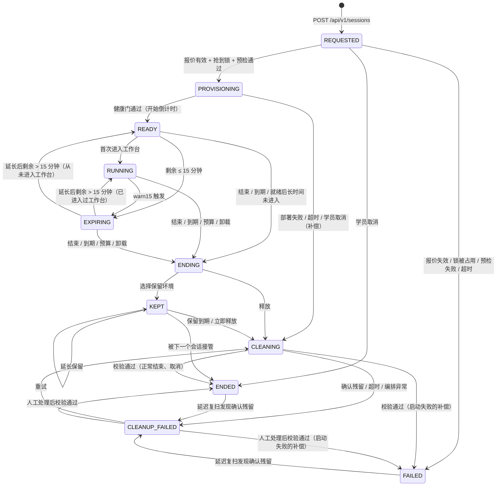
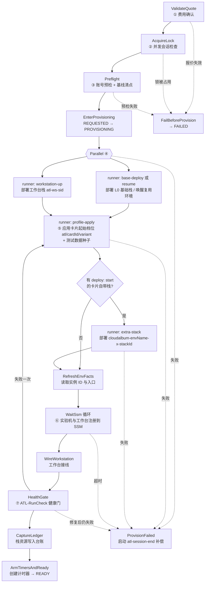
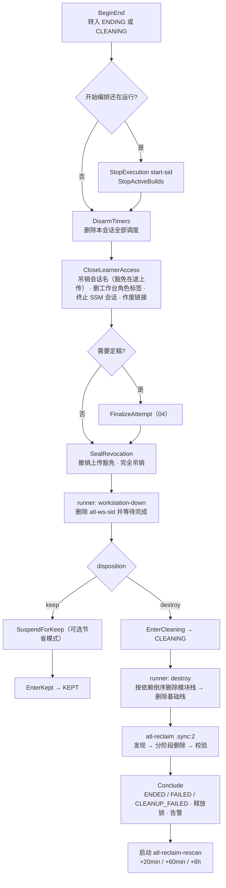
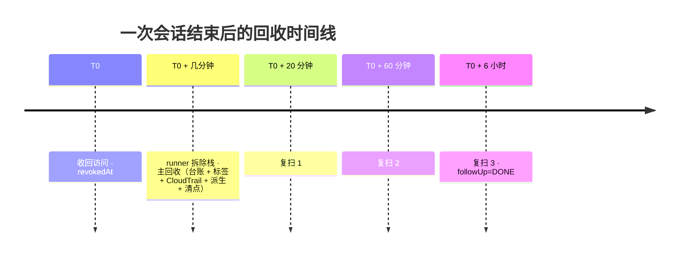
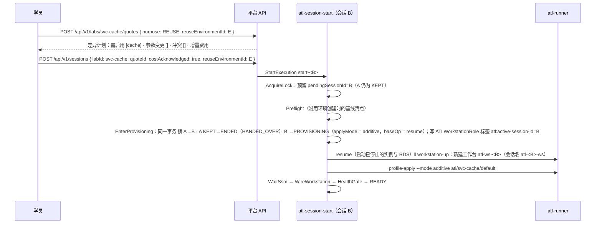

# 实验会话生命周期：一键开始、倒计时与自动释放

> 文档：`docs/platform/02-lab-lifecycle.md` · 状态：设计稿（第 2 轮：按主设计者裁决 C1～C8 修订；第 1 轮对抗式审稿与本轮的修订摘要见文末附录 A）· 日期：2026-10-13
>
> **命名权威**：[01](01-architecture.md) 是唯一的名称表（实体、DynamoDB 键、API 路由、函数、状态机、调度、`ATL_OP`、角色、标签、事件名）。本文只引用 01 的名称；本文依赖、需要 01 收录的组件与权限列在 13.6，速查见 13.7。各篇之间的名称与语义分歧（锁语义、实体名、路由等），一律以平台评审给出的统一取值为准（裁决 C1）。
>
> 本文规定 AWS Training Lab（ATL，实验平台）中**一次实验会话**（学员对一张学习卡片的一次尝试）从点击“开始实验”到资源全部释放（或交接给下一个会话）的完整生命周期：状态机、开始与结束两条 Step Functions 短编排、卡片起始状态的推导与部署、倒计时、回收器与会话内定向扫描、保留环境、并发、成本护栏、平台卸载，以及失败与恢复。
>
> 相关文档（本文只引用主题，不展开）：
> - [01-architecture.md](01-architecture.md)：总体架构、名称表、单表 `atl-main` 的键设计、IAM 角色与权限边界、一键安装与卸载。
> - [03-workspace-terminal.md](03-workspace-terminal.md)：分屏工作台、实验机终端、工作台（workstation）、控制台联合登录、应用预览。
> - [04-lab-format-checks-reports.md](04-lab-format-checks-reports.md)：`lab.yaml` v2（以卡片为单位）、检测、实验报告、徽章与证书。
> - [05-lab-catalog.md](05-lab-catalog.md)：卡片目录（权威）：56 张卡片的元数据汇总、Lab 0～25 → 卡片的映射；学习路径、掌握度、徽章与证书的模型见 [cards/tracks-and-catalog.md](cards/tracks-and-catalog.md)，逐卡设计见 `cards/` 下其余文件。
> - [06-cloudalbum-platform-mode.md](06-cloudalbum-platform-mode.md)：平台模式下 CloudAlbum 侧要求的唯一清单（`ATL_PLATFORM_MODE`、`scripts/module` 平台模式、状态桶与锁表、标签、`plan --start-of`、探测令牌、测试数据种子等）。
> - [07-aws-verification-plan.md](07-aws-verification-plan.md)：需要在真实 AWS 上确认的事项与验证计划。
>
> 上游契约：`docs/modular-design.md`（`scripts/module`、档位、模板约定，下称“总纲”）、`docs/modules/00-ec2-base.md`（基础栈，下称“00 号文档”）。README 的 Lab 0～25 现在是学习路径 `saa-main` 中的步骤（映射见 05）。本文**不修改**这些文件；CloudAlbum 侧需要的配合以 06 为唯一清单，第 15 节只列对照。
>
> 写作约束：不写具体价格与精确性能数字；文中出现的分钟数都是**可配置的默认值或超时预算**，不是性能承诺；不确定的 AWS 行为标注“以官方文档为准”，需要实测确认的列入 07。

---

## 目录

- [0. 术语与本文使用的组件](#0-术语与本文使用的组件)
- [1. 设计要点](#1-设计要点)
- [2. 会话状态机](#2-会话状态机)
- [3. 开始之前：报价、并发检查、账号预检与起始状态](#3-开始之前报价并发检查账号预检与起始状态)
- [4. 开始实验的编排：atl-session-start](#4-开始实验的编排atl-session-start)
- [5. 倒计时](#5-倒计时)
- [6. 结束实验的编排：atl-session-end](#6-结束实验的编排atl-session-end)
- [7. 回收器与会话内定向扫描](#7-回收器与会话内定向扫描)
- [8. 保留环境与环境复用](#8-保留环境与环境复用)
- [9. 并发策略、资源命名与环境状态](#9-并发策略资源命名与环境状态)
- [10. 成本护栏与平台卸载](#10-成本护栏与平台卸载)
- [11. 部署等级、耗时与进度展示](#11-部署等级耗时与进度展示)
- [12. 失败与恢复场景清单](#12-失败与恢复场景清单)
- [13. 接口汇总](#13-接口汇总)
- [14. 与 P1～P13 的偏离与细化](#14-与-p1p13-的偏离与细化)
- [15. 与其他文档的配合（对照）](#15-与其他文档的配合对照)
- [附录 A：修订记录](#附录-a修订记录)

---

## 0. 术语与本文使用的组件

### 0.1 术语

| 术语 | 含义 |
|---|---|
| 卡片 | 学习与开通的单位，id 为 `svc-<module-id>`（40 张单服务卡片）或 `sc-<slug>`（16 张场景卡片），目录以 05 为准。API、实体与标签沿用 `labId` / `atl:lab-id` 这一字段名，取值就是卡片 id（例如 `svc-cdn`）。原 Lab 0～25 是学习路径 `saa-main` 中的步骤，不再是开始实验的单位 |
| 会话（`LabSession`） | 学员对某张卡片的一次实验尝试。从“开始实验”开始，到资源释放或环境交接为止。状态机见第 2 节 |
| 实验环境（`Environment`） | 会话使用的一组 AWS 资源：CloudAlbum 工具链栈、基础栈与模块栈、卡片自带栈（`extraStacks`）、工作台（workstation）、`scripts/module` 的带外资源、学员手工创建的资源。选择“保留环境”后，一个环境可以先后服务多个会话 |
| 环境名（`envName`） | 平台模式下传给 CloudAlbum 模板的 `Env` 参数，每个环境唯一：`e` + 7 位小写字母数字，例如 `e7k2m9qx`（9.3） |
| 起始状态（`startProfile`） | 卡片开始时自动部署的状态 = L0 + iam(role) + 目标模块硬依赖的闭包（`svc-ec2`、`svc-iam` 不预置 iam）。由 `scripts/module plan --start-of <card>` 在构建期推导为档位 `atl/<cardId>/<variant>`（3.6） |
| 目标模块 | 卡片要求学员动手启用或改参的模块（04 `lab.yaml` v2 的 `targetModules[]`），完成情况由 04 的检测判定 |
| 部署等级（`provision.class`） | 起始状态的部署耗时等级 A～D，决定默认的部署与回收预算（11.1） |
| 运行器（`atl-runner`） | CodeBuild 项目，在云端执行 `scripts/module`，以会话名 `atl-<sid>-prov-<op>` 扮演 `ATLProvisionerRole`（4.3） |
| 回收器 | 结束时发现并删除资源的组件：状态机 `atl-reclaim` + Lambda `atl-reaper`（第 7 节） |
| 回收台账（`SessionResource`） | 按环境聚合（键 `ENV#<envId>/RES#<resourceKey>`，01）：每个需要回收（或明确保留）的资源一条，记录来源、创建证据、创建它的会话、删除状态、严重级别与失败原因 |
| 定向扫描（`OwnershipLookup`） | 会话进行中，按资源 ID 查询 CloudTrail 事件历史，确认学员手工创建的某个资源属于本会话（7.12） |
| 学员会话名 | 平台以 `ATLLearnerRole` 签发临时凭证时使用的 `RoleSessionName`，固定格式 `atl-<sid>-<channel>`，channel ∈ `console`、`term`、`ws`（01；9.3） |
| 截止时间 `deadlineAt` 与截止版本 `deadlineVersion` | 会话的权威到期时间（UTC，毫秒，整分钟）及其版本号。每次延长，版本号加 1，旧版本的计时器全部作废 |
| 交接（handover） | 处于 `KEPT` 的环境被下一个会话接管 |
| 活动环境锁（`ActiveEnvironmentLock`） | 平台层的单例锁（键 `PLATFORM / LOCK#ACTIVE_ENV`），保证同一时刻只有一个实验环境存在（第 9 节） |
| 环境状态桶 | `cloudalbum-lab-state-<acct>-<region>`：平台栈创建、学员可访问，每个环境一个前缀 `<envName>/`，存放 `scripts/module` 的 `state.json`（9.5） |
| 环境操作锁 | `scripts/module` 层的锁：DynamoDB 表 `cloudalbum-lab-locks` 中每个 `envName` 一项的条件写租约，防止运行器与学员在工作台上同时修改同一个环境（9.5） |
| 预期中断窗口 | 卡片步骤或平台动作事先声明的一段时间，期间实验机停机或管理通道中断属于预期，巡检与检测不把它当作故障（5.8） |
| 补偿 | 开始流程失败后的回收。**补偿与正常结束走同一条回收路径**，没有第二套删除代码 |

### 0.2 本文使用的组件（名称以 01 为准）

| 类别 | 名称 | 本文中的职责 |
|---|---|---|
| Step Functions（Standard） | `atl-session-start` | 开始实验：REQUESTED → PROVISIONING → READY（第 4 节） |
| | `atl-session-end` | 结束实验：ENDING → KEPT 或 CLEANING → ENDED/FAILED/CLEANUP_FAILED（第 6 节） |
| | `atl-reclaim` | 一轮回收：发现 → 分阶段删除 → 校验（第 7 节），被 end、rescan、uninstall 以 `.sync:2` 调用 |
| | `atl-reclaim-rescan` | CloudTrail 延迟复扫（7.7） |
| | `atl-platform-uninstall` | 卸载：结束全部会话、回收全部环境、清理运行期写入角色的策略，再回调卸载守卫（10.5） |
| | `atl-module-op`（01 定义） | 平台动作；本文只规定它受会话状态闸门与环境操作锁约束、并可打开预期中断窗口（4.3、5.8） |
| Lambda | `atl-lifecycle` | **全部状态转换**（`Transition`，单一写入者：API 触发的转换也由 `atl-api` 同步调用它完成），以及报价校验、抢锁、计时器、延长（`Extend`）、收回访问、结论等小任务，按 `action` 分派 |
| | `atl-timer` | EventBridge Scheduler 的目标：提醒、到期、保留到期、就绪空闲，以及巡检（`kind=SWEEP`，5.7） |
| | `atl-reaper` | 回收器的发现、删除、轮询、校验；会话内定向扫描 `OwnershipLookup`（7.12） |
| | `atl-checks`（04） | 账号预检与健康门（以 `ATLVerifierRole`、会话名 `atl-<sid>-verify` 执行）；定稿 `FinalizeAttempt` |
| | `atl-custom-resources` 中的 `UninstallGuard` 与动作 `UninstallRoleCleanup` | 平台栈的卸载守卫；卸载编排在回收完成后调用 `UninstallRoleCleanup` 做角色清理并回调 CloudFormation（10.5） |
| | `atl-tagger`（可选，只在 `PlatformTrail=enabled` 时部署） | 实时登记学员手工创建的资源（7.1），不是正确性的依据 |
| CodeBuild | `atl-runner` | 执行 `scripts/module` 与工作台栈的创建、删除（4.3）。源为 `atl-artifacts` 中固定版本的 `cloudalbum-infra.zip`，buildspec 随发布包提供；服务角色 `ATLRunnerServiceRole` |
| EventBridge Scheduler | 组 `atl-sessions` | 每个会话的一次性调度（5.2） |
| | 组 `atl-system` 中的 `atl-sweeper` | 周期巡检，目标 `atl-timer`（`kind=SWEEP`），只在有巡检对象时启用 |
| EventBridge | 总线 `atl-events` | 平台事件（13.3）；本文的 source 为 `atl.lifecycle`，04 的为 `atl.progress` |
| SNS | `atl-alerts` | 回收失败、预算超限、编排异常 |
| | `atl-notify` | 学员通知：就绪、到期提醒、已释放（可选邮件订阅） |
| | `atl-budget` | AWS Budgets 通知入口（10.4） |
| SQS | `atl-timer-dlq` | Scheduler 投递失败的死信队列 |
| S3 | `cloudalbum-lab-state-<acct>-<region>`（环境状态桶） | `<envName>/state.json`（9.5） |
| | `atl-data-<acct>-<region>` | `runs/<runId>/`（运行器产物：`result.json`、`ledger.json`、`progress.jsonl`）、`archive/<sid>/`（拆除前归档的 `state.json`） |
| DynamoDB | `atl-main`（01） | 本文读写的实体（13.4） |
| | `cloudalbum-lab-locks` | 环境操作锁（9.5） |
| SSM 文档 | `ATL-RunCheck`（04）、`ATL-WorkstationSetup`（03） | 健康门与工作台接线 |

> 本文使用的 `action` 名（`Transition`、`Extend`、`OwnershipLookup` 等）与事件名是跨文档接口，由 01 收录；部署单元、角色与权限以 01 为准。

---

## 1. 设计要点

1. **一个会话 = 一个状态机实例 + 开始、结束两条短编排。** 状态统一使用 P11 的 10 个状态名，另**增补 `KEPT`**（保留环境）。所有状态转换都经 `atl-lifecycle` 的 `Transition` 动作（单一写入者；学员操作触发的转换由 `atl-api` 同步调用它），用 DynamoDB 条件更新保证合法性与幂等。每个 CloudAlbum 环境使用独立的 `envName`。
2. **开始 = 费用确认 → 并发检查 → 账号预检（含回退档选择）→ 部署 L0（与工作台并行）→ runner 应用卡片的起始档位（含测试数据种子）→ 卡片自带栈（有 `deploy: start` 时）→ 等待 SSM 注册 → 工作台接线 → 健康门 → READY。** 起始档位 = L0 + iam(role) + 目标模块硬依赖的闭包，在构建期由 `scripts/module plan --start-of <card>` 推导，开始时只用 `plan --profile` 校验摘要、不现算（3.6）。失败一律交给结束编排做补偿回收。
3. **服务端是时间的唯一权威。** 倒计时从进入 READY 开始，截止时间 `deadlineAt` 向上取整到整分钟（Scheduler 以 60 秒精度触发，5.2）；到期、提前 15 分钟与 5 分钟的提醒由 EventBridge Scheduler 一次性调度触发；计时器带 `deadlineVersion`，延长时“先建新、后删旧”；巡检（`atl-sweeper`）兜底漏触发。浏览器只负责显示，用往返时延的中点估计与服务端的时钟偏差。
4. **结束 = 先收回访问，再定稿，再拆除，再回收，再校验。** 收回访问用针对本会话会话名的 `aws:userid` 拒绝策略（IAM 传播后对控制台、终端、工作台三条通道生效，传播时间以官方文档为准），同时删除 `ATLWorkstationRole` 上的 `atl:active-session-id` 标签，让工作台无法再换取学员凭证。
5. **回收器有 6 个发现来源：** 栈资源快照（含 `Retain` 资源）、`scripts/module` 的带外资源、标签扫描、CloudTrail 中本环境身份的创建事件、派生资源规则、基线清点差异（只用于提示）；实时打标签器是可选增强，需要 trail。会话进行中，检测需要确认“学员在控制台建的资源属于本会话”时，回收器提供按资源 ID 的定向扫描 `OwnershipLookup`（7.12）。**仅凭标签不删除**，必须有“是本环境创建的”证据。
6. **CloudTrail 有投递延迟：** 主回收后按 `revokedAt` 起算的绝对时间点（默认 +20 分钟、+60 分钟、+6 小时）复扫；复扫发现无法删除的残留时，会话从 ENDED/FAILED 转入 CLEANUP_FAILED 并告警。
7. **单活动环境。** 同一个平台安装（账号 + 区域）同一时刻只允许一个实验环境（运行中或保留中），理由见 9.1。每个环境有独立的 `envName`，资源名不冲突，残留也不会挡住下一个环境。CloudAlbum 的环境状态（`state.json`、环境操作锁）放在学员可访问的状态桶与锁表中，名称不以 `atl-` 开头，学员在工作台上也能运行 `scripts/module`（9.5）。
8. **保留环境是显式、限时、可复用的。** 保留需要单独的费用确认，有时长上限，默认进入“节省模式”（停止实例）；下一张卡片可以“增量应用”起始档位复用它。
9. **成本护栏分四层：** 开始前报价与确认；运行中费用计；时长、延长、保留的硬上限；可选的 AWS Budgets 联动。平台卸载前必须回收全部环境，卸载守卫在删除角色之前清理运行期写入的策略（10.5）。
10. **失败可见且有界。** 每一步都有超时与最大重试次数；每个失败都有错误码、学员可读的说明和诊断入口；三层兜底：Step Functions 的 Retry/Catch → 执行失败事件处理器 → 巡检。

---

## 2. 会话状态机

### 2.1 状态定义

| 状态 | 学员看到 | 含义 | 持有活动环境锁 | 资源在计费 | 学员可做的操作 | 超时（默认） | 超时后 |
|---|---|---|---|---|---|---|---|
| `REQUESTED` | 正在校验 | 会话记录已创建；正在校验报价、抢锁、账号预检；**尚未创建任何资源** | 抢锁中 | 否 | 取消 | 5 分钟 | → `FAILED`（`START_TIMEOUT`） |
| `PROVISIONING` | 正在准备环境 | 部署 L0、工作台、起始状态，等待 SSM，工作台接线，健康门 | 是 | 是 | 阅读手册、取消 | 按卡片的部署预算（11.1）+ 10 分钟宽限 | → `CLEANING`（补偿，`PROVISION_TIMEOUT`） |
| `READY` | 环境已就绪 | 健康门通过，**倒计时已开始**，学员还没进入工作台 | 是 | 是 | 进入工作台、延长、结束 | `readyIdleMinutes`（60）与 `deadlineAt` 取早者 | → `ENDING`（`IDLE_NOT_STARTED` 或 `EXPIRED`） |
| `RUNNING` | 实验中 | 学员已进入工作台，可使用终端、控制台、预览 | 是 | 是 | 全部 | `deadlineAt` | → `EXPIRING` → `ENDING` |
| `EXPIRING` | 即将到期 | 剩余时间 ≤ 15 分钟 | 是 | 是 | 延长、结束（可选保留） | `deadlineAt` | → `ENDING`（`EXPIRED`） |
| `ENDING` | 正在结束 | 计时器已撤销，学员访问已收回，正在定稿报告 | 是 | 是 | 查看进度 | 20 分钟 | 跳过定稿，继续释放或保留 |
| `KEPT`（增补） | 环境保留中 | 实验已结束、报告已定稿；资源按学员确认继续保留 | 是 | 是（节省模式下减少） | 复用、延长保留、立即释放 | `keep.until` | → `CLEANING`（`KEEP_EXPIRED`） |
| `CLEANING` | 正在释放资源 | 删除栈、回收器扫描与删除、校验 | 是（由 T19 重试进入的 `CLEANING` 除外：锁早已在 `Conclude` 时释放，重试**不重新获取**，此时可能已有另一个环境持有锁，见 7.5 S6 的护栏） | 递减 | 查看进度；可以先浏览下一张卡片的手册 | 按卡片的回收预算（11.1）；仍在单项期限内异步删除（`PENDING`）的项把超时顺延到该项期限 | → `CLEANUP_FAILED`（`CLEANUP_TIMEOUT`） |
| `ENDED` | 已结束 | 资源已释放，或环境已交接给下一个会话 | 否 | 否 | 查看报告 | 终态（复扫窗口内例外，见 2.4） | — |
| `FAILED` | 启动失败 | 没能进入 READY；补偿回收已完成 | 否 | 否 | 查看原因、重新开始 | 终态（同上） | — |
| `CLEANUP_FAILED` | 释放未完成 | 有确认未删除的资源；已生成待人工处理清单并告警 | 否（但开始新会话前须确认，9.2） | 可能 | 重试、查看清单、标记已处理 | 无；自动重试（7.8） | — |

### 2.2 状态图



### 2.3 转换表

“执行者”指调用 `atl-lifecycle` 的 `Transition` 动作的一方；`atl-lifecycle` 是会话状态的唯一写入者。执行者写作“API”的转换（T01、T04、T07、T09、T13、T20 与 T14 的“立即释放”），由 `atl-api` 收到请求后**同步调用** `atl-lifecycle` 完成，不在 `atl-api` 中直接写会话状态。每个转换都写一条 `SessionEvent`（类型 `session.state_changed`）并向 `atl-events` 发布同名事件。

| # | 从 | 到 | 触发 | 守卫条件 | 执行者 | 附带动作 |
|---|---|---|---|---|---|---|
| T01 | — | `REQUESTED` | `POST /api/v1/sessions` | 报价属于本人、用途为 `START` 或 `REUSE`、未过期；`costAcknowledged=true`；变体存在；同一个 `Idempotency-Key` 未用过 | API（`atl-lifecycle` 的 `CreateSession`） | 记录确认；确保巡检调度 `atl-sweeper` 处于启用状态（5.7）；启动执行 `start-<sid>` |
| T02 | `REQUESTED` | `PROVISIONING` | 开始编排 | 新环境：已持有活动环境锁；复用：持有对 KEPT 环境的有效预留（3.4）。预检无 `FAIL` | `atl-session-start` | 新环境：生成 `envId`、`envName`、标签集合，确定状态桶前缀 `<envName>/` 与锁表中的锁项（9.5）；复用：**在同一个 `TransactWriteItems` 中**完成锁的转移与 T15，并绑定已有环境 |
| T03 | `REQUESTED` | `FAILED` | 报价失效、锁被占用、预检失败、5 分钟未进入 PROVISIONING | — | `atl-session-start` / 巡检 | 新环境：若已抢到锁则释放；复用：只清除预留，**保留中的环境与其会话保持 KEPT 不变**；无资源需要回收 |
| T04 | `REQUESTED` | `ENDED` | 学员取消 | 尚未进入 PROVISIONING | API | 停止 `start-<sid>`；若已抢到锁则释放、若持有预留则清除；`endReason=CANCELLED`。条件更新失败（开始编排恰好已转入 PROVISIONING）时改走 T06 |
| T05 | `PROVISIONING` | `READY` | 健康门通过 | — | `atl-session-start` | 计算 `deadlineAt`（向上取整到整分钟，5.1），创建计时器，发通知 |
| T06 | `PROVISIONING` | `CLEANING` | 部署失败 / 超时 / 学员取消 | — | `atl-session-end` | `endReason` = `PROVISION_FAILED` / `PROVISION_TIMEOUT` / `CANCELLED`；停止开始编排与运行中的构建 |
| T07 | `READY` | `RUNNING` | 学员首次打开工作台（`POST .../heartbeat` 带 `workbench=true`） | `now < deadlineAt` | API | 记录 `runningAt` |
| T08 | `READY`/`RUNNING` | `EXPIRING` | `warn15` 触发，或任何读写时发现剩余 ≤ 15 分钟 | `deadlineVersion` 一致 | `atl-timer` / API | 发提醒 |
| T09 | `EXPIRING` | `RUNNING`（有 `runningAt`）/ `READY`（没有 `runningAt`） | 延长后剩余 > 15 分钟 | — | API | 回到进入 EXPIRING 之前的状态，避免“从未进入工作台”的会话被误标为 RUNNING 而绕过就绪空闲规则 |
| T10 | `READY`/`RUNNING`/`EXPIRING` | `ENDING` | 学员结束、到期、就绪空闲、预算强制、平台卸载、管理员结束 | 到期类触发要求 `deadlineVersion` 一致且 `now ≥ deadlineAt - 5s` | API / `atl-timer` / 巡检 → `atl-session-end` | 撤销计时器、收回访问 |
| T11 | `ENDING` | `KEPT` | `disposition=keep` | 保留确认有效（8.1） | `atl-session-end` | 计算 `keep.until`，创建保留计时器，可选节省模式 |
| T12 | `ENDING` | `CLEANING` | `disposition=destroy` | — | `atl-session-end` | — |
| T13 | `KEPT` | `KEPT` | 延长保留 | 不超过保留上限与环境最长寿命 | API | 计时器换版本 |
| T14 | `KEPT` | `CLEANING` | 保留到期 / 立即释放 / 平台卸载 | 锁上没有其他会话的有效预留（3.4）；有预留时，到期类触发改建 2 分钟后的补触发调度，学员的“立即释放”返回 409 `REUSE_IN_PROGRESS`；平台卸载先让预留方的开始编排失败再释放 | `atl-timer` / API → `atl-session-end` | 不再定稿 |
| T15 | `KEPT` | `ENDED` | 下一个会话复用本环境 | 由新会话的 T02 在同一事务中完成：锁的 holder 换成新会话、清除预留、本会话 `KEPT → ENDED`、新会话 `REQUESTED → PROVISIONING` | `atl-session-start`（新会话的 `EnterProvisioning`） | `endReason=HANDED_OVER`；本会话的回收责任随环境转移 |
| T16 | `CLEANING` | `ENDED` | 回收校验无确认残留 | `endReason ∉ {PROVISION_FAILED, PROVISION_TIMEOUT}` | `atl-session-end` | 释放锁；启动复扫 |
| T17 | `CLEANING` | `FAILED` | 回收校验无确认残留 | `endReason ∈ {PROVISION_FAILED, PROVISION_TIMEOUT}` | `atl-session-end` | 同上 |
| T18 | `CLEANING` | `CLEANUP_FAILED` | 存在 `BLOCKING` 残留、回收超时或编排异常 | — | `atl-session-end` / 巡检 / 执行失败事件处理器 | 生成待人工处理清单，告警，释放锁 |
| T19 | `CLEANUP_FAILED` | `CLEANING` | 学员或管理员点“重试”、巡检自动重试、平台卸载 | — | API / 巡检 → `atl-session-end`（从拆除阶段进入，执行名 `end-<sid>-retry-<k>`） | 不重新获取活动环境锁（2.1）；回收器按 7.5 S6 的护栏处理共享对象 |
| T20 | `CLEANUP_FAILED` | `ENDED`/`FAILED` | 待处理项全部标记已处理且校验通过 | 回到原来的终态（由 `endReason` 决定） | API | — |
| T21 | `ENDED`/`FAILED` | `CLEANUP_FAILED` | 复扫发现 `BLOCKING` 残留 | 处于复扫窗口内（`reclaim.followUp=PENDING`） | `atl-reclaim-rescan` | 告警 |

### 2.4 对 P11 的增补及理由

- **增补状态 `KEPT`。** 保留环境时，实验已经结束（凭证已收回、报告已定稿），但资源还在计费，且有自己的到期时间和“复用 / 释放”操作。把它塞进 `RUNNING` 会让“实验时间”与“保留时间”混淆，也会让 04 无法判断何时定稿；放进 `ENDED` 又会让一个“终态”还在计费、还有计时器。单独一个状态最清楚。
- **允许 `ENDED`/`FAILED` → `CLEANUP_FAILED`（T21）。** CloudTrail 有投递延迟，主回收后还要复扫（7.7）。如果为了等复扫而让会话一直停在 `CLEANING`，学员要等很久才能开始下一个 Lab。因此主回收完成即进入终态并释放锁；复扫窗口内若发现删不掉的残留，再“降级”为 `CLEANUP_FAILED`。窗口结束后 `ENDED`/`FAILED` 才是真正的终态。
- **允许 `PROVISIONING` → `CLEANING`（T06）。** 启动失败时没有需要收回的学员访问，也没有需要定稿的报告，直接进入回收；最终落到 `FAILED`，以区别于正常结束的 `ENDED`。

### 2.5 超时设置

**状态级超时**见 2.1。由两处共同保证：编排自身的 `TimeoutSeconds`，以及巡检每 5 分钟检查 `stateEnteredAt + 状态超时`。

**步骤级超时与重试**（默认值，可由卡片 `lab.yaml` 的 `provision` 覆盖）：

| 步骤 | 单次超时 | 重试 | 超过后 |
|---|---|---|---|
| Lambda 任务（报价校验、抢锁、转换等） | 30～60 秒 | 平台标准重试：间隔 2 秒，最多 5 次，倍率 2，全抖动 | 进入该步骤的 Catch |
| 账号预检 | 5 分钟 | 标准重试 | `FAILED`（`PREFLIGHT_*`） |
| runner `base-deploy`（工具链栈、密钥对、基础栈、平台模式配置、探测令牌、管理员初始化，4.3） | 构建超时 30 分钟（排队超时 30 分钟） | 可重试类错误最多再试 1 次 | 补偿 |
| runner `profile-apply`（含测试数据种子）与 `extra-stack`（`deploy: start` 的卡片自带栈） | 构建超时 = 该卡片的部署预算（11.1），两者共用 | `profile-apply`：可重试类错误最多再试 1 次，健康门失败时再以 `repair` 模式运行 1 次；`extra-stack`：运行器内部重试 1 次 | 补偿 |
| runner `workstation-up` | 构建超时 20 分钟（栈 `TimeoutInMinutes` 同值） | 不重试（失败后整体补偿；03 可选择“替换一次”） | 补偿 |
| 等待 SSM 注册 | 10 分钟；第 6 分钟时自动补救一次（重启实验机 / 替换工作台）。计时按“本轮 `profile apply` 完成时刻”起算：`repair` 之后重新计时，避免替换后的新实例一上来就被判超时 | — | 补偿（`SSM_NOT_REGISTERED`） |
| 工作台接线 | 3 分钟 | 2 次 | 补偿（`WORKSTATION_FAILED`） |
| 健康门 | 每次 60 秒 | 未就绪时每 30 秒重试，最多 6 次 | `repair` 一次，仍失败则补偿 |
| 定稿（04） | 10 分钟 | 不重试 | 记录 `finalizeError`，继续 |
| runner `destroy` | 构建超时 = 该卡片的回收预算（11.1） | 最多再试 2 次 | 带着“栈未删完”标记进入回收器 |
| 回收单个资源 | 默认 15 分钟；CloudFront 60 分钟；RDS、ElastiCache、EFS、Lambda 释放 ENI 45 分钟 | 限流类错误指数退避 | 该资源标为 `MANUAL` |
| 会话内定向扫描（7.12） | 单次查询 30 秒 | 未找到创建事件时按投递延迟退避重查，默认最长等到资源创建后 20 分钟 | 返回 `PENDING` 或 `NOT_FOUND`，由 04 的检查决定判定 |

**预算是总预算，不是单次预算。** 表中 `profile-apply` 的“构建超时 = 部署预算”是单次构建的上限；整个 `PROVISIONING`（含重试与 `repair`）共用同一个部署预算：`ClassifyRunnerFailure` 与 `RepairChoice` 在“剩余预算不足以再跑一次构建”时一律判为不可重试，并把下一次构建的 `TimeoutInMinutesOverride` 设为剩余预算。否则 D 级卡片在“重试 1 次 + repair 1 次”时最坏可达预算的 3 倍，既与 2.1 的状态超时矛盾，也会撞上执行级 `TimeoutSeconds`（10800 秒，只是最后的保险，须不小于最高等级的部署预算加各固定步骤之和）。

### 2.6 失败处理原则

1. **清理优先。** 任何失败最终都走 `atl-session-end`。补偿就是“endReason 不同的正常结束”，保证只有一套删除逻辑需要测试。
2. **先止血，再诊断。** 结束编排先撤销计时器、收回学员访问、停止进行中的构建，再收集诊断、定稿、拆除。
3. **不静默。** 每个失败都写 `LabSession.failure = { code, phase, message, diagnostics[] }`。`diagnostics` 指向 runner 日志、CloudFormation 失败事件摘要、实例控制台输出（`ec2:GetConsoleOutput`，不依赖 SSM）、SSM 命令输出。
4. **有界。** 每一步都有最大次数与总时长，超出就进入下一个确定的状态，不无限等待。
5. **三层兜底。** 编排内的 Retry/Catch → EventBridge 上 `Step Functions Execution Status Change`（`FAILED`/`TIMED_OUT`/`ABORTED`）的处理器 → 周期巡检（`atl-sweeper`）。

### 2.7 幂等性保证

| 层 | 机制 |
|---|---|
| API 写操作 | 所有 `POST` 要求 `Idempotency-Key` 请求头。`IdempotencyRecord` 保存（用户、路由、键）→ 请求摘要与响应，保留 24 小时。同键同请求体返回首次响应；同键不同请求体返回 422 |
| 状态转换 | `Transition` 用 DynamoDB 条件更新：`state IN (:from) AND ver = :v`，成功后 `ver+1`，并在同一个事务里写 `SessionEvent`。若当前状态已经等于目标状态且 `reason` 相同，视为重放成功；否则返回 `Atl.TransitionRejected`，调用方按“已有人处理”结束本分支 |
| 编排执行 | 执行名确定：`start-<sid>`；结束编排按“结束阶段”命名——首次结束（`ENDING`、取消、补偿、预算、卸载）`end-<sid>-1`，保留环境的释放（`KEPT → CLEANING`）`end-<sid>-rel`，回收重试 `end-<sid>-retry-<k>`；`reclaim-<envId>-<mode>-<n>`、`rescan-<envId>`。Standard 工作流的执行名在 90 天内不能复用：同名同输入且仍在运行时返回原执行；**已结束、或同名不同输入时返回 `ExecutionAlreadyExists`**（以官方文档为准）。所以同一个“结束阶段”只能有一个名字，不同阶段绝不能共用名字——否则保留环境的释放会因 `end-<sid>-1` 早已结束而被误判为“已有人在做”，环境永远不会被释放。`ExecutionAlreadyExists` 只在同一阶段内解释为“已有人在做”，调用方随后读取会话状态确认（状态未推进则告警） |
| 计时器 | 调度名包含 `deadlineVersion`；创建时遇到 `ConflictException` 视为成功；处理器比对版本，旧版本直接丢弃。截止时间对齐整分钟，提前触发不丢弃而是补建（5.3） |
| 运行器 | `scripts/module` 自身幂等（`--no-fail-on-empty-changeset`；`profile apply` 只做差异）。每次构建先 `wait-stable`；state.json（环境状态桶，9.5）用 S3 条件写（`If-Match` ETag）防止丢失更新；环境操作锁（`cloudalbum-lab-locks` 中的条件写租约）防止并发修改。`--disable-rollback` 创建失败的基础栈处于 `CREATE_FAILED`，重试时运行器先删除该栈再重建（首次创建时数据卷为空，删除无损失），不在失败栈上直接重试 |
| 直接调用 CloudFormation | `ClientRequestToken` 固定为 `<sid>-<动作>-<序号>` |
| 回收器 | 台账键 = 区域 + 资源 ARN（无 ARN 时用“类型 + ID”）；多个来源发现同一资源只记一条；`NotFound`/已删除状态视为成功 |
| 事件 | `SessionEvent` 带单调序号；消费者按 `eventId` 去重 |

---

## 3. 开始之前：报价、并发检查、账号预检与起始状态

### 3.1 学员视角的流程

1. 学员在卡片目录（05）打开某张卡片（有变体时选择变体），点“开始实验”。
2. 前端调用 `POST /api/v1/labs/{labId}/quotes`（`labId` 即卡片 id），弹出**费用确认对话框**：预计每小时费用区间、起始状态包含的按小时计费资源（含卡片自带栈）、完成本卡片后的每小时费用、本次会话最多可能产生的费用（含最大延长）、价格数据日期、免责声明（10.1）；部署等级的定性说明与本平台以往的准备时间（11.3）。卡片有预检型变体（回退档，`startProfile.variants[]` 中 `select: preflight` 的条目）时注明“若探测失败将改用回退档”（3.6）。如果当前有保留中的环境，对话框同时给出“复用该环境”的选项与差异计划（8.4）。
3. 学员勾选“我已了解：资源创建在我的 AWS 账号中并按 AWS 价格计费；结束或到期后自动释放；选择保留会持续计费”，点“开始实验（预计每小时 ≈ …）”。
4. 前端调用 `POST /api/v1/sessions`，立即跳转到分屏工作台：左侧手册**立即可读**，右侧各标签显示“环境准备中”与进度（11.3）。

### 3.2 报价（`CostQuote`）

- 路由（01）：开始前的报价用 `POST /api/v1/labs/{labId}/quotes`，用途 `START` 或 `REUSE`（复用时的增量）；延长与保留的报价用 `POST /api/v1/sessions/{sid}/quotes`，用途 `EXTEND` 或 `KEEP`。
- 内容：`labId`、`labVersion`、`variant`、起始档位与摘要、区域、价格数据日期 `asOf`、费用明细（10.1）、`timeLimitMinutes`、`maxTotalMinutes`；有效期字段 `CostQuote.expiresAt`，默认 15 分钟。
- 卡片的 `startProfile.variants[]` 中有 `select: preflight` 的条目（回退档，例如 svc-tls 的 `acme-off`，3.6）时，报价按“学员所选变体”与“它可能被预检替换成的变体”中费用较高的一个计算，并注明替换条件（条目的 `when`）。第 3 轮修订：原稿读取的 `startProfile.fallbacks` 不是 04 v2 的字段，已废弃。
- 报价计入卡片自带栈（`extraStacks`）与卡内会创建的临时 EC2（演练实例、第二台实例、Spot 基准实例等，按卡片 `cost` 段的声明）。
- 报价只在服务端保存，前端只传 `quoteId`，不传金额。
- 价格数据、卡片版本或档位摘要在报价之后发生变化 → `ValidateQuote` 失败（`QUOTE_MISMATCH`），前端重新报价并再次请学员确认。

### 3.3 `POST /api/v1/sessions` 的处理

请求体（01）：`{ labId, variant?, quoteId, costAcknowledged: true, reuseEnvironmentId?, residualAck?, learnerInputs?, workstation?: 'ec2' | 'cloudshell' }`。基础时长取卡片 `lab.yaml` 的 `timeLimitMinutes`，客户端不传时长。

1. 校验登录（Cognito）、`Idempotency-Key`、报价归属与有效期、`costAcknowledged=true`、`variant` 存在（缺省为 `default`）、`learnerInputs` 满足卡片的 `prerequisites.learnerInputs`。
2. **快速预判**（非权威）：读取活动环境锁与 `PlatformConfig`。被占用、预算阻止（10.4）、平台卸载中时直接返回 409，给学员更快的反馈。
3. 同步调用 `atl-lifecycle` 的 `CreateSession`：写入 `LabSession`（`REQUESTED`，`ver=1`；含从卡片复制的 `cardFacts{platformActions[], sshFromWorkstation, sshUser}`，供 agent context 使用，01 §7.3、§8.2）与 `SessionEvent`，确保 `atl-sweeper` 已启用（T01）。
4. `StartExecution`：状态机 `atl-session-start`，执行名 `start-<sid>`，输入 `{ "sessionId": "<sid>" }`。
5. 返回 `202`，响应体是会话视图（13.1），含 `serverNow`。

`workstation='cloudshell'` 时开始编排跳过工作台分支（`workstation-up`、`WireWorkstation`、`ws.ready`）与结束时的 `workstation-down`（Choice，骨架中省略）；该模式的能力限制由 03 定义，卡片 `workstation.required=true` 时不允许选择。

### 3.4 并发检查（编排内，权威）

`AcquireLock` 对单例实体 `ActiveEnvironmentLock`（键 `PLATFORM / LOCK#ACTIVE_ENV`，属性 `holderEnvId`、`holderSessionId`、`pendingSessionId`、`pendingUntil`）做条件写，分以下情况：

| 当前锁 | 请求 | 结果 |
|---|---|---|
| 空闲 | 新环境 | 获得锁：`holderEnvId`（新）、`holderSessionId` |
| 被 `KEPT` 环境 E 持有 | `reuseEnvironmentId = E` | **预留**（不交接）：条件写 `pendingSessionId = B`、`pendingUntil = now + 5 分钟`（条件：A 仍是 `KEPT`、`ver` 未变、没有其他有效预留）。真正的交接放到预检通过之后的 `EnterProvisioning`（T02 + T15 同一事务）。预检失败、取消或超时只清除预留，A 保持 `KEPT`，环境仍有主人。预留期间 A 的保留到期与“立即释放”按 T14 的守卫推迟 |
| 被 `KEPT` 环境 E 持有 | 新环境 | 拒绝 `ENV_KEPT_EXISTS`：提示“先释放保留的环境”或“复用” |
| 被活动会话持有（`PROVISIONING`～`ENDING`） | 任意 | 拒绝 `SESSION_ACTIVE_EXISTS`（显示是哪张卡片、谁开的、何时到期） |
| 被 `CLEANING` 会话持有 | 任意 | 拒绝 `CLEANUP_IN_PROGRESS`（显示回收进度与预计范围）。T19 重试进入的 `CLEANING` 不持有锁，不在此列 |
| 空闲，但存在 `CLEANUP_FAILED` 且有按小时计费的 `BLOCKING` 残留 | 未带 `residualAck` | 拒绝 `RESIDUAL_ACK_REQUIRED`（9.2） |

锁**没有**基于时间的自动过期：环境还存在时绝不允许被“抢走”。只有“预留”带 `pendingUntil`，过期的预留视为不存在。锁与会话状态不一致（例如持有者已是终态）由巡检修复。

> 第 1 轮审稿修订：初稿在 `AcquireLock`（预检之前）就完成交接并执行 T15。若随后预检失败，`FailBeforeProvision` 会把会话 B 置为 `FAILED` 并释放锁，而会话 A 已经 `ENDED`——保留中的环境从此没有任何会话负责回收，持续计费且不会被自动释放。改为“先预留、预检后交接”消除了这个孤儿窗口。

### 3.5 账号预检（`Preflight`，只读）

执行身份：预检由 `atl-lifecycle` 同步调用 `atl-checks` 的预检动作完成，以 `ATLVerifierRole`（会话名 `atl-<sid>-verify`）执行（P9；01）。

| 检查 | 级别 | 失败时的说明 |
|---|---|---|
| 区域是平台安装区域，且在边界允许的区域内；卡片 `regions.extra` 含 `${atl:drRegion}` 时，平台参数 `DrRegion` 已配置 | FAIL | 指出缺少的平台参数 |
| 存在默认 VPC 及目标 AZ 的默认子网（L0 依赖默认 VPC） | FAIL | 给出 `aws ec2 create-default-vpc` 命令（学员自己执行；平台不自动创建，也不会回收默认 VPC） |
| 弹性 IP、VPC、按需实例 vCPU 等配额够用（按起始档位与目标模块估算需求） | FAIL | 指向 Service Quotas 页面 |
| CodeBuild 并发构建配额可用（新账号可能很低，以官方文档为准） | WARN | 可能出现排队，进度页会显示“排队中” |
| 卡片的人工前置（`prerequisites.learnerInputs`）：域名与托管区域、能收信的邮箱等。**SES 发件身份只检查学员是否已填写发件邮箱，不检查身份是否已存在**——身份由卡片中的 email 栈创建、学员点验证邮件完成 | FAIL | 指向 04 手册的前置步骤 |
| 预检型变体选择：对 `startProfile.variants[]` 中 `select: preflight` 的条目，按其 `when` 引用的预检键执行探测（预检键在 04 登记，目前只有 `preflight.tlsAcme`：tls 的 ACME 端点是否可用），`when` 为真时改用该变体，写入 `LabSession.startProfileResolved = { name, digest, variant }`（3.6） | —（`when` 为真即改用该变体） | 进度页与报告中注明“已改用回退档 `<variant>`” |
| 账号级单例与已有资源（GuardDuty 检测器、Config 记录器、Inspector 激活、CloudTrail 跟踪数量）与本卡片模块的关系 | WARN | 由 `scripts/module` 的 `preflight`（`existing-detector` 等）决定“只读接入”；Inspector 激活会同时扫描、计费工作台与平台自身的函数，确认对话框中说明 |
| 存在未处理的 `CLEANUP_FAILED` 残留 | WARN / 需确认 | 见 9.2 |
| 预算状态（10.4） | FAIL（`EXCEEDED` 且设置为阻止）/ WARN | — |

预检同时做一次**基线清点**（`InventorySnapshot`）：在扫描区域内列出高成本资源的现有 ID，供结束时做差异提示（7.1 的 `INVENTORY` 来源）。清点范围除运行中的 EC2、NAT 网关、负载均衡器、RDS、ElastiCache、EFS、弹性 IP、接口型 VPC 终端节点外，还包括“昂贵但不是实例规格”的资源：ElastiCache Serverless 缓存、API Gateway REST API 的缓存集群、EFS 预置吞吐、RDS 预置 IOPS 与大容量存储、超大 EBS 卷（阈值为平台设置）。复用环境时**不重新清点**，沿用该环境创建时的基线；否则上一个会话留下的资源会被算进基线，差异提示就失效了。

### 3.6 起始状态：从卡片到档位（裁决 C3）

**规则**

1. 卡片的 `startProfile` = L0（`l0-ec2`）+ `iam`（`role` 模式）+ 目标模块硬依赖的闭包。闭包按总纲的规则表与 registry 计算，包括任选分支的选择、凭证前置，以及对比实验必需的本地档；场景卡还可以加入写明理由的背景模块与卡片自带栈（`extraStacks`），理由分类与写法以 05 和 `cards/tracks-and-catalog.md` 为准。
2. 例外：`svc-ec2`（学习对象就是 L0）与 `svc-iam`（学习对象就是 iam）不预置 iam。
3. **不能直接用 `profiles/single/<id>.env`**：它包含目标模块本身。档位由 `scripts/module plan --start-of <cardId> [--variant <v>] --platform --json` 推导（命令与输出格式见 06），构建期（`labs:build`）生成 `profiles/atl/<cardId>/<variant>.env`（默认变体 `default`）与摘要 `startProfileDigest`，写入内容发布的 `manifest.json`；CI 逐卡重算并比对，不一致即失败。
4. 目标模块的目标取值不得在起始状态中生效；目标模块的前驱取值（`targetModules[].fromDriver`，例如 network 从 `public` 起步）与本地档可以出现（04 的 lint）。
5. 平台段 `startProfile.platform`（04 `lab.yaml` v2）：`preview.directHttps` 控制平台默认的 HTTPS 方案（Let's Encrypt IP 证书，06）。该方案会写入 `TLS_MODE=letsencrypt`，与 `DEPLOY_MODE=asg` 冲突（ASG-014），也与“从自签名讲起”的 tls 叙事冲突，所以**起始状态或目标含 autoscaling 的卡片、以 tls 为目标的卡片必须关闭**（`svc-autoscaling`、`svc-tls`、`sc-ha-web`、`sc-static-acceleration` 等；实验机迁入私有子网后证书无法续期的 `sc-private-network` 也关闭）。`sshFromWorkstation` 见本节末尾。变体 `startProfile.variants` 可以覆盖默认的起始状态与目标。
6. 部署等级 `provision.class`（A～D）由构建按起始状态计算（11.1）；`lab.yaml` 中手写的值必须与之一致。
7. v1 不提供“新环境直接在自定义 VPC 中部署 L0”的快速路径（`profile apply --fresh`，11.4）。起始状态含 network 时，一律先在默认 VPC 部署 L0，再由 `profile apply` 以分阶段替换把实验机迁入自定义 VPC，部署等级至少为 B。

**开始实验时的解析**

| 时机 | 动作 |
|---|---|
| 报价（3.2） | 读取所选变体的档位与摘要；有 `select: preflight` 的变体时按费用较高者报价 |
| 账号预检（3.5） | 对 `select: preflight` 的变体执行探测，确定实际变体，写入 `LabSession.startProfileResolved = { name, digest, variant }`（第 3 轮：原 `fallbackId` 改名为 `variant`，与 01 §7.3 一致） |
| `EnterProvisioning` | 把 `startProfileResolved` 放进环境上下文（4.2） |
| runner `profile-apply`（4.3） | 从内容发布下载档位文件 `profiles/atl/<cardId>/<variant>.env`，按 `manifest.json` 校验 SHA-256；执行 `scripts/module plan --profile atl/<cardId>/<variant> --platform --json` 复核（第 3 轮：运行器的源码包与内容发布中都没有 `lab.yaml`，所以运行期不用 `--start-of`；两者的 `digest` 同一算法，06 PM-32）：退出码 2 → `PROFILE_RULES`；`digest` 与档位中的 `PROFILE_PLAN_DIGEST`、`startProfileDigest` 不一致 → `PROFILE_DIGEST_MISMATCH`（不可重试：内容包与工具包版本不匹配）；然后执行 `profile apply`，最后按 `PROFILE_SEEDS` 执行种子 |
| runner `extra-stack`（4.3） | 只在卡片有 `deploy: start` 的卡片自带栈时，在 `profile-apply` 成功之后执行一次 |
| 健康门（4.4 `HealthGate`） | `caps.profile` 逐个模块比对起始状态。模块 `status=ok`，或 `status=degraded` 且引起降级的规则**全部**属于卡片声明的 `expectedWarnings`、`validation.errors` 为空，都判为通过；其余 `degraded` 与 `error` 判为不通过。目标模块此时应为关闭或前驱取值，不参与判定 |

**SSH 接线**（卡片 `workstation.sshFromWorkstation=true`，例如 `svc-shell-access`、`sc-private-network`）：`profile-apply` 在应用档位时把基础栈的 `SshIngressCidr` 设为工作台地址/32。实验机与工作台同在默认 VPC 时取工作台**私网** IP；起始状态已把实验机迁入自定义 VPC 时（两者没有私网路由）取工作台**公网** IPv4。地址由运行器从工作台栈 `atl-ws-<sid>` 的输出读取（这就是工作台与 L0 并行部署、`profile-apply` 在两者之后执行的原因之一）；对应的平台占位符由 04/05 统一命名。

---

## 4. 开始实验的编排：`atl-session-start`

### 4.1 流程概览



与任务给定顺序（费用确认 → 并发检查 → 部署 L0 → runner 应用 startProfile → 等待 SSM → 健康检查 → READY）相比，本文做了三处细化：在并发检查后加“账号预检”（含回退档选择，3.6）；工作台与 L0 **并行**部署；在等待 SSM 之后加“工作台接线”。理由见 4.6。`workstation='cloudshell'` 时 Parallel 的工作台分支与 `WireWorkstation` 被 Choice 跳过（骨架中省略）。

### 4.2 环境上下文

`EnterProvisioning` 返回、并贯穿整个编排的上下文：

```json
{
  "sessionId": "s4k7m2q9x1abc",
  "env": {
    "envId": "01jc9x3k9c...",
    "envName": "e7k2m9qx",
    "fresh": true,
    "applyMode": "fresh",
    "baseOp": "base-deploy",
    "workstation": "ec2",
    "startProfile": "atl/svc-database/default",
    "extraStacks": { "atStart": false, "argsB64": null },
    "cfnTags": [
      { "Key": "Project", "Value": "CloudAlbum" },
      { "Key": "atl:session-id", "Value": "s4k7m2q9x1abc" },
      { "Key": "atl:lab-id", "Value": "svc-database" },
      { "Key": "atl:env-id", "Value": "01jc9x3k9c..." },
      { "Key": "atl:component", "Value": "env" }
    ],
    "stateUri": "s3://cloudalbum-lab-state-111122223333-ap-northeast-1/e7k2m9qx/state.json",
    "lockTable": "cloudalbum-lab-locks",
    "budget": { "baseBuildMinutes": 30, "baseTaskSeconds": 2100, "applyBuildMinutes": 30, "applyTaskSeconds": 2100, "ssmTimeoutSec": 600, "ssmRemediateAfterSec": 360 }
  },
  "ctx": { "lab": { "labId": "svc-database", "kind": "service", "version": "1.2.0", "variant": "default", "startProfile": "atl/svc-database/default", "startProfileDigest": "sha256:…", "timeLimitMinutes": 180 } }
}
```

- `applyMode`：新环境为 `fresh`；复用为 `additive`（只启用缺少的模块、更新参数，不禁用多余模块，8.4）。
- `baseOp`：新环境为 `base-deploy`；复用为 `resume`（启动节省模式下停止的实例与 RDS，8.2）。
- `startProfile`：预检确定的实际档位（`LabSession.startProfileResolved.name`，3.6）；没有 `select: preflight` 的变体被选中时等于 `ctx.lab.startProfile`。
- `extraStacks`：卡片有 `deploy: start` 的卡片自带栈时 `atStart=true`，`argsB64` 为 `extra-stack` 的 `ATL_ARGS`（`{"action":"deploy","stackIds":[…]}` 的 base64url）；没有时 `atStart=false`、`argsB64=null`（字段必须齐全，4.4 实现约束 1）。
- `workstation`：`ec2` 或 `cloudshell`（3.3）。
- `cfnTags`：`scripts/module` 在平台模式下打到全部栈与带外资源上的标签（9.3）。`atl:component=env` 表示“环境资源”：学员边界的 `ProtectComponentTag` 只保护取值 `platform` 与 `workstation`，所以学员在工作台上用 `scripts/module` 启用模块时同样能带上它（裁决 C4(d)）。
- `stateUri`、`lockTable`：环境状态桶中的本环境前缀与锁表（9.5）。
- `budget` 来自卡片的部署等级与 `provision` 覆盖（11.1），可被 `PlatformConfig` 覆盖。示例中的 `svc-database` 起始状态只有 L0 + iam，属于 A 级；RDS 由学员在卡片中创建，等待时间计入 `timeLimitMinutes`。

### 4.3 运行器 `atl-runner` 的契约

**项目配置**（以 01 为准）：不放进 VPC；按构建分钟计费，闲置零成本；ARM 最小规格的托管 Amazon Linux 镜像（版本以官方文档为准）；**源是 `atl-artifacts` 中固定版本的 `releases/<ver>/cloudalbum-infra.zip`，buildspec 随发布包提供，不从学员可写的位置读取**；日志组 `/aws/codebuild/atl-runner` 由平台栈预先创建（便于卸载时一并删除）；服务角色 `ATLRunnerServiceRole`（只能写日志、读制品、写 `atl-data` 的 `runs/` 与 `archive/` 前缀、扮演 `ATLProvisionerRole`），**不**把 `ATLProvisionerRole` 直接作为服务角色——否则会话名由 CodeBuild 决定、不含会话 ID，违反 P5。项目并发上限 2：开始编排中 `base-deploy` 与 `workstation-up` 并行会同时占满两个名额，此时若有 T19 回收重试会进入排队，进度页显示“排队中”。

**环境变量**（`ATL_OP` 及其取值、其余变量名以 01 为准；本文用到的变量需在 01 收录，13.6）：

| 变量 | 含义 |
|---|---|
| `ATL_OP` | `base-deploy` \| `resume` \| `profile-apply` \| `workstation-up` \| `workstation-down` \| `module-op` \| `suspend` \| `destroy` \| `repair` \| `diagnose` \| `extra-stack` |
| `ATL_RUN_ID` | 运行 ID，例如 `s4k7m2q9x1abc-apply-1-0`；对应 `RunnerRun` 实体与 `atl-data` 的 `runs/<runId>/` |
| `ATL_SESSION_ID`、`ATL_ENV_ID`、`ATL_LAB_ID` | 会话、环境、卡片 |
| `ATL_PROFILE`、`ATL_APPLY_MODE`、`ATL_REPAIR` | 仅 `profile-apply` |
| `ATL_ARGS` | `module-op`：平台动作参数（JSON，经 schema 与 registry 的 `platformActions` 白名单校验，01）；`extra-stack`：`{ action: deploy \| destroy, stackIds[] }`（`stackIds` 必须是本卡 `extraStacks[]` 中的 id） |
| 其余（区域、状态桶路径、锁表名、标签、平台 API 地址、CloudAlbum 版本） | 由 buildspec 从 `Environment` 记录读取，不经编排传递 |

**buildspec 各阶段**：

1. `install`：按发布包的 `SHA256SUMS` 校验源包。
2. `pre_build`：写入 CLI 配置文件（`role_arn = ATLProvisionerRole`、`credential_source = EcsContainer`、`role_session_name = atl-<sid>-prov-<op>`），以 `ATLRunnerServiceRole` 扮演 `ATLProvisionerRole`。这是角色链，凭证每次最长 1 小时，由 CLI/SDK 按配置文件自动续期，不把一次性凭证导出为环境变量。运行器创建的一切在 CloudTrail 中都能按会话名找到，运行器中途崩溃时回收器仍能补漏（7.3 的 I2）。然后从环境状态桶下载 `state.json`（记下 ETag），在 `cloudalbum-lab-locks` 中获取环境操作锁（持有者为本构建的会话名，租约在构建期间续期，9.5）。
3. `build`：执行 `scripts/module --platform …`（命令映射见下表）。`--progress-jsonl` 输出的每一行由辅助脚本转发到 `POST /api/v1/internal/runs/{runId}/events`；`scripts/module` 完成的模块启停写到 `POST /api/v1/internal/sessions/{sid}/module-ops`。两者都属于路由 `ANY /api/v1/internal/{proxy+}`（IAM 鉴权，01）。HTTP API 不支持资源策略，同账号内任何有 `execute-api:Invoke` 的身份都能签名调用，所以处理函数必须校验 `requestContext.authorizer.iam.userArn` 形如 `assumed-role/ATLProvisionerRole/atl-<sid>-prov-*`，且 `<sid>` 与路径中的会话、`runId` 所属会话一致；学员边界与 `ATLAgentApi` 另行拒绝 `/internal/*`。`/agent/*` 只给工作台（`-ws` 会话）使用。
4. `post_build`（无论成败都执行）：用 `If-Match` 把 `state.json` 写回状态桶；释放环境操作锁；以服务角色把 `result.json`、`ledger.json`、`progress.jsonl` 上传到 `atl-data` 的 `runs/<runId>/`；以 `scripts/module` 的退出码结束构建。

| `ATL_OP` | 实际命令（平台模式参数见 06） | 说明 |
|---|---|---|
| `base-deploy` | 按下面“`base-deploy` 的步骤”顺序执行 | 部署 L0 与平台模式所需的一切（包含 01 原 `session-bootstrap` 的全部内容） |
| `resume` | `scripts/module env resume --platform` | 复用环境时代替 `base-deploy`：启动节省模式下停止的实例与 RDS（8.2） |
| `profile-apply` | ⓪ **仅复用环境**：经 SSM 在实验机上执行 `cloudalbum platform:apply-env`，把 `platform.env` 中的会话事实（`ATL_SESSION_ID`、`ATL_LAB_ID`、`ATL_VARIANT`）更新为本会话（06 PM-02）① 下载并校验档位 `profiles/atl/<cardId>/<variant>.env`，替换 `${atl:…}` 占位符（3.6）② `scripts/module plan --profile atl/<cardId>/<variant> --platform --json` 复核摘要（3.6）③ `scripts/module profile apply atl/<cardId>/<variant> --platform --mode fresh\|additive [--repair] --yes` ④ （保留编号，第 3 轮起卡片自带栈改由 `extra-stack` 部署）⑤ **测试数据种子**：按档位 `PROFILE_SEEDS` 的顺序执行 `scripts/module seed <id> --platform`（持锁；06 PM-43）。单个种子失败重试 1 次，仍失败则继续后续种子，失败的种子 id 写入 `result.json` 的 `warnings`，健康门把它报告为警告（种子不改变模块状态，不阻止 `READY`）。种子放在这里而不是 `base-deploy`：`gps-sample-photos` 要经应用的 StoragePort 写入、`cognito-test-users` 依赖 auth 的状态，两者在 `base-deploy` 时都还没有启用 | `fresh`：完整差异；`additive`：只增不减；`--repair`：先执行 `status --repair` 再应用。卡片要求 SSH 接线时同时设置 `SshIngressCidr`（3.6）。l0-ec2 起始的卡片也执行，用于 SSH 接线与 L0 冒烟子集。Cognito 中的已知密码不由运行器设置：种子在 `state.json` 中登记钩子，由工作台接线时以学员身份执行（03 §4.6、06 PM-36） |
| `extra-stack` | 部署或删除卡片自带栈（01 §3.4）：栈名 `cloudalbum-<envName>-x-<stackId>`（第 3 轮由 `atl-<envName>-<cardId>-<stackId>` 改名：旧名落在学员边界 `DenyPlatformByName` 的 `stack/atl*` 内，灾备区域与 `us-east-1` 的护栏也只放行 `stack/cloudalbum-*`）；模板来自内容发布的 `stacks/<cardId>/<stackId>.yaml`（按 `manifest.json` 校验）；栈级标签 = 4.2 的 `cfnTags` + `atl:card-stack=<stackId>`；参数中的 `{{ … }}` 由运行器解析，输出按 `outputs` 写回会话变量。可重试类错误在运行器内部按下面的分类重试 1 次 | **唯一的部署者**：`deploy: start` 的栈由开始编排在 `profile-apply` 之后调用（4.4 的 `ExtraStacksDeploy`）；`deploy: step:<stepId>` 的栈由 `atl-module-op` 在学员点击步骤中的“部署”按钮（平台动作 `xstk-<stackId>`，04）时调用，只在 `READY`/`RUNNING`/`EXPIRING` 执行，与学员共用环境操作锁。删除不经这个操作：会话结束时由 `destroy` 按 `reclaim.phase` 删除（6.5）；`action: destroy` 只用于单独重试 |
| `workstation-up` | 以平台制品中的 `workstation.yaml` 创建栈 `atl-ws-<sid>`（参数 `SessionId`、`EnvName`；栈级标签 = 4.2 的 `cfnTags`，但 `atl:component=workstation`；`ClientRequestToken = <sid>-ws-create`；`--on-failure DELETE`） | 模板与参数由 03 定义。栈名带**会话 ID**：工作台每个会话重建，复用环境时新会话的栈不会与上一个会话仍在删除中的同名栈冲突 |
| `workstation-down` | 删除 `atl-ws-<sid>` 并等待 `DELETE_COMPLETE`（栈不存在视为成功；`DELETE_FAILED` 时把失败资源写入台账） | 结束编排用；保留环境时必须等删除完成再进入 `KEPT` |
| `module-op` | 平台动作（`atl-module-op` 调用，01 定义）：`scripts/module` 的 `enable`/`disable` 或模块的平台专用参数，参数只能来自 registry 的 `platformActions` 白名单 | 只在 `READY`/`RUNNING`/`EXPIRING` 执行；与学员共用环境操作锁；动作声明 `interruptsManagementChannel` 时先打开预期中断窗口（5.8） |
| `suspend` | `scripts/module env suspend --platform` | 保留环境的节省模式（8.2） |
| `destroy` | 先把 `state.json` 复制到 `atl-data` 的 `archive/<sid>/`；删除 `extraStacks` 中 `reclaim.phase: before-modules` 的栈；再 `scripts/module env destroy --platform --fast --ledger-out runs/<runId>/ledger.json` | 6.5；取代 `session-teardown` 与 `scripts/teardown`（平台模式下 `scripts/teardown` 只是 `env destroy` 的别名） |
| `repair` | `scripts/module status --repair`，必要时 `rebuild-instance` 或重新应用起始档位（`--mode additive`） | `POST /api/v1/environments/{envId}/repair`（场景 16） |
| `diagnose` | 只读诊断（01） | 收集栈事件、实例控制台输出与 SSM 状态 |

**`base-deploy` 的步骤与失败分类**（审稿补充：初稿只执行 `base deploy`，缺少工具链、平台配置、探测令牌与管理员初始化，健康门 `base.ready` 的 `platformEnvPresent`、`probeTokenPresent` 必然不通过）：

| # | 步骤 | 失败时 |
|---|---|---|
| 1 | `scripts/module bootstrap --platform --env <envName>`：工具链栈 `cloudalbum-<envName>-toolchain`（制品桶，`AppArchiveUrl` 由它生成预签名 URL） | 按 4.3 的分类表 |
| 2 | 创建会话密钥对 `cloudalbum-<envName>-key`（`ec2:CreateKeyPair`），私钥写入 SecureString `/cloudalbum/<envName>/atl/ssh-key`（受 01 `DenySessionSecrets` 保护，实验机读不到）。不用 `AWS::EC2::KeyPair`：它把私钥写到 `/ec2/keypair/*`，实验机凭 SSM 核心策略就能读到。名称以 `cloudalbum-` 开头，回收器按带外资源删除（7.2） | `AccessDenied` 不可重试（`ACCESS_DENIED`）；限流可重试 |
| 3 | `scripts/module base deploy --platform --env <envName> --delivery ssm --instance-profile CloudAlbumAppRole --key-name cloudalbum-<envName>-key --disable-rollback`：实验机从一开始就带只含 `AmazonSSMManagedInstanceCore` 的实例配置文件（P7），投递通道从 L0 起就是 SSM；`--disable-rollback` 保留失败现场，便于收集控制台输出与引导日志。首次创建遇到容量不足时，换同一默认 VPC 中另一个 AZ 的默认子网重试一次 | 按 4.3 的分类表；引导失败为 `BASE_BOOTSTRAP_FAILED` |
| 4 | 经 SSM 写入 `/etc/cloudalbum/platform.env`（`ATL_PLATFORM_MODE=1` 等，内容见 06） | SSM 投递失败可重试 1 次；仍失败为 `BASE_BOOTSTRAP_FAILED` |
| 5 | 经 SSM 在实验机本机初始化探测令牌（`X-ATL-Probe-Token` 所需的本机密钥与 `probe-token` CLI，06），令牌只在本机生成，不经平台传递 | 同上 |
| 6 | 非交互初始化应用管理员：运行器生成随机密码，明文只写入 SecureString `/cloudalbum/<envName>/atl/app-admin-password`；经 SSM 只向实例下发 argon2id 哈希。agent 的会话上下文返回该参数名，不在工作台脚本中硬编码路径 | 同上 |

步骤 2、4～6 是 `scripts/module` 之外的直接调用，所需的 `ec2:CreateKeyPair`/`DeleteKeyPair`（名称 `cloudalbum-*-key`）、`ssm:PutParameter`/`DeleteParameter`（`/cloudalbum/*/atl/*`）与 `ssm:SendCommand`（平台的 SSM 文档、`atl:role=lab-app` 的实例）需要 01 列入 `ATLProvisionerRole` 的直接调用白名单（13.6）。

**`result.json`**（运行器失败分类的唯一依据）：

```json
{
  "runId": "s4k7m2q9x1abc-apply-1-0",
  "command": "profile-apply",
  "exitCode": 3,
  "phase": "deploy-stack",
  "module": "database",
  "cfnFailures": [
    { "stack": "cloudalbum-e7k2m9qx-database", "logicalId": "DbInstance", "status": "CREATE_FAILED", "reason": "<CloudFormation 的 StatusReason 原文>" }
  ],
  "classification": { "retryable": false, "code": "ACCOUNT_QUOTA", "hint": "RDS 实例数量配额不足" },
  "stateEtag": "\"9f1c…\""
}
```

**失败分类规则**（`ClassifyRunnerFailure`）：

| 依据 | 分类 | 处理 |
|---|---|---|
| `scripts/module` 退出码 2（依赖或规则不满足，含 `plan --profile` 复核失败） | 不可重试，`PROFILE_RULES` | 说明卡片定义或 registry 有错；告警管理员 |
| 档位摘要与 `startProfileDigest` 不一致，或档位文件的 SHA-256 与 `manifest.json` 不符 | 不可重试，`PROFILE_DIGEST_MISMATCH` | 内容包与工具包版本不匹配；告警管理员 |
| 退出码 3，StatusReason 含限流（`Rate exceeded`、`Throttling`）、`InternalFailure`、`ServiceUnavailable` | 可重试 | 再试 1 次 |
| 退出码 3，容量不足（`InsufficientInstanceCapacity`） | 可重试（仅首次创建，换 AZ） | 再试 1 次 |
| 退出码 3，配额、权限（`AccessDenied`、`not authorized`）、账号受限（例如新账号需先验证才能创建某些资源，以 AWS 返回为准） | 不可重试，`ACCOUNT_QUOTA` / `ACCESS_DENIED` / `ACCOUNT_RESTRICTED` | 给出学员可执行的处理办法 |
| 退出码 4（迁移失败，已回滚） | 可重试 1 次 | — |
| 退出码 5（健康探针失败，已回滚） | 可重试 1 次 | — |
| 卡片自带栈部署失败（`extra-stack`） | 按其 StatusReason 套用上面的规则；不可重试时为 `EXTRA_STACK_FAILED` | — |
| 退出码 6（`env destroy` 部分栈未删除，已记账） | 不算失败：进入回收器 | `destroy` 专用；回收器按台账删除剩余资源，最终状态由回收器的校验决定（6.5 第 8 条） |
| 退出码 7（`ENV_LOCK_BUSY`：环境操作锁在等待上限内拿不到；`ENV_LOCK_LOST`：续租失败已中止，06 PM-28） | 可重试 1 次，`ENV_LOCK_TIMEOUT` | 开始阶段正常不会发生（学员还不能进入工作台）；重试前不改动 `state.json` |
| 退出码 8（`STATE_CONFLICT`：`state.json` 的条件写失败，有操作绕过了锁） | 可重试 1 次：下一次构建先执行 `scripts/module status --repair`（以栈为准重建状态）再重做本操作 | 仍失败为 `RUNNER_ERROR`，告警 |
| 构建状态 `TIMED_OUT` | 可重试 1 次 | 下一次构建先 `wait-stable` |
| 排队超时、构建基础设施错误（`result.json` 不存在） | 可重试 | 指数退避 |
| 其他 | 不可重试，`RUNNER_ERROR` | — |

### 4.4 ASL 骨架

约定：`${…}` 是 CloudFormation `DefinitionSubstitutions` 占位符；为节省篇幅，`"Retry": "<<LambdaRetry>>"` 表示下面这组标准重试，实现时展开：

```json
[
  {
    "ErrorEquals": ["Lambda.ServiceException", "Lambda.AWSLambdaException", "Lambda.SdkClientException", "Lambda.TooManyRequestsException", "Atl.Retryable"],
    "IntervalSeconds": 2, "MaxAttempts": 5, "BackoffRate": 2, "JitterStrategy": "FULL"
  }
]
```

另有两条实现约束（审稿修订）：

1. **Lambda 返回字段必须齐全。** `ResultSelector`、`Parameters` 中的 `.$` 路径或 Choice 的 `Variable` 引用了不存在的字段时，Step Functions 抛出 `States.Runtime`，它**不能被 `Retry`/`Catch`（包括 `States.ALL`）捕获**，整个执行直接失败（以官方文档为准）。因此 `atl-lifecycle`、`atl-reclaim` 的每个动作都必须返回骨架中被引用的全部字段，缺值写 `null` 而不是省略（例如新环境的 `reuseEnvId: null`、`DONE` 状态的 `waitSeconds: 0`）；读取可选字段的 Choice 先用 `IsPresent` 判断。契约测试逐个动作校验返回结构。
2. **`states:startExecution` 的错误名。** 优化集成抛出的错误名前缀是 `StepFunctions.`，例如 `StepFunctions.ExecutionAlreadyExistsException`（AWS SDK 集成 `aws-sdk:sfn:*` 的前缀才是 `Sfn.`）。骨架中的 `"Retry": "<<SfnRetry>>"` 表示只针对限流等瞬时错误的重试，具体错误名以官方文档与集成测试为准；**不得**用 `States.ALL` 或 `States.TaskFailed` 重试，否则会把 `ExecutionAlreadyExists` 也重试几轮。

`atl-session-start`（JSONPath 查询语言）：

```json
{
  "Comment": "atl-session-start：REQUESTED → PROVISIONING → READY。输入 { sessionId }",
  "QueryLanguage": "JSONPath",
  "TimeoutSeconds": 10800,
  "StartAt": "ValidateQuote",
  "States": {
    "ValidateQuote": {
      "Type": "Task",
      "Comment": "① 费用确认：报价存在、属于本人、未过期；卡片版本、档位摘要与价格数据 asOf 未变；costAcknowledged 已记录",
      "Resource": "arn:aws:states:::lambda:invoke",
      "Parameters": { "FunctionName": "${LifecycleFn}", "Payload": { "action": "ValidateQuote", "sessionId.$": "$.sessionId" } },
      "ResultSelector": { "lab.$": "$.Payload.lab", "quote.$": "$.Payload.quote", "reuseEnvId.$": "$.Payload.reuseEnvId" },
      "ResultPath": "$.ctx",
      "Retry": "<<LambdaRetry>>",
      "Catch": [ { "ErrorEquals": ["Atl.QuoteExpired", "Atl.QuoteMismatch", "Atl.CostNotAcknowledged"], "ResultPath": "$.error", "Next": "FailBeforeProvision" } ],
      "Next": "AcquireLock"
    },
    "AcquireLock": {
      "Type": "Task",
      "Comment": "② 并发会话检查：条件写 ActiveEnvironmentLock；复用时只做预留（pendingSessionId），交接在 EnterProvisioning 中完成",
      "Resource": "arn:aws:states:::lambda:invoke",
      "Parameters": { "FunctionName": "${LifecycleFn}", "Payload": { "action": "AcquireLock", "sessionId.$": "$.sessionId", "reuseEnvId.$": "$.ctx.reuseEnvId" } },
      "ResultSelector": { "envId.$": "$.Payload.envId", "fresh.$": "$.Payload.fresh" },
      "ResultPath": "$.lock",
      "Retry": "<<LambdaRetry>>",
      "Catch": [ { "ErrorEquals": ["Atl.LockBusy", "Atl.ResidualAckRequired", "Atl.BudgetBlocked", "Atl.PlatformUninstalling"], "ResultPath": "$.error", "Next": "FailBeforeProvision" } ],
      "Next": "Preflight"
    },
    "Preflight": {
      "Type": "Task",
      "Comment": "③ 账号预检 + 基线清点 + 回退档选择（只读；经 atl-checks 以 ATLVerifierRole 执行，3.5、3.6）",
      "Resource": "arn:aws:states:::lambda:invoke",
      "Parameters": { "FunctionName": "${LifecycleFn}", "Payload": { "action": "Preflight", "sessionId.$": "$.sessionId", "envId.$": "$.lock.envId" } },
      "ResultSelector": { "warnings.$": "$.Payload.warnings", "startProfileResolved.$": "$.Payload.startProfileResolved" },
      "ResultPath": "$.preflight",
      "TimeoutSeconds": 300,
      "Retry": "<<LambdaRetry>>",
      "Catch": [ { "ErrorEquals": ["Atl.PreflightFailed"], "ResultPath": "$.error", "Next": "FailBeforeProvision" } ],
      "Next": "EnterProvisioning"
    },
    "EnterProvisioning": {
      "Type": "Task",
      "Comment": "T02：REQUESTED → PROVISIONING；生成或绑定 Environment（envName、状态桶前缀、锁表中的锁项，9.5）；复用时同一事务完成 T15（锁转移 + A：KEPT→ENDED）；写入 ATLWorkstationRole 的 atl:active-session-id 标签；返回 4.2 的上下文",
      "Resource": "arn:aws:states:::lambda:invoke",
      "Parameters": { "FunctionName": "${LifecycleFn}", "Payload": { "action": "Transition", "sessionId.$": "$.sessionId", "from": ["REQUESTED"], "to": "PROVISIONING", "reason": "LOCK_ACQUIRED", "executionId.$": "$$.Execution.Id" } },
      "ResultSelector": { "envId.$": "$.Payload.env.envId", "envName.$": "$.Payload.env.envName", "applyMode.$": "$.Payload.env.applyMode", "baseOp.$": "$.Payload.env.baseOp", "cfnTags.$": "$.Payload.env.cfnTags", "budget.$": "$.Payload.env.budget", "startProfile.$": "$.Payload.env.startProfile", "workstation.$": "$.Payload.env.workstation" },
      "ResultPath": "$.env",
      "Retry": "<<LambdaRetry>>",
      "Catch": [ { "ErrorEquals": ["Atl.TransitionRejected"], "ResultPath": "$.error", "Next": "Superseded" },
                 { "ErrorEquals": ["Atl.ReservationLost"], "ResultPath": "$.error", "Next": "FailBeforeProvision" },
                 { "ErrorEquals": ["States.ALL"], "ResultPath": "$.error", "Next": "ProvisionFailed" } ],
      "Next": "InitAttempts"
    },
    "InitAttempts": { "Type": "Pass", "Result": { "base": 1, "apply": 1, "repair": 0 }, "ResultPath": "$.attempt", "Next": "Provision" },
    "Provision": {
      "Type": "Parallel",
      "Comment": "④ L0 基础栈（runner：新环境 base-deploy，复用环境 resume）与工作台栈（runner：workstation-up）并行；任一分支失败会停止另一分支",
      "Branches": [
        {
          "StartAt": "BaseDeploy",
          "States": {
            "BaseDeploy": {
              "Type": "Task",
              "Resource": "arn:aws:states:::codebuild:startBuild.sync",
              "Parameters": {
                "ProjectName": "${RunnerProject}",
                "EnvironmentVariablesOverride": [
                  { "Name": "ATL_OP", "Type": "PLAINTEXT", "Value.$": "$.env.baseOp" },
                  { "Name": "ATL_RUN_ID", "Type": "PLAINTEXT", "Value.$": "States.Format('{}-base-{}', $.sessionId, $.attempt.base)" },
                  { "Name": "ATL_SESSION_ID", "Type": "PLAINTEXT", "Value.$": "$.sessionId" },
                  { "Name": "ATL_ENV_ID", "Type": "PLAINTEXT", "Value.$": "$.env.envId" }
                ],
                "TimeoutInMinutesOverride.$": "$.env.budget.baseBuildMinutes"
              },
              "TimeoutSecondsPath": "$.env.budget.baseTaskSeconds",
              "ResultSelector": { "buildId.$": "$.Build.Id", "status.$": "$.Build.BuildStatus" },
              "ResultPath": "$.runs.base",
              "Catch": [ { "ErrorEquals": ["States.ALL"], "ResultPath": "$.error", "Next": "ClassifyBase" } ],
              "End": true
            },
            "ClassifyBase": {
              "Type": "Task",
              "Comment": "读取 runs/<runId>/result.json，按 4.3 的规则分类",
              "Resource": "arn:aws:states:::lambda:invoke",
              "Parameters": { "FunctionName": "${LifecycleFn}", "Payload": { "action": "ClassifyRunnerFailure", "runId.$": "States.Format('{}-base-{}', $.sessionId, $.attempt.base)", "error.$": "$.error", "attempt.$": "$.attempt.base", "maxAttempts": 2 } },
              "ResultSelector": { "retry.$": "$.Payload.retry", "code.$": "$.Payload.code" },
              "ResultPath": "$.classify",
              "Retry": "<<LambdaRetry>>",
              "Next": "RetryBaseChoice"
            },
            "RetryBaseChoice": { "Type": "Choice", "Choices": [ { "Variable": "$.classify.retry", "BooleanEquals": true, "Next": "BumpBaseAttempt" } ], "Default": "BaseFailed" },
            "BumpBaseAttempt": {
              "Type": "Pass",
              "Parameters": { "base.$": "States.MathAdd($.attempt.base, 1)", "apply.$": "$.attempt.apply", "repair.$": "$.attempt.repair" },
              "ResultPath": "$.attempt",
              "Next": "BaseDeploy"
            },
            "BaseFailed": { "Type": "Fail", "Error": "Atl.BaseDeployFailed", "CausePath": "$.classify.code" }
          }
        },
        {
          "StartAt": "WorkstationUp",
          "States": {
            "WorkstationUp": {
              "Type": "Task",
              "Comment": "审稿修订：改由 runner 的 workstation-up 创建栈 atl-ws-<sid>（01、03）。初稿用 aws-sdk:cloudformation:createStack 并把 ATLProvisionerRole 作为 CloudFormation 服务角色，这要求该角色信任 cloudformation.amazonaws.com，与 01 的信任与会话名约束冲突",
              "Resource": "arn:aws:states:::codebuild:startBuild.sync",
              "Parameters": {
                "ProjectName": "${RunnerProject}",
                "EnvironmentVariablesOverride": [
                  { "Name": "ATL_OP", "Type": "PLAINTEXT", "Value": "workstation-up" },
                  { "Name": "ATL_RUN_ID", "Type": "PLAINTEXT", "Value.$": "States.Format('{}-ws-1', $.sessionId)" },
                  { "Name": "ATL_SESSION_ID", "Type": "PLAINTEXT", "Value.$": "$.sessionId" },
                  { "Name": "ATL_ENV_ID", "Type": "PLAINTEXT", "Value.$": "$.env.envId" }
                ],
                "TimeoutInMinutesOverride": 20
              },
              "TimeoutSeconds": 1500,
              "ResultPath": null,
              "Catch": [ { "ErrorEquals": ["States.ALL"], "ResultPath": "$.error", "Next": "WorkstationFailed" } ],
              "End": true
            },
            "WorkstationFailed": { "Type": "Fail", "Error": "Atl.WorkstationFailed", "CausePath": "$.error.Cause" }
          }
        }
      ],
      "ResultPath": null,
      "Catch": [ { "ErrorEquals": ["States.ALL"], "ResultPath": "$.error", "Next": "ProvisionFailed" } ],
      "Next": "ProfileApply"
    },
    "ProfileApply": {
      "Type": "Task",
      "Comment": "⑤ runner 执行 scripts/module profile apply <startProfile>（l0-ec2 也执行：完成 SSH 接线并跑 L0 冒烟子集）",
      "Resource": "arn:aws:states:::codebuild:startBuild.sync",
      "Parameters": {
        "ProjectName": "${RunnerProject}",
        "EnvironmentVariablesOverride": [
          { "Name": "ATL_OP", "Type": "PLAINTEXT", "Value": "profile-apply" },
          { "Name": "ATL_RUN_ID", "Type": "PLAINTEXT", "Value.$": "States.Format('{}-apply-{}-{}', $.sessionId, $.attempt.apply, $.attempt.repair)" },
          { "Name": "ATL_SESSION_ID", "Type": "PLAINTEXT", "Value.$": "$.sessionId" },
          { "Name": "ATL_ENV_ID", "Type": "PLAINTEXT", "Value.$": "$.env.envId" },
          { "Name": "ATL_PROFILE", "Type": "PLAINTEXT", "Value.$": "$.env.startProfile" },
          { "Name": "ATL_APPLY_MODE", "Type": "PLAINTEXT", "Value.$": "$.env.applyMode" },
          { "Name": "ATL_REPAIR", "Type": "PLAINTEXT", "Value.$": "States.Format('{}', $.attempt.repair)" }
        ],
        "TimeoutInMinutesOverride.$": "$.env.budget.applyBuildMinutes"
      },
      "TimeoutSecondsPath": "$.env.budget.applyTaskSeconds",
      "ResultSelector": { "buildId.$": "$.Build.Id", "status.$": "$.Build.BuildStatus" },
      "ResultPath": "$.runs.apply",
      "Catch": [ { "ErrorEquals": ["States.ALL"], "ResultPath": "$.error", "Next": "ClassifyApply" } ],
      "Next": "ExtraStacksChoice"
    },
    "ExtraStacksChoice": {
      "Type": "Choice",
      "Comment": "第 3 轮新增：卡片有 deploy: start 的卡片自带栈时部署（4.2 的 env.extraStacks）；repair 后重新经过这里时 extra-stack 幂等",
      "Choices": [ { "Variable": "$.env.extraStacks.atStart", "BooleanEquals": true, "Next": "ExtraStacksDeploy" } ],
      "Default": "RefreshEnvFacts"
    },
    "ExtraStacksDeploy": {
      "Type": "Task",
      "Comment": "runner extra-stack（action=deploy）：栈名 cloudalbum-<envName>-x-<stackId>；可重试类错误由运行器内部重试 1 次，仍失败为 EXTRA_STACK_FAILED 并进入补偿",
      "Resource": "arn:aws:states:::codebuild:startBuild.sync",
      "Parameters": {
        "ProjectName": "${RunnerProject}",
        "EnvironmentVariablesOverride": [
          { "Name": "ATL_OP", "Type": "PLAINTEXT", "Value": "extra-stack" },
          { "Name": "ATL_RUN_ID", "Type": "PLAINTEXT", "Value.$": "States.Format('{}-xstk-{}-{}', $.sessionId, $.attempt.apply, $.attempt.repair)" },
          { "Name": "ATL_SESSION_ID", "Type": "PLAINTEXT", "Value.$": "$.sessionId" },
          { "Name": "ATL_ENV_ID", "Type": "PLAINTEXT", "Value.$": "$.env.envId" },
          { "Name": "ATL_ARGS", "Type": "PLAINTEXT", "Value.$": "$.env.extraStacks.argsB64" }
        ],
        "TimeoutInMinutesOverride.$": "$.env.budget.applyBuildMinutes"
      },
      "TimeoutSecondsPath": "$.env.budget.applyTaskSeconds",
      "ResultPath": null,
      "Catch": [ { "ErrorEquals": ["States.ALL"], "ResultPath": "$.error", "Next": "ProvisionFailed" } ],
      "Next": "RefreshEnvFacts"
    },
    "ClassifyApply": {
      "Type": "Task",
      "Resource": "arn:aws:states:::lambda:invoke",
      "Parameters": { "FunctionName": "${LifecycleFn}", "Payload": { "action": "ClassifyRunnerFailure", "runId.$": "States.Format('{}-apply-{}-{}', $.sessionId, $.attempt.apply, $.attempt.repair)", "error.$": "$.error", "attempt.$": "$.attempt.apply", "maxAttempts": 2 } },
      "ResultSelector": { "retry.$": "$.Payload.retry", "code.$": "$.Payload.code" },
      "ResultPath": "$.classify",
      "Retry": "<<LambdaRetry>>",
      "Next": "RetryApplyChoice"
    },
    "RetryApplyChoice": { "Type": "Choice", "Choices": [ { "Variable": "$.classify.retry", "BooleanEquals": true, "Next": "BumpApplyAttempt" } ], "Default": "ProvisionFailed" },
    "BumpApplyAttempt": {
      "Type": "Pass",
      "Parameters": { "base.$": "$.attempt.base", "apply.$": "States.MathAdd($.attempt.apply, 1)", "repair.$": "$.attempt.repair" },
      "ResultPath": "$.attempt",
      "Next": "ProfileApply"
    },
    "RefreshEnvFacts": {
      "Type": "Task",
      "Comment": "从 state.json 与栈 Outputs 读取当前实验机实例 ID（network、ami 可能已替换实例）、工作台实例 ID、应用入口 URL，写回 Environment",
      "Resource": "arn:aws:states:::lambda:invoke",
      "Parameters": { "FunctionName": "${LifecycleFn}", "Payload": { "action": "RefreshEnvFacts", "envId.$": "$.env.envId" } },
      "ResultSelector": { "instanceIds.$": "$.Payload.instanceIds" },
      "ResultPath": "$.facts",
      "Retry": "<<LambdaRetry>>",
      "Catch": [ { "ErrorEquals": ["States.ALL"], "ResultPath": "$.error", "Next": "ProvisionFailed" } ],
      "Next": "CheckSsm"
    },
    "CheckSsm": {
      "Type": "Task",
      "Comment": "⑥ DescribeInstanceInformation：全部实例 PingStatus=Online？返回已等待秒数与是否已补救（按 attempt.apply/attempt.repair 分别计时，2.5）",
      "Resource": "arn:aws:states:::lambda:invoke",
      "Parameters": { "FunctionName": "${LifecycleFn}", "Payload": { "action": "CheckSsmOnline", "envId.$": "$.env.envId", "instanceIds.$": "$.facts.instanceIds", "attempt.$": "$.attempt" } },
      "ResultSelector": { "allOnline.$": "$.Payload.allOnline", "elapsedSec.$": "$.Payload.elapsedSec", "remediated.$": "$.Payload.remediated" },
      "ResultPath": "$.ssm",
      "Retry": "<<LambdaRetry>>",
      "Next": "SsmChoice"
    },
    "SsmChoice": {
      "Type": "Choice",
      "Choices": [
        { "Variable": "$.ssm.allOnline", "BooleanEquals": true, "Next": "WireWorkstation" },
        { "Variable": "$.ssm.elapsedSec", "NumericGreaterThanEqualsPath": "$.env.budget.ssmTimeoutSec", "Next": "SsmTimeout" },
        { "And": [
            { "Variable": "$.ssm.elapsedSec", "NumericGreaterThanEqualsPath": "$.env.budget.ssmRemediateAfterSec" },
            { "Variable": "$.ssm.remediated", "BooleanEquals": false } ],
          "Next": "RemediateSsm" }
      ],
      "Default": "WaitSsm"
    },
    "WaitSsm": { "Type": "Wait", "Seconds": 20, "Next": "CheckSsm" },
    "RemediateSsm": {
      "Type": "Task",
      "Comment": "补救一次：收集控制台输出 → 重启未注册的实验机；工作台未注册则交给 03 定义的替换动作",
      "Resource": "arn:aws:states:::lambda:invoke",
      "Parameters": { "FunctionName": "${LifecycleFn}", "Payload": { "action": "RemediateSsm", "envId.$": "$.env.envId" } },
      "ResultPath": null,
      "Retry": "<<LambdaRetry>>",
      "Next": "WaitSsm"
    },
    "SsmTimeout": { "Type": "Pass", "Parameters": { "Error": "Atl.SsmNotRegistered", "Cause": "实例在超时内没有注册到 SSM" }, "ResultPath": "$.error", "Next": "ProvisionFailed" },
    "WireWorkstation": {
      "Type": "Task",
      "Comment": "SSM Run Command 执行 ATL-WorkstationSetup（03 定义）：写入环境事实、SSH 密钥参数名、状态桶路径与锁表名；同时登记 CredentialGrant(channel=ws)。脚本以 atl-<sid>-ws 调用 GET /api/v1/agent/sessions/{sid}/context——01 允许该路由在 PROVISIONING 状态下被本会话的工作台主体调用（4.6）。发送身份需要对该文档与带 atl:role=workstation、atl:env-id=<envId> 的实例的 ssm:SendCommand（01 授予 atl-lifecycle）",
      "Resource": "arn:aws:states:::lambda:invoke",
      "Parameters": { "FunctionName": "${LifecycleFn}", "Payload": { "action": "WireWorkstation", "envId.$": "$.env.envId", "sessionId.$": "$.sessionId" } },
      "ResultPath": null,
      "Retry": [ { "ErrorEquals": ["Atl.Retryable", "Lambda.ServiceException", "Lambda.TooManyRequestsException"], "IntervalSeconds": 10, "MaxAttempts": 2, "BackoffRate": 2 } ],
      "Catch": [ { "ErrorEquals": ["States.ALL"], "ResultPath": "$.error", "Next": "ProvisionFailed" } ],
      "Next": "HealthGate"
    },
    "HealthGate": {
      "Type": "Task",
      "Comment": "⑦ ATL-RunCheck：实验机 base.ready、caps.profile（经 127.0.0.1/api/capabilities 比对起始档位；degraded 只由卡片 expectedWarnings 引起时视为通过，3.6），工作台 ws.ready。RunHealthGate 同步调用 atl-checks，由它以 ATLVerifierRole（atl-<sid>-verify）发出 ATL-RunCheck",
      "Resource": "arn:aws:states:::lambda:invoke",
      "Parameters": { "FunctionName": "${LifecycleFn}", "Payload": { "action": "RunHealthGate", "envId.$": "$.env.envId", "profile.$": "$.env.startProfile" } },
      "ResultSelector": { "report.$": "$.Payload.report" },
      "ResultPath": "$.health",
      "TimeoutSeconds": 90,
      "Retry": [
        { "ErrorEquals": ["Atl.HealthNotReady"], "IntervalSeconds": 30, "MaxAttempts": 6, "BackoffRate": 1 },
        { "ErrorEquals": ["Lambda.ServiceException", "Lambda.TooManyRequestsException"], "IntervalSeconds": 2, "MaxAttempts": 3, "BackoffRate": 2 }
      ],
      "Catch": [ { "ErrorEquals": ["States.ALL"], "ResultPath": "$.error", "Next": "RepairChoice" } ],
      "Next": "CaptureLedger"
    },
    "RepairChoice": { "Type": "Choice", "Choices": [ { "Variable": "$.attempt.repair", "NumericLessThan": 1, "Next": "BumpRepair" } ], "Default": "ProvisionFailed" },
    "BumpRepair": {
      "Type": "Pass",
      "Parameters": { "base.$": "$.attempt.base", "apply.$": "$.attempt.apply", "repair.$": "States.MathAdd($.attempt.repair, 1)" },
      "ResultPath": "$.attempt",
      "Next": "ProfileApply"
    },
    "CaptureLedger": {
      "Type": "Task",
      "Comment": "把 runs/*/ledger.json 与全部环境栈的 ListStackResources 写入 SessionResource（来源 STACK）",
      "Resource": "arn:aws:states:::lambda:invoke",
      "Parameters": { "FunctionName": "${ReaperFn}", "Payload": { "action": "CaptureLedger", "envId.$": "$.env.envId", "sessionId.$": "$.sessionId" } },
      "ResultPath": null,
      "Retry": "<<LambdaRetry>>",
      "Catch": [ { "ErrorEquals": ["States.ALL"], "ResultPath": "$.error", "Next": "ProvisionFailed" } ],
      "Next": "ArmTimersAndReady"
    },
    "ArmTimersAndReady": {
      "Type": "Task",
      "Comment": "T05：deadlineAt = ceilToMinute(now + timeLimitMinutes)；创建 warn15/warn5/expire/ready-idle 调度（5.2，整分钟）；PROVISIONING → READY；通知（巡检已在 T01 启用）",
      "Resource": "arn:aws:states:::lambda:invoke",
      "Parameters": { "FunctionName": "${LifecycleFn}", "Payload": { "action": "ArmTimersAndReady", "sessionId.$": "$.sessionId" } },
      "ResultPath": null,
      "Retry": "<<LambdaRetry>>",
      "Catch": [ { "ErrorEquals": ["Atl.TransitionRejected"], "ResultPath": "$.error", "Next": "Superseded" },
                 { "ErrorEquals": ["States.ALL"], "ResultPath": "$.error", "Next": "ProvisionFailed" } ],
      "End": true
    },
    "Superseded": { "Type": "Succeed", "Comment": "会话已被取消或结束编排接管（例如学员在最后一刻取消），本执行安静退出" },
    "ProvisionFailed": {
      "Type": "Task",
      "Comment": "补偿：启动 atl-session-end（固定执行名），不等待；同名执行已存在说明结束编排已在进行",
      "Resource": "arn:aws:states:::states:startExecution",
      "Parameters": {
        "StateMachineArn": "${EndStateMachineArn}",
        "Name.$": "States.Format('end-{}-1', $.sessionId)",
        "Input": { "sessionId.$": "$.sessionId", "reason": "PROVISION_FAILED", "disposition": "destroy", "failure.$": "$.error" }
      },
      "ResultPath": null,
      "Retry": "<<SfnRetry>>",
      "Catch": [ { "ErrorEquals": ["StepFunctions.ExecutionAlreadyExistsException"], "ResultPath": null, "Next": "FailProvision" },
                 { "ErrorEquals": ["States.ALL"], "ResultPath": null, "Next": "FailProvision" } ],
      "Next": "FailProvision"
    },
    "FailProvision": { "Type": "Fail", "Error": "Atl.ProvisionFailed", "CausePath": "$.error.Cause" },
    "FailBeforeProvision": {
      "Type": "Task",
      "Comment": "T03：REQUESTED → FAILED；新环境释放锁，复用只清除预留（保留中的环境保持 KEPT）；此时还没有创建任何资源。会话已被取消（已是 ENDED）时安静返回",
      "Resource": "arn:aws:states:::lambda:invoke",
      "Parameters": { "FunctionName": "${LifecycleFn}", "Payload": { "action": "FailBeforeProvision", "sessionId.$": "$.sessionId", "error.$": "$.error" } },
      "ResultPath": null,
      "Retry": "<<LambdaRetry>>",
      "Next": "FailEarly"
    },
    "FailEarly": { "Type": "Fail", "Error": "Atl.StartRejected", "CausePath": "$.error.Cause" }
  }
}
```

为了让进度条（11.3）知道当前阶段，每个阶段开始前还有一个 `MarkPhase` 任务（调用 `atl-lifecycle` 的 `MarkPhase`，写 `session.phase_changed` 事件），骨架中省略。

### 4.5 重试与补偿汇总

| 步骤 | 可重试的情况 | 重试方式 | 不可重试 / 用尽后 | 补偿时需要回收的东西 |
|---|---|---|---|---|
| ① 费用确认 | Lambda 瞬时错误 | 标准重试 | `FAILED`（`QUOTE_*`） | 无 |
| ② 并发检查 | 条件写冲突（并发请求）→ 重新读取后判定 | 标准重试 | `FAILED`（`LOCK_BUSY` 等） | 无 |
| ③ 账号预检 | AWS 只读调用限流 | 标准重试 | `FAILED`（`PREFLIGHT_*`），释放锁 | 无 |
| ④ L0 基础栈 | 4.3 中的可重试类 | 分类后最多再试 1 次（第 2 次构建先 `wait-stable`） | 补偿 | 工具链栈、基础栈（`--disable-rollback` 保留的现场）、密钥对与私钥参数、管理员密码参数、AMI 固定参数、数据卷 |
| ④ 工作台栈 | —（runner `workstation-up` 内部对 CloudFormation 限流自行退避） | 不重试 | 补偿 | 工作台栈 |
| ⑤ 起始状态 | 4.3 中的可重试类 | 最多再试 1 次（`PROFILE_DIGEST_MISMATCH`、`PROFILE_RULES` 不重试）；种子失败不阻断（4.3 ⑤） | 补偿 | 已部署的模块栈及其 `Retain` 资源、种子写入的参数 `/cloudalbum/<envName>/atl/test-users` |
| ⑤′ 卡片自带栈（`extra-stack`） | 4.3 中的可重试类 | 运行器内部重试 1 次 | 补偿（`EXTRA_STACK_FAILED`） | 卡片自带栈 `cloudalbum-<envName>-x-*`（含 `us-east-1` 与灾备区域） |
| ⑥ 等待 SSM | — | 第 6 分钟补救一次 | 补偿（`SSM_NOT_REGISTERED`，附控制台输出） | 全部 |
| 工作台接线 | 命令投递失败 | 2 次 | 补偿 | 全部 |
| ⑦ 健康门 | 未就绪 | 每 30 秒最多 6 次；之后 `repair` 一次 | 补偿（`HEALTH_FAILED`） | 全部 |
| 进入 READY | 转换被拒（已被取消） | — | 安静退出 | 由结束编排负责 |
| 整个执行 | — | 执行级 `TimeoutSeconds` | `TIMED_OUT` → 执行失败事件处理器启动补偿 | 全部 |

### 4.6 实现说明

- **为什么在并发检查后加账号预检。** 缺默认 VPC、配额不足、缺人工前置这类问题，在部署开始前就能以只读方式发现。在 `REQUESTED` 阶段失败不产生任何资源和费用，也不必走补偿。
- **为什么工作台与 L0 并行。** 两者互不依赖，串行只会拉长等待时间。代价是 Parallel 中一个分支失败会停止另一个分支，被停止的 `.sync` 构建由 Step Functions 尽力停止（以官方文档为准），补偿编排的 `StopActiveBuilds` 会再停一次。
- **为什么“等待 SSM”放在 `profile apply` 之后。** `scripts/module` 在平台模式下从 L0 起就通过 SSM 投递配置，所以运行器内部在投递前已经等待过 SSM。编排层在 `profile apply` 之后再等一次，是因为 startProfile 可能**替换实例**（network 迁入自定义 VPC、ami 换黄金 AMI，见总纲 9.2“替换实例的流程”），实例 ID 只有在应用完成后才确定；同时工作台也要在这里一起确认。这一步也是 P7 的验证点：network 切换到 `private` 放置后，SSM 必须仍然可达（NAT，或 `ssm`、`ssmmessages` 接口终端节点；较旧版本的 SSM Agent 还需要 `ec2messages`，以官方文档为准，平台模式默认三个都建）。
- **为什么起始状态只有 L0 的卡片也执行 `profile apply`。** 它负责“工作台 SSH 接线”（`svc-shell-access` 等需要），并运行 L0 冒烟测试的子集；`profile apply` 本身幂等，代价只是一次构建的启动开销。
- **工作台接线发生在 `PROVISIONING`（裁决 C4(b)）。** `ATL-WorkstationSetup` 要以学员凭证（`atl-<sid>-ws`）读取 `GET /api/v1/agent/sessions/{sid}/context` 写 `~labuser/.atl/session.json`，而此时会话还没有 READY。01 对这一条路由做例外：会话处于 `PROVISIONING` 时，只接受本会话工作台主体的调用——调用者 ARN 为 `assumed-role/ATLLearnerRole/atl-<sid>-ws`，`<sid>` 等于路径中的会话；能取得这个会话名的只有当前工作台，因为 `ATLLearnerRole` 的信任策略按 `aws:PrincipalTag/atl:active-session-id` 把工作台可用的会话名绑定到当前会话（`EnterProvisioning` 写入该标签）。其他 agent 路由仍只接受 `READY`/`RUNNING`/`EXPIRING`。信任策略中 `aws:PrincipalTag` 的求值方式需要 07 实测。
- **`.sync` 集成的权限。** 编排的执行角色需要 `codebuild:StartBuild`、`StopBuild`、`BatchGetBuilds`，以及对托管规则 `StepFunctionsGetEventsForCodeBuildStartBuildRule` 的 `events:PutTargets`、`PutRule`、`DescribeRule`；`states:startExecution.sync:2` 同理需要 `StepFunctionsGetEventsForStepFunctionsExecutionRule`，另需 `states:DescribeExecution`、`states:StopExecution`（托管规则名以官方文档为准）。具体策略由 01 定义。
- **编排角色不扮演 `ATLProvisionerRole`。** 按 01，状态机只以 `ATLOrchestratorRole` 编排；一切对实验资源的写操作都经 runner（`atl-<sid>-prov-<op>`）或回收器（`atl-<sid>-reap-<n>`），因此本文骨架中不出现 Task 的 `Credentials` 字段，也不出现以 `ATLProvisionerRole` 为 `RoleARN` 的 CloudFormation 直接调用。
- **不使用 CodeBuild 的 `idempotencyToken`。** 它在短时间内对相同请求返回同一个构建，失败后的重试会拿回那个失败的构建。本设计依赖 `scripts/module` 自身的幂等与环境操作锁。
- **取消。** 学员在 `PROVISIONING` 中点“取消”，API 以 `end-<sid>-1` 启动结束编排（`reason=CANCELLED`）。结束编排先 `StopExecution` 开始编排、停止运行中的构建，再等栈稳定后回收。开始编排如果恰好走到写状态的步骤，会因转换被拒而进入 `Superseded` 安静退出。

---

## 5. 倒计时

### 5.1 时间模型

| 字段 | 含义 |
|---|---|
| `readyAt` | 进入 READY 的时间。**倒计时从这里开始**：部署耗时不占用实验时长，但会计费（报价中单列） |
| `timeLimitMinutes` | 本卡片的基础时长，来自 `lab.yaml`（客户端不传） |
| `deadlineAt` | `ceilToMinute(readyAt + timeLimitMinutes) + Σ 延长`，UTC 毫秒，**总是整分钟**，唯一权威。向上取整让学员最多多得不到 1 分钟，换来“调度永远不会早于截止时间触发”（5.2） |
| `deadlineVersion` | 初始为 1，每次延长加 1 |
| `extensions[]` | `{ at, minutes, quoteId, actor }` |
| `keep` | `{ until, version, saveMode, confirmedAt, quoteId }`：保留环境的到期时间、版本与确认信息（第 8 节） |
| `revokedAt` | 学员访问被收回的时间，复扫时间点由它起算（7.7） |

服务端时间取自 Lambda 的系统时钟（Amazon Time Sync Service 同步）。凡是“发放访问”的接口（控制台链接、终端令牌、工作台接线，见 03）都检查 `now < deadlineAt` 且状态属于 `READY`/`RUNNING`/`EXPIRING`。唯一的例外是工作台接线时读取会话上下文的 agent 路由：它在 `PROVISIONING` 时只对本会话的工作台主体开放（4.6）。

**凭证会比截止时间活得更久，而且不总能截断**（审稿修订，以官方文档为准）：

| 通道 | 能否按截止时间截断 | 原因 | 最多越过 `deadlineAt` |
|---|---|---|---|
| 终端会话发起（`-term`） | 可以：`DurationSeconds = clamp(deadlineAt - now + 60 秒, 900 秒, 3600 秒)` | `atl-api` 以函数角色扮演，属于角色链，上限 1 小时；最短 15 分钟 | 约 15 分钟（凭证）；已建立的 SSM 会话不受凭证到期影响，必须 `TerminateSession` |
| 控制台（`-console`） | **不能** | 角色链凭证不能向联合端点传 `SessionDuration`；带 `DurationSeconds` 的 `AssumeRole` 只有由 IAM 用户长期凭证调用时联合端点才接受（03 §5.3）。控制台会话时长 = 凭证剩余时间（默认 1 小时） | 约 1 小时 |
| 工作台 CLI（`-ws`） | 不能 | 角色链，CLI 每次最长 1 小时并自动续期 | 约 1 小时（续期由 6.3 删除角色标签切断） |

因此结束时**必须**主动收回访问（6.3），吊销条目也必须保留到该会话所有凭证都已过期之后（6.3 第 1 步）。

### 5.2 一次性调度（EventBridge Scheduler）

进入 READY 时（以及每次延长后）在调度组 `atl-sessions` 中创建：

| 调度名 | 触发时间 | `kind` | 作用 |
|---|---|---|---|
| `atl-<sid>-w15-v<N>` | `deadlineAt - 15 分钟` | `WARN_15` | READY/RUNNING → EXPIRING；站内横幅、可选邮件 |
| `atl-<sid>-w5-v<N>` | `deadlineAt - 5 分钟` | `WARN_5` | 站内模态提醒、可选邮件；状态不变 |
| `atl-<sid>-exp-v<N>` | `deadlineAt` | `EXPIRE` | 启动结束编排（`reason=EXPIRED`） |
| `atl-<sid>-idle-v1` | `readyAt + readyIdleMinutes` | `READY_IDLE` | 仍是 READY 时结束（`IDLE_NOT_STARTED`） |
| `atl-<sid>-kw60-v<K>` / `kw15` / `kexp` | `keep.until` 前 60、15 分钟与 `keep.until` | `KEEP_WARN_60` / `KEEP_WARN_15` / `KEEP_EXPIRE` | 第 8 节 |

触发时间已经过去（例如基础时长不足 15 分钟，或延长幅度很小）的提醒不创建。调度名最长 64 个字符：`atl-` + 13 位会话 ID + 后缀，长度足够。载荷为 `{ kind, sessionId, deadlineVersion }` 或 `{ kind, sessionId, keepVersion }`（01）。

`CreateSchedule` 请求示例：

```json
{
  "Name": "atl-s4k7m2q9x1abc-exp-v3",
  "GroupName": "atl-sessions",
  "ScheduleExpression": "at(2026-10-13T08:30:00)",
  "ScheduleExpressionTimezone": "UTC",
  "FlexibleTimeWindow": { "Mode": "OFF" },
  "ActionAfterCompletion": "DELETE",
  "Target": {
    "Arn": "<atl-timer 函数 ARN>",
    "RoleArn": "<ATLSchedulerRole 的 ARN>",
    "Input": "{\"kind\":\"EXPIRE\",\"sessionId\":\"s4k7m2q9x1abc\",\"deadlineVersion\":3}",
    "RetryPolicy": { "MaximumRetryAttempts": 10, "MaximumEventAgeInSeconds": 3600 },
    "DeadLetterConfig": { "Arn": "<atl-timer-dlq ARN>" }
  }
}
```

- `ActionAfterCompletion: DELETE`：触发后自动删除，不留垃圾；结束时 `DisarmTimers` 仍会按名删除一遍（`ResourceNotFound` 视为成功）。
- **触发精度。** 官方说明 Scheduler 以 60 秒精度调用目标：设定 `1:00` 时，调用发生在 `1:00:00`～`1:00:59` 之间（未设置弹性时间窗时）。如果 `at()` 中的时间不是整分钟（例如 `08:30:37`），调用可能早于截止时间数十秒；初稿的处理器把“早于 `deadlineAt - 5 秒`”的触发直接丢弃、交给巡检，会让到期最多晚约 7 分钟（巡检的 +2 分钟阈值加 5 分钟周期）。修订：`deadlineAt` 与全部提醒时间对齐整分钟（5.1），`at()` 的秒数恒为 `00`，触发只会晚、不会早；万一仍提前（例如时钟偏差），处理器不丢弃，而是补建一个 1 分钟后的 `atl-<sid>-exp-v<N>-r<k>`（最多 3 次）。界面以 `deadlineAt` 为准显示“已到期，正在结束”，不等调度触发；巡检发现 `now > deadlineAt + 2 分钟` 而会话仍未进入 ENDING 时补触发。
- 投递失败按重试策略重试，最终进入 `atl-timer-dlq`；巡检每轮消费死信队列。

### 5.3 计时器处理器（`atl-timer`）

```ts
// platform/api/src/timer/handler.ts（伪代码）
export async function handle(ev: { kind: TimerKind; sessionId: string; deadlineVersion?: number; keepVersion?: number }) {
  const s = await sessions.get(ev.sessionId);
  if (!s || isTerminal(s.state)) return;                                   // 已结束：丢弃

  switch (ev.kind) {
    case 'WARN_15':
    case 'WARN_5': {
      if (ev.deadlineVersion !== s.deadlineVersion) return;               // 旧版本：丢弃
      if (ev.kind === 'WARN_15' && ['READY', 'RUNNING'].includes(s.state)) {
        await transition(s, ['READY', 'RUNNING'], 'EXPIRING', 'WARN_15'); // T08，条件更新含 deadlineVersion
      }
      await events.emit(s, 'session.expiry_warning', { minutesLeft: ev.kind === 'WARN_15' ? 15 : 5 });
      await notify.maybeEmail(s, ev.kind);
      return;
    }
    case 'EXPIRE': {
      if (ev.deadlineVersion !== s.deadlineVersion) return;
      if (Date.now() < s.deadlineAt - 5_000) {                             // 提前触发（截止时间已对齐整分钟，正常不会发生）
        await timers.rearmExpireRetry(s, ev, { afterSeconds: 60, maxRetries: 3 }); // 补建 exp-v<N>-r<k>，不丢弃
        return;
      }
      if (!['READY', 'RUNNING', 'EXPIRING'].includes(s.state)) return;
      await startEnd(s, { reason: 'EXPIRED', disposition: s.preferredDisposition ?? 'destroy' });
      return;                                                              // startEnd 用固定执行名，重复触发安全
    }
    case 'READY_IDLE': {
      if (s.state === 'READY') await startEnd(s, { reason: 'IDLE_NOT_STARTED', disposition: 'destroy' });
      return;
    }
    case 'KEEP_WARN_60':
    case 'KEEP_WARN_15':
    case 'KEEP_EXPIRE': {
      if (s.state !== 'KEPT' || ev.keepVersion !== s.keep.version) return;
      if (ev.kind === 'KEEP_EXPIRE') {
        if (await lock.hasLiveReservation(s.envId)) {                       // 有新会话正在预留复用（3.4）：推迟，不释放
          await timers.rearmKeepExpireRetry(s, ev, { afterSeconds: 120 });
          return;
        }
        await startEnd(s, { reason: 'KEEP_EXPIRED', disposition: 'destroy' }); // 执行名 end-<sid>-rel（2.7）
      }
      else await events.emit(s, 'session.keep_expiry_warning', { minutesLeft: ev.kind === 'KEEP_WARN_60' ? 60 : 15 });
      return;
    }
  }
}
```

`preferredDisposition`：学员可以在到期前（例如 warn15 横幅里）预先选择“到期后保留环境 N 小时”，并完成保留确认（8.1）。到期时结束编排按该选择进入 `KEPT`；没有预先选择则一律释放。

### 5.4 延长

**规则**（平台默认值以 01 的安装参数为准；卡片可以收紧，不能放宽平台上限）：

| 项 | 默认 | 说明 |
|---|---|---|
| 每次延长 | 30 分钟 | 卡片 `extensions.minutesEach` |
| 次数上限 | 2 次 | 卡片 `extensions.maxCount` |
| 累计上限 | 次数 × 每次分钟数 | 再受会话总时长上限截断 |
| 会话总时长上限 | `MaxSessionMinutes` 默认 360 分钟（`readyAt` 到 `deadlineAt`），不小于 240 + 2 × 30；schema 上限 480 | 安装参数。默认值保证时间上限为 240 分钟的卡片（`sc-ha-web`、`sc-db-performance`、`sc-backup-dr` 等）仍能延长两次 |
| 允许的状态 | READY、RUNNING、EXPIRING，且 `now < deadlineAt - 30 秒` | 到期前最后 30 秒不再接受，避免与到期竞争 |
| 费用确认 | 每次延长都要确认 | 报价用途 `EXTEND`（`POST /api/v1/sessions/{sid}/quotes`）：当前环境（按实际启用的模块、卡片自带栈与已确认的手工资源，而不只是起始档位）的每小时估算 × 延长时长 |
| 预算 | 预算状态为 `EXCEEDED` 时拒绝（10.4） | — |

**流程**：`POST /api/v1/sessions/{sid}/extend`，请求体 `{ minutes, quoteId, expectedDeadlineVersion }`。`atl-api` 校验登录与报价归属后，**同步调用 `atl-lifecycle` 的 `Extend` 动作**完成以下步骤（调度的创建与删除权限只在 `atl-lifecycle` 的函数角色上，01；审稿补充：初稿由 `atl-api` 直接建调度，而它没有 Scheduler 权限）：

1. 校验报价与上述规则。
2. 条件更新：`state IN (READY, RUNNING, EXPIRING) AND deadlineVersion = :expected AND deadlineAt > :now + 30s` → `deadlineAt += minutes`（整分钟，保持对齐）、`deadlineVersion = v + 1`、追加 `extensions[]`；若原状态是 EXPIRING 且新的剩余时间 > 15 分钟，同一次更新转回 RUNNING 或 READY（T09，按是否有 `runningAt`）。
3. **先建新调度**：为版本 `v+1` 创建 `w15`/`w5`/`exp`（时间已过的跳过）。
4. **再删旧调度**：删除版本 `v` 的三个调度（`ResourceNotFound` 视为成功）。
5. 写 `session.extended` 事件，返回新的会话视图。

第 3 步失败时 API 返回 503，会话记录已经是新版本：此时旧版本调度即使触发，也会因版本不符被丢弃；巡检的“调度对账”会补建缺失的新版本调度（`atl-timer` 的函数角色需要对组 `atl-sessions` 的 `CreateSchedule`/`DeleteSchedule`，01）。所以“先改记录、后改调度”不会让会话在中间状态下提前结束，也不会漏掉到期。

### 5.5 浏览器与服务端时间对齐

原则：**服务端说了算，浏览器只负责显示**。浏览器显示 0 时不调用“结束”，只是加快轮询；结束由服务端的调度或巡检触发。

**偏差估计**：每个会话接口的响应都带 `serverNow`（毫秒）；另有轻量接口 `GET /api/v1/time`。

```ts
// platform/web/src/lib/serverClock.ts
type Sample = { offsetMs: number; rttMs: number };

async function sample(): Promise<Sample> {
  const t0 = performance.now();
  const res = await fetch('/api/v1/time', { cache: 'no-store' });
  const t1 = performance.now();
  const { serverNow } = await res.json();
  // 认为服务端在请求往返的中点读取了时间
  const localAtMid = performance.timeOrigin + (t0 + t1) / 2;
  return { offsetMs: serverNow - localAtMid, rttMs: t1 - t0 };
}

export async function syncClock(): Promise<number> {
  const samples: Sample[] = [];
  for (let i = 0; i < 3; i++) samples.push(await sample());
  const usable = samples.filter(s => s.rttMs < 2000);
  const best = (usable.length ? usable : samples).sort((a, b) => a.rttMs - b.rttMs)[0];
  return best.offsetMs;                       // 误差上界约为 RTT/2
}

// 用单调时钟推算服务端当前时间：不受学员修改系统时间的影响
export const serverNow = (offsetMs: number) => performance.timeOrigin + performance.now() + offsetMs;
```

**显示规则**：

- 剩余时间 = `deadlineAt - serverNow(offset)`，每次刷新都重新计算，**不做递减**（后台标签页的定时器会被浏览器节流，递减会累积误差）。
- 重新对时的时机：打开工作台时；之后每 5 分钟；`visibilitychange` 回到前台、`online` 事件、电脑从睡眠中唤醒时。**睡眠检测**比较两次刷新之间 `Date.now()` 的增量与 `performance.now()` 的增量：两者相差超过 5 秒即视为睡眠或系统改时，立即重新对时。不能只看 `performance.now()` 的跳变——部分浏览器与操作系统在睡眠期间不推进 `performance.now()`，唤醒后它不会跳变，推算的服务端时间反而落后整段睡眠时长（以浏览器实现为准）；每次会话接口响应时用其中的 `serverNow` 做轻量校正（新偏差与旧偏差相差超过 2 秒才替换）。
- 同时显示绝对时间：“将于 16:30 到期（本地时间）”。
- 剩余 ≤ 15 分钟：倒计时变为警告色，显示横幅（延长 / 结束并保留 / 现在结束）；≤ 5 分钟：模态提醒，提示“正在运行的对比实验结果请尽快上传”；= 0：工作台覆盖层“实验时间已到，正在收回访问并释放资源”，终端断开。
- 获得授权时用浏览器 Notification API 在页面不可见时提醒。

**轮询节奏**（`GET /api/v1/sessions/{sid}`，带 `If-None-Match`）：REQUESTED/PROVISIONING 5 秒；READY/RUNNING 30 秒；EXPIRING 10 秒；剩余 < 60 秒时 5 秒；ENDING/CLEANING 10 秒；终态停止。事件通过 `GET /api/v1/sessions/{sid}/events?after=<cursor>` 增量拉取，用于提示条。多个标签页通过 `BroadcastChannel` 共享会话视图，只有一个标签页负责轮询。

服务端对“临界时刻”的处理：学员看到剩余 00:02 时点延长，服务端已判定到期 → 返回 409 `SESSION_EXPIRING_OR_ENDED`，前端刷新会话视图。

### 5.6 就绪空闲与心跳

- 工作台每 60 秒发送一次 `POST /api/v1/sessions/{sid}/heartbeat`（页面可见时），用于 T07（READY → RUNNING）、“学员是否在线”的显示，以及对时。
- READY 超过 `readyIdleMinutes`（默认 60 分钟，可设为 0 关闭）仍未进入工作台 → 结束（`IDLE_NOT_STARTED`）。这覆盖“点了开始就关掉浏览器”的情况。
- RUNNING 中长时间没有心跳**不会**自动结束（学员可能在看文档或在控制台标签页中操作），截止时间是唯一的时间护栏。可选设置 `session.offlineNotifyMinutes`（默认 30）：离线超过该时长发一封提醒邮件。

### 5.7 巡检（`atl-sweeper`，兜底）

巡检没有单独的函数：`atl-system` 组中的周期调度 `atl-sweeper`（默认每 5 分钟）调用 `atl-timer`，载荷 `kind=SWEEP`（01）。它只在存在“需要巡检的对象”（非终态会话、`KEPT` 环境、待自动重试的 `CLEANUP_FAILED`、复扫窗口内的会话）时处于启用状态：**T01（`CreateSession`）**确保它已启用，巡检发现无事可做时把它禁用。启停调度需要先 `GetSchedule` 再整体 `UpdateSchedule`（01）；“禁用”与“新会话写入”之间的竞态用条件判断解决：禁用前再查一次非终态会话，T01 在写入会话后无条件执行一次“确保启用”。第 1 轮修订：初稿在进入 READY 时才启用，`REQUESTED` 的 5 分钟超时与 `PROVISIONING` 的状态超时恰恰发生在 READY 之前，兜底会失效。

| 巡检项 | 发现 | 动作 |
|---|---|---|
| 到期未结束 | READY/RUNNING/EXPIRING 且 `now > deadlineAt + 2 分钟`，没有运行中的结束编排 | 启动结束编排（`reason=EXPIRED`，`actor=sweeper`） |
| 保留到期未释放 | KEPT 且 `now > keep.until + 2 分钟` | 启动释放 |
| 状态超时 | `stateEnteredAt + 状态超时 < now`（2.1），且对应编排已不在运行 | 按 2.1 的“超时后”处理 |
| 调度对账 | 当前 `deadlineVersion`/`keep.version` 的调度缺失（`GetSchedule` 返回不存在且触发时间未到） | 补建 |
| 锁一致性 | 锁持有者已是终态且不是 KEPT；或 KEPT/非终态会话的环境没有持有锁 | 修复并告警 |
| 死信 | `atl-timer-dlq` 中有消息 | 逐条按 5.3 处理 |
| 环境体检（轻量，只对 RUNNING） | **每轮按标签重新发现实例**：`atl:env-id=<envId>` + `atl:role`（`lab-app` / `workstation`），再核对 `aws:cloudformation:stack-name` 属于本环境的栈；ASG 模式只取 `running` 且 `InService` 的实例；不缓存实例 ID（实例替换、`rebuild-instance` 会改变 ID） | 见下面的“体检判定” |
| 预期中断窗口到期 | `LabSession.outageWindow.until < now` | 关闭窗口，写事件（5.8） |
| `CLEANUP_FAILED` 自动重试 | 距上次重试满 1 小时、6 小时、24 小时 | 以 T19 重试回收，最多 3 次 |
| 吊销条目清理 | `now > max(该会话全部 CredentialGrant.expiresAt) + 15 分钟` 的条目 | 删除（6.3） |
| 复扫兜底 | 处于复扫窗口、但没有运行中的 `rescan-<envId>` | 告警并补做一轮复扫（7.7） |

**体检判定**（审稿补充：卡片的停机演练、平台动作“撤销实例会话”都会让管理通道暂时离线，初稿会把它当作“环境被改动”）：

| 发现 | 在预期中断窗口内（5.8） | 窗口外 |
|---|---|---|
| 实验机或工作台**已终止**、找不到；环境栈处于 `DELETE_*` 或 `*_FAILED` | `env.degraded`（窗口不豁免终止） | `env.degraded`：横幅“环境被改动：…”，提供“修复”（`repair`，场景 16）与“结束实验” |
| 实验机**已停止** | 不提示（显示为“预期中断”） | 信息提示“实验机已停止”，提供“启动实例”（以学员身份在控制台或工作台操作，平台不代为启动） |
| SSM `PingStatus` 不是 `Online`（实例在运行） | 不提示 | 提示“管理通道不可达”，列出常见原因（学员给 `CloudAlbumAppRole` 加了拒绝策略或“撤销活动会话”、private 放置缺 NAT 或终端节点），提供平台动作“刷新实例凭证”（`iam-refresh-credentials`，01/05）与“修复” |
| 恢复正常 | — | `env.recovered` |

### 5.8 预期中断窗口

有些卡片步骤与平台动作会**有意**让实验机停机或管理通道中断：`svc-ec2` 的单点故障演练、`svc-monitoring` 与 `sc-observability` 的 `kill-test` 停实例阶段、iam 的“撤销实例角色的活动会话”（平台动作 `iam-revoke-sessions`），以及 `sc-private-network` 的 endpoint-only 选做实验（删除 NAT 路由后，若接口终端节点不全，管理通道会中断）。为了不把这些当作故障：

1. **声明**：卡片步骤用 04 §3.2.8 的字段 `expectedOutage: { channel: lab | workstation | both, maxMinutes, reason }` 声明预期中断（第 3 轮：原稿示例 `{ minutes, scope }` 与 04 不一致，已改用 04 的字段）；平台动作在 `platformOps[]` 中声明 `interruptsManagementChannel`（01、04）。
2. **打开**：学员开始这样的步骤时，04 经 `atl-lifecycle` 的 `OpenOutageWindow` 动作（单一写入者）写入 `LabSession.outageWindow = { until, channel, reason, stepId | actionId }`（01 §7.3）；平台动作由 `atl-module-op` 在执行前打开（`channel` 取 `lab`）。窗口时长取声明的 `maxMinutes`，平台上限默认 30 分钟；窗口不能超过 `deadlineAt`。同一时刻只有一个窗口，重复打开取较晚的 `until`。
3. **效果**：窗口内巡检的体检不提示停机与通道中断（5.7）；04 的检测把 `CHANNEL_DOWN` 显示为“预期中断，稍后自动重试”，不计为失败；工作台的实验机终端显示同样的说明。**窗口不豁免终止实例、删除平台资源等真正的破坏**，也不影响倒计时与到期回收。
4. **关闭**：步骤完成、平台动作完成，或 `until` 到期（巡检关闭）。关闭后若通道仍不可达，按 5.7 的“窗口外”处理。每次打开与关闭写 `session.outage_window_changed` 事件（01 §8.4 已登记）。

---

## 6. 结束实验的编排：`atl-session-end`

### 6.1 触发来源与 `endReason`

| `endReason` | 触发 | 起始状态 | 是否定稿 | 可否保留 |
|---|---|---|---|---|
| `USER_ENDED` | 学员点“结束实验” | READY/RUNNING/EXPIRING | 是 | 可以 |
| `EXPIRED` | 到期调度或巡检 | READY/RUNNING/EXPIRING | 是 | 仅当事先选择了保留 |
| `IDLE_NOT_STARTED` | 就绪空闲调度 | READY | 是（报告为空） | 否 |
| `CANCELLED` | 学员在 REQUESTED/PROVISIONING 中取消 | PROVISIONING | 否 | 否 |
| `PROVISION_FAILED` / `PROVISION_TIMEOUT` | 开始编排补偿 / 执行超时 | PROVISIONING | 否 | 否 |
| `BUDGET_ENFORCED` | 预算强制（10.4，需安装时开启） | READY/RUNNING/EXPIRING | 是 | 否 |
| `ADMIN_ENDED` | 平台管理员 | 任意非终态 | 视状态 | 否 |
| `KEEP_EXPIRED` / `KEEP_RELEASED` | 保留到期 / 学员立即释放 | KEPT | 否（已定稿） | — |
| `PLATFORM_UNINSTALL` | 卸载守卫（10.5） | 任意非终态 | 视状态 | 否 |
| `CLEANUP_RETRY` | 重试回收 | CLEANUP_FAILED | 否 | — |

结束编排的执行名按“结束阶段”确定（2.7）：

| 阶段 | 起始状态 | 执行名 |
|---|---|---|
| 首次结束 | READY / RUNNING / EXPIRING / PROVISIONING（含取消、补偿、预算、卸载、管理员） | `end-<sid>-1` |
| 保留环境的释放 | KEPT（`KEEP_EXPIRED`、`KEEP_RELEASED`、`PLATFORM_UNINSTALL`） | `end-<sid>-rel` |
| 回收重试 | CLEANUP_FAILED（`CLEANUP_RETRY`、卸载时的重试） | `end-<sid>-retry-<k>`，`k` 取自 `LabSession.cleanupRetryCount + 1`（条件更新递增） |

同一阶段内，到期调度、学员点击、巡检同时触发时，只有第一个 `StartExecution` 成功，其余得到 `ExecutionAlreadyExists`，按“已在结束”处理。初稿只有 `end-<sid>-1` 与重试序号两种名字：保留环境的会话在 `ENDING → KEPT` 时已经用掉并结束了 `end-<sid>-1`，到期释放再用同名启动只会得到 `ExecutionAlreadyExists` 并被当作“已有人在做”，**保留的环境永远不会被释放**。

### 6.2 流程概览



### 6.3 收回学员访问（`CloseLearnerAccess`）

分两段执行，全部幂等。第一段在 `ENDING` 开头（`CloseLearnerAccess`），第二段在定稿之后（`SealRevocation`）。之所以分段：04 §7.2 规定工作台运行器用学员凭证（`atl-<sid>-ws`，SigV4）调用 agent 路由上传对比实验结果，而 6.4 要求定稿时“接收在途上传”；一步到位的 `Deny *` 会连这条上传路由一起拒绝（审稿修订，采纳 04 的豁免方案）。

**第一段：`CloseLearnerAccess`**

1. **切断工作台换取学员凭证。** 删除 `ATLWorkstationRole` 上的角色标签 `atl:active-session-id`（01）。`ATLLearnerRole` 对工作台的信任条件是 `sts:RoleSessionName = atl-${aws:PrincipalTag/atl:active-session-id}-ws`，标签删除后工作台上的任何进程（包括直接读取 IMDS 实例凭证、自选会话名的进程）都无法再扮演学员角色。
2. **吊销学员会话（豁免在途上传）。** 在 `ATLLearnerRole` 上维护内联策略 `ATLRevokedSessions`（01）。它是运行期写入、不归平台栈管理的策略，平台卸载时由卸载守卫删除（10.5）：

   ```json
   {
     "Version": "2012-10-17",
     "Statement": [
       {
         "Sid": "AtlRevokedSessions",
         "Effect": "Deny",
         "Action": "*",
         "Resource": "*",
         "Condition": { "StringLike": { "aws:userid": ["*:atl-s8p2c4n6r0dfg-*", "*:atl-s3m5q7t9v1wxy-*"] } }
       },
       {
         "Sid": "AtlFinalizingSession",
         "Effect": "Deny",
         "Action": "*",
         "NotResource": "arn:aws:execute-api:ap-northeast-1:111122223333:<apiId>/$default/PUT/api/v1/agent/sessions/s4k7m2q9x1abc/experiment-runs/*/result",
         "Condition": { "StringLike": { "aws:userid": "*:atl-s4k7m2q9x1abc-*" } }
       }
     ]
   }
   ```

   - 对扮演出来的角色会话，`aws:userid` 的值是 `<角色 ID>:<会话名>`，所以一条模式同时覆盖控制台（`-console`）、终端（`-term`）、工作台（`-ws`），不需要会话标签。
   - `AtlFinalizingSession` 只给**正在定稿的这一个会话**、只豁免“上传本会话结果”这一条路由（04 §7.2 给出的 ARN 形式）；`atl-agent` 另按 04 的规则只接受进入 `ENDING` 之前已登记的 `runId`。其余一切 AWS 操作照常拒绝。
   - 环境交接链中尚未吊销的会话一并放进 `AtlRevokedSessions`。
   - **豁免不生效时的回退**（审稿补充）：`NotResource` 能否按预期匹配 HTTP API 路由的 `execute-api` ARN 需要实测（07）。若不能匹配，第一段直接写入完全拒绝，在途上传改走不依赖 IAM 的路径：`atl-agent` 接受“进入 `ENDING` 之前已登记、且携带登记时签发的一次性 `runToken`”的结果上传，由平台校验 `runToken`，接口由 04 定义。反过来，若 `aws:userid` 拒绝本身不生效，控制台与工作台凭证最多还能使用约 1 小时（5.1），这一项同样列入 07 的必测项。
3. **记录 `revokedAt`。** IAM 的修改是最终一致的，传播时间以官方文档为准；`revokedAt` 取“策略写入时间 + 传播余量（默认 2 分钟）”。此后学员会话的写操作在 CloudTrail 中会带 `errorCode`，回收器自然会忽略。
4. **终止 SSM 会话。** `ssm:DescribeSessions`（状态 `Active`，分别以实验机、工作台实例为 `Target`，并以 `Owner` 匹配 `atl-<sid>-term`）→ `TerminateSession`。已建立的 Session Manager 数据通道不受凭证到期或 IAM 拒绝影响，必须显式终止。01 需要给 `atl-lifecycle` 授予 `ssm:DescribeSessions` 与 `ssm:TerminateSession`（后者的资源限定为 `session/atl-<sid>-*`）。作为第二道保障，03 的前端收到 `session.access_revoked` 后主动关闭终端连接。`DescribeSessions` 的 `Owner` 过滤能否按角色会话名匹配，需要 07 实测；不能时改为列出目标实例上的全部活动会话，按会话 ID 前缀 `atl-<sid>-` 过滤。
5. **作废平台侧访问。** `CredentialGrant` 标记为已吊销；终端令牌、控制台链接接口从此对该会话返回 409（03）。

**第二段：`SealRevocation`**（`FinalizeAttempt` 完成、失败或超时之后，无论是否定稿都执行）

6. 把本会话从 `AtlFinalizingSession` 移入 `AtlRevokedSessions`（完全拒绝），删除豁免语句。

**条目清理与大小。** 某个会话的条目在 `now > max(该会话全部 CredentialGrant.expiresAt) + 15 分钟` 后由巡检删除；由于签发只发生在 `revokedAt` 之前、每次最长 1 小时（5.1），条目通常在收回访问后约 75 分钟即可删除。不能按“角色最长会话时长”从 `revokedAt` 起算——控制台会话的寿命等于凭证寿命，而凭证可能是在 `revokedAt` 前一刻签发的。角色内联策略的总大小有上限（以官方文档为准），单活动环境下同时存在的条目只有个位数。

**紧急吊销全部。** 另保留一个管理员操作：写入以 `aws:TokenIssueTime`（`DateLessThan` 当前时间）为条件的拒绝语句，吊销 `ATLLearnerRole` 此前签发的全部会话。单活动环境下它不会误伤别的会话，但会同时拒绝在途上传，所以不作为常规步骤。

### 6.4 定稿（`FinalizeAttempt`，由 04 实现）

- 由 `atl-checks` 实现（`${ChecksFn}`），报告渲染与证书签发在 `atl-certs`（01）。输入：`sessionId`、`endReason`。04 在实验机仍然存在时执行最后一轮检测（包括对仍处于 `OWNERSHIP_PENDING` 的检查再做一次定向扫描，7.12）、接收在途的对比实验上传（依赖 6.3 第 2 步的豁免语句）、生成报告快照，并判定卡片是否完成：**徽章只看卡片是否完成，小测成绩只记录在徽章上，不影响完成**；路径证书由 04 按学习路径判定（模型见 `cards/tracks-and-catalog.md`）。
- 超时 10 分钟；失败或超时只记录 `finalizeError`，**不阻塞释放**（清理优先）。
- 生命周期提供给报告的事实：卡片 id 与变体、实际起始档位（含是否用了回退档）、`readyAt`、`endedAt`、`endReason`、延长记录、预期中断窗口记录、是否保留、环境交接链；回收结果在回收结束后以 `session.state_changed`（到达终态）事件通知 04 补写。

### 6.5 拆除 CloudAlbum 环境（runner `destroy`）

运行器 `destroy` 的语义（`scripts/module env destroy --platform --fast` 的平台模式行为以 06 为准）：

0. **归档与卡片自带栈。** 先把环境状态桶中的 `state.json` 复制到 `atl-data` 的 `archive/<sid>/`（回收失败时供人工排查；运行器服务角色写入）。然后删除卡片自带栈中 `reclaim.phase: before-modules` 的栈（例如 `sc-backup-dr` 的复制目标桶栈要先于存储模块删除），其余卡片自带栈与模块栈一起进入下面的排序。
1. **稳定。** 等待所有 `cloudalbum-<envName>-*` 栈与本环境的卡片自带栈离开 `*_IN_PROGRESS`；`UPDATE_ROLLBACK_FAILED` 的栈执行 `continue-update-rollback`（必要时跳过失败资源）。
2. **确定栈集合。** `state.json` 中已启用的模块栈 ∪ 带 `atl:env-id=<envId>` 标签的栈（覆盖学员在工作台上用 `scripts/module` 启用、但 `state.json` 写回失败的情况）∪ 工具链栈 `cloudalbum-<envName>-toolchain` ∪ 本环境的卡片自带栈（含 `regions.extra` 中的区域）。
3. **排序。** 在“`requires` ∪ `orderBefore` ∪ `injects`（提供方 → 被注入方）”三类边构成的图上取**逆拓扑序**：先删被注入方与依赖方，后删提供方；同一层内的栈并行删除（例如 RDS 与 ElastiCache 同时删除），层与层之间串行；基础栈 `cloudalbum-<envName>-ec2` 最后删除，工具链栈在所有模块栈之后。
4. **每个栈删除前：**
   - 分离该模块附加到 `CloudAlbumAppRole`（或 keys 模式演示用户）的 `PolicyArn` 与打包策略（托管策略仍被附加时 CloudFormation 删不掉它）；
   - 记录 `ListStackResources` 的全部物理 ID 到台账文件（`ledger.json`），`DeletionPolicy: Retain`/`Snapshot` 的资源标为 `RETAINED`；
   - **跳过实例侧步骤**：不做数据迁回、不改 env 文件、不重启服务（实例马上就会被删除）。
5. **删除失败的处理。** `DELETE_FAILED` 时读取失败资源与原因：桶非空 → 交给回收器清空（栈先以 `--retain-resources` 删除，被保留的资源进台账）；安全组仍被网卡引用 → 等待后重试；其余原因重试一次后同样以 `--retain-resources` 删除栈，资源交给回收器。
6. **带外资源。** `state.json` 中记录的带外资源全部写入台账，**由回收器统一删除**——运行器只负责“栈级拆除 + 记账”，回收器负责“资源级删除”，删除逻辑只有一套。包括：分阶段替换产生的快照、AMI 固定参数 `/cloudalbum/<envName>/ec2/image-id`、密钥对 `cloudalbum-<envName>-key`、会话机密参数 `/cloudalbum/<envName>/atl/*`（私钥、管理员密码）、打包策略、ACME 账户、本会话开启的 GuardDuty/Config/Inspector，以及账号级单例被修改前的原值（例如 `SSM-SessionManagerRunShell` 原来的默认版本，或“原本不存在”，7.5 S6）。
7. **环境操作锁。** 进入 `destroy` 时学员访问已经收回（6.3）；锁若仍被已吊销的学员会话（`atl-<sid>-ws`）持有，运行器在租约过期后接管，不等学员释放（9.5）。
8. **退出码。** 0：全部栈已删除；6：部分栈仍未删除（已记账）。两种情况编排都继续进入回收器，由回收器的校验决定最终状态。

`CloudAlbumAppRole` 的复位（它是平台栈创建的平台级角色，所有环境共用，01）由回收器的最后阶段完成：分离除 `AmazonSSMManagedInstanceCore` 以外、不属于平台栈的全部托管策略，删除不属于平台栈的全部内联策略（`svc-iam` 中学员可能在控制台给它加过策略或执行过“撤销活动会话”）；**保留平台栈声明的 `atl-*` 策略**（目前只有安装参数 `TerminalRecording=cloudwatch` 时栈创建的 `atl-terminal-recording`），不在运行期重写任何策略（第 3 轮：录制策略改由栈管理，01 §6.6、03 §3.3）。“是否属于平台栈”按平台栈的 `ListStackResources` 判断（01 §4.8）。**护栏**：只有当本次回收的环境仍是活动环境锁的持有者、或锁空闲时才做“全量复位”；T19 重试与复扫（`RESCAN`）时锁可能已被新环境持有，新环境的模块策略也附加在同一个角色上，此时只分离本环境台账中记录的策略 ARN，不碰其他附加关系（7.5 S6）。

### 6.6 ASL 骨架

`atl-session-end`：

```json
{
  "Comment": "atl-session-end：输入 { sessionId, reason, disposition, failure?, keep? }",
  "QueryLanguage": "JSONPath",
  "TimeoutSeconds": 21600,
  "StartAt": "BeginEnd",
  "States": {
    "BeginEnd": {
      "Type": "Task",
      "Comment": "按 reason 与当前状态转入 ENDING（T10）或 CLEANING（T06/T14/T19）；已在结束中则返回当前上下文（重放安全）",
      "Resource": "arn:aws:states:::lambda:invoke",
      "Parameters": { "FunctionName": "${LifecycleFn}", "Payload": { "action": "BeginEnd", "input.$": "$", "executionId.$": "$$.Execution.Id" } },
      "ResultSelector": { "ctx.$": "$.Payload" },
      "ResultPath": "$.end",
      "Retry": "<<LambdaRetry>>",
      "Catch": [ { "ErrorEquals": ["Atl.AlreadyTerminal"], "ResultPath": null, "Next": "AlreadyDone" },
                 { "ErrorEquals": ["States.ALL"], "ResultPath": "$.error", "Next": "EmergencyConclude" } ],
      "Next": "StartStillRunning"
    },
    "StartStillRunning": { "Type": "Choice", "Choices": [ { "Variable": "$.end.ctx.startExecutionRunning", "BooleanEquals": true, "Next": "StopStart" } ], "Default": "DisarmTimers" },
    "StopStart": {
      "Type": "Task",
      "Resource": "arn:aws:states:::aws-sdk:sfn:stopExecution",
      "Parameters": { "ExecutionArn.$": "$.end.ctx.startExecutionArn", "Error": "Atl.Superseded", "Cause.$": "$.end.ctx.reason" },
      "ResultPath": null,
      "Retry": [ { "ErrorEquals": ["States.ALL"], "IntervalSeconds": 2, "MaxAttempts": 3, "BackoffRate": 2 } ],
      "Catch": [ { "ErrorEquals": ["States.ALL"], "ResultPath": null, "Next": "StopActiveBuilds" } ],
      "Next": "StopActiveBuilds"
    },
    "StopActiveBuilds": {
      "Type": "Task",
      "Resource": "arn:aws:states:::lambda:invoke",
      "Parameters": { "FunctionName": "${LifecycleFn}", "Payload": { "action": "StopActiveBuilds", "envId.$": "$.end.ctx.envId" } },
      "ResultPath": null, "Retry": "<<LambdaRetry>>",
      "Catch": [ { "ErrorEquals": ["States.ALL"], "ResultPath": null, "Next": "DisarmTimers" } ],
      "Next": "DisarmTimers"
    },
    "DisarmTimers": {
      "Type": "Task",
      "Resource": "arn:aws:states:::lambda:invoke",
      "Parameters": { "FunctionName": "${LifecycleFn}", "Payload": { "action": "DisarmTimers", "sessionId.$": "$.sessionId" } },
      "ResultPath": null, "Retry": "<<LambdaRetry>>",
      "Catch": [ { "ErrorEquals": ["States.ALL"], "ResultPath": "$.error", "Next": "EmergencyConclude" } ],
      "Next": "CloseLearnerAccess"
    },
    "CloseLearnerAccess": {
      "Type": "Task",
      "Comment": "6.3：aws:userid 拒绝策略、记录 revokedAt、终止 SSM 会话、作废平台侧访问",
      "Resource": "arn:aws:states:::lambda:invoke",
      "Parameters": { "FunctionName": "${LifecycleFn}", "Payload": { "action": "CloseLearnerAccess", "sessionId.$": "$.sessionId" } },
      "ResultPath": null, "Retry": "<<LambdaRetry>>",
      "Catch": [ { "ErrorEquals": ["States.ALL"], "ResultPath": "$.error", "Next": "EmergencyConclude" } ],
      "Next": "NeedFinalize"
    },
    "NeedFinalize": { "Type": "Choice", "Choices": [ { "Variable": "$.end.ctx.needFinalize", "BooleanEquals": true, "Next": "FinalizeAttempt" } ], "Default": "SealRevocation" },
    "FinalizeAttempt": {
      "Type": "Task",
      "Comment": "04 实现；失败不阻塞释放",
      "Resource": "arn:aws:states:::lambda:invoke",
      "Parameters": { "FunctionName": "${ChecksFn}", "Payload": { "action": "FinalizeAttempt", "sessionId.$": "$.sessionId", "endReason.$": "$.end.ctx.reason" } },
      "TimeoutSeconds": 600,
      "ResultPath": null,
      "Catch": [ { "ErrorEquals": ["States.ALL"], "ResultPath": "$.finalizeError", "Next": "SealRevocation" } ],
      "Next": "SealRevocation"
    },
    "SealRevocation": {
      "Type": "Task",
      "Comment": "6.3 第二段：撤销上传豁免，本会话完全吊销",
      "Resource": "arn:aws:states:::lambda:invoke",
      "Parameters": { "FunctionName": "${LifecycleFn}", "Payload": { "action": "SealRevocation", "sessionId.$": "$.sessionId" } },
      "ResultPath": null, "Retry": "<<LambdaRetry>>",
      "Catch": [ { "ErrorEquals": ["States.ALL"], "ResultPath": "$.error", "Next": "EmergencyConclude" } ],
      "Next": "DeleteWorkstation"
    },
    "DeleteWorkstation": {
      "Type": "Task",
      "Comment": "工作台是无状态的：保留环境时也删除，复用时由新会话重建（栈名带会话 ID，不会与新栈冲突）。审稿修订：改为 runner workstation-down 并同步等待删除完成；初稿用 aws-sdk deleteStack 只发起删除、失败被 Catch 吞掉，保留环境时工作台可能残留且无人回收",
      "Resource": "arn:aws:states:::codebuild:startBuild.sync",
      "Parameters": {
        "ProjectName": "${RunnerProject}",
        "EnvironmentVariablesOverride": [
          { "Name": "ATL_OP", "Type": "PLAINTEXT", "Value": "workstation-down" },
          { "Name": "ATL_RUN_ID", "Type": "PLAINTEXT", "Value.$": "States.Format('{}-wsdown', $$.Execution.Name)" },
          { "Name": "ATL_SESSION_ID", "Type": "PLAINTEXT", "Value.$": "$.sessionId" },
          { "Name": "ATL_ENV_ID", "Type": "PLAINTEXT", "Value.$": "$.end.ctx.envId" }
        ],
        "TimeoutInMinutesOverride": 20
      },
      "TimeoutSeconds": 1500,
      "ResultPath": null,
      "Catch": [ { "ErrorEquals": ["States.ALL"], "ResultPath": "$.wsDownError", "Next": "Disposition" } ],
      "Next": "Disposition"
    },
    "Disposition": { "Type": "Choice", "Choices": [ { "Variable": "$.end.ctx.disposition", "StringEquals": "keep", "Next": "SuspendForKeep" } ], "Default": "EnterCleaning" },
    "SuspendForKeep": {
      "Type": "Task",
      "Comment": "8.2 节省模式：停止实验机（及可停的 RDS），失败则保持运行并在界面说明。工作台删除失败（$.wsDownError）时照常保留：残留的工作台栈已记入台账，随环境释放回收，并计入保留期间的费用显示",
      "Resource": "arn:aws:states:::lambda:invoke",
      "Parameters": { "FunctionName": "${LifecycleFn}", "Payload": { "action": "SuspendEnvironment", "envId.$": "$.end.ctx.envId", "saveMode.$": "$.end.ctx.keep.saveMode" } },
      "ResultPath": null, "Retry": "<<LambdaRetry>>",
      "Catch": [ { "ErrorEquals": ["States.ALL"], "ResultPath": "$.suspendError", "Next": "EnterKept" } ],
      "Next": "EnterKept"
    },
    "EnterKept": {
      "Type": "Task",
      "Comment": "T11：ENDING → KEPT；计算 keep.until，创建保留计时器。重新校验上限失败等无法保留的情况按“释放”处理并通知学员（成本优先）",
      "Resource": "arn:aws:states:::lambda:invoke",
      "Parameters": { "FunctionName": "${LifecycleFn}", "Payload": { "action": "EnterKept", "sessionId.$": "$.sessionId" } },
      "ResultPath": null, "Retry": "<<LambdaRetry>>",
      "Catch": [ { "ErrorEquals": ["States.ALL"], "ResultPath": "$.error", "Next": "EnterCleaning" } ],
      "End": true
    },
    "EnterCleaning": {
      "Type": "Task",
      "Resource": "arn:aws:states:::lambda:invoke",
      "Parameters": { "FunctionName": "${LifecycleFn}", "Payload": { "action": "Transition", "sessionId.$": "$.sessionId", "from": ["ENDING", "PROVISIONING", "KEPT", "CLEANUP_FAILED", "CLEANING"], "to": "CLEANING", "reason.$": "$.end.ctx.reason" } },
      "ResultPath": null, "Retry": "<<LambdaRetry>>",
      "Catch": [ { "ErrorEquals": ["States.ALL"], "ResultPath": "$.error", "Next": "EmergencyConclude" } ],
      "Next": "InitDestroyAttempt"
    },
    "InitDestroyAttempt": { "Type": "Pass", "Result": { "attempt": 1 }, "ResultPath": "$.destroy", "Next": "DestroyEnvironment" },
    "DestroyEnvironment": {
      "Type": "Task",
      "Comment": "6.5：栈级拆除 + 记账；没有环境（REQUESTED 阶段取消）时 BeginEnd 会让编排跳过此步",
      "Resource": "arn:aws:states:::codebuild:startBuild.sync",
      "Parameters": {
        "ProjectName": "${RunnerProject}",
        "EnvironmentVariablesOverride": [
          { "Name": "ATL_OP", "Type": "PLAINTEXT", "Value": "destroy" },
          { "Name": "ATL_RUN_ID", "Type": "PLAINTEXT", "Value.$": "States.Format('{}-destroy-{}', $$.Execution.Name, $.destroy.attempt)" },
          { "Name": "ATL_SESSION_ID", "Type": "PLAINTEXT", "Value.$": "$.sessionId" },
          { "Name": "ATL_ENV_ID", "Type": "PLAINTEXT", "Value.$": "$.end.ctx.envId" }
        ],
        "TimeoutInMinutesOverride.$": "$.end.ctx.budget.destroyBuildMinutes"
      },
      "TimeoutSecondsPath": "$.end.ctx.budget.destroyTaskSeconds",
      "ResultPath": null,
      "Catch": [ { "ErrorEquals": ["States.ALL"], "ResultPath": "$.error", "Next": "ClassifyDestroy" } ],
      "Next": "Reclaim"
    },
    "ClassifyDestroy": {
      "Type": "Task",
      "Resource": "arn:aws:states:::lambda:invoke",
      "Parameters": { "FunctionName": "${LifecycleFn}", "Payload": { "action": "ClassifyRunnerFailure", "runId.$": "States.Format('{}-destroy-{}', $$.Execution.Name, $.destroy.attempt)", "error.$": "$.error", "attempt.$": "$.destroy.attempt", "maxAttempts": 3 } },
      "ResultSelector": { "retry.$": "$.Payload.retry" },
      "ResultPath": "$.classify", "Retry": "<<LambdaRetry>>",
      "Next": "RetryDestroyChoice"
    },
    "RetryDestroyChoice": { "Type": "Choice", "Choices": [ { "Variable": "$.classify.retry", "BooleanEquals": true, "Next": "BumpDestroyAttempt" } ], "Default": "Reclaim" },
    "BumpDestroyAttempt": { "Type": "Pass", "Parameters": { "attempt.$": "States.MathAdd($.destroy.attempt, 1)" }, "ResultPath": "$.destroy", "Next": "DestroyEnvironment" },
    "Reclaim": {
      "Type": "Task",
      "Comment": "第 7 节：一轮 PRIMARY 回收（发现 → 分阶段删除 → 校验），同步等待",
      "Resource": "arn:aws:states:::states:startExecution.sync:2",
      "Parameters": {
        "StateMachineArn": "${ReclaimStateMachineArn}",
        "Name.$": "States.Format('reclaim-{}-primary-{}', $.end.ctx.envId, $.end.ctx.attempt)",
        "Input": { "envId.$": "$.end.ctx.envId", "sessionId.$": "$.sessionId", "mode": "PRIMARY" }
      },
      "ResultSelector": { "summary.$": "$.Output.summary" },
      "ResultPath": "$.reclaim",
      "Catch": [ { "ErrorEquals": ["States.ALL"], "ResultPath": "$.error", "Next": "EmergencyConclude" } ],
      "Next": "Conclude"
    },
    "Conclude": {
      "Type": "Task",
      "Comment": "7.8：按严重级别决定 ENDED / FAILED / CLEANUP_FAILED；释放锁；Environment 标为 RELEASED 或 RELEASE_FAILED；告警",
      "Resource": "arn:aws:states:::lambda:invoke",
      "Parameters": { "FunctionName": "${LifecycleFn}", "Payload": { "action": "Conclude", "sessionId.$": "$.sessionId", "summary.$": "$.reclaim.summary" } },
      "ResultSelector": { "finalState.$": "$.Payload.finalState", "rescanAt.$": "$.Payload.rescanAt" },
      "ResultPath": "$.conclude", "Retry": "<<LambdaRetry>>",
      "Catch": [ { "ErrorEquals": ["States.ALL"], "ResultPath": "$.error", "Next": "EmergencyConclude" } ],
      "Next": "StartRescans"
    },
    "StartRescans": {
      "Type": "Task",
      "Resource": "arn:aws:states:::states:startExecution",
      "Parameters": {
        "StateMachineArn": "${RescanStateMachineArn}",
        "Name.$": "States.Format('rescan-{}', $.end.ctx.envId)",
        "Input": { "envId.$": "$.end.ctx.envId", "sessionId.$": "$.sessionId", "rescanAt.$": "$.conclude.rescanAt" }
      },
      "ResultPath": null,
      "Retry": "<<SfnRetry>>",
      "Catch": [ { "ErrorEquals": ["StepFunctions.ExecutionAlreadyExistsException"], "ResultPath": null, "Next": "Done" },
                 { "ErrorEquals": ["States.ALL"], "ResultPath": "$.rescanStartError", "Next": "Done" } ],
      "Next": "Done"
    },
    "Done": { "Type": "Succeed" },
    "AlreadyDone": { "Type": "Succeed" },
    "EmergencyConclude": {
      "Type": "Task",
      "Comment": "编排异常：会话标为 CLEANUP_FAILED（WORKFLOW_ERROR），登记一条 BLOCKING 项“环境状态未知”，告警",
      "Resource": "arn:aws:states:::lambda:invoke",
      "Parameters": { "FunctionName": "${LifecycleFn}", "Payload": { "action": "EmergencyConclude", "sessionId.$": "$.sessionId", "error.$": "$.error" } },
      "ResultPath": null,
      "Retry": [ { "ErrorEquals": ["States.ALL"], "IntervalSeconds": 5, "MaxAttempts": 10, "BackoffRate": 2 } ],
      "Next": "EndFailed"
    },
    "EndFailed": { "Type": "Fail", "Error": "Atl.EndWorkflowError" }
  }
}
```

说明：
- 计数器放在对象里（`$.destroy.attempt`），用 Pass 的 `Parameters` + `States.MathAdd` 加 1；实现时也可以改用 JSONata，或由 `ClassifyRunnerFailure` 直接返回下一次的序号。
- `CLEANUP_RETRY` 时，`BeginEnd` 在上下文中标记 `skipToCleaning=true`，编排跳过收回访问、定稿与工作台删除（Choice 略）。`KEEP_EXPIRED`/`KEEP_RELEASED` 时（执行名 `end-<sid>-rel`），访问早已收回、工作台早已删除，`BeginEnd` 同样标记跳过，直接进入 `EnterCleaning`。这些 Choice 读取的字段由 `BeginEnd` 始终返回（布尔值，不省略），见 4.4 的实现约束。会话使用 `workstation='cloudshell'` 时没有工作台栈，`BeginEnd` 同样标记跳过 `DeleteWorkstation`。
- `DestroyEnvironment` 的运行器 `destroy` 包含 6.5 的第 0 步：先归档 `state.json`、删除 `reclaim.phase: before-modules` 的卡片自带栈。
- `.sync:2` 会把子执行的输出解析为 JSON，`$.Output.summary` 可以直接引用。

### 6.7 结论规则（`Conclude`）

| 回收摘要 | 会话结果 | 锁 | Environment |
|---|---|---|---|
| 没有 `BLOCKING`，没有 `REVIEW` | `ENDED`（或 `FAILED`，看 `endReason`） | 释放 | `RELEASED` |
| 没有 `BLOCKING`，有 `REVIEW` | 同上，界面显示“需复核”角标并发邮件 | 释放 | `RELEASED` |
| 有 `BLOCKING` | `CLEANUP_FAILED` | 释放（开始新会话前须确认，9.2） | `RELEASE_FAILED` |

严重级别的定义见 7.8。

---

## 7. 回收器与会话内定向扫描

### 7.1 发现来源

| 来源 | 发现方式 | 覆盖 | 可直接删除 |
|---|---|---|---|
| `STACK` / `RETAINED` | 运行器每次运行后与拆除前记录的 `ListStackResources`（含 `Retain`、`Snapshot` 留下的资源；含卡片自带栈） | 平台与 `scripts/module` 创建的一切栈内资源 | 是 |
| `OUT_OF_BAND` | `state.json`（环境状态桶）的带外资源段 | 快照、AMI 固定参数、密钥对与会话机密参数、打包策略、账号级开关及其原值等 | 是 |
| `CLOUDTRAIL` | `LookupEvents`：本环境的身份集合（7.3）在扫描区域内的创建事件；会话进行中由定向扫描（7.12）确认并写入台账的条目也属于这一来源 | 学员在控制台、CLI、工作台手工创建的资源；学员搭起来的自动化在收回访问后继续创建的资源；运行器崩溃时漏记的资源 | 是（需要创建事件作为证据） |
| `DERIVED` | 派生规则（7.4）：由已知资源推出的附属资源 | Lambda 自动创建的日志组、RDS 自动备份、NAT 的弹性 IP、WAF 日志组等 | 是 |
| `REALTIME`（可选） | `atl-tagger`：EventBridge 规则匹配学员会话的写类 API 事件，实时登记台账。只在安装参数 `PlatformTrail=enabled` 时部署 | 让“本会话创建的资源”在实验过程中就出现在界面和费用计上 | 是（事件本身就是证据） |
| `TAG` | Resource Groups Tagging API `GetResources`，按 `atl:env-id=<envId>` 在扫描区域内过滤 | 兜底：已打标签但上面几处都漏掉的资源 | **否**：仅凭标签只能进入 `REVIEW` |
| `INVENTORY` | 结束时的高成本资源清点 − 基线清点（3.5）− 台账 − 平台资源 | 无法归属的新增高成本资源（可能是账号所有者在平台之外创建的） | **否**：只进入 `REVIEW` |

- **扫描区域** = 平台所在区域 ∪ `us-east-1` ∪ 卡片 `regions.extra` 声明的额外区域（例如灾备区域 `${atl:drRegion}`；卡片自带栈的区域）。它必须与 `ATLLearnerBoundary`、`ATLProvisionerBoundary` 允许的区域集合一致（01）。
- **`us-east-1` 中会出现的会话资源**（审稿补充，回收器的处理器与 `ATLProvisionerRole` 的删除权限都要覆盖）：CloudFront 分配及其函数、缓存与响应头策略、OAC；CLOUDFRONT 范围的 WAF Web ACL、IP 集合及其日志组（`aws-waf-logs-*`，日志目的地须与 Web ACL 在同一区域，以官方文档为准）；挂在 CloudFront 上的 ACM 证书；CloudFront 指标告警与账单告警及其 SNS 主题。IAM、Route 53 是全局服务，资源本身没有区域，但它们（以及 STS 全局端点）的 CloudTrail 事件记录在 `us-east-1`，所以 CloudTrail 扫描与定向扫描对这几类服务一律查 `us-east-1`。
- **标签扫描的盲区**（以官方文档为准）：`GetResources` **不返回 IAM 用户与角色**，对 **Auto Scaling 组**返回空结果；不支持的资源类型也不会出现。因此 `TAG` 来源对这几类改用服务自身的列举接口按标签过滤（`iam:ListRoles` + `ListRoleTags`，限 `cloudalbum-*` 名称与 `/` 路径；`autoscaling:DescribeAutoScalingGroups` 的标签过滤器），其余盲区靠 `STACK`、`CLOUDTRAIL` 覆盖。
- **实时打标签器只是可选增强**（裁决 C4(e)）：它依赖 EventBridge 的“AWS API Call via CloudTrail”事件，通常需要账号里有记录管理事件的 trail（以官方文档为准），而平台默认 `PlatformTrail=none`，所以默认不部署。开启 trail 会产生 S3 存储费用，并影响 `svc-audit`（已有记录管理事件的 trail 时，audit 只建数据事件 trail）；全局服务的事件在 `us-east-1`，打标签器只部署在平台区域时覆盖不到它们。平台**不把正确性建立在它上面**：会话中的归属靠定向扫描（7.12），结束时的回收靠 CloudTrail 扫描（7.3）。

### 7.2 删除资格（安全护栏）

一个资源只有同时满足以下条件才会被自动删除：

1. **有创建证据**：来自 `STACK`/`RETAINED`/`OUT_OF_BAND`/`DERIVED`/`REALTIME`，或 CloudTrail 中有本环境身份集合（7.3）发出的、没有 `errorCode` 的创建事件，且事件时间不早于对应会话的 `createdAt`（会话中由定向扫描确认的条目已带事件 ID 作为证据）。
2. **不是平台资源**：不带 `atl:component=platform`，不在平台栈的资源列表中，名称不以 `atl-` 开头。例外（属于会话资源，按 `STACK` 来源正常删除）：本环境的工作台栈 `atl-ws-<sid>` 及其资源（`atl:component=workstation` 且 `atl:session-id` 属于本环境交接链）。本环境的卡片自带栈 `cloudalbum-<envName>-x-<stackId>`（第 3 轮改名，带本环境的 `atl:env-id` 与 `atl:card-stack`）不以 `atl-` 开头，不需要例外，同样按 `STACK` 来源删除。反过来，平台栈创建的环境状态桶 `cloudalbum-lab-state-<acct>-<region>`、锁表 `cloudalbum-lab-locks` 与 `CloudAlbumAppRole` 名称以 `cloudalbum-` 开头，但属于平台资源：回收器只删除本环境在桶中的前缀与表中的锁项，只复位角色，不删除它们（7.5 S6）。
3. **不在保留名单**：服务相关角色（service-linked role）、默认 VPC 及其默认资源、AWS 托管的密钥与策略一律保留；学员在结束对话框中勾选保留的“前置资源”（Route 53 托管区域、SES 发件身份、ACM 证书，卡片 `keepablePrerequisites` 允许的类型）标为 `KEEP`。栈创建的可保留前置资源必须由模块声明 `DeletionPolicy: Retain`（06），否则 `env destroy` 删栈时就把它删掉了，`KEEP` 无从谈起。
4. **当前确实存在**（Tagging API 可能短时间内仍返回已删除的资源，以官方文档为准，所以删除前先用服务 API 确认）。

只满足“带 `atl:env-id` 标签”的资源进入 `REVIEW`，不自动删除。学员能在创建资源时设置会话类标签（`atl:session-id`、`atl:lab-id`、`atl:env-id`、`atl:component=env`，`scripts/module` 需要），但不能删除会话类标签（01 的 `KeepAtlTags`），也不能设置或删除 `atl:component` 的 `platform`/`workstation` 取值、`atl:role`、`atl:active-session-id`（01 的 `ProtectComponentTag` 按标签值条件）。即使有人给账号里别的资源加上 `atl:*` 标签，也不会被误删：**归属一律只认创建证据**。

### 7.3 CloudTrail 扫描

**身份集合**（审稿修订：初稿只扫学员与运行器的会话名，漏掉了“学员搭起来、在收回访问之后仍会自己创建资源”的身份）。CloudTrail 扫描按以下身份逐一归属：

| # | 身份 | 怎么识别 | 归属依据 |
|---|---|---|---|
| I1 | 学员会话 `atl-<sid>-console`、`atl-<sid>-term`、`atl-<sid>-ws`（01） | `CredentialGrant` 登记的会话名；交接链上每个会话 | 会话名含 sid |
| I2 | 运行器会话 `atl-<sid>-prov-<op>` | `op` 取 01 的 `ATL_OP` 全集（有限集合），交接链上每个会话各一组，不依赖登记 | 同上；主要用于运行器崩溃时补漏 |
| I3 | `CloudAlbumAppRole` 的实例会话 | 会话名 = 本环境台账中的实验机实例 ID（含被替换掉的旧实例、ASG 启动的实例） | CloudWatch Agent 自动建日志组等（01）；也覆盖学员 SSH 进实验机后用实例角色凭证创建的资源 |
| I4 | 本环境创建的 IAM 角色的会话 | 台账中 `AWS::IAM::Role` 的 ARN，匹配事件的 `userIdentity.sessionContext.sessionIssuer.arn` | 学员建的 Lambda、Step Functions、EventBridge 目标等用这些角色创建的资源；这类资源在收回访问之后仍可能继续产生 |
| I5 | 兜底：`ATLLearnerRole` 的**任何**会话 | `sessionIssuer.arn = ATLLearnerRole`，时间落在本环境的 `[createdAt, revokedAt]` 内 | 单活动环境（9.1）保证这段时间内 `ATLLearnerRole` 只为本环境服务；会话名不符合 I1 格式的事件同时作为安全事件告警（正常情况下 01 的信任条件让这种会话无法产生） |
| 排除 | `atl-<sid>-reap-<n>`、`atl-<sid>-verify`、服务关联角色 | — | 回收器自身与只读检查；服务关联角色的产物由 7.4 派生规则处理 |

I3、I4、I5 不能用 `Username` 查找属性精确查询（I4 的会话名不可预知），统一走下面的 `ReadOnly=false` 方式。`CredentialGrant` 由签发方登记（03 的控制台与终端、本文 `WireWorkstation` 的工作台接线）；新增 channel 必须先在 01 登记。

**查询方式**：

- I1、I2：`LookupEvents`，查找属性 `Username = <会话名>`，时间范围 `[会话 createdAt - 10 分钟, now]`，逐个扫描区域、逐个会话名分页。
- I3、I4、I5：查找属性 `ReadOnly=false`，时间范围 `[环境 createdAt - 10 分钟, now]`，客户端按上表的 `sessionIssuer.arn` 与会话名过滤。
- 客户端过滤：丢弃 `readOnly=true`、带 `errorCode` 的事件；`eventName` 在提取器表中，或匹配写类前缀（`Create`、`Run`、`Allocate`、`Put`、`Register`、`Request`、`Import`、`Copy`、`Start`、`Enable`、`Associate`、`Publish`、`Subscribe`）。
- 限制：只能指定一个查找属性，每页条数有上限，每个账号每个区域的请求速率很低，只覆盖最近 90 天的管理事件（具体数值以官方文档为准）。实现上按“会话名 × 区域”拆成 Map 迭代，每次 Lambda 调用处理若干页后返回 `nextToken` 续扫，遇到限流指数退避。回收扫描、会话内定向扫描（7.12）与 04 的 `LookupEvents` 类检查共用 `atl-reaper` 维护的同一个按区域令牌桶（01）。
- 学员在控制台浏览会产生大量只读事件，而 `Username` 查询无法同时过滤只读，可能导致页数很多。备选：改用查找属性 `ReadOnly=false`，再在客户端按 `userIdentity.arn` 中的会话名过滤；在专用练习账号里，写事件的总量通常比单个学员的读事件少。两种方式按“上一轮的页数”自动选择。
- 实现时用集成测试确认 `Username` 对角色会话的取值确实是会话名；若不一致，回退到 `ReadOnly=false` 方式。

**提取器表**（`platform/workflows/reclaimer/extractors/`；“位置”指事件 JSON 中资源 ID 的取值路径）：

| 服务（eventSource） | eventName | 资源 | 位置 |
|---|---|---|---|
| ec2 | `RunInstances` | 实例 | `responseElements.instancesSet.items[].instanceId` |
| ec2 | `CreateVolume`、`CreateSnapshot`、`CreateImage`/`RegisterImage`/`CopyImage` | 卷、快照、AMI | `volumeId`、`snapshotId`、`imageId` |
| ec2 | `AllocateAddress` | 弹性 IP | `responseElements.allocationId` |
| ec2 | `CreateSecurityGroup`、`CreateKeyPair`/`ImportKeyPair`、`CreateLaunchTemplate` | 安全组、密钥对、启动模板 | `groupId`、`keyPairId`、`launchTemplate.launchTemplateId` |
| ec2 | `CreateVpc`、`CreateSubnet`、`CreateInternetGateway`、`CreateRouteTable`、`CreateNatGateway`、`CreateVpcEndpoint`、`CreateNetworkInterface`、`CreateFlowLogs`、`CreateInstanceConnectEndpoint` | 网络资源 | 对应 `responseElements` 中的 ID |
| autoscaling | `CreateAutoScalingGroup` | ASG | `requestParameters.autoScalingGroupName` |
| elasticloadbalancing | `CreateLoadBalancer`、`CreateTargetGroup` | ALB/NLB、目标组 | `responseElements.loadBalancers[].loadBalancerArn`、`targetGroups[].targetGroupArn` |
| s3 | `CreateBucket` | 桶 | `requestParameters.bucketName` |
| rds | `CreateDBInstance`、`CreateDBInstanceReadReplica`、`CreateDBCluster`、`RestoreDBInstanceFromDBSnapshot`、`RestoreDBInstanceToPointInTime`、`CreateDBSnapshot`、`CreateDBProxy`、`CreateDBSubnetGroup`、`CreateDBParameterGroup` | RDS 各类资源 | `responseElements` 中的 ARN 或标识符 |
| elasticache | `CreateReplicationGroup`、`CreateCacheCluster`、`CreateServerlessCache`、`CreateCacheSubnetGroup` | ElastiCache | 同上 |
| elasticfilesystem | `CreateFileSystem`、`CreateMountTarget`、`CreateAccessPoint` | EFS | 同上 |
| dynamodb | `CreateTable`、`CreateBackup`、`RestoreTableFromBackup`、`RestoreTableToPointInTime` | 表、备份 | `tableDescription.tableArn` 等 |
| lambda | `CreateFunction20150331`、`CreateEventSourceMapping20150331`、`PublishLayerVersion20181031` | 函数、事件源映射、层版本 | `functionArn`、`UUID`、`layerVersionArn`（名称带 API 版本后缀，以实际事件为准） |
| sqs / sns | `CreateQueue` / `CreateTopic`、`Subscribe` | 队列、主题、订阅 | `queueUrl` / `topicArn`、`subscriptionArn` |
| apigateway | `CreateApi`、`CreateRestApi` | API | `apiId`、`id` |
| cloudfront（us-east-1） | `CreateDistribution`、`CreateDistributionWithTags`、`CreateOriginAccessControl`、`CreateCachePolicy`、`CreateFunction` | 分配及附属资源 | `distribution.id` 等 |
| wafv2 | `CreateWebACL`、`CreateIPSet`、`CreateRuleGroup` | WAF（区域或 CLOUDFRONT 范围） | `summary.ARN` |
| acm | `RequestCertificate` | 证书 | `certificateArn` |
| route53 | `CreateHostedZone`；`ChangeResourceRecordSets`（动作 `CREATE`/`UPSERT`） | 托管区域；**记录**（在学员已有的托管区域中只删除本会话创建的记录） | `hostedZone.id`；`requestParameters.changeBatch` |
| cognito-idp / cognito-identity | `CreateUserPool`、`CreateUserPoolDomain` / `CreateIdentityPool` | 用户池、域、身份池 | `userPool.id`、`domain`、`identityPoolId` |
| kms | `CreateKey`、`CreateAlias` | 密钥、别名 | `keyMetadata.keyId`、`aliasName` |
| secretsmanager | `CreateSecret` | 密钥 | `arn` |
| ssm | `PutParameter`（新建）、`CreateDocument`、`CreateAssociation` | 参数、文档、关联 | `requestParameters.name` 等 |
| logs / monitoring | `CreateLogGroup` / `PutMetricAlarm`、`PutDashboard` | 日志组、告警、仪表板 | 名称 |
| events / scheduler / states | `PutRule`、`CreateEventBus` / `CreateSchedule`、`CreateScheduleGroup` / `CreateStateMachine` | 规则、总线、调度、状态机 | 名称或 ARN |
| firehose / glue / athena | `CreateDeliveryStream` / `CreateDatabase`、`CreateTable`、`CreateCrawler` / `CreateWorkGroup` | 分析类资源 | 名称或 ARN |
| backup | `CreateBackupPlan`、`CreateBackupVault`、`StartBackupJob`、`StartCopyJob` | 计划、库、恢复点（含目标区域） | `backupPlanId`、`backupVaultName`、`recoveryPointArn` |
| cloudtrail / guardduty / config / inspector2 / securityhub | `CreateTrail` / `CreateDetector` / `PutConfigurationRecorder`、`PutDeliveryChannel`、`PutConfigRule` / `Enable` / `EnableSecurityHub` | 账号级开关 | 名称或 ID；**只处理本会话开启的** |
| imagebuilder | `CreateImagePipeline`、`CreateImageRecipe`、`CreateComponent`、`CreateInfrastructureConfiguration`、`CreateDistributionConfiguration`、`CreateImage` | Image Builder 资源 | ARN |
| iam | `CreateRole`、`CreatePolicy`、`CreateInstanceProfile`、`CreateUser`、`CreateAccessKey` | IAM 资源（`CreateServiceLinkedRole` 一律保留） | 名称 |
| cloudformation | `CreateStack` | 学员自己建的栈（含其中资源） | `responseElements.stackId` |
| budgets | `CreateBudget` | 预算 | 名称 |
| ses / sesv2 | `CreateEmailIdentity` | 发件身份（默认询问是否保留） | 名称 |

匹配写类前缀但不在表中的事件，登记为 `REVIEW` 项“未识别的创建事件”，不自动删除。

### 7.4 派生资源规则

| 已知资源 | 派生资源 | 处理 |
|---|---|---|
| Lambda 函数 | 日志组 `/aws/lambda/<函数名>`（由 Lambda 服务以函数执行角色创建，不在学员会话名下） | 删除 |
| API Gateway、Step Functions、Firehose 等配置了日志的资源 | 配置中引用的日志组 | 删除（只删本环境创建的） |
| RDS 实例 | 自动备份、`DeletionPolicy: Snapshot` 产生的最终快照 | 删除实例时 `DeleteAutomatedBackups=true`；最终快照删除 |
| EC2 实例 | `DeleteOnTermination=false` 的卷（数据卷）、实例终止后残留的网卡 | 删除 |
| NAT 网关 | 关联的弹性 IP | NAT 删除完成后释放 |
| ASG | 组内实例 | 强制删除 ASG 时一并终止 |
| Image Builder 镜像 | 产出的 AMI 及其快照（带 Image Builder 标签） | 注销 AMI 后删除快照 |
| Backup 计划 | 恢复点（含复制到目标区域的副本） | 先删恢复点，再删库 |
| VPC 内的 Lambda | Lambda 管理的网卡 | 等待服务释放（可能较久），超时进入 `MANUAL` |
| 安全组 | 其他安全组中引用它的规则 | 先撤销引用规则，再删除 |
| WAF Web ACL 的日志配置 | 日志组 `aws-waf-logs-*`（CLOUDFRONT 范围时在 `us-east-1`） | 删除 |
| VPC Flow Logs | 目的地日志组 | 删除（只删本环境创建的） |
| 实验机（CloudWatch Agent） | Agent 以实例角色创建的日志组（I3 会话） | 删除 |

### 7.5 删除顺序（阶段）

同一阶段内按资源并行（默认并发 5，受各服务限流约束），阶段之间串行：

| 阶段 | 资源 | 要点 |
|---|---|---|
| S0 入口与触发 | 学员自己建的 CloudFormation 栈（删栈，栈内 `Retain` 资源回到台账）；EventBridge 规则与调度；事件源映射；SNS 订阅；ASG（强制删除）；API Gateway；CloudFront 分配（先禁用，等待部署完成后删除，异步）；WAF 关联；负载均衡器与目标组 | 先切断流量与触发，避免删除过程中又生成新资源。安装时启用了 IAM Access Analyzer 外部访问分析器（可选，01）时，本环境资源的外部访问发现（信任外部账号的 `cloudalbum-*` 角色、公开或跨账号的桶策略与密钥策略）列入回收报告与告警，这些资源的外部授权在 S0 先撤销，资源本身按原阶段删除 |
| S1 计算 | EC2 实例（先关闭终止保护与停止保护）；Lambda 函数与层版本；Step Functions 状态机；Image Builder 管道；Firehose 流 | — |
| S2 数据与托管服务 | RDS 代理 → RDS 实例/集群（关闭删除保护，跳过最终快照，删除自动备份）→ RDS 快照；ElastiCache；EFS 挂载目标 → EFS；DynamoDB 表与备份；SQS；SNS 主题；Cognito 域 → 用户池（关闭删除保护）、身份池；Secrets Manager（`ForceDeleteWithoutRecovery` 立即删除；学员手工删除后处于恢复窗口的本环境 secret 同样强制删除，必要时先恢复再强制删除，以官方 API 行为为准，07 验证；强制删除在后台异步完成，`exists()` 以 `DescribeSecret` 返回不存在判定完成）；SSM 参数与文档；S3 桶（删除全部版本、删除标记、未完成的分段上传后删桶；治理模式的对象锁带绕过权限删除）；Backup 恢复点 → 库（治理模式的 Vault Lock 先移除；合规模式锁无法处理，判 `BLOCKING`，学员边界应拒绝创建，01）→ 计划（含 `regions.extra` 中的副本）；Glue/Athena；CloudWatch 日志组、告警、仪表板；X-Ray 组与采样规则；本会话开启的 CloudTrail 跟踪、GuardDuty、Config、Inspector；预算；ACM 证书（CloudFront/ALB 删除之后）；WAF Web ACL（解除关联之后）；Route 53 记录与本会话创建的托管区域 | 数据量大的桶：先尝试直接删除，超出单项期限时加一条“全部过期”的生命周期规则，并以 `MANUAL`（附说明“到期后自动清空，再删桶”）跟踪 |
| S3 网络 | NAT 网关（异步）→ 弹性 IP；VPC 终端节点；空闲网卡；安全组（先撤销交叉引用）；子网；路由表；互联网网关（先分离）；VPC；密钥对；启动模板 | — |
| S4 镜像与卷 | AMI 注销 → 快照；未挂载的卷（含数据卷） | — |
| S5 身份与密钥 | 实例配置文件（先移除角色）→ 角色（分离托管策略、删除内联策略）→ 客户托管策略（先删非默认版本）→ IAM 用户（访问密钥、登录配置）；KMS 别名 → 密钥计划删除（等待期取允许的最短值，具体范围以官方文档为准；学员禁用过的密钥同样计划删除） | KMS 最后处理：前面的删除可能还需要解密。处于“等待删除”的密钥视为完成（`INFO`，7.8）；先删本环境的别名，避免与后续同名别名冲突 |
| S6 复位与环境状态 | `CloudAlbumAppRole` 复位（6.5）；账号级单例复位：本会话开启的 GuardDuty、Config、Inspector 扫描类型关闭，`SSM-SessionManagerRunShell` 按 `state.json` 记录的原默认版本复位（`UpdateDocumentDefaultVersion`），原本不存在则删除；吊销策略条目保留到过期。环境状态桶中的 `<envName>/` 前缀与锁表中本环境的锁项**不在这里删除**，而是在复扫窗口结束（`FinishFollowUp`）且没有 `BLOCKING` 时删除（9.5），T19 重试仍可读到 `state.json` | **共享对象护栏**：`CloudAlbumAppRole`、账号级单例是跨环境共享的。只有当本次回收的环境持有活动环境锁或锁空闲时，才做全量复位与单例关闭；T19 重试、复扫时若锁已被另一个环境持有，只撤销本环境台账中记录的附加关系，单例改为检查当前活动环境的 `state.json`：它以“只读接入”依赖该单例时推迟处理，登记 `REVIEW` 项并在该环境释放后再处理。`SSM-SessionManagerRunShell` 的原值必须记在 `state.json`（回收器可读），不能只记在执行 `scripts/module` 的机器上——工作台在回收时已被删除（06） |

### 7.6 处理器接口

```ts
// platform/workflows/reclaimer/handlers/types.ts
export type Stage = 'S0' | 'S1' | 'S2' | 'S3' | 'S4' | 'S5' | 'S6';
export interface ResourceRef { type: string; region: string; id: string; arn?: string }
export type StepResult =
  | { status: 'DONE' }                                   // 已删除或本来就不存在
  | { status: 'PENDING'; waitSeconds: number }           // 异步删除进行中（CloudFront、RDS、NAT…）
  | { status: 'RETRY'; waitSeconds: number; reason: string } // 依赖未释放、限流
  | { status: 'MANUAL'; reason: string; severity: 'BLOCKING' | 'REVIEW' };

export interface ReclaimHandler {
  type: string;                                          // 例如 'AWS::RDS::DBInstance'
  stage: Stage;
  billing: 'hourly' | 'storage' | 'monthly' | 'usage' | 'none';
  deadlineMinutes: number;                               // 单项期限，超过 → MANUAL
  extractors?: Record<string, (ev: CloudTrailEvent) => ResourceRef[]>; // 'rds.amazonaws.com:CreateDBInstance'
  derive?(ref: ResourceRef): Promise<ResourceRef[]>;
  exists(ref: ResourceRef): Promise<boolean>;
  prepare?(ref: ResourceRef): Promise<StepResult>;       // 关保护、清空、解除关联
  delete(ref: ResourceRef): Promise<StepResult>;
  poll?(ref: ResourceRef): Promise<StepResult>;
  manualHint(ref: ResourceRef): { consoleUrl: string; cli: string; note?: string };
}
```

- 删除以 `ATLProvisionerRole` 身份执行：回收器函数 `atl-reaper` 每批删除前用本批资源 ARN 生成会话策略，以 `atl-<sid>-reap-<n>` 扮演（01）。发现（标签扫描、CloudTrail、清点、定向扫描）使用回收器函数角色自身的只读权限（01）。只支持 `Resource: "*"` 的删除操作无法用 ARN 收窄，按 01 进入待人工处理清单，由学员确认后再放行。
- `NotFound`、“正在删除”、已处于终止或删除状态 → `DONE` 或 `PENDING`。
- `AccessDenied` → `MANUAL/BLOCKING`，附“缺少哪项权限”的说明（通常意味着 01 的 Provisioner 策略需要补充）。

### 7.7 CloudTrail 投递延迟与复扫

CloudTrail 事件出现在事件历史中有延迟：官方的描述是通常在几分钟内，但不作保证（以官方文档为准）。因此：

1. **先截断再扫描。** 主回收发生在 `revokedAt` 之后。此后**学员会话（I1）**的写操作都会被拒绝，带 `errorCode` 的事件会被过滤，这部分事件集合从 `revokedAt` 起不再增长，只是可能还没全部到达。但 I3、I4 不受吊销影响：学员搭好的自动化（EventBridge 规则触发的 Lambda、ASG 扩容、学员以 `cloudalbum-*` 服务角色创建的 CloudFormation 栈、Backup 计划、Image Builder 管道）在收回访问之后仍会创建资源。因此删除阶段 S0 先切断入口与触发（7.5），复扫也覆盖 I3、I4，直到这些身份被删除为止。
2. **按绝对时间复扫。** `Conclude` 计算 `rescanAt = [revokedAt + 20 分钟, revokedAt + 60 分钟, revokedAt + 6 小时]`（平台设置 `reclaim.rescanOffsetsMinutes`），`atl-reclaim-rescan` 用 `TimestampPath` 等待到这些时间点，各运行一轮 `mode=RESCAN` 的 `atl-reclaim`（来源只含 `CLOUDTRAIL`、`TAG`、`DERIVED`）。
3. **复扫结果。** 新发现的资源照常删除；若出现 `BLOCKING`，会话按 T21 转为 `CLEANUP_FAILED` 并告警；全部复扫结束后把 `reclaim.followUp` 置为 `DONE`，`ENDED`/`FAILED` 从此是真正的终态；此时（会话不是 `CLEANUP_FAILED`）才删除环境状态桶中的 `<envName>/` 前缀与锁项（9.5）。
4. **复扫不阻塞下一个会话。** 复扫只查旧会话名下的事件，与新会话互不干扰；锁在主回收结束时就已释放。
5. **卸载时**不等复扫：卸载编排立即补做一轮复扫，并在卸载前检查页提示“最近一次会话结束不足 X 小时，CloudTrail 中可能还有未到达的事件”（10.5）。
6. **复扫启动失败不静默。** `StartRescans` 失败时会话的 `reclaim.followUp` 保持 `PENDING`；巡检发现“处于复扫窗口但没有运行中的 `rescan-<envId>`”时告警，并直接以 `reclaim-<envId>-rescan-w<k>` 补做一轮 `RESCAN`。



### 7.8 校验、严重级别与 `CLEANUP_FAILED`

- **校验**：对每个非 `KEEP` 项调用 `exists()`；再做一次最终标签扫描；栈是否全部删除。KMS 密钥处于“等待删除”状态视为完成（是否计费以官方定价为准，界面如实说明）。
- **严重级别**：

| 级别 | 含义 | 举例 | 对会话状态的影响 |
|---|---|---|---|
| `BLOCKING` | 确认存在且未能删除 | RDS 删除保护无法关闭、合规模式对象锁、`AccessDenied`、单项期限内未删完、环境栈仍在 | `CLEANUP_FAILED` |
| `REVIEW` | 无法确定，需要人看一眼 | 仅凭标签发现、未识别的创建事件、清点差异、CloudTrail 扫描未完成 | 终态 + “需复核”角标 |
| `INFO` | 已按计划处理或保留 | KMS 等待删除、学员选择保留的前置资源 | 无 |

- **自动重试**：`CLEANUP_FAILED` 后，巡检在 1、6、24 小时后各重试一次（T19）；每次重试前后都发通知。
- **人工处理**：学员在清单中点“我已处理”→ 平台调用 `exists()` 复核 → 全部通过则按 T20 回到原终态。

### 7.9 待人工处理清单

`GET /api/v1/sessions/{sid}/cleanup` 返回：

```json
{
  "sessionId": "s4k7m2q9x1abc",
  "envId": "01jc9x3k9c...",
  "status": "CLEANUP_FAILED",
  "passes": [ { "passNo": 1, "mode": "PRIMARY", "startedAt": "…", "found": 63, "deleted": 61, "manual": 2 } ],
  "items": [
    {
      "resourceKey": "…",
      "severity": "BLOCKING",
      "type": "AWS::RDS::DBInstance",
      "region": "ap-northeast-1",
      "id": "cloudalbum-e7k2m9qx-db",
      "source": "CLOUDTRAIL",
      "createdBy": "atl-s4k7m2q9x1abc-console",
      "billing": "hourly",
      "reason": "已开启删除保护，关闭请求被拒绝（AccessDenied）",
      "hint": {
        "consoleUrl": "https://console.aws.amazon.com/rds/home?region=ap-northeast-1#database:id=cloudalbum-e7k2m9qx-db",
        "cli": "aws rds modify-db-instance --db-instance-identifier cloudalbum-e7k2m9qx-db --no-deletion-protection && aws rds delete-db-instance --db-instance-identifier cloudalbum-e7k2m9qx-db --skip-final-snapshot --delete-automated-backups"
      },
      "attempts": 4,
      "lastTriedAt": "…"
    }
  ],
  "exports": { "markdown": "/api/v1/sessions/s4k7m2q9x1abc/cleanup?format=md", "json": "/api/v1/sessions/s4k7m2q9x1abc/cleanup?format=json" }
}
```

界面：工作台与平台首页顶部的红色横幅“上次实验有 N 项资源未释放，其中 M 项按小时计费”；清单按严重级别排序，每项有控制台深链、可复制的 CLI、“我已处理”按钮（`POST /api/v1/sessions/{sid}/cleanup/items/{resourceKey}/resolve`）；支持导出 Markdown。跨会话的待处理项由 01 的 `GET /api/v1/resources/manual` 汇总（卸载前检查页也用它）。

### 7.10 告警

- 进入 `CLEANUP_FAILED`、`EmergencyConclude`、复扫发现 `BLOCKING`、自动重试仍失败：发布到 SNS `atl-alerts`（安装时填写的邮箱，需确认订阅），同时写 `cleanup.failed` 事件。
- 消息内容：会话、卡片、按小时计费的残留数、清单链接；不包含任何凭证。

### 7.11 `atl-reclaim` 与 `atl-reclaim-rescan` 骨架

```json
{
  "Comment": "atl-reclaim：输入 { envId, sessionId, mode: PRIMARY|RESCAN|UNINSTALL }，输出 { summary }",
  "QueryLanguage": "JSONPath",
  "StartAt": "PlanDiscovery",
  "States": {
    "PlanDiscovery": {
      "Type": "Task",
      "Comment": "生成发现任务：LEDGER、OUT_OF_BAND、TAG×区域、CLOUDTRAIL×会话名×区域、DERIVED、INVENTORY×区域（RESCAN 只含 CLOUDTRAIL、TAG、DERIVED）",
      "Resource": "arn:aws:states:::lambda:invoke",
      "Parameters": { "FunctionName": "${ReaperFn}", "Payload": { "action": "PlanDiscovery", "input.$": "$" } },
      "ResultSelector": { "tasks.$": "$.Payload.tasks", "passNo.$": "$.Payload.passNo" },
      "ResultPath": "$.plan", "Retry": "<<LambdaRetry>>",
      "Next": "Discover"
    },
    "Discover": {
      "Type": "Map",
      "ItemsPath": "$.plan.tasks",
      "ItemSelector": { "task.$": "$$.Map.Item.Value", "envId.$": "$.envId", "passNo.$": "$.plan.passNo" },
      "MaxConcurrency": 4,
      "ItemProcessor": {
        "ProcessorConfig": { "Mode": "INLINE" },
        "StartAt": "DiscoverPage",
        "States": {
          "DiscoverPage": {
            "Type": "Task",
            "Resource": "arn:aws:states:::lambda:invoke",
            "Parameters": { "FunctionName": "${ReaperFn}", "Payload": { "action": "DiscoverPage", "item.$": "$" } },
            "ResultSelector": { "task.$": "$.Payload.task", "envId.$": "$.Payload.envId", "passNo.$": "$.Payload.passNo", "more.$": "$.Payload.more" },
            "Retry": [
              { "ErrorEquals": ["Atl.Throttled"], "IntervalSeconds": 3, "MaxAttempts": 8, "BackoffRate": 2, "JitterStrategy": "FULL" },
              { "ErrorEquals": ["Lambda.ServiceException", "Lambda.AWSLambdaException", "Lambda.SdkClientException", "Lambda.TooManyRequestsException"], "IntervalSeconds": 2, "MaxAttempts": 5, "BackoffRate": 2, "JitterStrategy": "FULL" }
            ],
            "Catch": [ { "ErrorEquals": ["States.ALL"], "ResultPath": "$.discoverError", "Next": "RecordDiscoverGap" } ],
            "Next": "MorePages"
          },
          "MorePages": { "Type": "Choice", "Choices": [ { "Variable": "$.more", "BooleanEquals": true, "Next": "DiscoverPage" } ], "Default": "PageDone" },
          "RecordDiscoverGap": {
            "Type": "Task",
            "Comment": "该发现任务失败：登记 REVIEW 项“扫描未完成”，复扫时会再做",
            "Resource": "arn:aws:states:::lambda:invoke",
            "Parameters": { "FunctionName": "${ReaperFn}", "Payload": { "action": "RecordDiscoverGap", "item.$": "$" } },
            "ResultPath": null, "Retry": "<<LambdaRetry>>",
            "Next": "PageDone"
          },
          "PageDone": { "Type": "Succeed" }
        }
      },
      "ResultPath": null,
      "Next": "BuildDeletionPlan"
    },
    "BuildDeletionPlan": {
      "Type": "Task",
      "Comment": "应用 7.2 的删除资格；按 7.5 分阶段；返回 [{ stage, resourceKeys[] }]",
      "Resource": "arn:aws:states:::lambda:invoke",
      "Parameters": { "FunctionName": "${ReaperFn}", "Payload": { "action": "BuildDeletionPlan", "envId.$": "$.envId" } },
      "ResultSelector": { "stages.$": "$.Payload.stages" },
      "ResultPath": "$.deletion", "Retry": "<<LambdaRetry>>",
      "Next": "DeleteStages"
    },
    "DeleteStages": {
      "Type": "Map",
      "ItemsPath": "$.deletion.stages",
      "MaxConcurrency": 1,
      "ItemProcessor": {
        "ProcessorConfig": { "Mode": "INLINE" },
        "StartAt": "DeleteItems",
        "States": {
          "DeleteItems": {
            "Type": "Map",
            "ItemsPath": "$.resourceKeys",
            "MaxConcurrency": 5,
            "ItemProcessor": {
              "ProcessorConfig": { "Mode": "INLINE" },
              "StartAt": "DeleteItem",
              "States": {
                "DeleteItem": {
                  "Type": "Task",
                  "Resource": "arn:aws:states:::lambda:invoke",
                  "Parameters": { "FunctionName": "${ReaperFn}", "Payload": { "action": "DeleteItem", "resourceKey.$": "$" } },
                  "ResultSelector": { "resourceKey.$": "$.Payload.resourceKey", "status.$": "$.Payload.status", "waitSeconds.$": "$.Payload.waitSeconds" },
                  "Retry": "<<LambdaRetry>>",
                  "Catch": [ { "ErrorEquals": ["States.ALL"], "ResultPath": "$.err", "Next": "MarkManual" } ],
                  "Next": "ItemChoice"
                },
                "ItemChoice": {
                  "Type": "Choice",
                  "Choices": [
                    { "Or": [ { "Variable": "$.status", "StringEquals": "DONE" }, { "Variable": "$.status", "StringEquals": "MANUAL" } ], "Next": "ItemDone" },
                    { "Variable": "$.status", "StringEquals": "PENDING", "Next": "WaitPending" }
                  ],
                  "Default": "WaitRetry"
                },
                "WaitPending": { "Type": "Wait", "SecondsPath": "$.waitSeconds", "Next": "PollItem" },
                "PollItem": {
                  "Type": "Task",
                  "Comment": "Lambda 内部按单项期限判断：超时返回 MANUAL",
                  "Resource": "arn:aws:states:::lambda:invoke",
                  "Parameters": { "FunctionName": "${ReaperFn}", "Payload": { "action": "PollItem", "resourceKey.$": "$.resourceKey" } },
                  "ResultSelector": { "resourceKey.$": "$.Payload.resourceKey", "status.$": "$.Payload.status", "waitSeconds.$": "$.Payload.waitSeconds" },
                  "Retry": "<<LambdaRetry>>",
                  "Next": "ItemChoice"
                },
                "WaitRetry": { "Type": "Wait", "SecondsPath": "$.waitSeconds", "Next": "RetryItem" },
                "RetryItem": {
                  "Type": "Task",
                  "Resource": "arn:aws:states:::lambda:invoke",
                  "Parameters": { "FunctionName": "${ReaperFn}", "Payload": { "action": "DeleteItem", "resourceKey.$": "$.resourceKey" } },
                  "ResultSelector": { "resourceKey.$": "$.Payload.resourceKey", "status.$": "$.Payload.status", "waitSeconds.$": "$.Payload.waitSeconds" },
                  "Retry": "<<LambdaRetry>>",
                  "Next": "ItemChoice"
                },
                "MarkManual": {
                  "Type": "Task",
                  "Resource": "arn:aws:states:::lambda:invoke",
                  "Parameters": { "FunctionName": "${ReaperFn}", "Payload": { "action": "MarkManual", "error.$": "$.err" } },
                  "ResultPath": null, "Retry": "<<LambdaRetry>>",
                  "Next": "ItemDone"
                },
                "ItemDone": { "Type": "Succeed" }
              }
            },
            "End": true
          }
        }
      },
      "ResultPath": null,
      "Next": "Verify"
    },
    "Verify": {
      "Type": "Task",
      "Resource": "arn:aws:states:::lambda:invoke",
      "Parameters": { "FunctionName": "${ReaperFn}", "Payload": { "action": "Verify", "envId.$": "$.envId", "mode.$": "$.mode" } },
      "ResultSelector": { "summary.$": "$.Payload.summary" },
      "Retry": "<<LambdaRetry>>",
      "End": true
    }
  }
}
```

- 内联 Map 的事件都计入父执行的历史；Standard 工作流单次执行的历史事件有上限（撰写时为 25,000 条，以官方文档为准）。单次回收的资源数在几十到几百量级，加上异步轮询仍在安全范围内；`BuildDeletionPlan` 若发现项数超过阈值（默认 300），改为每个阶段以子执行（`states:startExecution.sync:2`）运行。
- `RetryItem` 的重试次数由 Lambda 记在台账中，超过上限返回 `MANUAL`，避免无限循环。

`atl-reclaim-rescan`：

```json
{
  "Comment": "输入 { envId, sessionId, rescanAt: [ISO 时间, …] }",
  "QueryLanguage": "JSONPath",
  "StartAt": "Init",
  "States": {
    "Init": { "Type": "Pass", "Parameters": { "envId.$": "$.envId", "sessionId.$": "$.sessionId", "rescanAt.$": "$.rescanAt", "i": 0, "n.$": "States.ArrayLength($.rescanAt)" }, "Next": "HasNext" },
    "HasNext": { "Type": "Choice", "Choices": [ { "Variable": "$.i", "NumericLessThanPath": "$.n", "Next": "PickTime" } ], "Default": "FinishFollowUp" },
    "PickTime": { "Type": "Pass", "Parameters": { "at.$": "States.ArrayGetItem($.rescanAt, $.i)" }, "ResultPath": "$.cur", "Next": "WaitUntil" },
    "WaitUntil": { "Type": "Wait", "TimestampPath": "$.cur.at", "Next": "Rescan" },
    "Rescan": {
      "Type": "Task",
      "Resource": "arn:aws:states:::states:startExecution.sync:2",
      "Parameters": { "StateMachineArn": "${ReclaimStateMachineArn}", "Name.$": "States.Format('reclaim-{}-rescan-{}', $.envId, $.i)", "Input": { "envId.$": "$.envId", "sessionId.$": "$.sessionId", "mode": "RESCAN" } },
      "ResultSelector": { "summary.$": "$.Output.summary" },
      "ResultPath": "$.last",
      "Catch": [ { "ErrorEquals": ["States.ALL"], "ResultPath": "$.last", "Next": "AfterRescan" } ],
      "Next": "AfterRescan"
    },
    "AfterRescan": {
      "Type": "Task",
      "Comment": "有 BLOCKING → T21（ENDED/FAILED → CLEANUP_FAILED）并告警",
      "Resource": "arn:aws:states:::lambda:invoke",
      "Parameters": { "FunctionName": "${LifecycleFn}", "Payload": { "action": "ConcludeRescan", "sessionId.$": "$.sessionId", "result.$": "$.last" } },
      "ResultPath": null, "Retry": "<<LambdaRetry>>",
      "Next": "Bump"
    },
    "Bump": { "Type": "Pass", "Parameters": { "envId.$": "$.envId", "sessionId.$": "$.sessionId", "rescanAt.$": "$.rescanAt", "n.$": "$.n", "i.$": "States.MathAdd($.i, 1)" }, "Next": "HasNext" },
    "FinishFollowUp": {
      "Type": "Task",
      "Comment": "复扫窗口结束：reclaim.followUp=DONE；会话不是 CLEANUP_FAILED 时删除环境状态桶中的 <envName>/ 前缀与锁表中的锁项（9.5）",
      "Resource": "arn:aws:states:::lambda:invoke",
      "Parameters": { "FunctionName": "${LifecycleFn}", "Payload": { "action": "FinishFollowUp", "sessionId.$": "$.sessionId" } },
      "ResultPath": null, "Retry": "<<LambdaRetry>>",
      "End": true
    }
  }
}
```

### 7.12 会话内定向扫描（`OwnershipLookup`，裁决 C4(e)）

**为什么需要。** 04 的检查对“学员在本卡片中创建的资源”带 `ownership: session`：资源必须有本会话的创建证据。栈内资源有台账；但学员按手册在**控制台**手工创建的资源（例如 `svc-cdn` 中的 CloudFront 分配）在结束前不会出现在台账里。实时打标签器默认不部署（7.1），所以会话进行中需要一种按需、只读、不依赖 trail 的确认方式。

**数据来源**：CloudTrail 事件历史 `LookupEvents`。不需要创建 trail，免费，保留最近 90 天的管理事件（以官方文档为准）。

**接口**：`atl-reaper` 的 `action=OwnershipLookup`，由 `atl-checks` 同步调用（01 授予 `lambda:InvokeFunction`）；`atl-reaper` 用自身函数角色的只读权限查询，结果写入台账并返回，`atl-checks` 把结果缓存到 `CheckRun`（04）。

```ts
// platform/workflows/reclaimer/ownership.ts
export interface OwnershipLookupRequest {
  sessionId: string;
  resource: { type: string; id: string; arn?: string; region: string }; // region 用资源所在区域；全局服务见下
  createdAtHint?: string;     // 服务 API 返回的创建时间（如分配的 LastModifiedTime），用来收窄时间窗
  scope: 'session' | 'chain'; // session：只认本会话；chain：认本环境交接链（04 决定用哪种）
  maxWaitMinutes?: number;    // 检查定义中的 ownership.maxWaitMinutes（04：缺省 20，最大 45）；不带时用平台设置的缺省值
}
export type OwnershipLookupResult =
  | { status: 'FOUND'; sessionId: string; roleSessionName: string; eventId: string; eventName: string; eventTime: string; region: string }
  | { status: 'PENDING'; retryAfterSeconds: number; waitedSeconds: number }   // 投递窗口内尚未查到
  | { status: 'NOT_OWNED'; actor: string; eventId: string }                   // 查到创建事件，但不是本会话（链）的身份
  | { status: 'NOT_FOUND' }                                                   // 超过等待上限仍无事件
  | { status: 'THROTTLED'; retryAfterSeconds: number };
```

**查询规则**

1. **先查台账。** 资源已在 `SessionResource` 中、且创建证据属于请求的范围 → 直接 `FOUND`（栈内资源、运行器建的资源、此前确认过的手工资源都走这条）。
2. **区域。** 在资源所在区域查询；**全局服务（CloudFront、IAM、Route 53，以及 STS 全局端点）与 CLOUDFRONT 范围的 WAF、挂在 CloudFront 上的 ACM 证书一律查 `us-east-1`**；`regions.extra` 中的资源查对应区域。
3. **查找属性**（一次只能指定一个，以官方文档为准）：
   - 首选 `ResourceName = <资源 ID 或 ARN>`：结果集最小；
   - 部分事件的 `Resources` 字段可能不含该资源（取决于服务，以实际事件为准）。首选查不到时，改用 `EventName = <该资源类型的创建事件名>`（来自 7.3 的提取器表），时间窗收窄到 `createdAtHint ± 15 分钟`（没有提示时用 `[会话 createdAt - 10 分钟, now]`），再用提取器从 `responseElements` 中匹配资源 ID；
   - 最后才用 `Username = <会话名>`（与回收扫描相同的方式，页数可能较多）。
4. **客户端过滤**：丢弃带 `errorCode` 的事件；创建者的角色会话名必须属于请求范围内的身份集合——`scope=session` 时为本会话的 `atl-<sid>-console`、`-term`、`-ws` 与 `-prov-<op>`；`scope=chain` 时为本环境交接链上的全部会话（7.3 的 I1、I2）。学员自建角色创建的资源（I4）只在其角色本身属于本会话时才认。
5. **写回**：`FOUND` 写入（或更新）`SessionResource`，来源 `CLOUDTRAIL`，证据为事件 ID 与会话名，`sessionId` 为创建者所属会话——之后的回收直接使用，不再重复扫描；`NOT_OWNED` 记一条 `REVIEW` 线索（资源可能不是学员在本会话中建的）。
6. **速率**：与回收扫描共用按区域的令牌桶（7.3）；被限流时返回 `THROTTLED` 与建议的等待时间，不在 Lambda 内长时间等待。

**投递延迟、重试与等待**

- CloudTrail 事件出现在事件历史中有**分钟级**的延迟：官方描述是通常在几分钟内送达、不作保证（以官方文档为准，实际分布由 07 测量）。所以“刚建完就点检测”多半先得到 `PENDING`。
- 退避（第 3 轮统一为 01 §3.12 的唯一节奏，与 04 §5.2.4 一致）：首次查询未找到时，`retryAfterSeconds` 依次为 120、120、240、240、480 秒，之后每 480 秒一次。
- 等待上限：取请求中的 `maxWaitMinutes`（即检查定义的 `ownership.maxWaitMinutes`，04：缺省 20、最大 45）；请求未带时用平台设置 `PlatformConfig.ownership.maxWaitMinutes`（缺省 20）；任何情况下不超过硬上限 `ownership.hardMaxWaitMinutes`（缺省 45，不得小于 45，保证 04 允许的 45 分钟能生效）。从 `createdAtHint`（没有时从首次查询）起算，超过上限仍未命中时返回 `NOT_FOUND`。第 3 轮修订：原稿固定在第 20 分钟返回 `NOT_FOUND`，与 04 允许检查设到 45 分钟冲突。
- `PENDING` 的检查由 04 显示为“等待 CloudTrail 送达（通常几分钟）”，不计失败，并按 `retryAfterSeconds` 自动重查；学员也可以手动重查（受令牌桶约束）。超过上限后的判定（`OWNERSHIP_PENDING` → 失败）由 04 规定。
- `FOUND` 结果永久有效（写入台账）；`PENDING`/`NOT_FOUND` 只在 `CheckRun` 中缓存到下一次重查时刻。
- 定稿时（6.4）对仍为 `PENDING` 的资源再查一次；结束后的复扫（7.7）仍会按身份集合找回这些资源，所以会话内查不到**不影响回收**，只影响检查能否在会话内判定。

---

## 8. 保留环境与环境复用

### 8.1 何时可以选择保留，确认什么

- **入口**：“结束实验”对话框（释放 / 保留 N 小时）；EXPIRING 横幅中的“到期后保留环境”（预先选择）；KEPT 状态下的“延长保留”。
- **前提**：卡片允许保留（`lab.yaml` 的 `retain.allowed`，默认允许）；环境健康（最近一次健康门或体检通过）；预算状态不是 `EXCEEDED`；环境年龄未超过上限（8.5）。
- **确认内容**（报价用途 `KEEP`）：
  - 当前环境**实际启用**的按小时计费资源清单（包括学员在本卡片中启用的目标模块、卡片自带栈，以及回收台账中学员手工创建的资源），以及每小时估算；
  - 节省模式下哪些会停止、哪些停不了（8.2）；
  - 保留时长（1、4、12、24 小时可选，不超过上限）与这段时间的估算合计；
  - 必须勾选“我了解保留期间这些资源会持续计费”；当每小时估算高于安装时设置的 `cost.highHourlyThreshold` 时，还要输入卡片 id 确认。
- **上限**：单次保留 ≤ min(`MaxKeepHours`（安装参数，默认 24、硬上限 72）, 卡片 `retain.maxHours`)；费用档位为“高”的卡片在目录中约定 ≤ 12 小时（05）。可以延长，但累计不超过环境最长寿命（8.5）。确认对话框中的上限与“保留期间持续计费的项目”一律以这里的统一值为准。

### 8.2 保留期间

- **访问**：学员会话已在 ENDING 时被收回，工作台已删除。保留中的环境不提供终端和控制台访问——要继续操作，就开始一个复用该环境的新会话（8.4）。应用预览如果仍可访问（实例未停止时）照常可看。
- **节省模式**（默认开启，可关闭）：

| 资源 | 节省模式下 | 说明 |
|---|---|---|
| 实验机（单实例） | 停止 | 实例费用停止；EBS 与公网 IPv4（弹性 IP）仍计费 |
| ASG 中的实例 | 不处理 | 改动容量会改变环境形态；界面提示“该环境含 ASG，保留期间持续计费” |
| RDS 实例 | 尽量停止 | 有只读副本等情况时不能停止（以官方文档为准）；停止后 AWS 会在一段时间后自动启动（官方说明为 7 天，保留上限远小于此） |
| ElastiCache、NAT 网关、负载均衡器、接口型终端节点、CloudFront | 无法停止 | 持续计费，在确认对话框中逐项列出 |

- **提醒**：保留到期前 60 分钟与 15 分钟各提醒一次（站内 + 可选邮件）；到期自动释放（T14）。
- **界面**：平台首页显示“保留中的环境”卡片：来自哪张卡片、启用了哪些模块、每小时估算、剩余保留时间，以及“在下一张卡片中复用 / 继续本卡片 / 延长保留 / 立即释放”。

### 8.3 释放

“立即释放”或保留到期 → 以 `KEEP_RELEASED`/`KEEP_EXPIRED` 启动结束编排，从 `KEPT` 直接进入 `CLEANING`（不再定稿）。回收覆盖整个交接链（8.4）。

### 8.4 下一张卡片如何复用已有环境



规则：

1. **差异计划**在报价时计算：读取环境当前实际启用的模块（`state.json` + capabilities），与新卡片的起始档位求差：
   - **新卡片的某个目标模块在当前环境中已经等于它的 `to`** → **不能在这个环境中开始**，开始对话框只提供“全新开始”（裁决：徽章只看完成，而这种组合拿不到本会话的完成证据；目录提供的 `reuseFrom` 是推荐的复用组合，`cards/tracks-and-catalog.md`）；
   - 需要启用的模块 → 增量应用；
   - 需要变更参数的模块 → 列出“是否会替换实例、是否有停机”；
   - 与 startProfile 冲突（互斥规则，或需要“降级”的变更，例如 network 从 `private` 回到 `public`）→ **不允许复用**，建议“释放后全新开始”；
   - 多余的模块 → **保留不动**（增量模式不禁用任何模块），界面提示“这些模块会继续计费，并可能让本卡片的部分对比实验失去‘没有它’的基线”。
2. **增量应用**：`scripts/module profile apply atl/<cardId>/<variant> --mode additive`，只启用缺少的模块、更新参数，从不禁用（06）。否则会把学员在上一张卡片中启用的目标模块禁用掉。
3. **学员手工创建、未被 `scripts/module` 接管的资源**会随环境继续存在；差异计划中列出“来自上一个会话的手工资源 N 项，将在环境释放时一并回收”。
4. **交接链**：`Environment.sessionChain` 追加会话 B。最终释放时，回收器对链上**所有会话**的会话名做 CloudTrail 扫描；资源标签中的 `atl:session-id` 保持创建时的值，`atl:env-id` 不变（这正是增补 `atl:env-id` 的原因）。
5. **继续本卡片**：复用时选择同一张卡片，即“改天接着做”。起始档位早已满足，增量应用基本是空操作。这时目标模块可能已被上一个会话改成 `to`，第 1 条的冲突规则对“同一张卡片在交接链中的上一个会话”放行，前提是 04 接受交接链中同一卡片会话的证据（定向扫描与检查的 `scope=chain`，7.12）；04 不接受时，开始对话框只提供“全新开始”。
6. **费用确认**：复用的报价 = 环境当前每小时估算 + 增量模块的估算。
7. **复用失败的后果要事先说明**（审稿修订）：交接在 `EnterProvisioning` 完成后，环境的回收责任已经属于新会话 B；B 若在 `PROVISIONING` 中失败，补偿会**释放整个环境**（包括上一个会话保留的模块与手工资源），不会退回 `KEPT`。在交接之前（预留、预检阶段）失败则环境原样保持 `KEPT`。复用确认对话框必须写明这一点。

### 8.5 环境最长寿命

`environment.maxAgeDays`（默认 7 天）：环境创建满这个时长后，不再允许保留与复用，只能释放。理由：长期存在的环境更容易漂移（学员手工改动、AMI 与软件包更新），RDS 停止后也会被自动启动；对比实验需要可信的起点。

---

## 9. 并发策略、资源命名与环境状态

### 9.1 决策：一个平台安装同一时刻只有一个实验环境

“活动”指环境处于 PROVISIONING～CLEANING 或 KEPT。理由：

1. **账号级单例冲突。** 每个区域只能有一个 GuardDuty 检测器、一个 Config 记录器；CloudTrail 跟踪、VPC、弹性 IP 等也有每区域的配额。两个环境同时做 `svc-threat-detection`、`svc-compliance`、`svc-vuln-scan` 或网络类卡片会互相干扰，或在“已有资源只读接入”时互相污染。
2. **归属清晰。** CloudTrail 扫描、标签扫描、清点差异在单环境下几乎没有歧义；多环境时“这个资源是谁的”会难很多。
3. **收回访问简单可靠。** 当前的吊销按会话名精确生效，不依赖单环境；但应急的“吊销全部”只有在单环境下才不会误伤别人。
4. **费用可控。** 防止误开第二个慢环境导致费用翻倍。
5. **单租户的使用场景**（P1）：一个学员、一个账号，同时只做一张卡片是自然的。

同一平台中有多个 Cognito 用户时，他们共享这一个名额；界面显示“当前由 xxx 占用（svc-database，16:30 到期）”。平台成员组只有三个（01）：`learner`（唯一一人，兼平台管理员，可以结束任何会话）、`assistant`、`observer`。

### 9.2 锁的语义

- 活动环境锁 `ActiveEnvironmentLock`（键 `PLATFORM / LOCK#ACTIVE_ENV`，属性 `holderEnvId`、`holderSessionId`、`pendingSessionId`、`pendingUntil`）在 `AcquireLock` 获得（复用时只是预留，T02 时连同 T15 一起转移）；锁覆盖 `PROVISIONING`～`CLEANING` 与 `KEPT`，在 `Conclude` 时释放——无论结果是 `ENDED`、`FAILED` 还是 `CLEANUP_FAILED`（统一取值，01 已按此改写）。
- `CLEANUP_FAILED` **不持有锁**：失败的环境有自己的 `envName`，不会与新环境的资源名冲突；T19 重试与新环境可能并存，由 7.5 S6 的共享对象护栏处理。为了防止“残留还在计费又开了一个新的”，开始新会话时按 `PlatformConfig` 的 `reclaim.blockStartOnResidual` 处理：
  - `ack`（默认）：存在按小时计费的 `BLOCKING` 残留时，必须在请求中带 `residualAck`（确认对话框中列出残留与每小时估算）；
  - `block`：必须先处理残留；
  - `ignore`：只提示。
- 账号级单例的残留（例如上次开启的 GuardDuty 没能关闭）由 `scripts/module` 的 preflight 识别并按“只读接入”处理，不会导致部署失败。
- 活动环境锁与环境操作锁（9.5）是两层锁：前者保证同一时刻只有一个环境，后者保证同一环境同一时刻只有一个 `scripts/module` 在改它。

### 9.3 命名规则

名称以 01 为准，下表只列本文用到的取值规则。

| 对象 | 规则 | 示例 | 理由 |
|---|---|---|---|
| 会话 ID | `s` + 12 位小写 Crockford Base32（01） | `s4k7m2q9x1abc` | 01 的信任策略条件（`atl-s*-console` 等）依赖 `s` 前缀 |
| 环境 ID | ULID | `01jc9x3k9c…` | — |
| 环境名 `envName`（= CloudAlbum `Env`） | `e` + 7 位小写字母数字（由环境 ID 派生，碰撞时重新生成） | `e7k2m9qx` | 总纲的资源名形如 `cloudalbum-<env>-<id>-…`，S3 桶名还要带账号与区域（`cloudalbum-${Env}-storage-raw-${AWS::AccountId}-${AWS::Region}`）；8 个字符可以控制在 S3 桶名、Cognito 域前缀等长度上限之内 |
| CloudAlbum 栈 | `cloudalbum-<envName>-<moduleId>`；工具链栈 `cloudalbum-<envName>-toolchain` | `cloudalbum-e7k2m9qx-database` | 总纲 9.1 |
| 卡片自带栈 | `cloudalbum-<envName>-x-<stackId>` | `cloudalbum-e7k2m9qx-x-dr-crr-target` | 01 §3.9、scenario-cards §2.4。第 3 轮由 `atl-<envName>-<cardId>-<stackId>` 改名：旧名被学员边界 `DenyPlatformByName`（`stack/atl*`）拦截，学员看不到，灾备区域与 `us-east-1` 的护栏也只放行 `stack/cloudalbum-*`。学员可以查看，约定不直接修改；模板内显式命名的资源以 `cloudalbum-<envName>-` 开头 |
| 工作台栈 | `atl-ws-<sid>` | `atl-ws-s4k7m2q9x1abc` | 工作台按会话重建；带会话 ID 后，复用环境时新旧工作台栈不会同名冲突 |
| SSH 密钥对 | `cloudalbum-<envName>-key`；私钥在 SecureString `/cloudalbum/<envName>/atl/ssh-key` | `cloudalbum-e7k2m9qx-key` | 运行器 `CreateKeyPair` 创建（4.3）；以 `cloudalbum-` 开头，回收器按带外资源删除 |
| 会话机密参数 | `/cloudalbum/<envName>/atl/*`（管理员密码、私钥）；keys 模式交接 `/cloudalbum/<envName>/iam/demo-keys` | `/cloudalbum/e7k2m9qx/atl/app-admin-password` | 01 的 `DenySessionSecrets` 按 `parameter/cloudalbum/*/atl/*` 拒绝工作负载身份读取 |
| 环境状态 | 状态桶 `cloudalbum-lab-state-<acct>-<region>` 的前缀 `<envName>/`；锁表 `cloudalbum-lab-locks` 中键为 `env#<envName>` 的项（01 §3.11） | `s3://cloudalbum-lab-state-111122223333-ap-northeast-1/e7k2m9qx/state.json` | 9.5 |
| 学员会话名 | `atl-<sid>-<channel>`，channel ∈ `console`、`term`、`ws`（01） | `atl-s4k7m2q9x1abc-console` | 在 RoleSessionName 的 64 字符上限内；回收器据此找事件 |
| 运行器 / 回收器 / 只读检查会话名 | `atl-<sid>-prov-<op>`、`atl-<sid>-reap-<n>`、`atl-<sid>-verify`（01） | `atl-s4k7m2q9x1abc-prov-profile-apply` | — |
| 运行 ID | `<sid>-<command>-<n>[-<m>]` | `s4k7m2q9x1abc-apply-1-0` | — |
| 调度 | `atl-<sid>-w15-v<N>`、`-w5-v<N>`、`-exp-v<N>`（补触发 `-exp-v<N>-r<k>`）、`-idle-v1`、`-kw60`/`-kw15`/`-kexp-v<K>`（01） | `atl-s4k7m2q9x1abc-exp-v3` | ≤ 64 字符 |
| 执行名 | `start-<sid>`、`end-<sid>-1` / `end-<sid>-rel` / `end-<sid>-retry-<k>`、`reclaim-<envId>-<mode>-<n>`、`rescan-<envId>`（01） | — | ≤ 80 字符；不同结束阶段不得共用名字（2.7、6.1） |
| 档位 | `atl/<cardId>/<variant>`，文件 `profiles/atl/<cardId>/<variant>.env` | `atl/svc-cdn/default` | 3.6 |

**为什么每个环境一个 `envName`，而不是固定的 `lab`**（统一取值，01 已按此改写）：

- 很多资源删除后名称不能立即复用：Secrets Manager 的强制删除在后台异步完成、学员手工删除时还会进入恢复窗口；KMS 密钥有等待期；S3 桶名全局唯一且删除后再次可用的时间不确定；Cognito 域前缀全局唯一；
- `CLEANUP_FAILED` 的残留与下一个环境同名会直接导致部署失败；
- 交接与复扫按 `envId` 区分环境，更不容易出错。

**标签**（P5 的细化；键与取值以 01 为准）：

| 标签键 | 值 | 打在哪里、谁打 |
|---|---|---|
| `Project` | `CloudAlbum`（平台资源为 `ATL`） | 全部会话资源 |
| `atl:session-id` | 创建该资源的会话 ID | 全部会话资源；只用于归属，不用于发现实例 |
| `atl:lab-id` | 创建该资源时所在的卡片 id | 同上 |
| `atl:env-id` | 环境 ID | 同上。环境复用后，同一环境里资源的 `atl:session-id` 各不相同，回收、费用统计与实例发现需要一个稳定的键 |
| `atl:component` | `env`（环境资源）/ `workstation` / `platform` / `lab-state` | `scripts/module` 在平台模式下给环境栈打 `env`（卡片自带栈同样是 `env`）；工作台栈打 `workstation`；平台栈的资源打 `platform`，但平台栈创建的学员可访问存储（状态桶与锁表，9.5）打 `lab-state`。学员边界的 `ProtectComponentTag` 与 `DenyPlatformByTag` 只针对 `platform` 与 `workstation` 两个取值（裁决 C4(d)） |
| `atl:role` | `lab-app` / `workstation` | EC2 实例（基础栈、工作台栈；ASG 经 `PropagateAtLaunch` 继承）。卡内临时实例、Image Builder 构建实例**不得**带这两个取值 |
| `atl:card-stack` | 卡片自带栈的 id | 卡片自带栈及其资源（`extra-stack` 打的栈级标签） |

CloudFormation 的栈级标签会传播到支持标签的资源；`scripts/module` 在平台模式下给所有栈与带外资源加上 `atl:component=env`、`atl:session-id`、`atl:lab-id`、`atl:env-id`（06）。学员在工作台上用 `scripts/module` 启用模块时，标签值来自 `state.json` 的 `platformTags` 段，因此也会带上。

**实例发现**（统一取值）：平台按 `atl:env-id=<envId>` + `atl:role` 发现实验机与工作台，再核对 AWS 保留标签 `aws:cloudformation:stack-name` 属于本环境的栈；ASG 模式只取 `running` 且 `InService` 的实例。`atl:session-id` 只用于归属，否则复用环境交接后新会话会找不到实例。终端会话策略与 `ATL-RunCheck` 的 `SendCommand` 条件同样按 `atl:env-id` 绑定（03、04）。

### 9.4 未来扩展：多个并行环境

如果以后要支持并行（例如讲师演示 + 学员练习），需要：卡片目录中声明 `concurrencySafe`（不含账号级单例模块）；状态桶与锁表的学员权限按 `envName` 收窄；锁从单例改为计数并按模块集合检查冲突；吊销只使用按会话名的语句（已满足）；清点差异按环境划分。v1 不做。

### 9.5 CloudAlbum 环境状态：状态桶与锁表（裁决 C4(c)）

**问题**（第 1 轮走查的高严重度断点）：初稿把 `state.json` 与环境操作锁放在平台状态桶（`atl-*`）里，而学员在工作台上以 `ATLLearnerRole` 运行 `scripts/module`，学员边界的 `DenyPlatformByName` 拒绝访问 `arn:aws:s3:::atl-*`：读不到状态、拿不到锁，所有“学员在工作台上启用模块”的步骤都会失败。

**方案**：平台栈额外创建两个**学员可访问**、名称不以 `atl-` 开头（不被 `DenyPlatformByName` 拦截）的资源，标签为 `atl:component=lab-state`、`Project=ATL`（与 01 §3.11 一致），平台卸载时连同删除（10.5）。**这个取值不能改成 `platform`**：学员边界的 `DenyPlatformByTag` 对 `aws:ResourceTag/atl:component ∈ {platform, workstation}` 的资源拒绝一切操作（`NotAction` 只放行终端会话与 `execute-api`），S3 与 DynamoDB 的表级、项级操作都按资源标签求值，打成 `platform` 时学员在工作台上读不到 `state.json`、拿不到锁，所有 `scripts/module enable/disable` 都会失败（第 3 轮修订：原稿写的 `atl:component=platform` 有误；07 V5-2 的 G2 覆盖这一点）：

| 资源 | 用途 | 访问者 |
|---|---|---|
| S3 桶 `cloudalbum-lab-state-<acct>-<region>` | 每个环境一个前缀 `<envName>/`，存放 `state.json` 及其附属文件（例如账号级单例修改前的原值）。阻止公有访问、SSE-S3、开启版本控制并让非当前版本短期过期（便于从误写中恢复，具体保留期以 01 为准） | `ATLLearnerRole`（工作台上的学员）、运行器（`ATLProvisionerRole`）、`atl-reaper` 与平台只读函数（读） |
| DynamoDB 表 `cloudalbum-lab-locks` | 环境操作锁：每个 `envName` 一项，条件写获取与续期 | 同上（`atl-reaper` 需要写，用于接管过期锁与删除锁项） |

学员的读写范围在单活动环境下不再按环境细分（同一时刻只有一个环境的前缀与锁项在被使用）；以后支持并行环境时（9.4）再按 `envName` 收窄。

**环境操作锁的语义**（项的具体字段与 `scripts/module` 的命令行为以 06 为准；本文依赖以下性质）：

1. **租约**：持有者写入 `holderArn`、`holder`（会话名）、`op`、`leaseUntil`（键 `env#<envName>`，属性以 01 §3.11、06 PM-28 为准）；获取的条件为“项不存在，或 `leaseUntil < now`”，续租与释放的条件为“`holderArn` 等于自己且 `ver` 未变”。持有期间按固定间隔续期；正常结束时删除自己的持有。
2. **等待**：拿不到锁时显示当前持有者与操作并等待；运行器的等待上限超过后 `scripts/module` 以退出码 7 结束，按 `ENV_LOCK_TIMEOUT` 分类（4.3）。
3. **接管**：只有租约过期才能接管；`destroy` 进入时学员访问已收回（6.3），若锁仍被已吊销的学员会话持有，运行器在租约过期后接管，不需要等学员。
4. **与 `state.json` 的配合**：拿到锁后读 `state.json` 并记 ETag，写回用 `If-Match`；ETag 不符说明有人绕过了锁，`scripts/module` 以退出码 8（`STATE_CONFLICT`）报错，运行器按可重试类处理一次（先 `status --repair` 以栈为准重建状态，4.3）。

**生命周期**：

| 时机 | 动作 |
|---|---|
| T02（新环境） | 确定前缀 `<envName>/`；`state.json` 由 `base-deploy` 的第一步创建 |
| 工作台接线 | `ATL-WorkstationSetup` 把状态桶路径与锁表名写入工作台环境（03 的 `CLOUDALBUM_STATE_URI` 等，变量名以 06 为准） |
| runner `destroy` | 先把 `state.json` 复制到 `atl-data` 的 `archive/<sid>/`（6.5） |
| T19 重试 | 前缀仍在，`destroy` 照常读取；若前缀已因异常丢失，从 `archive/<sid>/` 恢复后再执行 |
| 复扫窗口结束（`FinishFollowUp`）且会话不是 `CLEANUP_FAILED` | `atl-reaper` 删除前缀 `<envName>/`（全部版本）与锁项 |
| 平台卸载 | 桶清空后随平台栈删除，锁表随平台栈删除（10.5） |

---

## 10. 成本护栏与平台卸载

### 10.1 开始前的预估

单价来源以 01 为准：由 `atl-pricing` 调用 Price List Query API 按卡片声明的计费维度（`cost` 段与 registry 的 `billing.pricingKey`）计算并缓存（`PriceCache`）；`guides/_pricing.<region>.yaml`（ui-design 已定义的示例价格表，带 `asOf` 日期）只作为 Price List 不可用时的回退。本文只定义报价的结构、用途与确认流程。界面上的金额一律标注“≈ 估算，以 AWS 官方定价为准”。

| 明细 | 计算方法 |
|---|---|
| 起始状态每小时 | 起始档位中按小时计费的资源 + 卡片自带栈中 `deploy: start` 的资源 + 实验机 + 公网 IPv4 + EBS（按 GB-月折算到小时） |
| 完成后每小时 | 起始状态 + 目标模块 + 卡片声明的卡内临时 EC2（演练实例、第二台实例、Spot 基准实例等，按同时存在的最大数量）与步骤中部署的卡片自带栈（假设学员完成本卡片） |
| 按月计费项 | Secrets Manager、KMS 密钥、WAF Web ACL、Route 53 托管区域等，按小时折算，并提示“删除后仍可能按最小计费单位计费，以官方为准” |
| 按量计费项 | 只写定性说明：“学习流量通常很小，可能在免费额度内，以官方为准”（不估金额） |
| 平台开销（每次会话的固定开销，单列一行） | 工作台实例及其公网 IPv4 与 EBS；CodeBuild 构建分钟（开始与结束各需数次构建，ARM 最小规格；按本平台历史中位数估算，没有历史时按等级给范围）；Step Functions 状态转换、Lambda 调用与 CloudWatch Logs 摄入（定性：通常很小） |
| 本次会话最多 | 完成后每小时 ×（基础时长 + 最大延长）+ 部署与回收期间的起始状态费用 + 平台开销 |
| 部署期间 | 单独一行：“环境创建开始即计费，倒计时从就绪时开始” |

- 价格表缺少某个 `pricingKey` 时，该项显示“未知”，并要求学员额外勾选“我了解有未估算的费用”。
- 不计入免费额度（各账号情况不同），对话框中说明这一点。
- **账号级按量服务**单独说明：Inspector 的 EC2 扫描一旦在区域内激活，会同时扫描并计费工作台（以及若激活 Lambda 扫描，平台自身的函数）；GuardDuty 按账号计费、分析的是整个账号的事件。`svc-vuln-scan`、`svc-threat-detection`、`sc-threat-compliance` 等卡片的确认文案必须写明这一点。

### 10.2 运行中的费用计

工作台顶栏显示“本次会话已产生 ≈ $x（估算）· 当前 ≈ $y/小时”。数据来自：开始时的报价、`session.progress` 中模块启停的时间点、台账中已确认归属的学员手工资源（定向扫描确认的，或可选的实时打标签器登记的；按类型映射到价格表）。手工资源在价格表中找不到对应价格时显示“+ 未估算的手工资源 N 项”；没有部署实时打标签器时另加一句“控制台中新建、尚未经检测确认的资源不在此列”。

### 10.3 硬上限

| 上限 | 默认 | 设置位置 |
|---|---|---|
| 单次会话总时长（含延长） | `MaxSessionMinutes` 360 分钟（不小于 240 + 2 × 30，schema 上限 480） | 安装参数（01） |
| 延长次数与每次时长 | 2 次 × 30 分钟 | 卡片 `extensions` 可收紧 |
| 单次保留时长 | `MaxKeepHours` 24 小时（硬上限 72），与卡片 `retain.maxHours` 取较小值 | 安装参数；卡片可收紧 |
| 环境最长寿命 | 7 天 | 平台设置 |
| 就绪空闲 | 60 分钟 | 平台设置 |
| 实例类型 | 由 `ATLLearnerBoundary` 限制昂贵实例类型（01） | 边界策略 |
| 区域 | 平台区域 + 全局服务所需区域（`us-east-1`）+ 卡片 `regions.extra` 声明的额外区域 | 边界策略 |
| 昂贵但不是实例规格的资源 | ElastiCache Serverless、API Gateway REST API 缓存、EFS 预置吞吐、RDS 预置 IOPS 与大容量存储、超大 EBS 卷、NAT 网关与接口终端节点的数量：由 01 决定拒绝或设上限；至少纳入基线清点（3.5）与费用计 | 边界策略 / 清点 |

### 10.4 AWS Budgets 联动（可选）

- **安装参数**（01）：`MonthlyBudgetAmount`（留空 = 不创建）、`BudgetEnforcement` = `notify` | `block-start`（默认）| `end-active`；通知邮箱复用 `NotificationEmail`。
- **平台栈创建**：月度成本预算 `atl-platform-guard`，范围为整个账号（练习账号中更可靠；按 `Project=CloudAlbum` 标签过滤需要先激活成本分配标签，且不追溯历史）。通知：实际 80%、预测 100%、实际 100% → SNS `atl-budget`（主题策略允许 Budgets 服务发布）与邮件。
- **处理**：`atl-lifecycle` 的 `BudgetAlert` 动作更新 `PlatformConfig.budgetState`（`OK`/`WARN`/`EXCEEDED`）：
  - `WARN`：开始、延长、保留时额外显示警告并要求确认；
  - `EXCEEDED` 且 `block-start`：拒绝开始新会话、延长与保留（`BUDGET_BLOCKED`）；
  - `EXCEEDED` 且 `end-active`：另外向活动会话发出 10 分钟警告，然后以 `BUDGET_ENFORCED` 结束。
- **局限**：Budgets 的数据有延迟（以官方文档为准），只能作为“月度层面”的护栏，不能代替会话倒计时。可选的 Budgets Actions（超限时给 `ATLLearnerRole` 附加拒绝策略）留作未来扩展。
- **成本分配标签**：安装向导提示学员激活 `Project`、`atl:lab-id`、`atl:session-id`，也可以在会话中执行平台动作 `cost-activate-tags`（`atl-module-op`，需要 `ATLProvisionerRole` 的 `ce:UpdateCostAllocationTagsStatus`，01）。新标签键要先出现在账单数据中才能激活，激活后还要一段时间才生效（官方描述各为最长约 24 小时，以官方文档为准）；Organizations 成员账号只能由管理账号激活，平台动作在成员账号中失败时给出说明。激活后可在 Cost Explorer 中按卡片查看实际费用；04 的报告可以选择性地引用（查询 Cost Explorer API 按请求计费，需学员确认）。

### 10.5 平台卸载：先回收全部会话，再清理角色（裁决 C4(f)）

卸载统一采用异步编排 `atl-platform-uninstall`，路由以 01 为准；**卸载前必须先完成所有会话的回收**。

**卸载前检查页**（推荐入口，平台设置 → “卸载平台”），依次：

1. 列出非终态会话、保留中的环境、`CLEANUP_FAILED` 会话、复扫窗口内的会话（`GET /api/v1/platform/uninstall/status`）；
2. 提供“导出全部报告、徽章与证书”（04；卸载后公开验证页将不可用，离线验证方式由 04 说明）与“导出待人工处理清单（Markdown/JSON）”（`GET /api/v1/resources/manual`）；
3. “结束全部并回收”（`POST /api/v1/platform/uninstall/prepare`）→ 启动 `atl-platform-uninstall`；
4. 全部回收完成、没有 `BLOCKING` 后，才显示前往 CloudFormation 控制台删除平台栈的链接；最近一次会话结束不足 6 小时时，提示 CloudTrail 复扫尚未完成；最近一次收回访问不足约 75 分钟时，提示“吊销条目尚未自然过期”（见下文守卫第 3 步的说明）。

**`atl-platform-uninstall` 的步骤**（`prepare` 与守卫共用；幂等）：

1. 把 `PlatformConfig.mode` 设为 `UNINSTALLING`：API 拒绝新会话、延长、保留，返回 `PLATFORM_UNINSTALLING`。
2. 对每个非终态会话以 `PLATFORM_UNINSTALL` 结束（不允许保留；正在预留复用的开始编排先失败）；释放所有 `KEPT` 环境；对 `CLEANUP_FAILED` 会话重试一次（T19）；对复扫窗口内的环境立即补做一轮复扫。
3. 等待全部会话到达终态，汇总残留。仍有 `BLOCKING` 时结果为失败，原因中写明残留数量与“请在卸载前检查页处理后重试”。
4. 只有由守卫启动时，才继续执行下面守卫的“角色清理”并回调 CloudFormation。**执行者**（第 3 轮明确，按 01 §4.8 的方案 (a)）：编排以 `lambda:invoke` 调用 `atl-custom-resources` 的动作 `UninstallRoleCleanup`，输入 `{ cfn: {responseUrl, requestId, stackId, logicalResourceId, physicalResourceId}, outcome: SUCCESS | FAILED, reason }`。`ATLOrchestratorRole` 只获得调用这个函数的权限（01 §6.9）；角色清理所需的 IAM 权限只在 `ATLCustomResourceRole` 上，回调也由该函数发出。第 3 步有 `BLOCKING`、或接近 1 小时上限时，编排以 `outcome=FAILED` 调用同一动作（只回调，不清理）。

**卸载守卫 `UninstallGuard`**（`atl-custom-resources` 中的自定义资源；兜底，即使学员直接在 CloudFormation 控制台删栈也生效）：

- 通过 `DependsOn` 依赖生命周期用到的全部关键资源（状态机、函数、表、角色、调度组、桶），所以创建时最后创建、**删除时最先删除**，删除它时其余资源都还在。
- **Delete 事件**：启动 `atl-platform-uninstall`（若 `prepare` 已启动过同一流程，则等待它），把 CloudFormation 的响应 URL 交给它，处理函数本身不等待。流程在 3600 秒内回调：
  1. 全部会话回收完成且没有 `BLOCKING`；
  2. **角色清理**（由 `UninstallRoleCleanup` 执行，见上文第 4 步）——删除运行期写入、不归栈管理的内联策略，否则 CloudFormation 删除角色时 `DeleteRole` 会因仍有内联策略而失败、栈进入 `DELETE_FAILED`：`ATLLearnerRole` 上的 `ATLRevokedSessions`（以及应急“吊销全部”语句所在的策略）；`CloudAlbumAppRole` 上平台动作写入的 `AWSRevokeOlderSessions` 与学员加的内联策略。并**分离不属于平台栈的托管策略**（学员或模块残留附加到这三个平台角色上的）。同时删除 `ATLWorkstationRole` 上的 `atl:active-session-id` 标签。只处理平台栈中的这几个角色，“是否属于栈”按平台栈的 `ListStackResources` 判断。终端录制策略 `atl-terminal-recording` 由栈按安装参数 `TerminalRecording` 创建（03 §3.3、01 §4.3），不在清理之列，随栈删除；
  3. 吊销条目的去留：删除 `ATLRevokedSessions` 之后到 CloudFormation 删除 `ATLLearnerRole` 之间有一个短窗口。窗口内此前签发、尚未过期的学员凭证理论上不再被拒绝；角色删除后这些凭证是否立即失效需要 07 实测。检查页的“不足约 75 分钟”提示就是为此：等吊销条目自然过期后再卸载，窗口里就没有有效凭证；
  4. 环境状态桶 `cloudalbum-lab-state-<acct>-<region>`（全部版本）由 01 的 `BucketEmptier` 与 `atl-web`、`atl-artifacts`、`atl-data` 一起在删桶前清空，本流程不重复处理；锁表 `cloudalbum-lab-locks` 随平台栈一起删除；
  5. 以上完成后由 `UninstallRoleCleanup` 向响应 URL 发送 `SUCCESS`；有 `BLOCKING` 或任何一步失败时发送 `FAILED`，原因写明“请在平台的卸载前检查页处理后重试删除”。
- **1 小时上限**：自定义资源的 `ServiceTimeout` 只能在 1～3600 秒之间设置，默认即 3600 秒，**不能调大**（以官方文档为准）。慢环境（CloudFront、RDS）的回收可能超过 1 小时：守卫在接近上限前主动返回 `FAILED`（原因写明“回收仍在后台进行，请稍后重试删除”），而不是让 CloudFormation 超时；回收在后台继续，学员稍后重试删除栈，守卫的 Delete 处理是幂等的。
- **守卫拦不住“保留资源后强删”**：栈处于 `DELETE_FAILED` 时，CloudFormation 允许在重试删除时选择保留（跳过）删除失败的资源。学员若对守卫这样做，平台的状态机、函数与角色会被删除，仍在计费的实验资源将无人回收。卸载前检查页与守卫的失败原因都必须明确警告这一点，并提供“导出待人工处理清单”，清单中的资源均带 `atl:env-id` 标签与 CLI 删除命令。

**平台自身产生的附属资源**：日志组（`/aws/lambda/atl-*`、`/aws/codebuild/atl-runner`、状态机日志、`/atl-recordings/*`）都在平台栈中预先创建；Scheduler 调度组随栈删除时其中的调度一并删除。平台数据（`atl-main`、`atl-data`、证书签名密钥）的保留策略由 01 与 04 决定。

---

## 11. 部署等级、耗时与进度展示

### 11.1 耗时的构成与等级

一次开始的耗时 ≈ 运行器排队与启动 + `base-deploy`（工具链栈、密钥对、L0 引导：实例启动、安装软件包、下载发布包、`cfn-signal`；平台模式配置与管理员初始化）与工作台引导（并行）+ 起始档位中各模块栈的部署（按拓扑序，部分串行）+ 可能的实例替换 + 卡片自带栈 + SSM 注册 + 工作台接线 + 健康门。

不同资源的创建速度差别很大（定性，以实测为准）：

| 速度 | 资源 |
|---|---|
| 快（通常在 1 分钟以内） | IAM、SQS、SNS、DynamoDB 表、KMS 密钥、Secrets Manager、SSM 参数、日志组、EventBridge |
| 中（数分钟） | EC2 实例引导、Lambda（含打包上传）、Cognito 用户池与域、NAT 网关、ALB、WAF、接口型终端节点 |
| 慢（十几分钟甚至更久） | **RDS 实例**（Multi-AZ、只读副本、RDS Proxy 更久）、**ElastiCache 复制组**、**CloudFront 分配**、EFS、ASG + 实例刷新、Image Builder 构建、实例替换（network 迁移、换 AMI） |

回收同样有慢资源：CloudFront 需要先禁用再删除；RDS、ElastiCache 删除较慢；VPC 内 Lambda 的网卡释放可能很久。

据此把每张卡片的起始状态分为四个部署等级（`provision.class`），等级决定默认的部署与回收预算（运行器构建超时、编排超时）。**预算是“超过就判定失败”的上限，不是预计耗时**。等级由内容构建按起始档位计算并写入目录（`cards/tracks-and-catalog.md` §1.6 的判定规则：卡内创建的慢资源不影响等级，只影响时长），`lab.yaml` 中手写的 `provision.class` 必须与之一致：

| 等级 | 起始状态的特征 | 部署预算（默认） | 回收预算（默认） |
|---|---|---|---|
| A | 只有 L0 与“快”类模块（iam 属于快类，裁决 C3 给每张卡片加上 iam 不改变等级） | 30 分钟 | 45 分钟 |
| B | 含 CloudFront、实例替换、ALB、Cognito 用户池（托管登录或迁移）等“中/慢”资源中的一两个 | 45 分钟 | 60 分钟 |
| C | 含 RDS 或 ElastiCache 之一 | 90 分钟 | 120 分钟 |
| D | RDS / ElastiCache 再叠加 ALB、另一个 RDS / ElastiCache 或实例替换 | 120 分钟 | 150 分钟 |

**回收预算取较大者**（审稿补充：初稿只按起始状态的等级定回收预算，而学员在卡片中创建的慢资源——例如 `svc-cdn` 的 CloudFront 分配，单项删除期限 60 分钟——会让 A 级卡片的回收容易触发 `CLEANUP_TIMEOUT`）：

`回收预算 = max(等级默认回收预算, provision.cleanupBudgetMinutes, 目标模块与卡片声明“学员可能创建”的慢资源中最长的单项删除期限 + 15 分钟)`

例如 `svc-cdn` 是 A 级，但回收预算至少为 75 分钟，卡片目录建议显式写 `provision.cleanupBudgetMinutes: 90`。另外，仍在单项期限内异步删除（`PENDING`）的项会把 `CLEANING` 的状态超时顺延到该项期限（2.1），不判为超时。

### 11.2 各卡片的部署等级（示例）

部署等级、预计时长与时间上限的权威取值在 05 的卡片元数据汇总表（由 `catalog.yaml` 生成）。下表只列出说明耗时差异的示例，包括 07 中端到端走查的 6 张卡片：

| 卡片 | 起始状态（L0 之外） | 等级 | 说明 |
|---|---|---|---|
| `svc-ec2` | —（不预置 iam） | A | 起始状态最快；L0 冒烟测试在 `profile apply` 中运行 |
| `svc-storage` | iam | A | — |
| `svc-cdn` | iam | A | 起始快；学员在卡片中创建 CloudFront 分配要等较久，时长已留余量；回收预算按上式取较大者 |
| `svc-queue` | iam；本地档 `IMAGE_PROCESSOR=worker`、`QUEUE_DRIVER=memory` | A | 本地档不部署 AWS 资源 |
| `svc-image-processing` | iam、storage | A | Lambda 代码包在卡片中经工具链栈上传 |
| `sc-static-acceleration` | iam、storage；平台默认 HTTPS 方案关闭 | A | 卡片中依次创建 CloudFront、us-east-1 的 ACM 证书与 Route 53 记录，等待计入时长 |
| `svc-waf`、`svc-identity-pool`、`sc-user-identity` | 含 CloudFront 或 Cognito 用户池 | B | — |
| `sc-private-network` | iam、network（public，前驱取值）、load-balancer | B | v1 先在默认 VPC 部署 L0，再迁入自定义 VPC（实例替换，3.6 规则 7） |
| `svc-db-proxy`、`sc-ha-web`、`sc-db-performance`、`sc-backup-dr` | 含 RDS | C | 回收还要扫描 `regions.extra`（`sc-backup-dr` 的灾备区域） |
| `svc-autoscaling` | iam、storage、database、load-balancer；平台默认 HTTPS 方案关闭 | D | RDS + ALB，最慢的一档 |

### 11.3 进度与耗时展示

**开始之前**（目录卡片、简介页与费用确认对话框）：显示部署等级的定性说明——较快（A）、中等（B）、较慢（C）、很慢（D）；某张卡片在本平台有 3 次以上成功记录后，改为显示“本平台最近 N 次的中位数与较慢值”（来自 `SessionEvent` 的阶段时间戳）。卡片在实验中还要创建慢资源时，另起一行说明“实验中还需等待 …”，这部分计入时间上限而不是准备时间。

**准备期间**：工作台右侧（终端区域）在 READY 之前显示进度面板；左侧手册可以正常阅读。

```text
 正在准备实验环境 · svc-autoscaling Amazon EC2 Auto Scaling：弹性伸缩      已用 18:42 · 本平台以往约 35–50 分钟
 ✓ 校验与预检            0:12   起始档位 atl/svc-autoscaling/default
 ✓ 创建基础环境          6:05   实验机 i-0abc… · 工作台 i-0def…
 ● 部署实验起始状态      12:25   模块 3/4 · database
     正在创建 RDS 实例（cloudalbum-e7k2m9qx-database · DbInstance · CREATE_IN_PROGRESS）
     RDS 通常是最慢的一步。可以先阅读手册第 1～2 节。
 ○ 连接实验机（SSM）
 ○ 健康检查
 ○ 就绪，开始计时
 计费提示：环境创建开始即计费（≈ $x/小时，估算），倒计时从“就绪”开始            [ 查看部署日志 ] [ 取消 ]
```

- **阶段**：校验与预检 → 创建基础环境 → 部署实验起始状态（模块 i/n，含卡片自带栈）→ 连接实验机 → 健康检查 → 就绪。来自 `session.phase_changed` 事件。
- **细节行**：运行器经 `POST /api/v1/internal/runs/{runId}/events` 报告当前模块与正在变化的 CloudFormation 资源（逻辑 ID、类型、状态）。资源类型命中“慢资源”列表时显示提示语。
- **预计时间**：有历史时显示区间；没有历史时显示等级说明（“本卡片的起始状态包含 RDS，通常需要较长时间”）。不显示进度百分比，避免误导。
- **回退档**：预检改用了回退档时，在“校验与预检”一行注明（3.6）。
- **部署日志**：运行器日志的脱敏摘要（`scripts/module` 不打印机密，额外按模式打码），可展开。
- **取消**：二次确认后以 `CANCELLED` 结束；提示“已经创建的资源会被释放，可能需要一些时间”。
- **失败**：显示 `failure.code` 对应的说明、建议的处理办法、诊断入口与“重新开始”按钮（需要重新报价）。
- **回收进度**：CLEANING 时显示“已删除 x / y 项”，按阶段分组，慢项单独提示（例如“CloudFront 分配正在禁用”），并提供“先看看下一张卡片”。

### 11.4 减少等待的优化（可选，不在 v1 范围）

- **新环境快速路径**：新环境（`fresh`）上，`scripts/module` 可以先部署 network 再以最终的 VPC/子网直接部署基础栈，避免“先在默认 VPC 建实例、再迁移替换”。需要 `profile apply --fresh` 支持。**v1 不提供**：起始状态含 network 的卡片（`sc-private-network` 等）一律走实例替换，部署等级至少为 B（3.6 规则 7）；卡片文档不得依赖 `--fresh`。
- **预约开始**：学员选定时间，平台用一次性调度提前开始，就绪时正好可以上课。
- **黄金 AMI**：用 ami 模块的流水线产出预装依赖的镜像，缩短 L0 引导。

---

## 12. 失败与恢复场景清单

| # | 场景 | 如何发现 | 自动处理 | 学员看到 | 最终状态 |
|---|---|---|---|---|---|
| 1 | 报价过期，或价格数据 / 卡片版本 / 档位摘要已变化 | `ValidateQuote` | 无 | “费用信息已更新，请重新确认” | `FAILED`（`QUOTE_*`），无资源 |
| 2 | 已有活动会话、保留中的环境或正在回收 | API 预判 / `AcquireLock` | 无 | 409 + 当前占用信息 + 可选操作 | 未创建会话或 `FAILED`（`LOCK_BUSY`） |
| 3 | 没有默认 VPC、配额不足、缺人工前置（学员输入）、卡片需要灾备区域而平台未配置 | `Preflight` | 无 | 具体原因与处理命令 | `FAILED`（`PREFLIGHT_*`），无资源 |
| 4 | 基础栈部署失败：容量不足 | `result.json` | 换 AZ 重试一次 | 进度中显示“正在换可用区重试” | 成功或补偿 → `FAILED`（`CAPACITY`） |
| 5 | 基础栈部署失败：引导脚本失败（`cfn-signal` 超时） | 栈事件 | 重试一次；失败时收集控制台输出 | 引导日志摘要 | 补偿 → `FAILED`（`BASE_BOOTSTRAP_FAILED`） |
| 6 | 新账号受限、配额为 0、权限不足（含组织 SCP） | `result.json` 分类为不可重试 | 无 | AWS 原始错误 + 解释 + 建议（联系支持、申请配额） | 补偿 → `FAILED`（`ACCOUNT_RESTRICTED` 等） |
| 7 | `plan --profile` 复核或 `profile apply` 规则不满足（退出码 2） | `result.json` | 无；告警管理员（卡片定义问题） | “实验定义有误，已通知管理员” | 补偿 → `FAILED`（`PROFILE_RULES`） |
| 7a | 档位文件校验失败或推导摘要与 `startProfileDigest` 不一致 | `result.json` | 无；告警管理员（内容包与工具包版本不匹配） | 同上 | 补偿 → `FAILED`（`PROFILE_DIGEST_MISMATCH`） |
| 8 | `profile apply` 栈部署 / 迁移 / 探针失败（退出码 3/4/5） | `result.json` | 可重试类再试一次 | 失败模块与原因 | 成功或补偿 → `FAILED` |
| 9 | CodeBuild 排队超时（并发配额低） | 构建状态 | 退避重试 | “运行器排队中” | 成功或补偿 |
| 10 | CodeBuild 构建超时 | `.sync` 返回 `TIMED_OUT` | 下一次先 `wait-stable`，再试一次 | 进度停在原阶段 + “正在重试” | 成功或补偿 → `FAILED`（`RUNNER_TIMEOUT`） |
| 11 | 运行器崩溃，state.json 未写回 | `post_build` 缺失 / ETag 未变 | 下一次运行 `status --repair` 以栈为准重建；CloudTrail 扫描覆盖运行器会话名 | 无感知 | — |
| 12 | 实验机不注册 SSM | `CheckSsm` 超过补救时间 | 收集控制台输出，重启一次；仍不行则补偿 | “实验机无法连接管理通道”+ 常见原因（实例配置文件、出网路径、private 放置缺 NAT/终端节点） | 补偿 → `FAILED`（`SSM_NOT_REGISTERED`） |
| 13 | 工作台创建或接线失败 | 栈状态 / 接线命令 | 补偿（03 可选“替换一次”） | 原因 | 补偿 → `FAILED`（`WORKSTATION_FAILED`） |
| 14 | 健康门失败 | `RunHealthGate` | `repair` 一次 | 未通过的检查项 | READY 或补偿 → `FAILED`（`HEALTH_FAILED`） |
| 15 | 学员在 PROVISIONING 中取消 | API | 停止开始编排与构建，等栈稳定后回收 | 回收进度 | `ENDED`（`CANCELLED`） |
| 16 | 学员手动删除或改动了平台创建的资源（终止实验机、删栈、给 `CloudAlbumAppRole` 加拒绝策略或“撤销活动会话”、终止工作台） | 巡检体检（5.7）；检测时 SSM 不可达 | 写 `env.degraded`；边界已禁止最危险的操作（分离 SSM 核心策略、解除或替换实验机的实例配置文件、改平台资源，由 01 落实） | 横幅“环境被改动：…”，提供“修复”（运行器 `repair`：`status --repair`、`rebuild-instance` 或重新应用起始档位）、平台动作“刷新实例凭证”与“结束实验” | 状态不变；回收时 `NotFound` 视为已删除 |
| 16a | 卡片步骤或平台动作有意让实验机停机、管理通道中断（停机演练、撤销实例会话） | 步骤或动作声明的预期中断窗口（5.8） | 窗口内不提示、检测显示“预期中断”并自动重试 | “预期中断，稍后恢复” | 不变；窗口到期后仍不可达则按 16 处理 |
| 17 | 学员给资源加了删除阻碍（删除保护、终止保护、对象锁、修改 KMS 密钥策略） | 回收器删除失败 | 处理器先尝试关闭保护；对象锁合规模式、密钥策略锁死无法处理 | 清单中逐项说明 | `CLEANUP_FAILED` 或成功 |
| 18 | 学员创建了边界不允许的资源（昂贵实例、其他区域） | AWS 直接拒绝 | 无需回收 | 控制台中的 AccessDenied；手册提示 | — |
| 19 | 浏览器关闭、网络中断、电脑睡眠 | 无心跳 | 不影响服务端计时；READY 空闲规则；到期照常回收；可选离线邮件 | 重新打开后从 `GET /api/v1/sessions/current` 恢复，重新对时 | 不变 |
| 20 | 多个标签页 / 多台设备同时操作 | — | 所有写操作幂等；条件更新保证只有一个生效 | 一致的会话视图 | 不变 |
| 21 | 学员电脑时间错误 | 偏差估计 | 以服务端时间显示 | 正确的倒计时 | 不变 |
| 22 | 到期时学员正在执行长操作（例如正在用 `scripts/module enable database`） | — | 收回访问、删除工作台；学员启动的栈操作由运行器 `destroy` 先等稳定再删除；学员持有的环境操作锁在租约过期后由运行器接管（9.5） | warn5 模态提示“请保存结果” | 正常回收 |
| 23 | 到期与“结束”或“延长”同时发生 | 条件更新 / 执行名冲突 | 先提交的生效；另一方得到 409 或 `ExecutionAlreadyExists` | 刷新后的状态 | 不变 |
| 24 | Scheduler 未触发或延迟 | 巡检（到期 + 2 分钟） | 补触发结束 | 显示“已到期，正在结束” | 正常回收 |
| 25 | Scheduler 投递 Lambda 失败 | 重试 → 死信队列 | 巡检消费死信 | — | 正常 |
| 26 | 平台 Lambda 出错（瞬时） | Step Functions Retry / API 5xx | 标准重试；API 由前端携带同一 `Idempotency-Key` 重试 | 偶发的“请重试” | 不变 |
| 27 | 平台 Lambda 出错（代码缺陷） | 执行失败事件（`FAILED`/`TIMED_OUT`/`ABORTED`） | 开始编排失败 → 确保 `end-<sid>-1` 存在；结束编排失败 → `EmergencyConclude` | 横幅 + 清单 | `CLEANUP_FAILED`（`WORKFLOW_ERROR`），每次重试都会再试 |
| 28 | 回收时桶非空、网卡未释放、安全组被引用、证书仍被使用 | 处理器返回 `RETRY`/`PENDING` | 清空、等待、先删依赖方 | 回收进度中的“等待中”项 | 成功或单项超时 → `MANUAL` |
| 29 | CloudTrail 延迟导致主回收漏扫 | 复扫 | 删除 | 终态后可能收到“已补删 N 项”通知 | 不变或 T21 |
| 30 | CloudTrail 查询被限流或失败 | `Atl.Throttled` / 异常 | 退避；失败的发现任务登记为 `REVIEW` 并在复扫中重做；清点差异兜底高成本资源 | “需复核”角标 | 终态 + 复核 |
| 31 | AWS 区域性故障 | 大面积 5xx | 重试；超出预算进入 `CLEANUP_FAILED`，1/6/24 小时自动重试 | 清单 + 说明 | `CLEANUP_FAILED` → 自动恢复 |
| 32 | 预算超限 | Budgets 通知 | 按 `BudgetEnforcement` 阻止或结束 | 横幅 | 视设置 |
| 33 | 平台卸载时仍有活动会话 | 卸载守卫 | 结束全部并回收 | 卸载前检查页 | 回收后卸载，或守卫返回 `FAILED` |
| 34 | 复用时发现环境已漂移或冲突 | 差异计划 / 健康门 | 冲突时不允许复用；健康门失败时 `repair` 一次 | 建议释放后全新开始 | READY 或补偿 |
| 35 | 平台升级与活动会话重叠 | 升级向导检查（01） | 建议在没有活动会话时升级 | 提示 | — |
| 36 | 账号被暂停、凭证体系被外部修改（SCP 变化等） | 大面积 `AccessDenied` | 无法自动处理 | 清单 + 说明 | `CLEANUP_FAILED` |
| 37 | 复用预留期间，保留环境恰好到期或学员点“立即释放” | `atl-timer` / API 发现锁上有有效预留 | 到期类触发推迟 2 分钟再判；“立即释放”返回 409 `REUSE_IN_PROGRESS`；预留过期或开始编排失败后恢复正常 | “该环境正在被新会话接管” | A 保持 `KEPT` 或按 T15 交接 |
| 38 | 交接前预留丢失（例如管理员在预检期间释放了保留环境） | `EnterProvisioning` 的条件事务失败（`Atl.ReservationLost`） | 无 | “要复用的环境已不可用，请全新开始” | `FAILED`（`ENV_NOT_AVAILABLE`），无资源 |
| 39 | `ATLLearnerRole` 出现会话名不符合 `atl-<sid>-<channel>` 的写事件 | 回收器 I5 扫描（7.3） | 按时间窗归属并回收；告警（可能是信任条件配置错误或凭证外泄） | 管理员告警 | 不变 |
| 40 | 一次性调度早于截止时间触发 | `atl-timer` 比对 `deadlineAt` | 补建 1 分钟后的补触发调度（5.2） | 无感知 | 正常到期 |
| 41 | 学员在控制台创建资源后立刻点“检测”，CloudTrail 事件尚未送达 | 定向扫描返回 `PENDING`（7.12） | 按退避重查，最长 20 分钟 | “等待 CloudTrail 送达（通常几分钟）” | 不变；超过上限由 04 判定 |
| 42 | 卡片自带栈部署失败 | `result.json` | 按 4.3 分类重试 | 失败的栈与原因 | 成功或补偿 → `FAILED`（`EXTRA_STACK_FAILED`） |
| 43 | 卸载时运行期写入的角色策略未清理（例如守卫被绕过） | `DeleteRole` 失败，栈 `DELETE_FAILED` | 守卫在删除角色前清理（10.5）；重试删除时守卫再次执行 | 检查页与失败原因中的说明 | 清理后卸载成功 |
| 44 | 学员在工作台上运行 `scripts/module` 时，平台动作同时要修改环境 | 环境操作锁（9.5） | 后到者等待，超过上限后报 `ENV_LOCK_TIMEOUT` | “环境正被另一个操作修改” | 不变 |

---

## 13. 接口汇总

### 13.1 API（前缀 `/api/v1`，路由与鉴权以 01 为准）

| 方法 | 路径 | 用途 | 关键请求字段 | 关键响应 / 错误码 |
|---|---|---|---|---|
| POST | `/api/v1/labs/{labId}/quotes` | 开始前报价（`labId` 为卡片 id） | `purpose`（`START`/`REUSE`）、`variant?`、`reuseEnvironmentId?` | `CostQuote`（`expiresAt` 15 分钟）；复用时附差异计划 |
| POST | `/api/v1/sessions` | 开始实验 | `labId`、`variant?`、`quoteId`、`costAcknowledged: true`、`reuseEnvironmentId?`、`residualAck?`、`learnerInputs?`、`workstation?`（`ec2`/`cloudshell`）；头 `Idempotency-Key` | 202 会话视图；409 `SESSION_ACTIVE_EXISTS`、`ENV_KEPT_EXISTS`、`CLEANUP_IN_PROGRESS`、`RESIDUAL_ACK_REQUIRED`、`BUDGET_BLOCKED`、`PLATFORM_UNINSTALLING`、`TARGET_ALREADY_SATISFIED`（8.4 第 1 条）；422 `QUOTE_EXPIRED`、`QUOTE_MISMATCH`、`VARIANT_UNKNOWN` |
| GET | `/api/v1/sessions/current` | 当前用户的非终态会话（含 KEPT） | — | 会话视图或 204 |
| GET | `/api/v1/sessions/{sid}` | 会话视图 | 支持 `If-None-Match` | 见下文 |
| GET | `/api/v1/sessions/{sid}/events?after=` | 增量事件 | `after`（游标） | 事件列表 + 新游标 |
| POST | `/api/v1/sessions/{sid}/heartbeat` | 心跳与对时 | `workbench`（首次进入时为 true） | `serverNow`、`deadlineAt`、`deadlineVersion` |
| GET | `/api/v1/time` | 对时 | — | `serverNow` |
| POST | `/api/v1/sessions/{sid}/quotes` | 延长或保留的报价 | `purpose`（`EXTEND`/`KEEP`）、`minutes?`、`keepHours?` | `CostQuote`（按环境当前实际启用的模块估算） |
| POST | `/api/v1/sessions/{sid}/extend` | 延长（`atl-api` 同步调用 `atl-lifecycle` 的 `Extend`） | `minutes`、`quoteId`、`expectedDeadlineVersion` | 新会话视图；409 `EXTENSION_LIMIT`、`SESSION_EXPIRING_OR_ENDED` |
| POST | `/api/v1/sessions/{sid}/end` | 结束 / 取消 / 预选到期处置 | `disposition`（`destroy`/`keep`）、`keepHours?`、`quoteId?`、`when`（`now`/`at-expiry`）；本文另需 `keepPrerequisites?`（7.2，由 01 收录） | 202；409 `KEEP_NOT_ALLOWED` |
| POST | `/api/v1/sessions/{sid}/keep/extend` | 延长保留 | `hours`、`quoteId` | 新视图 |
| POST | `/api/v1/sessions/{sid}/keep/release` | 立即释放保留的环境 | — | 202；409 `REUSE_IN_PROGRESS`（有新会话正在预留复用，T14） |
| GET | `/api/v1/sessions/{sid}/cleanup` | 回收报告与待人工处理清单 | `format`（`json`/`md`） | 7.9 |
| POST | `/api/v1/sessions/{sid}/cleanup/retry` | 重试回收（T19） | — | 202 |
| POST | `/api/v1/sessions/{sid}/cleanup/items/{resourceKey}/resolve` | 标记已人工处理（触发复核） | — | 复核结果 |
| GET | `/api/v1/resources/manual` | 跨会话的待人工处理项（01） | — | 清单 |
| GET | `/api/v1/environments/current` | 当前环境（含 KEPT）详情 | — | 模块、入口、每小时估算、`keep.until` |
| POST | `/api/v1/environments/{envId}/repair` | 环境被改动后的修复（运行器 `repair`） | — | 202 |
| GET | `/api/v1/platform/guardrails` | 预算状态、上限、卸载状态 | — | — |
| POST | `/api/v1/platform/uninstall/prepare` | 卸载前：结束全部并回收（10.5） | — | 202 |
| GET | `/api/v1/platform/uninstall/status` | 卸载前检查 | — | 清单 |
| GET | `/api/v1/agent/sessions/{sid}/context` | 工作台接线读取会话上下文（SigV4，`atl-<sid>-ws`） | — | `PROVISIONING` 时只对本会话工作台主体开放（4.6）；其他 agent 路由只接受 `READY`/`RUNNING`/`EXPIRING` |
| POST | `/api/v1/internal/runs/{runId}/events` | 运行器上报进度（`ANY /api/v1/internal/{proxy+}`，AWS_IAM，只接受 `ATLProvisionerRole/atl-<sid>-prov-*`） | 进度行 | 204 |
| POST | `/api/v1/internal/sessions/{sid}/module-ops` | 运行器上报模块启停（同上） | 模块、操作、结果 | 204 |

终端令牌、控制台链接、应用预览、工作台（`/workspace`、`/terminals`、`/workspace-events`）等接口属于 03；检测、变量、进度、报告、徽章与证书接口属于 04。它们都必须以本文的会话状态作为闸门：只有 `READY`/`RUNNING`/`EXPIRING` 才能发放访问（唯一例外见上表的 agent context）。

会话视图（`GET /api/v1/sessions/{sid}` 的响应，字段名与实体一致）：

```json
{
  "sessionId": "s4k7m2q9x1abc",
  "labId": "svc-database",
  "variant": "default",
  "state": "RUNNING",
  "ver": 9,
  "serverNow": 1760340000123,
  "readyAt": 1760337000000,
  "runningAt": 1760337300000,
  "deadlineAt": 1760346000000,
  "deadlineVersion": 2,
  "extensions": [ { "at": 1760339000000, "minutes": 30 } ],
  "limits": { "extensionsLeft": 1, "extensionMinutesLeft": 30, "maxDeadlineAt": 1760358600000 },
  "startProfileResolved": { "name": "atl/svc-database/default", "digest": "sha256:…", "variant": "default" },
  "outageWindow": null,
  "phases": [ { "name": "provision.base", "status": "DONE", "startedAt": 1760336000000, "endedAt": 1760336400000 } ],
  "env": { "envId": "01jc9x3k9c…", "envName": "e7k2m9qx", "appUrl": "https://<EIP 或分配域名>", "hourlyEstimate": { "low": "<估算>", "high": "<估算>", "asOf": "2026-09" } },
  "keep": null,
  "allowedActions": ["extend", "end", "end-keep"],
  "preferredDisposition": null,
  "endReason": null,
  "disposition": null,
  "failure": null,
  "cleanup": null
}
```

### 13.2 失败码（`LabSession.failure.code`）

`QUOTE_EXPIRED`、`QUOTE_MISMATCH`、`VARIANT_UNKNOWN`、`LOCK_BUSY`、`ENV_NOT_AVAILABLE`、`START_TIMEOUT`、`PREFLIGHT_NO_DEFAULT_VPC`、`PREFLIGHT_QUOTA`、`PREFLIGHT_PREREQ`、`PREFLIGHT_DR_REGION`、`CAPACITY`、`ACCOUNT_RESTRICTED`、`ACCOUNT_QUOTA`、`ACCESS_DENIED`、`BASE_DEPLOY_FAILED`、`BASE_BOOTSTRAP_FAILED`、`PROFILE_RULES`、`PROFILE_DIGEST_MISMATCH`、`PROFILE_STACK_FAILED`、`PROFILE_MIGRATION_FAILED`、`PROFILE_PROBE_FAILED`、`EXTRA_STACK_FAILED`、`ENV_LOCK_TIMEOUT`、`RUNNER_TIMEOUT`、`RUNNER_QUEUE_TIMEOUT`、`RUNNER_ERROR`、`WORKSTATION_FAILED`、`SSM_NOT_REGISTERED`、`HEALTH_FAILED`、`PROVISION_TIMEOUT`、`WORKFLOW_ERROR`、`CLEANUP_TIMEOUT`。新增的码由 01 的错误码表收录。

### 13.3 事件

`SessionEvent.type` 与 EventBridge 总线 `atl-events` 上的 `detail-type` 使用同一个名字，统一登记在 01；本文事件的 `source` 为 `atl.lifecycle`；`detail` 至少含 `eventId`、`sessionId`、`envId`、`at`、`actor`（`user`/`system`/`scheduler`/`runner`/`sweeper`/`admin`）。

| 事件名 | 何时 | `detail` 附加字段 | 主要消费者 |
|---|---|---|---|
| `session.requested` | T01 | `labId`、`variant`、`quoteId` | 前端 |
| `session.state_changed` | 每次状态转换 | `from`、`to`、`reason` | 前端；03（关闭终端）；04（终态时补写报告的回收结果） |
| `session.phase_changed` | 开始与结束编排的阶段变化 | `phase`、`status`、`detail` | 前端进度 |
| `session.progress` | 运行器上报 | `runId`、`module`、`resource`、`status` | 前端进度、费用计 |
| `session.expiry_warning` | warn15 / warn5 | `minutesLeft`、`deadlineVersion` | 前端、通知 |
| `session.extended` | 延长成功 | `minutes`、`deadlineAt`、`deadlineVersion` | 前端、03（凭证时长） |
| `session.access_revoked` | 收回访问 | `revokedAt`、`roleSessionNames[]` | 03（前端主动关闭终端连接） |
| `session.outage_window_changed` | 预期中断窗口打开或关闭（5.8） | `open`、`until`、`channel`、`reason`、`stepId?`、`actionId?` | 前端、04（`CHANNEL_DOWN` 的显示） |
| `session.keep_started` / `session.keep_extended` / `session.keep_expiry_warning` | 保留相关 | `keep.until`、`minutesLeft` | 前端、通知 |
| `session.handed_over` | T15 | `toSessionId` | 04（交接链） |
| `env.degraded` / `env.recovered` | 体检 | `detail` | 前端、04 |
| `reclaim.pass_started` / `reclaim.pass_completed` | 每轮回收 | `passNo`、`mode`、计数 | 前端 |
| `reclaim.item_deleted` / `reclaim.item_manual` | 单项结果 | `resourceKey`、`type`、`severity`、`reason` | 前端 |
| `cleanup.failed` | 进入 CLEANUP_FAILED | `blocking`、`hourlyBlocking` | 告警、前端 |
| `budget.state_changed` | 预算状态变化 | `state` | 前端 |

### 13.4 本文读写的实体（`atl-main` 单表，键与属性名以 01 为准）

| 实体 | 键（01） | 本文的职责 | 主要属性 |
|---|---|---|---|
| `LabSession` | 01 | 写（只经 `atl-lifecycle`） | `ver`、`state`、`labId`、`variant`、`startProfileResolved`、`readyAt`、`runningAt`、`deadlineAt`、`deadlineVersion`、`extensions[]`、`keep{until, version, saveMode, confirmedAt, quoteId}`、`revokedAt`、`endReason`、`disposition`、`failure`、`outageWindow`、`cleanup`、`cleanupRetryCount`、`reclaim.followUp`、`preferredDisposition`、`startExecutionArn`、`endExecutionArns[]` |
| `SessionEvent` | 01 | 写 | 13.3 |
| `Environment` | `ENV#<envId>/META`，GSI1 `ENVS/<createdAt>` | 写 | `envId`、`envName`、`status`（`PROVISIONING`/`ACTIVE`/`KEPT`/`RELEASING`/`RELEASED`/`RELEASE_FAILED`，描述性，权威状态以会话为准）、`ownerSessionId`、`sessionChain[]`、`labChain[]`、`enabledModules[]`、`statePrefix`、`instances[]`（发现结果的缓存，仅供显示）、`endpoints`、`createdAt`、`maxAgeUntil`、`saveMode`、`platformTags` |
| `ActiveEnvironmentLock` | `PLATFORM / LOCK#ACTIVE_ENV` | 写 | `holderEnvId`、`holderSessionId`、`pendingSessionId`、`pendingUntil`、`acquiredAt` |
| `CostQuote` | 01 | 写 | 3.2；`CostQuote.expiresAt` |
| `RunnerRun` | `SESSION#<sid>/BUILD#<runId>` | 写（运行器经内部 API） | `runId`、`op`、`attempt`、`buildId`、`status`、`exitCode`、`classification`、`progress` |
| `SessionResource` | `ENV#<envId>/RES#<resourceKey>` | 写 | `resourceKey`（区域 + ARN，或类型 + ID）、`sessionId`（创建它的会话）、`source`、`evidence`（事件 ID、会话名）、`stage`、`cleanupState`（01 的枚举）、`severity`（`BLOCKING`/`REVIEW`/`INFO`）、`billing`、`attempts`、`reason` |
| `ReclaimPass` | `ENV#<envId>/PASS#<n>` | 写 | `passNo`、`mode`、时间、计数 |
| `InventorySnapshot` | `ENV#<envId>/INV` | 写 | 基线清点 |
| `CredentialGrant` | `SESSION#<sid>/CRED#<channel>#<ulid>` | 03 与本文（工作台接线）写，本文读并标记吊销 | `sessionId`、`roleSessionName`、`channel`、`issuedAt`、`CredentialGrant.expiresAt`、`revokedAt` |
| `IdempotencyRecord` | 01 | 写 | 2.7 |
| `PlatformConfig` | 01 | 读；`budgetState`、`mode` 由本文写 | 10.3 中的上限、`reclaim.*`、`ownership.maxWaitMinutes`（缺省值）与 `ownership.hardMaxWaitMinutes`（硬上限，7.12）、`budget*`、`mode`（`NORMAL`/`UNINSTALLING`） |
| 卡片目录（`CatalogRelease` 等） | 01 | 只读 | 13.5 |

回收器处理结果与 `SessionResource.cleanupState` 的对应：`DONE` → `DELETED`；`PENDING`/`RETRY` → `DELETING`；`MANUAL` → `MANUAL_REQUIRED`（严重级别另记）；学员“我已处理”且复核通过 → `RESOLVED_BY_LEARNER`；`KEEP` 与学员保留的前置资源 → `RETAINED`；台账初始为 `TRACKED`。

访问模式（供 01 设计键）：按 `sessionId` 取会话；按用户列出会话（时间倒序）；取当前非终态会话；按 `envId` 取环境及其交接链；读写单例锁；按 `envId` 列出台账项（按阶段、按状态）；按资源键查台账项（定向扫描先查台账，7.12）；按会话增量读事件（游标）；按 `runId` 取运行记录；巡检按“状态 + 截止时间”扫描非终态会话（建议稀疏索引）。

### 13.5 消费的卡片字段（04 `lab.yaml` v2；目录汇总见 05）

| 字段 | 用途 |
|---|---|
| `id`（卡片 id，即 `labId`）、`kind`、`version` | 报价与会话绑定 |
| `startProfile.variants[]`（`id`、`select: learner \| preflight`、`when`）、生成的档位名 `atl/<cardId>/<variant>`（文件 `profiles/atl/<cardId>/<variant>.env`）与 `startProfileDigest` | 起始档位与变体选择：`learner` 型取自开始请求；`preflight` 型由账号预检按 `when` 与登记的预检键（例如 `preflight.tlsAcme`）选择（3.5、3.6）。第 3 轮：`startProfile.fallbacks` 不是 04 v2 的字段，废弃 |
| `startProfile.provisions`（含 `kind: seed`）、`startProfile.platform`（`preview.directHttps`）、`workstation.sshFromWorkstation` | 起始状态、种子、平台段 |
| `targetModules[]`（`id`、`fromDriver`、目标取值） | 费用“完成后每小时”、复用差异计划（8.4 第 1 条） |
| `expectedWarnings` | 健康门 `caps.profile` 的判定（3.6） |
| `timeLimitMinutes` | 基础时长 |
| `extensions`（`maxCount`、`minutesEach`） | 只能收紧平台默认 |
| `provision`（`class`、`budgetMinutes?`、`cleanupBudgetMinutes?`） | 部署与回收预算（11.1） |
| `regions`（`alsoUses`、`extra`） | 回收扫描区域、预检（灾备区域） |
| `retain`（`allowed`、`maxHours`） | 是否可保留与保留上限 |
| `workstation`（`required`、`sshFromWorkstation`） | 工作台与 SSH 接线 |
| `prerequisites.learnerInputs` | 账号预检 |
| `keepablePrerequisites` | 结束时允许学员勾选保留的前置资源类型 |
| `extraStacks[]`（`id`、`deploy`、`region`、`params`、`outputs`、`reclaim.phase`） | 卡片自带栈的部署（`extra-stack`：`deploy: start` 在开始编排中、`step:<id>` 经平台动作 `xstk-<stackId>`）与回收（`destroy`） |
| `platformOps[]`（`interruptsManagementChannel`）、步骤的预期中断声明 | 预期中断窗口（5.8） |
| `cost`（`tier` 与计费维度） | 报价（10.1） |

### 13.6 与其他文档的约定

- **01（名称、模板与 IAM 的唯一来源；裁决 C1 要求收录 02 依赖的全部组件及权限）**：
  - 组件：状态机 `atl-session-start`、`atl-session-end`、`atl-reclaim`、`atl-reclaim-rescan`、`atl-platform-uninstall`；总线 `atl-events`；SNS `atl-alerts`、`atl-notify`、`atl-budget`；SQS `atl-timer-dlq`；调度组 `atl-sessions`、`atl-system`（`atl-sweeper`）；环境状态桶 `cloudalbum-lab-state-<acct>-<region>` 与锁表 `cloudalbum-lab-locks`（学员、运行器、`atl-reaper`、平台只读函数可访问，名称不以 `atl-` 开头，带 `atl:component=lab-state`——不能是 `platform`，9.5——随平台栈删除）；可选组件 `atl-tagger`（`PlatformTrail=enabled`）；`UninstallGuard`（`DependsOn` 全部关键资源）与 `atl-custom-resources` 的动作 `UninstallRoleCleanup`（10.5 的角色清理与回调；`ATLOrchestratorRole` 可调用该函数）。
  - 名称：13.4 的实体与键；13.3 的事件；13.2 的失败码；`action` 名（`CreateSession`、`Transition`、`Extend`、`OpenOutageWindow`、`OwnershipLookup` 等）；`ATL_RUN_ID`、`ATL_ENV_ID`、`ATL_PROFILE`、`ATL_APPLY_MODE`、`ATL_REPAIR` 等运行器变量；`ATL_OP=extra-stack`（第 3 轮启用）；`/end` 的 `keepPrerequisites`；路由 `/api/v1/internal/sessions/{sid}/module-ops`。
  - 路由规则：`GET /api/v1/agent/sessions/{sid}/context` 在 `PROVISIONING` 时只接受 `assumed-role/ATLLearnerRole/atl-<sid>-ws`（4.6）；`ANY /api/v1/internal/{proxy+}` 只接受 `ATLProvisionerRole/atl-<sid>-prov-*`。
  - `atl-lifecycle` 的函数角色：`iam:PutRolePolicy`/`DeleteRolePolicy`（仅 `ATLLearnerRole` 的 `ATLRevokedSessions`；录制策略由栈管理，不再需要对其他角色的这项权限）；`iam:TagRole`/`UntagRole`（仅 `ATLWorkstationRole` 的 `atl:active-session-id`）；`ssm:DescribeSessions` 与 `ssm:TerminateSession`（资源 `session/atl-<sid>-*`）；对 `ATL-WorkstationSetup` 与带 `atl:role=workstation` 实例的 `ssm:SendCommand`；Scheduler 的创建、删除、启停与 `iam:PassRole ATLSchedulerRole`。
  - `atl-timer` 的函数角色：对组 `atl-sessions` 的 `scheduler:CreateSchedule`/`DeleteSchedule`（补建与补触发调度）。
  - `atl-reaper` 的函数角色：`cloudtrail:LookupEvents`（含 `us-east-1` 与 `regions.extra`）、`tag:GetResources`、`iam:ListRoles`/`ListRoleTags`、`autoscaling:DescribeAutoScalingGroups`、清点所需的 `Describe*`/`List*`；读 `state.json`、删除状态桶前缀与锁项；被 `atl-checks` 调用（`lambda:InvokeFunction`）。
  - `ATLRunnerServiceRole`：写 `atl-data` 的 `runs/`、`archive/` 前缀；读内容发布中的档位、`stacks/*`（卡片自带栈模板）与 `labs/*`。
  - `ATLProvisionerRole`：覆盖 7.5 全部删除动作（含 `us-east-1` 的 CloudFront、WAF、ACM、日志组、告警与 SNS，以及灾备区域）；直接调用白名单增加 `ec2:CreateKeyPair`/`DeleteKeyPair`（`cloudalbum-*-key`）、`ssm:PutParameter`/`DeleteParameter`（`/cloudalbum/*/atl/*`）、对平台 SSM 文档与 `atl:role=lab-app` 实例的 `ssm:SendCommand`、`ce:UpdateCostAllocationTagsStatus`（平台动作）；可以创建、删除卡片自带栈 `cloudalbum-<envName>-x-*`（含 `us-east-1` 与灾备区域；两条边界在 `us-east-1` 放行 `cloudformation:*` 并以 `UsEast1LabStacksOnly` 限定为 `stack/cloudalbum-*`，01 §6.5）。
  - `ATLChecksFunctionRole`：调用 `atl-reaper` 的 `OwnershipLookup`。
  - Scheduler 执行角色：调用 `atl-timer`，并对 `atl-timer-dlq` 有 `sqs:SendMessage`。
  - 状态机执行角色：`.sync` 所需权限（4.6），不扮演 `ATLProvisionerRole`。
  - 学员边界：`ProtectComponentTag` 按标签值只保护 `atl:component` 的 `platform`、`workstation`（允许 `env`）；允许创建时设置会话类标签、禁止删除（`KeepAtlTags`）；`DenyPlatformByName` 不覆盖状态桶与锁表；禁止从 `CloudAlbumAppRole` 分离 `AmazonSSMManagedInstanceCore`、对实验机执行 `ec2:DisassociateIamInstanceProfile`/`ReplaceIamInstanceProfileAssociation`；禁止调用 `/internal/*`；禁止 S3 对象锁合规模式、Backup Vault Lock 合规模式与 `kms:BypassPolicyLockoutSafetyCheck`；区域集合与 7.1 的扫描区域一致；`DenySessionSecrets` 的资源为 `parameter/cloudalbum/*/atl/*`。
  - 平台栈预先创建全部日志组；平台升级时检查活动会话。
- **03**：签发 `ATLLearnerRole` 凭证时必须使用 `atl-<sid>-<channel>` 会话名并登记 `CredentialGrant`；能截断的通道按 5.1 截断；只在 `READY`/`RUNNING`/`EXPIRING` 发放访问；工作台栈 `atl-ws-<sid>`，由运行器 `workstation-up`/`workstation-down` 创建与删除；`ATL-WorkstationSetup` 从 agent context（01 §8.2 的 `atl.agent-context/v1`）写出 06 PM-26 的全部变量，并以 `labuser` 执行一次 `scripts/module hooks run --pending`（设置 Cognito 中种子用户的已知密码）；`workstation='cloudshell'` 模式的限制；收到 `session.access_revoked` 后主动断开终端；终端录制改为安装参数 `TerminalRecording`，策略由栈管理（不再有运行期录制策略，10.5）；实例发现与终端会话策略按 `atl:env-id` + `atl:role`。
- **04**：`FinalizeAttempt`（6.4，徽章只看完成）；`ATL-RunCheck` 的 `base.ready`、`caps.profile`（含 `expectedWarnings` 判定）、`ws.ready`；`lab.yaml` v2 的 13.5 字段与步骤的预期中断声明；`ownership` 检查调用 `OwnershipLookup` 并定义 `PENDING` 超过上限后的判定、`scope=chain` 的使用场合；`NotResource` 豁免不生效时的 `runToken` 上传路径（6.3）；`OpenOutageWindow` 的调用时机；复用环境下继承配置如何计入报告。
- **05**：卡片元数据汇总表中的 `provision.class`、`cleanupBudgetMinutes`（例如 `svc-cdn` 建议 90）、`retain.maxHours`；Lab 0～25 → 卡片映射；示例卡片的取值与 11.2 一致。
- **06**：`scripts/module` 平台模式（状态桶与锁表、租约锁语义 9.5、`--platform`、`--delivery ssm`、`--progress-jsonl`、`--result-json`、`wait-stable`、`env destroy --fast --ledger-out`、`env suspend|resume`、`profile apply --mode additive|--repair`、退出码 6、7、8、`plan --start-of`（构建期）与 `plan --profile`（运行期复核，同一摘要算法）、`seed`、标签、`PROFILE_EXTRA_STACKS`）；`base-deploy` 中 CloudAlbum 侧的步骤（`platform.env`、探测令牌、管理员非交互初始化）；可保留前置资源的 `DeletionPolicy: Retain`；`SSM-SessionManagerRunShell` 原值写入 `state.json`。
- **07**：本文依赖、需要实测的事项（13.7 末尾列表）。

### 13.7 本文引用的 01 名称（速查）

第 1 轮的“与 01 命名的对齐表”已按裁决 C1 全部收敛：编排模型采用本文的两条短编排（废弃 `atl-session-lifecycle`、`atl-session-cleanup`、`waitForTaskToken` 与 `LabSession.waitToken`），并保留 01 的“单一写入者”原则与 `atl-module-op`；其余名称以 01 为准。

| 类别 | 名称 |
|---|---|
| 状态机 | `atl-session-start`、`atl-session-end`、`atl-reclaim`、`atl-reclaim-rescan`、`atl-platform-uninstall`、`atl-module-op` |
| Lambda | `atl-api`、`atl-agent`、`atl-lifecycle`、`atl-timer`、`atl-reaper`、`atl-checks`、`atl-certs`、`atl-pricing`、`atl-custom-resources`（含 `UninstallGuard` 与动作 `UninstallRoleCleanup`）、可选 `atl-tagger` |
| 调度 | 组 `atl-sessions`：`atl-<sid>-w15-v<N>`、`-w5-v<N>`、`-exp-v<N>`（`-r<k>`）、`-idle-v1`、`-kw60`/`-kw15`/`-kexp-v<K>`；组 `atl-system`：`atl-sweeper`（→ `atl-timer`，`kind=SWEEP`） |
| `ATL_OP` | `base-deploy`、`resume`、`profile-apply`、`workstation-up`、`workstation-down`、`module-op`、`suspend`、`destroy`、`repair`、`diagnose`、`extra-stack` |
| 实体 | `LabSession`、`SessionEvent`、`Environment`、`ActiveEnvironmentLock`、`CostQuote`、`RunnerRun`、`SessionResource`、`ReclaimPass`、`InventorySnapshot`、`CredentialGrant`、`IdempotencyRecord`、`PlatformConfig` |
| 角色 | `ATLLearnerRole`、`ATLWorkstationRole`、`ATLProvisionerRole`、`ATLRunnerServiceRole`、`ATLVerifierRole`、`ATLOrchestratorRole`、`ATLSchedulerRole`、`CloudAlbumAppRole`；内联策略 `ATLRevokedSessions` |
| 角色会话名 | `atl-<sid>-console`、`-term`、`-ws`、`-prov-<op>`、`-reap-<n>`、`-verify` |
| 标签 | `Project`、`atl:session-id`、`atl:lab-id`、`atl:env-id`、`atl:component`（`platform`/`env`/`workstation`）、`atl:role`、`atl:active-session-id`、`atl:card-stack` |
| 栈与桶 | `cloudalbum-<envName>-<module>`、`cloudalbum-<envName>-toolchain`、`atl-ws-<sid>`、`cloudalbum-<envName>-x-<stackId>`（卡片自带栈）；`cloudalbum-lab-state-<acct>-<region>`、`atl-data-<acct>-<region>`、`atl-artifacts-<acct>-<region>`；表 `atl-main`、`cloudalbum-lab-locks` |
| SSM | `ATL-RunCheck`、`ATL-WorkstationSetup`、`ATL-SessionShell`、`ATL-SessionShell-Logged`；参数 `/cloudalbum/<envName>/atl/*` |
| SNS / SQS / 预算 | `atl-alerts`、`atl-notify`、`atl-budget`；`atl-timer-dlq`；预算 `atl-platform-guard` |

**需要 07 实测的事项**（本文的设计依赖它们，结论回写本文）：`LookupEvents` 的投递延迟分布与 `Username`/`ResourceName` 查找属性对角色会话、CloudFront 等资源的取值；信任策略中 `aws:PrincipalTag` 的求值时机（工作台会话名绑定）；`aws:userid` 拒绝对已签发凭证的效果与 IAM 传播时间；`NotResource` 豁免对 HTTP API 路由 ARN 的匹配；`DescribeSessions` 的 `Owner` 过滤；EventBridge Scheduler 一次性调度的触发精度与 `at()` 已过时的行为；Step Functions 对 `.sync` 构建在分支被取消时的停止行为与 `ResultPath` 写入不存在路径的行为；Secrets Manager 对“已在恢复窗口中的 secret”强制删除的行为；KMS 密钥等待删除期间的计费说明；删除角色后其已签发临时凭证是否立即失效；CloudFormation `--disable-rollback` 失败后“删除重建”与“原地重试”的取舍。

---

## 14. 与 P1～P13 的偏离与细化

| # | 涉及 | 内容 | 性质与理由 |
|---|---|---|---|
| 1 | P11 | 增补状态 `KEPT`；增补转换 `ENDED`/`FAILED` → `CLEANUP_FAILED`（复扫窗口内）与 `PROVISIONING` → `CLEANING` | 增补（P11 允许），理由见 2.4 |
| 2 | 任务给定的开始顺序 | 在并发检查后插入“账号预检”（含回退档选择）；工作台与 L0 并行部署；SSM 等待后插入“工作台接线”（在 `PROVISIONING` 中读取 agent context，01 为此开例外）；起始状态只有 L0 的卡片也执行 `profile apply` | 细化，不改变给定步骤的相对顺序，理由见 4.6 |
| 3 | P5 | 增补标签 `atl:env-id`（实例发现与回收的稳定键）与 `atl:component=env`（学员边界只保护 `platform`、`workstation` 两个取值，裁决 C4(d)）；规定“仅凭标签不删除”，归属只认创建证据 | 细化。复用环境后 `atl:session-id` 不再唯一；防止被打上标签的非本环境资源被误删 |
| 4 | P8 ② | 工作台实例角色**不直接**拥有与 `ATLLearnerRole` 相同的权限，而是一个只能 assume `ATLLearnerRole`（会话名固定为 `atl-<sid>-ws`）的跳板角色；工作台上的 AWS CLI 通过角色链使用 `ATLLearnerRole`。**实际有效权限与 `ATLLearnerRole` 相同** | 论证：EC2 实例角色的会话名是实例 ID，CloudTrail 中看不出会话 ID，违反 P5“会话名包含 session id”的前提，回收器会漏掉工作台上创建的资源；角色链还让工作台自动受 `ATLLearnerBoundary` 与 6.3 吊销策略约束。代价：角色链的会话最长 1 小时（以官方文档为准），由 CLI 自动续期。为防止工作台上的进程直接用实例角色凭证自选会话名（绕开归属与吊销），01 用 `ATLWorkstationRole` 上的角色标签 `atl:active-session-id` 把可用会话名绑定到当前会话，本文在收回访问时删除该标签（6.3）。具体设计归 03 |
| 5 | 总纲 `Env=lab` | 平台模式下每个环境使用独立的 `envName`（已成为统一取值，01 随之改写） | 细化，理由见 9.3 |
| 6 | P6 | 吊销学员会话使用 `ATLLearnerRole` 上基于 `aws:userid` 的内联拒绝策略 `ATLRevokedSessions`（两段式，定稿期间只豁免本会话的结果上传路由，6.3），由 `atl-lifecycle` 的函数角色修改；另需 Scheduler 执行角色 `ATLSchedulerRole`。这些内联策略不归平台栈管理，卸载守卫在删除角色前清理（10.5） | 细化，未新增学员可用的权限 |
| 7 | P3、P6 | 运行器的服务角色是 `ATLRunnerServiceRole`，构建内以 `atl-<sid>-prov-<op>` 会话名扮演 `ATLProvisionerRole`（与 01 一致）；运行器的源是固定版本的发布包，buildspec 随发布包提供；工作台栈也由运行器创建与删除 | 细化：让运行器创建的资源也能被 CloudTrail 扫描兜底；状态机不扮演 `ATLProvisionerRole` |
| 8 | P4 | 倒计时从 READY 开始而不是从点击开始；部署期间的费用在报价中单列 | 细化：部署耗时差异很大（11.1），不应占用学员的实验时间 |
| 9 | P4 保留环境 | 保留期间不提供终端与控制台；继续操作需要开始一个复用环境的新会话 | 细化：保持“一个会话 = 一段可归属的学员操作”，让 CloudTrail 归属与报告边界清晰 |
| 10 | — | 并发策略选择“单活动环境” | 任务要求做出选择，理由见 9.1 |
| 11 | P4 起始状态 | 起始状态以卡片为单位，= L0 + iam(role) + 目标模块硬依赖的闭包（`svc-ec2`、`svc-iam` 例外），由 `plan --start-of` 在构建期推导；健康门允许只由 `expectedWarnings` 引起的 `degraded` | 裁决 C3（3.6） |
| 12 | P2、P6 | CloudAlbum 的环境状态（`state.json`、环境操作锁）放在平台栈创建、学员可访问、名称不以 `atl-` 开头的状态桶与锁表中 | 裁决 C4(c)（9.5）：学员边界的 `DenyPlatformByName` 拒绝 `atl-*`，放在平台桶里学员无法在工作台上运行 `scripts/module` |

除以上各项外，本文遵守 P1～P13：平台部署在学员自己的账号中、不持有他人凭证（P1）；名称与目录（P2）；技术选型，闲置时没有常驻 EC2、NAT、ALB——巡检调度只在有巡检对象时启用（P3）；起始状态与费用确认（P4）；角色划分（P6）；管理通道与 private 放置下的 SSM 可达性在健康门中验证（P7）；终端经 SSM、控制台在新标签页打开（P8）；检测执行位置（P9）；证书由 04 处理（P10）；`/api/v1` 前缀与 `atl-main` 实体名（P11）；只在 `docs/platform/` 下写文档（P12）；不写价格与精确数字（P13）。

---

## 15. 与其他文档的配合（对照）

第 1 轮在这里列了 22 条回写建议。按裁决 C5、C6，本轮改为：**CloudAlbum 侧的要求只以 06 为唯一清单**（06 同时负责回写到 `docs/modular-design.md` 与对应模块文档），平台文档之间的约定见 13.6。下表只给出第 1 轮条目的去向，便于追溯。

| 第 1 轮条目 | 内容摘要 | 本轮去向 |
|---|---|---|
| #1～#5 | `scripts/module` 平台模式：`--platform`、状态位置与锁、`--delivery ssm`、标签、`--progress-jsonl`、`--result-json`、`wait-stable`、`env destroy --fast --ledger-out`、`env suspend\|resume`、退出码 6、`profile apply --mode additive\|--repair` | 06。状态位置改为环境状态桶与锁表（9.5）；新增 `plan --start-of`（3.6）。`--fresh` 不在 v1 范围（11.4） |
| #6 | 栈级标签 `atl:session-id`、`atl:lab-id`、`atl:env-id`、`atl:component=env` | 06；`atl:component=env` 经裁决 C4(d) 保留 |
| #7～#9 | `Env` 取 `e` + 7 位并校验名称长度；`Retain` 资源由平台回收器删除；创建 IAM 角色的模板支持 `PermissionsBoundaryArn` | 06 |
| #10～#13 | 00 号文档：管理通道实例配置文件、`KeyName`（改为 `cloudalbum-<envName>-key`，私钥在 `/cloudalbum/<envName>/atl/ssh-key`）、`SshIngressCidr`、冒烟用例 S02、`--disable-rollback` 与失败重建、首个管理员非交互初始化、拆除时由回收器删除数据卷等 | 06（`base-deploy` 的步骤见 4.3） |
| #14 | network：切换到 private 放置时必须保留 SSM 通路（NAT 或 `ssm`、`ssmmessages`、`ec2messages` 接口终端节点） | 06 |
| #15 | iam：平台模式复用 `CloudAlbumAppRole`，会话结束时复位 | 06；复位规则见 6.5、7.5 S6 |
| #16～#18 | ui-design：S11、S11b、S00 的平台模式版本，`actor=atl-runner` | 不再回写：`docs/ui-design.md` 的内置学习控制台方案已被平台方案取代（裁决 C6） |
| #19～#21 | README：实验平台模式、成本护栏、两种使用方式 | 由 01 的 README 回写建议统一处理；本轮不修改 README |
| #22 | labs.md：清理说明注明“平台模式下自动回收” | Lab 0～25 现在是学习路径 `saa-main` 的步骤，开始实验的单位是卡片；清理说明写在各卡片的手册中（04、`cards/`）。第 1 轮“labs.md 仍是旧编号 0～12”的说法有误，已删除 |

本文依赖、但尚未在 06 或其他文档中落实的点，以 13.6 为准；本节不再维护单独的回写清单。

---

## 附录 A：修订记录

> 本附录只记录修订过程，不含新的回写项；与其他文档的配合见 13.6 与第 15 节。第 1 轮记录中提到的名称（如 `Session`、`ReclaimItem`、`expiresAt`、`atl-watchdog`）是当时的写法，正文已按第 2 轮统一。

### 第 1 轮：对抗式审稿

审稿方式：对照 P1～P13、README、01/03/04 的当前版本逐节对抗式审查；AWS 事实以官方文档核对（EventBridge Scheduler 调度类型与触发精度、IAM 自定义联合登录、Step Functions `StartExecution` 幂等语义与错误名、CloudFormation 自定义资源 `ServiceTimeout`、Resource Groups Tagging API 支持范围）。未在 AWS 上部署验证。

| # | 严重度 | 位置 | 问题 | 修订 |
|---|---|---|---|---|
| R1 | 高 | 3.4、T02/T03/T15、ASL `AcquireLock`/`EnterProvisioning`、8.4 | 复用时在预检**之前**完成交接（A：KEPT→ENDED）；预检失败后 B→FAILED 并释放锁，保留中的环境变成无人负责回收的孤儿，持续计费 | 改为“先预留、预检后交接”，交接与 T02 同一事务；预留期间推迟 A 的保留到期与立即释放；新增 `Atl.ReservationLost` / `ENV_NOT_AVAILABLE` 与场景 37、38 |
| R2 | 高 | 2.7、6.1、9.3 | 结束编排执行名只有 `end-<sid>-1` 与重试序号；保留环境在 ENDING→KEPT 时已用掉 `end-<sid>-1`，到期释放复用同名得到 `ExecutionAlreadyExists` 并被当作“已在结束”，**保留环境永不释放** | 按结束阶段命名：`end-<sid>-1`、`end-<sid>-rel`、`end-<sid>-retry-<k>`；`ExecutionAlreadyExists` 只在同阶段内视为重复 |
| R3 | 高 | 5.1、5.2、5.3 | 官方说明 Scheduler 以 60 秒精度触发；`expiresAt` 不是整分钟时到期调度可能提前数十秒，处理器丢弃后要等 watchdog，到期最多晚约 7 分钟 | `expiresAt` 向上取整到整分钟、延长按整分钟；提前触发不丢弃，补建 1 分钟后的补触发调度 |
| R4 | 高 | 6.3、6.2、6.6 ASL | ① 吊销一步到位 `Deny *`，会拒绝 04 要求的“定稿期间在途结果上传”（工作台以学员凭证 SigV4 调 agent 路由）；② 未切断工作台换取学员凭证；③ 内联策略名与 01 不一致；④ 条目按“角色最长会话时长”清理不严谨 | 两段式吊销（`AtlFinalizingSession` 仅豁免本会话结果上传路由，定稿后 `SealRevocation`）；删除 `ATLWorkstationRole` 的 `atl:active-session-id` 标签；改名 `ATLRevokedSessions`；按 `max(CredentialGrant.expiresAt)+15 分钟` 清理；SSM 会话按 `Owner` 一并终止 |
| R5 | 高 | 5.1 | “凭证最多比截止时间多活 15 分钟”不成立：控制台通道是角色链，联合端点不接受 `SessionDuration`，带 `DurationSeconds` 的 `AssumeRole` 也只在长期凭证调用时被联合端点接受，控制台会话 = 凭证剩余时间（默认 1 小时） | 按通道列出能否截断与最多越界时长，明确依赖主动吊销 |
| R6 | 高 | 4.4、6.6 ASL；0.2；4.3 | 工作台栈由状态机 `aws-sdk:cloudformation:createStack/deleteStack` 以 `ATLProvisionerRole` 为 CloudFormation 服务角色创建，要求该角色信任 `cloudformation.amazonaws.com`，与 01 的信任与会话名约束、01/03 的 `workstation-up` 冲突；删除只发起不等待、失败被吞，保留环境时工作台可能残留；栈名 `atl-ws-<envName>` 在复用时与上一会话仍在删除的同名栈冲突 | 改为 runner `workstation-up` / `workstation-down`（`.sync`，等待删除完成）；栈名改为 01 的 `atl-ws-<sid>`；7.2 增加工作台栈的删除例外 |
| R7 | 高 | 4.3、0.1、0.2、14 #7 | 运行器以 `ATLProvisionerRole` 作服务角色并自我扮演为 `atl-<sid>-runner`，与 01 的 `ATLRunnerServiceRole` + `atl-<sid>-prov-<op>` 及信任条件冲突（按初稿实现会被信任策略拒绝） | 按 01 改写，并说明角色链 1 小时与 CLI 配置自动续期 |
| R8 | 高 | 9.3、全文示例 | 会话 ID 用 26 位 ULID，01 的信任条件 `atl-s*-console` 等依赖 `s` 前缀，ULID 会话名会被 `AssumeRole` 拒绝 | 会话 ID 格式以 01 为准；示例中的 ULID 仅示意 |
| R9 | 中 | 7.3、7.7 | CloudTrail 身份集合只含学员与运行器会话名，漏掉 `CloudAlbumAppRole` 实例会话、学员创建的角色的会话（收回访问后仍会继续创建资源）；“事件集合从 revokedAt 起不再增长”不成立 | 新增身份集合表 I1～I5（含单活动环境下按“角色 + 时间窗”的兜底与安全告警）；修正 7.7 第 1 点 |
| R10 | 中 | 7.1 | 未说明 Tagging API 盲区：`GetResources` 不返回 IAM 用户与角色，对 Auto Scaling 组返回空 | 这几类改用服务自身列举接口按标签过滤 |
| R11 | 中 | 6.5、7.5 S6、2.1、T19、9.2 | `CLEANUP_FAILED` 释放锁后，T19 重试与新环境可能并存；重试的 S6 会把共享的 `CloudAlbumAppRole` 全量复位、关闭账号级单例，破坏正在运行的新环境；2.1 又写 CLEANING 一律持锁，自相矛盾 | 共享对象护栏：仅在持锁或锁空闲时全量复位；否则只撤销本环境台账记录的附加关系，单例推迟；2.1、3.4 注明重试 CLEANING 不持锁；9.2 标出与 01 §7.5 的分歧 |
| R12 | 中 | 4.4 ASL、4.2 | 复用环境仍执行 `base-deploy`，不会唤醒节省模式下停止的实例与 RDS，且与 8.4 时序图不一致 | 新增 `baseOp`（`base-deploy` / `resume`） |
| R13 | 中 | 4.4、6.6、7.11 ASL | ① 优化集成 `states:startExecution` 的错误名是 `StepFunctions.ExecutionAlreadyExistsException`，初稿写作 `SFN.…`，Catch 永远不命中；`SFN.SfnException` 不是有效错误名；② `ResultSelector` 或 Choice 引用缺失字段产生 `States.Runtime`，`States.ALL` 也捕获不到 | 改正错误名并引入 `<<SfnRetry>>` 约定；增加“Lambda 返回字段必须齐全、可选字段用 `IsPresent`”的实现约束；`StartRescans` 失败不再静默（7.7 第 6 点） |
| R14 | 中 | 5.7、T01、T05 | watchdog 在进入 READY 时才启用，`REQUESTED`/`PROVISIONING` 的状态超时兜底可能失效 | 改为 T01 时确保启用，并处理启停竞态 |
| R15 | 中 | 2.5 | 部署预算按单次构建计，重试 + repair 最坏可达 3 倍，与状态超时、执行级超时矛盾 | 明确为总预算，按剩余预算决定能否重试 |
| R16 | 中 | 10.5 | 自定义资源 `ServiceTimeout` 只能在 1～3600 秒间设置，初稿暗示可调大；未说明学员可在重试删除时保留失败资源绕过卸载守卫 | 改正上限，守卫在上限前主动返回；补充绕过风险与导出清单 |
| R17 | 中 | 4.3 | `/api/v1/internal/*` 用 IAM 鉴权，但 HTTP API 不支持资源策略，同账号任何有 `execute-api:Invoke` 的身份都能签名调用 | 处理函数校验调用者 ARN 与会话归属 |
| R18 | 低 | T09、2.2 | 从未进入工作台的会话延长后被转为 RUNNING，绕过就绪空闲规则 | 回到 READY 或 RUNNING（按 `runningAt`） |
| R19 | 低 | 5.5 | 用 `performance.now()` 跳变检测睡眠不可靠：部分平台睡眠期间它不推进 | 比较 `Date.now()` 与 `performance.now()` 的增量差 |
| R20 | 低 | 2.5、4.4 `CheckSsm` | repair 后等待 SSM 的计时沿用第一轮，可能立即超时 | 按 attempt 重新计时 |
| R21 | 低 | 3.5、4.4 | 预检与健康门的执行身份与 01 §6.2/§6.8 不符（`ATLVerifierRole` 只信任 `atl-checks`） | 经 `atl-checks` 执行 |
| R22 | 低 | 3.5、2.7、8.4 | 复用时重新做基线清点会让差异提示失效；`--disable-rollback` 失败栈的重试方式未定义；复用失败会释放整个环境但未告知 | 沿用环境基线；重试前删除失败栈；复用确认对话框写明后果 |
| R23 | 低 | 4.6、15 #14 | private 放置的 SSM 终端节点漏了旧版 Agent 需要的 `ec2messages` | 补充 |
| R24 | 低 | 10.1 | 价格来源与 01 的 `atl-pricing`（Price List Query API）不一致 | 以 01 为准，示例价格表作回退 |
| R25 | — | 新增 13.7 | 与 01 的实体名、状态机划分、调度名、锁语义、`Env` 取值等仍有分歧 | 列出对齐表，标明已改与待裁决项 |

**审稿后仍未验证、需 PoC 确认的事项**（第 2 轮：已并入 13.7 末尾的列表，交给 07）：`LookupEvents` 的 `Username` 对角色会话的取值；`aws:PrincipalTag` 在信任策略中对角色标签的求值时机（01 的工作台会话名绑定依赖它）；`NotResource` 豁免对 HTTP API `execute-api` 路由 ARN 的匹配；Step Functions 对 `.sync` 构建在分支被取消时的停止行为；`ResultPath` 写入不存在的嵌套路径（如 `$.runs.base`）的行为。

### 第 2 轮：按主设计者裁决修订（2026-10-13）

依据：主设计者裁决 C1～C8；平台评审的统一取值（inconsistencies）、走查断点（walkthrough_breaks）、回写建议与安全成本缺口；卡片审稿结果与 `cards/` 各文件附录 B 中针对 02 的问题。

| # | 依据 | 位置 | 修订 |
|---|---|---|---|
| S1 | C1 | 全文、0、13 | 01 是唯一名称表，本文只引用 01 的名称：实体 `LabSession`（`deadlineAt`、`deadlineVersion`、`ver`、`keep{…}`）、`SessionResource`（按环境聚合，取代 `ReclaimItem`）、`PlatformConfig`；`atl-reaper`、`atl-timer`（`kind=SWEEP`，取代 `atl-watchdog`）、`atl-custom-resources` 的 `UninstallGuard`、`atl-checks` 实现 `FinalizeAttempt`；`ATL_OP` 全集；报价、开始、结束、回收清单、卸载、内部上报的路由与请求体；SNS、预算名与安装参数；成员组只有 `learner`、`assistant`、`observer`。13.7 由“对齐表”改为“名称速查”，第 1 轮的分歧全部收敛 |
| S2 | C1、统一取值 | 2.3、3.3、5.4 | 单一写入者：API 触发的转换由 `atl-api` 同步调用 `atl-lifecycle`（`CreateSession`、`Transition`、`Extend`）；延长由 `atl-lifecycle` 建删调度；`MaxSessionMinutes` 默认 360；延长 2 × 30 分钟；保留上限与卡片 `retain.maxHours` 取较小值 |
| S3 | C2、C3 | 0.1、3.2、3.5、新增 3.6、4.2、4.3、8.4、11 | 以卡片为单位：起始状态 = L0 + iam(role) + 目标模块硬依赖闭包（`svc-ec2`、`svc-iam` 例外），由 `plan --start-of` 在构建期推导为 `atl/<cardId>/<variant>`，运行器复核摘要（`PROFILE_DIGEST_MISMATCH`）；变体、回退档、平台段（默认 HTTPS 方案在 autoscaling 与 tls 类卡片关闭）、卡片自带栈；健康门接受只由 `expectedWarnings` 引起的 `degraded`；复用时目标已等于 `to` 的卡片不能在该环境开始；徽章只看完成 |
| S4 | C3、走查断点 | 11.1、11.2、11.3 | 部署等级 A～D 由构建计算；回收预算取“等级预算、`cleanupBudgetMinutes`、慢资源单项期限 + 15 分钟”的较大者，`PENDING` 项顺延状态超时；11.2 改为卡片示例（含 07 的 6 张走查卡片）；开始前与准备中的耗时展示 |
| S5 | C4(b) | 4.6、5.1、ASL `WireWorkstation`、13.1 | 工作台接线读取 agent context：`PROVISIONING` 时只对本会话工作台主体（`atl-<sid>-ws`，经 `aws:PrincipalTag` 绑定）开放，其他 agent 路由仍只接受 READY/RUNNING/EXPIRING |
| S6 | C4(c) | 0.2、4.3、6.5、7.5 S6、新增 9.5、10.5 | `state.json` 与环境操作锁移到平台栈创建、学员可访问的 `cloudalbum-lab-state-<acct>-<region>`（每个 `envName` 一个前缀）与 `cloudalbum-lab-locks`（条件写租约）；拆除前归档到 `atl-data`；复扫窗口结束后删除前缀与锁项；卸载时连同删除 |
| S7 | C4(d) | 4.2、7.2、9.3、14 #3 | 保留 `atl:component=env`；学员边界只保护 `platform`、`workstation` 两个取值；实例发现按 `atl:env-id` + `atl:role` + 栈名 |
| S8 | C4(e) | 7.1、新增 7.12、10.2、12 #41 | 新增会话内定向扫描 `OwnershipLookup`（`LookupEvents`，按 `ResourceName`/`EventName`/`Username` 逐级查询，全局服务查 `us-east-1`，分钟级投递延迟下的退避与 20 分钟等待上限）；实时打标签器改为可选增强（`PlatformTrail=enabled`） |
| S9 | C4(f) | 10.5、12 #43、14 #6 | 卸载统一为异步 `atl-platform-uninstall`；`UninstallGuard` 在删除角色前删除运行期写入的内联策略（`ATLRevokedSessions`、录制相关策略、学员加的策略）并分离不属于栈的策略；卸载前必须回收全部会话；清空状态桶 |
| S10 | 走查断点（`base-deploy` 不完整） | 4.3 | `base-deploy` 定义为有序步骤：工具链栈 → 会话密钥对 `cloudalbum-<envName>-key`（私钥进 `/cloudalbum/<envName>/atl/ssh-key`，不用 `AWS::EC2::KeyPair`）→ 基础栈 → `platform.env` → 探测令牌 → 管理员非交互初始化（只下发 argon2id 哈希），逐步给出失败分类；运行器源改为固定版本发布包 |
| S11 | 走查断点（收回访问） | 6.3 | `DescribeSessions` 与限定资源的 `TerminateSession` 由 01 授予；前端收到 `session.access_revoked` 主动断开；`NotResource` 豁免不生效时的 `runToken` 回退 |
| S12 | 卡片附录 B（停机演练、撤销实例会话） | 5.7、新增 5.8、12 #16/#16a | 巡检每轮按标签重新发现实例，只对“已终止”报 `env.degraded`；新增预期中断窗口，停机与通道中断在窗口内不当作故障；`PingStatus` 异常时提供“刷新实例凭证” |
| S13 | 卡片附录 B（回收缺口） | 7.1、7.4、7.5 | 列出 `us-east-1` 中的会话资源（CloudFront、WAF 与其日志组、ACM、告警与 SNS）；Secrets Manager 强制删除异步、恢复窗口中的 secret 也强制删除；KMS 计划删除取最短等待期并先删别名；Backup Vault Lock 治理模式先移除；`SSM-SessionManagerRunShell` 按 `state.json` 中的原值复位 |
| S14 | 卡片附录 B（SES、灾备、`--fresh`） | 3.5、3.6、11.4 | SES 发件身份只检查学员输入；灾备区域未配置时预检失败；`--fresh` 明确不在 v1，含 network 的起始状态走实例替换 |
| S15 | 安全与成本缺口 | 3.5、10.1、10.3、10.4、7.5 S0 | 基线清点纳入“昂贵但不是实例规格”的资源；报价单列每次会话的平台固定开销与账号级按量服务的影响；成本分配标签经平台动作激活及其时延与成员账号限制；可选的 Access Analyzer 外部访问发现 |
| S16 | C5、C6、C8 | 15 | CloudAlbum 侧要求改由 06 作为唯一清单，第 15 节只给出第 1 轮条目的去向；ui-design 回写取消；删除“labs.md 仍是旧编号”的错误说法 |
| S17 | C7 | 13.7 | 需要实测的事项汇总，交给 07 |

**没有采纳的意见**：

- 统一取值“`state.json` 放在工具链栈制品桶”：被裁决 C4(c) 的独立状态桶与锁表取代——工具链桶随环境删除，`destroy` 与重试需要在栈删除后仍能读到状态，锁也需要跨栈存在。
- 统一取值“删除 `atl:component=env`”：被裁决 C4(d) 取代，保留 `env`，只保护 `platform`、`workstation`。
- 第 1 轮“与 01 §7.5 的锁语义分歧”：按统一取值关闭，`CLEANUP_FAILED` 时释放锁，由 `residualAck` 与 S6 护栏兜底。
- 卡片审稿建议“由运行器在起始状态中为测试账号设置 Cognito 已知密码”：不在本文处理；测试数据种子由 06 定义，起始状态的部署不调用 `cognito-idp`（01 的直接调用白名单）。

### 第 3 轮：审计问题修复（2026-10-13）

依据：跨文档审计（1 高、9 中、8 低）中涉及本文的条目；主设计者裁决 C1～C8。只做局部修改。

| # | 审计问题 | 位置 | 修订 |
|---|---|---|---|
| U1 | （中）卡片自带栈：本文在 `profile-apply` 中部署，栈名 `atl-<envName>-<cardId>-<stackId>` 与 01 的学员边界、灾备区域护栏冲突 | 1、3.6、4.1、4.2、4.3、4.4 ASL、4.5、7.2、9.3、13.5～13.7 | 部署统一由 01 启用的 `ATL_OP=extra-stack` 执行（二选一取它，因为 `deploy: step:<id>` 也需要会话中的部署通道）：`deploy: start` 在 `profile-apply` 之后由新增的 `ExtraStacksChoice` / `ExtraStacksDeploy` 状态调用，`step:<id>` 经平台动作 `xstk-<stackId>` 由 `atl-module-op` 调用；删除仍在 `destroy` 中按 `reclaim.phase` 执行。栈名改为 `cloudalbum-<envName>-x-<stackId>`；环境上下文增加 `extraStacks{atStart, argsB64}` |
| U2 | （中）状态桶与锁表的标签写成 `atl:component=platform`，会被学员边界的 `DenyPlatformByTag` 拦截 | 9.3、9.5、13.6 | 改为 `atl:component=lab-state`、`Project=ATL`（与 01 §3.11 一致），并注明这个取值不能改成 `platform` |
| U3 | （中）运行期复核用 `plan --start-of`，而运行器拿不到 `lab.yaml` | 3.6、4.3 | 采用 01 的方案 (a)：运行期执行 `plan --profile atl/<cardId>/<variant> --json`，比较 `digest` 与档位中的 `PROFILE_PLAN_DIGEST` |
| U4 | （中）编排里没有测试数据种子；复用环境不更新实验机上的会话事实 | 1、3.6、4.3、4.5 | `profile-apply` 增加第 ⑤ 步：按 `PROFILE_SEEDS` 执行 `scripts/module seed <id> --platform`（持锁，失败重试 1 次，仍失败则继续并在健康门中报告）；复用环境时增加第 ⓪ 步 `cloudalbum platform:apply-env` |
| U5 | （中）卸载时角色清理没有执行者 | 10.5、13.6 | 按 01 §4.8 的方案 (a)：编排以 `lambda:invoke` 调用 `atl-custom-resources` 的 `UninstallRoleCleanup`（清理与回调都在该函数中，IAM 权限只在 `ATLCustomResourceRole`）；录制策略改由栈管理，不在清理之列；状态桶由 `BucketEmptier` 清空 |
| U6 | （中）终端录制的运行期策略 | 6.5、10.5、13.6 | 回收器复位 `CloudAlbumAppRole` 时保留栈声明的 `atl-terminal-recording`，不在运行期重写 |
| U7 | （低）读取旧字段 `startProfile.fallbacks` | 3.1、3.2、3.5、3.6、13.1、13.5 | 改读 `startProfile.variants[]` 中 `select: preflight` 的条目（按 `when` 与登记的预检键选择）；`startProfileResolved.fallbackId` 改名为 `variant` |
| U8 | （低）定向扫描的退避与上限与 04 不一致 | 7.12、13.4 | 节奏统一为 2、2、4、4、8 分钟，之后每 8 分钟（01 §3.12）；上限取请求中的 `maxWaitMinutes`，平台设置只作缺省值，硬上限 `hardMaxWaitMinutes` ≥ 45 |
| U9 | （低）失败分类表没有 06 的退出码 | 4.3、9.5 | 新增三行：6 → 进入回收器；7 → `ENV_LOCK_TIMEOUT`，可重试 1 次；8 → 先 `status --repair` 再重试 1 次 |
| U10 | （低）`expectedOutage` 字段与 04 不一致 | 5.8、13.3 | 改用 04 的 `expectedOutage{channel, maxMinutes, reason}`；`outageWindow` 与事件字段 `scope` 改为 `channel`；事件已在 01 §8.4 登记 |
| U11 | 自查 | 9.3、9.5、7.3 | 锁项键写全为 `env#<envName>`；锁的条件写法与 06 PM-28 对齐；`KeepSessionTags` 改为 01 的 `KeepAtlTags` |

**没有采纳的意见**：无。

**仍需其他文件配合**：01（`extra-stack`、`UninstallRoleCleanup`、`TerminalRecording`、`atl.agent-context/v1` 的登记——已在同一轮完成）；04（平台动作 `xstk-<stackId>` 由 `labs:build` 生成、档位文件名）；06（`PROFILE_EXTRA_STACKS`、`plan --profile` 与 `--start-of` 的摘要同一算法）。
