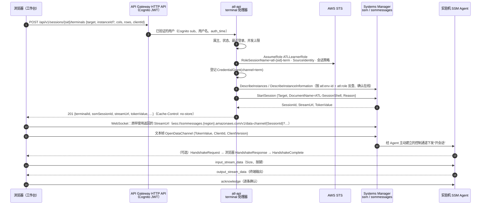
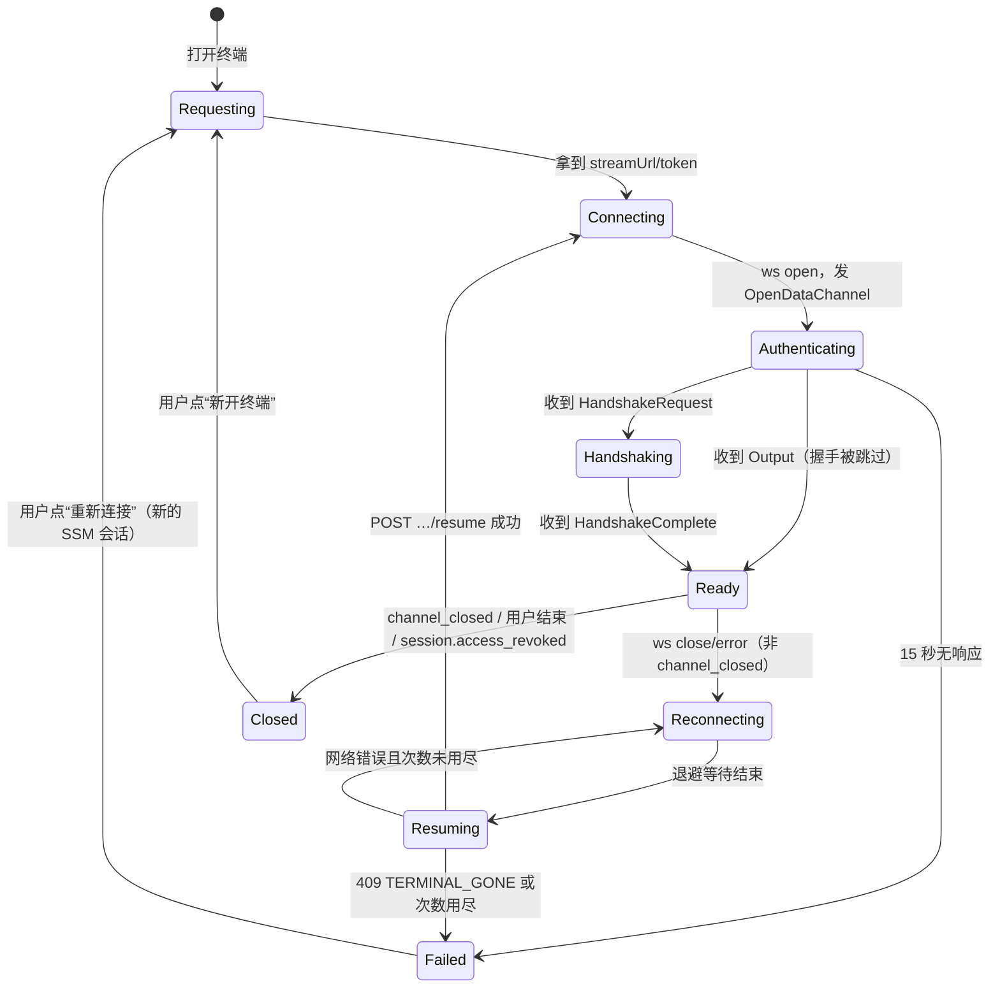
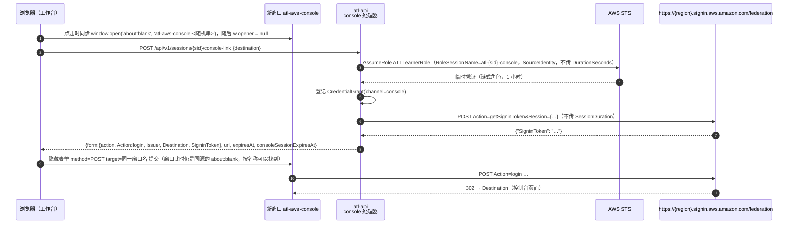

# 03 · 分屏工作台：实验手册 + 网页终端 + 控制台 + 应用预览

> **所属**：AWS Training Lab（ATL，实验平台）平台设计文档第 03 篇。
> **状态**：设计稿，未在真实账号中部署；已经过一轮对抗式审稿，并按主设计者裁决（C1～C5）做了第 2 轮修订，修订见第 14 节。协议细节以 2026-10-13 读到的官方源码与文档为准（第 12 节）；凡标注“以官方文档为准”“以实测为准”的地方，实现前必须先做第 10 节的 PoC（执行计划见 [07-aws-verification-plan](07-aws-verification-plan.md)）。
> **本篇负责**：实验进行中学员看到的那一屏——工作台页面布局、实验机终端、工作台终端（workstation）、AWS 控制台联合登录、应用预览，以及手册与终端的联动、无障碍与快捷键；另外定义工作台上的两条约定：实验机侧实验的投递与上传（4.11）、工作台上 `scripts/module` 的运行条件（4.12）。
> **本篇不负责**（只引用）：平台总体架构、`atl-main` 键设计、IAM 角色与边界的完整定义（[01-architecture](01-architecture.md)）；会话编排（`atl-session-start` / `atl-session-end`）、环境、倒计时、收回访问与回收器（[02-lab-lifecycle](02-lab-lifecycle.md)）；手册格式、`lab.yaml` v2、变量解析、检测引擎、`ATL-RunCheck`、报告、徽章与证书（[04-lab-format-checks-reports](04-lab-format-checks-reports.md)）；卡片目录（[05-lab-catalog](05-lab-catalog.md) 与 [cards/](cards/)，学习路径与徽章模型以 [cards/tracks-and-catalog](cards/tracks-and-catalog.md) 为准）；CloudAlbum 侧的平台模式改动（[06-cloudalbum-platform-mode](06-cloudalbum-platform-mode.md)，唯一清单）。
> **命名对齐**（第 2 轮修订，C1）：[01](01-architecture.md) 是唯一的名称表——实体、DynamoDB 键、API 路由、函数、状态机、调度、`ATL_OP`、角色、标签、事件名一律以 01 为准，本篇只引用；本篇新提出、尚待 01 登记的名称在第 9 节逐项列出。会话实体为 `LabSession`（截止时间字段 `deadlineAt`，乐观锁字段 `ver`）；环境 `Environment` 有稳定键 `envId`（标签 `atl:env-id`）与资源名用的 `envName`（每个环境一个，`e` + 7 位小写字母数字）；凭证登记 `CredentialGrant`；变量命名空间与检测 API 沿用 04。实验以**卡片**为单位（`svc-<module-id>`、`sc-<slug>`，卡片 id 即 `labId`）；原 Lab 0～25 是学习路径 `saa-main` 中的步骤，本篇提到原 Lab 时一律写成“卡片 id（原 Lab N）”。

---

## 目录

- [0. 一页结论](#0-一页结论)
- [1. 范围、术语与依赖](#1-范围术语与依赖)
- [2. 页面布局](#2-页面布局)
- [3. 实验机终端：浏览器直连 Session Manager](#3-实验机终端浏览器直连-session-manager)
- [4. 工作台终端：每个会话一台 workstation](#4-工作台终端每个会话一台-workstation)
- [5. AWS 控制台联合登录](#5-aws-控制台联合登录)
- [6. 应用预览](#6-应用预览)
- [7. 手册与终端的联动](#7-手册与终端的联动)
- [8. 无障碍与快捷键](#8-无障碍与快捷键)
- [9. 与其他篇的接口约定](#9-与其他篇的接口约定)
- [10. 实现顺序与 PoC 验收](#10-实现顺序与-poc-验收)
- [11. 与 P1～P13 的偏离与细化](#11-与-p1p13-的偏离与细化)
- [12. 参考资料与核实记录](#12-参考资料与核实记录)
- [13. 需要回写到现有文档的改动](#13-需要回写到现有文档的改动)
- [14. 审稿修订记录](#14-审稿修订记录)

---

## 0. 一页结论

| # | 决策 | 一句话理由 |
|---|---|---|
| W1 | 工作台路由 `/workspace/:sessionId`：左侧实验手册，右侧四个标签（`terminal-lab`、`terminal-workstation`、`console`、`preview`），中间是可拖动、可键盘操作的分隔条；窄屏退化为分段切换 | 对应用户确认的“分屏工作台”；切换标签时终端保活 |
| W2 | 实验机终端：`atl-api` 以学员身份（`ATLLearnerRole`，会话名 `atl-<sid>-term`，附会话策略）调用 `StartSession`，把 `StreamUrl`/`TokenValue` 交给浏览器；浏览器用自研的薄协议层直连 `wss://ssmmessages.<region>.amazonaws.com`，渲染用 xterm.js 6。目标实例按 `atl:env-id` + `atl:role` 发现（第 2 轮修订，保留环境被下一个会话复用时仍能找到实验机） | 满足 P8①“不开 22、不经平台转发”；数据面不过平台，闲置成本不变 |
| W3 | 协议层**自研**（薄 TypeScript 层），以官方 Go 插件 `aws/session-manager-plugin` 为规范来源；社区库 `ssm-session` 只作参考 | 社区库停在 2021 年的 1.0.6，缺握手、重传、乱序缓冲、改尺寸、断线续连（3.6） |
| W4 | 平台专用 Session 文档 `ATL-SessionShell`（01 已登记名称，本篇定义内容），RunAs 用户 `labuser`；可选的录制版 `ATL-SessionShell-Logged`；不碰账号级单例 `SSM-SessionManagerRunShell` | svc-shell-access（原 Lab 2）要让学员自己改会话首选项，平台终端不能受影响 |
| W5 | 终端安全三层：API 鉴权（属主 + 状态 + `auth_time` 最近登录）→ 以学员会话按 `atl:env-id` + `atl:role` 反查目标并核对 AWS 保留标签 `aws:cloudformation:stack-name`/`aws:autoscaling:groupName` → 会话策略只允许 `atl:env-id=<envId>` 的实例、`ATL-SessionShell*` 文档与 `session/atl-<sid>-term-*` 会话；令牌只在内存、只用一次；空闲 20 分钟、单会话最长 240 分钟；审计 = CloudTrail + `CredentialGrant` + `TerminalSession`，终端内容录制默认关闭、可开启 | 满足“令牌有效期、只能连本会话实例、空闲超时、会话审计日志”，并与 01“默认不录制会话内容”一致 |
| W6 | 工作台终端：**每个会话一台 workstation EC2**（栈 `atl-ws-<sid>`，与 01 §3.9、§14 与 02 §4.3 一致；AL2023 arm64、`t4g.small`、默认 VPC 公有子网、无入站规则），User Data 安装 AWS CLI v2、Node.js 22、k6、session-manager-plugin、仓库与 `scripts/module`；会话相关的接线由 Command 文档 `ATL-WorkstationSetup` 完成，接线时在 `PROVISIONING` 阶段读取 agent context（01 为此开的唯一例外，4.6） | 负载发生器不能和被测实例共用 CPU；`scripts/module` 会替换实验机；凭证不能和应用角色混在一台机器上（4.2） |
| W7 | workstation 的实例角色是 `ATLWorkstationRole`（管理通道 + 只能换取学员身份）；学员 CLI 经 `~/.aws/config` 以角色链按 `atl-<sid>-ws` 使用 `ATLLearnerRole` | 实例配置文件凭证的会话名是实例 ID，回收器无法归属（第 11 节 D1；与 01、02 一致） |
| W8 | 控制台：`atl-api` `AssumeRole` → `getSigninToken`（POST，不传 `SessionDuration`）→ 浏览器在点击时预开空白窗口（随机窗口名），再用 **POST 表单**登录；链式角色使控制台会话最长 1 小时，到期前一键续期（续期与深链接新开标签页，不复用旧窗口，5.3） | 控制台不能被嵌入；POST 让 SigninToken 不进地址栏和历史记录 |
| W9 | 应用预览：只有“受信任 HTTPS + `frame-ancestors` 允许平台来源”的入口才嵌入 iframe；L0 默认用 tls 本地档的 Let's Encrypt IP 短期证书取得受信任 HTTPS，开关来自卡片的 `startProfile.platform.preview.directHttps`（svc-autoscaling、svc-tls 等卡片关闭）；L0 没有受信任 HTTPS（方案关闭或签发失败）时，预览一律在新标签页打开 `http://<EIP>`（6.2） | HTTPS 页面里的 `http://` iframe 是被拦截的混合内容；自签名证书在 iframe 中无法越过 |
| W10 | CloudAlbum 平台模式按 `ATL_PLATFORM_ORIGIN` 输出 `frame-ancestors`、不再输出 `X-Frame-Options`（01 已定）；本篇补充登录 Cookie 改为 `SameSite=None; Secure; Partitioned`（Safari 的 CHIPS 支持不稳定，不支持时退回新标签页；Cognito 托管登录在预览框内不可用，6.3） | CloudAlbum 用 BFF + HttpOnly Cookie（02-identity-security），跨站 iframe 中 `SameSite=Lax` 的 Cookie 不会被发送 |
| W11 | 命令块默认“粘贴到终端（不执行）”，用 bracketed paste 防止多行被逐行执行；“粘贴并执行”需要确认，危险命令永远不自动执行；借助 OSC 133 提示符标记判断终端是否正忙 | 防误执行；最后一个 Enter 由学员自己按 |
| W12 | 快捷键用前导键 `Ctrl+.`（在终端内也生效，可在设置中更换），避开 Windows 默认的 `Alt+Shift` 输入法切换；中文输入法常把 `Ctrl+.` 用作标点切换，首次进入时自检并引导更换（8.2）；提供离开终端的键盘方法 | 终端会吞掉几乎所有按键；WCAG 2.1.2 无键盘陷阱 |
| W13 | 必须在实验机上运行的对比实验（例如 svc-iam 的 `leak-scan`、`imds-ssrf`）一律**从工作台发起**：运行器先登记，再经 SSM Run Command 投递到实验机执行，取回标准输出中的结果，最后从工作台上传；在实验机终端里手动运行只作观察，不上传（4.11） | 上传要用学员身份 SigV4（04 §7.2），实验机只有 `CloudAlbumAppRole`（SSM 核心权限，P7），既不能也不应该上传 |
| W14 | 工作台上的 `scripts/module` 以学员身份运行，状态文件放在平台栈创建的 `cloudalbum-lab-state-<acct>-<region>` 桶（每个 `envName` 一个前缀），环境操作锁放在 DynamoDB 表 `cloudalbum-lab-locks`（条件写）；栈标签带 `atl:component=env` 与会话类标签（4.12） | `atl-*` 桶被学员边界的 `DenyPlatformByName` 拒绝；原设计中学员在工作台上读不到状态、拿不到锁（C4(c)） |

---

## 1. 范围、术语与依赖

### 1.1 术语

| 术语 | 含义 |
|---|---|
| 卡片 | 实验的单位：单服务卡片 `svc-<module-id>`（40 张）与场景卡片 `sc-<slug>`（16 张），卡片 id 就是 `labId`（标签 `atl:lab-id` 的值）。卡片可有变体（`variant`）。原 Lab 0～25 是学习路径 `saa-main` 中的步骤（映射见 05 与 cards/tracks-and-catalog §4.2.1） |
| 会话（`LabSession`） | 学员点“开始实验”后的一次卡片运行，状态机见 02（P11 状态名）。`sessionId`（sid）格式由 01 定义为 `^s[0-9a-hjkmnp-tv-z]{12}$`，例如 `s4k7m2q9x1abc`；截止时间字段为 `deadlineAt`（01 统一命名，取代旧稿的 `expiresAt`） |
| 环境（`Environment`） | 会话使用的一组 AWS 资源，02 定义。`envId` 是稳定键（标签 `atl:env-id`），`envName` 用于资源名（例如 `e7k2m9qx`，CloudAlbum 栈名 `cloudalbum-<envName>-<module>`）。每个环境一个 `envName`；保留环境后可被下一个会话复用，复用时 `envId`、`envName` 不变而 `sid` 改变 |
| 实验机 | 平台为会话创建的 CloudAlbum EC2（可能多台，例如 svc-autoscaling 的 ASG），标签 `atl:role=lab-app`。平台从不缓存实例 ID，每次按 `atl:env-id` + `atl:role` 查询并核对 AWS 保留标签（01 §9.8、3.2 第 4 步）；`atl:session-id` 只用于归属 |
| 工作台 / workstation | 每个会话一台的“运维机”EC2，标签 `atl:role=workstation`、`atl:component=workstation`；学员在这里跑 AWS CLI、`scripts/module`、`npm run exp` |
| 状态桶 / 锁表 | 平台栈创建、学员可访问的 `cloudalbum-lab-state-<acct>-<region>`（每个 `envName` 一个前缀，放 `state.json` 等 `scripts/module` 状态）与 DynamoDB 表 `cloudalbum-lab-locks`（环境操作锁，条件写）。名称不以 `atl-` 开头，以免被学员边界的 `DenyPlatformByName` 拦截；平台卸载时一并删除（01 名称表，C4(c)） |
| 管理通道 | 实验机与工作台上为平台服务的 SSM Agent、实例角色中的 SSM 权限、`labuser` 用户与 `/opt/atl/terminal/` 下的脚本。**不属于应用权限**（P7） |
| 终端会话 | 一次 SSM Session Manager 会话（`StartSession` 返回的 `SessionId`，形如 `atl-<sid>-term-<随机串>`）；平台实体 `TerminalSession`（01：`SESSION#<sid>` / `TERM#<ulid>`） |
| 凭证通道（channel） | 02 的 `CredentialGrant` 中登记的会话名后缀。本篇使用 `term`（终端代理）、`console`（控制台）、`ws`（工作台 CLI），会话名一律 `atl-<sid>-<channel>` |
| 平台来源 | 平台前端的 origin（CloudFront 默认域名或自定义域名），即 CloudAlbum 的 `ATL_PLATFORM_ORIGIN` |

### 1.2 依赖的外部事实（实现前需复核）

| 事实 | 来源 | 本篇用在哪 |
|---|---|---|
| `StartSession` 返回 `SessionId`、`StreamUrl`、`TokenValue`；`TokenValue` “只在足以保证连接成功的时间内有效”，不得分享 | SSM API 参考 | 3.2、3.8 |
| `ResumeSession` 只能用于断开的会话，不能用于已终止的会话；用于客户端在网络抖动后自动重连 | SSM API 参考 | 3.5.9 |
| Session 文档 `idleSessionTimeout` 取值 1–60 分钟，`maxSessionDuration` 1–1440 分钟；RunAs 用户的优先级是“IAM 用户会话标签上的 `SSMSessionRunAs` → 角色上的 `SSMSessionRunAs` 标签 → 文档的 `runAsDefaultUser`” | Session document schema | 3.3 |
| 联合登录 URL 生成后 15 分钟内有效；链式角色凭证最长 1 小时且不能传 `SessionDuration`；“`AssumeRole*` 带 `DurationSeconds` 时必须由 IAM 用户的长期凭证调用，否则联合端点调用失败”；`getSigninToken` 与 `login` 都支持 POST。注意：同一页面的 Important 提示甚至写成“使用 `AssumeRole*` 时必须以 IAM 用户长期凭证调用”，与同页“角色链凭证不要传 `SessionDuration`”的说明互相矛盾；以 PoC 实测为准（第 10 节 ⑩） | IAM 用户指南 | 5.2–5.5 |
| Let's Encrypt 自 2026-01 起正式签发 IP 地址证书，必须用 `shortlived` 配置档（约 6 天），只能用 HTTP-01 或 TLS-ALPN-01 验证 | Let's Encrypt 公告（01-edge 文档已引用） | 6.2 |
| CHIPS（`Partitioned` Cookie）：Chrome 114 起默认可用；Firefox 141 起完全启用；**Safari 的支持不稳定**（18.4 上线后在 18.5 关闭，关闭期间带 `Partitioned` 的第三方 Cookie 会被直接拒绝；之后版本的状态以 MDN 兼容表与 WebKit 发布说明为准）。不能当作“所有主流浏览器都可用”（审稿修订） | MDN、Chrome 开发者文档、WebKit Bugzilla 292975 | 6.3 |
| xterm.js 6.0.0 的 DOM 渲染器与 `@xterm/addon-webgl` 0.19.0 会在运行时 `createElement('style')` 并写入 `textContent`，没有 nonce 选项（审稿时下载 npm 包核实） | npm 包源码 | 3.7.6 |
| `@aws-sdk/credential-provider-ini`（3.973.x）支持 `credential_source = Ec2InstanceMetadata`、`role_session_name`、`duration_seconds`（审稿时下载 npm 包核实） | npm 包源码 | 4.6 |
| `GetCommandInvocation` 返回的 `StandardOutputContent` 只含插件写到 stdout 的前约 24,000 个字符，超出部分被截断（完整输出只能写 S3 或 CloudWatch Logs）；Run Command 的参数会保留在命令历史中，有 `ssm:ListCommands` 权限的人可见 | SSM API 参考（01 §9.2、§9.3 已引用） | 4.11 |

---

## 2. 页面布局

### 2.1 路由、入口与前端接口

| 路由 / 参数 | 说明 |
|---|---|
| `/workspace/:sessionId` | 工作台。02 的开始流程在 `POST /api/v1/sessions` 后**立即**跳转到这里：左侧手册立即可读，右侧显示环境准备进度 |
| `?step=<stepId>` | 定位到手册的某一步 |
| `?panel=terminal-lab\|terminal-workstation\|console\|preview` | 右侧默认标签（取值与 04 手册的 `panel`、`::open-tab` 一致） |

工作台在前端暴露一个 `workbench` 上下文（React Context），供 04 的手册渲染组件调用：

```ts
interface Workbench {
  focusTab(panel: 'terminal-lab' | 'terminal-workstation' | 'console' | 'preview'): void;
  /** 只粘贴不回车（04 的约定）；返回是否已粘贴（被确认矩阵拒绝时为 false） */
  pasteToTerminal(tab: 'terminal-lab' | 'terminal-workstation', text: string, meta: PasteMeta): Promise<boolean>;
  openConsole(destination?: { linkId: string; params?: Record<string, string> }): Promise<void>;
  runStepCheck(stepId: string): void;            // 转发到 04 的检测 API
}
interface PasteMeta { stepId: string; blockIndex: number; dangerous?: boolean; execute?: boolean }
```

页面生命周期中的调用（与 02 对齐）：

- 进入时：`GET /api/v1/sessions/{sid}`（02 会话视图）、`GET /api/v1/sessions/{sid}/workspace`（本篇，2.7）、手册静态内容 `/content/<catalogVersion>/labs/<labId>.json`（`labId` 即卡片 id；有变体时手册按会话的 `variant` 选择分支，格式由 04 的 `lab.yaml` v2 定义；04 §2.5 与 §12 的接口表：经 CloudFront 提供，不走 API；审稿修订，原稿写成并不存在的 `GET /api/v1/labs/{labId}/content`）、`GET /api/v1/sessions/{sid}/vars`（04）。
- 页面可见时每 60 秒 `POST /api/v1/sessions/{sid}/heartbeat`（02；首次带 `workbench=true`，触发 `READY → RUNNING`），并用返回的 `serverNow` 对时（也可调用 01 登记的 `GET /api/v1/time`）。
- 增量事件：`GET /api/v1/sessions/{sid}/events?after=`（01/02 的短轮询，间隔按服务端 `pollAfterMs`；页面不可见时暂停）。工作台关心的事件见 9.3。
- 同一会话可在多个浏览器标签页打开工作台；终端按“浏览器标签页”计数（3.2 的并发上限），标签页之间不做同步。

### 2.2 桌面布局（≥ 1280px）

```text
┌ ATL 实验平台 › [服务][S3] svc-storage 照片存进 S3 ── 运行中 · 剩余 01:42:10 · 预计 ‹估算›/h [延长] [结束实验] ⋯ ┐
├────────────────────────────────────────────┬┬──────────────────────────────────────────────────────────┤
│ 实验手册                  进度 3/7  步骤 ▾ ││ [▣ 实验机 ●] [▣ 工作台 ●] [↗ AWS 控制台] [◫ 应用预览]  [⇅ 拆分] │
│ 变量 bucket=cloudalbum-…[cap] instance=i-0a…[target]││ ┌ 实验机 i-0abc… · labuser · AWS 身份 CloudAlbumAppRole   #1 #2 + ┐│
│ ───────────────────────────────────────────── ││ │  实验机  labuser@ip-172-31-8-21:~$ curl -sI http://127.0.0.1/ │ │
│ 3  接入应用                        约 10 分钟 ││ │ HTTP/1.1 200 OK                                             │ │
│ 为什么：让应用改用 S3 适配器……               ││ │ X-CloudAlbum-Path: storage=local;…                          │ │
│ 做法 [控制台] [CLI•] [脚本]     运行于：工作台 ││ │                                                             │ │
│ ┌────────────────────────────────────────┐ ││ │                                                             │ │
│ │ scripts/module enable storage          │ ││ │                                                             │ │
│ │              [复制] [粘贴到 工作台 ▾]   │ ││ └─────────────────────────────────────────────────────────────┘ │
│ └────────────────────────────────────────┘ ││ ● 已连接 · Session Manager · 空闲 20 分钟断开 ⓘ                  │
│ 预期结果 ……                                ││ 按 Ctrl+. 再按 M 回到手册                                        │
│ ▶ 常见错误（2）   ▶ 为什么（SAA）           ││                                                                │
│ ── 本步检测 ─────────────── [检测  ⌃. R] ── ││                                                                │
│ [v] ○ 探针  storage 驱动为 s3               ││                                                                │
│ [x] □ AWS   桶开启了“阻止公共访问”           ││                                                                │
│ [← 上一步]                       [下一步 →] ││                                                                │
└────────────────────────────────────────────┴┴──────────────────────────────────────────────────────────┘
```

- **顶栏**（`SessionBar`，高 48px）：面包屑（卡片类型标记 + 服务缩写方块 + 卡片标题，有变体时附变体名）、会话状态胶囊、倒计时、预计每小时费用（只显示 02 给出的估算，不写价格常量）、延长 / 结束按钮（动作与确认流程由 02 定义，“结束”对话框中含“保留环境”选项）、溢出菜单（快捷键帮助、终端设置、主题）。
- **左栏**：实验手册（2.4）；**分隔条**（2.6）；**右栏**：多标签面板（2.5）。

### 2.3 顶栏元素

| 元素 | 数据来源 | 行为 |
|---|---|---|
| 卡片标识 | 目录数据（`catalog.yaml` 生成的卡片元数据：`kind`、`services`、`modules`、`variant`，见 cards/tracks-and-catalog §6.6、§6.7） | 单服务卡片显示 `[服务]` 标记与一个服务缩写方块；场景卡片显示 `[场景]` 标记与多个方块，下方一行“本卡将依次启用：cdn → waf → …”（`targetModules` 的顺序，已完成的目标打勾）。图标沿用卡片目录的“方块 + 缩写 + 类别色条”，不使用 AWS 官方素材 |
| 状态胶囊 | 会话视图的 `state`（02） | 颜色与形状复用 ui-design §11.3 的语义色；文案见 2.7 |
| 倒计时 | `deadlineAt` + 02 的对时规则 | 提醒阈值、警告色、模态提醒、到点覆盖层全部按 02 的“倒计时与提醒”执行，本篇只负责在工作台中的呈现位置：横幅放在顶栏下方，不遮挡终端；模态提醒出现时**不抢夺终端焦点**以外的输入 |
| 预计费用 | 02 的 `CostQuote` | “约 ‹估算›/h · 明细”；明细列出实验机、工作台（含公有 IPv4、EBS）、本 Lab 已启用的按小时计费资源 |
| 延长 / 结束 | 02 的 `extend`、`end` 接口 | “保留环境”必须展示持续计费与时长上限（P4）；保留期间不提供终端与控制台（02） |

### 2.4 左栏：实验手册

左栏渲染 04 的手册 AST。它是 ui-design.md S06-2“配置指南”三栏布局的**单栏化**：步骤栏（`StepRail`）收进顶部“步骤 ▾”下拉，检测栏（`CheckPanel`）收进每一步的底部。

| 区域 | 组件（复用 ui-design §8） | 平台模式下的变化 |
|---|---|---|
| 手册头 | 卡片标题、`OverallProgress` | 进度来自 04；完成后显示徽章（徽章只看卡片是否完成，小测成绩只记录在徽章上，模型以 cards/tracks-and-catalog §5 为准） |
| 变量条 | `VariableStrip` / `VariableChip` | 来源标签按 04 的命名空间显示（`session`、`target`、`workstation`、`stack`、`cap`、`envfile`、`var`）；值变化时高亮 2 秒并显示“已更新” |
| 步骤下拉 | `StepRail` 的紧凑形态 | `J`/`K`（手册聚焦时）与 `⌃. N`/`⌃. P`（任何位置） |
| 步骤内容 | `StepCard`、`MethodTabs`、`RunsOnTag`、`ConsolePath`、`CommandBlock`、`CodeSnippet`、`PitfallItem`、`SaaTip`、`CostNotice` | `RunsOnTag` 的“运维机”改为“工作台”；`CommandBlock` 增加“粘贴到终端”（7.1）；`ConsolePath` 与 04 的 `::console-link` 的“打开 ↗”走联合登录（5.5） |
| 本步检测 | `CheckResultRow`（compact）、`WaitTimer` | 检测 API 由 04 定义（7.2） |
| 底栏 | 上一步 / 检测 / 下一步 | 固定在左栏底部（sticky），高 48px |

左栏宽度不足 400px 时：`MethodTabs` 改为下拉；命令块按钮只显示图标（带 `aria-label`）；关键字段表改为“字段：值”的纵向列表。

### 2.5 右栏：多标签面板

| 标签（`panel`） | 图标与状态 | 内容 | 首次打开时 |
|---|---|---|---|
| ① `terminal-lab` 实验机终端 | ▣ + 连接状态（已连接 / 重连中 / 断开，形状 + 文字） | `TerminalView`（3.7）；子标签 `#1 #2 +`，每个对应一个 SSM 会话 | 自动连接主实验机 |
| ② `terminal-workstation` 工作台终端 | ▣ + 状态；工作台未就绪时显示时钟 | 同上，目标为 workstation；省钱模式下为 CloudShell 启动卡片（4.9） | 自动连接 |
| ③ `console` AWS 控制台 | ↗（外链图标，表示会开新标签页） | `ConsoleLauncher`（5.7），不嵌入控制台 | 不自动打开新窗口 |
| ④ `preview` 应用预览 | ◫ | `PreviewFrame`（6.5）：可嵌入时显示 iframe，否则显示“新标签页打开”卡片 | 懒加载 iframe |

- **保活**：切换标签只切换可见性（`hidden` 属性），不卸载组件；终端的 WebSocket 不因切换而断开。iframe 首次打开后保留，切换入口或点刷新时才重新加载。
- **子标签菜单**（右键或 `⋯`）：重命名、复制选中、清屏、在新子标签中打开、结束会话。上限见 3.2。
- **拆分（可选，P2 优先级）**：`⇅ 拆分` 把右栏上下分成两个标签组（例如上方终端、下方预览），每组独立选择标签，中间是水平分隔条（规则同 2.6）。窄于 1280px 时不可用。
- **身份条**：每个终端顶部固定一行 `IdentityChip`：主机角色 + 实例 ID（缩写，悬停显示全名）+ Linux 用户 + “AWS 身份”。实验机上是 `CloudAlbumAppRole`（实例角色，应用/管理通道），工作台上是 `ATLLearnerRole（atl-<sid>-ws）`。这正是 svc-iam（原 Lab 1）的教学点之一：**同一条 `aws sts get-caller-identity` 在两个终端里结果不同**。

### 2.6 分隔条

| 项目 | 规格 |
|---|---|
| 形态 | 视觉 1px `--border` 竖线，命中区域 8px；悬停 `--border-strong`，拖动中 2px `--accent` |
| 默认比例 | 左 40% / 右 60%（≥ 1600px 时左 36%） |
| 最小宽度 | 左栏 320px，右栏 480px；拖到最小宽度以下 48px 时吸附为“折叠”，折叠后留 32px 竖条与展开按钮 |
| 拖动实现 | Pointer Events + `setPointerCapture`；拖动中给 iframe 覆盖透明遮罩，避免指针事件被 iframe 吃掉；终端在拖动结束后才重新计算尺寸（3.5.6） |
| 键盘 | 可聚焦；`role="separator"`、`aria-orientation="vertical"`、`aria-valuenow`（左栏百分比）、`aria-valuemin`、`aria-valuemax`、`aria-controls`；←/→ 每次 16px，Shift+←/→ 每次 64px；Home/End 到最小 / 最大；Enter 折叠 / 展开左栏 |
| 复位 | 双击分隔条，或 `⌃. 0` |
| 持久化 | 比例与折叠状态存 `localStorage` 键 `atl.ws.layout.v1`（读写包在 try/catch 里，读不到用默认值）；只存布局偏好，不存会话数据 |

### 2.7 工作台描述与会话状态

`GET /api/v1/sessions/{sessionId}/workspace` 聚合工作台需要的“通道”信息（会话本身的状态、倒计时、费用由 02 的会话视图提供，变量由 04 的 `/vars` 提供，这里不重复）。刷新时机：进入页面、页面重新可见、终端异常断开、收到 9.3 中会改变目标的事件，以及每 60 秒一次。

```json
{
  "sessionId": "s4k7m2q9x1abc",
  "labId": "svc-storage",
  "variant": "default",
  "envId": "01jc9x3k9cq2w8e4r6t0y1u3i5",
  "envName": "e7k2m9qx",
  "region": "ap-northeast-1",
  "targets": [
    { "tab": "terminal-lab", "instanceId": "i-0abc1234def567890", "primary": true,
      "runAs": "labuser", "awsIdentity": "CloudAlbumAppRole",
      "ssmPing": "Online", "prepared": true, "placement": "public" },
    { "tab": "terminal-workstation", "instanceId": "i-0def1234abc567890",
      "runAs": "labuser", "awsIdentity": "ATLLearnerRole (atl-s4k7m2q9x1abc-ws)",
      "ssmPing": "Online", "prepared": true, "wired": true }
  ],
  "terminals": [
    { "terminalId": "01JA3P0A1B2C3D4E5F6G7H8J9K", "ssmSessionId": "atl-s4k7m2q9x1abc-term-0a1b2c3d4e5f67890",
      "instanceId": "i-0abc1234def567890", "openedAt": "2026-10-13T10:58:03Z", "status": "OPEN" }
  ],
  "console": { "available": true, "lastIssuedAt": "2026-10-13T10:42:10Z", "credentialsExpireAt": "2026-10-13T11:42:10Z",
               "links": [ { "linkId": "s3.bucket", "label": "S3 · 照片桶", "steps": ["s2", "s5"] } ] },
  "features": { "workstation": "ec2", "terminalRecording": "off", "terminalPersistence": "none",
                "streamUrlSigning": "none", "previewDirectHttps": "on" },
  "expectedOutage": null
}
```

- `envId`、`envName` 与 `targets` 每次现查（不缓存实例 ID）；`targets` 与上一次不同时（实例被替换、ASG 扩缩），前端提示“实验机已替换”并刷新变量（7.3）。旧稿依赖的 `atl.session.target-changed` 事件已被 04 撤销（04 R-27），本篇改为靠这次比对发现变化。
- `expectedOutage`：当前步骤或正在执行的平台动作声明了“会中断管理通道”（平台动作的 `interruptsManagementChannel`，或卡片步骤级的预期中断声明，字段以 04 为准）时为 `{reason, stepId|actionId, until}`；此期间终端与本地检查连不上是预期现象，覆盖层与检测结果都按 3.9 的“预期中断”文案显示，不按故障处理（service-cards-1 附录 B-7、B-13，service-cards-3 附 B 第 11 条）。

工作台在各会话状态（P11）下的行为：

| 状态 | 手册 | 终端 | 控制台 | 预览 |
|---|---|---|---|---|
| `REQUESTED` / `PROVISIONING` | 可读，检测按钮禁用 | 禁用；显示 02 的准备进度（`session.progress`、`session.phase_changed`）与实验机 / 工作台各自的就绪状态。工作台接线在此阶段完成（4.6），但学员终端要到 `READY` 才开放 | 禁用 | 禁用 |
| `READY` | 可用 | 可用（首次打开自动连接；心跳把会话推进到 `RUNNING`） | 可用 | 可用 |
| `RUNNING` | 可用 | 可用 | 可用 | 可用 |
| `EXPIRING` | 可用 | 可用；顶栏横幅显示回收时间（不写入终端输出流） | 可用；提示控制台会话可能先于实验结束失效 | 可用 |
| `ENDING` | 只读 | 收到 `session.access_revoked` 立即断开（02 也会直接终止 SSM 会话），覆盖层“实验已结束，正在收回访问并释放资源”；终端与控制台接口返回 `409` | 禁用；说明已打开的控制台窗口中的权限已被收回（02） | 禁用 |
| `CLEANING` | 只读 | 同上 | 禁用 | 禁用 |
| `ENDED` | 只读存档 + 报告与徽章入口（04） | 显示本会话的终端会话列表，不可连接 | 禁用 | 禁用 |
| `FAILED` | 只读 | 禁用；显示 02 的失败原因与操作 | 禁用 | 禁用 |
| `CLEANUP_FAILED` | 只读 | 禁用 | 只提供 02“待人工处理清单”中各项的控制台深链（这些深链由 02 给出，不签发新的联合登录） | 禁用 |
| `KEPT`（02 按 P11 增补的“保留环境”状态，01 已接受） | 只读 | 不提供（02：要继续操作就开始一个复用该环境的新会话） | 不提供 | 实例未停止（未进入 02 的节省模式）时照常可看 |

### 2.8 响应式与窄屏退化

| 断点 | 布局 |
|---|---|
| ≥ 1280px | 左右分栏（2.2）；可拆分右栏 |
| 1024–1279px | 左右分栏；左栏默认 42%、最小 300px；右栏标签只显示图标 + 短名；不可拆分 |
| 768–1023px | **不再并排**。顶部一行分段控件 `[手册] [实验机] [工作台] [控制台] [预览]`，一次显示一个；手册的底栏常驻“检测”；“粘贴到终端”后自动切到对应终端 |
| < 768px | 同上，左右边距 16px，页面无横向滚动；终端分段底部出现**附加按键条**（8.6）；预览默认“新标签页打开”；顶栏折叠为“卡片 id · 状态 · 剩余时间 ⋯” |

```text
< 768px
┌ svc-storage · 运行中 · 01:42 ⋯ ┐
│[手册][实验机][工作台][控制台][预览]│
├──────────────────────────┤
│   当前分段的内容（全屏）    │
├──────────────────────────┤
│ Esc Tab Ctrl ↑ ↓ ← → | ~ / │  ← 终端分段时
│ [← 上一步] [检测] [下一步 →]│  ← 手册分段时
└──────────────────────────┘
```

- 终端列数少于 60 时，在身份条下方提示一次“窗口较窄，部分命令输出会折行；建议在电脑上操作”。
- 页面缩放到 200% 时自动落入窄屏布局（WCAG 1.4.10 重排）。

### 2.9 视觉 token 增补

沿用 ui-design.md §11 的全部 token（平台前端复制一份到 `platform/web/src/styles/tokens.css`，根节点 `.atl-app`），只增补：

| token | 亮色 | 暗色 | 用途 |
|---|---|---|---|
| `--host-lab` | `#9A6B1F` | `#D1A45A` | 实验机身份条与提示符标签（与 `--viz-third` 同色系，表示“被测对象”） |
| `--host-ws` | `#0F6E6E` | `#4FB3A9` | 工作台身份条（与 `--accent` 同色） |
| `--term-bg` / `--term-fg` | `#1B1C1F` / `#E9E7E2` | `#141517` / `#E9E7E2` | 终端默认深色（亮色主题下也默认深色，可在设置中改为跟随主题） |
| `--term-cursor` | `#4FB3A9` | `#4FB3A9` | 光标 |
| `--term-selection` | `rgb(79 179 169 / .35)` | 同左 | 选中背景 |
| `--split-handle-active` | `--accent` | `--accent` | 拖动中的分隔条 |

- 终端的 16 色 ANSI 调色板定义在 `terminalTheme.ts`，并设置 xterm.js 的 `minimumContrastRatio: 4.5`，由 xterm 在渲染时提亮对比度不足的前景色。
- 不使用 AWS 控制台的深海军蓝 + 橙色组合；控制台标签明确写“将打开 AWS 官方控制台（新标签页）”，平台始终标注“ATL 实验平台（非 AWS 官方）”。

---

## 3. 实验机终端：浏览器直连 Session Manager

### 3.1 架构与时序



- **数据面不经过平台**：平台只参与“开门”（`StartSession`）与“续门”（`ResumeSession`），之后浏览器与 `ssmmessages` 端点直接通信。平台 Lambda 不保持连接，闲置成本不变（P3）。
- **实例上无入站规则**：SSM Agent 主动出站连接 SSM 端点（P7、P8①）。
- **原样使用 `StreamUrl`**：查询参数（API 参考中的示例与实际返回值不完全相同，可能带 `role`、`cell-number` 等）由服务决定，浏览器不得自行拼接或改写，只做 3.2 第 8 步的协议与主机校验（审稿修订）。
- **WebSocket 不做 CORS 预检**。`ssmmessages` 端点是否校验 `Origin` 头需要 PoC 实测（社区库 `ssm-session` 的示例页面从 `localhost:8080` 直连可用，说明至少在其编写时不校验）。

### 3.2 终端 API

路由沿用 01 第 8 节（`/api/v1`，Cognito JWT；01 规定终端属于“敏感操作”，要求访问令牌的 `auth_time`（最近一次真实登录时间）在 60 分钟内——不能用 `iat` 判断，刷新令牌换来的访问令牌 `iat` 总是新的；第 2 轮修订，旧稿误写为“访问令牌签发时间”）。响应一律 `Cache-Control: no-store`。

| 方法与路径 | 来源 | 请求 | 响应 |
|---|---|---|---|
| `GET /api/v1/sessions/{sid}/terminals` | 本篇新增 | — | `[{terminalId, ssmSessionId, instanceId, tab, openedAt, status}]` |
| `POST /api/v1/sessions/{sid}/terminals` | 01（本篇细化） | `{target: "lab"\|"workstation", instanceId?, cols, rows, clientId}` | `201 {terminalId, ssmSessionId, instanceId, streamUrl, tokenValue, document, runAs, idleTimeoutMin, maxDurationMin, connectBy, clientVersion}` |
| `POST /api/v1/sessions/{sid}/terminals/{terminalId}/resume` | 本篇新增 | `{clientId}` | `200 {streamUrl, tokenValue, connectBy}`；会话已终止 → `409 TERMINAL_GONE` |
| `DELETE /api/v1/sessions/{sid}/terminals/{terminalId}` | 01 | — | `204` |

`terminalId` 是平台的 ULID（01 的 `TERM#<ulid>`），`ssmSessionId` 是 SSM 的会话 ID。

**打开终端的处理步骤**（`atl-api` 的 terminal 处理器）：

1. **授权**：调用者是会话属主；会话状态 ∈ {`READY`、`RUNNING`、`EXPIRING`} 且 `now < deadlineAt`（02 的发放访问规则）；`CredentialGrant` 未被吊销；`auth_time` 在 60 分钟内。否则 `409 TERMINAL_SESSION_STATE`（最近登录不满足时为 01 的 `403 REAUTH_REQUIRED`，前端引导重新登录）。
2. **并发**：同一实例最多 3 个、整个会话最多 6 个 `OPEN` 的终端；超出 → `429 TERMINAL_LIMIT`。（SSM 自身的并发会话配额以官方文档为准。）计数前先对账：`openedAt` 早于“空闲超时 + 5 分钟”且没有续连记录的 `OPENING`/`OPEN` 条目，用 `ssm:DescribeSessions`（`State=Active`，按 `Owner` 过滤）确认后标为 `CLOSED`，避免浏览器异常关闭留下的僵尸条目把上限占满（审稿修订）。
3. **扮演学员**：`sts:AssumeRole`，`RoleArn=ATLLearnerRole`，`RoleSessionName=atl-<sid>-term`，`SourceIdentity=<Cognito 用户名>`（01 的约定；STS 对 `SourceIdentity` 有字符集与长度限制，以官方文档为准，01 需保证所选的用户标识符合，否则终端与控制台都会签发失败），`DurationSeconds=clamp(deadlineAt − now + 60s, 900, 3600)`（02 的截断规则），`Policy=` 下面的会话策略。登记 `CredentialGrant`（`channel=term`、`roleSessionName`、`issuedAt`、`expiresAt`）。
4. **反查目标**：用上一步的凭证调用 `ec2:DescribeInstances`，过滤 `tag:atl:env-id=<envId>`、`tag:atl:role=lab-app|workstation`（按 `target`）、`instance-state-name=running`。给了 `instanceId` 时必须在结果中；没给时取主实验机（ASG 场景取 `aws:autoscaling:groupName` 所属 ASG 中最早启动的 `InService` 实例；停机保留的 L0 实例因不是 `running` 自然被排除，service-cards-1 附录 B-16）。否则 `404 TERMINAL_TARGET_NOT_IN_SESSION`。
   - **为什么用 `atl:env-id` 而不是 `atl:session-id`**（第 2 轮修订，按平台评审的统一取值）：保留环境被下一个会话复用时，实验机仍带着创建它的那个会话的 `atl:session-id`（02 规定交接后资源保留创建时的标签，`atl:session-id` 只用于归属）。按 `sid` 过滤，复用环境的新会话会找不到实验机。`envId` 在复用前后不变，同一时刻只属于一个持有环境锁的会话。
   - **标签并不完全可信，再核对 AWS 保留标签**：按 01 统一后的标签规则，学员可以在创建资源时设置会话类标签（`atl:session-id`、`atl:lab-id`、`atl:env-id`，`scripts/module` 需要），不能删除它们；`atl:role`、`atl:active-session-id` 与取值为 `platform`、`workstation` 的 `atl:component` 不能直接设置或删除，但**经 CloudFormation 的调用除外**（学员在工作台上 `scripts/module enable autoscaling` 时，启动模板要给新实例打 `atl:role=lab-app`）。所以学员仍可以用自己的栈造出一台带 `atl:env-id=<envId>`、`atl:role=lab-app` 的实例。处理器因此再核对：实例的 `aws:cloudformation:stack-name` 符合本环境的 CloudAlbum 栈名 `cloudalbum-<envName>-*`（01 名称表），或者是本会话的工作台栈 `atl-ws-<sid>`（`target=workstation` 时只接受后者）；或者其 `aws:autoscaling:groupName` 是这些栈创建的 ASG。`aws:` 前缀标签用户无法添加或修改。不满足同样返回 404。卡片自带的额外栈（`extraStacks`）若要让实例能被终端连接，栈名也必须落在 `cloudalbum-<envName>-*` 之下；构建实例、演练用的临时实例**不得**带 `atl:role=lab-app|workstation`（否则会被当作实验机，3.4）。
   - 单租户下这主要是防误连与防混淆，不是对账号所有者的安全边界。
5. **确认可连**：`ssm:DescribeInstanceInformation` 要求 `PingStatus=Online`，否则 `409 TERMINAL_TARGET_NOT_CONNECTED`；平台准备未完成（3.4 的 `/var/lib/atl/prepared.json` 由工作台描述的 `prepared` 字段反映）→ `409 TERMINAL_TARGET_NOT_PREPARED`。两者都附排障提示（3.9）。
6. **选文档**：录制关闭（`terminal.recording=off`，默认；取值来自平台栈参数 `TerminalRecording`，3.3）时用 `ATL-SessionShell`；`cloudwatch` 且该实例能访问 CloudWatch Logs 端点时用 `ATL-SessionShell-Logged`（3.3）。
7. `ssm:StartSession {Target, DocumentName, Reason: "ATL web terminal <sid>"}`。
8. **校验 `StreamUrl`**：协议必须是 `wss`，主机必须等于 `ssmmessages.<region>.amazonaws.com`（或 01 登记的双栈主机名），不得含 userinfo（与官方插件 1.2.889.0 起的校验一致）。
9. 写 `TerminalSession`（`OPENING`）与 `SessionEvent`（`terminal.opened`），写 `AuditEvent`（01）。
10. 返回。`connectBy = now + 30s` 是平台约定：浏览器必须立刻连接；超时未连上就不再用这个令牌，改走 `resume`（3.5.9）。

**会话策略**（每次调用时内联传入，`<sid>`、`<envId>`、`<region>`、`<acct>` 由处理器代入）：

```json
{
  "Version": "2012-10-17",
  "Statement": [
    { "Sid": "FindTargets", "Effect": "Allow",
      "Action": [ "ec2:DescribeInstances", "ssm:DescribeInstanceInformation" ], "Resource": "*" },
    { "Sid": "OnlyThisEnvironmentsInstances", "Effect": "Allow", "Action": "ssm:StartSession",
      "Resource": "arn:aws:ec2:<region>:<acct>:instance/*",
      "Condition": { "StringEquals": { "ssm:resourceTag/atl:env-id": "<envId>" } } },
    { "Sid": "OnlyAtlSessionShell", "Effect": "Allow", "Action": "ssm:StartSession",
      "Resource": [ "arn:aws:ssm:<region>:<acct>:document/ATL-SessionShell",
                    "arn:aws:ssm:<region>:<acct>:document/ATL-SessionShell-Logged" ] },
    { "Sid": "OwnSessionsOnly", "Effect": "Allow",
      "Action": [ "ssm:ResumeSession", "ssm:TerminateSession" ],
      "Resource": "arn:aws:ssm:<region>:<acct>:session/atl-<sid>-term-*" },
    { "Sid": "OpenOwnDataChannel", "Effect": "Allow", "Action": "ssmmessages:OpenDataChannel",
      "Resource": "arn:aws:ssm:<region>:<acct>:session/atl-<sid>-term-*" },
    { "Sid": "Reconcile", "Effect": "Allow", "Action": "ssm:DescribeSessions", "Resource": "*" }
  ]
}
```

- 实例与文档分成两条语句：标签条件只作用于实例资源，避免文档资源因“没有该标签”被拒（这是常见坑）。
- **会话资源写成 `session/atl-<sid>-term-*`，不用 `session/${aws:userid}-*`**（审稿修订）。对扮演出来的角色会话，`aws:userid` 的值是 `<角色 ID>:<会话名>`（例如 `AROA…:atl-s4k7m2q9x1abc-term`），而 SSM 会话 ID 以**会话名**开头（`atl-s4k7m2q9x1abc-term-<随机串>`），两者不匹配，原稿的写法会让 `ResumeSession`、`TerminateSession` 被拒。官方“只允许结束自己开启的会话”示例也明确：`${aws:username}` 写法只适用于 IAM 用户，联合 / 扮演身份应改用 AWS 自动打在会话上的标签 `ssm:resourceTag/aws:ssmmessages:session-id`（值形如 `<角色 ID>:<会话名>`，条件写 `StringLike "${aws:userid}*"`）。本平台的会话名由处理器代入、固定且唯一，直接按会话 ID 前缀限定最简单；“会话 ID 以会话名开头”须在 PoC 中确认（第 10 节 ⑪），若不成立就改用上述系统标签条件（`Resource: "*"`）。
- `ssmmessages:OpenDataChannel` 一条为 3.5.11 的签名演进预留，资源写法同上。
- 会话策略只能收窄、不能放大权限；`ATLLearnerRole` 本身（`PowerUserAccess` 经边界收窄）必须仍允许这些动作，且 01 的 `DenyPlatformByTag` 要以 `NotAction` 放行对工作台实例的 `ssm:StartSession`（01 已说明）。
- `resume` 与 `DELETE` 用同一个会话名 `atl-<sid>-term` 重新扮演，保证会话 ID 前缀与 `aws:userid` 都相同。`GET …/terminals` 与第 2 步的对账也走这组凭证（`Reconcile` 语句），`ATLApiFunctionRole` 自身仍不需要任何 SSM 权限。

### 3.3 Session 文档与 RunAs 用户

**为什么用独立文档**：`SSM-SessionManagerRunShell` 是每账号每区域一份的单例，svc-shell-access（原 Lab 2，shell-access 模块）会让学员备份并修改它（runAs 改为 `cloudalbum-ops`、写会话日志组等，见 docs/modules/05-ops-observability.md）。平台终端若依赖它，学员一改，平台终端的用户、日志、超时都会跟着变。所以平台安装栈创建自己的 Session 文档（`AWS::SSM::Document`，`DocumentType: Session`），`StartSession` 时显式传 `DocumentName`（01 已登记名称 `ATL-SessionShell`）。

```yaml
# platform/workflows/ssm/ATL-SessionShell.yaml（路径按 01 §13 目录树） —— 01 的安装栈创建；学员边界禁止修改 ATL-* 文档
schemaVersion: '1.0'
description: ATL web terminal (platform management channel, not an application permission)
sessionType: Standard_Stream
inputs:
  s3BucketName: ''
  s3KeyPrefix: ''
  s3EncryptionEnabled: false
  cloudWatchLogGroupName: ''             # 默认不录制会话内容（与 01 一致）；录制版见下
  cloudWatchEncryptionEnabled: false
  cloudWatchStreamingEnabled: false
  kmsKeyId: ''                           # 必须为空：浏览器终端不实现 KMS 会话加密（3.5.4）
  runAsEnabled: true
  runAsDefaultUser: labuser
  idleSessionTimeout: '20'               # 分钟，取值 1–60
  maxSessionDuration: '240'              # 分钟，取值 1–1440；到期后前端提示“新开一个终端”
  shellProfile:
    windows: ''
    linux: '[ -x /opt/atl/terminal/term-entry.sh ] && exec /opt/atl/terminal/term-entry.sh || exec bash -l'
```

`ATL-SessionShell-Logged` 与之相同，只改三项：`cloudWatchLogGroupName: /atl-recordings/terminal-sessions`、`cloudWatchStreamingEnabled: true`（边执行边上传，异常断开也能留下记录）、`cloudWatchEncryptionEnabled: false`（日志组未用 KMS 加密时必须为 false，否则写入失败）。它只在录制开启（`terminal.recording=cloudwatch`）时使用，并要求实例角色能写该日志组（第 11 节 D2）。

> **录制开关改为安装参数**（第 2 轮修订，配合 C4(f) 的卸载要求）：旧稿让平台在运行期给 `CloudAlbumAppRole`、`ATLWorkstationRole` 写内联策略 `atl-terminal-recording`。这类不归栈管理的内联策略会让卸载时删除角色失败（平台评审走查“卸载平台”）。现改为：录制由平台栈参数 `TerminalRecording`（`off` | `cloudwatch`，默认 `off`，需 01 在模板参数中登记）决定；参数为 `cloudwatch` 时，栈以条件资源创建日志组 `/atl-recordings/terminal-sessions`，并在两个角色上创建**由栈管理**的策略 `atl-terminal-recording`（只允许 `logs:CreateLogStream`、`logs:PutLogEvents` 于该日志组，`logs:DescribeLogGroups`、`logs:DescribeLogStreams` 于 `*`）。切换录制要更新平台栈，而不是在平台设置页里点开关；平台设置中的 `terminal.recording` 只读地反映该参数。回收器对 `CloudAlbumAppRole` 的“复位”必须跳过这条栈管理的策略。`UninstallGuard` 仍按 C4(f) 清理所有不由栈创建的内联策略，作为兜底。

> **日志组为什么不叫 `/atl/terminal-sessions`**（审稿修订）：01 的 `ATLWorkloadBoundary` 沿用学员边界的 `DenyPlatformByName`，对 `arn:aws:logs:*:*:log-group:/atl/*` 拒绝**全部**动作，日志流 ARN（`…:log-group:/atl/…:log-stream:…`）同样落在这个通配里。边界中的显式拒绝优先于任何内联允许，所以把录制写进 `/atl/*` 时，`CloudAlbumAppRole` 上的 `atl-terminal-recording` 内联策略永远不会生效，实验机上的录制必然失败。IAM 的 `Resource` 列表无法写“除某一项外”，因此改用不在该通配内的名字 `/atl-recordings/terminal-sessions`，再请 01 在**两条**边界中只拒绝对它的破坏性动作（`logs:DeleteLogGroup`、`logs:DeleteLogStream`、`logs:PutRetentionPolicy`、`logs:DeleteRetentionPolicy`、`logs:AssociateKmsKey`、`logs:DisassociateKmsKey`、`logs:PutSubscriptionFilter`、`logs:DeleteSubscriptionFilter`、`logs:TagResource`、`logs:UntagResource`），写入动作放行。

- **为什么要 `shellProfile`**：Linux 上 Session Manager 会话默认以 `sh` 启动（以官方文档为准）。`term-entry.sh` 统一切到 `bash -l` 并加载 3.7.5 的 shell 集成；脚本不存在（实例尚未完成平台准备）时直接退回 `bash -l`。
- **RunAs 的优先级**：官方顺序是“联合 / 扮演时传入的会话标签 `SSMSessionRunAs` → IAM 用户或角色上的 `SSMSessionRunAs` 标签 → 文档的 `runAsDefaultUser`”（以官方文档为准）。因此**不在 `ATLLearnerRole` 上打 `SSMSessionRunAs` 标签**，否则 svc-shell-access 中学员自己的 `aws ssm start-session` 也会被改成 `labuser`，破坏对比；`atl-api` 扮演时也**不传** `SSMSessionRunAs` 会话标签（否则会覆盖文档里的 `labuser`）。

**为什么是 `labuser`**：

| 候选 | 结论 | 理由 |
|---|---|---|
| `ssm-user`（Agent 默认） | 否 | 首次会话时由 Agent 自动创建并给免密 sudo，行为不受平台控制；svc-shell-access 的对比也以它为“默认值”举例 |
| `ec2-user` | 否 | AL2023 默认用户，sshd 加固片段只允许它 SSH 登录（00-ec2-base 3.3）；svc-shell-access 的 SSH 对比要用它，平台终端占用会混淆“谁走哪条通道” |
| `cloudalbum-ops` | 否 | 只在 shell-access 启用时由模块创建，L0 不存在；它的 sudoers 是刻意收紧的教学设计 |
| `root` | 否 | 不必要；审计中也看不出“学员”这个角色 |
| **`labuser`（平台创建）** | **是** | 平台准备文档在每台带 `atl:role` 标签（`lab-app` 或 `workstation`）的实例上创建（3.4），实例替换后自动重建；名字直接表达“这是学员的账户”。实验机与工作台使用同一个名字，同一份文档 |

`labuser` 规格：uid/gid 2100；主目录 `/home/labuser`；shell `/bin/bash`；密码锁定（`passwd -l`），不能 SSH 登录（实验机 sshd 的 `AllowUsers ec2-user` 不变）；附加组 `systemd-journal`（不用 sudo 也能 `journalctl -u cloudalbum-api`）；sudoers 片段 `/etc/sudoers.d/90-atl-labuser`：`labuser ALL=(ALL) NOPASSWD: ALL`。

> **为什么给完整 sudo**：账号属于学员本人，`ATLLearnerRole` 本来就能用 Run Command 以 root 执行命令（`scripts/module` 的投递通道正是如此），在 OS 层收紧 sudo 不构成安全边界，只会让 `sudo systemctl restart cloudalbum-api`、读 `/etc/cloudalbum/` 这类常见步骤变麻烦。代价是学员可能误停 `amazon-ssm-agent` 或改坏 `/opt/atl/`；对策是 `atl.channel` 检查（9.6）发现后提示“管理通道被修改”，并提供“修复”（重新执行准备文档）或“重启实验机”（02 的环境操作）。

### 3.4 平台准备文档 `ATL-PrepareInstance`

实验机由 CloudAlbum 自己的引导脚本启动（00-ec2-base 6.5），平台不改那份脚本，而是用一份 Command 文档补齐终端所需的管理通道部分：

| 项目 | 规格 |
|---|---|
| 文档 | `ATL-PrepareInstance`（Command 类型，root 执行），平台安装栈创建；**脚本内容全部内联在文档中**，实例不需要任何 S3 权限（与 04 对 `CloudAlbumAppRole` 的要求一致） |
| 触发 | State Manager 关联 `atl-prepare-instance`，目标为 `tag:atl:role` ∈ {`lab-app`, `workstation`} 的实例（直接复用 01 §3.9 已登记的标签；审稿修订：原稿新增的 `atl:managed` 标签不在 01 的标签表中，且同样不受边界保护，删去）：新实例注册到 SSM 后自动执行，因此 ASG 扩出的实例、`rebuild-instance` 替换的实例、工作台都会被覆盖；02 的“等待 SSM 注册”之后若发现未执行，可对指定实例立即执行一次。**反向约束**（service-cards-3 附 B 第 13 条）：Image Builder 的构建与测试实例、`boot-time` 等演练用的临时实例、卡片 `extraStacks` 中的基准实例不得带这两个 `atl:role` 值，否则关联会把 `labuser` 与终端集成烘焙进黄金 AMI，带 `lab-app` 的临时实例还会让“按标签发现实验机”同时命中多台；它们仍要带会话类标签供归属与回收 |
| 幂等 | 写 `/var/lib/atl/prepared.json`（文档版本、执行时间）；重复执行只修正差异 |
| 动作 | ① 创建 `labuser` 与 sudoers 片段；② 写 `/opt/atl/terminal/`：`term-entry.sh`、`shell-integration.bash`、`tmux.conf`；③ 写 `/etc/atl/host-role`（按实例标签 `atl:role` 写 `lab` 或 `workstation`）与 `/etc/atl/term.conf`（`ATL_TERM_PERSIST=none\|tmux`）；④ 在 `~labuser/.bashrc` 末尾加载 shell 集成；⑤ 确认 `amazon-ssm-agent` 为 `enabled`；⑥ 只做 TCP 443 连通性探测 `logs.<region>.amazonaws.com`，结果写入 `prepared.json`，供 3.2 第 6 步选择录制文档 |
| 不做 | 不改主机名（CloudAlbum 的日志与指标会用到）；不改 sshd、Nginx、systemd 单元；不碰 `/etc/cloudalbum`；**不安装检查包**：实验机上的检查包随 CloudAlbum 发布包分发，由 CloudAlbum 的引导脚本（包括 ASG 的 User Data）安装到 `/opt/atl/checks/<bundleDigest>/` 与入口 `/opt/atl/bin/atl-check`（04 §6.2、06）；工作台上的检查包随 4.5 的引导包安装，布局相同 |
| 已知限制 | 学员有 root（3.3 的 sudo），可以改坏这里写入的一切；也能经 CloudFormation 给自建实例打 `atl:role` 让关联在其上执行（只影响学员自己的实例，无害；3.2 第 4 步的栈名核对保证终端不会连过去）。01 的边界已用 `ProtectAtlDocuments` 保护 `ATL-*` 文档；关联 `atl-prepare-instance` 的保护见 9.4 |
| 所有权 | `/opt/atl/`、`/etc/atl/`、`/var/lib/atl/`、`labuser` 属于平台；其中 `/opt/atl/checks/` 与 `/opt/atl/bin/atl-check` 由 CloudAlbum 引导脚本按 06 的约定写入，`ATL-PrepareInstance` 不得改动它们。CloudAlbum 的 `hostSetup`、本地自检、`vuln-scan` 必须忽略这些路径（06 与第 13 节回写） |

### 3.5 Session Manager 数据通道协议（浏览器实现规格）

规范来源：官方 Go 插件 `aws/session-manager-plugin`（`src/message/clientmessage.go`、`messageparser.go`、`src/datachannel/streaming.go`、`src/config/config.go`）与 Agent 端 `aws/amazon-ssm-agent`（`agent/session/datachannel/datachannel.go`）。以下常量均摘自源码，实现时以届时的源码为准，并用 3.5.13 的互操作测试兜底。

#### 3.5.1 连接与鉴权帧

1. `new WebSocket(streamUrl)`，`binaryType = 'arraybuffer'`。
2. `open` 后**第一帧**为文本帧（JSON），对应插件的 `OpenDataChannelInput`：

```json
{ "MessageSchemaVersion": "1.0",
  "RequestId": "<crypto.randomUUID()>",
  "TokenValue": "<StartSession/ResumeSession 返回的 TokenValue>",
  "ClientId": "<本浏览器标签页固定的 UUID，存 sessionStorage>",
  "ClientVersion": "<PROTOCOL_COMPAT_VERSION>" }
```

- `ClientVersion` 填我们**对齐的官方插件版本号**（例如实现时的 `1.2.896.0`），集中定义为常量 `PROTOCOL_COMPAT_VERSION`。Agent 会按客户端版本决定部分行为（例如输出分离对 `1.2.295` 及更早的客户端不启用），所以版本号必须与实际实现的行为一致；对齐新版插件时先重跑互操作测试再改它。
- 之后的所有消息都是二进制帧。

#### 3.5.2 二进制帧格式

全部字段为大端序。

| 偏移 | 长度 | 字段 | 说明 |
|---|---|---|---|
| 0 | 4 | `HeaderLength` uint32 | 固定 116（= `PayloadLength` 字段的偏移，不含它自己） |
| 4 | 32 | `MessageType` | ASCII，**右侧用空格 0x20 填充**（官方 `putString`）；解码时去掉首尾空白与 0x00 |
| 36 | 4 | `SchemaVersion` uint32 | 1 |
| 40 | 8 | `CreatedDate` uint64 | Unix 毫秒 |
| 48 | 8 | `SequenceNumber` int64 | 见 3.5.5 |
| 56 | 8 | `Flags` uint64 | `input_stream_data` 为 0；`acknowledge` 为 3 |
| 64 | 16 | `MessageId` | UUID 的线上字节序：**先放低 64 位（UUID 字节 8–15），再放高 64 位（字节 0–7）** |
| 80 | 32 | `PayloadDigest` | `SHA-256(Payload)` 的 32 字节原始摘要 |
| 112 | 4 | `PayloadType` uint32 | 见 3.5.3 |
| 116 | 4 | `PayloadLength` uint32 | |
| 120 | n | `Payload` | |

> 社区库 `ssm-session` 在 `MessageType` 左侧填 0x00、把十六进制摘要字符串的前 32 个字符当作 `PayloadDigest`、用 `Math.random` 生成 UUID。这些写法与官方不同，能工作只说明 Agent 目前没有校验，不能作为依据。

#### 3.5.3 消息类型与载荷类型

| `MessageType` | 方向 | 处理 |
|---|---|---|
| `input_stream_data` | 浏览器 → Agent | 按键、终端尺寸、握手应答 |
| `output_stream_data` | Agent → 浏览器 | 终端输出、握手请求 / 完成 |
| `acknowledge` | 双向 | 确认对方的 `*_stream_data` |
| `channel_closed` | Agent/服务 → 浏览器 | 会话结束；载荷 JSON 含 `MessageId`、`CreatedDate`、`DestinationId`、`SessionId`、`MessageType`、`SchemaVersion`、`Output`（结束原因文本） |
| `start_publication` / `pause_publication` | 服务 → 浏览器 | 流控信号；官方插件直接忽略。我们只计数到前端指标，不实现流控 |

| `PayloadType` | 值 | 方向 | 内容 |
|---|---|---|---|
| Output | 1 | 双向 | 终端字节流（浏览器发出的按键也用 1） |
| Error | 2 | Agent → | 错误文本 |
| Size | 3 | → Agent | JSON `{"cols":<uint32>,"rows":<uint32>}` |
| Parameter | 4 | — | 本平台不用 |
| HandshakeRequest | 5 | Agent → | JSON，见 3.5.4 |
| HandshakeResponse | 6 | → Agent | JSON，见 3.5.4 |
| HandshakeComplete | 7 | Agent → | JSON `{HandshakeTimeToComplete, CustomerMessage}` |
| EncChallengeRequest / Response | 8 / 9 | — | KMS 加密专用；本平台不支持 |
| Flag | 10 | → Agent | uint32 大端：1 DisconnectToPort、2 TerminateSession、3 ConnectToPortError（端口转发用；本平台用 API 结束会话） |
| StdErr / ExitCode | 11 / 12 | Agent → | 非交互命令用；`Standard_Stream` 会话一般不出现，出现时按 Output 显示 |

#### 3.5.4 握手

- Agent 只在会话插件要求握手、或启用了 KMS 加密时执行握手，否则跳过（Agent 源码 `RequireHandshake() || encryptionEnabled`）。**客户端两种情况都要支持**：
  - 第一条数据消息是 `HandshakeRequest`（5）：先确认，再回 `HandshakeResponse`（6），等 `HandshakeComplete`（7），然后进入 Ready。
  - 第一条数据消息是 `Output`（1）：握手被跳过，直接进入 Ready（与官方 `ProcessFirstMessage` 的回退逻辑一致）。
- `HandshakeRequest` 载荷：`{"AgentVersion": "...", "RequestedClientActions": [{"ActionType": "SessionType" | "KMSEncryption", "ActionParameters": {...}}]}`。
- `HandshakeResponse` 载荷：`{"ClientVersion": PROTOCOL_COMPAT_VERSION, "ProcessedClientActions": [...], "Errors": [...]}`，逐条处理：
  - `SessionType`：`SessionType == "Standard_Stream"` 时 `ActionStatus: 1`（Success），否则 `3`（Unsupported），终端显示“不支持的会话类型”。
  - `KMSEncryption`：回 `ActionStatus: 2`（Failed）与 `Error: "ATL web terminal does not support KMS session encryption"`，Agent 随后会结束会话；前端显示“平台配置错误：ATL-SessionShell 不应设置 kmsKeyId”。浏览器要实现 KMS 加密，必须用学员凭证调用 `kms:GenerateDataKey` 并在浏览器里做 AES-GCM，等于把长效能力带进浏览器，本平台不做；WebSocket 本身已经是 TLS。
- 握手进行中 Agent 会忽略普通输入（Agent 源码注释 “Handshake still in progress, ignore stream data message”），所以进入 Ready 之前，浏览器把按键与尺寸消息排队，不发送。
- 发出 `OpenDataChannel` 后 15 秒内既无 `HandshakeRequest` 也无 `Output`：判定连接失败，调用 `DELETE` 结束该 SSM 会话，提示“实验机没有响应”（3.9）。15 秒是平台参数。

#### 3.5.5 序列号、确认、重传与乱序

| 规则 | 说明（对齐官方插件） |
|---|---|
| 发送序列号 | 本地计数器 `outSeq` 从 0 开始，**每发一条 `input_stream_data`（含 Size、HandshakeResponse、按键）加 1**；`acknowledge` 的序列号固定为 0，不占计数 |
| 发送缓冲 | 每条已发 `input_stream_data` 进入发送缓冲（容量 10000），收到对该序列号的 `acknowledge` 后移除，并用往返时间更新 RTO |
| 重传 | 每 100ms 扫描一次缓冲；超过 RTO 未确认的重发原帧。RTO 初值 200ms，按 SRTT/RTTVAR（系数 1/8、1/4）更新，上限 1s；单条重发超过 3000 次（约 5 分钟）判定连接失败 |
| 接收顺序 | `expectedSeq` 从 0 开始。`seq == expectedSeq`：处理、确认、`expectedSeq++`，再依次处理乱序缓冲中的后续消息；`seq > expectedSeq`：确认并放入乱序缓冲（容量 10000）；`seq < expectedSeq`：重复消息，丢弃（官方插件此时不确认；若 PoC 发现 Agent 持续重发，再改为补发确认） |
| 确认载荷 | `{"AcknowledgedMessageType":"output_stream_data","AcknowledgedMessageId":"<标准格式 UUID>","AcknowledgedMessageSequenceNumber":<n>,"IsSequentialMessage":true}`；`MessageType=acknowledge`、`Flags=3`、`PayloadType=0` |
| 何时确认 | 握手类消息收到即确认；终端输出在交给 xterm.js 之后确认（与官方“处理器就绪后再确认”一致） |
| 摘要校验 | 解码时校验 `PayloadDigest`；不一致则丢弃且不确认，让对方重发 |
| 跨重连 | `outSeq`、`expectedSeq` 与两个缓冲在 `ResumeSession` 续连后**保持不变**；续连成功后立即重发缓冲中的未确认消息 |

#### 3.5.6 终端尺寸

- xterm.js 的 Fit 插件根据容器尺寸算出 `cols × rows`。容器尺寸变化由 `ResizeObserver` 触发，**去抖 150ms**；分隔条拖动中不发送，拖动结束后发一次。
- 只有尺寸确实变化时才发送 `Size`（3）；进入 Ready 时、续连成功后各发一次当前尺寸。
- 官方插件每 500ms 轮询一次本地终端尺寸，我们改为事件驱动，效果相同。

#### 3.5.7 输入与输出

- **输入**：xterm.js 的 `onData` 给出字符串（Enter 已是 `\r`），用 `TextEncoder` 转 UTF-8；超过 1024 字节时按 1024 字节分片（`StreamDataPayloadSize`），**分片不得切断多字节 UTF-8 字符**。官方插件会把单独的 `\n` 改成 `\r`，粘贴路径上由 xterm.js 的 `paste()` 完成同样的转换。
- **输出**：`Output` 载荷是原始字节，直接 `terminal.write(Uint8Array)`，由 xterm.js 做流式 UTF-8 解码，避免中文被拆到两条消息时出现乱码。
- **背压**：xterm.js 的 `write(data, callback)` 回调表示已解析。输出速率过高（例如 `cat` 大文件）时，把确认延迟到回调之后，让 Agent 端的发送窗口自然放慢。

#### 3.5.8 心跳与保活

- 官方插件每 5 分钟发一次 **WebSocket 协议层的 ping 控制帧**（`PingTimeInterval`）。浏览器的 WebSocket API **不能主动发送 ping 帧**（只能被动回应服务器的 ping），无法照搬。
- 本平台**不做应用层保活**。理由：(1) 任何能“保活”的应用层消息（例如重复发送相同尺寸）都可能被 Agent 计为活动，让 `idleSessionTimeout` 失效，而空闲超时正是我们想要的安全属性；(2) 中间网络设备掐断空闲连接时，3.5.9 的续连可以无感恢复。
- 连接是否已死：发送缓冲中有消息超过重传上限仍未确认，或收到 `close` / `error` 事件。
- 可选开关 `terminal.keepalive = size-nudge`（默认关）：每 4 分钟重发一次当前尺寸。是否会重置空闲计时以实测为准，只在学员网络频繁掐断空闲连接时打开。

#### 3.5.9 断线重连



- **退避参数**（对齐官方插件）：首次等待 100–200ms 随机，倍率 2，单次最长 5 秒，最多 5 次。`navigator.onLine === false` 时暂停计数，等 `online` 事件再继续。
- **续连**：调用 `POST …/terminals/{terminalId}/resume`（平台以同一会话名 `atl-<sid>-term` 调 `ResumeSession`），用新的 `StreamUrl`/`TokenValue` 建新 WebSocket，重发 `OpenDataChannel`（`ClientId` 不变），序列号与缓冲保持不变（3.5.5）。续连后 Agent 是否重新握手以实测为准，客户端按 3.5.4 两种情况处理。
- **不能续连**：会话已因空闲或最长时长被终止、实例被替换或停止、页面被刷新（本地序列号状态丢失）、访问已被收回。此时进入 Failed，覆盖层给出原因和“重新连接”（新的 SSM 会话）。
- **页面刷新**：前端在 `pagehide` 时用 `fetch(…, {keepalive: true})` 调 `DELETE` 结束本页打开的终端（尽力而为）；新页面加载后 `GET …/terminals` 若发现属于本 `clientId` 的残留会话，先结束再新开。
- **会话保持（可选）**：平台设置 `terminal.persistence = tmux` 时，`term-entry.sh` 以 `tmux new-session -A -s atl` 进入，刷新页面后的新会话会重新挂上原来的 tmux 会话，长时间运行的命令不会丢。默认关闭：tmux 会接管滚动缓冲（`tmux.conf` 用 `terminal-overrides` 关闭其备用屏幕，使输出仍进入 xterm.js 的滚动区），还会吞掉 3.7.5 的 OSC 133 标记，使“终端是否正忙”的判断失效。

#### 3.5.10 关闭

| 触发 | 动作 |
|---|---|
| 收到 `channel_closed` | 覆盖层显示 `Output` 字段（例如空闲超时说明），关闭 WebSocket；`TerminalSession` 标为 `CLOSED`（由下一次 `GET …/terminals` 对账） |
| 用户点“结束会话” | `DELETE …/terminals/{terminalId}`（平台调用 `TerminateSession`），再关闭 WebSocket |
| `session.access_revoked`（02） | 前端立即关闭所有 WebSocket；02 的收回访问步骤会对实验机与工作台执行 `DescribeSessions` → `TerminateSession`，并在学员角色上按会话名拒绝 `atl-<sid>-*` |
| 实例被终止 / 替换 | 服务端关闭连接；前端刷新工作台描述，发现实例不在 `targets` 中时提示“该实验机已不在会话中（可能被替换或终止）”，并提供“连接到新的主实验机” |

#### 3.5.11 OpenDataChannel 的签名演进与兼容方案

- 官方插件发布记录：1.2.688.0（2024-11）给 `OpenDataChannel` 请求加凭证，1.2.694.0 回滚，1.2.764.0（2025-11）“重新启用签名”。当前源码在 `StreamUrl` **未预签名**且本地有凭证时，用 SigV4 给 WebSocket 握手请求加签名头（服务名 `ssmmessages`）；`StreamUrl` 已带 `X-Amz-Signature` 等查询参数时不加头。官方示例策略也开始包含 `ssmmessages:OpenDataChannel`。
- 浏览器 WebSocket API **不能设置自定义请求头**，因此只有两条路：
  1. **仅令牌**（当前方案）：不签名，依赖 `TokenValue`。插件源码中签名是“有凭证才做”的可选步骤，说明服务端目前接受未签名连接——**必须 PoC 实测**。
  2. **预签名 URL**（兼容方案，代码先写好、开关控制）：terminal 处理器用刚扮演得到的 `atl-<sid>-term` 凭证，对 `StreamUrl` 做 SigV4 **查询串预签名**（`@smithy/signature-v4` 的 `presign`，服务名 `ssmmessages`，`X-Amz-Expires=60`），把预签名后的 URL 交给浏览器。URL 里只有访问密钥 ID、会话令牌和签名，没有私有密钥；会话策略中的 `ssmmessages:OpenDataChannel` 就是为此准备的。
- 平台设置 `terminal.streamUrlSigning = none | presign`，默认值由 PoC 结论决定；夜间 E2E（3.5.13）两种模式都跑，任何一种突然失败都会告警。

#### 3.5.12 模块划分

```text
platform/web/src/workspace/terminal/ssm/
├── constants.ts      # PROTOCOL_COMPAT_VERSION、超时与容量（摘自官方 config.go，附来源注释）
├── codec.ts          # ClientMessage 编解码、UUID 线上字节序、摘要（@noble/hashes 的同步 SHA-256）
├── handshake.ts      # HandshakeRequest → Response 的纯函数
├── channel.ts        # 序列号、发送/乱序缓冲、确认、重传、RTO；与 WebSocket 解耦，便于单测
├── connection.ts     # WebSocket 生命周期、OpenDataChannel、续连状态机（3.5.9）、调用平台 API
└── __tests__/        # 黄金样本、乱序/丢包/重复模拟、UTF-8 分片
```

`codec.ts` 的关键部分（摘要必须同步计算，否则会打乱处理顺序，所以不用 WebCrypto 的异步 `digest`）：

```ts
import { sha256 } from '@noble/hashes/sha256';

export const HEADER_LENGTH = 116;
export interface ClientMessage {
  messageType: string; schemaVersion: number; createdDate: bigint;
  sequenceNumber: bigint; flags: bigint; messageId: string;   // 标准格式 UUID
  payloadType: number; payload: Uint8Array;
}

export function encode(m: ClientMessage): Uint8Array {
  const buf = new Uint8Array(120 + m.payload.length);
  const dv = new DataView(buf.buffer);
  dv.setUint32(0, HEADER_LENGTH);
  buf.fill(0x20, 4, 36);                                   // MessageType 右侧空格填充
  buf.set(new TextEncoder().encode(m.messageType), 4);
  dv.setUint32(36, m.schemaVersion);
  dv.setBigUint64(40, m.createdDate);
  dv.setBigInt64(48, m.sequenceNumber);
  dv.setBigUint64(56, m.flags);
  buf.set(uuidToWire(m.messageId), 64);
  buf.set(sha256(m.payload), 80);
  dv.setUint32(112, m.payloadType);
  dv.setUint32(116, m.payload.length);
  buf.set(m.payload, 120);
  return buf;
}

/** 线上顺序：UUID 字节 8–15（低 64 位）在前，字节 0–7（高 64 位）在后 */
export function uuidToWire(uuid: string): Uint8Array {
  const b = hexToBytes(uuid.replace(/-/g, ''));
  return concat(b.subarray(8, 16), b.subarray(0, 8));
}
export function wireToUuid(w: Uint8Array): string {
  return formatUuid(concat(w.subarray(8, 16), w.subarray(0, 8)));
}
```

#### 3.5.13 测试

| 层级 | 内容 |
|---|---|
| 单元 | 编解码往返；UUID 字节序；`MessageType` 填充；摘要；乱序 / 重复 / 丢包下的确认与重传；UTF-8 分片边界；握手两条路径；KMS 请求被拒 |
| 互操作黄金样本 | 用官方插件的 Go 序列化函数（`SerializeClientMessage`、`SerializeClientMessageWithAcknowledgeContent`）生成帧，存为 `fixtures/*.bin`；JS 解码后比对字段，JS 编码结果交给 Go 解码比对。每次升级 `PROTOCOL_COMPAT_VERSION` 时重新生成 |
| E2E（夜间，真实账号） | Playwright 打开平台页面：连接 → 输入中文与长命令 → 改窗口尺寸后 `stty size` 校验 → 断网 10 秒恢复后续连并继续输出 → 等待空闲超时观察 `channel_closed` → 私有放置（只有 VPC 终端节点）的实验机 → `none` 与 `presign` 两种签名模式 |

### 3.6 开源实现调研与成熟度

2026-10-13 核实（npm registry、GitHub API 与源码阅读）：

| 项目 | 语言 / 许可 | 活跃度 | 覆盖范围 | 结论 |
|---|---|---|---|---|
| `ssm-session`（bertrandmartel/aws-ssm-session） | JavaScript（浏览器 + Node）/ MIT | npm 最新 1.0.6，发布于 2021-04-11；仓库最后推送 2023-05-02；约 57 星；npm 周下载约 1.9k（2026-10-05～11） | 鉴权帧（不带 `ClientId`/`ClientVersion`）、发送按键、逐条确认、初始尺寸、解码。**没有**：握手应答、发送缓冲与重传、乱序缓冲、运行中改尺寸（需自己重复调用初始化函数）、`ResumeSession` 续连、`channel_closed` 处理、ping（README 自述未实现）。序列号是模块级全局变量，同页多终端会互相干扰；摘要与 `MessageType` 填充写法与官方不同（3.5.2） | **只作参考**，不作依赖 |
| `aws/session-manager-plugin` | Go / Apache-2.0 | 持续发布：1.2.889.0（2026-10-09）、1.2.896.0（2026-10-10） | 完整客户端：握手、KMS、重传、续连、端口转发、ping、StreamUrl 校验、OpenDataChannel 签名 | **规范来源**；不能在浏览器运行 |
| `aws/amazon-ssm-agent` | Go / Apache-2.0 | 持续维护（2026-10-12 有推送） | Agent 端数据通道：握手触发条件、超时、流控 | 用于理解服务端行为 |
| xterm.js（`@xterm/xterm`） | TypeScript / MIT | 6.0.0（2025-12-22）；npm 周下载约 557 万 | 终端渲染、键盘、选择、无障碍、OSC 钩子、bracketed paste 状态 | **采用** |

结论：自研 3.5 的薄协议层。主要难点在 `channel.ts`（缓冲、确认、重传、续连）与测试；协议字段与常量都能从官方源码逐条对照。

### 3.7 xterm.js 集成

#### 3.7.1 依赖（版本在 `platform/web/package.json` 中锁定）

| 包 | 用途 |
|---|---|
| `@xterm/xterm` 6.x | 终端本体 |
| `@xterm/addon-fit` | 按容器计算行列 |
| `@xterm/addon-web-links` | 输出中的 URL 可点击（新标签页，`noopener`） |
| `@xterm/addon-search` | 终端内搜索（`Ctrl+Shift+F`，可在设置中改键；微软拼音默认把它用作简繁切换，见 8.2；状态栏另有搜索按钮） |
| `@xterm/addon-unicode11` | 中文等宽字符宽度 |
| `@xterm/addon-webgl` | GPU 渲染；WebGL 上下文丢失或不可用时退回默认 DOM 渲染 |
| `@xterm/addon-clipboard` | OSC 52 剪贴板（只允许**写入**浏览器剪贴板，且首次需学员确认） |
| `@noble/hashes` | 同步 SHA-256（3.5.12） |

#### 3.7.2 终端选项

| 选项 | 值 | 说明 |
|---|---|---|
| `fontFamily` | ui-design §11.5 的 `--font-mono` | 不加载网络字体 |
| `fontSize` | 13（设置中可选 12–18） | |
| `scrollback` | 5000 | |
| `cursorBlink` | 跟随 `prefers-reduced-motion` | |
| `minimumContrastRatio` | 4.5 | WCAG AA |
| `screenReaderMode` | 默认 false，设置或 `⌃. S` 切换 | 8.3 |
| `allowProposedApi` | true | `unicode11` 需要 |
| `macOptionIsMeta` | true | |
| `rightClickSelectsWord` | false | 右键弹平台菜单 |

#### 3.7.3 复制与粘贴

| 平台 | 复制 | 粘贴 |
|---|---|---|
| Windows / Linux | `Ctrl+Shift+C`；或选中后右键“复制” | `Ctrl+Shift+V`；右键“粘贴” |
| macOS | `⌘C` | `⌘V` |

- `Ctrl+C` 始终发送中断信号（`^C`），不复制，避免“想中断却复制了”。
- 粘贴走 `terminal.paste()`（自动处理 bracketed paste 与换行转换）。**多行或超过 4KB 的粘贴**先确认：“将向 实验机终端 #1 粘贴 12 行，确定？”，规则与 7.1 一致。

#### 3.7.4 身份条与状态栏

- 顶部 `IdentityChip`：`[实验机] i-0abc…1234 · labuser · AWS 身份 CloudAlbumAppRole ⓘ`。ⓘ 解释“实验机终端里的 AWS CLI 默认使用实例角色；你的学员权限在工作台终端里”。
- 底部 `TerminalStatusBar`：连接状态（形状 + 文字）、文档名、“空闲 20 分钟自动断开”；开启录制时显示“本终端的输入输出会记录到 CloudWatch Logs `/atl-recordings/terminal-sessions`”；下面一行常驻“按 Ctrl+. 再按 M 回到手册”（8.3）。

#### 3.7.5 shell 集成（OSC 133 / OSC 7）

`/opt/atl/terminal/shell-integration.bash`（3.4 安装，`~labuser/.bashrc` 加载）在提示符与命令边界输出不可见的标记，xterm.js 用 `parser.registerOscHandler(133, …)` 与 `(7, …)` 接收，用于 7.1 的“终端是否正忙”和 7.2 的“命令结束后建议检测”：

```bash
# /opt/atl/terminal/shell-integration.bash —— 只在交互式 bash 中生效
[[ $- == *i* ]] || return
__atl_role=$(cat /etc/atl/host-role 2>/dev/null || echo host)
__atl_precmd() {
  local ec=$?                                   # 必须是第一行：取上一条命令的退出码
  printf '\e]133;D;%s\a' "$ec"                  # 命令结束（附退出码）
  printf '\e]7;file://%s%s\a' "$HOSTNAME" "$PWD" # 当前目录
  printf '\e]133;A\a'                           # 提示符开始
}
PROMPT_COMMAND="__atl_precmd${PROMPT_COMMAND:+;$PROMPT_COMMAND}"
PS0=$'\e]133;C\a'                               # 命令开始执行（bash ≥ 4.4 支持 PS0）
case "$__atl_role" in
  lab)         PS1='\[\e[30;43m\] 实验机 \[\e[0m\] \u@\h:\w\$ \[\e]133;B\a\]' ;;
  workstation) PS1='\[\e[30;46m\] 工作台 \[\e[0m\] \u@\h:\w\$ \[\e]133;B\a\]' ;;
esac
```

`/opt/atl/terminal/term-entry.sh`：

```bash
#!/bin/bash
# ATL-SessionShell 的 shellProfile 调用：Session Manager 以 sh 打开会话后统一切到 bash 登录 shell
export LANG=C.UTF-8 TERM=xterm-256color
[ -r /etc/atl/term.conf ] && . /etc/atl/term.conf
cd ~ || true
if [ "${ATL_TERM_PERSIST:-none}" = tmux ] && command -v tmux >/dev/null && [ -z "${TMUX:-}" ]; then
  exec tmux -f /opt/atl/terminal/tmux.conf new-session -A -s atl
fi
exec bash -l
```

#### 3.7.6 与平台 CSP 的冲突（审稿新增）

01 §10.6 的 `atl-web` CSP 是 `style-src 'self'`（不含 `'unsafe-inline'`），并已提醒“终端组件若在运行时注入 `<style>` 元素会被拦截”。审稿时下载 npm 包核实：`@xterm/xterm` 6.0.0 的核心（DOM 渲染器的主题与尺寸样式等）有 4 处、`@xterm/addon-webgl` 0.19.0 有 1 处 `createElement('style')` 并写入 `textContent`，**都没有 nonce 选项**。在现行 CSP 下，这些样式会被浏览器拒绝，表现为配色、行高或光标错乱，WebGL 不可用而退回 DOM 渲染时尤其明显。哈希源不适用于运行时生成的样式；nonce 需要每次响应生成，而 `atl-web` 由 CloudFront 从 S3 提供静态文件，做不到逐请求注入。处理顺序：

1. **P0 PoC 先验证实际影响**（第 10 节 ⑫）：在 01 的 CSP 下分别跑 WebGL 与 DOM 渲染，记录 `securitypolicyviolation` 事件与显示效果。
2. **首选**：在 `platform/web` 用 `patch-package` 给 xterm.js 打补丁，把这几处改为可构造样式表（`new CSSStyleSheet()` + `replaceSync()` + `adoptedStyleSheets`），同时向上游提交 PR。可构造样式表是否受 `style-src` 约束以 PoC 实测为准。
3. **兜底**（需 01 同意并在其威胁表中登记）：只放宽 `style-src-elem 'self' 'unsafe-inline'`，`script-src` 保持严格。残余风险是 HTML 注入时的 CSS 外泄，脚本注入面不变。

### 3.8 安全

| 关注点 | 设计 |
|---|---|
| 令牌有效期 | `TokenValue` 只在“足以保证连接成功的时间内”有效（官方原文）。平台只在 `POST` 响应体中下发，`Cache-Control: no-store`；前端只放在内存变量里，用完即丢，**不写** `localStorage`/`sessionStorage`/URL/日志/错误上报；30 秒内未连上即作废，改走 `resume`。API Gateway 访问日志本就不含请求与响应体（01：`/atl/apigw-access` 只记元数据）；Lambda 结构化日志对 `tokenValue` 与 `streamUrl` 的查询串一律脱敏 |
| 用于开门的学员凭证 | 只在 Lambda 内存中存在一次调用的时间；时长按 02 截断；会话策略收窄到“查目标 + 开 / 续 / 关本会话的终端” |
| 只能连本会话环境的实例 | 三层：① API 层——属主、可发放访问的状态、`auth_time` 最近登录、`CredentialGrant` 未吊销；② 处理器——以学员会话按 `atl:env-id` + `atl:role` 反查实例，`instanceId` 必须属于本会话持有的环境；③ IAM 层——会话策略只允许 `ssm:resourceTag/atl:env-id=<envId>` 的实例与 `ATL-SessionShell*` 文档。学员可以在创建资源时设置会话类标签，也能经 CloudFormation 设置 `atl:role`，所以第 ② 层另核对 AWS 保留标签 `aws:cloudformation:stack-name` / `aws:autoscaling:groupName`（3.2 第 4 步）。同一时刻只有一个会话持有环境锁 `ActiveEnvironmentLock`（01 §7.2）并处于可发放访问的状态，“本会话”以外没有别的会话可以越权进入；这三层防的是误连与混淆，不是防账号所有者本人 |
| 空闲超时 | SSM 侧 `idleSessionTimeout=20`、`maxSessionDuration=240`；前端不做额外保活（3.5.8）。会话收回访问时平台主动终止全部终端（02） |
| 审计 | ① CloudTrail 管理事件 `StartSession`、`ResumeSession`、`TerminateSession`，调用者为 `assumed-role/ATLLearnerRole/atl-<sid>-term`，并带 `SourceIdentity`（Cognito 用户名），请求参数含目标实例与文档名；② 平台 `CredentialGrant`（02）、`TerminalSession`（谁、何时、连哪台、文档、结束原因）、`AuditEvent`（01）；③ **可选**终端内容录制：`terminal.recording=cloudwatch` 时用 `ATL-SessionShell-Logged` 写入 `/atl-recordings/terminal-sessions`（保留期取 01 的 `LogRetentionDays`；命名原因见 3.3）。这些记录用于学习回放与排错，**不构成对账号所有者的防篡改审计**：学员拥有整个账号 |
| 录制中的敏感信息 | 录制会包含学员输入的一切；默认关闭；开启时状态栏常驻提示；报告（04）只引用统计数据，不内嵌终端内容 |
| 平台 CSP | 01 的 `atl-web` CSP 已含 `connect-src … wss://ssmmessages.<region>.amazonaws.com` 与 `frame-src https:`；`form-action` 加入 `https://signin.aws.amazon.com https://*.signin.aws.amazon.com`（5.5）已列入平台评审的统一取值，由 01 落实；`style-src 'self'` 与 xterm.js 的运行时样式冲突按 3.7.6 的 PoC 结论二选一；若启用双栈 `ssmmessages` 主机名，`connect-src` 也要同步加入 |
| 管理通道被破坏 | 学员停掉 Agent 或改坏 `/opt/atl` → 终端连不上；工作台描述中的 `ssmPing`/`prepared` 与 `atl.channel` 检查显示原因，并提供“修复”与“重启实验机” |

威胁与对策：

| 威胁 | 对策 |
|---|---|
| 平台 XSS 读走令牌 | 严格 CSP（无内联脚本、无第三方脚本）；令牌只在内存且 30 秒内消费；终端输出中的链接经 web-links 插件打开时强制 `noopener` |
| 恶意页面诱导学员把命令粘进终端 | 平台 `frame-ancestors 'none'`；只有手册中的命令块能“粘贴到终端”，且默认不执行（7.1） |
| CloudAlbum 预览 iframe 反向操纵平台 | iframe 不给 `allow-top-navigation`；`postMessage` 校验来源与消息结构（6.3） |
| 终端输出中的恶意转义序列（例如 OSC 52 偷写剪贴板） | `addon-clipboard` 只允许写入且首次需确认；不启用读取剪贴板的转义；不启用会回报窗口信息的 `windowOptions` |
| 实验机被攻破后读取会话级机密 | P7 规定的 `AmazonSSMManagedInstanceCore` 包含对所有参数的 `ssm:GetParameter(s)`；而会话级机密 `/cloudalbum/<envName>/atl/*`（管理员初始密码、SSH 私钥）使用 AWS 托管密钥 `aws/ssm`，其密钥策略允许账号内主体经 SSM 解密（以官方文档为准）。**01 已采纳**：`ATLWorkloadBoundary` 的 `DenySessionSecrets` 拒绝 `ssm:GetParameter*` 于 `parameter/cloudalbum/*/atl/*`（统一取值：每环境一个 `envName` 后由 `cloudalbum/lab/atl/*` 改为通配）。工作台的 `ATLWorkstationRole` 不受这条约束，但学员本来就能读会话级机密；`/atl/*` 只放非机密配置——这条必须是 01 的硬约束并由 CI 校验，否则 `labuser`（有 sudo）能从 IMDS 拿到 `ATLWorkstationRole` 凭证读出它们 |
| 伪造或冒用工作台会话名 | 01 已在 `ATLLearnerRole` 的信任策略中用 `ATLWorkstationRole` 上的角色标签 `atl:active-session-id` 把工作台能扮演的会话名绑定为 `atl-<当前 sid>-ws`（01 §6.2；02 在 `atl-session-start` 的进入阶段写入该标签，早于工作台接线）；4.6 的 CLI 配置与 `credential_process` 后备脚本必须使用完全相同的会话名，否则扮演失败。信任策略中 `${aws:PrincipalTag/…}` 的求值尚未实测，列为 PoC ⑭（第 10 节、07）；若不成立，由 01 选定回退方案（例如每个会话一个工作台角色、按实例 ID 归属），4.6 的 `PROVISIONING` 例外也随之改为按该方案绑定 |

### 3.9 错误与状态文案

| 情况 | 识别 | 覆盖层文案（摘要） | 动作 |
|---|---|---|---|
| 连接中 | Requesting / Connecting | 正在建立 Session Manager 会话… | — |
| Agent 不在线 | `PingStatus` 非 Online，或 `TargetNotConnected` | 实验机的 SSM Agent 不在线。常见原因：实例正在重启；网络切换为私有放置但缺少 NAT 或 `ssm`/`ssmmessages`/`ec2messages` 终端节点；Agent 被停止 | [重试] [查看排障步骤] [重启实验机] |
| 未完成平台准备 | `TERMINAL_TARGET_NOT_PREPARED` | 实验机还在执行平台准备（创建 labuser 等） | 自动轮询 |
| 权限不足 | `AccessDeniedException` | 学员角色缺少打开终端的权限，这是平台配置问题，不是你的操作问题 | [复制诊断信息] |
| 文档不存在 | `InvalidDocument` | 平台文档 ATL-SessionShell 不存在或不可用，请重新部署平台 | — |
| 握手超时 | 3.5.4 的 15 秒 | 实验机没有响应 | [重新连接] |
| 重连中 | Reconnecting / Resuming | 网络中断，正在重连（第 n/5 次） | [立即重试] |
| 空闲断开 | `channel_closed`，且此前无输入超过空闲阈值 | 会话因空闲 20 分钟被关闭 | [重新连接] |
| 达到最长时长 | `channel_closed`，且会话时长达到上限 | 单个终端会话最长 4 小时，已自动关闭 | [新开终端] |
| 访问已收回 | `session.access_revoked` 或 `409 TERMINAL_SESSION_STATE` | 实验已结束，正在收回访问并释放资源 | [查看报告]（04） |
| 预期中断 | 工作台描述的 `expectedOutage` 非空（2.7），且连不上或 `PingStatus` 非 Online | 本步骤会暂时中断平台管理通道（例如撤销实例会话、停机演练、只留终端节点），终端与本地检查暂时不可用，这是预期现象；预计在 ‹until› 前恢复 | 自动轮询；[查看本步说明] |

---

## 4. 工作台终端：每个会话一台 workstation

### 4.1 需求

工作台是学员的“运维机”：运行 `scripts/module enable/disable/status`（4.12）、AWS CLI、`npm run exp`（k6 与 Node 脚本；需要在实验机上执行的实验也从这里投递，4.11）、卡片的准备脚本（例如给 Cognito 测试用户设置已知密码，测试数据种子的生成方式见 06）、svc-shell-access 的 `ssh` 与 `aws ssm start-session`（需要 session-manager-plugin）。它必须：使用学员身份（`ATLLearnerRole`，受边界约束）且能被回收器归属（P5）；不与被测的 CloudAlbum 实例争抢资源；在实验机进入私有放置（sc-private-network）或被 ASG 替换（svc-autoscaling）时仍然可用；开箱即用。

### 4.2 方案比较

| 维度 | A 每会话一台 workstation EC2 | B 复用实验机上的 `labuser` | C AWS CloudShell 链接 | D Fargate 任务 + ECS Exec |
|---|---|---|---|---|
| 能否放进分屏右侧 | 能（同 3 的协议） | 能 | **不能**：CloudShell 在控制台内，控制台不能嵌入，只能新标签页打开 | 能：`ecs:ExecuteCommand` 同样返回会话的 `streamUrl`/`tokenValue`（以官方 API 文档为准），浏览器协议层可复用 |
| 对比实验的有效性 | 好：负载发生器与被测实例分离 | **差**：k6 与被测应用共用 CPU，Lambda 分担 CPU、SQS 削峰等实验的 EC2 CPU 指标被污染 | 一般：计算资源有限，不适合负载实验（以官方文档为准） | 好 |
| 凭证与 svc-iam | 学员凭证与应用凭证分在两台机器 | **差**：同一台机器上既有 `CloudAlbumAppRole`（IMDS）又有学员凭证；学员 CLI 容易误用实例角色；`leaked-keys` 检查和“应用使用实例角色 vs 访问密钥”的教学被干扰 | 控制台会话凭证（`atl-<sid>-console`），可归属 | 任务角色做法同 A |
| 与 `scripts/module` 的关系 | 好：工具在 A 上运行，通过 SSM Run Command 投递到实验机 | **差**：`rebuild-instance`、svc-autoscaling 的 ASG 替换会把正在运行工具的机器替换掉 | 可以，但每次都要手动准备仓库与工具 | 好 |
| 私有放置的卡片 | 好：A 在默认 VPC 公有子网，不受 CloudAlbum `network` 模块的自定义 VPC 影响；需要内网访问时用 SSM 端口转发 | 依赖实验机的 SSM 可达性（P7 已保证） | 需要配置 CloudShell VPC 环境（以官方文档为准） | 需要公有 IP 或 NAT（拉镜像、连 SSM） |
| 准备时间 | 启动 + User Data 安装；与 L0 并行部署（02），通常不在关键路径上 | 无 | 学员手动执行引导命令 | 拉镜像 + 启动 |
| 成本 | 会话期间：EC2 实例小时 + EBS + 公有 IPv4（按小时）；无会话时为零 | 零 | CloudShell 本身不另收费（以官方定价为准） | 按秒计费；另需 ECR 长期存放镜像（闲置时也有少量存储费） |
| 维护负担 | 一份栈模板 + User Data + 引导包 | 最低 | 低 | 需要构建、扫描、发布 arm64 镜像的流水线 |
| SAA 教学一致性 | 与 README 的“运维机”概念一致 | 弱 | 一般 | 偏离主线（容器不在课程范围） |

### 4.3 结论

**默认采用 A**；C 作为可选的“省钱模式”（4.9）；D 记为未来选项（浏览器协议层可复用，届时新增目标类型 `task`）；B 不采用。

关于 P8②“实例角色权限等同于 ATLLearnerRole”：结论是**有效权限相同，但实例角色不是 ATLLearnerRole**（第 11 节 D1；01、02 已按此设计）：

1. **归属**：实例配置文件凭证的会话名是实例 ID（`assumed-role/…/i-0def…`），不含 sid，回收器按 P5“会话名包含 sid”找不到学员在工作台上创建的资源。用角色链指定 `role_session_name = atl-<sid>-ws` 才满足 P5。
2. **防逃逸**：若 `ATLLearnerRole` 信任 `ec2.amazonaws.com`，学员就能把它 `PassRole` 给自建 EC2，那台机器上的操作都以实例 ID 为会话名，脱离会话归属。`ATLLearnerRole` 只信任 `ATLApiFunctionRole` 与 `ATLWorkstationRole`（01）。
3. **通道分离**：工作台上的 SSM Agent 使用 `ATLWorkstationRole`（管理通道），学员 CLI 使用 `ATLLearnerRole`。学员即使把自己的权限弄坏，网页终端仍然能连上去修。

### 4.4 规格（工作台栈 `atl-ws-<sid>`）

模板 `platform/workflows/templates/atl-workstation.yaml`（路径按 01 §13 目录树），由 02 的开始编排 `atl-session-start` 经 `atl-runner`（`ATL_OP=workstation-up`）部署、由结束编排 `atl-session-end` 经 `ATL_OP=workstation-down` 删除，参数至少含 `SessionId`、`EnvName`、`EnvId`（02 的约定）。

| 项目 | 取值 | 说明 |
|---|---|---|
| AMI | AL2023 最新 arm64：参数类型 `AWS::SSM::Parameter::Value<AWS::EC2::Image::Id>`，默认 `/aws/service/ami-amazon-linux-latest/al2023-ami-kernel-default-arm64` | 工作台每个会话重建，跟随最新 AMI 没有“栈更新时悄悄换 AMI”的问题；可选预制 AMI（4.5 末尾） |
| 实例类型 | `t4g.small`，`CpuCredits=standard` | 平台设置 `workstation.instanceType`（必须在 01 的实例规格白名单内）；02 的费用估算按实际类型计算。注意（审稿补充）：突发型实例在 `standard` 模式下 CPU 积分耗尽后会被限制在基线性能，较长的 k6 压测可能让**负载发生器本身**成为瓶颈，污染对比结论。对比实验运行器（04）应同时记录工作台的 CPU 使用率与 `CPUCreditBalance`，发现积分耗尽时把该次实验标为“负载端受限”；需要较重负载的卡片可在 `lab.yaml` 中声明改用 `unlimited` 或非突发型实例（字段由 04 定义），计入费用估算 |
| 根卷 | gp3 16 GiB，加密，`DeleteOnTermination=true` | 无状态（02：每个会话重建） |
| 网络 | **默认 VPC 的公有子网**（01、02 的约定），自动分配公有 IPv4；安全组 `atl-ws-<sid>-sg` **无入站规则**、出站全开 | 与 L0 实验机同在默认 VPC。SSH 基线（`sshFromWorkstation`）的地址规则见 4.8：同在默认 VPC 时走私网（`SshIngressCidr` = 工作台私网 IP/32），实验机已在自定义 VPC 时走公网（工作台公网 IPv4/32） |
| IMDS | `HttpTokens=required`，跳数 1 | |
| 实例配置文件 | `ATLWorkstationRole`（4.6） | |
| 标签 | `atl:session-id`、`atl:lab-id`、`atl:env-id`、`Project=CloudAlbum`（P5，会话类标签）；`atl:component=workstation`；`atl:role=workstation`（3.4 的 State Manager 关联与 3.2 的目标发现都按它选择）；`Name=atl-ws-<sid>`（标签键与取值以 01 §3.9 为准） | `atl:component=workstation` 让学员边界禁止停止、终止、修改它（01 的 `DenyPlatformByTag`）；学员边界的 `ProtectComponentTag` 只保护取值 `platform` 与 `workstation`，允许 `scripts/module` 给环境栈打 `atl:component=env`（C4(d)，4.12） |
| UserData | 4.5，只做与会话无关的安装 | 会话相关的接线由 `ATL-WorkstationSetup` 完成（4.6） |
| Outputs | `InstanceId`、`PrivateIp`、`PublicIp` | 02 写回 `LabSession.workstation{instanceId, stackName}` 与 `Environment` |

### 4.5 User Data、预装工具与版本固定

工作台只从平台制品桶取第三方二进制（01：`atl-artifacts-<acct>-<region>/releases/<ver>/atl-workstation.tar.gz`，`ATLWorkstationRole` 可读），启动时不访问 GitHub 或第三方源（系统软件包仍来自 AL2023 官方仓库）。引导包内容：

```text
atl-workstation.tar.gz
├── manifest.json                  # 每个文件的版本与 SHA-256（01 的 SHA256SUMS 也覆盖整个包）
├── session-manager-plugin.rpm     # arm64，与 PROTOCOL_COMPAT_VERSION 对齐的官方版本
├── k6-linux-arm64.tar.gz          # 平台锁定版本
├── atl-credentials                # credential_process 后备脚本（4.6）
├── atl-workstation-setup.sh       # ATL-WorkstationSetup 调用的接线脚本（4.6）
├── atl-agent-call                 # 以学员凭证 SigV4 调用 /api/v1/agent/* 的小工具（Node 22，4.6）
├── atl-lab-proxy                  # ssh 的 ProxyCommand：每次连接前现查实验机地址（4.8）
├── atl-checks.tar.gz              # 04 的检查包（on: workstation 的检查，含 ws.ready、atl.channel）与入口 atl-check；
│                                  #   安装布局与实验机相同：/opt/atl/checks/<bundleDigest>/、/opt/atl/bin/atl-check（04 §6.2）
└── cloudalbum-src.tar.gz          # 与 atl-runner 同版本的仓库，含 arm64 的 node_modules（scripts/module、experiments/）
```

完整性（审稿修订）：`manifest.json` 与被校验的文件在同一个包里，包内自校验只能发现传输损坏，不能证明包本身没被替换。栈参数增加 `BundleSha256`（由 02 从 01 发布时生成的 `SHA256SUMS` 读出），User Data 先校验整个 tar 包的摘要，再做包内逐文件校验。

| 工具 | 来源 | 版本策略 |
|---|---|---|
| AWS CLI v2 | AL2023 预装（`awscli-2`） | 随 AMI；就绪报告记录版本 |
| Node.js 22 + npm | `dnf install nodejs22 nodejs22-npm`，`alternatives --set node /usr/bin/node-22` | 与 00-ec2-base 相同 |
| session-manager-plugin | 引导包 rpm | 与协议层对齐 |
| k6 | 引导包 | 平台锁定 |
| git、jq、tmux、openssh-clients、nmap-ncat（`atl-lab-proxy` 用）、bind-utils、tar、gzip | AL2023 仓库 | 随仓库 |
| 项目仓库与 `scripts/module` | 引导包 → `/home/labuser/cloudalbum` | 与平台版本一致 |

```bash
#!/bin/bash
# platform/workflows/workstation/user-data.sh —— 只做与会话无关的安装；栈参数经 Fn::Sub 代入 ${Region}、${BundleUri}、${BundleSha256}
set -euo pipefail
exec > >(tee -a /var/log/atl-workstation-bootstrap.log) 2>&1
install -d -m 0755 /etc/atl /var/lib/atl /opt/atl/bin
echo workstation > /etc/atl/host-role
hostnamectl set-hostname atl-ws

dnf -y install git jq tmux tar gzip openssh-clients nmap-ncat bind-utils nodejs22 nodejs22-npm
alternatives --set node /usr/bin/node-22

W=$(mktemp -d)
aws s3 cp --region "${Region}" "${BundleUri}" "$W/atl-workstation.tar.gz"
echo "${BundleSha256}  $W/atl-workstation.tar.gz" | sha256sum -c -
tar -xzf "$W/atl-workstation.tar.gz" -C "$W"
( cd "$W" && jq -r '.files[] | "\(.sha256)  \(.name)"' manifest.json | sha256sum -c - )
dnf -y install "$W/session-manager-plugin.rpm"
tar -xzf "$W/k6-linux-arm64.tar.gz" -C /usr/local/bin --strip-components=1 --wildcards '*/k6'
install -m 0755 "$W/atl-credentials" "$W/atl-workstation-setup.sh" "$W/atl-agent-call" "$W/atl-lab-proxy" /opt/atl/bin/
install -d -m 0755 /opt/atl/checks && tar -xzf "$W/atl-checks.tar.gz" -C /opt/atl   # 解出 checks/<bundleDigest>/ 与 bin/atl-check，布局按 04 §6.2

# labuser 与 ATL-PrepareInstance 幂等一致（避免与 State Manager 关联竞态）
id labuser >/dev/null 2>&1 || { groupadd -g 2100 labuser; useradd -u 2100 -g 2100 -m -s /bin/bash labuser; passwd -l labuser; }
echo 'labuser ALL=(ALL) NOPASSWD: ALL' > /etc/sudoers.d/90-atl-labuser && chmod 0440 /etc/sudoers.d/90-atl-labuser
install -d -o labuser -g labuser /home/labuser/cloudalbum
tar -xzf "$W/cloudalbum-src.tar.gz" -C /home/labuser/cloudalbum && chown -R labuser:labuser /home/labuser/cloudalbum
rm -rf "$W"
jq -n '{installed:true}' > /var/lib/atl/installed.json
```

**预制 AMI（可选）**：平台设置 `workstation.ami = prebaked` 时，由 EC2 Image Builder 在平台安装或升级时构建一次 AMI，跳过上面的安装步骤。代价是 AMI 快照的长期存储费（闲置时也存在），默认关闭。

### 4.6 凭证与接线（`ATL-WorkstationSetup`）

**`ATLWorkstationRole`**（01 定义）：`AmazonSSMManagedInstanceCore` + `sts:AssumeRole` 于 `ATLLearnerRole` + `s3:GetObject` 于引导包；平台栈参数 `TerminalRecording=cloudwatch` 时多一条**由栈管理**的 `atl-terminal-recording`（3.3）。本篇不再要求在运行期给它写任何内联策略。`ATLLearnerRole` 的信任策略只允许它扮演出会话名 `atl-<当前 sid>-ws`（01 §6.2：条件 `sts:RoleSessionName = atl-${aws:PrincipalTag/atl:active-session-id}-ws`）。02 在 `atl-session-start` 的进入阶段写入 `atl:active-session-id` 角色标签（早于工作台部署），在收回访问时删除它，工作台从此无法再换取学员凭证。

**学员 CLI 配置**（与 01 6.3 的示例一致）：

```ini
# /home/labuser/.aws/config（0600，labuser）
[default]
role_arn = arn:aws:iam::111122223333:role/ATLLearnerRole
credential_source = Ec2InstanceMetadata
role_session_name = atl-s4k7m2q9x1abc-ws
region = ap-northeast-1
duration_seconds = 3600
cli_pager =
```

- AWS CLI v2 在凭证到期前自动重新扮演，学员无感；链式角色上限 1 小时（02 的截断规则在这里取上限 3600）。
- Node.js 的 AWS SDK v3 支持 `credential_source = Ec2InstanceMetadata`、`role_session_name` 与 `duration_seconds`（审稿时核对 `@aws-sdk/credential-provider-ini` 3.973.x 源码）。若将来某个工具不支持，接线脚本改写为 `credential_process = /opt/atl/bin/atl-credentials`：该脚本以清空 `AWS_PROFILE`、`AWS_CONFIG_FILE=/dev/null` 的方式强制落到 IMDS 的实例角色，调用 `aws sts assume-role --role-session-name atl-<sid>-ws`，输出 `credential_process` 规定的 JSON，并缓存到 `~/.cache/atl/`（0600），到期前 5 分钟才重新扮演。
- 学员当然可以直接从 IMDS 取 `ATLWorkstationRole` 的凭证，但它只能连 SSM、读引导包、换取学员身份。（`AmazonSSMManagedInstanceCore` 还允许读取账号内的**全部** SSM 参数，`ATLWorkstationRole` 也不受 `ATLWorkloadBoundary` 的 `DenySessionSecrets` 约束；这在工作台上可以接受：会话级机密学员本来就能读，`/atl/*` 按 01 §3.9 只放非机密配置。这一条请 01 写成硬约束并由 CI 校验；今后若在 `/atl/*` 放入机密，必须给 `ATLWorkstationRole` 加相应拒绝。）

**`ATL-WorkstationSetup`**（Command 文档，root 执行）。由 02 开始编排 `atl-session-start` 中的 `WireWorkstation` 在“等待 SSM 注册”之后调用；发送者是 `atl-lifecycle`，它需要对该文档与带 `atl:role=workstation` 的实例的 `ssm:SendCommand` 权限（由 01 授予，平台评审走查“开始 Lab 5（工作台接线）”）。

第 2 轮修订把会话事实的来源从“命令参数”改为“agent context”（C4(b)），参数只保留接线自举所需的四个：`SessionId`、`Region`、`AgentApiEndpoint`、`PlatformOrigin`。每个参数都带 `allowedPattern`，并与 04 §6.1 的 `ATL-RunCheck` 一样使用 `interpolationType: ENV_VAR`：参数以环境变量 `SSM_<参数名>` 交给脚本，文档的 shell 文本中不出现 `{{ }}` 文本替换，脚本再按同一正则复核一次。环境名、状态位置、标签、SSH 密钥参数名、管理员密码参数名一律从 context 读取，保证工作台与运行器看到的是同一份事实（01 的 agent context 是唯一来源）。文档只调用固定入口 `/opt/atl/bin/atl-workstation-setup.sh`，脚本按顺序执行：

1. **写学员 CLI 配置**：账号 ID 取自 IMDS 的实例身份文档，角色名固定为 `ATLLearnerRole`（01），会话名 `atl-<SessionId>-ws`；写入上面的 `~labuser/.aws/config`（0600）。
2. **读取 agent context**：以 `labuser` 身份（即学员凭证 `atl-<sid>-ws`）执行 `/opt/atl/bin/atl-agent-call GET /api/v1/agent/sessions/<sid>/context`。该工具用默认凭证链（即第 1 步的角色链）对 `execute-api` 做 SigV4 签名，直连 `AgentApiEndpoint`（不经 CloudFront，04 §7.2）。
   - **状态例外**（C4(b)）：01 §5.3 规定 agent 路由只接受 `READY`/`RUNNING`/`EXPIRING` 的会话，而接线发生在 `PROVISIONING`。现在**只有** `GET /api/v1/agent/sessions/{sid}/context` 额外接受 `PROVISIONING`，并且只限本会话的工作台主体：调用方 ARN 必须是 `arn:aws:sts::<acct>:assumed-role/ATLLearnerRole/atl-<sid>-ws`，`<sid>` 等于路径中的会话 ID。这个会话名只能由 `ATLWorkstationRole` 扮演得到，且信任策略按其角色标签 `aws:PrincipalTag/atl:active-session-id` 把 `<sid>` 绑定为当前会话（01 §6.2），所以 `PROVISIONING` 期间能调用这个接口的只有本会话的工作台。其余 agent 路由（`experiment-runs`、`attachments`、`module-ops`）仍只接受 `READY`/`RUNNING`/`EXPIRING`（结果上传另有 04 §7.2 的 `ENDING` 例外）。
   - **重试**：网络错误、`5xx`、STS 扮演被拒（角色标签的 IAM 传播尚未完成）时，按 2、4、8、16、30 秒退避重试，累计不超过约 2 分钟；`403`（调用方与路径不符）与 `409`（会话已不在 `PROVISIONING`～`EXPIRING`）不重试。脚本以退出码区分“不可重试的拒绝”（3）与“暂时不可用”（4），供 02 归类失败。
   - **context 的字段**以 01 §8.2 的 `atl.agent-context/v1` 字段表为准（第 3 轮：01 已按本篇与 06 PM-26 的需要补全，并逐字段写明来源与写入的变量）。示例：

     ```json
     {
       "schema": "atl.agent-context/v1", "generatedAt": "2026-10-13T05:12:30Z",
       "sessionId": "s4k7m2q9x1abc", "sessionState": "PROVISIONING",
       "labId": "svc-shell-access", "labKind": "service", "variant": "default",
       "envId": "01jc9x3k9cq2w8e4r6t0y1u3i5", "envName": "e7k2m9qx",
       "region": "ap-northeast-1", "drRegion": "ap-northeast-3",
       "agentApiBase": "https://<apiId>.execute-api.ap-northeast-1.amazonaws.com",
       "platformOrigin": "https://d1234abcd.cloudfront.net",
       "cloudalbum": {
         "stateUri": "s3://cloudalbum-lab-state-111122223333-ap-northeast-1/e7k2m9qx/state.json",
         "lockTable": "cloudalbum-lab-locks",
         "stackTags": { "atl:component": "env", "atl:session-id": "s4k7m2q9x1abc", "atl:lab-id": "svc-shell-access",
                        "atl:env-id": "01jc9x3k9cq2w8e4r6t0y1u3i5", "Project": "CloudAlbum" },
         "permissionsBoundaryArn": "arn:aws:iam::111122223333:policy/ATLWorkloadBoundary",
         "adminPasswordParam": "/cloudalbum/e7k2m9qx/atl/app-admin-password",
         "testUsersParam": null,
         "opsReport": "agent",
         "asgMaxSizeLimit": 4
       },
       "ssh": { "keyParam": "/cloudalbum/e7k2m9qx/atl/ssh-key", "user": "ec2-user" },
       "appEntry": null,
       "platformActions": ["iam-revoke-sessions", "iam-refresh-credentials"]
     }
     ```

     `ssh` 只在卡片声明 `workstation.sshFromWorkstation` 时非空；`testUsersParam` 只在起始档位含种子 `cognito-test-users` 时非空；`appEntry`（`{ baseUrl, https: { trusted } }`）在 `PROVISIONING` 期间可以为空，运行器每次运行时重新读取 context，不依赖接线时的快照。context 缺少必填字段或 `schema` 不认识时，脚本以退出码 3 结束（不可重试）。
3. **写 `/etc/atl/session.env`**（0644，非机密）并由 `/etc/profile.d/atl.sh` 在登录 shell 中导出。变量名与含义以 06 PM-26 为准，取值逐个来自 context（映射见 01 §8.2 字段表），本篇只负责照写；同一组值也由运行器（02）以相同来源写给 `atl-runner`，两处不得各自拼接。第 3 轮补全为下列全部变量：
   - 平台变量：`ATL_SESSION_ID`、`ATL_LAB_ID`、`ATL_VARIANT`、`ATL_ENV_ID`、`ATL_PLATFORM_ORIGIN`、`ATL_AGENT_API`、`AWS_REGION`、`AWS_DEFAULT_REGION`；
   - `scripts/module` 平台模式的变量：`CLOUDALBUM_PLATFORM_MODE=1`、`CLOUDALBUM_ENV`、`CLOUDALBUM_STATE_URI`、`CLOUDALBUM_LOCK_TABLE`、`CLOUDALBUM_PLATFORM_TAGS`、`CLOUDALBUM_PERMISSIONS_BOUNDARY_ARN`、`CLOUDALBUM_ADMIN_PASSWORD_PARAM`、`CLOUDALBUM_OPS_REPORT=agent`（工作台上的模块操作经 agent 路由上报）、`CLOUDALBUM_ASG_MAX_SIZE_LIMIT`；context 中对应字段非空时再写 `CLOUDALBUM_TEST_USERS_PARAM`、`CLOUDALBUM_DR_REGION`。
   - 写完后用 `scripts/module --platform status --json` 自检一次：退出码 2 且错误码为 `PLATFORM_ENV_INCOMPLETE` 时接线失败（退出码 3，列出缺少的变量），不让学员在工作台上才发现。
3a. **执行等学员身份的平台钩子**（第 3 轮新增，06 PM-36）：以 `labuser` 身份（学员凭证 `atl-<sid>-ws`，`session.env` 已导出）执行一次 `scripts/module hooks run --pending --platform`。典型用途：起始状态含 `auth=cognito` 与种子 `cognito-test-users` 时，运行器在 `profile-apply` 中只登记了钩子 `cognito-passwords`，由这里以学员身份在 Cognito 中设置管理员与测试用户的已知密码（运行器没有 `cognito-idp:Admin*` 权限）。没有待执行的钩子时立即返回；钩子失败不让接线失败——钩子保持 `pending`，`scripts/module status` 显示它，学员在工作台上执行任何持锁命令时会顺带重试，进度面板提示“测试账号尚未就绪”。命令持有环境操作锁；此时运行器的 `profile-apply` 已结束并释放了锁。
4. **写 `~labuser/.atl/session.json`**（0600）：字段按 04 §7.2 只有 `{ schema, agentApiBase, sessionId, labId, region }`，**不含任何密钥**。04 已撤销 HMAC 上传凭证方案，对比实验上传统一用 SigV4（`ATLLearnerRole/atl-<sid>-ws`）调用 01 的 agent 路由（审稿修订）。
5. **SSH**（`ssh` 非空时，例如 svc-shell-access、sc-private-network）：以学员凭证读取 SecureString `ssh.keyParam`（`/cloudalbum/<envName>/atl/ssh-key`，受 `DenySessionSecrets` 保护，实验机读不到），写 `~labuser/.ssh/atl-<envName>.pem`（0600）；在 `~labuser/.ssh/config` 写入下面的 `Host lab`。地址不写死，由 `atl-lab-proxy` 在每次连接时现查（4.8），实验机被替换或迁入自定义 VPC 后 `ssh lab` 仍然可用。私钥只放在工作台上（02）。

   ```text
   Host lab
     User ec2-user
     IdentityFile ~/.ssh/atl-e7k2m9qx.pem
     ProxyCommand /opt/atl/bin/atl-lab-proxy %p
     HostKeyAlias atl-lab-e7k2m9qx
     UserKnownHostsFile ~/.ssh/known_hosts_atl
     StrictHostKeyChecking accept-new
   ```

6. **不把 CloudAlbum 管理员密码写入磁盘**：对比实验运行器在需要时按 `CLOUDALBUM_ADMIN_PASSWORD_PARAM`（`/cloudalbum/<envName>/atl/app-admin-password`，由 context 给出，不在运行器里硬编码）读取，并把令牌缓存在 `~/.atl/cloudalbum-admin-token`（0600，04 的 `adminTokenFile`）。
7. 运行 `tool-versions` 等价自检，写 `/var/lib/atl/ready.json`（工具版本、context 的 `schema`、接线时间）。02 的健康门由 `atl-checks` 以 `ATLVerifierRole`（会话名 `atl-<sid>-verify`）经 `ATL-RunCheck` 执行 `ws.ready` 读取它。

脚本幂等：重复执行（02 的修复、工作台替换后重新接线）只覆盖上述文件，不追加。

接线的调用方（02 的 `WireWorkstation`）同时登记 `CredentialGrant`（`channel=ws`、`roleSessionName=atl-<sid>-ws`；键 `SESSION#<sid>` / `CRED#ws#<ulid>`，01 §7.2），以便 02 在收回访问与回收器扫描 CloudTrail 时覆盖这个会话名。**`expiresAt` 不能写成会话截止时间**（审稿修订）：工作台自己每小时重新扮演，平台看不到每次签发；最后一组凭证可能在删除角色标签前一刻签发，最长再活 1 小时。若按“会话截止时间”登记，02 按 `max(CredentialGrant.expiresAt) + 15 分钟` 清理吊销条目时会提前删掉拒绝语句，让仍然有效的 `-ws` 凭证重新获得访问。正确做法：接线时 `expiresAt` 留空（视为未定），02 在收回访问、删除 `atl:active-session-id` 标签后写入 `expiresAt = 删除标签的时间 + 3600 秒 + IAM 传播余量`。

### 4.7 生命周期（与 02 的接口）

| 阶段 | 工作台 | 执行者 |
|---|---|---|
| `PROVISIONING` | 与 L0 **并行**部署 `atl-ws-<sid>`（`ATL_OP=workstation-up`）；等待 SSM 注册；`WireWorkstation` 执行 `ATL-WorkstationSetup`（其中读取 agent context，4.6 的状态例外）；健康门 `ws.ready` | 02 的开始编排 `atl-session-start` + `atl-runner` |
| `READY` / `RUNNING` / `EXPIRING` | 可连接 | — |
| `ENDING` | 收回访问（02：按会话名拒绝、删除 `atl:active-session-id`、终止 SSM 会话）；在途的对比实验结果上传按 04 §7.2 的例外处理 | 02 的结束编排 `atl-session-end` |
| 结束后 | 删除工作台栈（`ATL_OP=workstation-down`）；**保留环境时也删除**，复用环境的下一个会话重建（02：工作台无状态） | 02 |
| 未注册补救 | 02 在等待 SSM 注册的第 6 分钟补救一次：工作台未注册时**替换一次**（删除并重建 `atl-ws-<sid>`），仍失败则补偿回收 | 02 调用，本篇定义为“替换一次” |

### 4.8 私有网络卡片中的可达性与 SSH 基线

- **工作台自身**：位于默认 VPC 公有子网，与 CloudAlbum `network` 模块创建的自定义 VPC 无关，`network=private` 时工作台终端照常可用。
- **实验机终端**：依赖 P7 的保证（私有放置时必须有 NAT，或 `ssm`、`ssmmessages`、`ec2messages` 接口终端节点；01 已把它列为平台模式硬依赖）。开启录制时还需要 `logs` 终端节点；没有时 3.2 第 6 步自动改用不录制的 `ATL-SessionShell`，状态栏显示“本终端未录制（实验机无法访问 CloudWatch Logs）”。
- **工作台访问私网中的应用**：对比实验默认走公共入口（CloudFront / ALB），与真实用户路径一致。需要直连私有 IP 的验证（例如“源站只接受 CloudFront”的反例），在工作台上用 SSM 端口转发穿过实验机（变量写法见 04）：

  ```bash
  aws ssm start-session --target {{ target.instanceId }} \
    --document-name AWS-StartPortForwardingSession \
    --parameters '{"portNumber":["80"],"localPortNumber":["18080"]}'
  ```

  这条命令以学员身份（`atl-<sid>-ws`）运行，使用 AWS 托管的端口转发文档（目标就是实验机本身，不需要 `…ToRemoteHost` 变体；要转发到同一 VPC 内的其他主机，例如 RDS，才用 `AWS-StartPortForwardingSessionToRemoteHost`），恰好也是 svc-shell-access 的演示内容。工作台与 RDS、ElastiCache 同在默认 VPC 时也连不上它们，拦住的是安全组链（数据库安全组只放行实验机的安全组），不是 VPC 边界（卡片第 2 批审稿更正）。
- **SSH 基线**（卡片声明 `sshFromWorkstation` 时；第 2 轮修订，按 scenario-cards 附录 B-24 与 sc-private-network 的审稿修订 R7）：

  | 实验机所在位置 | 实验机安全组放行的来源（`SshIngressCidr`，由 02 的运行器设置） | `ssh lab` 连接的地址 | 典型卡片 |
  |---|---|---|---|
  | 默认 VPC（与工作台同一 VPC） | 工作台**私网** IP/32 | 实验机私网 IP | svc-shell-access |
  | 自定义 VPC，实例有公网 IPv4 | 工作台**公网** IPv4/32（经实验机 EIP 到达时对端看到的是公网地址） | 实验机公网 IP（`target.publicIp`） | sc-private-network 的 SSH 基线 |
  | 自定义 VPC，私有放置、没有公网 IPv4 | 不提供 SSH（只有 Session Manager） | — | sc-private-network 的私有阶段 |

  `atl-lab-proxy`（引导包，4.5）是 `ssh lab` 的 `ProxyCommand`：每次连接时以学员凭证按 3.2 第 4 步同样的规则（`atl:env-id` + `atl:role=lab-app` + `running` + 栈名核对）现查主实验机，比较实验机与工作台的 `VpcId` 选出上表中的地址，然后 `exec ncat <地址> <端口>`；找不到实例或没有可用地址时以非零退出并打印原因。实验机被替换后主机密钥会变，`StrictHostKeyChecking accept-new` 会拒绝连接并提示，`atl-lab-proxy --reset` 清除 `~/.ssh/known_hosts_atl` 中的旧条目（手册在“替换实例”的步骤后提示）。`SshIngressCidr` 的取值需要工作台地址先确定，02 要保证 `profile-apply` 在工作台栈输出（`PrivateIp`、`PublicIp`）之后设置该参数（9.5）。

### 4.9 省钱模式：CloudShell

学员可在开始前的费用确认页（02）选择“不启动工作台（省钱模式）”。开始请求体按平台评审的统一取值为 `{ labId, quoteId, costAcknowledged: true, reuseEnvironmentId?, residualAck?, learnerInputs?, workstation?: 'ec2' | 'cloudshell' }`（01 §8.2 登记，第 2 轮修订：旧稿把它列为待 02 新增的前提）。只有卡片的 `workstation.savingsMode` 不是 `unsupported` 时才允许 `cloudshell`（`degraded` 时确认页提示“负载类实验结果只供参考”）；`cloudshell` 时 02 跳过 `workstation-up`、`WireWorkstation` 与 `ws.ready`，`CostQuote` 去掉工作台的计费维度。此时：

- 工作台标签显示 `CloudShellLauncher`：说明“工作台命令将在 AWS CloudShell 中执行（新标签页）”，按钮“打开 CloudShell”走 5 的联合登录，`Destination` 为 CloudShell 控制台页面；下方给出一键引导命令（下载仓库与 k6、设置与 `session.env` 等价的环境变量；变量值由 `atl-api` 按与 agent context 相同的来源生成后显示在卡片上，不含机密）。**下载来源不能是 `atl-artifacts` 桶**：学员边界的 `DenyPlatformByName` 拒绝学员身份访问 `arn:aws:s3:::atl-*`，CloudShell 里的控制台凭证读不到它（工作台能读，是因为用的是 `ATLWorkstationRole`）。改为把不含机密的 CloudShell 工具包发布到 `atl-web` 的公开静态前缀（经 CloudFront，01 §3.7），引导命令校验 SHA-256。CloudShell 的 CPU 架构可能与工作台（arm64）不同（以官方文档为准），工具包要按 CloudShell 的实际架构单独构建 k6 与 `node_modules`。
- 手册中 `runsOn=workstation` 的代码块，“粘贴到终端”替换为“复制并打开 CloudShell”。
- 限制在确认页如实列出：不能嵌入分屏；控制台会话最长 1 小时（5.3），之后 CloudShell 也随之失效，需续期；计算资源不适合负载实验；**对比实验结果无法上传**（agent 路由只给工作台的 `-ws` 会话使用，CloudShell 里是 `-console`，见第 11 节 D9），依赖对比实验记录的检查只能按 04 的规则降级为手动确认或标注“未完成”；需要在实验机上执行的实验（4.11）同样只能手动观察；进入私网要另配 CloudShell VPC 环境；存储与空闲超时以官方文档为准；CloudShell 的持久主目录不在回收器的删除范围内，结束后由学员自行清理（列入 02 的“待人工处理清单”提示）。
- `scripts/module` 在 CloudShell 中可以运行：状态桶 `cloudalbum-lab-state-<acct>-<region>` 与锁表 `cloudalbum-lab-locks` 对 `ATLLearnerRole` 开放（C4(c)，4.12），控制台会话凭证同样能读写它们；但一次较长的 `enable` 可能跨过 1 小时的控制台会话上限，手册应提示先续期再执行。
- CloudShell 中的凭证是控制台会话凭证（`atl-<sid>-console`），满足 P5 归属；`ATLLearnerRole` 的 `PowerUserAccess` 已覆盖 `cloudshell:*`，边界不得拒绝它。

### 4.10 成本维度（不写价格）

工作台在会话期间产生：EC2 实例小时、EBS gp3 容量、公有 IPv4 地址小时、少量数据传输。全部计入开始前显示的预计每小时费用（02 的 `CostQuote`、04 的估算），价格以 AWS 官方定价页为准。4.11 的 Run Command 投递本身不另收费（以官方定价为准），只增加少量 API 调用与 CloudTrail 管理事件。

### 4.11 实验机侧实验：从工作台投递，从工作台上传（第 2 轮新增）

**问题**（卡片第 1 批 R-8、第 3 批 svc-audit 修订）：有些对比实验必须在实验机上执行，例如 svc-iam 的 `leak-scan`、`imds-ssrf`，svc-kms 的 `ciphertext-view`，svc-secrets 的 `key-file-risk`，svc-audit 的 `who-deleted` 场景 4。结果上传要用学员身份的 SigV4（`ATLLearnerRole/atl-<sid>-ws`，04 §7.2），而实验机只有 `CloudAlbumAppRole`（SSM 核心权限，P7），既不能、也不应该直接上传。学员在实验机终端里手动跑出来的结果因此无法计入。

**约定**：这类实验一律从工作台发起，经 SSM Run Command 投递到实验机执行，结果取回工作台后再上传。在实验机终端中手动运行同一脚本只作观察，不上传、不计入完成。

| 项目 | 规格 |
|---|---|
| 入口 | 工作台上的运行器：`npm run exp -- <module> <experiment> --label <变体> --on lab [--instance <id> \| --instances all] --upload`。`experiment.json` 中声明在实验机上执行（字段名由 06 定义，例如 `runsOn: lab`）的实验自动走这条路径，`--on lab` 只是显式写法。`--label` 接受任意变体名，结果中标注 `variant`（C5，06） |
| 第 1 步：登记 | 与普通实验相同：`POST /api/v1/agent/sessions/{sid}/experiment-runs`，拿到 `runId`、时间窗、实验头与 `nonce`（04 §7.1） |
| 第 2 步：确定目标 | 按 3.2 第 4 步的规则现查实例：`atl:env-id=<envId>`、`atl:role=lab-app`、`running`、栈名核对；默认取主实验机，`--instances all` 时取全部（ASG 场景只取 `InService`）。按实例 ID 投递，**不用**标签作为 Run Command 的目标，以免命中学员自建的同标签实例 |
| 第 3 步：投递 | 以学员身份调用 `ssm:SendCommand`：文档 `AWS-RunShellScript`（AWS 托管文档，不新增平台文档）；`commands` 为运行器从工作台上的仓库读出的实验机脚本（`experiments/<module>/<scenario>` 中标记为实验机执行的脚本，与运行器同一版本），开头以 `export` 写入经 `pattern` 校验的非机密参数（`ATL_RUN_ID`、`ATL_LABEL`、`X-Experiment-Run` 的值等）；实验机脚本要短小，Run Command 参数的长度上限以官方文档为准，超过上限的脚本改为随 CloudAlbum 发布包分发、由 `commands` 调用固定路径（06 决定放在发布包的哪个目录）；`executionTimeout` 取实验声明（默认 600 秒，上限按 04 的等待上限）；`Comment` 写 `atl-exp <runId>`；不配置 S3 或 CloudWatch 输出（那需要给 `CloudAlbumAppRole` 加权限，违背 P7）。**参数中不得出现任何机密**：Run Command 的参数会留在命令历史中（1.2）；实验机脚本需要应用管理员权限时，用实验机本机的 CloudAlbum CLI（root）完成，不经参数传递令牌 |
| 第 4 步：取回 | 轮询 `ssm:GetCommandInvocation`（每 2 秒，直到终态）。实验机脚本把人读的过程输出写到 stderr，最后在 stdout 打印唯一一行 `ATL-EXP-RESULT:<base64(gzip(JSON))>`。`StandardOutputContent` 只含前约 24,000 个字符（1.2），所以结果 JSON 必须是摘要（压缩编码后建议不超过 16 KB）；找不到标记行、或标记行被截断时，运行器把该次结果标为失败（`OUTPUT_TRUNCATED`），不上传残缺数据。原始明细留在实验机的 `/var/lib/atl/exp/<runId>/`，随实例回收删除 |
| 第 5 步：上传 | 运行器按 `atl.experiment-result/v1` 组装结果，`runner.host = "workstation"`，并增加投递信息 `runner.delivery = "ssm"`、`runner.executedOn = { instanceId, commandId }`（请 04 在 schema 中登记），然后 `PUT …/experiment-runs/{runId}/result`（04 §7.1） |
| 服务端佐证 | 除 04 §7.4 的规则外，`atl-checks` 以 `ATLVerifierRole` 调用 `ssm:GetCommandInvocation(commandId, instanceId)` 复核：目标实例属于本环境、执行时间落在时间窗内、状态为 `Success`，并从输出中重新解出结果摘要、与上传内容逐字段比对（需要 04 把这项只读动作加入白名单）。不一致时 `validity = invalid`，原因 `DELIVERY_MISMATCH` |
| 权限 | `ATLLearnerRole` 需要 `ssm:SendCommand`（`document/AWS-RunShellScript` + 本环境实验机）、`ssm:GetCommandInvocation`、`ssm:ListCommandInvocations`。这与 `scripts/module` 平台模式的 `--delivery ssm` 是同一组权限（01 §9.6），不新增 |
| 并发与锁 | 只读型实验不拿环境操作锁；会改动实验机状态的实验（故障注入、停服务）与 `scripts/module` 一样先拿锁（4.12），避免与运行器的平台动作同时改动同一台实例 |
| 手册与工作台 | 手册中这类实验的命令块写在 `runsOn=workstation`；需要“看一眼实验机”的观察命令写在 `runsOn=lab`，并标注“观察用，不计入结果”（7.1）。运行中的投递在工作台终端里显示 `commandId` 与目标实例，学员可以在 Systems Manager 控制台的 Run Command 历史中看到同一条命令 |

**为什么不让实验机直接上传**：那需要给 `CloudAlbumAppRole` 加 `execute-api:Invoke` 与会话绑定，等于把学员身份的一部分放进被测应用的实例角色，违背 P7，也会破坏 svc-iam“应用使用实例角色 vs 访问密钥”的对比。**为什么不用平台自己的 Command 文档**：脚本随仓库版本变化，用 AWS 托管的 `AWS-RunShellScript` 加上运行器传入的脚本，版本天然与运行器一致；而且学员在 Run Command 历史中看到的就是“自己（`atl-<sid>-ws`）在实验机上执行了什么”，这本身就是 svc-shell-access 与 svc-audit 的教学素材。

### 4.12 工作台上的 `scripts/module`（第 2 轮新增，C4(c)(d)）

学员在工作台终端运行 `scripts/module enable/disable/status/plan` 时处于平台模式（`CLOUDALBUM_PLATFORM_MODE=1`，由 4.6 的 `session.env` 设置）。本篇只列工作台一侧的前提，`scripts/module` 平台模式的完整规格以 06 为准：

| 方面 | 约定 |
|---|---|
| 身份 | 学员 `ATLLearnerRole/atl-<sid>-ws`（角色链，4.6），受学员边界约束；新建的 IAM 角色自动带 `ATLWorkloadBoundary`（`CLOUDALBUM_PERMISSIONS_BOUNDARY_ARN`） |
| 状态文件 | `s3://cloudalbum-lab-state-<acct>-<region>/<envName>/state.json`。这个桶由平台栈创建，学员角色、运行器（`ATLProvisionerRole`）与平台只读函数都能访问；名称不以 `atl-` 开头，所以不会被学员边界的 `DenyPlatformByName` 拦截；平台卸载时连同删除。shell-access 对账号级单例 `SSM-SessionManagerRunShell` 的备份也写在同一前缀下（`<envName>/backup/`），回收器复位时能读到（卡片第 3 批附录 B-6） |
| 环境操作锁 | DynamoDB 表 `cloudalbum-lab-locks` 中按 `envName` 的条件写锁（键与租约字段以 06 为准）。拿不到锁时（例如运行器正在执行平台动作 `module-op`），`scripts/module` 打印持锁者（运行 ID 或 `atl-<sid>-ws`）与开始时间后退出，不排队等待。工作台在收到 `module_op.started` / `module_op.succeeded` / `module_op.failed` 事件时，在顶栏下方显示“平台正在修改环境：‹动作›”横幅，提示学员此时不要在终端里改同一个模块 |
| 栈标签 | 平台模式下给每个栈打 `atl:component=env`、`atl:session-id`、`atl:lab-id`、`atl:env-id`、`Project=CloudAlbum`（取值来自 context 的 `stackTags`）。学员边界的 `ProtectComponentTag` 只保护 `atl:component` 的取值 `platform` 与 `workstation`，允许 `env`（C4(d)） |
| 投递通道 | 始终用 SSM Run Command（以学员身份，按实例 ID 投递），与 `SHELL_ACCESS_MODE` 无关（01 §9.6） |
| 操作上报 | 每次 `enable`/`disable`/`profile apply` 的开始与结束，尽力调用 `POST /api/v1/agent/sessions/{sid}/module-ops`（只在 `READY`/`RUNNING`/`EXPIRING` 接受；失败不影响操作本身）；平台据此触发相关步骤的检测 |
| 起始状态推导 | 卡片的起始状态由运行器用 `scripts/module plan --start-of <card>` 推导（C3），学员不需要在工作台上执行；学员可以运行同一命令查看“这张卡片从什么状态开始”，输出只读 |

---

## 5. AWS 控制台联合登录

### 5.1 流程



### 5.2 处理器实现要点

路由 `POST /api/v1/sessions/{sid}/console-link`（01）。01 的示例响应只有 GET 形式的 `url`；本篇要求**同时返回 `form`**，前端默认使用 `form`（5.5），`url` 只作兼容。

```ts
// platform/api/src/handlers/console.ts（节选）
const { Credentials } = await sts.send(new AssumeRoleCommand({
  RoleArn: LEARNER_ROLE_ARN,
  RoleSessionName: `atl-${sid}-console`,                     // P5 与 02 的会话名约定
  SourceIdentity: cognitoUsername,                           // 01：控制台与终端会话写入 SourceIdentity
  // 不传 DurationSeconds：官方说明 AssumeRole 带 DurationSeconds 时必须由长期凭证调用，
  // 否则联合端点调用失败；Lambda 执行角色调用属于角色链，凭证默认且最长 1 小时（见 5.3 与 D8）
}));
await putCredentialGrant({ sessionId: sid, channel: 'console', roleSessionName: `atl-${sid}-console`,
                           issuedAt: now, expiresAt: Credentials!.Expiration });
const session = JSON.stringify({
  sessionId: Credentials!.AccessKeyId, sessionKey: Credentials!.SecretAccessKey, sessionToken: Credentials!.SessionToken,
});
// 审稿修订：login 必须提交到签发 SigninToken 的同一个联合端点；区域端点失败而退回全局端点时，
// fed 随之改为 https://signin.aws.amazon.com/federation，form.action 与 url 都用这个值
const fed = await pickFederationEndpoint(region);           // 先区域端点，失败再全局端点
const res = await fetch(fed, {
  method: 'POST',                                             // 官方：getSigninToken 支持 POST
  headers: { 'content-type': 'application/x-www-form-urlencoded' },
  body: new URLSearchParams({ Action: 'getSigninToken', Session: session }),   // 角色链：不得传 SessionDuration
});
const { SigninToken } = await res.json();
const destination = resolveConsoleLink(req.destination, ctx);  // 5.4 的注册表 + 主机名白名单
const issuer = `${PLATFORM_ORIGIN}/workspace/${sid}?from=console`;
return json(200, {
  form: { action: fed, fields: { Action: 'login', Issuer: issuer, Destination: destination, SigninToken } },
  url: `${fed}?${new URLSearchParams({ Action: 'login', Issuer: issuer, Destination: destination, SigninToken })}`,
  expiresAt: plusMinutes(now, 15),                            // 登录链接 15 分钟内有效
  consoleSessionExpiresAt: Credentials!.Expiration,
}, { 'Cache-Control': 'no-store' });
```

- 授权：属主；状态 ∈ {`READY`、`RUNNING`、`EXPIRING`} 且 `now < deadlineAt`；`CredentialGrant` 未被吊销；访问令牌的 `auth_time` 在 60 分钟内（01 的敏感操作规则，不满足时 `403 REAUTH_REQUIRED`）。收回访问后返回 `409 CONSOLE_SESSION_STATE`（02）。
- **不记录 SigninToken 与凭证**：日志只记 `destination.linkId` 与过期时间；`AuditEvent` 同理。
- `Issuer`：控制台会话过期后，AWS 登录页把用户引回这个地址，工作台据此显示“控制台会话已过期，点击续期”。
- 处理器访问公网的联合端点（`atl-api` 不在 VPC 内），优先使用区域端点，失败时退回 `https://signin.aws.amazon.com/federation`；`Action=login` 一律提交到签发令牌的那个端点。
- `form` 提交时加 `rel="noopener noreferrer"`（被拦截后改用 `target="_blank"` 的那一次尤其需要），不让控制台页面拿到工作台的 `window.opener`。

### 5.3 会话时长与续期

| 限制 | 来源 | 影响 |
|---|---|---|
| 角色链凭证最长 1 小时 | IAM 用户指南 | `ATLApiFunctionRole` → `ATLLearnerRole` 是角色链（01 也把 `ATLLearnerRole` 的最长会话设为 1 小时） |
| 角色链不能传 `SessionDuration`，否则操作失败 | 同上 | 控制台会话 = 凭证剩余时间 |
| `AssumeRole` 带 `DurationSeconds` 时必须由长期凭证调用，否则联合端点失败 | 同上 | **控制台通道不能使用 02 的“凭证有效期截断到会话截止时间”规则**，控制台凭证固定为默认 1 小时；结束时的越界部分由 02 的收回访问（按会话名拒绝）兜住。PoC 需实测这一限制（第 11 节 D8） |
| 登录链接生成后 15 分钟内有效 | 同上 | 前端拿到响应后立即提交表单；超过 10 分钟未用就丢弃重取 |

续期：控制台标签显示“控制台会话剩余 mm 分钟”。剩余 10 分钟时出现琥珀色时钟与“续期”按钮；点击后重新走 5.1，`Destination` 默认是“当前 Lab 的主控制台页面”，**在新的标签页中**完成登录。控制台的登录状态保存在浏览器的 Cookie 中，新登录会替换同一浏览器配置文件里的控制台会话（开启控制台多会话时则作为新会话加入，以官方行为为准），旧标签页刷新后即使用新会话，提示中说明这一点。

> **为什么不复用“同名窗口”**（审稿修订）：原稿假定续期与深链接都能提交到同名窗口 `atl-aws-console`。按 HTML 规范，按名称查找窗口要求调用方与目标“相互熟悉”（目标页与调用方同源，或调用方是目标的 opener）。窗口导航到 `*.console.aws.amazon.com` 后不再同源，我们又已置 `opener = null`，因此之后的 `window.open(url, 'atl-aws-console')` 或 `form target` 找不到它，只会再开一个新窗口；控制台若下发 COOP 头，浏览上下文组切换时窗口名还会被清空。所以本篇只依赖“首次打开时，空白窗口仍然同源”这一刻按名称提交，窗口名带随机后缀以免误中旧窗口；之后的续期与深链接一律新开标签页（`noopener`），不做复用。

**可选“长会话模式”**（平台设置 `console.longSession`，默认关闭，第 11 节 D5）：用 Cognito Identity Pool 的基本（经典）流程（Identity Pool 需开启经典流程），由处理器为当前用户取得 OpenID 令牌后调用 `AssumeRoleWithWebIdentity`，这不是角色链，可以在 `getSigninToken` 时传 `SessionDuration`。代价与前提（审稿补充）：① 新增 Identity Pool 与 `ATLLearnerRole` 对 `cognito-identity.amazonaws.com` 的 Web 身份信任（带 `aud`、`amr` 条件），要求 01 放宽“只信任两个角色 ARN”的规则；② 官方规定 `SessionDuration` 必须**小于**角色的最长会话时长，而 01 把 `ATLLearnerRole` 的最长会话设为 1 小时，所以必须同时提高该值，或另建一个只供控制台使用的角色（其边界与吊销策略与 `ATLLearnerRole` 相同）；③ 控制台会话越长，收回访问前的暴露窗口越长，必须依赖 02 的 `aws:userid` 拒绝策略；④ 01 的信任条件需同样约束会话名 `atl-<sid>-console`。

### 5.4 深链接注册表

深链接模板集中维护在 `platform/api/contracts/console-links.ts`（01 D-14 的共享契约包 `@atl/contracts`；审稿修订：原稿的 `platform/shared/` 超出 P2 规定的四个子目录），键是稳定的 `linkId`；04 的 `::console-link`、卡片 `lab.yaml` v2 的 `platform.consoleLinks` 与控制台标签都只引用 `linkId`，参数必须通过各自的正则校验后才能代入。下表的 URL 片段格式会随控制台改版变化，属于“示例”：注册表有单元测试（参数编码）与每周巡检（以学员身份打开，确认不是 404 或首页重定向），失效时退回该服务首页并告警。

| linkId | 模板（示例） | 参数校验 | 主要卡片（原 Lab） |
|---|---|---|---|
| `ec2.instance` | `https://{region}.console.aws.amazon.com/ec2/home?region={region}#InstanceDetails:instanceId={instanceId}` | `^i-[0-9a-f]{8,17}$` | svc-ec2、svc-iam、svc-shell-access、svc-network、sc-private-network、svc-autoscaling（0、1、2、14、20、21） |
| `ec2.securityGroup` | `https://{region}.console.aws.amazon.com/ec2/home?region={region}#SecurityGroup:groupId={sgId}` | `^sg-[0-9a-f]{8,17}$` | svc-ec2、svc-shell-access、svc-cdn（0、2、5） |
| `iam.role` | `https://console.aws.amazon.com/iam/home#/roles/details/{roleName}` | `^[\w+=,.@-]{1,64}$` | svc-iam（1） |
| `budgets.home` | `https://console.aws.amazon.com/billing/home#/budgets`（Budgets 页面已迁入 Billing and Cost Management 控制台，地址以巡检结果为准） | — | svc-cost（1）。注意：IAM 角色能否打开账单与成本管理控制台，取决于账号是否由根用户开启“IAM 用户和角色访问账单信息”（以官方文档为准）。未开启时联合登录后看到的是拒绝访问，svc-cost 的手册要同时给出 CLI 路径（`aws budgets describe-budgets`），并把这一开关列入安装前检查 |
| `ssm.sessions` | `https://{region}.console.aws.amazon.com/systems-manager/session-manager/sessions?region={region}` | — | svc-shell-access（2） |
| `logs.group` | `https://{region}.console.aws.amazon.com/cloudwatch/home?region={region}#logsV2:log-groups/log-group/{logGroupEncoded}` | 日志组名按控制台要求二次编码 | svc-logging、svc-tracing（3、22） |
| `s3.bucket` | `https://s3.console.aws.amazon.com/s3/buckets/{bucket}?region={region}&tab=objects` | S3 桶名规则 | svc-storage、svc-analytics、svc-backup（4、18、24） |
| `cloudfront.distribution` | `https://us-east-1.console.aws.amazon.com/cloudfront/v4/home#/distributions/{distributionId}` | `^E[0-9A-Z]{8,20}$` | svc-cdn、svc-waf、sc-static-acceleration（5、7） |
| `cloudfront.createDistribution` | `https://us-east-1.console.aws.amazon.com/cloudfront/v4/home#/distributions/create` | — | svc-cdn、sc-static-acceleration（5；04 §12.4 要求新增） |
| `wafv2.webAcls` | `https://us-east-1.console.aws.amazon.com/wafv2/homev2/web-acls?region=global` | — | svc-waf、sc-edge-protection（7） |
| `cognito.userPool` | `https://{region}.console.aws.amazon.com/cognito/v2/idp/user-pools/{userPoolId}/users?region={region}` | `^[\w-]+_[0-9a-zA-Z]+$` | svc-auth、svc-identity-pool（8） |
| `sqs.queue` | `https://{region}.console.aws.amazon.com/sqs/v3/home?region={region}#/queues/{queueUrlEncoded}` | 队列 URL 编码 | svc-queue、sc-decoupling（10） |
| `lambda.function` | `https://{region}.console.aws.amazon.com/lambda/home?region={region}#/functions/{functionName}` | `^[\w-]{1,64}$` | svc-image-processing、svc-social-api（11、17） |
| `vpc.vpc` | `https://{region}.console.aws.amazon.com/vpcconsole/home?region={region}#VpcDetails:VpcId={vpcId}` | `^vpc-[0-9a-f]{8,17}$` | svc-network、sc-private-network（14、20） |
| `rds.database` | `https://{region}.console.aws.amazon.com/rds/home?region={region}#database:id={dbId}` | RDS 标识符规则 | svc-database（15） |
| `dynamodb.table` | `https://{region}.console.aws.amazon.com/dynamodbv2/home?region={region}#table?name={table}` | 表名规则 | svc-social-store（17） |
| `ec2.loadBalancers` | `https://{region}.console.aws.amazon.com/ec2/home?region={region}#LoadBalancers:` | — | svc-load-balancer（19） |
| `cloudtrail.events` | `https://{region}.console.aws.amazon.com/cloudtrail/home?region={region}#/events` | — | svc-audit（23） |
| `cloudshell.home` | `https://{region}.console.aws.amazon.com/cloudshell/home?region={region}` | — | 省钱模式（4.9） |

其余卡片的条目由卡片作者按同一规则补充；04 的内容构建检查手册与 `platform.consoleLinks` 引用的每个 `linkId` 都存在。可选（cards/tracks-and-catalog W-03-3）：目录的 `taxonomy.yaml` 为每个服务格登记一个“服务首页” `linkId`，控制台标签在卡片没有声明常用页面时，按卡片的 `services` 列出这些首页。

**白名单**：`Destination` 的主机名必须是 `console.aws.amazon.com`、`<region>.console.aws.amazon.com`、`s3.console.aws.amazon.com` 或注册表登记过的其他 `*.console.aws.amazon.com` 子域；不接受学员或手册里的任意 URL（防开放重定向）。

### 5.5 在新标签页打开

- 控制台禁止被第三方页面嵌入，只能开新窗口。
- **弹窗拦截**：`window.open('about:blank', name)`（`name = 'atl-aws-console-' + 随机串`）必须在点击事件中**同步**调用；拿到句柄后立即 `w.opener = null`，断开新窗口对工作台的引用。之后异步取得 `form`，生成 `<form method="POST" target="<name>" rel="noopener noreferrer">` 并提交——此刻窗口仍是继承了平台来源的 `about:blank`，按名称可以找到。用 POST 是为了让 SigninToken 不出现在地址栏和浏览历史中（官方同时支持 GET 与 POST）。若 PoC 发现某浏览器在 `opener` 置空后按名称找不到这个空白窗口，就把置空推迟到 `form.submit()` 之后的同一个任务里执行（此时导航尚未完成，窗口仍同源，可以写 `opener`）；P4 验收覆盖四种浏览器。
- `window.open` 返回 `null`（被拦截）时：显示内联提示“浏览器拦截了新窗口”，提供一个普通按钮，学员再点一次时直接以 `target="_blank"` 提交同一表单（链接 15 分钟内有效）。
- 平台 CSP 的 `form-action` 必须允许 `https://signin.aws.amazon.com` 与 `https://*.signin.aws.amazon.com`（已列入平台评审的统一取值，由 01 落实；未落实时浏览器会拦截 POST 登录，只剩 GET 链接的兼容路径）。
- 手册中的“打开 ↗”：若本标签页 50 分钟内成功签发过控制台登录（记在 `sessionStorage`），直接 `window.open(deepLink, '_blank', 'noopener')` 新开标签页（浏览器中的控制台登录 Cookie 已存在）；否则先走 5.1。不尝试复用已打开的控制台窗口（理由见 5.3）。旁边常驻“以学员身份重新登录”小链接，应对学员在控制台中退出或切换了身份的情况。

### 5.6 身份提示与结束时的处理

- 控制台标签的说明区写明：将以 `ATLLearnerRole`（会话名 `atl-<sid>-console`）登录；只能在允许的区域操作（01 的边界）；控制台中的操作会被 CloudTrail 记录，结束实验时回收器据此删除你手动创建的资源（02）。
- **手工创建资源的归属有延迟**（第 2 轮补充，C4(e)）：在控制台创建的资源（例如 svc-cdn 中手工建的 CloudFront 分配）由 02 的“定向扫描”确认归属——用 CloudTrail `LookupEvents`（事件历史，不需要 trail）按 `Username` = 本会话的角色会话名、`ResourceName` 与事件名查询，全局服务（CloudFront、IAM、Route 53 等）的事件在 us-east-1 查。管理事件进入事件历史有分钟级的投递延迟（以官方文档为准），所以刚创建完就点“检测”时，相关检查可能显示“等待归属确认”并按 04/02 的重试策略自动复查，这不是学员的操作错误。说明区与检查详情都要这样提示。
- 浏览器里若已登录学员自己的管理员身份，联合登录会替换当前控制台会话，或在开启控制台多会话时作为新会话加入（以官方行为为准）。说明区建议用单独的浏览器配置文件做实验。
- **结束后控制台凭证仍可能有效到过期时间**：本篇在 `CredentialGrant` 中登记每次签发的 `expiresAt`；02 在收回访问时按会话名拒绝 `atl-<sid>-*`，并把回收器的 CloudTrail 扫描窗口延长到 `max(expiresAt)` 加投递延迟。`-ws` 通道的 `expiresAt` 由 02 在删除角色标签后补写（4.6），否则这里的 `max` 会偏小。
- 控制台会话使用联合登录时，CloudTrail 中控制台操作的访问密钥可能与 STS 返回的不同（官方说明“联合登录可能产生不同的 `AccessKeyId`”）。回收器按会话名（`userIdentity.arn` 的最后一段）与 `SourceIdentity` 归属，**不要**按访问密钥 ID 归属。

### 5.7 控制台标签页 UI（`ConsoleLauncher`）

```text
┌ AWS 控制台（新标签页打开，AWS 不允许嵌入） ─────────────────────────┐
│ 身份  ATLLearnerRole · 会话名 atl-s4k7m2q9x1abc-console · 区域 ap-northeast-1 │
│ 控制台会话剩余 42 分钟                                       [续期] │
│ [ 在新标签页打开 AWS 控制台 ]                                        │
│ ── 本 Lab 常用页面 ──────────────────────────────────────────── │
│ ↗ S3 · 照片桶 cloudalbum-e7k2m9qx-storage-raw-…   步骤 2、5 用到     │
│ ↗ EC2 · 实验机 i-0abc…                            步骤 3 用到       │
│ ↗ IAM · 角色 CloudAlbumAppRole                    步骤 4 用到       │
│ ⓘ 控制台中的操作会被 CloudTrail 记录；结束实验时，本会话中手动创建的资源会被回收。│
└────────────────────────────────────────────────────────────────┘
```

- 链接列表来自工作台描述的 `console.links`（由手册中引用的 `linkId` 与 04 的变量计算，标出“哪些步骤用到”）。
- 无法检测已打开的控制台窗口状态，不显示“已登录”之类的猜测，只显示“上次签发于 hh:mm，凭证到 hh:mm”。

---

## 6. 应用预览

### 6.1 预览入口与可嵌入判定

路由 `GET /api/v1/sessions/{sid}/preview`（01）。本篇把响应细化为入口列表（入口来自 02 的 `Environment.endpoints`）：

```json
{
  "default": "direct",
  "targets": [
    { "id": "direct", "url": "https://54.12.34.56", "embeddable": true,  "via": "letsencrypt-ip" },
    { "id": "cdn",    "url": "https://d111abcdef8.cloudfront.net", "embeddable": true, "via": "cloudfront" },
    { "id": "alb",    "url": "http://cloudalbum-e7k2m9qx-alb-123.ap-northeast-1.elb.amazonaws.com",
      "embeddable": false, "reason": "MIXED_CONTENT" }
  ]
}
```

| 入口 `id` | 来源 | 何时出现 |
|---|---|---|
| `direct` | 实验机 EIP | 实验机有公网地址时。方案 B 生效时为 `https://<EIP>`（可嵌入）；方案 B 关闭或签发失败时为 `http://<EIP>`（`MIXED_CONTENT`，只能新标签页打开，6.2） |
| `cdn` | `cap.cdn.public.baseUrl` | cdn 模块启用后 |
| `alb` | `cap.load-balancer.public.baseUrl` | load-balancer 启用后（通常为 `http://`，除非有证书和域名） |
| `custom-domain` | `APP_BASE_URL` 为自定义域名时 | dns/tls 启用后 |

`embeddable` 由 `atl-api` 判定，结果缓存 60 秒（并写回 01 的 `LabSession.app{entryUrl, embeddable}` 供其他读者使用）：

1. 协议必须是 `https`，否则 `reason=MIXED_CONTENT`。
2. 以 Node.js 默认信任库发起 `GET /`（3 秒超时，不跟随重定向，只读响应头）：证书不受信任 → `UNTRUSTED_CERT`；连接失败 → `UNREACHABLE`。
3. 响应头必须有 `Content-Security-Policy` 且其 `frame-ancestors` 包含平台来源，否则 `FRAME_ANCESTORS_MISSING`；出现 `X-Frame-Options: DENY` 或 `SAMEORIGIN` → `X_FRAME_OPTIONS`。

这一步是平台对学员应用公网入口的只读访问，不带任何凭证。`custom-domain` 的主机名由学员控制，探测前必须复用 01 外部探针的防护（审稿补充，01 R-13）：解析后拒绝回环、私有、链路本地与保留地址，只连 443 端口，并用解析得到的地址建立连接（防 DNS 重绑定）；`atl-api` 不在 VPC 内，但 Lambda 运行时在本机回环上暴露运行时 API，不能让学员的域名把请求引到 `127.0.0.1`。

### 6.2 混合内容与 L0

平台页面是 HTTPS。HTTPS 页面里嵌入 `http://` 的 iframe 是浏览器直接拦截的混合内容；L0 的 443 是自签名证书（00-ec2-base），iframe 中的证书错误页无法手动越过。可选方案：

| 方案 | 结论 | 理由 |
|---|---|---|
| A 新标签页打开 `http://<EIP>` | **始终提供**（回退）；L0 没有受信任 HTTPS 时是唯一方式 | 顶层导航不受混合内容限制；零成本 |
| B tls 本地档取得 Let's Encrypt IP 地址证书（`TLS_MODE=letsencrypt`、`TLS_LE_PROFILE=shortlived`） | **平台模式默认**，可按卡片关闭 | 01-edge 文档已设计的本地档，不引入任何 AWS 服务；证书有效期 160 小时（Let's Encrypt 公告），长于单次会话，但 `KEPT` 保留与多次复用可能让同一台实验机运行更久，所以**必须启用自动续期**（ACME 客户端定时任务，在有效期过半前续期），不能只在启动时签发一次；需要实验机 80 端口可被公网访问（HTTP-01，或 TLS-ALPN-01 用 443；IP 证书不能用 DNS-01） |
| C 每会话一个 API Gateway HTTP API 代理 | 不采用 | 在请求路径中插入额外的 AWS 服务，改变 `X-CloudAlbum-Path` 与客户端 IP，污染对比实验；还有负载大小与超时上限（以官方文档为准） |
| D 平台为预览加 CloudFront 代理 | 不采用 | 01 9.7 已否决：会污染 cdn 的“有 / 没有 CloudFront”对比，还会拖慢开通 |
| E 让学员先在新标签页手动信任自签名证书，再回到 iframe | 不推荐 | 浏览器行为不一致；培养“忽略证书警告”的坏习惯 |

**开关来源**（第 2 轮修订，cards/tracks-and-catalog W-03-2、卡片第 1 批附录 B-5）：方案 B 是否启用由卡片 `lab.yaml` v2 的 `startProfile.platform.preview.directHttps`（`on` | `off`）决定，平台设置 `preview.directHttps` 只提供缺省值（`on`）。运行器在 `profile-apply` 时把它翻译成 tls 本地档的设置（只在 `--platform` 下生效，06）。必须关闭的卡片：

| 卡片 | 关闭原因 |
|---|---|
| svc-autoscaling、sc-ha-web，以及起始状态或目标模块含 autoscaling 的任何卡片 | 方案 B 写入 `TLS_MODE=letsencrypt`，与 `DEPLOY_MODE=asg` 同时出现会被规则 ASG-014 拒绝（不可覆盖），起始状态或启用 autoscaling 的步骤直接失败。卡片目录的 lint 强制这一条；`profile apply` 命中 ASG-014 时提示“关闭方案 B”（C5、06） |
| svc-tls、sc-static-acceleration | 卡片要从“自签名 → 受信证书”讲起，方案 B 会让直连入口一开始就是受信 HTTPS |
| sc-private-network | 切换为私有放置后实例没有公网 IPv4，IP 证书无法续期，tls 本地档会一直 `degraded` |

**方案 B 不生效时的预览**（方案 B 关闭、签发失败或证书过期）：`direct` 入口是 `http://<EIP>`，预览标签直接显示“在新标签页打开”卡片（6.5），不尝试嵌入，也不建议学员去信任自签名证书；启用 cdn 后 `cdn` 入口（CloudFront 默认域名，受信任 HTTPS）可以嵌入。svc-autoscaling 等卡片的 ALB 入口通常也是 `http://`，同样在新标签页打开。

方案 B 的副作用必须如实告知（第 11 节 D3）：

- L0 的 `X-CloudAlbum-Path` 中 `tls` 段从 `selfsigned@nginx` 变为 `letsencrypt@nginx`，`/api/capabilities` 的 `https.trusted` 变为 `true`。依赖“受信任 HTTPS”的判定（例如 auth=cognito 对回调地址的要求，DEP-029）在 L0 就能满足，会改变 svc-auth（原 Lab 8）的前置条件叙述。方案 B 下 `APP_BASE_URL` 是否改为 `https://<EIP>` 由 06 定义（卡片第 1 批附录 B-5）。
- svc-dns、svc-tls（原 Lab 6）要从“自签名 → Let's Encrypt → ACM”讲起，所以关闭方案 B（见上表）。
- 证书进入证书透明度日志，EIP 会更早被扫描器发现（L0 本来就对公网开放 80/443）。
- 签发频率受 Let's Encrypt 限额约束（以官方文档为准）；签发失败自动回退自签名，预览退化为方案 A，不影响实验本身。
- 实验机私有放置（sc-private-network）、`PublicHttpIngress` 收紧（例如 svc-load-balancer 的选做步骤）或 dns 的换 IP 演练期间，`direct` 入口不可用或续期失败；此时用 `cdn`/`alb` 入口或新标签页。

### 6.3 CloudAlbum 侧需要的改动

01 第 9.2 节已规定平台模式下 CloudAlbum 按 `ATL_PLATFORM_ORIGIN` 输出 `Content-Security-Policy: frame-ancestors 'self' <ATL_PLATFORM_ORIGIN>`、不再发送 `X-Frame-Options`。CloudAlbum 侧的全部平台模式改动以 06 为唯一清单（C5），下表是本篇对预览提出的需求，实现时以 06 的规格为准：

| 改动 | 规格 |
|---|---|
| CSP 的覆盖范围 | 对**所有 HTML 响应**输出（Nginx 直接提供的 `index.html` 与 Express 渲染的页面都要有） |
| cdn 响应头策略 | `cloudalbum-lab` 不得添加 `X-Frame-Options`；若添加 CSP，必须包含相同的 `frame-ancestors`（01-edge 回写） |
| 登录 Cookie | 新配置 `AUTH_COOKIE_SAMESITE=lax\|none-partitioned`，默认 `lax`；`ATL_PLATFORM_MODE=on` 且请求经受信任 HTTPS 到达时自动用 `none-partitioned`：`ca_at`、`ca_rt`、`ca_it` 与 CSRF 双提交 Cookie 设为 `Secure; SameSite=None; Partitioned; Path=/`（登录 Cookie 保持 `HttpOnly`）。原因：CloudAlbum 的会话是 BFF + HttpOnly Cookie（02-identity-security），跨站 iframe 中 `SameSite=Lax` 的 Cookie 不会随请求发送，登录后会立刻“掉线”；`Partitioned`（CHIPS）让 Cookie 以平台站点为分区键合法存在。浏览器支持并不一致（1.2）：Chrome、Firefox 当前版本可用；**Safari 曾在 18.5 关闭 CHIPS，关闭期间带 `Partitioned` 的第三方 Cookie 会被直接拒绝**，此时 iframe 内无法保持登录，预览要能检测到“登录后仍未登录”并提示改用新标签页（审稿修订）。01 9.7 中“CloudAlbum 使用 JWT、不依赖跨站 Cookie”的表述需按此修正 |
| CSRF | `SameSite=None` 后不能再依赖 Lax 的 CSRF 缓解：CloudAlbum 已有的双提交 token 必须覆盖所有改变状态的接口，并增加 `Origin` 头校验（允许应用自身来源） |
| PKCE state Cookie | 保持 `SameSite=Lax`：托管登录必须是顶层导航 |
| 托管登录（svc-auth、sc-user-identity，auth=cognito） | Cognito 托管登录页能否被嵌入以实测为准，按“不允许”设计。应用检测到自己处于 iframe（`window.top !== window.self`）时，“登录”改为在新标签页完成，**并如实提示“托管登录后的登录状态只在新标签页中有效，预览框内仍是未登录状态”**。审稿修订：原稿写“登录完成后回到工作台刷新预览”，这与分区 Cookie 的机制矛盾——新标签页是顶层上下文，回调写下的是未分区的第一方 Cookie，iframe 读的是以平台站点为键的分区 Cookie，刷新预览也看不到登录状态。若要在预览框内完成 Cognito 登录，需要另做“弹窗回传授权码”：iframe 内生成 PKCE 与 `state`（只放内存），弹窗完成托管登录后，回调页（应用自身来源）用 `window.opener.postMessage` 把 `code` 与 `state` 交回 iframe，iframe 再把 `code` 与 `code_verifier` 发给自己的 BFF 换取令牌，写入分区 Cookie。托管登录页的 COOP 设置可能切断 `opener`，该方案列为 P2 可选项，先做 PoC |
| 预览桥（可选，P2） | 嵌入时应用前端在路由变化与 API 响应后执行 `parent.postMessage({type:'atl:path', path, xCloudAlbumPath, serverTiming}, ATL_PLATFORM_ORIGIN)`（目标来源必须是精确值）；平台侧校验 `event.origin` 属于当前预览入口，只接受白名单字段 |

分区 Cookie 的现象要在预览标签里说明：**iframe 里的登录状态与新标签页中的登录状态互相独立**（本地账号登录在 iframe 内以表单完成，可以正常保持；Cognito 托管登录见上表）。不支持或关闭了 CHIPS 的浏览器（包括部分 Safari 版本）在预览中可能无法保持登录，提示改用新标签页。预览标签提供“查看 CloudAlbum 管理员账号”按钮，调用 01 的 `GET /api/v1/sessions/{sid}/app-credentials`（不落地、不缓存）。

### 6.4 iframe 属性

```html
<iframe
  src="https://54.12.34.56/"
  title="CloudAlbum 应用预览（直连 EC2）"
  sandbox="allow-scripts allow-same-origin allow-forms allow-popups allow-popups-to-escape-sandbox allow-downloads"
  allow="clipboard-write"
  referrerpolicy="no-referrer"
  loading="lazy"></iframe>
```

- 在 01 9.8 的 `sandbox` 基础上增加两项：`allow-popups-to-escape-sandbox`（托管登录等新标签页应是正常窗口，否则会继承沙箱限制）、`allow-downloads`（相册的原图下载）。
- 不给 `allow-top-navigation`：预览中的页面不能把整个工作台导航走。
- `allow-same-origin` 与 `allow-scripts` 同时存在是安全的，因为预览来源与平台来源不同源。
- 平台 CSP 的 `frame-src https:`（01）覆盖动态的 EIP 与 CloudFront 域名；只有 6.1 判定可嵌入的 URL 才会被设为 `src`。

### 6.5 预览标签 UI

```text
┌ 入口 [直连 EC2 · https://54.12.34.56 ✓可嵌入 ▾]  路径 [/albums        ] [⟳] [↗ 新标签页] [▭ 375|768|自适应] [管理员账号] ┐
│                                 （iframe：CloudAlbum）                                                      │
├ 路径 storage=s3@…:presigned;image-processing=inline;… · Server-Timing storage;dur=4 …（来自预览桥，可选）          ┤
└──────────────────────────────────────────────────────────────────────────────────────────────┘
```

| 状态 | 表现 |
|---|---|
| 可嵌入 | 显示 iframe；入口下拉中每项带“可嵌入 / 仅新标签页”标记 |
| 不可嵌入 | 卡片：原因（例如“当前入口只有 HTTP，嵌入会被浏览器作为混合内容拦截”；本卡片关闭了方案 B 时写“本卡片从自签名 / ALB 的 HTTP 入口讲起，预览在新标签页打开”）、[在新标签页打开]、“如何在此处直接预览”（例如“启用 cdn 后改用 CloudFront 入口”）。L0 没有受信任 HTTPS 时，这就是预览标签的默认内容 |
| 加载后疑似被拦截 | 应用支持预览桥时，加载 8 秒内没收到 `atl:path` 消息，显示“预览可能被浏览器拦截”+ 新标签页按钮 |
| 入口切换 | 重新加载 iframe；本会话内记住选择（`sessionStorage`） |

预览请求会出现在 CloudAlbum 的日志与指标中；对比实验由工作台上的运行器执行（04），预览不承担任何检测职责（04 的约定），也不加任何实验头。

---

## 7. 手册与终端的联动

### 7.1 命令块“粘贴到终端”

**目标映射**：04 的手册代码块用 `runsOn=workstation|lab|local|cloudshell`；经 `::include` 引入的 guides 片段沿用 ui-design 的 `ops|ec2|browser|cloudshell`。工作台统一映射：

| `runsOn` | 目标 | 按钮 |
|---|---|---|
| `workstation`、`ops` | 工作台终端 | 粘贴到 工作台 |
| `cloudshell` | 工作台终端；省钱模式下为“复制并打开 CloudShell” | 粘贴到 工作台 |
| `lab`、`ec2` | 实验机终端；多台实验机时弹出选择（默认主实验机）。这类命令块只用于观察与排错；需要计入结果的实验机侧实验写成 `runsOn=workstation` 的 `npm run exp -- … --on lab`（4.11），手册渲染时在 `runsOn=lab` 的实验类命令旁标注“观察用，不计入结果” | 粘贴到 实验机 |
| `local`、`browser` | 不可粘贴 | 只有“复制”（以及“打开控制台 / 预览”） |

目标终端未打开时先打开并等待 Ready（超时则提示失败，保留“复制”）。粘贴后焦点移到目标终端，标签闪烁 150ms（减少动效时不闪），`aria-live` 播报“已粘贴到 工作台终端 #1，检查后按 Enter 执行”。实现入口是 2.1 的 `workbench.pasteToTerminal`。

**两种模式**：

| 模式 | 行为 | 默认 |
|---|---|---|
| 粘贴（不执行） | 把代入变量后的文本交给 `terminal.paste()`：终端处于 bracketed paste 模式时，xterm.js 用 `ESC[200~ … ESC[201~` 包裹，shell 只插入文本、不执行；末尾换行一律去掉。学员检查后自己按 Enter——这个 Enter 就是确认 | 是（04 约定“只粘贴、不回车”） |
| 粘贴并执行 | 粘贴后再发送一个 `\r` | 否；需在设置中开启，且按下表确认 |

**确认矩阵**：

| 条件 | 粘贴（不执行） | 粘贴并执行 |
|---|---|---|
| 单行、普通命令 | 不确认 | 确认浮层：完整命令、目标主机、Linux 用户、AWS 身份；可勾选“本 Lab 内不再询问（仅普通命令）” |
| 多行（heredoc 等） | 终端处于 bracketed paste 模式（xterm.js `modes.bracketedPasteMode`）时浮层确认“将粘贴 N 行”；**不处于该模式时拒绝**，提示“当前程序不支持安全粘贴，请复制后手动粘贴” | 同左，且每次都确认 |
| 危险命令（`dangerous=true`，或启发式匹配：`rm -rf`、`delete-`、`terminate-`、`scripts/module disable`、`scripts/module env destroy`、`scripts/teardown`（平台模式下是 `env destroy` 的别名）、`--purge` 等） | 红色确认对话框，列出影响（取自手册说明），需点“我了解，粘贴” | **不允许** |
| 含未解析变量 | 拒绝，定位到变量条（与复制规则一致） | 拒绝 |
| 含密钥占位（`‹secret›`） | 拒绝，给出在实例上读取的命令 | 拒绝 |
| 终端正忙（OSC 133：收到 `C` 而未收到 `D`） | 提示“终端正在运行命令（例如 `tail -f`），粘贴的内容会成为该程序的输入”：[仍然粘贴] [在新的终端子标签中粘贴] [取消] | 同左 |
| 目标与 `runsOn` 不一致（学员手动选了另一个终端） | 提示“这条命令本应在 实验机 上执行” | 同左 |
| 终端处于 tmux 中（无法判断忙闲） | 不显示忙闲提示，状态栏标“tmux 中无法判断终端是否空闲” | 同左 |

**变量与注入防护**：代入在前端按 04 的规则完成（`pattern` 校验；无 `pattern` 的值在代码块中必须带 `| shell` 过滤器，由 04 的 lint 保证）；发送文本不超过 16KB，超过只允许复制。

### 7.2 每一步的“检测”按钮

- 步骤底部常驻“检测”（手册聚焦时 `R`，任何位置 `⌃. R`）；Shift+点击检测整个 Lab。
- 提交检测与查询结果由 04 定义，按 04 §12 的接口表（已与 01 §8.2 对齐；审稿修订，原稿引用的是 04 旧稿的写法）：本步检测 `POST /api/v1/sessions/{sid}/steps/{stepId}/check-runs`（可带 `checkIds`、`force`）；Shift+点击的“检测整个 Lab”用 `POST /api/v1/sessions/{sid}/check-runs {scope: "lab"}`；结果 `GET …/check-runs/{runId}`，历史 `GET …/check-runs?stepId=`。结果来自轮询或 01/02 的事件流（`check_run.completed`），逐条显示 `CheckResultRow`，来源图标沿用 ui-design §11.7（◇ 本地、○ 探针、□ AWS、△ 实验、⬚ 手动）。
- 判定来源的执行位置遵循 P9（详见 04）：本地检查与能力探针经 `ATL-RunCheck` 在实验机上执行；AWS 只读检查由检测函数以 `ATLVerifierRole` 执行；对比实验结果来自工作台运行器的上传（包括 4.11 投递到实验机执行、再从工作台上传的实验）；手动确认在工作台弹出 `ManualConfirmDialog`。检查的判定规则（例如能力检查允许“只由本卡声明的 `expectedWarnings` 导致的 `degraded`”、before 状态断言一律 `drift: once`）由 04 定义，工作台只负责显示。
- **命令结束后的建议**：某个经“粘贴到终端”发出的命令在终端中结束（OSC 133 `D`），若退出码为 0 且该命令块属于当前步骤，步骤底部出现“命令已完成（退出码 0）· [检测本步]”。不自动检测，避免频繁调用 Run Command。退出码非 0 时提示“命令失败（退出码 n）”，并展开本步的常见错误。
- 检查详情中的复现命令（04 的 `reproduce`）与常见错误的修复命令同样提供“粘贴到终端”，规则同 7.1。

### 7.3 变量自动填入

变量的命名空间、过滤器、解析与安全规则由 04 定义（`session.*`、`target.*`、`workstation.*`、`stack.*`、`cap.*`、`envfile.*`、`var.*`、`learner.*`、`platform.*`），工作台调用 `GET /api/v1/sessions/{sid}/vars` 取值，学员输入走 `PUT /api/v1/sessions/{sid}/vars/{name}`。本篇负责 `workstation.*` 命名空间的取值：

| 变量 | 值 | 来源 |
|---|---|---|
| `workstation.instanceId` | 工作台实例 ID | 按标签查询（不缓存，01 的原则） |
| `workstation.privateIp` / `workstation.publicIp` | 私网 / 公网 IPv4 地址。`publicIp` 就是工作台访问实验机公网入口时对端看到的出口地址（工作台在默认 VPC 公有子网，直接用自己的公网 IPv4 出网） | 同上 |
| `workstation.user` | `labuser` | 常量 |
| `workstation.mode` | `ec2` / `cloudshell` | 会话设置（4.9） |
| `workstation.sshConfigHost` | `lab`（仅当接线写入了 SSH 配置） | 4.6 第 5 步 |

**工作台地址的两种用途**（第 2 轮补充，scenario-cards 附录 B-5、B-24，tracks-and-catalog C-13）：起始状态参数中的占位符 `${atl:workstationCidr}`（原 05 S10 的定义，占位符的登记归 04 的 `lab.yaml` v2）指工作台**公网** IPv4/32，用于放行“工作台经实验机公网入口发出的请求”（例如 sc-edge-protection 的 `CDN_ADMIN_CIDR`）；svc-shell-access 的 SSH 基线由 `sshFromWorkstation` 驱动，按 4.8 的表选私网或公网地址，不用占位符。为了避免再被误读，建议 04 把占位符拆成 `${atl:workstationPublicCidr}` 与 `${atl:workstationPrivateCidr}`（旧名作为 `Public` 的别名保留一个版本），并在变量命名空间中登记 `workstation.publicIp`、`workstation.privateIp`（本表已由 03 定义取值）。

工作台对变量的呈现：

- 命令块中被代入的部分加点状下划线，悬停显示来源与更新时间；值变化时（例如刷新工作台描述时发现实验机已被替换，2.7），变量条与所有命令块同步更新，并提示一次“实验机已替换：i-0abc… → i-0f12…，命令中的实例 ID 已更新”。
- 未解析变量沿用红色虚线占位与 `(!)` 规则；密钥永远不出现在变量中。

### 7.4 工作台事件

前端把以下事件批量（每 10 秒或页面隐藏时）提交到 `POST /api/v1/sessions/{sid}/workspace-events`（本篇提出，按统一取值由 01 登记），服务端写成 `SessionEvent`（01 的实体；`workspace.*` 类型由 01 §8.4 统一登记），供报告（04）统计与排错：

| `SessionEvent.type` | 字段 |
|---|---|
| `workspace.command_pasted` | `stepId`、`blockIndex`、`tab`、`mode`（`paste`/`execute`）、`textSha256`、`dangerous` |
| `workspace.command_finished` | 关联的粘贴事件、退出码（来自 OSC 133，尽力而为） |
| `workspace.console_opened` | `linkId` |
| `workspace.preview_opened` | `targetId`、`embedded` |
| `workspace.terminal_reconnected` | `terminalId`、尝试次数、结果 |

不记录命令文本之外的终端内容（终端内容只在可选录制中）。

---

## 8. 无障碍与快捷键

### 8.1 目标

- WCAG 2.2 AA（与 ui-design §13 一致）；工作台组件的 Storybook 用例在 CI 中跑 axe，不允许 serious / critical。
- 所有状态同时用形状、文字、颜色表达（终端连接状态也有文字）。

### 8.2 快捷键：前导键 `Ctrl+.`

终端获得焦点后会吞掉几乎所有按键，单键快捷键（`R`、`J`、`K`）只能在手册聚焦时使用。全局动作改用**前导键**：先按 `Ctrl+.`（macOS 同样是 Control+.），1.5 秒内再按第二个键。选 `Ctrl+.` 的理由：它在终端中不对应任何控制字符，浏览器也没有默认行为；避开 Windows 默认用 `Alt+Shift` 切换输入法、以及部分键盘布局把 `Ctrl+Alt` 当作 AltGr 的冲突。前导键由 xterm.js 的 `attachCustomKeyEventHandler` 拦截，在终端内同样生效。

> **中文输入法冲突**（审稿补充，以实测为准）：本平台的学员以中文用户为主，而微软拼音、搜狗等常见中文输入法默认把 `Ctrl+.` 用作“中 / 英文标点切换”，微软拼音还把 `Ctrl+Shift+F` 用作“简 / 繁切换”。输入法处于中文模式时，这两个组合可能被输入法截获，网页收不到（或收到 `key === 'Process'`、`keyCode === 229` 的事件）。对策：① 前导键可在设置中更换，候选为 `Ctrl+.`（默认）、`` Ctrl+` ``、`Ctrl+Shift+.`，每个候选都要在 Windows 微软拼音、搜狗与 macOS 简体拼音下实测后再列入；② 首次进入工作台时做一次“请按前导键”自检，1.5 秒内未收到就提示更换或关闭中文输入法的对应快捷键；③ 终端搜索也提供状态栏按钮与可改键；④ 身份条与状态栏上的“回到手册”“检测本步”始终是可点击按钮，键盘失效时仍能用 `Tab` 以外的方式离开终端（8.3）。

| 组合 | 动作 |
|---|---|
| `⌃. 1` / `2` / `3` / `4` | 切换右栏到 实验机终端 / 工作台终端 / AWS 控制台 / 应用预览 |
| `⌃. M` | 焦点到手册当前步骤（**离开终端的键盘方法**） |
| `⌃. T` | 焦点到当前终端 |
| `⌃. R` | 检测当前步骤 |
| `⌃. N` / `⌃. P` | 下一步 / 上一步 |
| `⌃. ←` / `⌃. →` | 分隔条左移 / 右移 64px |
| `⌃. 0` | 分隔条复位 |
| `⌃. [` / `⌃. ]` | 折叠 / 展开左栏 |
| `⌃. S` | 切换终端读屏模式 |
| `⌃. ?` | 快捷键帮助 |
| `⌃. ⌃.` | 把按键原样交给终端（逃生口；`Ctrl+.` 在传统终端编码中没有对应的控制字符，只对识别扩展键盘协议的程序有意义） |

手册聚焦时保留 ui-design §3.7 的单键：`R` 检测、`J`/`K` 切换步骤、`?` 帮助、`Esc` 关闭抽屉。`Esc` 在终端中照常发给 shell（vim 等需要），不用于离开终端。终端内：`Ctrl+Shift+C`/`V` 复制粘贴（macOS 为 `⌘C`/`⌘V`），`Ctrl+Shift+F` 搜索。所有快捷键可在设置中关闭（与读屏软件冲突时）。前导键按下后右下角出现“等待第二个键…”（`aria-live="polite"`），超时消失。

### 8.3 终端的无障碍

- **无键盘陷阱（WCAG 2.1.2）**：终端会捕获 Tab（用于补全），因此终端下方常驻可见提示“按 Ctrl+. 再按 M 回到手册”（前导键更换后文案随之变化），快捷键帮助中也列出；前导键被输入法截获时，按 8.2 的自检引导更换。
- **读屏模式**：xterm.js 的 `screenReaderMode` 为终端输出维护可访问的行缓冲；默认关闭（开启有渲染开销），由设置或 `⌃. S` 打开，偏好存 `localStorage`。
- **对比度**：`minimumContrastRatio: 4.5`；终端主题提供“高对比度”选项。
- **字号**：设置中 12–18px；不劫持浏览器的 `Ctrl+=`/`Ctrl+-` 页面缩放。
- **光标闪烁**：遵守 `prefers-reduced-motion`。

### 8.4 结构与 ARIA

| 元素 | ARIA |
|---|---|
| 右栏标签 | `role="tablist"`、`role="tab"`（`aria-selected`、`aria-controls`），方向键切换；面板 `role="tabpanel"` |
| 终端子标签 | 同上，嵌套在终端面板内；“+”按钮 `aria-label="新开终端"` |
| 分隔条 | 见 2.6 |
| 终端容器 | `role="region"`、`aria-label="实验机终端 #1，i-0abc…，labuser"` |
| 连接状态 | 状态文字放在 `aria-live="polite"` 区域，只在变化时播报 |
| 确认浮层 / 对话框 | 焦点锁定在内部，关闭后回到触发按钮（ui-design §13.3） |
| iframe | `title` 写明入口（6.4） |

### 8.5 读屏播报

- 检测结果按 ui-design §13.4 合并播报；会话状态变化（例如进入 `EXPIRING`）用 `role="status"`；访问被收回、实验到期回收用 `role="alert"`，只播一次。
- “已粘贴到 …”“已复制”用 `aria-live="polite"`。

### 8.6 触屏与移动

- 终端分段底部的附加按键条：`Esc`、`Tab`、`Ctrl`（粘滞，再按一个字母生成控制字符）、`Alt`、`↑`、`↓`、`←`、`→`、`|`、`~`、`/`、`-`、`粘贴`；每个触控区域 ≥ 44×44px。
- 触屏设备上前导键不可用，用顶部分段控件与按钮代替。
- 软键盘弹出时，终端区域随 `visualViewport` 高度缩小，并触发 3.5.6 的尺寸更新。

---

## 9. 与其他篇的接口约定

> 第 2 轮修订（C1）：01 是唯一的名称表。下表“归属”一列写“01 登记”的，是平台评审 inconsistencies 中已给出统一取值、由 01 收录的名称；写“待 01 登记”的，是本篇本轮新提出、01 尚未收录的名称。实现以 01 的最终名称为准，本篇只引用。

### 9.1 API（全部在 `/api/v1` 下）

| 路径 | 归属 | 说明 |
|---|---|---|
| `GET /sessions/{sid}/workspace` | 本篇定义，01 登记 | 工作台描述（2.7）；本轮新增响应字段 `labId`、`variant`、`envId`、`features.previewDirectHttps`、`expectedOutage` |
| `GET /sessions/{sid}/terminals` | 本篇定义，01 登记 | 列出终端 |
| `POST /sessions/{sid}/terminals` | 01，本篇细化请求 / 响应 | 打开终端（3.2）；目标按 `atl:env-id` + `atl:role` 发现 |
| `POST /sessions/{sid}/terminals/{terminalId}/resume` | 本篇定义，01 登记 | 续连 |
| `DELETE /sessions/{sid}/terminals/{terminalId}` | 01 | 结束终端 |
| `POST /sessions/{sid}/console-link` | 01，本篇要求响应增加 `form` 与 `consoleSessionExpiresAt` | 控制台联合登录（5.2） |
| `GET /sessions/{sid}/preview` | 01，本篇细化为 `targets[]` 与原因码 | 预览入口（6.1） |
| `POST /sessions/{sid}/workspace-events` | 本篇定义，01 登记 | 工作台事件（7.4） |
| `GET /sessions/{sid}`、`…/events?after=`、`…/heartbeat`、`GET /time`、`POST …/extend {minutes, quoteId, expectedDeadlineVersion}`、`POST …/end {disposition, keepHours?, quoteId?, when}` | 02（路由由 01 登记） | 工作台消费 |
| `POST /sessions`（开始；请求体含 `workstation?: 'ec2' \| 'cloudshell'`） | 02（01 登记） | 省钱模式（4.9） |
| `GET /sessions/{sid}/vars`、`PUT …/vars/{name}`、`POST …/steps/{stepId}/check-runs`、`POST …/check-runs`（`scope=lab`）、`GET …/check-runs/{runId}` | 04（路径以 04 §12 为准，01 登记） | 工作台消费 |
| 静态内容 `/content/<catalogVersion>/labs/<labId>.json` | 04（经 CloudFront，非 API） | 手册 AST；`labId` 为卡片 id |
| `GET /sessions/{sid}/app-credentials` | 01 | 预览标签的“管理员账号” |
| `GET /agent/sessions/{sid}/context` | 01（`AWS_IAM`，SigV4） | `ATL-WorkstationSetup` 接线时调用（4.6）。**状态例外**（C4(b)）：除 `READY`/`RUNNING`/`EXPIRING` 外还接受 `PROVISIONING`，但只限调用方为 `assumed-role/ATLLearnerRole/atl-<sid>-ws` 且 `<sid>` 等于路径；响应需含 4.6 列出的字段 |
| `POST /agent/sessions/{sid}/experiment-runs`、`PUT …/{runId}/result`、`GET …/{runId}`、`POST …/{runId}/attachments` | 04 的协议（01 登记） | 工作台运行器上传对比实验（含 4.11 的实验机侧实验）；只接受 `READY`/`RUNNING`/`EXPIRING`，结果上传另有 04 §7.2 的 `ENDING` 例外 |
| `POST /agent/sessions/{sid}/module-ops` | 01 | 工作台上 `scripts/module` 的操作上报（4.12）；只接受 `READY`/`RUNNING`/`EXPIRING`。运行器的上报改走 `/internal/*`，工作台不使用 `/internal/*` |

错误码：`TERMINAL_SESSION_STATE`、`TERMINAL_TARGET_NOT_IN_SESSION`、`TERMINAL_TARGET_NOT_CONNECTED`、`TERMINAL_TARGET_NOT_PREPARED`、`TERMINAL_LIMIT`、`TERMINAL_GONE`、`CONSOLE_SESSION_STATE`、`CONSOLE_DESTINATION_NOT_ALLOWED`、`CONSOLE_FEDERATION_FAILED`（待 01 登记到 §8.6）；最近登录不满足沿用 01 的 `REAUTH_REQUIRED`；预览原因码 `MIXED_CONTENT`、`UNTRUSTED_CERT`、`FRAME_ANCESTORS_MISSING`、`X_FRAME_OPTIONS`、`UNREACHABLE`；4.11 的实验有效性原因 `OUTPUT_TRUNCATED`、`DELIVERY_MISMATCH`（待 04 登记）。

### 9.2 实体（`atl-main`，键由 01 定义）

| 实体 | 归属 | 本篇的读写 |
|---|---|---|
| `LabSession` | 01 / 02 | 读 `state`、`deadlineAt`、`labId`、`variant`、`workstation{instanceId, stackName}`、所持环境的 `envId`；写 `app{entryUrl, embeddable}`（6.1） |
| `Environment` | 02（键 `ENV#<envId>` / `META`） | 读 `envId`、`envName`、`endpoints`；状态位置由 `envName` 推出（`cloudalbum-lab-state-<acct>-<region>/<envName>/`，C4(c)），不再读旧稿的 `stateUri` 字段 |
| `TerminalSession` | 01 定义键（`SESSION#<sid>` / `TERM#<ulid>`），**本篇定义属性** | `terminalId`（ULID）、`ssmSessionId`、`instanceId`、`tab`、`document`、`runAs`、`clientId`、`openedBy`、`openedAt`、`status`（`OPENING`/`OPEN`/`CLOSED`）、`closedAt`、`closeReason` |
| `CredentialGrant` | 01 登记（键 `SESSION#<sid>` / `CRED#<channel>#<ulid>`），**本篇写入** | `channel ∈ {term, console}`（`ws` 由 02 的接线步骤写入，`expiresAt` 由 02 在收回访问时补写，见 4.6） |
| `SessionEvent` | 01 / 02 | 本篇产生的类型：`terminal.opened`、`terminal.closed`、`console_link.issued`（统一取值，取代旧稿的 `console.link_issued`）、`workspace.*`（7.4） |
| `AuditEvent` | 01 | 终端打开 / 结束、控制台签发、查看管理员账号 |

### 9.3 事件

| 事件 | 方向 | 工作台的反应 |
|---|---|---|
| `session.state_changed` | 02 → 前端（事件流） | 按 2.7 切换各标签的可用性 |
| `session.progress`、`session.phase_changed` | 02 → 前端 | `PROVISIONING` 期间的准备进度（2.7） |
| `session.expiry_warning`、`session.extended` | 02 → 前端 | 顶栏横幅与倒计时 |
| `session.access_revoked` | 02 → 前端 | 立即断开全部终端，禁用控制台（3.5.10） |
| `env.degraded`、`env.recovered` | 02 → 前端 | 提示实验机或工作台异常 / 恢复，刷新工作台描述 |
| `module_op.started`、`module_op.succeeded`、`module_op.failed` | 01/02 → 前端 | “平台正在修改环境”横幅（4.12）；结束后刷新工作台描述与变量 |
| `check_run.completed`、`step.state_changed` | 04/01 → 前端 | 刷新本步检测结果与步骤状态 |
| `experiment_run.recorded`、`experiment_run.validated` | 04 → 前端 | 在本步检测区显示实验记录与有效性 |
| `terminal.opened`、`terminal.closed`、`console_link.issued` | 本篇 → `SessionEvent`（以及 01 的事件总线 `atl-events`） | 04 的报告统计；02 的收回访问与回收窗口 |

实验机替换不再有专门事件（04 R-27 撤销了 `atl.session.target-changed`）：工作台在刷新工作台描述时比对 `targets` 发现变化（2.7）。

### 9.4 给 01 的 IAM 与资源要求

| 对象 | 要求 |
|---|---|
| `ATLApiFunctionRole` | 已有 `sts:AssumeRole` + `sts:SetSourceIdentity` 于 `ATLLearnerRole`（01），本篇不再需要额外权限：目标反查、续连、结束与对账都用扮演得到的学员会话完成（3.2 的会话策略）。3.2 第 4 步的栈名核对只需要 `envName` 与 `sid`（`atl-main` 读权限已有） |
| `ATLLearnerRole` | 经边界后仍允许：`ssm:StartSession`（实例 + `ATL-SessionShell*` 文档，以及 svc-shell-access 中学员自用的默认文档与端口转发文档）、`ssm:ResumeSession`/`TerminateSession`/`DescribeSessions`、`ssmmessages:OpenDataChannel`、`ec2:DescribeInstances`、`ssm:DescribeInstanceInformation`、`ssm:SendCommand`（`AWS-RunShellScript` + 本环境实验机）/`GetCommandInvocation`/`ListCommandInvocations`（4.11、4.12，与 `scripts/module --delivery ssm` 同一组）、状态桶 `cloudalbum-lab-state-<acct>-<region>` 的读写与锁表 `cloudalbum-lab-locks` 的条件写（C4(c)）、`cloudshell:*`；`DenyPlatformByTag` 以 `NotAction` 放行对工作台实例的 `ssm:StartSession`（01 已说明） |
| `ATLLifecycleFunctionRole` | 对 `ATL-WorkstationSetup` 与带 `atl:role=workstation` 实例的 `ssm:SendCommand`（`WireWorkstation`，02 已提出，01 授予）；`ssm:DescribeSessions` 与资源限定为 `session/atl-<sid>-*` 的 `ssm:TerminateSession`（收回访问） |
| agent 路由的状态校验（01 §5.3） | 新增唯一例外：`GET /agent/sessions/{sid}/context` 在 `PROVISIONING` 也接受，前提是调用方为 `assumed-role/ATLLearnerRole/atl-<sid>-ws`（由 `aws:PrincipalTag/atl:active-session-id` 的信任绑定保证只能是本会话的工作台，4.6）；其他 agent 路由不变 |
| 学员边界须拒绝 | 修改或删除 `ATL-SessionShell*`、`ATL-PrepareInstance`、`ATL-WorkstationSetup` 文档（01 的 `ProtectAtlDocuments` 已覆盖 `document/ATL-*`）与 `atl-prepare-instance` 关联（`ssm:UpdateAssociation*`、`ssm:DeleteAssociation` 于该关联，需 01 新增）；对 `/atl-recordings/*` 日志组的破坏性动作（清单见 3.3，需 01 新增，**两条**边界都要有）；修改 `CloudAlbumAppRole` 上名为 `atl-*` 的内联策略；直接设置或删除 `atl:role`、`atl:active-session-id` 与取值为 `platform`/`workstation` 的 `atl:component`（经 CloudFormation 的调用除外；统一取值已采纳，3.2 第 4 步仍做栈名核对）。`ProtectComponentTag` 必须按标签值条件写，放行 `atl:component=env`（C4(d)） |
| `ATLWorkloadBoundary`（`CloudAlbumAppRole`） | `DenySessionSecrets` 的资源改为 `parameter/cloudalbum/*/atl/*`（每环境一个 `envName`，统一取值）；录制日志组用 `/atl-recordings/terminal-sessions` 后，该边界的 `DenyPlatformByName`（`log-group:/atl/*`）不再挡住录制写入，但要补上对它的破坏性动作拒绝（3.3） |
| `CloudAlbumAppRole` | P7 的 `AmazonSSMManagedInstanceCore`；平台栈参数 `TerminalRecording=cloudwatch` 时由栈创建策略 `atl-terminal-recording`（`logs:CreateLogStream`、`logs:PutLogEvents` 于 `/atl-recordings/terminal-sessions:*`；`logs:DescribeLogGroups`、`logs:DescribeLogStreams` 于 `*`），标注“平台管理通道，不属于应用权限”（D2、3.3）。回收器对该角色的复位必须保留这条栈管理的策略 |
| `ATLWorkstationRole` | 01 的定义 + `TerminalRecording=cloudwatch` 时同上的栈管理日志权限；不再有运行期写入的内联策略 |
| 卸载（C4(f)） | `UninstallGuard` 删除角色前清理不由栈创建的内联策略（`ATLLearnerRole` 上的 `ATLRevokedSessions` 等）并分离不属于栈的托管策略；本篇已把录制策略改为栈管理（3.3），不再产生运行期策略，但守卫仍应覆盖 `CloudAlbumAppRole`、`ATLWorkstationRole` 作为兜底。卸载前必须先回收全部会话，因此不会有存活的工作台栈 `atl-ws-<sid>` |
| 安装栈资源 | SSM 文档 `ATL-SessionShell`、`ATL-SessionShell-Logged`、`ATL-PrepareInstance`、`ATL-WorkstationSetup`；State Manager 关联 `atl-prepare-instance`（目标 `tag:atl:role` ∈ {`lab-app`, `workstation`}）；条件资源：日志组 `/atl-recordings/terminal-sessions` 与两个角色上的 `atl-terminal-recording`（`TerminalRecording=cloudwatch` 时，保留期 `LogRetentionDays`）；引导包 `atl-workstation.tar.gz` 的内容按 4.5（含 04 的检查包与 `atl-agent-call`、`atl-lab-proxy`；发布时生成整包 SHA-256 供 `BundleSha256` 参数使用）；省钱模式的 CloudShell 工具包放在 `atl-web` 的公开静态前缀（4.9）；状态桶与锁表（C4(c)，4.12） |
| 模板参数（01 §4.3 已登记，第 3 轮） | `TerminalRecording`（`off` \| `cloudwatch`，默认 `off`）；01 同时删除了 `atl-lifecycle` 对 `CloudAlbumAppRole`、`ATLWorkstationRole` 的 `PutRolePolicy` 权限，回收器复位保留栈声明的 `atl-*` 策略 |
| 前端 CSP | `form-action` 增加 `https://signin.aws.amazon.com https://*.signin.aws.amazon.com`（统一取值）；`connect-src` 与 `frame-src` 维持 01 现状；`style-src` 与 xterm.js 运行时注入 `<style>` 的冲突按 3.7.6 的 PoC 结论处理（首选补丁，兜底时只放宽 `style-src-elem` 并登记风险） |
| iframe 属性 | `sandbox` 增加 `allow-popups-to-escape-sandbox`、`allow-downloads`（6.4，统一取值） |
| 平台设置项 | `terminal.recording`（只读，反映 `TerminalRecording`）、`terminal.persistence`（`none`/`tmux`）、`terminal.streamUrlSigning`（`none`/`presign`）、`terminal.keepalive`（`off`/`size-nudge`）、`workstation.instanceType`、`workstation.ami`（`al2023`/`prebaked`）、`console.longSession`（默认关）、`preview.directHttps`（缺省 `on`，卡片的 `startProfile.platform.preview.directHttps` 覆盖，6.2） |
| 文案修正 | 01 6.3 示例中“工作台 atl 用户”应为 `labuser`，并说明 `credential_source` 是主方案、`credential_process` 是后备（统一取值）；01 9.7 关于 CloudAlbum 不依赖 Cookie 的表述按 6.3 修正；01 §9.8 的实例发现改为 `atl:env-id` + `atl:role`（统一取值） |

### 9.5 给 02 的约定

| 项目 | 约定 |
|---|---|
| 编排 | 采用 02 的两条短编排：工作台部署、接线、健康门在 `atl-session-start` 中，收回访问与删除工作台在 `atl-session-end` 中（C1） |
| 工作台栈 | `atl-ws-<sid>`，模板 `platform/workflows/templates/atl-workstation.yaml`，`ATL_OP=workstation-up` / `workstation-down`，参数至少 `SessionId`、`EnvName`、`EnvId`（另有 `LabId`、`InstanceType`、`BundleUri`、`BundleSha256`） |
| 工作台标签 | 会话类标签 `atl:session-id`、`atl:lab-id`、`atl:env-id`、`Project`，加 `atl:component=workstation`、`atl:role=workstation`（4.4） |
| 接线 | `WireWorkstation` 调用 `ATL-WorkstationSetup`，参数只有 `SessionId`、`Region`、`AgentApiEndpoint`、`PlatformOrigin`；其余会话事实由脚本从 agent context 读取（4.6，C4(b)）。旧稿中 02 下发的 `StateUri`、`SshKeyParam` 等参数不再需要。脚本退出码 3 表示不可重试的拒绝，4 表示暂时不可用；同时写 `CredentialGrant(channel=ws)` |
| 角色标签时序 | `atl:active-session-id` 必须在 `workstation-up` 之前写入（02 已在进入阶段写入），否则接线时扮演失败 |
| 健康门 | 由 `atl-checks` 以 `ATLVerifierRole` 执行（统一取值）。实验机：`ATL-PrepareInstance` 已执行（`prepared.json`）；工作台：`ws.ready`（读 `/var/lib/atl/ready.json`） |
| 未注册补救 | 工作台“替换一次”（4.7） |
| SSH 基线 | 卡片声明 `sshFromWorkstation` 时，`profile-apply` 设置 `SshIngressCidr` 必须在工作台栈输出（`PrivateIp`、`PublicIp`）可用之后；按 4.8 的表选私网或公网 /32；SSH 私钥由运行器写入 `/cloudalbum/<envName>/atl/ssh-key`（统一取值），其参数名经 context 交给工作台 |
| 收回访问 | 会话名拒绝需覆盖 `atl-<sid>-term`；终止 SSM 会话（02 已有）；之后本篇的终端与控制台接口返回 409；删除 `atl:active-session-id` 角色标签后补写 `ws` 通道 `CredentialGrant.expiresAt`（4.6） |
| 凭证时长 | 终端通道按 02 的截断规则（以 `deadlineAt` 为准）；**控制台通道不能截断**（5.3、D8），由收回访问兜底 |
| 保留环境与复用 | `KEPT` 不提供终端与控制台（与 02 一致）；预览按 2.7。复用环境时实验机保留原 `atl:session-id`，本篇按 `atl:env-id` 发现（3.2），不需要 02 在交接时重打标签 |
| 环境锁与状态 | 学员在工作台运行 `scripts/module` 时使用状态桶 `cloudalbum-lab-state-<acct>-<region>/<envName>/` 与锁表 `cloudalbum-lab-locks`（C4(c)，4.12）；运行器使用同一位置。运行器在拆除前把 `state.json` 副本归档（位置由 02 定义） |
| 预期中断 | 平台动作带 `interruptsManagementChannel`、或卡片步骤声明预期中断时，在工作台描述中给出 `expectedOutage`（2.7），并在该窗口内不把 `CHANNEL_DOWN` 当作环境故障（service-cards-1 附录 B-7、B-13） |
| 省钱模式 | 开始请求体的 `workstation: 'ec2' \| 'cloudshell'` 已列入统一取值（仅卡片 `workstation.savingsMode ≠ unsupported` 时允许），`cloudshell` 时跳过工作台的部署、接线与健康门，`CostQuote` 去掉工作台计费维度（4.9） |
| 实例归属核对 | 3.2 第 4 步按栈名规则 `cloudalbum-<envName>-*` / `atl-ws-<sid>` 核对，不再要求 `Environment` 另行登记栈名清单；卡片 `extraStacks` 中需要被终端连接的实例，其栈名必须落在 `cloudalbum-<envName>-*` 之下 |

### 9.6 给 04、05 与 06

- **04**：
  - `ATL-RunCheck` 需要包含 `ws.ready`（读就绪报告）与 `atl.channel`（Agent 运行、`/opt/atl/terminal` 的版本与校验和、`labuser` 存在）——04 §6.4 已登记。checkId 写法已由 04 §6.1 统一，本篇不再列为分歧。工作台上的检查包布局与实验机相同（`/opt/atl/checks/<bundleDigest>/`、`/opt/atl/bin/atl-check`，4.5）。
  - `workbench.focusTab`、`workbench.pasteToTerminal` 按 2.1 的签名实现；`~/.atl/session.json` 由 `ATL-WorkstationSetup` 写入（4.6），字段按 04 §7.2。对比实验上传统一为 SigV4 agent 路由（“登记 → 上传结果 → 轮询”，04 D-4 撤销 HMAC）。
  - 4.11 需要 04：在 `atl.experiment-result/v1` 中登记 `runner.delivery`（`local` \| `ssm`）与 `runner.executedOn{instanceId, commandId}`；把 `ssm:GetCommandInvocation` 加入 `ATLVerifierRole` 的只读白名单，用于 `DELIVERY_MISMATCH` 佐证；登记原因码 `OUTPUT_TRUNCATED`、`DELIVERY_MISMATCH`。
  - 变量命名空间登记 `workstation.publicIp`、`workstation.privateIp`（取值由 7.3 定义）；建议把占位符拆成 `${atl:workstationPublicCidr}` / `${atl:workstationPrivateCidr}`（7.3）。
  - 步骤级的“预期管理通道中断”声明（service-cards-1 附录 B-13 提出的 `expectedOutage`，字段名由 04 定）供 2.7 的 `expectedOutage` 使用。
  - CloudShell 省钱模式下无法上传对比实验、也不能运行 4.11 的实验机侧实验（4.9），04 需给出对应的降级规则。
- **05（卡片目录）与 cards/**：每张卡片在 `lab.yaml` v2 中声明 `startProfile.platform.preview.directHttps`（svc-autoscaling、svc-tls、sc-ha-web、sc-static-acceleration、sc-private-network 为 `off`，6.2；起始或目标含 autoscaling 的卡片由 lint 强制 `off`）、是否需要工作台、`workstation.savingsMode`、是否需要 SSH 基线（`sshFromWorkstation`，svc-shell-access、sc-private-network）、`platform.consoleLinks`、是否需要较重负载（4.4）。需要在实验机上执行的实验按 4.11 写成工作台命令，`runsOn=lab` 只留观察命令。svc-iam、svc-shell-access 可直接使用 2.5 的“两个终端身份不同”与 4.8 的端口转发命令；svc-cost 涉及 Budgets 控制台时注意 5.4 的账单访问开关。
- **06（CloudAlbum 平台模式清单）**：本篇依赖 06 定义的 `scripts/module` 平台模式（状态桶、锁表、`atl:component=env` 等标签、`--start-of` 推导）、实验运行器的 `--on lab` 与 `--label <任意变体>`、实验机脚本的输出约定（4.11 的 `ATL-EXP-RESULT:` 标记行）、检查包随发布包分发、CSP `frame-ancestors`、登录 Cookie 与方案 B 下 `APP_BASE_URL` 的取值（6.2、6.3），以及工作台 `session.env` 中 CloudAlbum 变量的最终名称（4.6）。

---

## 10. 实现顺序与 PoC 验收

需要真实 AWS 才能确认的项目（下表的 P0 与各阶段验收）汇总在 [07-aws-verification-plan](07-aws-verification-plan.md)，其中写明每项的步骤、会创建的资源、费用档位、回收与核对方法；本节只列本篇的验收口径。

| 顺序 | 内容 | 验收 |
|---|---|---|
| P0 协议 PoC | 一个静态页面 + 一个 Lambda：浏览器从平台来源直连 `ssmmessages` | ① 未签名连接是否可用；② 预签名 URL 是否可用；③ 握手跳过 / 执行两条路径；④ 改尺寸后 `stty size` 正确；⑤ 断网后 `ResumeSession` 续连且输出无重复无丢失；⑥ 空闲超时的 `channel_closed` 内容；⑦ 中文输出与大段粘贴；⑧ 私有放置 + VPC 终端节点；⑨ 是否校验 `Origin`；⑩ 角色链 + `DurationSeconds` 后联合端点是否失败（D8）；⑪ 扮演身份开启的 SSM 会话 ID 是否以会话名开头，3.2 会话策略的 `session/atl-<sid>-term-*` 能否放行 `ResumeSession`/`TerminateSession`/`OpenDataChannel`（否则改用 `aws:ssmmessages:session-id` 系统标签条件）；⑫ 在 01 的 CSP（`style-src 'self'`）下 xterm.js 的 WebGL 与 DOM 两种渲染是否正常（3.7.6）；⑬ 中文输入法下前导键 `Ctrl+.` 与 `Ctrl+Shift+F` 能否到达页面（8.2）；⑭ `ATLLearnerRole` 信任策略中 `${aws:PrincipalTag/atl:active-session-id}` 的求值：带标签时只能扮演出 `atl-<sid>-ws`，删除标签后扮演失败，并在 `PROVISIONING` 期间以该身份调用 agent context 成功、以其他会话名调用被拒（4.6、3.8）；⑮ 用 `AWS-RunShellScript` 投递一段实验机脚本，确认 `GetCommandInvocation` 的输出截断长度与 `ATL-EXP-RESULT:` 标记行的取回（4.11） |
| P1 终端 | 3.2–3.9、`ATL-SessionShell`、`ATL-PrepareInstance` | 3.5.13 的单元与互操作测试通过；夜间 E2E 绿 |
| P2 工作台布局 | 2.x、手册单栏化、分隔条、窄屏 | axe 无 serious；纯键盘可完成“打开终端 → 粘贴命令 → 回到手册 → 检测” |
| P3 workstation | 4.x、`ATL-WorkstationSetup`、`atl-agent-call`、`atl-lab-proxy` | 接线在 `PROVISIONING` 中完成且 `ws.ready` 通过；学员在工作台创建的资源在 CloudTrail 中显示 `atl-<sid>-ws`；`scripts/module enable storage` 成功，`state.json` 写在状态桶的 `<envName>/` 前缀下、锁表中可见锁的获取与释放、栈带 `atl:component=env` 等标签（4.12）；svc-shell-access 的 `ssh lab`（默认 VPC，私网）与 sc-private-network 的 SSH 基线（自定义 VPC，公网）都可用；svc-iam 的 `leak-scan` 经 4.11 投递、取回、上传后 `validity=valid`；保留环境被下一个会话复用后，终端仍能连上原实验机 |
| P4 控制台 | 5.x、深链接注册表 | 弹窗拦截与 POST 登录在 Chrome、Edge、Firefox、Safari 当前版本可用（含 `opener` 置空后按名称提交到空白窗口，5.5）；登录提交到签发令牌的同一联合端点 |
| P5 预览 | 6.x、CloudAlbum 侧改动（06） | 方案 B 开启的卡片：L0（Let's Encrypt IP 证书，含自动续期）与 cdn 入口均可嵌入；方案 B 关闭的卡片（svc-tls、svc-autoscaling）：预览直接显示“新标签页打开 `http://<EIP>`”，svc-autoscaling 的起始状态不触发 ASG-014；本地账号登录在 Chrome、Firefox 中能保持；Safari 按其当时的 CHIPS 状态记录结果，不支持时正确提示改用新标签页；HTTP 入口正确退化；`custom-domain` 指向回环 / 私有地址时探测被拒 |
| P6 联动与无障碍 | 7.x、8.x | 确认矩阵每一行有自动化用例 |

---

## 11. 与 P1～P13 的偏离与细化

| 编号 | 对应决策 | 内容 | 理由 |
|---|---|---|---|
| D1 | P8②（偏离，已论证；与 01、02 一致） | workstation 的实例角色是 `ATLWorkstationRole`（管理通道 + 只能换取学员身份），不是 `ATLLearnerRole`；学员在工作台上的**有效权限**仍等于 `ATLLearnerRole`，由角色链以 `atl-<sid>-ws` 取得 | 满足 P5 的“会话名包含 sid”；防止 `ATLLearnerRole` 被 `PassRole` 到学员自建实例而脱离归属；管理通道与学员权限分离（4.3） |
| D2 | P7（细化，可选） | 平台栈参数 `TerminalRecording=cloudwatch` 时，`CloudAlbumAppRole` 在 `AmazonSSMManagedInstanceCore` 之外多一条由栈管理、只写 `/atl-recordings/terminal-sessions` 的策略（审稿修订：原名 `/atl/terminal-sessions` 会被 `ATLWorkloadBoundary` 的 `DenyPlatformByName` 显式拒绝；第 2 轮修订：从“运行期写内联策略”改为栈管理，见 3.3） | Session Manager 的会话内容由实例上的 Agent 以实例角色写入，`AmazonSSMManagedInstanceCore` 不含日志写权限；资源限定在平台日志组，不影响 svc-iam、svc-logging 的“有 vs 没有”对比；默认关闭，关闭时完全保持 P7 原样；栈管理的策略不会让卸载时删除角色失败 |
| D3 | P8④（细化，有副作用） | 平台模式默认在 L0 启用 tls 本地档的 Let's Encrypt IP 短期证书，使直连入口可嵌入；做不到时退化为新标签页 | 混合内容与自签名证书使 L0 无法嵌入；副作用（L0 的 `tls` 段与 `https.trusted` 改变、svc-tls 与 svc-auth 的叙述、与 ASG-014 的冲突）列在 6.2，由卡片的 `startProfile.platform.preview.directHttps` 关闭 |
| D4 | P8①（细化，风险） | 浏览器终端不支持 KMS 会话加密（`kmsKeyId` 必须为空）、不发送 WebSocket ping、默认不签名 WebSocket 握手（预签名作为开关） | 浏览器 WebSocket API 的能力限制；签名演进的风险见 3.5.11，PoC 先行 |
| D5 | P3（扩展选项） | 可选“长会话模式”使用 Cognito Identity Pool（P3 只列了 User Pool），默认关闭 | 角色链把控制台会话限制在 1 小时；默认用续期解决，不新增服务 |
| D6 | P3（补充） | 平台安装栈新增 SSM 文档 `ATL-SessionShell-Logged`、`ATL-PrepareInstance`、`ATL-WorkstationSetup`，State Manager 关联，可选日志组 `/atl-recordings/terminal-sessions` | 都没有按小时计费的常驻成本，只有日志存储与可选预制 AMI 的存储费；工作台成本只在会话期间产生并计入费用估算 |
| D7 | P8①（细化） | 终端内容录制默认关闭，审计以 CloudTrail、`CredentialGrant`、`TerminalSession`、`AuditEvent` 为主 | 与 01“默认不录制会话内容”一致，也避免默认就偏离 P7 |
| D8 | 与 02 的约定冲突（依据官方文档） | 控制台通道的凭证不按 02 的“截断到会话截止时间”规则设置 `DurationSeconds`，固定为角色链默认的 1 小时 | 官方说明“`AssumeRole*` 带 `DurationSeconds` 时必须由 IAM 用户长期凭证调用，否则联合端点失败”；越界部分由 02 的收回访问兜底；PoC 实测后若该限制不成立再改回。审稿复核：该页同时写有“角色链凭证不要传 `SessionDuration`”，说明角色链凭证本身可以换取登录令牌；但同页 Important 提示又笼统要求 `AssumeRole*` 由 IAM 用户调用，文字自相矛盾，必须以 PoC ⑩ 的结果为准（02 §5.1 已采纳本条） |
| D9 | P5、P8③（细化，审稿新增） | CloudShell 省钱模式下对比实验结果无法上传，工具包不从 `atl-artifacts` 下载而改放 `atl-web` 公开前缀；开始参数 `workstation` 已列入统一取值 | 学员边界拒绝访问 `atl-*` 桶；agent 路由只给工作台的 `-ws` 会话使用（4.9）。卡片审稿建议的 `runner: cloudshell`（让 CloudShell 也能上传）本轮不采纳，理由见第 14 节 |
| D10 | P2（遵守，审稿修订） | 深链接注册表从 `platform/shared/` 移到 `platform/api/contracts/`，模板与 SSM 文档路径按 01 §13 的目录树 | P2 只允许 `platform/` 下四个子目录 |
| D11 | P7、P9（细化，第 2 轮新增） | 必须在实验机上执行的对比实验从工作台经 SSM Run Command（`AWS-RunShellScript`，学员身份）投递，结果经标准输出取回后从工作台上传；实验机终端中的手动运行只作观察（4.11） | 不给 `CloudAlbumAppRole` 增加任何上传权限（P7）；结果仍由学员身份上传、平台以 `GetCommandInvocation` 佐证（P9 的“判定来自平台可核验的数据”） |
| D12 | P8②、P11（细化，第 2 轮新增，C4(b)） | agent 路由的状态校验对 `GET /agent/sessions/{sid}/context` 开一个例外：`PROVISIONING` 期间只接受本会话工作台主体（`atl-<sid>-ws`）调用；工作台接线的会话事实全部来自该接口（4.6） | 接线必须发生在 `READY` 之前（健康门要读 `ws.ready`）；只放开一个只读接口、只对信任策略绑定的主体放开，其他 agent 路由不受影响 |
| — | P11 | 本篇未新增会话状态；沿用 02 增补、01 已接受的 `KEPT`（2.7）；`TerminalSession.status` 是独立实体的状态 | — |

---

## 12. 参考资料与核实记录

2026-10-13 核实：

- Systems Manager API：[StartSession](https://docs.aws.amazon.com/systems-manager/latest/APIReference/API_StartSession.html)（`TokenValue` 有效期原文、`StreamUrl` 格式、`TargetNotConnected`）、[ResumeSession](https://docs.aws.amazon.com/systems-manager/latest/APIReference/API_ResumeSession.html)。
- [Session document schema](https://docs.aws.amazon.com/systems-manager/latest/userguide/session-manager-schema.html)（`idleSessionTimeout` 1–60、`maxSessionDuration` 1–1440、RunAs 优先级、`shellProfile`）。
- [Additional sample IAM policies for Session Manager](https://docs.aws.amazon.com/systems-manager/latest/userguide/getting-started-restrict-access-examples.html)（`ssm:resourceTag/*`、`ssmmessages:OpenDataChannel`；Example 4：`${aws:username}` 写法只适用于 IAM 用户，扮演 / 联合身份用系统标签 `aws:ssmmessages:session-id`，值为 `<角色 ID>:<会话名>`。审稿时复核）。
- 官方插件 [aws/session-manager-plugin](https://github.com/aws/session-manager-plugin)：`src/message/clientmessage.go`、`src/message/messageparser.go`、`src/datachannel/streaming.go`、`src/communicator/websocketchannel.go`、`src/config/config.go`、`src/sessionmanagerplugin/session/*`、`RELEASENOTES.md`（1.2.688.0 / 1.2.694.0 / 1.2.764.0 的 OpenDataChannel 签名变更；1.2.889.0 的 StreamUrl 校验）；最新发布 1.2.896.0（2026-10-10）。
- Agent [aws/amazon-ssm-agent](https://github.com/aws/amazon-ssm-agent)：`agent/session/datachannel/datachannel.go`（握手触发、握手中忽略输入、暂停 / 恢复发布）。
- 社区库 [bertrandmartel/aws-ssm-session](https://github.com/bertrandmartel/aws-ssm-session) / npm [`ssm-session`](https://www.npmjs.com/package/ssm-session)（1.0.6，2021-04-11）。
- xterm.js：npm `@xterm/xterm` 6.0.0 及各插件（2025-12-22）；类型定义中的 `minimumContrastRatio`、`screenReaderMode`、`registerOscHandler`、`attachCustomKeyEventHandler`、`paste`、`modes.bracketedPasteMode`。
- IAM：[Enable custom identity broker access to the AWS console](https://docs.aws.amazon.com/IAM/latest/UserGuide/id_roles_providers_enable-console-custom-url.html)（15 分钟、角色链 1 小时且不得传 `SessionDuration`、`DurationSeconds` 的长期凭证要求、POST 支持、区域联合端点）。
- Let's Encrypt：[6-day and IP address certificates general availability（2026-01-15）](https://letsencrypt.org/2026/01/15/6day-and-ip-general-availability.html)。
- CHIPS：[MDN · Cookies Having Independent Partitioned State](https://developer.mozilla.org/en-US/docs/Web/Privacy/Guides/Third-party_cookies/Partitioned_cookies)、[Chrome · CHIPS](https://developer.chrome.com/docs/privacy-sandbox/chips/)。

审稿时追加核实（2026-10-13）：

- IAM 用户指南 *Enable custom identity broker access to the AWS console*：`DurationSeconds` 与长期凭证的要求、角色链不得传 `SessionDuration`、未传时控制台会话等于凭证时长、`getSigninToken` 与 `login` 都支持 POST、URL 15 分钟有效、联合登录可能产生不同的 `AccessKeyId`；同页 Important 提示与角色链说明存在矛盾（D8）。
- Session Manager 示例策略 Example 4：`${aws:username}` 写法只适用于 IAM 用户，扮演 / 联合身份使用系统标签 `aws:ssmmessages:session-id`（值为 `<角色 ID>:<会话名>`）——据此修正 3.2 的会话策略。
- 官方插件 `RELEASENOTES.md`（1.2.688.0 加凭证、1.2.694.0 回滚、1.2.764.0 重新启用签名、1.2.889.0 校验 StreamUrl）、`websocketchannel.go`（URL 已预签名时不加签名头；签名失败只记日志、不阻止连接）、`streaming.go`（输入消息 `Flags=0`；单独的 `
` 改为 `
`；重复消息不确认；`start/pause_publication` 忽略；重连不重置序列号与缓冲）。
- npm 包源码：`@xterm/xterm` 6.0.0（发布于 2025-12-22）与 `@xterm/addon-webgl` 0.19.0 运行时创建 `<style>` 且无 nonce（3.7.6）；`@aws-sdk/credential-provider-ini` 3.973.x 支持 `credential_source`、`role_session_name`、`duration_seconds`（4.6）；`ssm-session` 1.0.6 发布于 2021-04-11。
- Let's Encrypt 2026-01-15 公告：短期证书与 IP 地址证书正式可用，IP 证书必须用 `shortlived` 配置档，有效期 160 小时。
- CHIPS：Chrome 114 起、Firefox 141 起可用；Safari 18.4 上线后在 18.5 关闭（WebKit Bugzilla 292975），之后版本的状态以 MDN 兼容表为准（6.3）。
- 兄弟篇的最新落盘版本：01 §3.9（标签表无 `atl:managed`）、§6.2（工作台会话名绑定）、§6.5（`ProtectComponentTag`、`KeepSessionTags`、`DenyPlatformByName` 覆盖 `log-group:/atl/*`）、§6.6（`DenySessionSecrets`）、§10.6（CSP）、§13（目录树）；02 §4.3（栈名 `atl-ws-<sid>`）、§5.1、§6.3、`KEPT`；04 §2.5、§6.1、§7.2、§12。

第 2 轮修订的依据（2026-10-13）：主设计者裁决 C1～C5；平台评审的 inconsistencies 统一取值（会话字段、Env 命名、标签与学员权限、实例发现键、事件名、开始请求体、CSP 与 iframe、L0 预览）与走查断点（工作台接线、state.json 位置、标签、卸载）；卡片文档附录 B 与审稿修订中涉及本篇的条目（第 1 批 B-5、B-7、B-9、B-13、B-16、R-8，第 2 批工作台 VPC 更正，第 3 批 B-5、B-6、B-9、B-13，scenario-cards B-5、B-23、B-24、B-25，tracks-and-catalog W-03-1～3）。另引用 SSM API 参考 [GetCommandInvocation](https://docs.aws.amazon.com/systems-manager/latest/APIReference/API_GetCommandInvocation.html)（标准输出约 24,000 字符的截断；与 01 §9.3 的引用一致，本轮未重新核对，以官方文档为准）。

未核实、按“以官方文档为准 / 以实测为准”处理：`ssmmessages` 是否校验 WebSocket `Origin`；未签名 OpenDataChannel 的长期可用性；扮演身份的 SSM 会话 ID 是否总以会话名开头；Session Manager 并发会话配额；AWS 托管密钥 `aws/ssm` 对账号内主体的解密授权细节；CloudShell 的 CPU 架构、存储、空闲超时与 VPC 环境；ECS ExecuteCommand 的会话字段；Cognito 托管登录能否被嵌入及其 COOP 设置；AWS 控制台是否下发 COOP；Let's Encrypt 的签发限额；控制台深链接的片段格式；账单控制台的 IAM 访问开关；中文输入法对 `Ctrl+.`、`Ctrl+Shift+F` 的截获情况；可构造样式表是否受 `style-src` 约束；信任策略中 `${aws:PrincipalTag/…}` 的求值（PoC ⑭）；Run Command 参数的长度上限；CloudTrail 事件历史的投递延迟（02 的定向扫描）。

---

## 13. 需要回写到现有文档的改动

> 按 P12，本篇不修改下列文件，只列出改动。
>
> **第 2 轮去向说明**：按 C5，CloudAlbum 侧的平台模式改动以 [06-cloudalbum-platform-mode](06-cloudalbum-platform-mode.md) 为唯一清单，并由 06 的流程回写到 modular-design.md 与对应模块文档——下面第 2～20 条与第 26～28 条都交给 06 收录（以 06 的写法为准，本节保留原文供核对）；按 C6，ui-design.md 只在顶部加“已被平台方案取代”的说明，第 21～23 条**不再回写到 ui-design.md**，其内容由本篇 2.4、2.9、7.1、8.2 承载，“取代说明”中列出被平台界面复用的组件（`StepCard`、`CommandBlock`、`VariableChip`、`CheckResultRow` 等）、视觉 token 与进度模型；按 C8，第 1 条 README.md 本轮不修改，留给主设计者；第 24 条 labs.md 的内容改由卡片手册（cards/ 与 04 的手册格式）承载；第 25 条 architecture.md 不在 C5 的回写范围内，仍待后续处理。

**README.md**（C8：本轮不修改，留给主设计者）
1. “学习控制台”与“规划中的使用方式”两节各加一句：平台模式（ATL）下学员在分屏工作台中完成实验，CloudAlbum 内置的 `/console` 仍可访问，但进度与检测以平台为准；链接到 `docs/platform/`。

**docs/modular-design.md**
2. 配置 schema 新增 `AUTH_COOKIE_SAMESITE`（`lax` | `none-partitioned`），说明平台模式下的自动取值与 CSRF 要求（本篇 6.3）；`ATL_PLATFORM_ORIGIN` 驱动的 CSP 应覆盖全部 HTML 响应。
3. “运维机”的定义增加“平台工作台（workstation）”：学员身份经 `~/.aws/config` 的角色链取得；`scripts/module` 在工作台上运行时读取 `/etc/atl/session.env` 中的平台模式变量（变量名以 06 为准；值来自 agent context，见本篇 4.6）。
4. 托管策略配额与打包模式：统计时忽略 `CloudAlbumAppRole` 上名为 `atl-*` 的平台策略（第 2 轮起录制策略由平台栈管理），打包时不得合并或删除它们。

**docs/modules/00-ec2-base.md**
5. 3.2“实例配置文件”一行补充平台模式：从 L0 起就有 `CloudAlbumAppRole`，只含管理通道策略（`AmazonSSMManagedInstanceCore`，平台栈参数 `TerminalRecording=cloudwatch` 时另有栈管理的 `atl-terminal-recording`），应用仍是 `IAM_CREDENTIALS=none`。
6. 3.4“用户与组”增加平台用户 `labuser`（uid 2100，平台创建，不属于应用）；3.5 进程表注明平台模式下 `amazon-ssm-agent` 从 L0 起即注册。
7. 6.9 主机级扩展与重放契约：`/opt/atl/`、`/etc/atl/`、`/var/lib/atl/` 与 `labuser` 归平台所有，CloudAlbum 的 `hostSetup` 不得修改；例外是引导脚本按 06 从发布包安装检查包到 `/opt/atl/checks/<bundleDigest>/` 与入口 `/opt/atl/bin/atl-check`；实例替换后由 State Manager 关联 `atl-prepare-instance` 重建其余部分。
8. Nginx 对 HTML 响应输出 `frame-ancestors`（值来自 `ATL_PLATFORM_ORIGIN`），平台模式下不输出 `X-Frame-Options`。

**docs/modules/01-edge-network-scaling.md**
9. tls：平台模式默认在 L0 使用本地档 `TLS_MODE=letsencrypt` + `TLS_LE_PROFILE=shortlived`（IP 地址证书）以便预览嵌入，开关来自卡片的 `startProfile.platform.preview.directHttps`；列出对 `tls` 段、`https.trusted` 与 svc-tls 基线的影响，以及与 ASG-014 的冲突（svc-autoscaling、svc-tls 等卡片关闭，本篇 6.2）；签发失败回退自签名；证书有效期 160 小时，必须配置自动续期（`KEPT` 保留与环境复用会让实验机运行超过一次会话）。
10. cdn：响应头策略 `cloudalbum-lab` 不得添加 `X-Frame-Options`；若添加 CSP，必须包含与 `ATL_PLATFORM_ORIGIN` 一致的 `frame-ancestors`。
11. network（私有放置）：开启平台终端录制时还需要 `logs` 终端节点；缺少时平台改用不录制的文档（本篇 4.8）。
12. autoscaling：启动模板必须传播 `atl:session-id`、`atl:lab-id`、`atl:env-id`、`atl:role=lab-app`、`Project=CloudAlbum` 标签，新实例才能自动完成平台准备（State Manager 关联按 `atl:role` 选择目标）并被终端连接；ASG 必须由平台部署的栈创建，实例才带有 3.2 第 4 步核对的 `aws:autoscaling:groupName`。

**docs/modules/02-identity-security.md**
13. auth：平台模式下 `ca_at`、`ca_rt`、`ca_it` 与 CSRF Cookie 使用 `SameSite=None; Secure; Partitioned`；PKCE state Cookie 保持 Lax；CSRF 增加 `Origin` 校验；应用在 iframe 中时托管登录改为新标签页打开，并如实说明新标签页的登录状态不会出现在预览框中（分区 Cookie）；可选的“弹窗回传授权码”方案见本篇 6.3。
14. iam（svc-iam，原 Lab 1）：平台模式下实例角色从 L0 起存在（只含管理通道），“没有它时”的判定应为“应用不使用 AWS 凭证”；补充教学点：实验机终端中的 AWS CLI 身份是 `CloudAlbumAppRole`，工作台终端中是 `ATLLearnerRole`；`leak-scan`、`imds-ssrf` 等实验机侧实验按本篇 4.11 从工作台投递。

**docs/modules/05-ops-observability.md**
15. shell-access：平台终端使用独立的 Session 文档 `ATL-SessionShell`，不读写 `SSM-SessionManagerRunShell`；svc-shell-access 修改会话首选项不影响平台终端，反之亦然。
16. shell-access 的感知器与 svc-shell-access 的检查：用 `DescribeSessions` 统计会话时，排除文档为 `ATL-SessionShell*` 或会话 ID 前缀为 `atl-<sid>-term-` 的平台终端会话，只统计前缀为 `atl-<sid>-ws-` 的学员会话，否则“已使用 Session Manager”会因平台终端而直接成立。
17. shell-access 的“启用前”描述：平台模式下 L0 的 SSM Agent 已在线（管理通道），对比的是“运维者走 SSH 22 端口”与“运维者走 Session Manager”；SSH 从工作台发起（`ssh lab`），`SshIngressCidr` 按本篇 4.8 的表取工作台私网 IP（默认 VPC）或公网 IPv4（实验机已在自定义 VPC）；`probe-port` 支持探测实验机私网地址（`--target private-ip`，卡片第 3 批附录 B-5）。
18. 清理：平台模式下 `SSM-SessionManagerRunShell` 的备份（或修改前的 `DefaultVersion`）写在状态桶 `cloudalbum-lab-state-<acct>-<region>/<envName>/backup/`，不写在工作台本地；回收器复位时据此恢复（卡片第 3 批附录 B-6）。

**docs/modules/06-governance-cost.md**
19. compliance 的本地自检规则与 vuln-scan：把 `labuser` 的免密 sudo、`/opt/atl/` 标注为“平台管理通道”，不计为应用配置问题。
20. cost：本地费用估算在平台模式下加入工作台 EC2、EBS 与公有 IPv4 的计费维度。

**docs/ui-design.md**（C6：以下三条不再回写，ui-design.md 只加“已被取代”说明）
21. 新增“平台模式”说明：S06-2 的三栏在 ATL 工作台中单栏化为左侧手册（本篇 2.4）；`RunsOnTag` 文案“运维机”改为“工作台”；`CommandBlock` 增加“粘贴到终端”变体与确认矩阵（本篇 7.1）；`ConsolePath` 的打开动作经联合登录。
22. §3.7 快捷键补充前导键 `Ctrl+.` 方案（可在设置中更换，并注明与中文输入法“中英文标点切换”“简繁切换”的冲突与自检，本篇 8.2），并注明终端聚焦时单键快捷键不生效。
23. §11 视觉 token 增补 `--host-lab`、`--host-ws`、`--term-*`、`--split-handle-active`。

**docs/labs.md**（第 2 轮：内容改由卡片手册承载，labs.md 是否保留由主设计者决定）
24. 各 Lab 中“在运维机上执行”的命令改为“在工作台终端执行”；Lab 1 增加“两个终端的 `aws sts get-caller-identity` 对比”；Lab 2 的 SSH 实验从工作台发起，并演示 4.8 的端口转发；Lab 6 注明平台模式下其起始状态关闭 Let's Encrypt IP 证书；Lab 1 的 Budgets 控制台步骤注明需要根用户开启“IAM 用户和角色访问账单信息”，并给出等价的 CLI 步骤（本篇 5.4）；Lab 8 注明在工作台预览框内无法完成 Cognito 托管登录，需在新标签页中验证（本篇 6.3）。

**docs/architecture.md**
25. 增加一段“平台模式下不属于 CloudAlbum 架构的部分”：SSM 管理通道、`labuser`、工作台 EC2，避免学员把它们误认为应用架构的一部分。

**第 2 轮新增（交给 06 收录）**
26. 实验框架（modular-design §8.2）：`npm run exp -- … --on lab` 的投递与取回（本篇 4.11）；实验机脚本以 stderr 输出过程、以 stdout 最后一行 `ATL-EXP-RESULT:<base64(gzip(JSON))>` 输出结果摘要；`experiment.json` 能声明“在实验机上执行”；`--label` 接受任意变体并在结果中写 `variant`。
27. `scripts/module` 平台模式（modular-design §9.2）：状态桶 `cloudalbum-lab-state-<acct>-<region>/<envName>/state.json`、锁表 `cloudalbum-lab-locks` 的条件写锁、栈标签 `atl:component=env` 与会话类标签、拿不到锁时打印持锁者并退出、`plan --start-of <card>`（本篇 4.12）。
28. 实验机侧实验的脚本不得依赖平台机密（实验机读不到 `/cloudalbum/<envName>/atl/*`），需要应用管理员权限时改用实验机本机的 CloudAlbum CLI（本篇 4.11）。

---

## 14. 审稿修订记录

> 审稿角色：AWS 解决方案架构师（对抗式审查）。审稿日期 2026-10-13。依据：官方文档与源码复核（第 12 节“审稿时追加核实”），以及 01、02、04 的最新落盘版本。下表按严重度排列；“位置”指修订后的小节。

| # | 严重度 | 位置 | 问题 | 修订 |
|---|---|---|---|---|
| R1 | 高 | 3.2 会话策略 | `ResumeSession`、`TerminateSession`、`OpenDataChannel` 的资源写成 `session/${aws:userid}-*`，称“照搬官方示例”。扮演身份的 `aws:userid` 是 `<角色 ID>:<会话名>`，而 SSM 会话 ID 以会话名开头，两者不匹配，续连与结束终端会被拒；官方 Example 4 也说明该写法只适用于 IAM 用户 | 改为 `session/atl-<sid>-term-*`（会话名由处理器代入）；备选为系统标签 `ssm:resourceTag/aws:ssmmessages:session-id`；新增 `Reconcile`（`ssm:DescribeSessions`）；PoC ⑪ |
| R2 | 高 | 3.3、3.7.4、3.8、4.6、9.4、D2、D6 | 录制日志组 `/atl/terminal-sessions` 落在 01 `ATLWorkloadBoundary` 的 `DenyPlatformByName`（`log-group:/atl/*`，`Action: *`）里。边界的显式拒绝优先，`CloudAlbumAppRole` 的内联允许永远不生效，实验机上的录制必然失败 | 改名 `/atl-recordings/terminal-sessions`，请 01 在两条边界中只拒绝对它的破坏性动作 |
| R3 | 高 | 3.7.6（新增）、9.4、PoC ⑫ | 01 的 CSP 是 `style-src 'self'`，并已提醒 03；本篇未处理。核实 npm 包：xterm.js 6.0.0 与 WebGL 插件在运行时创建 `<style>`，没有 nonce 选项，在现行 CSP 下样式会被拦截 | 新增 3.7.6：先 PoC，首选给 xterm.js 打补丁改用可构造样式表，兜底只放宽 `style-src-elem`（需 01 同意） |
| R4 | 高 | W6、4.4、4.7、9.5 | 工作台栈名仍是 `atl-ws-<envName>`；01 §3.9/§14 与 02 §4.3 已改为 `atl-ws-<sid>`（复用环境时新旧栈不能同名），02 明确要求 03 修改 | 全文改为 `atl-ws-<sid>`（含安全组与 `Name` 标签） |
| R5 | 中 | 4.6、5.6、9.2、9.5 | `ws` 通道的 `CredentialGrant.expiresAt` 登记为“会话截止时间”。工作台每小时自行重新扮演，最后一组凭证最长可在删除角色标签后再活 1 小时；02 按 `max(expiresAt)+15 分钟` 清理吊销条目，会提前删掉拒绝语句，让仍有效的凭证重新获得访问 | 接线时留空，由 02 在删除 `atl:active-session-id` 标签后写入“删除时间 + 3600 秒 + 传播余量” |
| R6 | 中 | 6.3、13 #13、13 #24 | Lab 8 在 iframe 中把 Cognito 托管登录改到新标签页后，提示“回到工作台刷新预览”。新标签页写的是未分区的第一方 Cookie，iframe 读的是分区 Cookie，刷新后仍未登录，与本节自己的说明矛盾 | 如实提示预览框内无法完成托管登录；给出可选的“弹窗回传授权码”方案（P2，先 PoC） |
| R7 | 中 | 1.2、6.3、W10、P5 验收 | 称 CHIPS“在主流浏览器当前版本可用（Baseline 2025）”。Safari 18.4 上线后在 18.5 关闭，关闭期间带 `Partitioned` 的第三方 Cookie 被直接拒绝 | 按浏览器分别说明；Safari 不可用时检测并退回新标签页；验收按浏览器分别记录 |
| R8 | 中 | 5.1、5.3、5.5、W8 | 续期与深链接依赖“提交到同名窗口 `atl-aws-console`”。窗口导航到控制台后不再同源，又已置 `opener = null`，按 HTML 的“相互熟悉”规则无法按名称找到它；COOP 还可能清空窗口名 | 只在首次打开（空白窗口仍同源）时按名称提交，窗口名带随机后缀；续期与深链接新开标签页；表单加 `rel="noopener noreferrer"`；`login` 必须提交到签发令牌的同一联合端点 |
| R9 | 中 | 3.2 第 4 步、3.8、W5、9.4 | 称“边界禁止学员增删 `atl:*` 标签，因此标签可信”。01 只保护 `atl:component`，`KeepSessionTags` 禁止撕掉 `atl:session-id` 却允许设置其值，`atl:role` 不受保护 | 增加 AWS 保留标签核对（`aws:cloudformation:stack-name` 属于本环境由平台部署的栈，或 `aws:autoscaling:groupName` 属于这些栈的 ASG）；建议 01 保护 `atl:role`；如实说明这是防误连，不是防账号所有者 |
| R10 | 中 | 3.4、4.4、9.4、13 #12 | 新增的 `atl:managed=true` 标签不在 01 的标签表中，同样不受保护 | State Manager 关联改为按 01 已登记的 `tag:atl:role` ∈ {`lab-app`, `workstation`} 选择目标，删除 `atl:managed` |
| R11 | 中 | 8.2、3.7.1、W12、PoC ⑬ | 目标用户以中文为主，而微软拼音、搜狗等默认把 `Ctrl+.` 用作中英文标点切换，微软拼音还把 `Ctrl+Shift+F` 用作简繁切换；中文模式下这两个组合可能被输入法截获 | 前导键与搜索键可在设置中更换；首次进入时自检；所有关键动作另有可点击按钮；以实测为准 |
| R12 | 中 | 4.9、9.5、D9 | 省钱模式：① 02 没有“学员选择不启动工作台”的开始参数；② 引导命令从 `atl-artifacts` 下载，但学员边界拒绝访问 `atl-*` 桶，CloudShell 中的控制台凭证读不到；③ agent 路由按 `-ws` 会话名绑定，CloudShell（`-console`）无法上传对比实验；④ 引导包是 arm64，CloudShell 的 CPU 架构可能不同（以官方文档为准） | 请 02 增加 `workstation: ec2 \| cloudshell`；工具包改放 `atl-web` 公开前缀并校验摘要、按 CloudShell 架构构建；如实列出“无法上传对比实验” |
| R13 | 中 | 2.1、7.2、9.1、9.6 | 引用了 04 已废弃或不存在的接口：`GET /api/v1/labs/{labId}/content`（04 的手册是 CloudFront 上的静态 JSON）、`POST check-runs {scope, stepId}`（04 §12 已与 01 对齐为 `steps/{stepId}/check-runs`）；HMAC 上传凭证（04 D-4 已撤销）；checkId 写法分歧（04 §6.1 已统一）；“请 02 登记 `term`”（02 已登记）；“建议 01 加 `DenySessionSecrets`”（01 已采纳） | 按 01/02/04 的最新版本改写，删除已解决的分歧 |
| R14 | 中 | 2.7、11 | 会话状态表用“保留中”，没有使用 02 增补、01 已接受的状态名 `KEPT`（P11 要求说明增补状态） | 改为 `KEPT` 并在第 11 节说明 |
| R15 | 中 | 4.5 | 引导包缺少 04 §12.4 要求的检查包；`manifest.json` 与被校验文件同在包内，自校验只能发现传输损坏 | 引导包加入 `atl-checks.tar.gz` 并安装；新增栈参数 `BundleSha256`，先校验整包摘要 |
| R16 | 低 | 5.4、D10 | 深链接注册表放在 `platform/shared/`，超出 P2 规定的四个子目录；模板、User Data、SSM 文档路径与 01 §13 的目录树不一致 | 移到 `platform/api/contracts/`（01 D-14）；路径按 01 §13 |
| R17 | 低 | 5.3、D5 | 长会话模式漏了前提：`SessionDuration` 必须小于角色最长会话时长，而 01 把 `ATLLearnerRole` 设为 1 小时；Identity Pool 需开启经典流程 | 补充：需提高最长会话或另建控制台专用角色；列出信任条件 |
| R18 | 低 | 6.1、6.2 | ① `custom-domain` 的主机名由学员控制，平台探测存在 SSRF / DNS 重绑定风险；② IP 证书只有 160 小时，`KEPT` 与复用可能超过 | 复用 01 外部探针的防护；要求自动续期，并写明可用的验证方式 |
| R19 | 低 | 4.6 | ① `credential_source` 的 SDK 支持标为“以文档为准”，实际可核实；② `ATL-WorkstationSetup` 的参数没有采用 04 已定的 `interpolationType: ENV_VAR`；③ 称 SSM Core 只能读“本会话的参数”，实际是账号内全部参数 | 写明已核实；改用 `ENV_VAR`；如实说明读取范围，以及 `/atl/*` 只能放非机密配置的前提 |
| R20 | 低 | 3.1 | 时序图把 `StreamUrl` 写成固定的 `?role=publish_subscribe`，容易诱导前端自行拼接 | 强调原样使用返回值 |
| R21 | 低 | 3.2 第 2 步 | 浏览器异常关闭留下的 `OPEN` 条目会把并发上限占满 | 计数前用 `DescribeSessions` 对账 |
| R22 | 低 | 4.4 | `t4g.small` 的 `standard` 积分模式下，较长的 k6 压测可能让负载端成为瓶颈，污染对比结论 | 运行器记录工作台 CPU 与积分余额；重负载 Lab 由 05 声明改用 `unlimited` 或非突发型实例 |
| R23 | 低 | 5.4 | Budgets 控制台需要根用户开启“IAM 用户和角色访问账单信息”，否则联合登录后被拒；缺少 04 要求的 `cloudfront.createDistribution` | 加注并要求手册给出 CLI 路径；补充该 `linkId` |
| R24 | 低 | 4.8、3.3 | 端口转发示例用 `…ToRemoteHost` 转发到实例自身，并称使用“账号默认的会话首选项”；RunAs 优先级的表述不准确 | 改用 `AWS-StartPortForwardingSession`；RunAs 优先级改为“会话标签 → IAM 实体标签 → 文档默认值”，并要求 `atl-api` 不传 `SSMSessionRunAs` 会话标签 |

**复核后保留原结论的项**：3.5 的协议常量与帧格式（116 字节帧头、`MessageType` 右侧空格填充、UUID 低 64 位在前、SHA-256 原始摘要、`acknowledge` 的 `Flags=3`、重传常量、重复消息不确认）与官方插件源码一致；3.5.11 的签名演进与插件发布记录一致；D1（工作台实例角色经角色链取得学员身份）与 01 D-3、02 一致，论证成立；D8 依据的官方原文存在，但该页自相矛盾，保留为 PoC 必测项。

**需要其他篇配合的事项**（已写入第 9 节）：01——两条边界对 `/atl-recordings/*` 的破坏性动作拒绝、`atl-prepare-instance` 关联的保护、建议保护 `atl:role`、CSP 的 `form-action` 与 `style-src` 处理；02——`ws` 通道 `expiresAt` 的补写、省钱模式开始参数、`BundleSha256` 栈参数、`Environment` 登记平台部署的栈名；04——CloudShell 模式下对比实验的降级规则；05——每个 Lab 是否允许省钱模式、是否需要较重负载。（第 2 轮注：“`Environment` 登记栈名”已撤回，改为栈名规则，见 3.2；“建议保护 `atl:role`”与“省钱模式开始参数”已进入统一取值。）

### 第 2 轮修订（2026-10-13，按主设计者裁决 C1～C5、C7）

依据：主设计者裁决；平台评审 `critique` 的统一取值（inconsistencies）、走查断点与回写清单；卡片审稿（`cards/` 各文件的附录 B 与审稿修订记录）中涉及本篇的条目。本轮只修改本篇。

| # | 依据 | 位置 | 改动 |
|---|---|---|---|
| N1 | C1；统一取值“会话实体与字段”“事件类型”“敏感操作的最近登录” | 全文、第 9 节 | 会话截止时间 `expiresAt` → `deadlineAt`；最近登录改用 `auth_time`（不满足时 01 的 `REAUTH_REQUIRED`）；`console.link_issued` → `console_link.issued`；事件表增补 `session.progress`、`session.phase_changed`、`env.recovered`、`module_op.*`、`step.state_changed`、`experiment_run.*`，删除 04 已撤销的 `atl.session.target-changed`（改为比对工作台描述的 `targets`）；第 9 节改为“01 登记 / 待 01 登记”的引用口径 |
| N2 | C1；统一取值“实验机与目标实例的发现键”“标签集合与学员对标签的权限”；走查“保留环境后复用” | W2、W5、1.1、3.2、3.8、9.5 | 目标发现与终端会话策略从 `atl:session-id=<sid>` 改为 `atl:env-id=<envId>` + `atl:role`，复用环境后仍能找到实验机；栈名核对改为规则 `cloudalbum-<envName>-*` / `atl-ws-<sid>`，撤回“请 02 在 `Environment` 登记栈名”；按统一后的标签权限改写“标签并不完全可信”的说明 |
| N3 | C1；统一取值“CloudAlbum Env 名与会话级命名” | 3.8、4.6、9.4 | 会话级机密路径改为 `/cloudalbum/<envName>/atl/*`，`DenySessionSecrets` 改为 `parameter/cloudalbum/*/atl/*`；管理员密码与 SSH 私钥的参数名由 agent context 给出，不在工作台或运行器里硬编码 |
| N4 | C4(b)；走查“工作台接线” | W6、4.6、4.7、9.1、9.4、9.5、D12 | `ATL-WorkstationSetup` 参数减为 `SessionId`、`Region`、`AgentApiEndpoint`、`PlatformOrigin`，其余会话事实读 agent context；context 路由在 `PROVISIONING` 只对 `atl-<sid>-ws`（`aws:PrincipalTag` 信任绑定）开例外，其他 agent 路由不变；给出 context 需要的字段、重试策略与退出码；新增 `atl-agent-call`；写明 `atl-lifecycle` 需要的 `SendCommand` 权限与角色标签的时序 |
| N5 | C4(c)(d)；走查“state.json 位置”“栈标签” | W14、1.1、4.6、4.9、4.12、9.4、9.5 | 新增 4.12：工作台上的 `scripts/module` 使用状态桶 `cloudalbum-lab-state-<acct>-<region>/<envName>/` 与锁表 `cloudalbum-lab-locks`，栈标签带 `atl:component=env` 与会话类标签，拿不到锁时打印持锁者并退出，平台动作期间显示横幅；CloudShell 中同样可用 |
| N6 | 卡片第 1 批 R-8、第 3 批 svc-audit 修订 | W13、4.11、7.1、7.2、9.6、D11 | 新增 4.11：必须在实验机上执行的实验从工作台经 `AWS-RunShellScript` 投递、以 stdout 标记行取回、从工作台上传；平台用 `GetCommandInvocation` 佐证；实验机终端中的手动运行只作观察 |
| N7 | C4(f)；走查“卸载平台” | 3.3、4.6、9.4、D2 | 录制改由平台栈参数 `TerminalRecording` 控制，`atl-terminal-recording` 由栈管理，不再在运行期给角色写内联策略；回收器复位须保留它；`UninstallGuard` 仍兜底清理不由栈创建的策略 |
| N8 | C2、C5；tracks-and-catalog W-03-2；卡片第 1 批 B-5；scenario-cards B-23、C-9 | W9、6.1、6.2、6.5、10、D3 | 方案 B 的开关改为卡片的 `startProfile.platform.preview.directHttps`；列出必须关闭的卡片（svc-autoscaling、sc-ha-web 等因 ASG-014，svc-tls、sc-static-acceleration 因叙事，sc-private-network 因无公网 IPv4）；写明 L0 没有受信任 HTTPS 时预览一律在新标签页打开 `http://<EIP>` |
| N9 | scenario-cards B-5、B-24、R7；tracks-and-catalog C-13；卡片第 3 批约定 §1 的审稿修订 | 4.4、4.6、4.8、7.3、9.5、9.6 | SSH 基线按实验机位置选择工作台私网或公网 /32；`ssh lab` 改用 `atl-lab-proxy` 每次现查地址（实例替换、迁入自定义 VPC 后仍可用）；说明工作台地址的两种用途，建议 04 拆分占位符并登记 `workstation.publicIp` / `privateIp` |
| N10 | C2；tracks-and-catalog W-03-1、W-03-3 | 头部、1.1、2.1～2.4、2.7、2.8、5.4 及全文 | 实验以卡片为单位，原 Lab 编号改写为“卡片 id（原 Lab N）”；顶栏显示类型标记、服务缩写方块、变体，场景卡显示目标启用顺序；手册头显示徽章；深链接注册表按卡片标注，可选从 `taxonomy.yaml` 生成服务首页链接 |
| N11 | 卡片第 1 批 B-7、B-13，第 3 批 B-11 | 2.7、3.9、9.5、9.6 | 工作台描述新增 `expectedOutage`，终端覆盖层新增“预期中断”文案，避免把计划内的管理通道中断显示成故障 |
| N12 | 卡片第 3 批 B-13、第 1 批 B-16 | 3.2、3.4 | 构建实例与演练用临时实例不得带 `atl:role=lab-app` 或 `atl:role=workstation`；ASG 场景的主实验机取 `InService` 实例，停机保留的 L0 实例因非 `running` 被排除 |
| N13 | 统一取值“ATL-RunCheck 参数与实验机入口”“健康门的调用身份” | 3.4、4.5、4.6、9.6 | 实验机的检查包随 CloudAlbum 发布包分发到 `/opt/atl/checks/<bundleDigest>/` 与 `/opt/atl/bin/atl-check`，工作台引导包采用相同布局；健康门由 `atl-checks` 以 `ATLVerifierRole` 执行 |
| N14 | C5、C6、C8 | 第 13 节 | CloudAlbum 侧回写改交 06 收录；ui-design.md 的三条不再回写（只加“已被取代”说明）；README.md 本轮不改；shell-access 的单例备份改存状态桶；新增第 26～28 条 |
| N15 | C7 | 头部、第 10、12 节 | PoC 执行计划指向 07；新增 PoC ⑭（`aws:PrincipalTag` 信任绑定与 `PROVISIONING` 期间的 context 调用）、⑮（Run Command 输出取回）；P3、P5 验收按卡片改写 |

**未采纳或被裁决取代的意见**：

- 平台评审统一取值“state.json 放在工具链栈制品桶”与“删除 `atl:component=env`”：分别被 C4(c)（独立状态桶 + 锁表）与 C4(d)（按标签值保护、允许 `env`）取代；“v1 以 05 的 Lab 目录为准”被 C2（卡片模型为权威）取代。
- 走查“工作台接线”的方案 ②（把 `session.json` 所需字段全部作为 `ATL-WorkstationSetup` 的参数下发、不调用 context）：C4(b) 选定方案 ①；本篇只保留接线自举所需的 4 个参数。
- 卡片附录建议的 `runner: cloudshell`（让 CloudShell 也能上传对比实验）：不采纳。统一取值规定 `/agent/*` 只给工作台的 `-ws` 会话使用，控制台凭证最长 1 小时，且 CloudShell 中的运行无法由平台佐证；攻击类实验按 04 记为 `local`/`manual`，“平台提供受控的攻击来源”留作后续选项。
- 卡片第 1 批 B-9 的“平台提供多区域探测 Lambda”：不属于工作台范围，本篇不设计；svc-cdn 已改用 `media-load` 作为必需实验。
- 卡片第 1 批 B-16 的“把停机保留的 L0 实例的 `atl:role` 改为 `lab-app-standby`”：不采纳，只发现 `running` 实例已足够，且改标签需要额外的 `atl:role` 写权限。
- 卡片第 3 批 B-5 ② 的“管理通道改用最小权限集合”：不在本篇范围，P7 规定实验机使用 `AmazonSSMManagedInstanceCore`，相关卡片手册如实说明即可。

**仍需其他篇配合**（第 9 节已逐项列出）：01——登记 `TerminalRecording` 参数、context 路由的 `PROVISIONING` 例外与返回字段、`ATLLearnerRole` 对状态桶 / 锁表与 Run Command 的权限、`atl-lifecycle` 的 `SendCommand` 与 `DescribeSessions`、本篇的错误码、`workspace.*` 事件；02——工作台标签含 `atl:env-id`、接线参数精简、`SshIngressCidr` 在工作台输出之后设置、`expectedOutage`、状态桶与锁表的使用；04——`runner.delivery` / `runner.executedOn`、`GetCommandInvocation` 白名单、`OUTPUT_TRUNCATED` / `DELIVERY_MISMATCH`、`workstation.publicIp` / `privateIp` 与占位符拆分、步骤级预期中断字段；05 / cards——每张卡片的 `preview.directHttps`、`savingsMode`、`sshFromWorkstation`、`consoleLinks`；06——第 13 节第 2～20、26～28 条以及 `session.env` 中 CloudAlbum 变量的最终名称；07——PoC ⑭、⑮ 与终端协议 PoC 的执行步骤。

### 第 3 轮修订（2026-10-13，跨文档审计）

| # | 审计问题 | 位置 | 修订 |
|---|---|---|---|
| A1 | （中）01 规定的会话上下文字段不够用，工作台写不出 `session.env`，`scripts/module` 以 `PLATFORM_ENV_INCOMPLETE` 退出 | 4.6 第 2、3 步 | context 字段改为引用 01 §8.2 的 `atl.agent-context/v1` 完整字段表（01 已并入本篇与 06 PM-26 的全部项）；`session.env` 写出 PM-26 的全部变量，新增 `CLOUDALBUM_OPS_REPORT=agent`、`CLOUDALBUM_TEST_USERS_PARAM`、`CLOUDALBUM_ASG_MAX_SIZE_LIMIT`、`CLOUDALBUM_DR_REGION`；写完后以 `scripts/module status --json` 自检 |
| A2 | （中）测试数据种子的 Cognito 部分没有执行者 | 4.6 新增第 3a 步 | 接线脚本在写完 CLI 配置与 `session.env` 后，以 `labuser` 执行一次 `scripts/module hooks run --pending --platform`（06 PM-36）；失败不阻断接线，钩子保持 `pending` |
| A3 | （中）终端录制方案与 01 冲突 | 9.4 | 01 已采纳本篇方案（安装参数 `TerminalRecording`、栈管理的 `atl-terminal-recording`），本篇正文不变，只更新登记状态 |

**仍需其他篇配合**：无新增（01 §8.2、§4.3 已在同一轮修改；06 PM-26、PM-36 的规格不变）。
