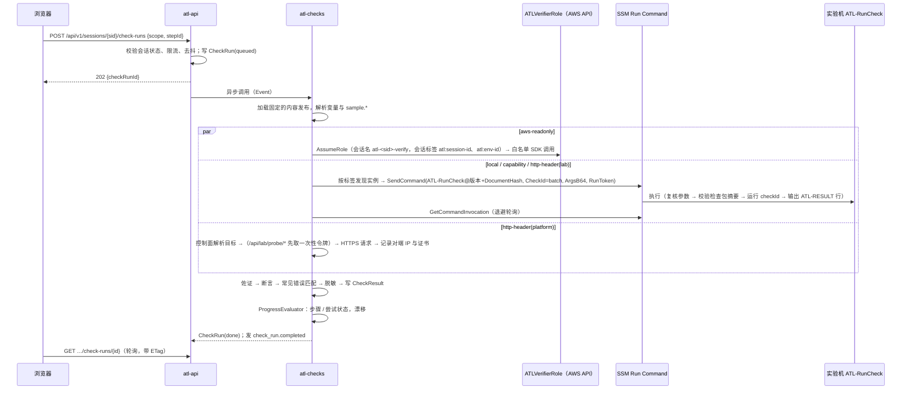
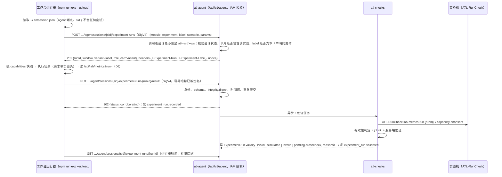
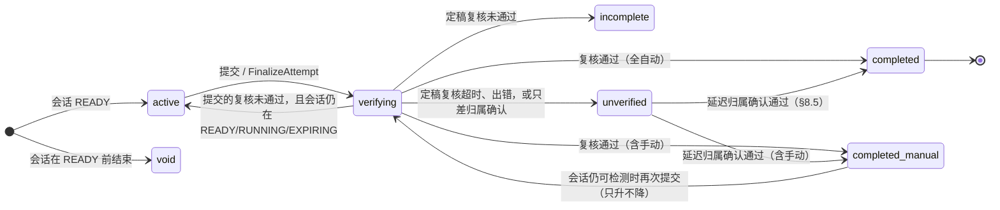

# ATL 平台设计 04：实验内容格式、检测引擎、实验报告与证书

> **文档定位**：AWS Training Lab（ATL，中文“实验平台”）平台设计的第 04 篇。定义一张学习卡片的内容怎么写（`labs/<card-id>/`，`lab.yaml` v2）、平台怎么判定学员做没做完（检测引擎、ATL-RunCheck、对比实验上传）、进度怎么算（步骤 / 卡片 / 学习路径三级，卡片完成即得徽章），以及实验报告与证书怎么生成、签名和验证。
>
> **状态**：设计稿 · 第 2 轮 · 2026-10-13。第 1 轮经过一轮对抗式审稿（附录 A）；第 2 轮按主设计者裁决 C1～C8 与平台评审、卡片审稿的意见修订（文末“修订记录”）。
>
> **同组文档**（只引用主题，不在本文展开）：
> - [01-architecture](01-architecture.md)：平台总体架构、部署与卸载、IAM 角色与权限边界、DynamoDB 单表 `atl-main`、事件总线、制品桶。**01 是唯一的名称表**（C1）：实体、键、API 路由、函数、状态机、调度、`ATL_OP`、角色、标签、事件名一律以 01 为准。
> - [02-lab-lifecycle](02-lab-lifecycle.md)：会话状态机、开始 / 结束两条短编排、报价与预检、倒计时与延长、保留与环境复用、回收器、定向扫描（CloudTrail 事件历史）与“待人工处理清单”。
> - [03-workspace-terminal](03-workspace-terminal.md)：分屏工作台、终端、AWS 控制台联合登录、应用预览。
> - [05-lab-catalog](05-lab-catalog.md)：**卡片目录（权威）**：目录页信息架构、56 张卡片的元数据汇总、原 Lab 0～25 到卡片 id 的映射。
> - [cards/tracks-and-catalog](cards/tracks-and-catalog.md)：卡片模型、学习路径、掌握度、徽章与路径证书的**模型权威**；逐卡设计见同目录的 `service-cards-1/2/3`、`scenario-cards`。
> - [06-cloudalbum-platform-mode](06-cloudalbum-platform-mode.md)：平台模式下 CloudAlbum 侧要求的**唯一清单**（探测令牌与 `/api/lab/probe/*`、`atl-check` / `probe-token` / `lab-metrics` CLI、检查包随发布包分发、Nginx 日志、`scripts/module` 平台模式与 `plan --start-of`、测试数据种子、实验变体标签等）。
> - [07-aws-verification-plan](07-aws-verification-plan.md)：需要真实 AWS 才能确认的事项。
>
> **约定**：文中“学员”指使用平台的人；“卡片”是一个可以单独开始、单独完成的实验单元（技术标识沿用 `labId`，tracks-and-catalog T2）；“实验机”指平台为会话创建的 CloudAlbum EC2；“工作台”指每个会话的 workstation EC2；“平台”指部署在学员账号里的 ATL 自身。不写具体价格和性能数字；不确定的 AWS 限制写“以官方文档为准”。
>
> **命名与权威**：本文**拥有**内容格式（`lab.yaml`、检查定义、手册指令、ATL-RunCheck 的 checkId 目录与输出、证据、报告与证书载荷）；本文用到的实体、路由、事件、函数、标签、角色会话名一律引用 01；本文新提出、01 尚未收录的名称在 §12 中逐项标注“需 01 登记”。会话状态与结束编排（`CloseLearnerAccess` → `FinalizeAttempt` → 拆除）、环境与交接链以 02 为准。凡平台评审给出 `unified_value` 的分歧，本文按该取值改写。
>
> **关于 ui-design**：`docs/ui-design.md` 描述的 CloudAlbum 内置学习控制台已被平台方案取代（C6）。本文仍沿用它的若干定义（检查结果取值、断言格式、Redactor、对比实验有效性规则、`guides/<module>.yaml` 的格式），**从本轮起由本文接管为规范**；文中“沿用 ui-design §x”只表示出处，以本文的写法为准。

---

## 目录

- [0. 摘要：关键决策](#0-摘要关键决策)
- [1. 范围、术语与信任模型](#1-范围术语与信任模型)
- [2. 实验内容目录](#2-实验内容目录)
- [3. lab.yaml 规范（v2，以卡片为单位）](#3-labyaml-规范v2以卡片为单位)
- [4. 步骤类型与手册格式](#4-步骤类型与手册格式)
- [5. 检查定义与检测引擎](#5-检查定义与检测引擎)
- [6. ATL-RunCheck：实验机上的白名单检查](#6-atl-runcheck实验机上的白名单检查)
- [7. 对比实验结果的上传协议](#7-对比实验结果的上传协议)
- [8. 进度模型](#8-进度模型)
- [9. 实验报告](#9-实验报告)
- [10. 证书](#10-证书)
- [11. 完整示例：卡片 svc-cdn（Amazon CloudFront：内容分发与边缘缓存）](#11-完整示例卡片-svc-cdnamazon-cloudfront内容分发与边缘缓存)
- [12. 接口约定汇总（供 01、02、03、05、06）](#12-接口约定汇总供-0102030506)
- [13. 对 P1～P13 的细化与偏离](#13-对-p1p13-的细化与偏离)
- [14. 需要回写到其他文档的改动](#14-需要回写到其他文档的改动)
- [附录 A. 审稿修订记录（第 1 轮）](#附录-a-审稿修订记录第-1-轮)
- [修订记录](#修订记录)

---

## 0. 摘要：关键决策

| # | 决策 | 理由 |
|---|---|---|
| C1 | **内容以卡片为单位**：`labs/<card-id>/`（`svc-<module-id>` 40 张、`sc-<slug>` 16 张）拥有编排、手册、专属检查、小测与费用依据；`guides/<module>.yaml` 作为模块知识库被引用（`guide:` 引用，构建期展开）；场景卡可以引用单服务卡的检查（`<cardId>/<checkId>`）。原 Lab 0～25 不再是内容单位，而是学习路径 `saa-main` 的步骤（映射见 05） | 卡片模型已由用户确认（C2）；同一项检查只定义一次 |
| C2 | 步骤分 6 类：`console`、`cli`、`script`、`code`、`observe`、`experiment`；“接入应用”是步骤上的 `wire: true` 标记 | 类型决定右侧面板默认标签页；`wire` 是判定语义，与做法无关 |
| C3 | 手册变量统一为 `{{ 命名空间.路径 \| 过滤器 }}`，命名空间固定 10 个；密钥永远不能成为变量 | 消除“变量从哪来”的歧义 |
| C4 | **实验机只回传观测事实，判定在平台侧执行。** 检查包随 CloudAlbum 发布包分发（06），每次调用钉扎摘要，经 SSM 文档 `ATL-RunCheck`（`ENV_VAR` 参数）按 `checkId` 调用固定入口 `/opt/atl/bin/atl-check` | 断言随内容更新而无需更新实验机；实例替换后检查包仍在 |
| C5 | 可计入完成的 `http-header` 检查**只能由平台或实验机执行**；目标从 AWS 控制面解析；关键结论用**服务端佐证**加固。平台请求 CloudAlbum 的探测端点统一为 `/api/lab/probe/*`，令牌头统一为 `X-ATL-Probe-Token`（06） | 响应头可以被源站伪造（§11.4） |
| C6 | `aws-readonly` 的 `ownership` **只认创建证据**：栈成员 → 02 台账 → 父资源 → 02 的**定向扫描**（CloudTrail `LookupEvents` 事件历史，不需要 trail）。实时打标签器只是可选加速。标签只用于发现候选资源 | 学员在控制台手工建的资源也能在会话内确认归属（C4(e)）；标签可以补打，不能证明归属 |
| C7 | 漂移按检查声明 `drift.policy: must-hold \| once`；**描述起始（before）状态的断言一律 `once`**（lint 报错）；提交时 must-hold 的检查必须仍然通过 | 启用目标模块后 before 断言必然变化；会话很短，“完成时的状态”才是能被证明的事实 |
| C8 | 卡片完成 = 最终复核通过。02 的结束编排在 `CloseLearnerAccess` 之后调用本文实现的 `FinalizeAttempt`；它失败或超时不得阻塞回收 | 忘记提交也不吃亏；费用安全优先 |
| C9 | 对比实验：工作台运行器以 SigV4（`ATLLearnerRole/atl-<sid>-ws`）“先登记、后上传”；**标签不再只有 before/after**：卡片声明任意变体标签（`--label <变体>`），每个标签有角色（`baseline`、`treatment`、`single`），结果中标注 `variant`；成对比较由 `pairs` 声明 | 模块文档的 `l0`、`unsafe`、配置 a～d、一次性实验都能被记录与判定（C5） |
| C10 | 报告是每次尝试一份**不可变快照**，可追加修订；JSON 是权威格式，HTML 自包含，PDF 由浏览器打印生成 | 平台闲置成本接近零 |
| C11 | 证书是 **JWS（ES256）**：KMS `ECC_NIST_P256` 对 SHA-256 摘要签名，载荷按 RFC 8785 规范化，验证页离线可验。**卡片完成只发徽章**（不签名），证书由学习路径颁发；卡片的证书默认关闭 | 用户要求“完成单张卡片获得徽章”；路径证书才是可对外出示的成果 |
| C12 | 证书如实标注“**自托管平台自签的完成证明**，不是 AWS 官方认证” | 诚实是证书唯一的价值来源 |
| C13 | **起始状态 = L0 + iam(role) + 目标模块硬依赖的闭包**（svc-ec2、svc-iam 不预置 iam）。`lab.yaml` 用 `startProfile.provisions` 逐项列出并说明理由；构建期由 `scripts/module plan --start-of <card>` 推导并逐项核对，生成档位 `atl/<card-id>/<variant>`（默认变体也写全为 `atl/<card-id>/default`，01 §3.9）；不能直接用 `single/<id>`（它包含目标模块本身） | 主设计者裁决 C3；起始状态不靠人工维护，又对学员逐项可解释 |
| C14 | **“正常”的判定允许预期警告**：`capability` 的 `healthy` 断言在 `status=ok`，或 `status=degraded` 且只由本卡声明的 `expectedWarnings` 导致（`validation.errors` 为空）时通过 | 总纲 §5.3：warn 级规则会让模块至少为 `degraded`；DEP-013、SEC-002、ASG-009～013 等是设计上预期的（C3） |
| C15 | **徽章只看卡片是否完成**；小测成绩只记录在徽章上，不影响完成，也不影响徽章 | 用户要求；每卡 3 题时“≥ 70 分”等于全对（C3） |

---

## 1. 范围、术语与信任模型

### 1.1 本文负责与不负责

| 本文负责 | 不在本文（见） |
|---|---|
| `labs/` 目录、`lab.yaml` v2、手册、检查、小测的**格式**；路径文件 `_tracks/*.yaml` 的**校验与进度函数** | 每张卡片的具体内容（cards/ 各文件）；卡片目录与 Lab→卡片映射（05）；路径清单、掌握度、徽章与路径证书的**模型**（tracks-and-catalog） |
| 检测引擎：检查类型、执行位置、证据、佐证、漂移、所有权判定的**使用方式** | IAM 角色与权限边界（01）；定向扫描与台账的**实现**（02）；本文只列出检测需要的权限与接口 |
| `ATL-RunCheck` SSM 文档、检查包与 checkId 目录 | 实验机、工作台的开通与引导（02、03）；CloudAlbum 侧的 CLI、探测端点、日志格式与发布包（06） |
| 对比实验上传协议（含变体标签） | 实验脚本本身（`experiments/<module>/`，总纲 §8.2；平台模式的改动见 06） |
| 进度模型、提交与最终复核、徽章的授予时机 | 会话状态机与倒计时（02） |
| 实验报告、分享、证书、公开验证页 | 平台前端的整体信息架构与视觉（03、05、01） |
| 起始状态的**声明格式**与构建期核对；预计每小时费用的**计算依据与算法** | `scripts/module plan --start-of` 的推导算法（06）；费用确认流程与保留时长控制（02） |

### 1.2 术语

| 术语 | 含义 |
|---|---|
| 卡片（card） | 一个可以单独开始、单独完成的实验单元，由 `labs/<card-id>/` 定义。单服务卡片 `svc-<module-id>`（`kind: service`，40 张）只讲一个模块的“有 vs 没有”；场景卡片 `sc-<slug>`（`kind: scenario`，16 张）组合 2～5 个服务。技术标识沿用 `labId`（`LabSession.labId`、`/api/v1/labs/*`、标签 `atl:lab-id`），界面上称“卡片” |
| Lab（旧） | 原 Lab 0～25 与扩展 Lab；现在是学习路径 `saa-main` 中的步骤，映射见 05。`atl.lab/v1` 的 `lab-NN` 内容只在迁移期可构建（§3.6） |
| 内容版本 | 卡片的语义化版本号 `version`；**内容发布**（01 的实体 `CatalogRelease`，以 `catalogVersion` 标识）是一次构建出的全部卡片、路径与生成档位的集合，另记唯一摘要 `contentDigest` |
| 会话（Session） | 学员点“开始实验”后创建的一次运行实例，实体为 01 的 `LabSession`，状态机由 02 定义 |
| 环境（Environment） | 02 定义：一套实际部署的 CloudAlbum 资源，有自己的 `envName`；保留（`KEPT`）后可被下一个会话复用，形成“交接链” |
| 起始状态（startProfile） | 开始实验时平台自动部署的状态 = L0 + iam(role) + 目标模块硬依赖的闭包（C13）；生成档位 `atl/<card-id>/<variant>`（默认变体 `default`），文件 `profiles/atl/<card-id>/<variant>.env` |
| 变体（variant） | 两种含义，名称上区分：**起始变体**（`startProfile.variants`，同一卡片的另一种起始状态，例如 sc-ha-web 的 EFS 做法、svc-tls 的 ACME 不可用回退档）与**实验变体**（对比实验的标签，例如 `before`、`after`、`l0`、`unsafe`、`a`） |
| 预期警告（expectedWarnings） | 卡片声明的、设计上预期出现的 warn 级规则 ID；只有它们导致的 `degraded` 才被视为“正常”（C14） |
| 尝试（LabAttempt） | 会话对应的学习记录，与会话一一对应（`attemptId = sessionId`）。会话的资源会被回收，尝试的记录会保留。实体与键见 01（键 `SESSION#<sid>` / `ATTEMPT`） |
| 步骤（Step） | 卡片中的一个操作单元，有类型、手册和检查 |
| 检查（Check） | 一个可执行的判定定义，属于 6 种类型之一 |
| 检查运行（CheckRun） | 一次检测请求，可包含多项检查 |
| 检查结果（CheckResult） | 一项检查的一次执行结果，**只追加**（存为 `CheckRun.results[]` 中的一项） |
| 证据（Evidence） | 检查结果中的观测数据、断言对照和执行者信息 |
| 佐证（Corroboration） | 附属于某项检查、从另一条独立渠道获得的服务端证据，例如源站日志 |
| 判定来源 | 5 类：① 本地检查、② 能力探针、③ AWS 只读、④ 对比实验、⑤ 手动确认 |
| 漂移 | 已通过的 must-hold 检查后来变为 `fail` |
| 提交 / 最终复核 | 学员点“提交实验”或会话进入回收前，平台对全部必需检查做一次强制复测并判定卡片是否完成 |
| 徽章 | 卡片完成（最终复核通过）即授予，不签名，记在进度里；小测成绩只记录在徽章上。模型见 tracks-and-catalog §5 |
| 学习路径（Track） | 由若干卡片组成的路径，例如 `saa-main`、`secure`；完成路径颁发签名的路径证书。清单与规则见 tracks-and-catalog §4、§5 |

### 1.3 信任模型

ATL 部署在学员自己的账号里，学员（或其团队）同时是平台的所有者。因此检测的目标是**防误判、防走捷径、让造假需要刻意为之**，而不是对抗账号所有者。

| 威胁 | 例子 | 是否防御 | 手段 |
|---|---|---|---|
| 误判：资源建好了，但应用没用上 | 分配已部署，但相册仍从 EIP 直出 | 防 | `wire` 步骤同时要求 ② 能力探针与 ① 请求路径（沿用 ui-design §4.5） |
| 走捷径：伪造响应头 | Nginx `add_header X-Cache "Hit from cloudfront"` | 防 | C5：平台执行、控制面解析目标、IP 段与 TLS 证书校验、源站日志佐证（§11.4） |
| 走捷径：拿别处的资源过检查 | 填一个以前建好的分配 ID；给旧资源补打 `atl:session-id` 标签 | 防 | C6：`ownership` 只认创建证据（本环境栈成员、02 台账、父资源、CloudTrail 定向扫描），标签不算证据 |
| 走捷径：不做操作也通过 | 起始状态里已经有目标取值；before 断言在启用后“漂移”导致卡片无法完成 | 防 | C13：目标取值不得出现在起始状态（lint DRV-5）；C7：before 断言一律 `once` |
| 伪造对比实验结果 | 手写 JSON 上传 | 防（提高门槛） | SigV4 上传 + 服务端登记的时间窗 + 按 `runId` 的服务端佐证（§7.4） |
| 重放旧证据 | 复制上次会话的结果 | 防 | 每次检查生成 nonce；证据绑定 `sessionId`、`runToken` 与时间窗 |
| 学员以 root 修改实验机上的检查包或 Nginx 日志 | 改 `/opt/atl/checks` | 只发现**意外**改动 | 每次调用钉扎检查包清单摘要（§6.3）；不承诺对抗 |
| 账号所有者修改平台本身、KMS 密钥或数据库 | 直接改 DynamoDB 里的结果 | 不防 | 自托管的本质；证书如实声明（§10.1） |

---

## 2. 实验内容目录

### 2.1 仓库布局

`labs/` 放在仓库根目录（它是内容，不是平台代码，也不是 CloudAlbum 代码）。平台读取它的构建产物。

```text
labs/
├── _schema/                         # 由 platform/api 中的 zod 定义生成，CI 校验与源码一致
│   ├── lab.schema.json              # atl.lab/v2（§3.3）；迁移期另保留 lab.v1.schema.json（§3.6）
│   ├── check.schema.json
│   ├── quiz.schema.json
│   ├── manual-frontmatter.schema.json
│   ├── track.schema.json            # atl.track/v2，字段由 tracks-and-catalog §7.3 定义
│   └── taxonomy.schema.json
├── _catalog/
│   ├── taxonomy.yaml                # 手写：类别、服务格与附属服务 id、iamPrefix、领域、费用档位规则（tracks-and-catalog §7.4）
│   └── catalog.yaml                 # 生成：npm run labs:catalog 的输出，提交到仓库，CI 重新生成后比较（05 的目录页读取它）
├── _tracks/                         # 学习路径（atl.track/v2），清单内容见 tracks-and-catalog §4
│   ├── saa-main.yaml
│   └── secure.yaml
├── _pricing/                        # 计费维度映射：pricingKey → Price List 查询条件（不含价格，§3.4）
│   └── dimensions.yaml
├── _shared/
│   ├── snippets/*.md                # 可复用的手册片段（例如“如何打开工作台终端”）
│   └── checks/*.yaml                # 跨卡片复用的检查（例如 no-world-ssh：安全组没有对全网开放 22）
├── svc-cdn/                         # 目录名 = 卡片 id
│   ├── lab.yaml                     # 元数据与编排（§3）
│   ├── manual/                      # 手册正文，一个步骤一个文件（§4）
│   │   ├── 00-overview.md           # section: overview（痛点、目标、架构图）
│   │   ├── 10-orient.md             # step: orient
│   │   ├── 20-baseline.md
│   │   ├── …
│   │   ├── 90-wrap-up.md            # section: wrap-up（结论、考点回顾）
│   │   └── 95-cleanup.md            # section: cleanup（清理说明）
│   ├── checks/                      # 本卡专属检查（§5）；文件名自由，按主题分
│   │   ├── distribution.yaml
│   │   └── edge.yaml
│   ├── stacks/                      # 只有带 extraStacks 的场景卡才有（§3.2.15）；发布为 stacks/<card-id>/<stackId>.yaml
│   ├── quiz.yaml                    # 小测（§3.2.11）
│   ├── assets/                      # 图片与示意图（png、svg、webp；单文件 ≤ 512 KB，整个目录 ≤ 4 MB）
│   │   ├── badge.svg                # 徽章图形（自绘，不使用 AWS 官方素材；tracks-and-catalog §6.7）
│   │   └── edge-vs-direct.svg
│   └── CHANGELOG.md                 # 版本变更说明；主版本号变化必须写明影响
└── sc-ha-web/                       # 场景卡；有起始变体时生成多个档位（§3.2.3）
```

**生成物（不提交，随内容发布）**：每张卡片的每个起始变体一个档位文件 `profiles/atl/<card-id>/<variant>.env`，默认变体为 `profiles/atl/<card-id>/default.env`（§3.2.3、§2.5；第 3 轮统一为 01 §3.9 的写法，不再生成省略变体的 `profiles/atl/<card-id>.env`）；卡片自带栈的模板复制为 `stacks/<card-id>/<stackId>.yaml`。测试数据种子（已确认的 Cognito 测试用户、带 GPS 信息的示例照片）**不放在 `labs/`**：它们随 CloudAlbum 发布包提供，生成方式见 06；卡片只在 `startProfile.provisions` 中以 `kind: seed` 引用种子 id。

**命名规则**

| 对象 | 格式 | 例子 |
|---|---|---|
| 卡片 id | `^(svc\|sc)-[a-z0-9]+(-[a-z0-9]+)*$`，前缀之后 ≤ 24 字符；`svc-` 之后必须是 `modules/registry.yaml` 中的模块 id（含 `ec2`）；迁移期仍接受 `atl.lab/v1` 的 `lab-NN` 与 `lab-NN-x-<slug>`（§3.6） | `svc-cdn`、`sc-edge-protection` |
| 步骤 id | kebab-case，卡片内唯一，≤ 40 字符 | `enable-cdn` |
| 卡片检查 id | kebab-case，卡片内唯一；全局键为 `<cardId>/<checkId>`，场景卡可以直接引用 | `svc-cdn/edge-cache-observed` |
| guides 引用 | `guide:<moduleId>#<stepId>/<checkId>`；考点题为 `guide:<moduleId>#exam/<quizId>`；清理验证为 `guide:<moduleId>#cleanup/<checkId>` | `guide:cdn#cleanup/dist-gone` |
| 共享检查 | `_shared/checks/` 中的 id，引用时直接写 id | `no-world-ssh` |
| 路径 id | kebab-case，≤ 32 字符 | `saa-main` |
| 起始档位名 | `atl/<card-id>/<variant>`，默认变体写全为 `atl/<card-id>/default`（01 §3.9） | `atl/svc-cdn/default`、`atl/sc-ha-web/efs` |
| 手册文件 | `NN-<stepId>.md`，`NN` 只用于排序 | `30-enable-cdn.md` |
| 实验变体标签 | `^[a-z][a-z0-9-]{0,23}$`，在卡片的 `experiments[].labels` 中声明 | `before`、`after`、`l0`、`unsafe` |

> 任务说明中的 `steps/*.md` 与 `manual/*.md` 二选一：**统一用 `manual/`**，因为手册还包含不属于步骤的章节（概览、总结、清理）。
>
> 共享检查名统一为 `no-world-ssh`（第 1 轮写作 `lab2-no-world-ssh`，卡片第 1 批写作 `lab-no-world-ssh`；“lab2”在卡片模型中已无意义）。迁移期两个旧名作为别名，lint 给出警告。

### 2.2 文件职责

| 文件 | 职责 | 谁读 | 可否引用 guides |
|---|---|---|---|
| `lab.yaml` | 元数据、时间、起始状态声明、目标模块、费用依据、步骤编排、对比实验、小测配置、徽章、所属路径、清理、考点、标签、权限声明 | 平台 API、`labs:lint`、`labs:derive`、`labs:catalog`（生成 05 目录页读取的 `catalog.yaml`） | 是（步骤 `from:`、检查 `ref:`、考点 `ref:`） |
| `manual/*.md` | 学员看到的正文 | 平台前端（构建期编译为 AST） | 是（`::include{ref=…}` 引入 guides 中的做法片段） |
| `checks/*.yaml` | 卡片专属检查 | 检测引擎；场景卡可按全局键 `<cardId>/<checkId>` 引用 | 是（`extends: guide:…` 在 guides 检查基础上覆盖字段） |
| `quiz.yaml` | 小测题目 | 平台 API（答案不下发到浏览器） | 是（`include: guide:<module>#exam/<quizId>`） |
| `assets/` | 图片 | 前端（经 CloudFront 提供） | 否 |
| `_tracks/*.yaml` | 学习路径（`atl.track/v2`，tracks-and-catalog §7.3） | 平台 API、`labs:catalog` | — |
| `_catalog/taxonomy.yaml` / `catalog.yaml` | 分类法（手写）/ 目录（生成，禁止手改） | `labs:lint`、`labs:catalog`、05 的目录页 | — |
| `_pricing/dimensions.yaml` | 计费维度到 Price List API 查询条件的映射（不含价格） | `atl-pricing`（01）、`labs:lint` | — |

所有 YAML 用安全模式加载：不允许自定义标签，锚点合并不超过 1 层，单文件 ≤ 256 KB（沿用 ui-design §5.1）。

### 2.3 与 `guides/<module>.yaml` 的关系（结论）

**结论：引用，不合并；labs 取代 course.yaml 与 guides 的步骤编排，但不取代 guides 的模块知识。**

> 第 2 轮补充：ui-design 已被平台方案取代（C6），`guides/<module>.yaml` 的格式从本轮起由本文接管为规范，ATL 实际使用的子集就是下表列出的六类内容；guides 中只服务于内置控制台的字段（例如页面布局提示）构建期忽略。卡片模型下，单服务卡 `svc-<module>` 是该模块知识最自然的“使用者”，但检查仍定义在 guides 或卡片的 `checks/` 中，**不允许**在两处重复定义同一事实；场景卡复用单服务卡的检查时直接写全局键（`ref: svc-cdn/edge-cache-observed`），构建期展开并记录来源。

| guides 中的内容 | 在 ATL 中的地位 | 理由 |
|---|---|---|
| `checks[]`（检查定义） | **单一来源**。卡片在 `lab.yaml` 中用 `ref: guide:cdn#wire/cap-ok` 引用，引用处可覆盖 `required`、`when`、`drift`、`timeoutMs`；需要追加 `ownership`、`corroborate` 等较大改动时，在 `checks/*.yaml` 中用 `extends: guide:…` 定义一个新检查 | 同一事实只定义一次 |
| `pitfalls`、`saa`、`exam`（考点、易混概念、题目）、`compare`（指标与有效性）、`cleanup.verify` | **单一来源**，原样引用 | 属于模块知识，与卡片编排无关 |
| `steps[].methods`（控制台、CLI、脚本、代码做法） | **可引用的片段库**。手册用 `::include{ref="guide:cdn#create-distribution/methods.cli"}` 引入；也可以在手册里重写 | 平台手册需要针对“工作台 / 实验机 / 联合登录控制台”改写运行位置，所以允许重写 |
| `steps[]` 的顺序与骨架（before → config → wire → … → after） | **被 lab.yaml 取代** | 场景卡包含多个模块（例如 sc-user-identity：auth + identity-pool + social-api），卡片还有平台专属步骤（观察起始状态、最终提交） |
| `course.yaml`（ui-design §5.2） | **被取代**：卡片元数据进 `lab.yaml`，路径进 `labs/_tracks/`，目录进生成的 `_catalog/catalog.yaml` | 卡片模型取代 Lab 编排（C2） |
| `variables`（模块变量） | 合入卡片的 `var.*` 命名空间；`fillFrom` 中的 `envfile.*`、`cap.*` 保留 | 见 §2.4 |

**引用解析规则**

1. 构建期（`labs:build`）解析全部 `guide:` 引用，把被引用的定义**展开**进内容发布，并记录来源 `{ guide: cdn, guideVersion: 4.0.0, path: 'wire/cap-ok' }` 与该定义的哈希。运行时不再读取 guides。
2. 被引用的 guides 主版本号变化时，引用它的卡片必须在 `CHANGELOG.md` 说明并提升自身版本（lint 强制）。被引用的卡片检查（`<cardId>/<checkId>`）同理：被引用卡片的主版本变化时，引用方必须提升版本。
3. 引用的 guides 检查若用了 ATL 无法执行的形式（例如 `local` 的某个 probe 尚无对应 `checkId`），构建失败并指出位置。

**guides 步骤类型到 ATL 步骤类型的映射**（`from: guide:<module>#<stepId>` 时自动套用，卡片可覆盖）

| guides `type` | ATL `type` | 说明 |
|---|---|---|
| `config` | `console`、`cli` 或 `script` | 取 guides 的 `defaultMethod`；没有时按 console → cli → script 的顺序取第一个存在的做法 |
| `wire` | `script`，并加 `wire: true` | 每个目标模块恰好一个 `wire: true` 的步骤（lint 强制） |
| `code` | `code` | — |
| `manual` | `observe` | 检查仍是 `manual` 类型 |
| `read` | 不成为步骤 | 正文并入手册 |
| `experiment` | `experiment` | — |

### 2.4 变量与执行位置的映射

**guides 内置变量 → ATL 命名空间**（展开 guides 定义时自动改写）

| guides 写法 | ATL 写法 | 来源 |
|---|---|---|
| `{{region}}` | `{{ session.region }}` | 会话 |
| `{{accountId}}` | `{{ session.accountId }}` | 会话（默认打码） |
| `{{instanceId}}` `{{az}}` `{{instanceType}}` | `{{ target.instanceId }}` 等 | 按标签 `atl:env-id` + `atl:role=lab-app` 实时发现、并核对 `aws:cloudformation:stack-name` 属于本环境的实验机（01 §9.8：平台不缓存实例 ID；规则见 §5.2.1） |
| `{{publicIp}}` `{{publicDns}}` `{{privateIp}}` `{{sgId}}` | `{{ target.publicIp }}` 等 | 同上 |
| `{{appBaseUrl}}` | `{{ target.appBaseUrl }}` | 同上 |
| `{{env}}` | `{{ session.env }}` | 会话：本环境的 `envName`（`e` 加 7 位小写字母数字，01） |
| `{{cap.*}}`、`{{envfile.*}}`、`{{var.*}}`、`{{sample.*}}` | 不变 | §4.4 |
| `{{profile.domain}}` | `{{ learner.inputs.domain }}` | 学员在开始前填写的前置输入 |

**guides 检查 → ATL 执行位置**

| guides 检查 | ATL 执行方式 |
|---|---|
| `local`（`probe: X`） | `local`，经 `ATL-RunCheck` 调用对应 `checkId`（映射见 §6.4 最后一列） |
| `http-header`，`from: server`，`target ∈ {self, origin-private, cdn-origin}` | `http-header`，`from: lab`（实验机上的 `http-probe`） |
| `http-header`，`from: server`，`target ∈ {cdn, public-ip, alb, apigw, app-base-url, s3-object}` | `http-header`，`from: platform`（平台 Lambda） |
| `http-header`，`from: browser` | `from: browser`，只用于展示，不能是必需检查 |
| `capability` | 经 `ATL-RunCheck` 的 `capability-snapshot` |
| `aws-readonly` | 平台 Lambda 以 `ATLVerifierRole` 执行；卡片可追加 `ownership` |
| `experiment` | 读取平台中的对比实验结果（§7） |
| `manual` | 读取平台中的手动确认记录（§8.8） |

### 2.5 构建、校验与发布

```text
npm run labs:lint     # schema 校验 + 交叉校验（§3.5），CI 必跑
npm run labs:derive   # 对每张卡片的每个起始变体执行 scripts/module plan --start-of，与 startProfile.provisions 逐项核对（§3.2.3、§3.5 DRV-*）
npm run labs:build    # 展开引用、编译手册为 AST、计算哈希、生成起始档位文件，输出 dist/content/<contentDigest>/
npm run labs:catalog  # 由全部 lab.yaml、_tracks、taxonomy 与 plan 输出生成 _catalog/catalog.yaml（tracks-and-catalog §7.5）
npm run labs:policy   # 汇总全部 aws-readonly 的 service:action，生成 ATLVerifierRole 的只读白名单（§5.7）
```

- **产物**：`index.json`（卡片与路径索引，内容与 `catalog.yaml` 相同）、`labs/<cardId>.json`（展开后的完整卡片，含手册 AST、检查元数据）、`profiles/atl/<cardId>/<variant>.env`（生成的起始档位，每个变体一个，默认变体为 `default.env`；格式由 06 定义，含 `PROFILE_PLAN_DIGEST`）、`stacks/<cardId>/<stackId>.yaml`（卡片自带栈的模板，运行器 `extra-stack` 读取）、`assets/…`、`manifest.json`（每个文件的 SHA-256）。整个产物的摘要即 `contentDigest`。**小测答案与 `explain` 单独输出到 `private/quiz/<cardId>.json`，不进入公开内容包**（见下）。
- **发布**：内容随平台版本一起发布（分发渠道见 01 §4.5）；安装或升级时由 01 的自定义资源复制到 `atl-web` 桶的 `/content/<catalogVersion>/`（经 CloudFront 提供），并登记为 `CatalogRelease`（`contentDigest` 是它的属性）。`private/quiz/*` 只写入学员不可访问的 `atl-artifacts` 桶，由 `atl-api` 读取判分。管理员也可以在平台上切换到新的内容发布。
- **起始档位的使用**：02 的运行器在 `profile-apply` 前从 `/content/<catalogVersion>/profiles/atl/<cardId>/<variant>.env` 取得档位文件，按 `manifest.json` 校验 SHA-256，并在部署前执行一次 `scripts/module plan --profile atl/<cardId>/<variant> --platform --json`，比较 `digest` 与档位中的 `PROFILE_PLAN_DIGEST`；不一致属于“内容与工具包版本不匹配”的不可重试失败（02、06）。`plan --profile` 的 `digest` 与构建期 `plan --start-of` 的 `digest` 是同一算法（06 PM-32、PM-33），所以运行期不需要 `lab.yaml`（运行器的源码包与内容发布中都没有它）。
- **固定**：会话创建时在 `LabSession.catalogVersion` 中固定版本（01），本文另在尝试记录中写 `contentDigest`、`labVersion` 与所选起始变体，整个尝试期间按这一版判定（§8.10）。
- **版本一致**：`labs:derive` 使用的 CloudAlbum 工具包与 registry 版本记入 `CatalogRelease`（`registryVersion`、`toolkitVersion`）；平台发布时校验它们与平台携带的 CloudAlbum 发布包一致（01 登记字段）。
- **验证策略**：`labs:policy` 的输出写入 `platform/infra/policies/generated/verifier-readonly.json`（01 的生成目录），由 01 的策略生成器并入 `ATLVerifierRole`；CI 比对生成结果与仓库中的文件，不一致即失败。
- **代码位置**：内容的 zod 定义与 lint/build/derive/catalog 脚本放在 `platform/api/src/content/`；根 `package.json` 提供上述 npm 脚本。

---

## 3. lab.yaml 规范（v2，以卡片为单位）

第 2 轮把 `lab.yaml` 升级为 `atl.lab/v2`：一个 `lab.yaml` 就是一张卡片（C2）。v2 合并了三方面的需求：卡片模型（cards/ 各文件附录与 tracks-and-catalog §7.2）、05 第 1 轮提出的 F-1～F-9（四级难度、`platform` 段、`workstation.savingsMode`、`platformOps[].id`、一次性实验、`atl/<id>` 档位名、平台占位符、分类法服务 id），以及主设计者的起始状态规则（C3）。字段名以本节为准，cards/ 各文件中不同的写法按 §14 回写。

### 3.1 顶层字段一览

| 字段 | 必填 | 类型 | 说明 | 相对 v1 |
|---|---|---|---|---|
| `schema` | 是 | 常量 `atl.lab/v2` | 格式版本 | v1 → v2（迁移见 §3.6） |
| `id` | 是 | 卡片 id | `svc-<module-id>` 或 `sc-<slug>`（§2.1），与目录名一致 | 放宽：不再只允许 `lab-NN` |
| `kind` | 是 | `service \| scenario` | 必须与 id 前缀一致 | 新增 |
| `service` / `function` | `kind: service` 时必填 | 文本 | AWS 服务全称与机能（README 对照表的“机能”列，可做 ≤ 12 字的口语化改写）；`title` 必须等于 `<service>：<function>` | 新增 |
| `version` | 是 | semver | 主版本号变化 = 检查语义变化（§8.10） | — |
| `status` | 否 | `draft \| beta \| stable \| deprecated` | `draft` 不在目录中显示；`deprecated` 不能开始新会话 | — |
| `title` / `subtitle` | 是 / 否 | 文本 | 标题 ≤ 48 字（服务全称不能缩写，例如“AWS Systems Manager Parameter Store：运行时配置”）；副标题 ≤ 60 字，场景卡写服务组合 | 放宽（v1 ≤ 24） |
| `summary` | 是 | 文本 | 目录卡片上的一句话简介 | — |
| `story` | 场景卡必填 | Markdown | 痛点故事，2～4 句 | 场景卡改为必填 |
| `scenario` | 场景卡必填 | 对象 | `{question, constraints[], antiPatterns[]}`：简介页的考题式场景（tracks-and-catalog §7.2） | 新增 |
| `objectives` | 否 | 数组 | 学习目标，每条带 SAA 领域与关联步骤 | — |
| `difficulty` | 是 | `intro \| beginner \| intermediate \| advanced` | 入门 / 初级 / 中级 / 高级，判定标准沿用 05（目录总则）；`intro` 只用于不启用任何 AWS 模块的卡片（目前只有 svc-ec2）；场景卡至少 `intermediate` | 放宽为四级；`beginner` 的含义由“入门”改为“初级” |
| `estimatedMinutes` | 是 | 整数 | 预计时长（熟练学员完成全部必需步骤的典型用时，含卡内云端等待，不含环境准备），15 的整数倍 | 增加取整规则 |
| `timeLimitMinutes` | 是 | 整数 | 时间上限（倒计时长度），30 的整数倍且 ≥ `estimatedMinutes` × 1.5；平台上限 `MaxSessionMinutes`（01，默认 360）取较小值 | 增加取整规则 |
| `extensions` | 是 | 对象 | `maxCount`、`minutesEach`；平台默认 2 × 30 分钟，取较小值 | — |
| `retain` | 是 | 对象 | 是否允许“保留环境”及 `maxHours`；与平台 `MaxKeepHours`（01，默认 24、硬上限 72）取较小值 | — |
| `regions` | 否 | 对象 | `supported`；`alsoUses`（`global`、`us-east-1`）；`extra`（`dr-region` = 平台安装参数 `DrRegion`） | — |
| `services` | 是 | 数组 | `{id, name?, role, module?, featureOf?, optional?, creditBy?}`；`id` 取 `_catalog/taxonomy.yaml` 的服务格或附属服务 id（不是 IAM 前缀）；`role` 增加 `context`（起始状态中的模块，默认不计入掌握度）；`creditBy` 见 tracks-and-catalog §5.4 | 扩展 |
| `modules` | 是 | 对象 | `{target[], start[], context[], related[]}`：`target` 必须等于 `targetModules[].id`，`start`、`context` 由 `labs:derive` 核对；`related` 用于“下一步”推荐 | 新增 |
| `prerequisites` | 否 | 对象 | `cards`（推荐的前置卡片，`soft \| hard`）、`learnerInputs`（学员前置输入）、`knowledge` | `labs` 改名为 `cards` |
| `startProfile` | 是 | 对象 | 起始状态声明：`provisions`（逐项列出并说明理由）、`branches`、`platform`、`variants`、`reason`；构建期推导并核对（§3.2.3） | 重写（v1 的写法 A / B 废止） |
| `targetModules` | 是 | 数组 | 学员在卡内启用或改变的模块：`{id, driver, fromDriver?, set?, params?, wireStep, adoptsExisting?, optional?}`（§3.2.4）；svc-ec2 为空 | 扩展：`fromDriver`、`set`、`wireStep` |
| `expectedWarnings` | 否 | 数组 | 本卡设计上预期出现的 warn 级规则 ID（§3.2.5，C14） | 新增 |
| `acceptedDrift` | 否 | 数组 | 学员在模块管理的资源上有意做的修改，漂移检查与最终复核不判失败（§5.8） | 新增 |
| `workstation` | 否 | 对象 | `required`、`tools`、`sshFromWorkstation`、`savingsMode`（03 的 CloudShell 省钱模式） | 增加 `savingsMode` |
| `platform` | 否 | 对象 | `consoleLinks`（03 深链接注册表 id，目录与手册推荐用）、`accountImpact`（账号级影响与回收还原方式，02 消费）。预览方案 B 的开关不在这里，在 `startProfile.platform` | 新增（05 F-1） |
| `variables` | 否 | 映射 | 卡片变量声明（`var.*`） | — |
| `cost` | 是 | 对象 | 费用依据（§3.4）；`tier`（`low \| medium \| high`）、`tierWithOptional?`、`mainDrivers[]`，构建期按 05 的费用档位算法复算并核对 | 增加 `tier`、`mainDrivers` |
| `provision` | 是 | 对象 | `class`（`A`～`D`，部署耗时等级，02）、可选 `budgetMinutes`、`cleanupBudgetMinutes`；构建期按 tracks-and-catalog §1.6 推导并核对 | — |
| `steps` | 是 | 数组 | 步骤编排（§3.2.8、§4） | 增加 `expectedOutage` |
| `finalChecks` | 否 | 数组 | 不属于任何步骤、只在最终复核时执行的检查 | — |
| `experiments` | 否 | 数组 | 对比实验：变体标签与角色、成对比较、有效性类型（§3.2.10） | 重写标签模型（C9） |
| `quiz` | 否 | 对象 | 小测文件与抽题数；成绩只记录，不影响完成与徽章 | 删除 `requiredForCertificate`（v1 才有） |
| `badge` | 是 | 对象 | `{title, short?, icon?}`：完成即授予（C15） | 新增 |
| `tracks` | 是 | 数组 | 包含本卡的路径 id，必须等于 `_tracks/` 的实际包含关系（`npm run labs:fix` 可改写） | 新增 |
| `cleanup` | 是 | 对象 | 清理说明、数据风险、学员手动资源的回收提示、清理验证 | — |
| `saa` | 是 | 对象 | SAA 考点：领域、知识点、易混概念 | — |
| `tags` | 是 | 数组 | 标签，用于目录搜索 | — |
| `permissions` | 否 | 对象 | 学员在本卡需要的写操作（IAM action）；lint 与有效权限比对 | — |
| `platformOps` | 否 | 数组 | 本卡允许学员请求的平台动作：`{id, op, module, args, title, confirm?, optional?, interruptsManagementChannel?}`；`module-ops` 请求体只带 `actionId`（01） | 增加 `id`、`title` 等（05 F-1） |
| `keepablePrerequisites` | 否 | 数组 | 结束时允许学员勾选保留的前置资源类型 | — |
| `extraStacks` | 否 | 数组 | 卡片自带的非模块栈（目前只有 sc-backup-dr、sc-cost-optimization，§3.2.15） | 新增 |
| `certificate` | 否 | 对象 | 卡片证书开关；v2 默认 `{enabled: false}`（证书由路径颁发，C11） | 改默认值；删除 `requireQuiz` |
| `owners` | 否 | 数组 | 内容维护者 | — |

**02 消费的字段**（02 §13.5 按下列字段读取 `lab.yaml` 与生成的档位；以本文字段名为准）：

| 02 的旧写法 | v2 字段 |
|---|---|
| `durationMinutes` | `timeLimitMinutes` |
| `extension{stepMinutes, maxCount, maxTotalMinutes}` | `extensions{minutesEach, maxCount}`（`maxTotalMinutes` = 两者之积，平台上限另行截断） |
| `keepAllowed` | `retain.allowed`（`retain.maxHours` 与平台上限取较小值） |
| `provisionClass`、`provisionBudgetMinutes`、`cleanupBudgetMinutes` | `provision.class`、`provision.budgetMinutes`、`provision.cleanupBudgetMinutes` |
| `workstationRequired`、`sshFromWorkstation` | `workstation.required`、`workstation.sshFromWorkstation` |
| `regions`（额外区域） | `regions.alsoUses` 与 `regions.extra` |
| `prerequisites` | `prerequisites.learnerInputs` |
| `startProfile`（档位名） | 生成的档位名 `atl/<card-id>/<variant>`（§3.2.3），会话记录所选变体；预检型变体（`startProfile.variants[]` 中 `select: preflight`）由 02 的账号预检按 `when` 选择 |
| `targetModules[].driver` | 同名；另读 `fromDriver`、`set` |
| （新增） | `kind`、`startProfile.variants`、`startProfile.platform.preview.directHttps`、`expectedWarnings`（`caps.profile` 健康门使用，§6.4）、`extraStacks`、`platform.accountImpact` |

### 3.2 字段详解

#### 3.2.1 时间：`estimatedMinutes`、`timeLimitMinutes`、`extensions`、`retain`

```yaml
estimatedMinutes: 75
timeLimitMinutes: 120
extensions: { maxCount: 2, minutesEach: 30 }   # 最多延长 2 次，每次 30 分钟
retain: { allowed: true, maxHours: 24 }         # 允许保留环境，最长 24 小时（与平台上限取较小值）
```

- 倒计时、延长、到期提醒、保留环境的状态转移全部由 02 实现，本文只定义字段。
- 带长时间等待的卡片（RDS、分配部署）应把等待时间计入 `timeLimitMinutes`；lint 对 `steps[].wait.maxMinutes` 之和超过上限 50% 的卡片给出警告。
- 费用档位为“高”的卡片建议 `retain.maxHours ≤ 12`（cards/ 各批的约定），以控制保留期间的持续计费。

#### 3.2.2 `kind`、`service`/`function`、`services`、`modules`、`regions`

```yaml
kind: service
service: Amazon CloudFront
function: 内容分发与边缘缓存
title: Amazon CloudFront：内容分发与边缘缓存
services:
  - { id: cloudfront, role: primary, module: cdn }
  - { id: ec2, role: supporting, module: ec2 }                     # 源站
  - { id: iam, role: context, module: iam }                        # 起始状态中的 iam(role)，不计入掌握度
  - { id: ssm-session-manager, role: observed }                    # 平台管理通道
modules: { target: [cdn], start: [iam], context: [], related: [waf, dns, tls, storage] }
regions:
  supported: [ap-northeast-1]
  alsoUses: [global, us-east-1]
```

- `services[].id` 用分类法 id（例如 `ssm-session-manager`、`ssm-parameter-store`、`ebs`；以 05 §8.2 的 taxonomy 为准，第 3 轮把示例中的 `session-manager` 改为 `ssm-session-manager`），分类法中另存 `iamPrefix`，供权限边界与回收器对照（05 F-6）。
- 单服务卡：`primary` 恰好 1 个，且其 `module` 等于 id 中的模块；场景卡：`primary` + `supporting` ≥ 2（tracks-and-catalog §7.7）。
- `alsoUses` 告诉 01 的权限边界与 02 的回收器：本卡需要全局服务或 us-east-1（例如 CloudFront 的 ACM 证书、CLOUDFRONT 范围的 WAF）；`extra: [dr-region]` 让灾备区域进入边界放行、回收扫描与 `aws-readonly` 的可用区域。

#### 3.2.3 `startProfile`：起始状态（C3）

**规则**（主设计者裁决 C3，本节是它在内容格式中的落实）：

1. 起始状态 = `l0-ec2` + **iam(role)** + 目标模块（按目标取值）硬依赖的**闭包**。闭包包括 registry 的 `requires`，也包括规则表中“启用某模块即可满足”的 error 级条件（例如 ASG-001～003、DEP-009 的复合条件），由 `scripts/module plan` 求解（06）。
2. **例外**：`svc-ec2` 与 `svc-iam` 不预置 iam（前者是“没有任何 AWS 模块”的基线，后者的目标就是 iam）。其余卡片——包括目标模块 `credentials: optional` 的卡片——一律预置 `iam(role)`，因此不再出现“只因无凭证而 `degraded`”（CRED-004）。这取代 cards/ 各批“optional 不并入 iam”的写法与总纲 §10.4 规则 2 在平台模式下的适用（§14 回写）。
3. **不能直接用 `single/<id>` 档位**：它包含目标模块本身（L0 + 该模块 + 依赖）。起始状态由 `scripts/module plan --start-of <card-id> [--variant <id>] --platform --json` 推导（06），构建期为每个起始变体生成档位文件 `profiles/atl/<card-id>/<variant>.env`（档位名 `atl/<card-id>/<variant>`；默认变体为 `default`，写全为 `atl/<card-id>/default`，与 01 §3.9、02 §3.6、06 PM-33 一致）。
4. 场景卡可以在闭包之外加入**背景模块**（`basis: context`），理由只允许四类：`https-entry`（提供受信 HTTPS 入口）、`protected-data`（提供被保护或被分析的数据）、`shorten-wait`（把慢资源移到开始阶段）、`realism`（场景真实性）。单服务卡不允许背景模块。
5. 目标取值不得在起始状态中生效（lint DRV-5）；目标模块以本地档或前驱取值出现在起始状态时，`targetModules[].fromDriver` 必须写明（§3.2.4）。
6. 需要人工前置的设置（域名、SES 发件身份、确认订阅、成本分配标签）不预置，写进 `prerequisites.learnerInputs`。

**字段**

| 字段 | 必填 | 说明 |
|---|---|---|
| `provisions[]` | 是 | 起始状态的逐项清单，同时是给学员看的“开始前会自动准备什么”（简介页“实验资源”区块）。每项 `{item, kind, basis?, set?, params?, value?, rule?, contextKind?, reason}`，见下表 |
| `branches` | 否 | 任选分支（`a \| b`）的选择：`{ <规则 ID>: { choose: <模块>, reason } }`；不写时取 plan 的默认分支 |
| `platform` | 是 | 平台固定部分的开关：`{ preview: { directHttps: 'on' \| 'off' } }`。方案 B（Let's Encrypt IP 证书，03）会写入 `TLS_MODE=letsencrypt`：起始状态或目标含 **autoscaling**（ASG-014）或 **tls** 的卡片必须为 `off`（C5）；切换到 private 放置的卡片（sc-private-network）也应为 `off` |
| `variants[]` | 否 | 起始变体，≤ 3 个：`{id, title, select: learner \| preflight, when?, provisions, branches?, platform?, targetModules?, reason}`。`learner`：开始前由学员选择（sc-ha-web 的 EFS 做法）；`preflight`：由 02 的账号预检按 `when` 选择（svc-tls 在 ACME 端点不可用时的回退档）。`provisions` 写变体的**完整**清单；同一卡片的所有变体共用一个徽章 |
| `reason` | 是 | 一段给学员看的总说明 |

`provisions[]` 的条目：

| `kind` | `item` | 其他字段 | 例子 |
|---|---|---|---|
| `module` | 模块 id | `basis`（必填）：`credential`（C3 的 iam）、`closure`（硬依赖，`rule` 写规则 ID）、`precursor`（目标模块的前驱取值）、`context`（场景卡背景模块，`contextKind` 必填）；`set` 写开关取值，`params` 写栈参数 | `{ item: iam, kind: module, basis: credential, set: { IAM_CREDENTIALS: role }, reason: … }` |
| `local` | 模块 id | `set`：本地档或本地设置（不部署 AWS 资源，不写 `MODULE_<ID>=on`） | `{ item: queue, kind: local, set: { QUEUE_DRIVER: memory }, reason: … }` |
| `runtime` | 运行时热键 | `value` | `{ item: featureFlags.lab.faults, kind: runtime, value: true, reason: … }` |
| `seed` | 测试数据种子 id（06 的种子登记表） | `params?` | `{ item: cognito-test-users, kind: seed, reason: … }`、`{ item: gps-sample-photos, kind: seed, reason: … }` |
| `platform` | `mgmt-channel`、`workstation`、`preview-direct-https`、`ssh-from-workstation`、`check-bundle` | — | 只用于向学员说明，不参与推导核对（`preview-direct-https` 与 `startProfile.platform` 一致性由 lint 核对） |

- `set`、`params` 中允许 05 定义的平台占位符 `${atl:workstationPrivateCidr}`、`${atl:workstationPublicCidr}`、`${atl:drRegion}`、`${atl:platformOrigin}`（取值由 02 在 `profile-apply` 前替换；`${atl:workstationCidr}` 语义有歧义，拆为两个，§14）。`scripts/module` 拒绝含未替换占位符的档位（06）。
- **构建期核对**（`labs:derive`，§3.5 DRV-*）：`kind ∈ {module, local, runtime}` 的条目，连同 `set`、`params`、`value`，必须与 `plan --start-of` 的输出**逐项完全相同**；`basis` 必须与 plan 给出的成因一致（`closure` 的 `rule` 必须出现在 plan 的 `because` 中）。所以 `provisions` 既是给学员的解释，也是给 CI 的期望值：作者写错或依赖关系变化，构建都会失败。
- `seed` 条目由 02 的运行器在 `profile-apply` 之后执行（06 定义种子命令与幂等性）；它们不改变模块状态，不参与推导。

#### 3.2.4 `targetModules`

```yaml
targetModules:
  - id: cdn
    driver: cloudfront          # 完成时 capabilities 中该模块的 driver
    set: { CDN_ORIGIN_TYPE: ec2, CDN_MEDIA_ORIGIN: ec2, CDN_DIRECT_ACCESS: open }
    wireStep: enable-cdn        # 恰好一个 wire 步骤
    adoptsExisting: true        # 允许“先在控制台手动建，再用 scripts/module 接管”（路线 M）

  # 目标模块以本地档出现在起始状态（svc-queue）
  - { id: queue, driver: sqs, fromDriver: memory, wireStep: wire-sqs }

  # 对起始状态中的模块改放置或参数（sc-private-network、sc-db-performance）
  - { id: network, driver: private, fromDriver: public, set: { NETWORK_NAT_MODE: gateway, NETWORK_INTERFACE_ENDPOINTS: ops }, wireStep: go-private }   # driver 取值以 registry 为准
  - { id: database, driver: postgres, fromDriver: postgres, params: { CreateReadReplica: true }, wireStep: add-replica }
```

- `driver`：完成时期望的驱动（capabilities 中的 `driver`）。`fromDriver`：目标模块已以另一种取值（本地档、前驱放置）出现在起始状态时**必填**，且必须等于 plan 给出的起始取值。
- **目标必须真的改变什么**（取代 v1 lint 第 4 条“目标模块不得出现在起始状态中”，即 05 F-5、cards 的 from → to）：`driver ≠ fromDriver`，或 `set` / `params` 中至少有一项与起始状态不同（DRV-5）。
- 目标模块用于：wire 检查约束、费用估算（`cost.basis` 中的 `ref: target-modules`）、回收器预期出现的资源类型（02）、徽章与掌握度的计入（tracks-and-catalog §5.4）。
- `optional: true` 的目标（场景卡的“扩展”）不计入闭包与预计时长，它的依赖必须已在起始状态或必做目标中；它同样恰好有一个 wire 步骤，该步骤必须是选做步骤。

#### 3.2.5 `expectedWarnings`

```yaml
expectedWarnings: [DEP-013]        # svc-auth：L0 的 EMAIL_DRIVER=outbox 必然触发 DEP-013
```

- 列出本卡**设计上预期**出现的 warn 级规则 ID（总纲 §5.2）。总纲 §5.3 规定任何 warn 级规则都会让关联模块至少为 `degraded`；只有本列表中的规则导致的 `degraded` 才被视为“正常”。典型取值（来自 cards/ 各批）：svc-auth `[DEP-013]`，svc-load-balancer `[SEC-002]`，svc-waf `[DEP-018]`（before 基线，卡内修复），svc-identity-pool `[DEP-030]`，svc-autoscaling `[ASG-009, ASG-010, ASG-011, ASG-012, ASG-013]`。C3 之后 CRED-004 不应再出现在任何卡片中。
- 使用方：① `capability` 检查的 `healthy` 断言（§5.3）；② 02 的健康门 `caps.profile`（起始状态允许出现这些警告，§6.4）；③ `labs:derive` 的 DRV-6（按手册顺序启用目标时出现的 warn 必须在本列表中）。
- 检查可以用 `expectedWarnings` 覆盖卡片级的取值（例如某一步之后才允许出现的警告），但只能取卡片级列表的子集。
- lint：每个规则 ID 必须存在于总纲规则表且级别为 `warn`；列出 error 级规则即报错。

#### 3.2.6 `variables`

```yaml
variables:
  distributionId:
    label: 分配 ID
    from: input                                  # input | derived
    fillFrom: stack.cdn.EnvCdnDistributionId     # 有值时优先采用（接入应用后自动读取）
    pattern: '^E[A-Z0-9]{8,20}$'                 # RE2；同时用于防注入
    example: E2QWRUHAPOMQZL
    help: CloudFront 控制台“分配”列表中的 ID 列
```

| 字段 | 说明 |
|---|---|
| `from` | `input`：学员在变量面板中填写；`derived`：由 `fillFrom` 计算，学员不能填写 |
| `fillFrom` | 任意变量表达式（§4.4），例如 `stack.cdn.EnvCdnDistributionId`、`cap.cdn.public.baseUrl \| host`、`envfile.audit.CLOUDTRAIL_MANAGED` |
| `pattern` | 必填（`input` 时）。值不匹配时不保存；引用它的检查返回 `error/NOT_FOUND_VAR` |
| `secret` | 不存在此字段。lint 拒绝键名匹配 `/(SECRET\|PASSWORD\|TOKEN\|PRIVATE\|_KEY)$/i` 的变量 |

学员填写的变量保存在尝试记录中，接口见 §12.2。

#### 3.2.7 `cost` 与 `provision`

```yaml
cost:
  tier: low                       # low | medium | high：目录上的费用档位（必需步骤）
  tierWithOptional: low           # 含选做步骤时的档位；与 tier 相同可省略
  mainDrivers: [CloudFront 请求数, CloudFront 出网流量, 超出免费配额的失效路径]
  basis: [ … ]                    # §3.4
provision: { class: A, cleanupBudgetMinutes: 90 }
```

- `tier` 是作者声明的期望值；`labs:catalog` 按 05 的结构算法（起始状态、`extraStacks` 与目标中“基础之外的按小时计费单位”及账号级按量服务）复算，不一致即构建失败（DRV-11）。
- `provision.class` 同理按 tracks-and-catalog §1.6 推导核对。`cleanupBudgetMinutes` 必须覆盖学员可能在卡内创建的慢删除资源（例如 CloudFront 分配需要先禁用、等部署完成再删除；02 的回收预算取部署等级预算与本字段的较大值）。

#### 3.2.8 `steps`

每个步骤的字段：

| 字段 | 必填 | 说明 |
|---|---|---|
| `id` | 是 | 步骤 id |
| `type` | 是 | `console \| cli \| script \| code \| observe \| experiment`（§4.1） |
| `title` | 是 | 步骤标题 |
| `manual` | 是 | 手册文件路径，例如 `manual/30-enable-cdn.md` |
| `from` | 否 | `guide:<module>#<stepId>`：继承 guides 步骤的 `checks`、`pitfalls`、`saa`、`waitHint`、`startsBilling` |
| `wire` | 否 | `true` 表示“接入应用”步骤；必须被某个 `targetModules[].wireStep` 引用 |
| `optional` | 否 | `true` 或 `{ reason, when }`；选做步骤可被学员跳过，不计入分母 |
| `when` | 否 | 表达式为假时步骤记为 `skipped`（例如需要域名的步骤：`learner.inputs.domain != ''`） |
| `requires` | 否 | `{ steps: [...], runtime: [...] }`：前置步骤必须已达成、模块必须在运行，否则 `locked` |
| `supersedes` | 否 | 本步骤达成后，被列出的早先步骤中 must-hold 检查自动降为 `once` |
| `estMinutes` | 否 | 预计耗时 |
| `methods` | 否 | 可选做法，例如 `[script, console]`；手册中对应的 `:::method` 块必须存在 |
| `panel` | 否 | 右侧面板默认标签页：`terminal-lab \| terminal-workstation \| console \| preview` |
| `startsBilling` | 否 | `{ class: hourly \| usage \| fixed-monthly, pricingKeys: [...], note }` |
| `wait` | 否 | `{ typicalMinutes, maxMinutes, text }`：等待型步骤 |
| `expectedOutage` | 否 | `{ channel: lab \| workstation \| both, maxMinutes, reason }`：本步骤会有意中断平台管理通道（停止实例、撤销会话、删除 NAT 路由等）。窗口内的 `CHANNEL_DOWN` 记为 `unavailable/EXPECTED_OUTAGE`，界面显示“预期中断”而不是故障；窗口从学员点“开始本步骤”或执行对应平台动作时起算（§5.6） |
| `checks` | 是 | 检查引用列表；`observe` 类型可以只有 `manual` 检查 |
| `experiment` | `type=experiment` 时必填 | `{ module, id, label }`；`label` 必须是该实验在 `experiments[].labels` 中声明的变体（§3.2.10） |
| `pitfalls`、`saa` | 否 | 追加到继承来的内容之后；也可以用 `ref:` 引用 guides 中的条目 |

#### 3.2.9 `finalChecks`

只在最终复核时执行，不属于任何步骤，计入卡片完成条件。典型用法：

- 安全底线：`no-world-ssh`（实验机安全组没有对 0.0.0.0/0 开放 22 端口），每张卡片都包含。
- 目标模块的整体状态：“capabilities 中 cdn 为 `healthy`”（§5.3）。

#### 3.2.10 `experiments`：变体标签、成对比较与有效性类型（C9）

```yaml
experiments:
  - module: cdn
    id: media-load                         # experiments/cdn/experiment.json 中的 id
    labels:
      - { id: before, role: baseline, requires: { cdn: direct } }
      - { id: after,  role: treatment, requires: { cdn: cloudfront } }
    pairs: [[before, after]]               # 需要成对可比的组合
    required: true
    runner: workstation
    allowSimulatedBaseline: true           # 允许旁路补测的“模拟基线”
    corroboration: { minServerRatio: 0.9 }

  - module: ec2                            # 一次性实验：只有一个标签
    id: smoke
    labels: [ { id: l0, role: single } ]
    required: true
    validity: functional                   # 不产生可按 runId 归属的业务请求比例，改用检查佐证
    corroborateWith: [cap-ec2-ok]

  - module: cache                          # 多档对比（各标签要求的驱动取自 experiments/cache/experiment.json）
    id: hit-ratio
    labels:
      - { id: memory,   role: baseline }
      - { id: selfhost, role: baseline }
      - { id: after,    role: treatment }
    pairs: [[memory, after], [selfhost, after]]
    requiredLabels: [memory, after]
    required: true
```

| 字段 | 说明 |
|---|---|
| `labels[]` | 本卡声明的**实验变体**。对象写法 `{id, role, requires?, title?}`：`id` 即运行器的 `--label` 取值（`^[a-z][a-z0-9-]{0,23}$`）；`role` 为 `baseline`（没有它）、`treatment`（有它）或 `single`（一次性实验，不参与成对比较）；`requires` 是该变体要求的驱动（缺省取 `experiment.json` 中同名标签的 `requires`）。简写只允许三个字符串：`before`（= baseline）、`after`（= treatment）、`run`（= single，05 F-7） |
| `pairs` | 需要成对可比的 `[baseline, treatment]` 组合；缺省 = 所有 baseline × treatment |
| `required` | 为 true 时，完成条件是：`requiredLabels`（缺省 = 全部 labels）中每个标签都有一条有效结果，且 `pairs` 中至少一对可比（只有 `single` 标签时不要求成对） |
| `runner` | `workstation \| browser`；必需实验只能是 `workstation` |
| `allowSimulatedBaseline` | 允许 baseline 角色用旁路补测的“模拟基线”（`simulated`），v1 名为 `allowSimulatedBefore` |
| `validity` | `traffic`（默认：按 runId 的服务端请求佐证与路径占比，§7.4 第 5～7 步）或 `functional`（实验不产生可归属的业务请求，例如端口探测、覆盖矩阵、启动时长；改为要求 `corroborateWith` 中的检查在实验时间窗内 pass） |
| `corroborateWith` | `validity: functional` 时必填：本卡的检查 id 列表 |
| `compareAcross` | 成对比较时允许不同的维度：`instanceType`、`arch`（sc-cost-optimization 的 Graviton 前后对比）；报告中显著标注“跨实例类型比较” |
| `scenarios`、`corroboration.minServerRatio` | 同 v1 |

- 运行器命令为 `npm run exp -- <module> <id> --label <变体> --upload`（06）；平台在登记时按本卡声明解析标签的角色，并在结果中标注 `variant`（§7.3）。卡片未声明的标签在登记时被拒绝（422 `LABEL_NOT_IN_LAB`）。
- 第 1 批卡片的 `experiment.variant` 写法（标签仍是 before/after、另记 `variant: l0`）并入本模型：改为声明标签 `l0`（角色 `single` 或 `baseline`），§14 回写。

#### 3.2.11 `quiz` 与 `badge`

```yaml
quiz: { file: quiz.yaml, draw: 3 }
badge: { title: 边缘缓存, icon: assets/badge.svg }
```

`quiz.yaml` 的格式（TypeScript 为规范定义，zod 实现）：

```ts
// platform/api/src/content/quiz.ts
export interface QuizFile {
  schema: 'atl.quiz/v1';
  version: string;                         // 与 lab.yaml 独立的 semver
  include?: { ref: string }[];             // 'guide:cdn#exam/cdn-q1'：引入 guides 中的题
  questions: Question[];
  maxAttemptsPerDay?: number;              // 默认 5
  timeLimitMinutes?: number;               // 不填 = 不限时
}
export interface Question {
  id: string;                              // 卡片内唯一，稳定（打乱顺序时用于对账）
  domain: 'secure' | 'resilient' | 'performance' | 'cost';
  type: 'single' | 'multi';
  kind?: 'concept' | 'scenario';           // 场景卡至少一半是场景题（tracks-and-catalog §7.7）
  services?: string[];                     // 分类法服务 id；服务掌握度的 Q 按它统计
  stem: string;                            // Markdown
  options: { id: string; text: string }[]; // 选项 id 稳定，例如 a/b/c/d
  answer: string[];                        // 选项 id；single 时恰好 1 个
  explain: string;                         // 提交后显示
  relatesTo?: string;                      // 步骤 id；提交后显示“回看步骤”
  difficulty?: 1 | 2 | 3;
  tags?: string[];
}
```

- 答案只保存在平台端；开始答题时下发打乱后的题目与选项，不含 `answer` 与 `explain`；提交后服务端判分。
- 小测**不依赖会话资源**，会话结束后也可以做；成绩按 SAA 领域与服务拆分，取历次最好成绩**记录在徽章上**，并进入服务掌握度的 Q（tracks-and-catalog §5.4）。
- **小测不影响卡片完成，也不影响徽章**（C15）。v2 删除 v1 的 `passScore` 门槛语义与 `requiredForCertificate`；界面只按正确率显示，不显示“及格/不及格”。
- `badge`：`title`（徽章名，建议 ≤ 6 字的机能短语）、`short`（场景徽章上的短名）、`icon`（`assets/` 中的自绘 SVG）。授予条件、等级、状态与撤回规则以 tracks-and-catalog §5.2、§5.6 为准，本文 §8.6 只定义写入的数据。

#### 3.2.12 `cleanup`

```yaml
cleanup:
  summary: 结束实验后，平台会删除本次会话的全部资源，包括你在控制台手动创建的分配。
  autoReclaim: true                       # 平台回收（P4）；只允许 true
  dataRisk: [没有业务数据；实验数据随实验机一起删除，报告中保留证据摘要]
  learnerCreatedHints:                    # 给回收器和“待人工处理清单”用的提示（02）
    - { resourceType: 'AWS::CloudFront::Distribution', how: 先禁用，等状态变为已部署后再删除 }
  verify:                                 # 回收完成后的验证
    - { ref: 'guide:cdn#cleanup/dist-gone' }
```

- `summary` 与 `manual/95-cleanup.md` 一起在“结束实验”对话框中显示。
- `learnerCreatedHints` 描述学员手动创建、需要特殊删除顺序的资源。回收器的实现与“待人工处理清单”属于 02；本字段只提供内容。提示中不得写“按标签删除”（02：仅凭标签只进入 REVIEW），也不得引用平台不用的命令（例如 `scripts/teardown --purge-data`）。
- `verify` 中的检查在资源回收后执行：本文消费 02 的 `session.state_changed`（`to` 为 `ENDED`/`FAILED`/`CLEANUP_FAILED`）后，由 `atl-checks` 以 `ATLVerifierRole` 执行（只允许 `aws-readonly` + `expectError`，实验机已不存在）。结果写进报告的“清理”一节，不影响完成状态；权威结论以 02 的回收报告为准。

#### 3.2.13 `saa`、`tags`、`tracks`

```yaml
saa:
  domains: [performance, cost, secure]
  topics:
    - { id: three-policies, title: 缓存策略、源请求策略、响应头策略的分工, domain: performance, relatesTo: observe-edge-cache }
    - { ref: 'guide:cdn#exam/points/0' }        # 引用 guides 的 exam.points[0]
  confusables:
    - { ref: 'guide:cdn#exam/confusables/1' }   # CloudFront vs Global Accelerator
tags: [cdn, edge, caching, performance]
tracks: [saa-main, performant, cost-optimized, quick-compare, networking]
```

`saa.domains` 的第一个是主领域（目录筛选与分组用）。`tracks` 由 `labs:fix` 按 `_tracks/` 自动改写，lint 校验一致。

#### 3.2.14 `permissions`

```yaml
permissions:
  learner: [cloudfront:CreateDistribution, cloudfront:TagResource, cloudfront:UpdateDistribution, cloudfront:CreateInvalidation, …]
```

- 这里写的是 **IAM action**（服务授权参考中的动作名），不是 API 名。二者并不总是一一对应：例如 API `CreateDistributionWithTags` 没有同名 IAM 动作，授权时检查的是 `cloudfront:CreateDistribution` 与 `cloudfront:TagResource`（以官方服务授权参考为准）。lint 用 IAM Access Analyzer `ValidatePolicy` 拒绝不存在的动作名。
- `labs:lint` 计算**有效权限**：`ATLLearnerRole` 的身份策略 ∩ `ATLLearnerBoundary`，再减去内联护栏 Deny（01）。含条件的语句无法静态判定时给出警告。不允许时 CI 失败。
- 列表不要求穷举控制台需要的 `List*` / `Describe*`；但手册中出现的每一个**写操作**都必须列出，包括 `scripts/module` 以调用者身份经 CloudFormation 执行的写操作（未指定服务角色时，CloudFormation 以调用者身份调用资源 API）。
- 标签：学员可以在创建资源时设置会话类标签（`atl:session-id`、`atl:lab-id`、`atl:env-id`，`scripts/module` 需要），不能撕掉它们；不能设置或删除 `atl:component=platform|workstation`、`atl:role`、`atl:active-session-id`（01 的学员边界，C4(d)）。归属判定不依赖标签（§5.2.4），所以手册中**不要求**学员手工补打 `atl:` 标签。

#### 3.2.15 `workstation`、`platform`、`platformOps`、`keepablePrerequisites`、`extraStacks`

```yaml
workstation: { required: true, tools: [aws-cli, node, k6, jq], savingsMode: ok }
platform:
  consoleLinks: [cloudfront.createDistribution, cloudfront.distributions]
  accountImpact: []
platformOps:
  - { id: iam-revoke-sessions, op: enable, module: iam, args: { revokeOlderSessions: true }, title: 撤销角色的旧会话,
      optional: true, interruptsManagementChannel: true, confirm: 撤销后实验机终端与本地检查会中断，直到执行“刷新实验机凭证” }
extraStacks:
  - id: dr-crr-target
    template: stacks/dr-crr-target.yaml
    region: dr-region                       # app | us-east-1 | dr-region（必须出现在 regions.extra）
    deploy: start                           # start | step:<stepId>
    params: { SourceBucketArn: '{{ stack.storage.InfoRawBucketArn }}' }
    outputs: { DrBucketArn: var.drBucketArn }
    reclaim: { phase: before-modules, notes: 先删本栈，再拆模块栈 }
```

- `workstation.savingsMode`：`ok | degraded | unsupported`（03 的 CloudShell 省钱模式下本卡是否可做）；`tools` 增加 `session-manager-plugin`。
- `platform.accountImpact[]`：`{id, scope: account | region, resource, preexisting: adopt-readonly | not-applicable, revert: delete | restore | keep | manual, note}`，02 据此在开始前提示、在回收时还原（05 F-1）。
- `platformOps[]`：只有列出的平台动作可以请求；`args` 只能取 registry `platformActions` 白名单中的参数（01）。手册用 `::platform-action{id=…}` 渲染按钮（§4.3）。`interruptsManagementChannel: true` 的动作执行后自动开启该步骤的 `expectedOutage` 窗口。
- `extraStacks[]`：只用于模块设计不覆盖、但用户指定的服务组合必须亲手做的资源；`labs:lint` 要求每个 extraStack 被至少一个步骤使用，且不能替代已有模块（tracks-and-catalog §1.5 场景卡规则 6）。第 3 轮按 01 §3.4 落定：
  - **部署者**：唯一是运行器的 `ATL_OP=extra-stack`。`deploy: start` 的栈由 02 的开始编排在 `profile-apply` 之后部署；`deploy: step:<stepId>` 的栈由学员在该步骤点“部署”触发——`labs:build` 为每个这样的栈自动生成一个平台动作 `{ id: xstk-<stackId>, op: extra-stack, stackId, title: 部署 <stackId> }`，写进展开后的 `labs/<card-id>.json` 的 `platformOps[]`（作者不在 `lab.yaml` 中手写；`op: extra-stack` 不经 registry `platformActions`，`atl-module-op` 以 `ATL_OP=extra-stack` 调用运行器），手册用 `::platform-action{id=xstk-<stackId>}` 渲染按钮。
  - **栈名与标签**：`cloudalbum-<envName>-x-<stackId>`（01 §3.9）；栈级标签为环境标签加 `atl:card-stack=<stackId>`。模板中显式命名的资源必须以 `cloudalbum-<envName>-` 开头（lint 用 `${Env}` 渲染后检查）。
  - **发布**：模板复制为内容发布中的 `stacks/<card-id>/<stackId>.yaml`，写入 `manifest.json`；`deploy: start` 的栈同时登记到档位的 `PROFILE_EXTRA_STACKS`（06 PM-33），计入部署等级与报价。
  - **回收**：随会话结束由运行器 `destroy` 按 `reclaim.phase` 删除（02 §6.5）。

#### 3.2.16 `certificate`

```yaml
certificate: { enabled: false }            # v2 默认：卡片不签发证书，证书由学习路径颁发（§10.2）
```

v2 只保留 `enabled`、`title`、`maxManualChecks`。少数需要单独出示的卡片可以打开 `enabled`，条件与徽章相同（完成即可，不看小测）。

### 3.3 JSON Schema（`atl.lab/v2`）

下面是 `labs/_schema/lab.schema.json` 的规范内容（以 YAML 书写，构建时 1:1 转成 JSON；源头是 `platform/api/src/content/lab.ts` 的 zod 定义，CI 校验二者一致）。检查定义的 schema 见 §5.1。schema 只管结构；跨字段、跨文件的约束（例如 `title` 等于 `service：function`、`modules.target` 等于 `targetModules[].id`、起始状态与 plan 一致）由 §3.5 的 lint 与 `labs:derive` 负责。内容按 YAML 1.2 解析（`on`/`off` 是字符串而不是布尔值）。

```yaml
$schema: https://json-schema.org/draft/2020-12/schema
$id: urn:atl:schema:lab:v2
title: ATL lab.yaml v2（卡片）
type: object
additionalProperties: false
required: [schema, id, kind, version, title, summary, difficulty, estimatedMinutes, timeLimitMinutes,
           extensions, retain, services, modules, startProfile, targetModules, provision, cost,
           steps, cleanup, saa, tags, badge, tracks]
properties:
  schema:           { const: atl.lab/v2 }
  id:               { $ref: '#/$defs/cardId' }
  kind:             { enum: [service, scenario] }
  service:          { type: string, minLength: 3, maxLength: 40 }
  function:         { type: string, minLength: 2, maxLength: 20 }
  version:          { $ref: '#/$defs/semver' }
  status:           { enum: [draft, beta, stable, deprecated], default: draft }
  title:            { type: string, minLength: 2, maxLength: 48 }
  subtitle:         { type: string, maxLength: 60 }
  summary:          { type: string, minLength: 10, maxLength: 200 }
  story:            { type: string, maxLength: 1200 }
  scenario:
    type: object
    additionalProperties: false
    required: [question]
    properties:
      question:     { type: string, minLength: 20, maxLength: 400 }
      constraints:  { type: array, maxItems: 6, items: { type: string, maxLength: 80 } }
      antiPatterns: { type: array, maxItems: 6, items: { type: string, maxLength: 120 } }
  objectives:
    type: array
    maxItems: 6
    items:
      type: object
      additionalProperties: false
      required: [text, domain]
      properties:
        text:       { type: string, maxLength: 80 }
        domain:     { $ref: '#/$defs/saaDomain' }
        relatesTo:  { $ref: '#/$defs/stepId' }
  difficulty:       { enum: [intro, beginner, intermediate, advanced] }      # 入门 / 初级 / 中级 / 高级
  estimatedMinutes: { type: integer, minimum: 15, maximum: 480, multipleOf: 15 }
  timeLimitMinutes: { type: integer, minimum: 30, maximum: 480, multipleOf: 30 }
  extensions:
    type: object
    additionalProperties: false
    required: [maxCount, minutesEach]
    properties:
      maxCount:     { type: integer, minimum: 0, maximum: 5 }
      minutesEach:  { type: integer, minimum: 10, maximum: 120 }
  retain:
    type: object
    additionalProperties: false
    required: [allowed]
    properties:
      allowed:      { type: boolean }
      maxHours:     { type: integer, minimum: 1, maximum: 72 }
      reason:       { type: string, maxLength: 120 }
  regions:
    type: object
    additionalProperties: false
    properties:
      supported:    { type: array, minItems: 1, items: { $ref: '#/$defs/region' } }
      alsoUses:     { type: array, uniqueItems: true, items: { enum: [global, us-east-1] } }
      extra:        { type: array, uniqueItems: true, items: { const: dr-region } }   # 平台安装参数 DrRegion（01）；不写具体区域
  services:
    type: array
    minItems: 1
    items:
      type: object
      additionalProperties: false
      required: [id, role]
      properties:
        id:         { $ref: '#/$defs/serviceId' }                            # _catalog/taxonomy.yaml 的服务格或附属服务 id
        name:       { type: string, maxLength: 60 }
        role:       { enum: [primary, supporting, observed, context] }
        module:     { $ref: '#/$defs/moduleId' }
        featureOf:  { $ref: '#/$defs/serviceId' }
        optional:   { type: boolean, default: false }
        creditBy:   { type: array, uniqueItems: true, items: { $ref: '#/$defs/stepId' } }
  modules:
    type: object
    additionalProperties: false
    required: [target, start]
    properties:
      target:       { $ref: '#/$defs/moduleList' }
      start:        { $ref: '#/$defs/moduleList' }
      context:      { $ref: '#/$defs/moduleList' }
      related:      { $ref: '#/$defs/moduleList' }
  prerequisites:
    type: object
    additionalProperties: false
    properties:
      cards:
        type: array
        items:
          type: object
          additionalProperties: false
          required: [id, kind]
          properties:
            id:     { $ref: '#/$defs/cardId' }
            kind:   { enum: [soft, hard] }
      learnerInputs:
        type: array
        items:
          type: object
          additionalProperties: false
          required: [id]
          properties:
            id:       { enum: [domain, hosted-zone, ses-identity, notify-email, recipient-emails, alert-email, budget-amounts, cost-tags-active] }
            required: { type: boolean, default: true }
      knowledge:    { type: array, items: { type: string, maxLength: 60 } }
  startProfile:     { $ref: '#/$defs/startProfile' }
  targetModules:    { type: array, maxItems: 6, items: { $ref: '#/$defs/targetModule' } }
  expectedWarnings: { type: array, uniqueItems: true, items: { $ref: '#/$defs/ruleId' } }
  acceptedDrift:    { type: array, uniqueItems: true, items: { type: string, pattern: '^[a-z][a-z0-9-]*\.[A-Za-z][A-Za-z0-9]*\.[A-Za-z][A-Za-z0-9.]*$' } }   # <模块>.<资源逻辑 ID>.<属性路径>
  workstation:
    type: object
    additionalProperties: false
    properties:
      required:     { type: boolean, default: true }
      sshFromWorkstation: { type: boolean, default: false }
      savingsMode:  { enum: [ok, degraded, unsupported], default: ok }
      tools:        { type: array, uniqueItems: true, items: { enum: [aws-cli, node, k6, git, jq, psql, redis-cli, session-manager-plugin] } }
  platform:
    type: object
    additionalProperties: false
    properties:
      consoleLinks: { type: array, uniqueItems: true, items: { type: string, pattern: '^[a-z0-9]+\.[A-Za-z0-9]+$' } }   # 03 深链接注册表 id
      accountImpact:
        type: array
        items:
          type: object
          additionalProperties: false
          required: [id, scope, resource, revert]
          properties:
            id:          { type: string, pattern: '^[a-z][a-z0-9-]{1,39}$' }
            scope:       { enum: [account, region] }
            resource:    { type: string, maxLength: 80 }
            preexisting: { enum: [adopt-readonly, not-applicable], default: not-applicable }
            revert:      { enum: [delete, restore, keep, manual] }
            note:        { type: string, maxLength: 200 }
  variables:
    type: object
    propertyNames:  { pattern: '^[a-z][A-Za-z0-9]{1,31}$' }
    additionalProperties: { $ref: '#/$defs/variable' }
  cost:             { $ref: '#/$defs/cost' }
  provision:
    type: object
    additionalProperties: false
    required: [class]
    properties:
      class:                { enum: [A, B, C, D] }
      budgetMinutes:        { type: integer, minimum: 5, maximum: 120 }
      cleanupBudgetMinutes: { type: integer, minimum: 5, maximum: 180 }
  steps:            { type: array, minItems: 1, maxItems: 30, items: { $ref: '#/$defs/step' } }
  finalChecks:      { type: array, items: { $ref: '#/$defs/checkRef' } }
  experiments:      { type: array, items: { $ref: '#/$defs/experiment' } }
  quiz:
    type: object
    additionalProperties: false
    required: [file]
    properties:
      file:         { const: quiz.yaml }
      draw:         { type: integer, minimum: 1, maximum: 30 }
  badge:
    type: object
    additionalProperties: false
    required: [title]
    properties:
      title:        { type: string, minLength: 2, maxLength: 8 }
      short:        { type: string, maxLength: 6 }
      icon:         { type: string, pattern: '^assets/[a-z0-9-]+\.svg$' }
  tracks:           { type: array, minItems: 1, uniqueItems: true, items: { $ref: '#/$defs/trackId' } }
  cleanup:          { $ref: '#/$defs/cleanup' }
  saa:              { $ref: '#/$defs/saa' }
  tags:
    type: array
    minItems: 1
    maxItems: 12
    uniqueItems: true
    items:          { type: string, pattern: '^[a-z0-9][a-z0-9-]{0,23}$' }
  permissions:
    type: object
    additionalProperties: false
    properties:
      learner:      { type: array, uniqueItems: true, items: { type: string, pattern: '^[a-z0-9-]+:[A-Za-z0-9*]+$' } }
      notes:        { type: string }
  platformOps:
    type: array
    items:
      type: object
      additionalProperties: false
      required: [id, op, module, title]
      properties:
        id:       { type: string, pattern: '^[a-z][a-z0-9-]{2,39}$' }       # module-ops 请求体只带它（actionId）
        op:       { enum: [enable, disable] }   # lab.yaml 中只能写这两种；labs:build 为 deploy: step:<id> 的 extraStacks 生成的 xstk-<stackId> 动作为 op: extra-stack（只出现在展开后的 labs/<id>.json，§3.2.15）
        module:   { $ref: '#/$defs/moduleId' }
        args:     { type: object, additionalProperties: { type: [string, number, boolean] } }   # 只能取 registry platformActions 白名单
        title:    { type: string, maxLength: 40 }
        confirm:  { type: string, maxLength: 200 }
        optional: { type: boolean, default: false }
        interruptsManagementChannel: { type: boolean, default: false }
  keepablePrerequisites:
    type: array
    uniqueItems: true
    items: { enum: [route53-hosted-zone, ses-identity, acm-certificate] }
  extraStacks:      { type: array, maxItems: 4, items: { $ref: '#/$defs/extraStack' } }
  certificate:
    type: object
    additionalProperties: false
    properties:
      enabled:         { type: boolean, default: false }
      title:           { type: string, maxLength: 40 }
      maxManualChecks: { type: integer, minimum: 0 }
  owners:           { type: array, items: { type: string } }
allOf:
  - if:   { required: [kind], properties: { kind: { const: service } } }
    then: { required: [service, function], properties: { id: { pattern: '^svc-' } } }
  - if:   { required: [kind], properties: { kind: { const: scenario } } }
    then: { required: [scenario, story], properties: { id: { pattern: '^sc-' }, difficulty: { enum: [intermediate, advanced] } } }

$defs:
  cardId:    { type: string, pattern: '^(svc|sc)-[a-z0-9]+(-[a-z0-9]+)*$', maxLength: 28 }   # 前缀之后 ≤ 24 字符
  trackId:   { type: string, pattern: '^[a-z][a-z0-9-]{1,31}$' }
  stepId:    { type: string, pattern: '^[a-z][a-z0-9-]{1,39}$' }
  checkId:   { type: string, pattern: '^[a-z][a-z0-9-]{1,47}$' }
  checkKey:  { type: string, pattern: '^(svc|sc)-[a-z0-9-]+/[a-z][a-z0-9-]{1,47}$' }        # 引用其他卡片的检查
  moduleId:  { type: string, pattern: '^[a-z][a-z0-9-]{1,23}$' }
  moduleList: { type: array, uniqueItems: true, items: { $ref: '#/$defs/moduleId' } }
  serviceId: { type: string, pattern: '^[a-z][a-z0-9-]{1,31}$' }
  ruleId:    { type: string, pattern: '^[A-Z]{2,5}-[0-9]{3}$' }                               # 总纲 §5.2 的规则 ID
  labelId:   { type: string, pattern: '^[a-z][a-z0-9-]{0,23}$' }
  envKey:    { type: string, pattern: '^[A-Z][A-Z0-9_]{1,47}$' }
  semver:    { type: string, pattern: '^(0|[1-9][0-9]*)\.(0|[1-9][0-9]*)\.(0|[1-9][0-9]*)(-[0-9A-Za-z.-]+)?$' }
  region:    { type: string, pattern: '^[a-z]{2}(-[a-z]+)+-[0-9]$' }
  saaDomain: { enum: [secure, resilient, performance, cost] }
  guideRef:  { type: string, pattern: '^guide:[a-z][a-z0-9-]*#[a-z][a-z0-9-]*(/[A-Za-z0-9.\-]+)*$' }
  expr:      { type: string, maxLength: 200 }
  scalar:    { type: [string, number, boolean] }
  envMap:
    type: object
    propertyNames: { $ref: '#/$defs/envKey' }
    additionalProperties: { $ref: '#/$defs/scalar' }                                         # 允许 ${atl:…} 平台占位符（§3.2.3）
  paramMap:
    type: object
    propertyNames: { pattern: '^[A-Za-z][A-Za-z0-9]{1,63}$' }
    additionalProperties: { $ref: '#/$defs/scalar' }

  provisionItem:
    type: object
    additionalProperties: false
    required: [item, kind, reason]
    properties:
      item:        { type: string, pattern: '^[A-Za-z][A-Za-z0-9._-]{1,63}$' }
      kind:        { enum: [module, local, runtime, seed, platform] }
      basis:       { enum: [credential, closure, precursor, context] }
      set:         { $ref: '#/$defs/envMap' }
      params:      { $ref: '#/$defs/paramMap' }
      value:       { $ref: '#/$defs/scalar' }
      rule:        { oneOf: [ { $ref: '#/$defs/ruleId' }, { type: array, minItems: 1, items: { $ref: '#/$defs/ruleId' } } ] }
      contextKind: { enum: [https-entry, protected-data, shorten-wait, realism] }
      reason:      { type: string, minLength: 4, maxLength: 240 }
    allOf:
      - if:   { properties: { kind: { const: module } } }
        then: { required: [basis], properties: { item: { $ref: '#/$defs/moduleId' } } }
        else: { not: { required: [basis] } }
      - if:   { required: [basis], properties: { basis: { const: closure } } }
        then: { required: [rule] }
      - if:   { required: [basis], properties: { basis: { const: context } } }
        then: { required: [contextKind] }
      - if:   { properties: { kind: { const: local } } }
        then: { required: [set], properties: { item: { $ref: '#/$defs/moduleId' } } }
      - if:   { properties: { kind: { const: runtime } } }
        then: { required: [value] }
      - if:   { properties: { kind: { const: platform } } }
        then: { properties: { item: { enum: [mgmt-channel, workstation, preview-direct-https, ssh-from-workstation, check-bundle] } } }

  platformStart:
    type: object
    additionalProperties: false
    required: [preview]
    properties:
      preview:
        type: object
        additionalProperties: false
        required: [directHttps]
        properties:
          directHttps: { enum: ['on', 'off'] }

  branches:
    type: object
    propertyNames: { $ref: '#/$defs/ruleId' }
    additionalProperties:
      type: object
      additionalProperties: false
      required: [choose, reason]
      properties:
        choose: { $ref: '#/$defs/moduleId' }
        reason: { type: string, maxLength: 200 }

  startProfile:
    type: object
    additionalProperties: false
    required: [provisions, platform, reason]
    properties:
      base:       { const: l0-ec2, default: l0-ec2 }
      provisions: { type: array, minItems: 1, items: { $ref: '#/$defs/provisionItem' } }
      branches:   { $ref: '#/$defs/branches' }
      platform:   { $ref: '#/$defs/platformStart' }
      variants:   { type: array, maxItems: 3, items: { $ref: '#/$defs/startVariant' } }
      reason:     { type: string, maxLength: 400 }

  startVariant:
    type: object
    additionalProperties: false
    required: [id, title, select, provisions, reason]
    properties:
      id:            { type: string, pattern: '^[a-z][a-z0-9-]{1,23}$', not: { const: default } }
      title:         { type: string, maxLength: 40 }
      select:        { enum: [learner, preflight] }
      when:          { $ref: '#/$defs/expr' }                     # 预检结果表达式，例如 "preflight.tlsAcme == 'off'"
      provisions:    { type: array, minItems: 1, items: { $ref: '#/$defs/provisionItem' } }
      branches:      { $ref: '#/$defs/branches' }
      platform:      { $ref: '#/$defs/platformStart' }
      targetModules: { type: array, items: { $ref: '#/$defs/targetModule' } }
      reason:        { type: string, maxLength: 240 }
    if:   { properties: { select: { const: preflight } } }
    then: { required: [when] }

  targetModule:
    type: object
    additionalProperties: false
    required: [id, driver, wireStep]
    properties:
      id:             { $ref: '#/$defs/moduleId' }
      driver:         { type: string, pattern: '^[a-z][a-z0-9-]{1,31}$' }
      fromDriver:     { type: string, pattern: '^[a-z][a-z0-9-]{1,31}$' }
      set:            { $ref: '#/$defs/envMap' }
      params:         { $ref: '#/$defs/paramMap' }
      wireStep:       { $ref: '#/$defs/stepId' }
      adoptsExisting: { type: boolean, default: false }
      optional:       { type: boolean, default: false }

  variable:
    type: object
    additionalProperties: false
    required: [label, from]
    properties:
      label:    { type: string, maxLength: 24 }
      from:     { enum: [input, derived] }
      fillFrom: { type: string, maxLength: 120 }
      pattern:  { type: string, maxLength: 200 }
      example:  { type: string }
      help:     { type: string, maxLength: 200 }
    if:   { properties: { from: { const: input } } }
    then: { required: [pattern] }
    else: { required: [fillFrom] }

  cost:
    type: object
    additionalProperties: false
    required: [tier, basis]
    properties:
      currency:         { const: USD }
      tier:             { enum: [low, medium, high] }
      tierWithOptional: { enum: [low, medium, high] }
      mainDrivers:      { type: array, maxItems: 6, items: { type: string, maxLength: 40 } }
      basis:            { type: array, minItems: 1, items: { $ref: '#/$defs/costItem' } }
      assumptions:      { type: array, items: { type: string, maxLength: 200 } }

  costItem:
    oneOf:
      - type: object
        additionalProperties: false
        required: [ref]
        properties:
          ref:  { enum: [start-profile, workstation, target-modules, extra-stacks] }
          note: { type: string }
      - type: object
        additionalProperties: false
        required: [key, pricingKey, billing, quantity, source]
        properties:
          key:                 { type: string, pattern: '^[a-z][a-z0-9-]{1,31}$' }
          pricingKey:          { type: string, pattern: '^[a-z0-9-]+(\.[a-z0-9-]+)+$' }
          billing:             { enum: [hourly, monthly, usage, one-time] }
          quantity:            { type: number, exclusiveMinimum: 0 }
          unit:                { type: string, maxLength: 16 }
          assumedUsagePerHour: { type: number, minimum: 0 }
          source:              { enum: [start-profile, workstation, target, learner-created, extra-stack, platform] }
          optional:            { type: boolean, default: false }       # 只在选做步骤中出现（05 F-3）
          whenRetained:        { type: boolean, default: true }
          note:                { type: string, maxLength: 200 }
        allOf:
          - if:   { properties: { billing: { const: usage } } }
            then: { required: [assumedUsagePerHour, unit] }

  step:
    type: object
    additionalProperties: false
    required: [id, type, title, manual, checks]
    properties:
      id:          { $ref: '#/$defs/stepId' }
      type:        { enum: [console, cli, script, code, observe, experiment] }
      title:       { type: string, maxLength: 60 }
      manual:      { type: string, pattern: '^manual/[0-9]{2}-[a-z0-9-]+\.md$' }
      from:        { $ref: '#/$defs/guideRef' }
      wire:        { type: boolean, default: false }
      optional:
        oneOf:
          - { type: boolean }
          - type: object
            additionalProperties: false
            required: [reason]
            properties:
              reason: { type: string, maxLength: 120 }
              when:   { $ref: '#/$defs/expr' }
      when:        { $ref: '#/$defs/expr' }
      requires:
        type: object
        additionalProperties: false
        properties:
          steps:   { type: array, items: { $ref: '#/$defs/stepId' } }
          runtime: { type: array, items: { $ref: '#/$defs/moduleId' } }
      supersedes:  { type: array, items: { $ref: '#/$defs/stepId' } }
      estMinutes:  { type: integer, minimum: 1, maximum: 120 }
      methods:     { type: array, uniqueItems: true, items: { enum: [console, cli, script, code] } }
      panel:       { enum: [terminal-lab, terminal-workstation, console, preview] }
      startsBilling:
        type: object
        additionalProperties: false
        required: [class, pricingKeys]
        properties:
          class:       { enum: [hourly, usage, fixed-monthly] }
          pricingKeys: { type: array, items: { type: string } }
          note:        { type: string }
      wait:
        type: object
        additionalProperties: false
        required: [typicalMinutes, maxMinutes]
        properties:
          typicalMinutes: { type: integer, minimum: 1 }
          maxMinutes:     { type: integer, minimum: 1, maximum: 60 }
          text:           { type: string, maxLength: 120 }
      expectedOutage:
        type: object
        additionalProperties: false
        required: [channel, maxMinutes, reason]
        properties:
          channel:    { enum: [lab, workstation, both] }
          maxMinutes: { type: integer, minimum: 1, maximum: 30 }
          reason:     { type: string, maxLength: 120 }
      checks:      { type: array, items: { $ref: '#/$defs/checkRef' } }
      experiment:
        type: object
        additionalProperties: false
        required: [module, id, label]
        properties:
          module: { $ref: '#/$defs/moduleId' }
          id:     { type: string, pattern: '^[a-z][a-z0-9-]{1,31}$' }
          label:  { $ref: '#/$defs/labelId' }
      pitfalls:    { type: array, items: { anyOf: [ { type: object, required: [ref], properties: { ref: { $ref: '#/$defs/guideRef' } } }, { type: object, required: [id, symptom, match, cause, fix] } ] } }
      saa:         { type: array, items: { type: object } }
    allOf:
      - if:   { properties: { type: { const: experiment } } }
        then: { required: [experiment] }
      - if:   { required: [wire], properties: { wire: { const: true } } }
        then: { properties: { type: { enum: [script, cli, console] } } }

  checkRef:
    oneOf:
      - { $ref: '#/$defs/checkId' }               # 本卡 checks/*.yaml 或 _shared/checks 中的检查
      - { $ref: '#/$defs/checkKey' }              # 其他卡片的检查（场景卡复用单服务卡）
      - type: object
        additionalProperties: false
        required: [ref]
        properties:
          ref:       { oneOf: [ { $ref: '#/$defs/guideRef' }, { $ref: '#/$defs/checkId' }, { $ref: '#/$defs/checkKey' } ] }
          as:        { $ref: '#/$defs/checkId' }  # 引用外部检查时在本卡中的 id
          required:  { type: boolean }
          when:      { $ref: '#/$defs/expr' }
          timeoutMs: { type: integer, minimum: 1000, maximum: 90000 }
          expectedWarnings: { type: array, uniqueItems: true, items: { $ref: '#/$defs/ruleId' } }   # 只能是卡片级列表的子集
          drift:
            type: object
            additionalProperties: false
            properties:
              policy:  { enum: [must-hold, once] }
              monitor: { type: boolean }

  experimentLabel:
    oneOf:
      - { enum: [before, after, run] }            # 简写：before = baseline，after = treatment，run = single
      - type: object
        additionalProperties: false
        required: [id, role]
        properties:
          id:       { $ref: '#/$defs/labelId' }
          role:     { enum: [baseline, treatment, single] }
          title:    { type: string, maxLength: 24 }
          requires: { type: object, propertyNames: { $ref: '#/$defs/moduleId' }, additionalProperties: { type: string } }

  experiment:
    type: object
    additionalProperties: false
    required: [module, id, labels, required]
    properties:
      module:                 { $ref: '#/$defs/moduleId' }
      id:                     { type: string, pattern: '^[a-z][a-z0-9-]{1,31}$' }
      labels:                 { type: array, minItems: 1, maxItems: 6, items: { $ref: '#/$defs/experimentLabel' } }
      pairs:                  { type: array, items: { type: array, minItems: 2, maxItems: 2, items: { $ref: '#/$defs/labelId' } } }
      requiredLabels:         { type: array, uniqueItems: true, items: { $ref: '#/$defs/labelId' } }
      required:               { type: boolean }
      runner:                 { enum: [workstation, browser], default: workstation }
      allowSimulatedBaseline: { type: boolean, default: true }
      validity:               { enum: [traffic, functional], default: traffic }
      corroborateWith:        { type: array, minItems: 1, items: { $ref: '#/$defs/checkId' } }
      compareAcross:          { type: array, uniqueItems: true, items: { enum: [instanceType, arch] } }
      scenarios:              { type: array, items: { type: string } }
      corroboration:
        type: object
        additionalProperties: false
        properties:
          minServerRatio: { type: number, minimum: 0, maximum: 1, default: 0.9 }
    allOf:
      - if:   { properties: { required: { const: true } } }
        then: { properties: { runner: { const: workstation } } }
      - if:   { required: [validity], properties: { validity: { const: functional } } }
        then: { required: [corroborateWith] }

  extraStack:
    type: object
    additionalProperties: false
    required: [id, template, region, deploy, reclaim]
    properties:
      id:       { type: string, pattern: '^[a-z][a-z0-9-]{1,23}$' }
      template: { type: string, pattern: '^stacks/[a-z0-9-]+\.ya?ml$' }
      region:   { enum: [app, us-east-1, dr-region] }
      deploy:   { type: string, pattern: '^(start|step:[a-z][a-z0-9-]{1,39})$' }
      when:     { $ref: '#/$defs/expr' }
      optional: { type: boolean, default: false }
      params:   { type: object, propertyNames: { pattern: '^[A-Za-z][A-Za-z0-9]{1,63}$' }, additionalProperties: { type: string, maxLength: 200 } }   # 可含 {{ 变量 }}
      outputs:  { type: object, propertyNames: { pattern: '^[A-Za-z][A-Za-z0-9]{1,63}$' }, additionalProperties: { type: string, pattern: '^var\.[a-z][A-Za-z0-9]{1,31}$' } }
      reclaim:
        type: object
        additionalProperties: false
        required: [phase]
        properties:
          phase: { enum: [before-modules, after-modules] }
          notes: { type: string, maxLength: 200 }

  cleanup:
    type: object
    additionalProperties: false
    required: [summary, autoReclaim]
    properties:
      summary:     { type: string, maxLength: 400 }
      autoReclaim: { const: true }
      dataRisk:    { type: array, items: { type: string } }
      learnerCreatedHints:
        type: array
        items:
          type: object
          additionalProperties: false
          required: [resourceType, how]
          properties:
            resourceType: { type: string, pattern: '^AWS::[A-Za-z0-9]+::[A-Za-z0-9]+$' }
            how:          { type: string, maxLength: 200 }
      verify:      { type: array, items: { $ref: '#/$defs/checkRef' } }

  saa:
    type: object
    additionalProperties: false
    required: [domains]
    properties:
      domains: { type: array, minItems: 1, uniqueItems: true, items: { $ref: '#/$defs/saaDomain' } }
      topics:
        type: array
        items:
          oneOf:
            - type: object
              additionalProperties: false
              required: [ref]
              properties: { ref: { $ref: '#/$defs/guideRef' } }
            - type: object
              additionalProperties: false
              required: [id, title, domain]
              properties:
                id:        { type: string }
                title:     { type: string, maxLength: 60 }
                domain:    { $ref: '#/$defs/saaDomain' }
                relatesTo: { $ref: '#/$defs/stepId' }
      confusables:
        type: array
        items:
          oneOf:
            - { type: object, required: [ref], properties: { ref: { $ref: '#/$defs/guideRef' } } }
            - { type: object, required: [a, b, rule], properties: { a: { type: string }, b: { type: string }, rule: { type: string } } }
```

### 3.4 预计每小时费用的计算依据

P4 要求开始前显示预计每小时费用并请学员确认。**单价来源与报价流程以 01、02 为准**：01 的 `atl-pricing` 函数用 AWS Price List Query API（`pricing:GetProducts`）取官方单价并缓存在 `PriceCache`；02 的报价接口（`POST /api/v1/labs/{labId}/quotes`，`purpose` 为 `START` 或 `REUSE`）生成 `CostQuote`（`quoteId`，有效期 15 分钟，01/02），开始实验时校验 `quoteId`；有起始变体时按所选变体的档位报价，预检型变体报价取两个档位中较高的一个并注明（tracks-and-catalog W-02-1）。本节只定义**输入**（`cost.basis` 与计费维度映射）与**算法**，输出一个**区间**，永远附带“估算 · 单价取自 Price List（取价时间）· 以官方定价与账单为准”。

> 审稿修订：初稿使用仓库内维护的“示例单价文件”，与 01/02 的 Price List + `CostQuote` 方案冲突，而且示例价会过期。现改为仓库只维护“计费维度 → Price List 查询条件”的映射，不在仓库或文档中写任何价格。

**计费维度映射**（只给格式，不含价格）：

```yaml
# labs/_pricing/dimensions.yaml
schema: atl.pricing-dimensions/v1
dimensions:
  ec2.instance:                      # 参数化维度：实例类型在展开时代入
    serviceCode: AmazonEC2
    filters: { instanceType: '{instanceType}', operatingSystem: Linux, tenancy: Shared, preInstalledSw: NA, capacitystatus: Used }
    unit: Hrs
  ebs.gp3.storage:
    serviceCode: AmazonEC2
    filters: { volumeApiName: gp3, productFamily: Storage }
    unit: GB-Mo
  vpc.public-ipv4:
    serviceCode: AmazonVPC
    filters: { group: VPCPublicIPv4Address }        # 具体属性值以 Price List 实际返回为准，由集成测试校验
    unit: Hrs
  cloudfront.requests.https:
    serviceCode: AmazonCloudFront
    filters: { requestType: CloudFront-Request-HTTPS-Proxy, location: '{edgeLocationGroup}' }
    unit: Requests
    freeTierNote: true
  cloudfront.dto:
    serviceCode: AmazonCloudFront
    filters: { transferType: CloudFront Outbound, fromLocation: '{edgeLocationGroup}' }
    unit: GB
    freeTierNote: true
```

- 维度键（`pricingKey`）是稳定契约；查询条件随 Price List 的属性名变化而维护，由 `atl-pricing` 的集成测试在 CI 中对每个维度至少命中一条价格。
- `{instanceType}`、`{edgeLocationGroup}` 等占位由展开规则（下表）或会话区域决定。
- 取不到单价时，该项显示“单价暂不可得”，区间的上界标注“不完整”，**不允许**静默按 0 计；是否仍允许开始由 02 的报价规则决定。

**三种 `ref` 的展开规则**

| `ref` | 展开为 | 数据来源 |
|---|---|---|
| `start-profile` | 起始档位中会计费的资源：实验机 EC2（实例类型取基础栈参数）、EBS（根卷 + 数据卷，按 GB-month）、公网 IPv4，以及档位中按小时计费的模块（注册表 `billing` 与 `hourlyBilled`） | `profiles/*.env`、`modules/registry.yaml` |
| `workstation` | 工作台 EC2、EBS、公网 IPv4 | 平台配置（03 定义规格） |
| `target-modules` | 目标模块在注册表中声明的按小时、按月资源（例如 ElastiCache 节点） | `modules/registry.yaml` |
| `extra-stacks` | 卡片自带栈中的计费资源（由模板的资源类型与参数推导，计入费用档位与部署等级） | `labs/<card-id>/stacks/*.yaml` |

- `start-profile` 展开时，L0 部分标注 `base: true`（目录的费用档位不计入“基础”，报价照常计入）；`optional: true` 的明细只在“含选做”的区间与 `tierWithOptional` 中计入（05 F-3）。

**算法**

```ts
// platform/api/src/content/cost-estimate.ts
const HOURS_PER_MONTH = 730;          // 按月计价换算为每小时的约定值
export function estimate(items: ExpandedCostItem[], price: PriceBook, dims: DimensionMap, usageHighFactor = 3) {
  let fixed = 0, usage = 0, retained = 0;
  const missing: string[] = [];
  for (const it of items) {
    const p = price.items[it.pricingKey];
    if (!p) { missing.push(it.pricingKey); continue; }               // 不按 0 计；结果标注不完整
    const perHour =
      it.billing === 'hourly'  ? it.quantity * p.price :
      it.billing === 'monthly' ? it.quantity * p.price / HOURS_PER_MONTH :
      it.billing === 'usage'   ? it.assumedUsagePerHour! * unitScale(p.unit, it.unit) * p.price :
      0;                                                               // one-time 单独列出
    if (it.billing === 'usage') usage += perHour; else fixed += perHour;
    if (it.whenRetained !== false && it.billing !== 'usage') retained += perHour;
  }
  return {
    hourly: { low: fixed, typical: fixed + usage, high: fixed + usage * usageHighFactor },
    retainHourly: retained,           // “保留环境”期间的估算（只算持续存在的资源）
    incomplete: missing,              // 非空时界面标注“估算不完整”
    oneTime: items.filter(i => i.billing === 'one-time'),
    freeTierNote: items.some(i => dims[i.pricingKey].freeTierNote),
    pricedAt: price.fetchedAt, currency: price.currency,     // PriceBook 由 atl-pricing 从 PriceCache 组装
  };
}
```

- 显示为“约 $a～$b/小时（估算 · 单价取自 Price List，取价时间 … · 以官方定价与账单为准）”，并列出每一项与计费维度。
- **平台自身的闲置成本不计入卡片估算**，单独在平台设置页说明（01）。
- 估算由 02 的报价接口写入 `CostQuote`；开始实验时 02 校验 `quoteId`，本文在尝试记录中引用该 `quoteId` 作为“已确认的费用依据”（不再另设 `estimateDigest`）。
- 结束后报告中的费用按实际资源时长重算（§9.3），与开始前的估算并排显示。
- **费用档位**（`cost.tier`）不是金额，而是由计费结构推导的低 / 中 / 高（05 的目录总则、tracks-and-catalog §1.6）；`labs:catalog` 复算并与作者声明核对（DRV-11），金额区间只出现在报价与报告中。

### 3.5 lint 规则（`npm run labs:lint`、`npm run labs:derive`）

**A. 单卡规则**（`labs:lint`；未注明的都是 error）

1. 通过 schema 校验；`id` 与目录名一致；`kind` 与 id 前缀一致；`version` 比上一次发布的版本高（CI 对比 git 历史）。`kind: service` 时 `title` 等于 `<service>：<function>`，`svc-` 之后的模块 id 存在于 registry；`modules.target` 等于 `targetModules[].id`。
2. 每个 `steps[].manual` 文件存在，front matter 的 `step` 与 id 一致；每个步骤有且只有一个手册文件。
3. **wire**：每个目标模块（含 `optional: true` 的扩展目标）的 `wireStep` 指向一个 `wire: true` 的步骤，且每个 `wire: true` 的步骤恰好被一个目标引用；扩展目标的 wire 步骤必须是选做步骤。wire 步骤的检查至少包含：① 一项该模块的 `capability`（`healthy` 断言或 `driver` 断言）；② 一项“真的接入”的证据——`http-header`（`from: platform | lab`）、`local` 的 `http-probe` / `path-seen` 路径检查；**纯基础设施型模块**（registry `kind: infra`，例如 tls、dns、backup、audit、threat-detection、compliance、vuln-scan、cost、ami、shell-access）可以改用 `local` 的 `module-state` 加一项带 `ownership` 的 `aws-readonly`（控制面证据比感知器的 `observed` 更难伪造）。
4. **起始状态**：见 C 组（`labs:derive`）。单卡层面只检查：`startProfile.provisions` 中 `kind: module` 的条目与 `modules.start ∪ modules.context` 一致；`basis: context` 只出现在场景卡；`provisions` 中的 `preview-direct-https` 平台条目与 `startProfile.platform.preview.directHttps` 一致。
5. **C3 的 iam 规则**：除 `svc-ec2`、`svc-iam` 外，`provisions` 必须含 `{ item: iam, kind: module, basis: credential, set: { IAM_CREDENTIALS: role } }`；`svc-ec2`、`svc-iam` 不得含 iam。
6. **方案 B**：起始状态或目标中含 `autoscaling` 或 `tls` 时，`startProfile.platform.preview.directHttps` 必须为 `off`（ASG-014，C5）；目标把 network 切到 private 时给出警告建议 `off`。
7. 所有检查引用可解析：`guide:` 引用的 guides 存在且版本兼容；`<cardId>/<checkId>` 引用的卡片与检查存在；检查 id 在卡片内唯一；共享检查的旧名（`lab-no-world-ssh`、`lab2-no-world-ssh`）给出警告。
8. 必需检查中不允许 `from: browser` 的 `http-header`；`aws-readonly` 必须有 `manualFallback` 与 `reproduce`；`service:action` 是 **SDK 操作名**且在只读白名单中（§5.7）。标 [白名单+] 的检查（白名单尚未收录的动作）不能进入必需步骤。
9. **before 状态一律 once**（C3、C7）：下列检查必须声明 `drift: { policy: once }`，否则报错——① 位于某个目标模块的 wire 步骤之前（按 `requires` 与步骤顺序）、且断言对象是该目标模块的检查（`capability` 的 `module`、`http-header` / `path-seen` 中该模块的路径段、`aws-readonly` 中该模块的资源）；② 断言目标模块 `driver` 等于 `fromDriver` 或本地驱动、或 `status` 为 `off` 的 `capability` 检查；③ `observe` 类型步骤中描述起始状态的检查。`experiment` 与 `manual` 检查默认就是 `once`。
10. **“正常”的写法**：`capability` 检查中出现 `{ path: $.status, op: eq, value: ok }` 时给出警告，建议改用 `op: healthy`（§5.3）；`expectedWarnings`（卡片级与检查级）中的规则 ID 必须存在于总纲规则表且级别为 `warn`，检查级取值必须是卡片级的子集。
11. 每个 `type: experiment` 的步骤与 `experiments[]` 对应，`experiment.label` 是该实验声明的标签；`pairs`、`requiredLabels` 中的标签都已声明；`experiments/<module>/experiment.json` 中存在该实验 id；`validity: functional` 的 `corroborateWith` 检查存在于本卡。
12. 变量：`input` 必须有 `pattern`；不得出现密钥类变量；手册与检查中引用的变量都已声明或属于内置命名空间。
13. 手册只使用 §4.3 允许的指令；图片只能引用 `assets/`；外链只允许 `https://docs.aws.amazon.com/`、`https://aws.amazon.com/` 及白名单域名；`::console-link` 的 `link` 已在 03 的深链接注册表中登记；`::platform-action` 的 `id` 在 `platformOps` 中声明。
14. `cost.basis` 的每个 `pricingKey` 在 `labs/_pricing/dimensions.yaml` 中有映射。
15. `permissions.learner` 被有效权限允许（§3.2.14）。
16. `timeLimitMinutes ≥ estimatedMinutes × 1.5`；`retain.maxHours` 不超过平台上限；`steps[].wait.maxMinutes` 之和超过上限 50% 时警告。
17. 小测：每题 `answer` 合法；`single` 恰好 1 个答案；题目数 ≥ `draw`；场景卡中 `kind: scenario` 的题至少一半。
18. `difficulty: intro` 只允许没有任何目标模块、起始状态没有任何模块的卡片；`badge.icon` 文件存在。
19. 需要域名等前置输入的步骤必须带 `when: learner.inputs.<id> != ''`，且没有该输入时卡片的必需步骤仍然非空。
20. `extraStacks`：每个都被至少一个步骤使用（`deploy: step:<id>` 或步骤检查引用其输出）；`region: dr-region` 时 `regions.extra` 含 `dr-region`；模块能实现的资源不得放进 `extraStacks`（审查项，lint 只检查模板中没有 registry 模块的主资源类型）。

**B. 卡片目录规则**（`labs:lint`，收录 tracks-and-catalog §7.7）

21. 单服务卡的 `services` 中 `primary` 恰好 1 个且其 `module` 等于 id 中的模块；场景卡 `primary` + `supporting` ≥ 2。
22. 单服务卡恰好 1 个非选做目标（svc-ec2 为 0）；场景卡 1～5 个非选做目标，且“非选做目标 + 有 `creditBy` 的服务” ≥ 2。
23. `tracks` 与 `_tracks/` 的实际包含关系一致（`labs:fix` 可自动改写）；每条路径中的卡片 id 都存在，同一路径中同一卡片只出现一次。
24. `creditBy` 的每个步骤至少有一条针对该服务的自动检查，且这条检查不能只描述起始状态。
25. 场景卡必须有 `scenario.question`。

**C. 起始状态推导与核对**（`labs:derive`，对每张卡片的默认起始状态与每个起始变体执行；推导命令由 06 定义）

```text
scripts/module plan --start-of <card-id> [--variant <id>] --platform --json   # 读取 labs/<card-id>/lab.yaml 的 targetModules、branches、provisions 中的 local/runtime/context 条目
scripts/module plan --profile atl/<card-id>/<variant> --then <目标按手册顺序> --platform --json
```

| # | 检查 | 失败时 |
|---|---|---|
| DRV-1 | `provisions` 中 `kind ∈ {module, local, runtime}` 的条目（含 `set`、`params`、`value`）与 `plan --start-of` 的输出逐项完全相同 | error：列出多出与缺少的条目 |
| DRV-2 | 每个 `basis` 与 plan 给出的成因一致：`credential` 只能是 C3 的 iam；`closure` 的 `rule` 出现在 plan 的 `because` 中；`precursor` 对应某个目标的 `fromDriver` | error |
| DRV-3 | 场景卡：目标闭包 ⊆ 起始状态 | error：缺少硬依赖 |
| DRV-4 | 场景卡：起始状态 = 目标闭包 ∪ 背景模块及其闭包 ∪ iam；每个背景模块都有合法的 `contextKind` 与理由 | error |
| DRV-5 | 每个目标：`driver ≠ fromDriver`，或 `set` / `params` 中至少一项与起始状态不同；目标模块出现在起始状态时 `fromDriver` 必填且等于起始取值（取代 v1 lint 第 4 条） | error |
| DRV-6 | `plan --profile … --then …` 按手册顺序启用目标的每一步都没有 error；出现的 warn 都在 `expectedWarnings` 中 | error / warn |
| DRV-7 | 手册中 wire 步骤的顺序与 plan 的拓扑序（含 registry 的 `orderBefore`）一致 | error |
| DRV-8 | `branches` 与 plan 输出的分支选择一致；改选了默认分支的必须有理由 | error |
| DRV-9 | 每个起始变体都能推导出合法档位；`select: preflight` 的 `when` 只引用 02 账号预检登记的键（例如 `preflight.tlsAcme`） | error |
| DRV-10 | 生成的档位文件中 `PROFILE_PLAN_DIGEST` 等于 plan 的 `digest`；并且对生成的档位文件执行 `plan --profile atl/<card-id>/<variant> --json` 得到的 `digest` 与它相同（运行器在运行期用的就是这条命令，02 §3.6；第 3 轮新增，防止两种入口的摘要算法分叉） | error |
| DRV-11 | 构建期计算的部署等级与费用档位等于 `provision.class` 与 `cost.tier`（`tierWithOptional`） | error |

- `plan` 的输入只来自 `lab.yaml`，不读取任何会话状态；它是纯计算命令，CI 无需 AWS 凭证。
- 规则表中“启用某模块即可满足”的 error 级规则与单服务卡的本地档调整，需要 registry 提供机器可读的 `remedy`、`singleLocalSettings`、`singleRuntime`（tracks-and-catalog P-4、X-1），否则 DRV-1 无法通过；这属于 06 与总纲的前置工作。

### 3.6 从 v1 迁移

- `atl.lab/v1`（`lab-NN`）的内容在一个次版本的迁移期内仍可构建：`lab.v1.schema.json` 保留，`labs:lint` 对 v1 内容给出“已弃用”警告；v1 内容不出现在目录中（目录只列卡片），只供历史会话的报告与证书回看。
- 原 Lab 0～25 与扩展 Lab 对应到卡片 id 的映射由 05 维护；`saa-main` 路径的条目带 `legacyLab` 字段，旧证书与报告中的 `lab-NN` 通过该映射显示为卡片标题。
- v1 字段到 v2 的对照：`startProfile.{profile | extends+add+drivers+params}` → `startProfile.provisions`（由 `labs:derive --emit` 生成初稿后人工补理由）；`targetModules[].params` 不变，新增 `wireStep`；`experiments[].labels: [before, after]` 可原样保留（简写）；`experiments[].allowSimulatedBefore` → `allowSimulatedBaseline`；`quiz.{passScore, requiredForCertificate}`、`certificate.requireQuiz` 删除；`prerequisites.labs` → `prerequisites.cards`；`difficulty: beginner`（v1 的“入门”）→ 按 05 的判定改为 `intro` 或 `beginner`（初级）。

---

## 4. 步骤类型与手册格式

### 4.1 六种步骤类型

| 类型 | 中文 | 学员做什么 | 右侧面板默认标签 | 典型检查 | 必需字段 |
|---|---|---|---|---|---|
| `console` | 控制台操作 | 在 AWS 控制台（联合登录，新标签页打开）中创建或修改资源 | ③ AWS 控制台 | `aws-readonly`（带 `ownership`） | 手册中至少一个 `:::method` 块 |
| `cli` | CLI | 在工作台终端（或实验机终端）执行命令 | ② 工作台终端 | `aws-readonly`、`local` | 至少一个带 `runsOn` 的代码块 |
| `script` | 脚本 | 执行仓库中的一键脚本，通常是 `scripts/module enable <id>` | ② 工作台终端 | `capability`、`http-header`、`aws-readonly` | `:::method`，含 `--dry-run` 预览命令 |
| `code` | 代码修改 | 阅读或修改实验机 / 工作台上的代码或模板，然后重启或部署 | ① 实验机终端 | `capability`（驱动切换）、`local` | 至少一个 `:::code-ref` 块 |
| `observe` | 观察 | 不改变配置，观察现象并回答“看到了什么” | ④ 应用预览 | `http-header`、`local`、`manual` | 至少一个 `:::expected` 块 |
| `experiment` | 对比实验 | 在工作台运行 `npm run exp -- <module> <id> --label <变体> --upload` 记录一个实验变体（before、after、l0 等，§3.2.10） | ② 工作台终端 | `experiment` | `experiment: { module, id, label }` |

- **`wire: true`**：表示“接入应用”。通常是 `script` 类型；路线 M（先手动建，再接管）时可以是 `cli` 类型（带 `--param Existing…`）。
- **做法可选**：步骤可以在 `methods` 中声明多个做法，例如 `console` 步骤同时提供 `cli` 与 `script`。**无论学员选哪种做法，检查完全相同**（沿用 ui-design §5.4 的路线 M / 路线 S）。
- **右侧面板联动**：步骤激活时前端向工作台发出 `workbench.focusTab(panel)`；具体行为由 03 实现。

### 4.2 手册文件

```markdown
---
step: create-distribution            # 步骤文件必填，与 lab.yaml 中的 steps[].id 一致
---
```

非步骤章节用 `section`：

```markdown
---
section: overview                    # overview | wrap-up | cleanup
---
```

- 标题、类型、预计时长都取自 `lab.yaml`，手册文件不重复（减少不一致）。
- 正文第一段应当是“本步做什么、为什么”，不超过 3 句；详细原理放进 `:::why` 或 `:::reveal` 中折叠。

### 4.3 Markdown 子集与指令

**基础语法**：CommonMark + GFM 表格、删除线、任务列表。**不允许原始 HTML**（构建期直接拒绝），不允许脚本、iframe、内联样式。

**指令**采用通用指令语法（remark-directive 的写法）：容器 `:::name{属性}` … `:::`，叶子 `::name[文字]{属性}`，行内 `:name[文字]{属性}`。

| 指令 | 种类 | 属性 | 渲染 |
|---|---|---|---|
| `:::why` | 容器 | — | “为什么”折叠块 |
| `:::tip` `:::warning` `:::danger` | 容器 | — | 提示、注意、危险（删除类操作） |
| `:::method` | 容器 | `kind=console\|cli\|script\|code`，`default` | 做法标签页；同一步骤中多个 `:::method` 组成一组标签 |
| `:::expected` | 容器 | — | “预期结果”块，可含示例输出 |
| `:::wait` | 容器 | `typical`、`max`（分钟） | 等待计时器与“等待时读一读” |
| `:::reveal` | 容器 | `title` | 默认折叠的提示（例如参考答案） |
| `:::saa` | 容器 | `domain=secure\|resilient\|performance\|cost`，`confusable` | SAA 考点卡片 |
| `:::code-ref` | 容器 | `path`（仓库相对路径）、`lang`、`runsOn=lab\|workstation` | 代码片段 + 逐行讲解 |
| `::check` | 叶子 | `id`（本步骤中的检查 id） | 检查行：标题、状态、“检测”按钮、证据抽屉 |
| `::checks` | 叶子 | — | 本步骤全部检查（缺省时自动追加在手册末尾） |
| `::console-link` | 叶子 | `link`（03 §5.4 深链接注册表中的 `linkId`）、模板参数（只能取 §4.4 的变量，代入前按注册表的正则校验） | “在控制台打开”按钮：前端调用 03 的联合登录接口生成链接，在新标签页打开。**不接受任意 URL 或路径**（防开放重定向，03 §5.4）；`labs:lint` 校验每个 `linkId` 都已在注册表中登记 |
| `::open-tab` | 叶子 | `tab=terminal-lab\|terminal-workstation\|console\|preview`，`path` | 切换右侧面板标签 |
| `::var-input` | 叶子 | `name` | 变量输入框（带 `pattern` 校验与示例） |
| `::platform-action` | 叶子 | `id`（`platformOps[].id`） | 平台动作按钮：显示 `confirm` 文案，学员确认后调用 01 的 `module-ops`（请求体 `{ actionId }`）；`interruptsManagementChannel` 的动作执行后，实验机终端标为“管理通道暂时不可用”，并开启该步骤的 `expectedOutage` 窗口（05 F-10） |
| `::experiment` | 叶子 | `module`、`id`、`label` | 实验卡片：命令、最近一次记录与有效性 |
| `::include` | 叶子 | `ref`（`guide:…/methods.cli` 或 `_shared/snippets/<name>`） | 构建期展开 |
| `:kbd` | 行内 | — | 键帽 |
| `:term` | 行内 | `id` | 术语气泡（术语表在 `_shared/glossary.yaml`） |

**代码块属性**（写在信息串中）：

````markdown
```bash {runsOn=workstation copy=true vars=true}
aws cloudfront get-distribution --id {{ var.distributionId }} --query Distribution.Status
```
````

| 属性 | 取值 | 说明 |
|---|---|---|
| `runsOn` | `workstation`（默认）\| `lab` \| `local` \| `cloudshell` | 显示运行位置标签；`workstation` 与 `lab` 的代码块带“粘贴到终端”按钮（只粘贴、不回车；由 03 实现） |
| `copy` | `true`（默认）\| `false` | 复制按钮 |
| `vars` | `true`（默认）\| `false` | 是否代入变量；内容本身含 `{{` 时设为 `false` |
| `danger` | `true` | 红色左边框，复制时二次确认（删除类命令） |

### 4.4 变量占位符语法

```text
{{ <命名空间>.<路径> [ | <过滤器>[:<参数>] ]* }}
```

- 花括号内的空格可有可无；路径段只允许 `[A-Za-z0-9_-]`，用 `.` 分隔。
- 字面量 `{{` 写成 `\{{`，或给代码块加 `vars=false`。

**命名空间**

| 命名空间 | 来源 | 例子 | 何时可用 |
|---|---|---|---|
| `session.*` | 会话记录（01 `LabSession`） | `session.id`、`session.region`、`session.accountId`、`session.env`（`envName`）、`session.envId`、`session.deadlineAt`、`session.readyAt`、`session.variant`（所选起始变体，默认 `default`） | 会话创建后 |
| `target.*` | 按标签 `atl:env-id` + `atl:role=lab-app` 实时发现、核对栈名属于本环境的实验机（§5.2.1，01 §9.8）与 02 `Environment.endpoints` | `target.instanceId`、`target.publicIp`、`target.publicDns`、`target.privateIp`、`target.az`、`target.sgId`、`target.appBaseUrl` | READY 之后；每次解析都重新发现，实例被替换时自然更新（缓存 ≤ 30 秒） |
| `workstation.*` | 会话的工作台记录（03） | `workstation.instanceId`、`workstation.privateIp`、`workstation.publicIp`（公网出口 IPv4，用于 `CDN_ADMIN_CIDR` 等，scenario-cards B-5、B-24） | READY 之后 |
| `stack.<module>.<OutputKey>` | 本环境中该模块栈（`cloudalbum-<envName>-<module>`，01）的输出（只取 `Env*`、`Info*`） | `stack.cdn.EnvCdnDistributionId` | 栈存在后；由检测引擎以 `ATLVerifierRole` 读取并缓存 30 秒 |
| `cap.<module>.<path>` | 实验机 `/api/capabilities` 快照（公开视图） | `cap.cdn.public.baseUrl` | 经 `capability-snapshot` 获取，缓存 30 秒 |
| `envfile.<module>.<KEY>` | 实验机 `modules.d/<id>.env` 中的**非密钥**键 | `envfile.cdn.CDN_ORIGIN_PORT` | 经 `env-key` 获取 |
| `var.<name>` | 卡片声明的变量（含 `extraStacks` 的输出） | `var.distributionId` | 填写或 `fillFrom` 有值后 |
| `sample.<name>` | 检测引擎为每次运行生成的样本 | `sample.nonce`、`sample.assetPath`、`sample.privateMediaPath` | 只在检查定义中可用 |
| `learner.*` | 学员资料与前置输入 | `learner.displayName`、`learner.inputs.domain` | 手册中只允许 `learner.inputs.*` |
| `platform.*` | 平台配置 | `platform.origin`（平台域名）、`platform.drRegion`（安装参数 `DrRegion`，未配置时为空串） | 始终 |

**过滤器**

| 过滤器 | 作用 | 例子 |
|---|---|---|
| `default:"文字"` | 未解析时显示的占位文字 | `{{ var.distributionId \| default:"‹分配 ID›" }}` |
| `mask` | 打码（账号 ID 只留后 4 位） | `{{ session.accountId \| mask }}` |
| `host` | 从 URL 取主机名 | `{{ cap.cdn.public.baseUrl \| host }}` |
| `trimScheme` | 去掉 `https://` | — |
| `shell` | 按 POSIX 单引号规则转义 | `{{ var.myCidr \| shell }}` |
| `url` | 百分号编码 | — |
| `json` | JSON 字符串字面量 | — |
| `lower` `upper` | 大小写 | — |

**规则**

1. **未解析**：渲染为红色虚线框占位 `‹标签›`；代码块的复制按钮带 `(!)`，点击时提示“有 1 个变量未填写”并定位到变量面板。
2. **安全**：变量值在代入前按声明的 `pattern` 校验；没有 `pattern` 的值（例如 `cap.*`）代入代码块时 lint 要求加 `| shell`。检测引擎从不把变量拼进 shell（§6）。
3. **密钥**：任何命名空间都不提供密钥值；`envfile` 对密钥类键返回 `‹secret: 在实验机上读取›`。
4. **账号 ID**：`session.accountId` 在页面上默认打码，点击眼睛图标显示；导出报告时默认打码（§9）。
5. **表达式**（`when`、`optional.when`）沿用 ui-design §5.6 的小语法，替换命名空间：`runtime.<id>`、`done.<stepId>`、`driver.<id> == 'x'`、`var.<name> != ''`、`learner.inputs.<id> != ''`、`session.region == 'ap-northeast-1'`、`session.variant == 'efs'`、`platform.drRegion != ''`、`envfile.<module>.<KEY> == 'x'`（只允许非密钥键，经 `env-key` 读取；svc-3 B-20）；起始变体的 `when` 另可引用 `preflight.<key>`（02 账号预检登记的键）。运算符 `! && || == !=` 与括号；用自写解析器求值，不使用 `eval`。

### 4.5 渲染与安全

- 手册在构建期编译为 mdast（JSON），前端用 React 组件逐节点渲染，**不使用** `dangerouslySetInnerHTML`。
- 变量在浏览器端代入：前端调用 `GET /api/v1/sessions/{sessionId}/vars` 取得已解析的值（敏感值已打码），按 AST 中的占位节点替换。
- 图片经 CloudFront 从内容发布的 `assets/` 提供；平台前端的 CSP 只允许同源图片。

---

## 5. 检查定义与检测引擎

### 5.1 检查定义（规范）

检查写在 `labs/<lab-id>/checks/*.yaml`（文件内容为 `checks: [...]`），或被引用自 guides。以下 TypeScript 是规范定义，用 zod 实现并生成 `labs/_schema/check.schema.json`。

```ts
// platform/api/src/content/check.ts
export type CheckType = 'local' | 'capability' | 'http-header' | 'aws-readonly' | 'experiment' | 'manual';
export type Source = 'LOCAL' | 'PROBE' | 'AWS' | 'EXP' | 'MANUAL';   // ①～⑤；由 type 推导，不需要手写
// local、http-header → LOCAL；capability → PROBE；aws-readonly → AWS；experiment → EXP；manual → MANUAL

interface CheckBase {
  id: string;                         // 卡片内唯一；全局键 <cardId>/<id>
  extends?: string;                   // 'guide:cdn#wire/entry-cloudfront'：在 guides 定义上覆盖字段
  title: string;
  type: CheckType;
  required?: boolean;                 // 默认 true
  when?: string;                      // §4.4 表达式；为假时 skipped
  dependsOn?: string[];               // 依赖的检查未 pass 时，本检查记为 skipped/PRECONDITION
  timeoutMs?: number;                 // 默认值见 §5.6
  retry?: { max: number; backoffMs: number[] };
  wait?: { typicalMinutes: number; maxMinutes: number };  // 等待型（替代 guides 的 waitable）
  pendingIf?: Assertion[];            // 满足时结果记为 pending，而不是 fail（例如 Status=InProgress）
  ttl?: string;                       // 新鲜期，例如 '15m'；默认见 §8.2
  drift?: { policy: 'must-hold' | 'once'; monitor?: boolean };   // §5.8
  corroborate?: Corroboration[];      // §5.4
  evidence?: { keep?: string[]; redact?: string[] };              // JSONPath；在默认脱敏规则之外追加
  explain?: string;                   // 判定逻辑的一句话说明
  reproduce?: { run: string; runsOn: 'workstation' | 'lab' };    // 学员可自行执行的等价只读命令
  pitfalls?: string[];                // 关联的常见错误 id
  saaDomain?: 'secure' | 'resilient' | 'performance' | 'cost';
}

export interface LocalCheck extends CheckBase {
  type: 'local';
  on?: 'lab' | 'workstation';         // 默认 lab
  instances?: 'one' | 'all';          // ASG 场景：在全部带会话标签的应用实例上执行，结果取“全部满足”
  checkId: string;                    // ATL-RunCheck 检查目录中的 id（§6.4）
  args?: Record<string, unknown>;     // 按该 checkId 的 args schema 校验
  assert: Assertion[];
}

export interface CapabilityCheck extends CheckBase {
  type: 'capability';
  module: string;                     // 模块 id，或 'app' 表示 capabilities 的 app 段
  view?: 'public' | 'admin';          // 默认 public；admin = atl-probe 主体的完整视图（本机令牌 X-ATL-Probe-Token，06）
  expectedWarnings?: string[];        // 覆盖卡片级 expectedWarnings（只能取其子集），供 op: 'healthy' 使用（§5.3）
  assert: Assertion[];                // 作用于 modules.<id> 条目：{driver,status,localHealth,confidence,detail,public,data?}
}

export interface HttpHeaderCheck extends CheckBase {
  type: 'http-header';
  from: 'platform' | 'lab' | 'browser';
  target: HttpTarget;                 // 枚举，见下表；不能写任意 URL
  path: string;                       // 以 / 开头；可含变量
  method?: 'GET' | 'HEAD';
  headers?: Partial<Record<'Accept' | 'Accept-Encoding' | 'X-Compare-Bypass' | 'Authorization' | 'Cookie', string>>;
                                      // Authorization 只允许固定哑值 'Bearer probe'，Cookie 只允许 'ca_probe=1'
  // 路径以 /api/lab/probe/ 开头时，引擎自动附带探测令牌 X-ATL-Probe-Token（§5.2.3），内容不能自行设置
  repeat?: number;                    // 1–5；>1 时证据提供 first/last/responses[]；重复请求复用同一 TCP/TLS 连接（§5.2.3）
  intervalMs?: number;                // 重复请求的间隔，默认 500，≤ 5000
  stripQuery?: boolean;               // 再请求一次去掉查询串的同一路径，结果放在 unsigned
  assert: Assertion[];
}

export interface AwsReadonlyCheck extends CheckBase {
  type: 'aws-readonly';
  service: string;                    // IAM 服务前缀，例如 cloudfront、elasticloadbalancing、states、tag（账号级 S3 设置用 s3control）
  action: string;                     // SDK 操作名（不是 IAM 动作名），例如 GetDistribution；必须在白名单中（§5.7）
  region?: 'app' | 'us-east-1' | 'global' | 'dr-region';   // dr-region = 平台参数 DrRegion，卡片须声明 regions.extra；未配置时 skipped
  params: Record<string, unknown>;
  paginate?: { maxPages: number };    // 默认 1，上限 5
  ownership?: OwnershipRule;          // §5.2.4
  assert?: Assertion[];
  expectError?: string;               // 例如 NoSuchDistribution（清理验证）
  manualFallback: ManualSpec;         // 沿用 ui-design §5.7
}

export interface OwnershipRule {
  resource: string;                   // 资源 ARN 模板，可引用本检查的响应，例如 '{{$.Distribution.ARN}}'
  resourceId?: string;                // CloudTrail 中的资源名（定向扫描的 ResourceName），缺省从 ARN 推导，例如分配 ID
  createEvents?: string[];            // 创建事件名，缺省按资源类型取 02 的创建事件表，例如 ['CreateDistribution', 'CreateDistributionWithTags']
  mode: 'session' | 'session-or-start';   // session：只认学员在本会话（及交接链中本人的会话，§8.11）创建的；session-or-start：也认起始档位（运行器）创建的
  createdAfter?: 'session.readyAt' | 'step.startedAt';
  maxWaitMinutes?: number;            // 等待创建证据的上限，默认 20，上限 45（§5.2.4 的等待与重试策略）
}

export interface ExperimentCheck extends CheckBase {
  type: 'experiment';
  module: string;
  experiment: string;
  label?: string;                     // 某个已声明的实验变体有一条有效结果（§3.2.10）
  pair?: [string, string] | 'any';    // 指定的一对（或 pairs 中任一对）可比；与 label 二选一
  accept?: ('valid' | 'simulated')[]; // 默认 ['valid','simulated']；simulated 只对 baseline 角色有效
}

export interface ManualCheck extends CheckBase {
  type: 'manual';
  spec: ManualSpec;                   // 沿用 ui-design §5.7：where / confirm / observed / input / evidence
}

export type CheckDecl = LocalCheck | CapabilityCheck | HttpHeaderCheck | AwsReadonlyCheck | ExperimentCheck | ManualCheck;
```

### 5.2 各类型的执行方式

```text
 浏览器（工作台左栏）           平台（学员账号内）                                         实验机 / 工作台
 ┌───────────────┐  POST    ┌────────────────────────────────────────────────────────┐
 │ 手册 · 检测按钮 │ ───────▶ │ atl-api（HTTP API + Lambda）：建 CheckRun → 异步调用 atl-checks │
 │ 进度 · 证据抽屉 │ ◀─轮询── │ atl-checks（Lambda，01 §3.2）                               │
 └───────────────┘          │  ├ 加载会话固定的内容发布；解析变量                          │
                            │  ├ aws-readonly ─ AssumeRole ATLVerifierRole ─ 白名单 SDK 调用│
                            │  ├ http-header(platform) ─ Node https，控制面解析目标        │
                            │  ├ local / capability / http-header(lab) ─ ssm:SendCommand ─▶ ATL-RunCheck
                            │  │      ◀─ ssm:GetCommandInvocation（只回传观测事实）─────── │（§6）
                            │  ├ experiment ─ 读 ExperimentRun.validity                    │
                            │  ├ manual ─ 读 ManualConfirmation                            │
                            │  ├ 佐证 → 断言 → 常见错误匹配 → 脱敏                          │
                            │  └ 写 CheckResult（只追加）→ ProgressEvaluator → 发事件        │
                            └────────────────────────────────────────────────────────┘
```

#### 5.2.1 `local`（判定来源 ①）

- 经 `ATL-RunCheck` 在实验机（`on: lab`）或工作台（`on: workstation`）上执行检查目录中的一个 `checkId`。
- 实验机只返回观测值 `observed`，断言在平台侧对 `observed` 求值。
- **目标实例的发现**（每次检测都重新发现，不缓存实例 ID，01 §9.8；平台评审统一取值）：
  - 实验机：`atl:env-id=<本环境 envId>` 且 `atl:role=lab-app`，再核对 AWS 保留标签 `aws:cloudformation:stack-name` 属于本环境（`cloudalbum-<envName>-*`）；只取 `running` 状态、且 `DescribeInstanceInformation` 中 `PingStatus=Online` 的实例。ASG 模式下只取本环境 ASG 中 `InService` 的实例——启用 ASG 后停机保留的 L0 实例即使仍带 `atl:role=lab-app` 也不会被选中（cards 第 1 批 B-16）。`atl:session-id` 只用于归属，不用于发现，所以复用环境（交接链）后新会话照样能找到实验机。
  - 工作台：`atl:session-id=<sid>` 且 `atl:role=workstation`（工作台每会话一台，03）。
  - 临时实例（演练实例、Image Builder 构建实例、第二台实例）不得带 `atl:role=lab-app` 或 `workstation`，否则发现会命中多台（cards 第 3 批 B-13）；发现结果多于预期时检查记为 `error/TARGET_AMBIGUOUS`。
- `instances: one`：单实例取那一台；ASG 取一台 `InService` 实例。证据记录实例 ID 与 AZ。
- `instances: all`：找到全部应用实例（ASG 卡片），最多 4 台，每台一个结果；全部满足才算 pass，证据中逐台列出。

#### 5.2.2 `capability`（判定来源 ②）

- 经 `ATL-RunCheck` 的 `capability-snapshot` 在实验机上请求 `http://127.0.0.1/api/capabilities`（P9），因此无论 network 是否私有都可达。
- 默认用公开视图；需要 `data` 字段（ARN、计数）时用 `view: admin`，由本机探针令牌（请求头 `X-ATL-Probe-Token`，令牌文件 `ATL_PROBE_TOKEN_FILE`，只读主体 `atl-probe`，仅回环地址、仅平台模式、不允许 `deep=1`；06）取得完整视图。
- **投影**：输出受 Run Command 标准输出长度限制，一律只取请求的模块与字段投影（`?fields=`）。投影至少包含 `modules.<id>.{driver, status, localHealth, confidence, detail}` 与 `validation.{errors[], warnings[]}.{rule, modules}`——`localHealth` 是 `status=off` 时唯一能说明本地实现是否正常的字段（cards 第 3 批 B-22），`warnings` 与其关联模块是 `healthy` 判定的依据（§5.3）。01 的投影清单需随之增补（§12.4）。
- 同一次检查运行中多个 `capability` 检查共享一次快照。

#### 5.2.3 `http-header`（判定来源 ①）

| `from` | 执行位置 | 能否作为必需检查 | 适合的目标 |
|---|---|---|---|
| `platform` | 平台 Lambda（不在 VPC 内，直接访问公网） | 能 | `cdn`、`cdn-alias`、`public-ip`、`public-dns`、`alb`、`apigw`、`app-entry`、`tls-domain`、`s3-object` |
| `lab` | 实验机上的 `http-probe`（经 ATL-RunCheck） | 能 | `self`、`origin-private`、`cdn-origin`，以及从实验机访问 `cdn`、`tls-domain` |
| `browser` | 学员浏览器 | **不能**（只用于展示） | 任意枚举目标 |

**目标枚举及解析方式**（学员和内容都不能写任意 URL，防 SSRF）

| target | 解析为 | 解析依据 | 可信度 |
|---|---|---|---|
| `cdn` | `https://<DomainName>` | `cloudfront:GetDistribution`（Id 取自 `var.distributionId` 或 `stack.cdn.EnvCdnDistributionId`），并要求该分配通过 `ownership` 校验 | 高（AWS 控制面） |
| `cdn-alias` | `https://<Aliases[0]>` | 同上 | 高 |
| `public-ip` | `http(s)://<target.publicIp>` | 会话记录（02）；方案 B 开启时为 `https`（Let's Encrypt IP 证书） | 高 |
| `public-dns` | `http://<target.publicDns>` | 会话记录 | 高 |
| `alb` | `http(s)://<DNSName>` | `elasticloadbalancing:DescribeLoadBalancers` + 本环境栈成员 | 高 |
| `apigw` | `<ApiEndpoint>` | `apigateway:GET /apis` + 本环境栈成员 | 高 |
| `tls-domain` | `https://<learner.inputs.domain>` | 学员前置输入（或 `envfile.tls.TLS_DOMAIN`）；平台解析该域名，解析结果必须落在由控制面得到的本环境入口集合中（`target.publicIp`、本环境 ALB、本会话分配），否则 `TARGET_UNRESOLVED`；并自动附加 `tls-san` 佐证（证书 SAN 必须包含该域名）。用于 tls、dns 的“自定义域名直连”（cards 第 1 批 B-12） | 中高（域名可控，入口与证书受校验） |
| `s3-object` | `https://<bucket>.s3.<region>.amazonaws.com/<key>` | 桶名取自本环境 storage 栈输出（栈成员），键只能是 `sample.*`；只用于断言“桶不公开”（期望 403），不用于读取内容 | 高 |
| `app-entry` | `cap.app.entry.baseUrl` | 应用自报；**只有当其主机名等于上面某个由控制面或会话记录解析出的目标主机**时才放行，否则 `TARGET_UNRESOLVED` | 中（只能用于非关键断言） |
| `self` | `http://127.0.0.1`，`Host: <target.publicDns>` | 实验机本地 | 高 |
| `origin-private` | `http://<target.privateIp>` | 实验机本地 | 高 |
| `cdn-origin` | `http://127.0.0.1:<envfile.cdn.CDN_ORIGIN_PORT>`，不带校验头 | 实验机本地 | 高 |

guides 中的目标 `app-base-url` 映射为 `app-entry`。

**执行约束**：不跟随重定向；响应体最多读 64 KB；只解析 JSON 响应体；TLS 证书校验开启；`from: platform` 时记录 DNS 解析结果与对端 IP、TLS 证书主体与 SAN；每个请求自动带 `X-ATL-Probe-Nonce: <nonce>` 请求头（CloudAlbum 可在日志中识别平台探测流量；它不是鉴权头）。

**防 SSRF 与连接规则**（`from: platform`）：
- 使用 01 定义的共享出站防护库（与 03 的预览探测同一实现，契约测试覆盖；平台评审 security_cost_gaps #12）。目标主机名先由平台自己解析，解析结果中任何一个地址落在私有网段、回环、链路本地（含 `169.254.0.0/16`）、组播或保留地址时整项拒绝（`TARGET_UNRESOLVED`）；随后**直接连接已校验的 IP**（TLS SNI 与 `Host` 仍用原主机名），防止 DNS 重绑定在“校验后、连接前”换地址。
- 只允许端口 80、443 与目标枚举中明确给出的端口；`atl-checks` 不放进 VPC，出站只到公网。
- `repeat > 1` 时，各次请求**复用同一条 TCP/TLS 连接**（HTTP keep-alive），使它们落到同一个边缘节点的同一套缓存上；连接被对端关闭时重建并在证据中标注 `reconnected: true`。否则 CloudFront 同一站点内的不同缓存主机可能让第二次请求仍为 Miss，造成误判（以实测为准，07）。

**CloudAlbum 探测端点 `/api/lab/probe/*` 与探测令牌**（C5；端点、令牌格式与 CLI 以 06 为准，本节只定义平台侧怎么用）：

- 平台需要“经入口请求一个动态接口”时，只请求 CloudAlbum 的探测端点 `/api/lab/probe/*`（例如 `now`、`echo`、`media-url`，以及按模块的 `auth`、`identity-pool`、`kms` 等，清单见 06）。它们取代第 1 轮与卡片中出现的 `/api/console/probe/*` 与 `/api/lab/now`、`/api/lab/echo`（后两者是管理员接口或未定义，平台检查不使用）。
- 探测端点只接受请求头 **`X-ATL-Probe-Token`** 中的有效令牌，以只读的探测主体处理请求，响应 `Cache-Control: private, no-store`。令牌有两种（06）：
  - **本机令牌**：令牌文件中的值，只在请求来自回环地址时有效。`from: lab` 的 `http-probe` 访问 `self`、`origin-private`、`cdn-origin` 时直接使用；
  - **一次性令牌**：由本机 CLI `probe-token --ttl <≤60>` 签发，60 秒内有效、只能用一次，可以经 CloudFront、ALB 等入口到达源站。`from: platform` 的检查先经 `ATL-RunCheck` 的 `probe-token` 取得，再从平台发出请求；`from: lab` 访问 `cdn`、`tls-domain` 时由 `http-probe` 在本机取得。
- 令牌在平台内存中使用，**不进入证据**（§5.5 打码）；一次性令牌会出现在该次 Run Command 的输出中（SSM 保留命令输出一段时间，以官方文档为准），因为它短时有效且只能用一次，这一暴露可以接受。
- 经 CloudFront 请求时，令牌头必须被转发到源站：`/api/*` 行为使用转发全部查看器请求头的源请求策略，已包含；其他行为不会被探测端点使用。

> **注意**：收紧直连（`CDN_DIRECT_ACCESS=admin-ip`）或私有化（sc-private-network）之后，平台 Lambda 访问不到 `public-ip`。此后的直连类检查必须改用 `from: lab`。lint 对 `supersedes` 之后仍使用 `public-ip` 的 `from: platform` 检查给出警告。

**证据结构**（沿用 ui-design §5.8 并扩展）：

```text
{ status, headers(小写), json?, pathSegments, timing, peer{address, family}, tls{subject, subjectAltNames, issuer, notAfter}?,
  first?, last?, responses[]?, unsigned?, reconnected? }
```

#### 5.2.4 `aws-readonly`（判定来源 ③）

- 由 `atl-checks` 以 `sts:AssumeRole` 取得 `ATLVerifierRole` 的临时凭证执行；角色会话名为 `atl-<sid>-verify`（01），扮演时带会话标签 `atl:session-id`、`atl:env-id`（§5.7）。
- `region: app` = 会话区域；`global` 服务（CloudFront、IAM、Route 53）用其控制面所在区域；`dr-region` = 平台安装参数 `DrRegion`（卡片须在 `regions.extra` 中声明；未配置灾备区域时检查记为 `skipped/PRECONDITION`）。
- **代码白名单 + IAM 策略**双重限制：`service:action` 不在白名单中时直接返回 `error/NOT_ALLOWED`，不发请求。

**所有权校验（`ownership`）——只认创建证据，不认标签。** 标签可以在资源创建之后补打，学员只要给一个旧分配补上 `atl:session-id` 就能“冒认”；02 也规定“仅凭标签不删除”。按下列顺序尝试，命中即停：

| # | 证据 | 规则 | 覆盖的情形 |
|---|---|---|---|
| 1 | **栈成员**（快） | 资源是本环境某个 `cloudalbum-<envName>-*` 模块栈（或本卡 `extraStacks` 栈）的成员（`ListStackResources` / `DescribeStacks`），该栈的 `CreationTime`（AWS 返回、学员无法改写）不早于 `createdAfter`，且栈带本环境的 `atl:env-id` 栈标签。经**资源导入**（栈事件 `IMPORT_COMPLETE`）纳入栈的资源不是栈创建的，不走这条 | 路线 S（`scripts/module enable`）、起始状态（`mode: session-or-start`） |
| 2 | **02 台账**（快） | 在 02 的 `SessionResource`（`ENV#<envId>` / `RES#<resourceKey>`）中找到该资源，创建证据的主体是：本会话（或 §8.11 允许的交接链会话）的学员会话 `atl-<sid>-console`、`atl-<sid>-term`、`atl-<sid>-ws`；`mode: session-or-start` 时另认运行器 `atl-<sid>-prov-<op>`；或一个**本身是本环境栈成员的角色**（例如 ACM 的 ACME 签发角色、模块的 Lambda 执行角色——它们代表模块行事，cards 第 1 批 B-12） | 回收器扫描与（可选的）实时打标签器已经登记的资源 |
| 3 | **父资源**（快） | 资源带 AWS 托管标签指向一个已通过 1 或 2 认领的父资源：`aws:autoscaling:groupName`（ASG 服务关联角色启动的实例）、`aws:cloudformation:stack-name`（栈内嵌套创建）。父资源必须属于本环境 | ASG 实例、Spot 基准机群（scenario-cards B-28） |
| 4 | **定向扫描**（慢，C4(e)） | 前三条都没有命中时，`atl-checks` 请求 02 的定向扫描（`OwnershipLookup`）：02 用 CloudTrail **事件历史**（`LookupEvents`，不需要 trail，保留最近 90 天的管理事件）在该资源所在区域查询——**全局服务（CloudFront、IAM、Route 53 等）的事件在 us-east-1 查询**；按 `ResourceName`（`ownership.resourceId`）查找，在结果中按事件名（`createEvents`）与调用者会话名（规则同第 2 条）过滤，命中后写入 `SessionResource` 并返回。`LookupEvents` 每次只能指定一个查找属性（以官方文档为准），所以“事件名、会话名”是在结果中过滤的；某些事件的 `Resources` 字段可能不含新建资源，此时 02 改按 `EventName` + 时间窗查询并在响应元素中匹配资源 ID（07 列为 PoC 项） | 学员在控制台或 CLI 中手工创建的资源（路线 M），会话内即可确认 |
| 5 | **都没有** | 结果为 `pending`（`OWNERSHIP_PENDING`），按下面的等待与重试策略处理 | CloudTrail 投递延迟 |

**等待与重试策略**（定向扫描受投递延迟与很低的调用速率限制）：

- **投递延迟**：管理事件出现在事件历史中有分钟级的延迟（以官方文档为准，07 实测）。所以学员刚创建的资源，第一次检测通常是 `OWNERSHIP_PENDING`，界面显示“正在确认这个资源是你在本次实验中创建的（通常需要几分钟）”，而不是失败。
- **触发**：同一资源第一次 `pending` 时立即请求一次定向扫描；之后由浏览器的等待型轮询驱动（§5.6），同一资源两次扫描的间隔按 2、2、4、4、8 分钟递增，之后每 8 分钟一次（全平台唯一节奏，01 §3.12；02 的 `OwnershipLookup` 在 `PENDING` 结果中返回同样的 `retryAfterSeconds`），直到 `ownership.maxWaitMinutes`（默认 20 分钟，可设到 45 分钟；以资源创建事件的大致时间——步骤开始时间——为起点）。`atl-checks` 把检查的 `maxWaitMinutes` 随请求传给 `OwnershipLookup`，02 以它为准，平台设置只作缺省值，硬上限不小于 45 分钟（02 §7.12）。
- **限流**：定向扫描与 02 的回收器共用 `LookupEvents` 的速率令牌桶（速率以官方文档为准）；每个会话同时最多 2 个在途扫描，超出排队；被限流时不计入等待次数。
- **超时**：超过 `maxWaitMinutes` 仍没有证据 → `fail`（`OWNERSHIP_MISMATCH`），提示“没有找到该资源在本次实验中被创建的记录”；学员点“再测一次”会再触发一次扫描（受同样的间隔约束），所以真正迟到的事件仍能被认领。
- **定稿时仍未确认**：走 §8.5 的“延迟归属确认”，由 02 的复扫补齐。
- **实时打标签器**（`atl-tagger`，01 登记为可选组件，只在安装参数 `PlatformTrail=enabled` 时部署）是可选的**加速**：它写入的台账记录走第 2 条，能省掉一次定向扫描；没有它时功能完整。

**其他规则**

- 标签（`atl:session-id`、`atl:env-id`）只用于**发现候选资源**（例如 `tag:GetResources` 列出本环境的分配，免去学员手填 ID），不能单独让 ownership 通过。
- `createdAfter`：比较 CloudTrail `eventTime`（或栈 `CreationTime`）与会话 READY 时间，防止“会话开始前就建好”。`mode: session-or-start` 时起始状态的栈建于 PROVISIONING 期间，起点改取会话（复用环境时取交接链中最早会话）的创建时间。
- `List*` 类调用一次返回多个资源，不能直接带单资源的 `ownership`；需要归属判定时改用 `Describe*` / `Get*`，或在 `where` 中先选出资源再按 `{{$…ARN}}` 引用（cards 第 1 批 B-12）。
- 账号级单例（GuardDuty 检测器、Config 记录器、Inspector 激活、trail）在“已存在则只读接入”时不属于本会话：这类检查用 `ownership` 以外的写法（检查 `platform.accountImpact` 与只读接入的标志），不能要求 `mode: session`（cards 第 3 批）。
- 结果为资源不存在类错误（`NoSuch*`、`*NotFound`）时记为 `fail`；声明了 `expectError` 时则为 `pass`。

#### 5.2.5 `experiment`（判定来源 ④）

读取本尝试中该实验的结果（§7），按 §7.4 的有效性规则判定。`label: <变体>` 要求该变体有一条有效结果；`pair: [a, b]` 要求这一对都有效且可比（§7.4 第 8 步），`pair: any` 要求 `pairs` 中任一对可比。`simulated`（旁路补测的模拟基线）只对 `baseline` 角色有效，且 `accept` 包含它时才算，证据中标注“模拟基线”。

#### 5.2.6 `manual`（判定来源 ⑤）

读取本尝试中的手动确认记录（§8.8）。没有记录时结果为 `needs_manual`。

### 5.3 判定表达式

**断言**沿用 ui-design §5.8 的 `Assertion`，扩展四处（`severity`、`where` 的运算符、模板值，以及第 2 轮新增的 `healthy`）：

```ts
interface Assertion {
  path: string;                       // JSONPath 子集：$.a.b、$.a[0].b、$.items[*].x、$..x（只用于 redact）
  where?: Record<string, unknown | { op: Op; value: unknown }>;
  op: Op;
  value?: unknown;                    // 可以是模板：'{{ target.publicDns }}'、'{{$.first.json.now}}'
  label?: string;                     // 证据对照表中显示的名称
  severity?: 'error' | 'warn';        // 新增：warn 只记录不判负（用于“以实测为准”的辅助断言）
}
type Op = 'eq' | 'neq' | 'in' | 'nin' | 'exists' | 'absent' | 'contains' | 'icontains' | 'startsWith' | 'endsWith'
        | 'matches' | 'gt' | 'gte' | 'lt' | 'lte' | 'len_eq' | 'len_gte' | 'len_lte' | 'every' | 'some'
        | 'healthy';                  // 只用于 capability 检查，path 固定为 '$'（§5.3 下文）
```

**`healthy`：允许预期警告的“正常”**（C14，落实主设计者裁决 C3）

```ts
// platform/api/src/checks/assert/healthy.ts —— 纯函数，表驱动单元测试
export function healthy(mod: CapModule, v: Validation, moduleId: string, expected: Set<string>): Verdict {
  const errs  = v.errors.filter(e => e.modules.includes(moduleId));
  const warns = v.warnings.filter(w => w.modules.includes(moduleId)).map(w => w.rule);
  if (errs.length > 0) return { ok: false, why: `errors: ${errs.map(e => e.rule)}` };
  if (mod.status === 'ok') return { ok: true };
  if (mod.status === 'degraded') {
    const unexpected = warns.filter(r => !expected.has(r));
    if (warns.length > 0 && unexpected.length === 0) return { ok: true, note: `expected warnings: ${warns}` };
    return { ok: false, why: unexpected.length ? `unexpected warnings: ${unexpected}` : 'degraded without a rule' };
  }
  return { ok: false, why: `status=${mod.status}` };
}
```

- `expected` = 检查级 `expectedWarnings`（若有），否则卡片级 `expectedWarnings`。没有任何规则却是 `degraded`（例如探针失败、置信度不足）不算正常。
- 证据中列出命中的预期警告，报告显示“正常（含预期警告 DEP-013）”，让学员知道黄色状态是设计使然。
- 02 的健康门 `caps.profile` 与最终复核中的 `finalChecks` 使用同一个函数。

**组合规则**

| 写法 | 含义 |
|---|---|
| `assert: [a, b, c]` | 全部满足（AND） |
| `anyOf: [[a, b], [c]]` | 任一组全部满足（OR of AND） |
| `pendingIf: [x]` | 先于 `assert` 求值；满足则结果为 `pending` |
| `dependsOn: [checkId]` | 依赖的检查有效结果不是 pass 时，本检查记为 `skipped/PRECONDITION` |

**值中的引用**

| 引用 | 含义 | 限制 |
|---|---|---|
| `{{$.path}}` | 本检查主证据中的值 | 只在 `assert`、`corroborate[].args` 中使用 |
| `{{$check.<checkId>.path}}` | 本尝试中另一项检查**最近一次 pass** 的证据值 | 被引用的检查必须列在 `dependsOn` 中 |
| 其他 `{{ ns.path }}` | §4.4 命名空间 | — |

**结果取值**（沿用 ui-design §4.3）：`pass`、`fail`、`pending`、`error`（附错误码）、`unavailable`、`skipped`、`not_run`；手动确认产生 `manual`、`manual_evidence`。

### 5.4 佐证：用服务端证据加固

一项检查可以声明若干**佐证**。佐证从**另一条独立渠道**获得证据，与主证据交叉核对。必需的佐证不满足时，整项检查为 `fail`（错误码 `CORROBORATION_FAILED`），证据中写明哪一条不满足。

```ts
type Corroboration =
  | { id: string; via: 'local';        checkId: string; args?: Record<string, unknown>; assert: Assertion[]; required?: boolean; on?: 'lab' | 'workstation' }
  | { id: string; via: 'aws-readonly'; service: string; action: string; params: Record<string, unknown>; assert: Assertion[]; required?: boolean }
  | { id: string; via: 'builtin';      name: BuiltinCorroborator; args: Record<string, unknown>; assert?: Assertion[]; required?: boolean };

type BuiltinCorroborator =
  | 'ip-in-aws-ranges'   // 对端 IP 是否属于 AWS 公布的某服务 IP 段（ip-ranges.json，平台每日缓存一次）
  | 'tls-san'            // TLS 证书 SAN 是否匹配期望模式，例如 *.cloudfront.net
  | 'fresh-nonce';       // 本次 nonce 未在本尝试的其他证据中出现过（防重放）
```

- `required` 默认 `true`。
- 佐证按声明顺序执行；`via: local` 的佐证与主检查在同一次 `ATL-RunCheck` 批量调用中下发时，主检查的值通过 `{{$.…}}` 传入，所以 worker 会先执行主检查再下发佐证。
- 证据的“可信度”（`trust`）：平台执行且全部必需佐证通过 = `high`；平台执行、无佐证 = `medium`；浏览器执行 = `low`。可信度写进证据与报告，不改变 pass/fail。

### 5.5 证据格式

每条检查结果的证据是一个 JSON 信封（schema `atl.evidence/v1`），按 RFC 8785（JCS）规范化后计算摘要。

```json
{
  "schema": "atl.evidence/v1",
  "checkKey": "svc-cdn/edge-cache-observed",
  "checkHash": "sha256:4c1d…",
  "content": { "labId": "svc-cdn", "labVersion": "1.0.0", "contentDigest": "sha256:9a07…", "origin": "lab", "variant": "default" },
  "sessionId": "<sessionId>",
  "checkRunId": "01JB3C…",
  "executor": {
    "kind": "lambda",
    "function": "atl-checks",
    "role": "ATLVerifierRole",
    "ssm": [{ "commandId": "6f1c…", "instanceId": "i-0abc…", "documentVersion": "3" }]
  },
  "startedAt": "2026-10-13T07:21:04.112Z",
  "finishedAt": "2026-10-13T07:21:09.870Z",
  "result": "pass",
  "errorCode": null,
  "trust": "high",
  "observed": {
    "first": { "status": 200, "headers": { "x-cache": "Miss from cloudfront", "x-amz-cf-id": "‹hash:7b2e…›" } },
    "last":  { "status": 200, "headers": { "x-cache": "Hit from cloudfront", "age": "1" } }
  },
  "assertions": [
    { "label": "第 2 次 X-Cache", "path": "$.last.headers.x-cache", "op": "icontains", "expected": "hit from cloudfront", "actual": "Hit from cloudfront", "ok": true, "severity": "error" }
  ],
  "corroboration": [
    { "id": "origin-log", "via": "local", "ok": true, "observed": { "nonce": { "count": 1, "port": 8080 } } }
  ],
  "pitfalls": [],
  "redactions": ["$.observed..x-amz-cf-id"],
  "digest": "sha256:1e5f…"
}
```

- **存放**：一条检查结果是 01 实体 `CheckRun` 的 `results[]` 中的一项（本文称“检查结果 / CheckResult”，不是单独的实体）。脱敏后的信封 ≤ 4 KB 时内联（01 §7.3 的约定）；更大时存入 `atl-data` 桶的 `evidence/<sid>/<runId>/<checkKey>.json`，`results[]` 中只存摘要、`digest` 与对象键。
- **脱敏**沿用 ui-design §6.10.3 的 Redactor，并增加：
  - CloudFront `CustomHeaders.Items[*].HeaderValue`（`X-Origin-Verify` 的值）一律打码——`GetDistribution(Config)` 的响应中**带有这个值**，guides 中 `origin-config` 检查的证据目前会把它写进数据库（§14 回写 U-5）。
  - 可用于关联的 ID（`x-amz-cf-id`、请求 ID）只在本次运行的内存中以原值参与佐证，落库时替换为 `‹hash:…›`（原值 SHA-256 的前缀），报告中同样只显示哈希前缀。
  - CloudAlbum 的探测令牌（请求头 `X-ATL-Probe-Token` 的值、`probe-token` 的输出，见 §5.2.3）一律替换为 `‹redacted›`。
  - 账号 ID、公网 IP 在导出与分享时打码。
- `checkHash` 是展开后检查定义的哈希；内容主版本变化时用于判断旧结果是否仍然适用。

### 5.6 超时、重试与等待

**默认值**（可在检查上覆盖，不得超过上限）

| 类型 | 默认 `timeoutMs` | 上限 | 说明 |
|---|---|---|---|
| `local`、`capability`、`http-header(lab)` | 30 000 | 90 000 | 包含 SSM 投递与回读；ATL-RunCheck 内部另有每个 checkId 的超时 |
| `http-header(platform)` | 10 000 | 30 000 | 每个请求；`repeat` 时按请求计 |
| `aws-readonly` | 10 000 | 30 000 | 每次 API 调用；分页时按页计 |
| `experiment`、`manual` | 2 000 | — | 只读数据库 |
| 一次检查运行（CheckRun） | 180 000 | — | 超时后剩余检查记为 `error/TIMEOUT` |

**重试**

- 只重试**瞬时错误**：`THROTTLED`、`NETWORK`、AWS 5xx、SSM 投递类状态（`Undeliverable`、`DeliveryTimedOut`）、`http-header` 的连接重置。
- 默认 `retry: { max: 2, backoffMs: [1000, 3000] }`，每次加 ±20% 抖动。
- **不重试**：断言失败、`ACCESS_DENIED`、`NOT_ALLOWED`、`NOT_FOUND_VAR`、`OWNERSHIP_MISMATCH`。

**等待型检查**（`wait`）

- 结果为 `pending`（`pendingIf` 命中或 `OWNERSHIP_PENDING`），或超时 / 5xx 且距步骤开始时间小于 `maxMinutes` 时，记为 `pending` 而不是 `fail`。
- **轮询由浏览器驱动**：前端按 15、30、45、60 秒之后每 60 秒的节奏重新请求；服务端对同一检查强制最小间隔 15 秒。学员关掉页面，轮询自然停止，不会持续调用 AWS API；最终复核（§8.5）会兜底。
- 超过 `maxMinutes` 仍为 pending → `fail`（`WAIT_TIMEOUT`），并匹配“等待超时”类常见错误。

**错误码**

| 错误码 | 含义 | 结果 |
|---|---|---|
| `TIMEOUT` `THROTTLED` `NETWORK` | 瞬时问题 | error |
| `ACCESS_DENIED` | 验证角色缺少权限（内容与 `labs:policy` 不一致） | error，允许手动确认 |
| `NOT_ALLOWED` | `service:action` 不在白名单 | error（内容错误） |
| `NOT_FOUND_VAR` | 变量缺失或不匹配 `pattern` | error |
| `TARGET_UNRESOLVED` | `http-header` 目标解析失败 | error |
| `CHANNEL_DOWN` | 实例不是 SSM 托管节点、Agent 离线（`PingStatus≠Online`）、实例角色被改动 | error，并提示“平台管理通道被破坏”（P7）；01 §9.8 中写作 `error/PRECONDITION`，以本错误码为准（需 01 改写） |
| `EXPECTED_OUTAGE` | 在步骤声明的 `expectedOutage` 窗口内出现 `CHANNEL_DOWN`（停止实例、撤销会话、删除 NAT 路由等演练） | `unavailable`，界面显示“预期中断”；窗口结束后仍为 `CHANNEL_DOWN` 时按 error 处理（cards 第 1 批 B-13、第 3 批 B-11） |
| `TARGET_AMBIGUOUS` | 按 §5.2.1 的规则发现到多于预期的实验机（例如临时实例误带 `atl:role=lab-app`） | error，提示检查临时实例的标签 |
| `RUNNER_INTEGRITY` | 检查包清单摘要不符（§6.3） | error，并提示“检查包被修改”，修复入口为 02 的环境修复 |
| `RUNNER_UNAVAILABLE` | 实验机上的运行器无法启动（Node 缺失、检查包未安装、SSM Agent 版本过旧不支持 `ENV_VAR`） | error |
| `OWNERSHIP_PENDING` | 台账尚未出现该资源 | pending |
| `OWNERSHIP_MISMATCH` | 资源不属于本会话 | fail |
| `CORROBORATION_FAILED` | 必需佐证不满足 | fail |
| `SPOOF_SUSPECTED` | 直连源站的响应带有 CDN 专属响应头等可疑现象 | fail |
| `WAIT_TIMEOUT` | 等待超过上限 | fail |
| `PRECONDITION` | `when` 为假或 `dependsOn` 未满足 | skipped |
| `SESSION_NOT_RUNNING` | 会话不在可检测的状态 | 不执行，返回 409 |
| `INTERNAL` | 引擎内部错误 | error |

### 5.7 aws-readonly 的只读 API 白名单

**来源**：`labs:policy` 汇总全部内容（含被引用的 guides 检查与其他卡片的检查）实际用到的 `service:action`，与下表的基础白名单求交集；交集之外的 action 会使构建失败。基础白名单 = 原 `CloudAlbumLabVerifier` 的只读集合（ui-design §6.7，由本文接管）+ 第 1 轮与第 2 轮的平台新增项。

**命名约定**（第 2 轮统一，cards 第 2 批 C-14）：检查中的 `service` 写 **IAM 服务前缀**（例如 `cloudfront`、`elasticloadbalancing`、`states`、`tag`；唯一例外是账号级 S3 设置用 `s3control`），引擎按固定表映射到 SDK 客户端；`action` 与下表一律写 **SDK 操作名**（`atl-checks` 直接用它调用 SDK）；`labs:policy` 按映射表 `platform/api/src/checks/verifier/iam-map.ts` 换算成 IAM 动作生成策略，CI 要求每个 SDK 操作都有映射。两者不同名的已知情形：

| SDK 操作 | IAM 动作（以服务授权参考为准） |
|---|---|
| S3 `GetPublicAccessBlock`（桶级） | `s3:GetBucketPublicAccessBlock` |
| S3 Control `GetPublicAccessBlock`（账号级） | `s3:GetAccountPublicAccessBlock` |
| S3 `GetBucketNotificationConfiguration` | `s3:GetBucketNotification` |
| S3 `GetBucketEncryption` | `s3:GetEncryptionConfiguration` |
| S3 `GetBucketLifecycleConfiguration` | `s3:GetLifecycleConfiguration` |
| S3 `GetBucketReplication` | `s3:GetReplicationConfiguration` |
| S3 `GetBucketCors` | `s3:GetBucketCORS` |
| S3 `ListBuckets` | `s3:ListAllMyBuckets` |
| Budgets `DescribeBudgets`、`DescribeNotificationsForBudget` | `budgets:ViewBudget` |
| API Gateway v2 `GetApis`、`GetApi` | `apigateway:GET`（资源 `/apis`、`/apis/*`） |

**基础白名单**（SDK 操作名；每个 action 在生成的策略中逐条列出，不使用通配符；“第 2 轮新增”来自 cards 各批与 tracks-and-catalog W-04-9）：

| 服务 | 允许的操作 |
|---|---|
| acm | DescribeCertificate、ListCertificates |
| apigateway | GetApis、GetApi（API Gateway v2 的 SDK 操作） |
| autoscaling | DescribeAutoScalingGroups、DescribeAutoScalingInstances、DescribeLifecycleHooks、DescribePolicies、DescribeScalingActivities、DescribeScheduledActions |
| athena | **第 2 轮新增** GetWorkGroup、GetQueryExecution |
| backup | DescribeBackupVault、GetBackupPlan、GetBackupSelection、ListBackupPlans、ListBackupSelections、ListBackupVaults、ListRecoveryPointsByBackupVault、ListRecoveryPointsByResource；**第 2 轮新增** ListCopyJobs |
| budgets | DescribeBudgets、DescribeNotificationsForBudget；**第 2 轮新增** DescribeBudgetActionsForBudget |
| ce | **第 2 轮新增** ListCostAllocationTags（Cost Explorer API 可能按请求计费，以官方定价为准；检查默认缓存 30 分钟，不随轮询重复调用） |
| cloudformation | DescribeStacks、ListStackResources、ListStacks、DescribeStackEvents |
| cloudfront | GetCachePolicy、GetDistribution、GetDistributionConfig、GetOriginAccessControl、GetOriginRequestPolicy、GetResponseHeadersPolicy、ListDistributions、ListOriginAccessControls、ListTagsForResource、GetInvalidation、ListInvalidations、ListCachePolicies |
| cloudtrail | DescribeTrails、GetEventSelectors、GetTrailStatus、LookupEvents |
| cloudwatch | DescribeAlarms、GetMetricData、ListDashboards、ListMetrics |
| cognito-identity / cognito-idp | DescribeIdentityPool、GetIdentityPoolRoles；DescribeUserPool、DescribeUserPoolClient、DescribeUserPoolDomain、GetUserPoolMfaConfig、ListGroups、ListUserPoolClients |
| config | **第 2 轮新增** DescribeConfigurationRecorders、DescribeConfigurationRecorderStatus、DescribeConfigRules、DescribeComplianceByConfigRule、GetComplianceDetailsByConfigRule、GetResourceConfigHistory |
| dynamodb | DescribeContinuousBackups、DescribeTable、DescribeTimeToLive、ListTables |
| ec2 | DescribeAddresses、DescribeFlowLogs、DescribeIamInstanceProfileAssociations、DescribeInstances、DescribeInternetGateways、DescribeLaunchTemplateVersions、DescribeLaunchTemplates、DescribeManagedPrefixLists、DescribeNatGateways、DescribeNetworkAcls、DescribeRouteTables、DescribeSecurityGroupRules、DescribeSecurityGroups、DescribeSubnets、DescribeVolumes、DescribeVpcEndpoints、DescribeVpcs、GetEbsEncryptionByDefault、DescribeInstanceAttribute、DescribeTags；**第 2 轮新增** DescribeImages、DescribeSnapshots、DescribeInstanceConnectEndpoints |
| elasticache / elasticfilesystem | DescribeCacheClusters、DescribeCacheSubnetGroups、DescribeReplicationGroups、DescribeServerlessCaches；DescribeFileSystems、DescribeMountTargets；**第 2 轮新增** DescribeAccessPoints |
| elasticloadbalancing | DescribeListeners、DescribeLoadBalancerAttributes、DescribeLoadBalancers、DescribeRules、DescribeTargetGroups、DescribeTargetHealth、DescribeTags |
| events / scheduler | DescribeRule、ListRules、ListTargetsByRule；GetSchedule、ListSchedules |
| firehose | DescribeDeliveryStream、ListDeliveryStreams |
| glue | **第 2 轮新增** GetTable |
| guardduty | GetDetector、GetFindingsStatistics、ListDetectors、ListFindings |
| iam | GetAccountSummary；GetInstanceProfile、GetRole、ListAttachedRolePolicies、ListRolePolicies（Resource 限定为 `CloudAlbum*`、`cloudalbum-*` 角色与实例配置文件）；ListAccessKeys（Resource 限定为演示用户 `arn:aws:iam::<acct>:user/cloudalbum/cloudalbum-*-demo-keys`——路径 `/cloudalbum/`、名称 `cloudalbum-<envName>-demo-keys`，与 01 的命名一致；第 1 轮写的 `cloudalbum-app` 与演示用户名不符，已更正，cards 第 1 批 B-12；只返回密钥 ID 与状态，不含密钥） |
| imagebuilder | **第 2 轮新增** GetImagePipeline、ListImagePipelineImages、GetImage |
| inspector2 | **第 2 轮新增** BatchGetAccountStatus、ListCoverage、ListFindings、ListFindingAggregations、GetEc2DeepInspectionConfiguration |
| kms | DescribeKey、GetKeyPolicy、GetKeyRotationStatus、ListAliases（`GetKeyRotationStatus` 只接受密钥 ID 或 ARN，不接受别名；检查用 `stack.kms.InfoKeyArn`） |
| lambda | GetEventSourceMapping、GetFunctionConcurrency、GetFunctionConfiguration、GetFunctionEventInvokeConfig、GetPolicy、ListAliases、ListEventSourceMappings、ListFunctions |
| logs | DescribeLogGroups、DescribeLogStreams、DescribeMetricFilters |
| rds | DescribeDBInstances、DescribeDBProxies、DescribeDBProxyTargets、DescribeDBSnapshots、DescribeDBSubnetGroups |
| route53 | GetHostedZone、ListHostedZones、ListHostedZonesByName、ListResourceRecordSets；**第 2 轮新增** GetHealthCheckStatus |
| s3 / s3control | GetPublicAccessBlock、GetBucketCors、GetBucketLocation、GetBucketNotificationConfiguration、GetBucketOwnershipControls、GetBucketPolicy、GetBucketPolicyStatus、GetBucketTagging、GetBucketVersioning、GetBucketEncryption、GetBucketLifecycleConfiguration、GetBucketReplication、ListBuckets；s3control GetPublicAccessBlock |
| secretsmanager | DescribeSecret、ListSecrets |
| ses | GetAccount、GetEmailIdentity、ListEmailIdentities（SES v2 的 SDK 操作） |
| states | **第 2 轮新增** DescribeStateMachine、ListExecutions |
| sns / sqs | GetSubscriptionAttributes、GetTopicAttributes、ListSubscriptionsByTopic、ListTopics；GetQueueAttributes、GetQueueUrl、ListDeadLetterSourceQueues、ListQueues；**第 2 轮新增** ListMessageMoveTasks |
| ssm | DescribeInstanceInformation、DescribeParameters、GetConnectionStatus；**第 2 轮新增** DescribeSessions |
| tag | GetResources |
| wafv2 | GetSampledRequests、GetWebACL、GetWebACLForResource、ListWebACLs |
| xray | GetSamplingRules、GetServiceGraph、GetTraceSummaries |

- 场景与卡片中标 **[白名单+]** 的检查，在本表收录对应操作之前不能进入必需步骤（§3.5 第 8 条）；本轮已收录 cards 各批与 tracks-and-catalog W-04-9 列出的全部操作。之后新增的只读操作照此办理：先改本表与映射表，再写检查。
- `region: dr-region` 的检查只能使用 backup、s3、rds、route53 的操作（灾备区域的边界放行范围以 01 为准）。

**刻意不授予**（写进 lint 的禁止列表）：`s3:GetObject`、`s3:ListBucket`、`secretsmanager:GetSecretValue`、`ssm:GetParameter*`、`kms:Decrypt`、`kms:GenerateDataKey*`、`dynamodb:GetItem/Query/Scan`、`sqs:ReceiveMessage`、`lambda:GetFunction`、`logs:GetLogEvents`、`logs:FilterLogEvents`、`cognito-idp:ListUsers`、`cognito-idp:AdminGetUser`、`rekognition:*`、`ce:GetCostAndUsage`（按次计费，只在报告中由学员显式触发，由 `atl-api` 调用，§9.3）。

**检测引擎自身需要、但不属于“只读 API 白名单”的权限**（放在 `ATLVerifierRole` 中，见 §13 D-1）：

| 语句 | action | Resource 与条件 |
|---|---|---|
| ① 文档 | `ssm:SendCommand` | 只有 `arn:aws:ssm:<region>:<acct>:document/ATL-RunCheck`；**不带**标签条件 |
| ②a 实验机 | `ssm:SendCommand` | `arn:aws:ec2:<region>:<acct>:instance/*`，条件：实例标签 `atl:role = lab-app`，且实例标签 `atl:env-id` 等于主体会话标签 `${aws:PrincipalTag/atl:env-id}` |
| ②b 工作台 | `ssm:SendCommand` | 同上资源，条件：实例标签 `atl:role = workstation`，且实例标签 `atl:session-id` 等于 `${aws:PrincipalTag/atl:session-id}` |
| ③ 读回 | `ssm:GetCommandInvocation`、`ssm:ListCommandInvocations`、`ssm:DescribeInstanceInformation` | `*`（只读） |

- **必须拆成多条语句**：同一语句里的条件会同时作用在文档资源上，而 `ATL-RunCheck` 文档本身不带这些标签，合在一起会导致每次调用都被拒绝。实例标签的条件键写作 `ssm:resourceTag/…` 或 `aws:ResourceTag/…`，以官方文档为准（07 验证）。
- **按环境与会话绑定**：`atl-checks` 扮演 `ATLVerifierRole` 时带会话标签 `atl:session-id=<sid>`、`atl:env-id=<envId>`（信任策略需允许 `ATLChecksFunctionRole` 执行 `sts:TagSession`，01）。实验机按 `atl:env-id` 绑定（复用环境后实验机仍带前一会话的 `atl:session-id`，平台评审统一取值），工作台按 `atl:session-id` 绑定。即使 `atl-checks` 的代码有缺陷，也不会对其他环境或账号里其他实例发命令。
- **钉住文档版本**：`SendCommand` 同时传 `DocumentVersion`（平台安装时登记的版本号）与 `DocumentHash`（SHA-256，`DocumentHashType=Sha256`），文档被改动时调用直接失败，记 `RUNNER_INTEGRITY`。
- **健康门同样适用**：02 的健康门（`base.ready`、`caps.profile`、`ws.ready`）也由 `atl-checks` 以 `ATLVerifierRole`（会话名 `atl-<sid>-verify`）执行（平台评审统一取值），遵守上面三类语句。

> 白名单之外的读取由**代码白名单**再拦一次：`platform/api/src/checks/verifier/allowlist.ts` 由 `labs:policy` 生成，`atl-checks` 遇到不在其中的 action 直接返回 `NOT_ALLOWED`。

### 5.8 配置漂移判定

**定义**：一项 `drift.policy: must-hold` 的检查，在本尝试中曾经 `pass`，之后最新的**自动**结果为 `fail`。`error`、`unavailable`、`pending` 不覆盖 `pass`，因此不构成漂移（沿用 ui-design §4.3）。

**策略**

| `drift.policy` | 含义 | 默认适用 |
|---|---|---|
| `must-hold` | 提交时必须仍然 pass | `aws-readonly`、`capability`、`local`、`http-header` |
| `once` | 通过一次即可，之后变化不算漂移 | `experiment`、`manual`、`observe` 步骤中的检查、`supersedes` 生效后的被取代步骤；**以及一切描述起始（before）状态的断言** |

**before 状态一律 `once`**（主设计者裁决 C3）：启用目标模块之后，“`cdn` 的 driver 还是 direct”“直连响应没有 `X-Cache`”这类断言必然变为 fail；若按 must-hold 处理，最终复核会把它判为漂移，卡片永远无法完成（cards 第 1 批 B-20）。规则：

1. 作者必须给这类检查写 `drift: { policy: once }`；`labs:lint` 按 §3.5 第 9 条识别，漏写即报错（不是警告）。
2. 引擎不做隐式推断：没有写 `once` 的检查一律按类型默认值处理，这样 lint 的结论与运行时一致。
3. 也可以在 wire 步骤上用 `supersedes` 一次性降级早先步骤的 must-hold 检查，但它会把被取代步骤里的**全部** must-hold 检查一起降级，只在“整步都描述旧状态”时使用。

**学员有意的修改**（`acceptedDrift`，tracks-and-catalog W-04-10）：卡片在 `acceptedDrift` 中列出 `<模块>.<资源逻辑 ID>.<属性路径>`（例如 sc-backup-dr 让学员在控制台给原图桶加复制规则：`storage.RawBucket.ReplicationConfiguration`）。针对这些属性的断言变化不算漂移，模块栈的 CloudFormation 漂移状态也不计入 `capability` 的 `degraded` 判定（检测引擎在证据中注明“已声明为预期修改”）。手册必须同时提示“本会话内不要重新 enable 该模块”，否则栈更新会覆盖学员的修改。

**预期中断**（`expectedOutage`，§3.2.8）：窗口内本地类检查的 `CHANNEL_DOWN` 记为 `unavailable/EXPECTED_OUTAGE`，不覆盖此前的 pass，也不触发漂移；窗口结束后照常判定。

**什么时候会重新判定**

| 触发 | 范围 | 说明 |
|---|---|---|
| 学员点“再测一次” | 本检查 / 本步骤 | — |
| 进入已达成的步骤，且证据超过新鲜期 | 本步骤 | 新鲜期见 §8.2 |
| **惰性巡检**：学员浏览器轮询进度时，若距上次巡检超过 10 分钟 | 已达成步骤中 `drift.monitor: true` 的检查 | 不需要常驻调度；学员离开时自动停止 |
| 提交 / 最终复核 | 全部必需检查 | §8.5 |
| 实验机被替换（检测时按 §5.2.1 发现的实例 ID 与上次 pass 证据中的实例 ID 不同） | 全部 `local`、`capability`、`http-header(lab)` 检查标记为过期 | 实例 ID 变化后旧证据不再代表当前状态；平台不缓存实例 ID，不依赖额外事件 |

**漂移的分类**（写进 `StepResult.driftEvents[]`，用于提示文案）

| 分类 | 判据 | 典型原因 |
|---|---|---|
| `config` | `aws-readonly` 由 pass 变 fail | 学员在控制台改了配置 |
| `runtime` | `capability` 由 `healthy` 变为不健康，或 driver 变回本地值 | 应用故障、env 文件被删 |
| `behavior` | `http-header` 或 `local` 由 pass 变 fail | 请求路径变化、端口被关 |
| `ownership` | 资源被删除后重建（ARN 变化） | 学员删了重建 |

漂移的处理见 §8.9；漂移与徽章的关系见 tracks-and-catalog §5.6（完成之后的漂移不撤销徽章；复用环境中发现的回归只记 `regression`）。

### 5.9 检测引擎的执行流程与限额



| 项 | 默认值 |
|---|---|
| 每个会话同时进行的 CheckRun | 1；新请求与进行中的运行重叠时合并（去抖 10 秒） |
| 每个学员的 CheckRun 速率 | 每分钟 20 次，超出返回 429 |
| 每个会话同时在途的 SSM 命令 | 4（批量模式下一个命令最多 10 项检查） |
| aws-readonly 速率 | 令牌桶：全局每秒 5 次、每个服务每秒 2 次（官方限额以官方文档为准）。`cloudtrail:LookupEvents` 不由检查直接高频调用：所有权确认走 02 的定向扫描，与回收器共用 02 的令牌桶（§5.2.4）；内容中直接使用 `LookupEvents` 的检查一律是等待型且 `drift: once` |
| aws-readonly 响应缓存 | 同一会话内（region, service, action, 规范化参数）缓存 30 秒；“再测一次”带 `force=true` 时跳过 |
| 可检测的会话状态 | READY、RUNNING、EXPIRING；ENDING 中只允许 `FinalizeAttempt` 发起的复核；`KEPT` 及之后不再检测（`cleanup.verify` 除外，§3.2.12）。PROVISIONING 中只允许 02 的健康门（§6.4） |

**实时性**：HTTP API 不做长连接推送；前端在有进行中的运行时每 2 秒轮询一次 `GET …/check-runs/{id}`，空闲时每 30 秒轮询 `GET …/progress`（带 ETag，无变化返回 304）。

---

## 6. ATL-RunCheck：实验机上的白名单检查

### 6.1 SSM 文档定义

文档由 01 的平台模板创建（名称固定 `ATL-RunCheck`，文档类型 Command），源文件 `platform/infra/ssm/ATL-RunCheck.yaml`。权限边界禁止 `ATLLearnerRole` 修改或删除 `ATL-*` 文档（§12.4）。参数名以本节为准（平台评审已统一：`CheckId`、`ArgsB64`、`RunToken`、`SessionId`、`BundleDigest`、`TimeoutSec`，全部 `interpolationType: ENV_VAR`；01 中的旧写法按 §12.4 改写）。实验机上的固定入口 `/opt/atl/bin/atl-check` 由 CloudAlbum 发布包提供（06 的 CLI 清单）。

```yaml
schemaVersion: '2.2'
description: 'AWS Training Lab: run whitelisted read-only probes from the pinned check bundle'
parameters:
  CheckId:
    type: String
    description: 'checkId in the bundle manifest (e.g. http-probe, base.ready), or "batch"'
    interpolationType: ENV_VAR                       # 以 SSM_CheckId 环境变量传入，不做文本替换
    allowedPattern: '^(batch|[a-z][a-z0-9-]{1,31}(\.[a-z][a-z0-9-]{1,31})?)$'
  ArgsB64:
    type: String
    description: 'base64url(JSON args); validated again by the runner against the per-check schema'
    default: 'e30'                                   # base64url("{}")
    interpolationType: ENV_VAR
    allowedPattern: '^[A-Za-z0-9_-]{2,6000}$'
  RunToken:
    type: String
    description: 'per-invocation nonce, echoed in the result'
    interpolationType: ENV_VAR
    allowedPattern: '^[A-Za-z0-9_-]{22,64}$'
  SessionId:
    type: String
    interpolationType: ENV_VAR
    allowedPattern: '^s[0-9a-hjkmnp-tv-z]{12}$'      # 01 §3.9 的 sid 格式；01/02 若改格式，此处同步
  BundleDigest:
    type: String
    description: 'sha256 of manifest.json pinned by the platform'
    interpolationType: ENV_VAR
    allowedPattern: '^[a-f0-9]{64}$'
  TimeoutSec:
    type: String
    default: '20'
    interpolationType: ENV_VAR
    allowedPattern: '^([1-9]|[1-7][0-9]|80)$'
mainSteps:
  - action: aws:runShellScript
    name: runCheck
    precondition:
      StringEquals: [platformType, Linux]
    inputs:
      timeoutSeconds: '90'
      runCommand:
        # 不出现任何 {{ 参数 }} 文本替换：参数只以 SSM_<名称> 环境变量到达启动器，
        # 启动器再按同样的正则复核一次（防御纵深）
        - 'exec /opt/atl/bin/atl-check'
```

**设计要点**

1. **不执行任意命令**：文档里唯一的命令是固定路径的启动器；`CheckId` 只能是检查包清单中的 id。
2. **不做文本插值**（审稿修订）：初稿把 `{{ 参数 }}` 替换进 shell 文本再靠 `allowedPattern` 保证安全。现改用 SSM 文档参数的 `interpolationType: ENV_VAR`：参数值以环境变量 `SSM_<参数名>` 交给脚本，作为字面字符串处理，脚本文本中不再出现 `{{ }}`。`allowedPattern` 仍保留（SSM 在 API 侧与 Agent 侧各校验一次，以官方文档为准）。该特性要求较新的 SSM Agent（官方给出的最低版本以官方文档为准）；启动器发现 `SSM_RunToken` 等变量缺失时输出 `RUNNER_UNAVAILABLE`（“SSM Agent 版本过旧”），不回退到文本替换。
3. **三重校验**：SSM 在 `SendCommand` 时按 `allowedPattern` 拒绝不合规参数；启动器按同一正则复核；运行器再按清单与每个 checkId 的 args schema 校验一次。
4. **为什么不用 `allowedValues` 枚举全部 checkId**：每新增一个 checkId 都要发布新的文档版本，并与检查包版本耦合。用 `allowedPattern` 限制字符集、由钉扎的清单决定“哪些 id 存在”，两者职责清楚。文档版本只在参数结构变化时更新；调用方用 `DocumentVersion` + `DocumentHash` 钉住版本（§5.7）。
5. **checkId 命名**：卡片检查使用的探针为 kebab-case（`http-probe`）；02/03 健康门与平台内置项使用带一个点的命名空间（`base.ready`、`caps.profile`、`ws.ready`、`atl.channel`，见 §6.4）。正则同时允许两者，统一了 01、02、03 与初稿之间的写法分歧。
6. **`ArgsB64` 的长度**：上限 6000 字符足以容纳批量模式的 10 项参数；SSM 参数的总大小上限以官方文档为准。

### 6.2 实验机与工作台上的布局

```text
/opt/atl/                                   root:root 0755（整个目录树只有 root 可写）
├── bin/atl-check                           启动器（bash，0755）：复核参数 → 按摘要选包 → 校验 → exec node runner
├── checks/
│   └── <bundleDigest>/                     检查包，按清单摘要分目录（内容寻址；可并存多个版本）
│       ├── manifest.json                   清单：版本、checkId 列表与别名、每个文件的 SHA-256、args schema 路径
│       ├── runner.mjs                      运行器（只用 Node 内置模块）
│       ├── checks/<checkId>.mjs            每个 checkId 一个文件
│       └── schemas/<checkId>.args.json     每个 checkId 的 args schema
└── state/                                  运行器写入的最近一次执行摘要（排障用，0600）
```

- **随 CloudAlbum 发布包分发**（审稿修订）：初稿让 02 在开通时经 Run Command + 预签名 URL 安装检查包，这有两个缺陷：① 实例被替换（svc-network、sc-private-network 的 network 迁移，`rebuild-instance`，svc-autoscaling、sc-ha-web 的 ASG 扩容与实例刷新）后新实例上没有检查包，本地检查全部失败；② 私有放置且只有 SSM 终端节点、没有 NAT 或 S3 终端节点时，预签名 URL 不可达。现改为：发布流水线把 `platform/infra/checks-bundle/` 的构建产物打进 CloudAlbum 发布包（`cloudalbum-<ver>.tar.gz` 中的 `atl/checks/<bundleDigest>/` 与 `atl/bin/atl-check`），**凡是装得上 CloudAlbum 的实例（包括 ASG 新实例），引导脚本就同时装好检查包**（规格见 06，并回写 00-ec2-base）。实验机角色 `CloudAlbumAppRole` 仍只有 `AmazonSSMManagedInstanceCore`（P7），不需要任何额外权限。
- **工作台**：同一个检查包由 03 的工作台引导包安装（`atl-workstation.tar.gz`），用于 `on: workstation` 的检查（例如 `tool-versions`、`ws.ready`）。
- **固定**：平台版本的发布清单（01 §4.5 的 `SHA256SUMS`）登记该版本检查包的 `bundleDigest`（= `manifest.json` 的 SHA-256）；`atl-checks` 每次调用都把它作为 `BundleDigest` 参数传入。复用环境（02 §8.4）中实例上的包来自更早的发布时，启动器找不到对应目录 → `RUNNER_INTEGRITY`，修复入口是 02 的“环境修复”（运行器 `ATL_OP=repair` 重新部署当前发布包）。
- **运行时依赖**：运行器用 Node 22（实验机上由 CloudAlbum 引导脚本安装，工作台预装）。Node 不可用时启动器输出 `RUNNER_UNAVAILABLE` 结果行，不执行任何检查。

### 6.3 完整性校验

**信任链**：维护者 CI 构建检查包 → 清单摘要写入平台发布的 `SHA256SUMS`（01 §4.5，模板内嵌校验）→ 安装时登记为本平台版本的 `bundleDigest` → 每次 `SendCommand` 经 SSM（已认证的通道）把摘要交给实验机 → 启动器按摘要选目录并复算清单摘要 → 运行器逐个核对文件摘要。

```json
{
  "purpose": "atl-checkbundle/v1",
  "version": "1.4.0",
  "createdAt": "2026-10-10T03:00:00Z",
  "files": { "runner.mjs": "sha256:…", "checks/http-probe.mjs": "sha256:…", "schemas/http-probe.args.json": "sha256:…" },
  "checks": ["imds-get", "systemd-unit", "port-listen", "http-probe", "capability-snapshot", "nginx-log-summary", "base.ready", "…"],
  "aliases": { "atl.capabilities": "capability-snapshot", "atl.lab-metrics": "lab-metrics-run" }
}
```

**校验（每次调用）**

```bash
# /opt/atl/bin/atl-check（节选；固定 argv，不拼接参数）
for v in SSM_CheckId SSM_ArgsB64 SSM_RunToken SSM_SessionId SSM_BundleDigest SSM_TimeoutSec; do
  [ -n "${!v:-}" ] || fail RUNNER_UNAVAILABLE "missing $v (SSM Agent too old for ENV_VAR?)"
done
[[ "$SSM_BundleDigest" =~ ^[a-f0-9]{64}$ ]] || fail RUNNER_INTEGRITY "bad digest param"
B="/opt/atl/checks/$SSM_BundleDigest"
[ -d "$B" ] || fail RUNNER_INTEGRITY "bundle not installed"
actual=$(sha256sum "$B/manifest.json" | cut -d' ' -f1)
[ "$actual" = "$SSM_BundleDigest" ] || fail RUNNER_INTEGRITY "manifest digest mismatch"
command -v node >/dev/null || fail RUNNER_UNAVAILABLE "node not found"
exec node "$B/runner.mjs"          # runner 复核其余参数的正则，再逐个核对 files 中的 SHA-256 后才加载 checks/<checkId>.mjs
```

- 摘要由平台经 SSM 交给实验机，所以“包被替换成另一个版本”或“文件被意外改动”都会被发现。
- **不再对清单做 KMS 签名**（审稿修订）：初稿在实验机上用平台公钥验证 `manifest.sig`。但公钥本身也是平台经同一 SSM 通道写到实验机上的，签名带来的保证不超过“平台钉扎的摘要”；而它需要把证书签名密钥扩大到第三种用途、需要 `atl-certs` 以外的函数调用 `kms:Sign`（与 01 §6.9“只有 `atl-certs` 能签名”冲突），还要在每台新实例上分发公钥。去掉后，KMS 密钥只签证书与吊销列表（§10.3）。
- 能力边界：实验机上的 root 可以同时改启动器和检查包，摘要校验**不能**对抗这种情况；它的作用是发现意外改动与供应链问题（§1.3）。

### 6.4 检查目录（checkId）

每个 checkId 只读、固定行为、参数受 schema 约束；需要外部命令时用 `execFile` 固定 argv（例如 `systemctl show`、`ss -ltnH`），**不经过 shell**。需要 CloudAlbum 配合的 checkId（`capability-snapshot`、`lab-metrics-run`、`probe-token`、`path-seen`、`app-stat`、`module-state`）只调用 06 定义的本机 CLI 或回环接口，不直接读 CloudAlbum 的数据库。

| checkId | args | 返回的观测值 `observed` | 典型用途 | 对应 guides probe |
|---|---|---|---|---|
| `imds-get` | `path`（白名单，**逐条精确匹配**：instance-id、ami-id、placement/availability-zone、public-ipv4、iam/info、iam/security-credentials/（只返回角色名列表）、network/interfaces/macs/<mac>/vpc-id）、`checkV1Rejected` | `{value, v1Status}`；**永远不请求** `iam/security-credentials/<角色名>`（该路径返回临时凭证） | IMDSv2 强制、实例角色名、黄金 AMI 是否生效 | `imds` |
| `systemd-unit` | `unit`（白名单：cloudalbum-api、`cloudalbum-api@<端口>`、cloudalbum-worker、`cloudalbum-worker-<n>`、cloudalbum-pgbouncer、nginx、amazon-ssm-agent、amazon-cloudwatch-agent、sshd、fail2ban） | `{active, sub, enabled, since}` | 进程状态、重启时间佐证 | `process` |
| `port-listen` | `port`（1–65535）、`proto: tcp` | `{listening, addresses[]}` | 22、80、8080 端口 | `port` |
| `disk-usage` | `mount`（白名单） | `{usedPct, fstype, sizeBytes}` | 数据卷、EFS 挂载 | `disk` |
| `file-stat` | `path`（白名单前缀：/etc/cloudalbum/、/var/lib/cloudalbum/、/opt/cloudalbum/、/etc/nginx/cloudalbum.*） | `{exists, mode, owner, sizeBytes}`（不读内容） | 配置文件存在与权限 | `file` |
| `env-key` | `module`、`key` | `{present, value?}`（密钥类键只返回 present） | `CDN_DIRECT_ACCESS` 等；`when` 中的 `envfile.*` | `env-key` |
| `dns-resolve` | `host`（主机名 pattern） | `{addresses[]}` | 公网 DNS、分配域名、`tls-domain` | `dns-resolve` |
| `tls-handshake` | `target`（同 http-header 枚举，含 `tls-domain`） | `{issuer, subject, subjectAltNames, notAfter, protocol}` | 证书来源 | `tls-handshake` |
| `http-probe` | `target`、`path`、`method`、`headers`（白名单）、`repeat ≤ 5`、`intervalMs`、`stripQuery` | `{responses:[{status, headers, json?, timingMs}], unsigned?}`；访问 `/api/lab/probe/*` 时自动附带探测令牌（§5.2.3） | `from: lab` 的 http-header 检查 | `http-header`（server） |
| `path-seen` | `segment`（模块段名）、`pattern`（段值正则）、`window`（≤ 24h）、`minCount`（默认 1）、`distinct?`；`excludeProbe` 固定为 true | `{count, firstTs, lastTs, samples[≤3]}`：真实请求（含 POST 与异步路径）的路径签名中，该段匹配的次数 | POST / 异步路径上的“真的接入”证据（storage 上传、queue、image-processing 的 `lambda:async`、notification、email、analytics 等；cards 第 2 批 C-3、scenario-cards B-22） | `path-seen` |
| `capability-snapshot` | `modules?`、`view: public\|admin`、`fields?` | capabilities 投影（§5.2.2：含 `localHealth` 与 `validation.warnings[].{rule, modules}`） | capability 检查、`cap.*` 变量 | `capability` |
| `nginx-log-summary` | `window`（≤ 30m）、`groupBy?: entry\|via-cloudfront\|via-alb`、`nonce?`、`cfIds?[] ≤ 5`、`path?` | `{counts{…}, nonce{count, ports[], firstTs}, cfIds[{id, seen}]}`（依赖 Nginx 日志的 `args` 与 `port` 字段，06） | 真实流量、佐证 | `nginx-log` |
| `net-bytes` | `window` | `{rxBytes, txBytes}` | 源站卸载 | `net-bytes` |
| `app-stat` | `stat`（CloudAlbum 登记的统计名白名单，06）、`runId?`（只取该次实验运行的差值） | `{value}` | 业务计数（例如 `biz.jobs_lost` 按运行判定，scenario-cards B-11） | `app-stat` |
| `leaked-keys` | — | `{count, places[]}`（不返回值） | 访问密钥残留 | `leaked-keys` |
| `aws-cred-source` | — | `{imdsRole, appMode, envHasKeys, credentialsFile, sdkSourceHint}` | **svc-iam**：应用用实例角色还是访问密钥 | — |
| `sshd-state` | — | `{active, port22Listening, passwordAuth}` | **svc-shell-access**：关闭 22 端口 | — |
| `module-state` | `module?` | `modules.state.json` 摘要：已启用模块、驱动、最近操作 | 纯基础设施型模块的 wire 证据（§3.5 第 3 条）、漂移原因 | — |
| `lab-metrics-run` | `runId` | 本机 CLI `lab-metrics --run <runId> --json` 的输出：该 runId 的请求数（按目标）、路径签名占比、时间窗、主机采样摘要 | 对比实验佐证（§7.4） | — |
| `probe-token` | `ttlSec ≤ 60`、`count ≤ 5`（默认 1；`repeat` 检查每次请求各用一个） | 本机 CLI `probe-token --ttl <ttlSec> [--count <n>]` 的输出 `{tokens[], expiresAt}`（平台只在内存中使用，证据中打码） | 平台请求 `/api/lab/probe/*` 前取一次性令牌（§5.2.3）；第 1 轮名为 `cloudalbum-probe-token` | — |
| `tool-versions` | — | `{awsCli, node, k6, repoCommit}` | 工作台工具检查 | — |
| `base.ready` | — | `{services:{api, worker, nginx}, dataVolumeMounted, platformEnvPresent, probeTokenPresent, localHealth}` | **02 健康门**：L0 基础就绪 | — |
| `caps.profile` | `expect: {<moduleId>: driver}`、`expectedWarnings[]` | capabilities 投影中各模块的 `driver/status`、与期望的差异列表、按 `healthy` 判定的结果 | **02 健康门**：起始状态已按期望生效（允许卡片的预期警告） | — |
| `ws.ready` | — | 工作台就绪报告：`{labuserPresent, cliProfileOk, repoCommit, tools{…}}` | **02/03 健康门**：工作台就绪（`on: workstation`） | — |
| `atl.channel` | — | `{ssmAgent:{running, version}, terminalHelper:{version, sha256}, labuserPresent}` | **03**：终端通道自检（`on: workstation` 或 `lab`） | — |

- 别名：`atl.capabilities` ≡ `capability-snapshot`，`atl.lab-metrics` ≡ `lab-metrics-run`（01 的写法），由清单的 `aliases` 解析，两种写法等价；`cloudalbum-probe-token` 作为 `probe-token` 的旧名保留一个次版本。
- 健康门检查（`base.ready`、`caps.profile`、`ws.ready`）由 02 在 PROVISIONING 中请求，**由 `atl-checks` 以 `ATLVerifierRole` 执行**（会话名 `atl-<sid>-verify`，平台评审统一取值），遵守 §5.7 的“分语句 + 按环境与会话绑定 + 钉住文档版本”。它们只回传观测事实；`caps.profile` 另按卡片的 `expectedWarnings` 给出 `healthy` 结论，其余是否通过由 02 按本表的期望判断。
- 白名单类参数（`systemd-unit` 的单元、`file-stat` 的前缀、`app-stat` 的统计名、`imds-get` 的路径）的扩充随检查包版本发布；新增项先写进本表，再写检查。

### 6.5 输出格式

- 每项检查输出**一行** `ATL-RESULT-V1 <base64url(JSON)>`；批量模式下每项一行。其他输出（警告、调试）写 stderr。
- 退出码：运行器正常完成（无论观测结果如何）为 0；启动器校验失败或运行器崩溃为非 0，同时尽量输出一行带 `errorCode` 的结果。
- 单行 JSON ≤ 16 KB；超出时运行器截断 `observed` 中最大的数组并设 `truncated: true`。`GetCommandInvocation` 返回的标准输出有长度上限（约 24,000 字符，以官方文档为准），批量模式按此预算分批。

```json
{
  "schema": "atl.runcheck.result/v1",
  "key": "c1",
  "checkId": "nginx-log-summary",
  "runToken": "Zq3…",
  "sessionId": "<sessionId>",
  "bundle": { "version": "1.4.0", "digest": "<sha256>" },
  "host": { "instanceId": "i-0abc…", "role": "lab" },
  "startedAt": "2026-10-13T07:21:06.004Z",
  "durationMs": 41,
  "status": "ok",
  "errorCode": null,
  "observed": { "nonce": { "count": 1, "ports": [8080], "firstTs": "2026-10-13T07:21:05.2Z" }, "cfIds": [ { "id": "…", "seen": true }, { "id": "…", "seen": false } ] },
  "truncated": false
}
```

平台侧校验：`runToken`、`sessionId`、`bundle.digest` 必须与本次调用一致；`host.instanceId` 必须等于 `SendCommand` 的目标实例。任一不一致记为 `error/RUNNER_INTEGRITY`。

### 6.6 调用约束

| 约束 | 说明 |
|---|---|
| 谁能调用 | `atl-checks` 以 `ATLVerifierRole` 调用（02 的健康门也经由它执行）；条件限定文档、`atl:role`，以及实验机的 `atl:env-id` / 工作台的 `atl:session-id`（§5.7）。学员也能调用（只读、无害），但改不了文档；学员自己调用产生的输出**不被平台采信**（平台只读取自己发出的 `CommandId` 的结果，并核对 `runToken`） |
| 运行身份 | SSM Agent 以 root 运行；部分 checkId 需要读 root 权限的文件（`modules.d`、Nginx 日志）。运行器只读，不写业务目录 |
| 并发 | 每个会话同时在途 ≤ 4 个命令（§5.9） |
| 私有子网 | P7 保证 SSM 可达（NAT 或 SSM 相关 VPC 终端节点），所以切到 private 放置之后（sc-private-network）本地检查照常可用 |
| 管理通道被破坏 | 学员停掉 SSM Agent 或改了实例配置文件 → `CHANNEL_DOWN`；手册中提示恢复方法，最终复核前必须恢复 |

---

## 7. 对比实验结果的上传协议

### 7.1 参与方与流程

> 审稿修订：初稿采用“每会话一组 HMAC 上传凭证 + SSM SecureString 根密钥”。这与 01 已定义的 agent 路由（`/api/v1/agent/*`，HTTP API 的 IAM 授权，`ATLLearnerRole` 内联策略 `ATLAgentApi`）冲突，并且引入了一个账号内的长期共享密钥（CloudFormation 的 `AWS::SSM::Parameter` 不能直接创建 SecureString，还需要自定义资源；`/atl/*` 参数对学员角色可读）。现统一为 **SigV4**：工作台运行器使用工作台 CLI 的凭证（`ATLLearnerRole`，会话名 `atl-<sid>-ws`，01 §6.3）签名请求。保留初稿的“先登记、后上传”“服务端时间窗”与“服务端佐证”。



### 7.2 身份、会话绑定与完整性

**身份**

- 路由挂在 01 的 HTTP API 上，授权方式为 `AWS_IAM`（01 §5.3、§8.2 的 agent 路由）；`ATLLearnerRole` 的内联策略 `ATLAgentApi` 只允许 `execute-api:Invoke` 这些路由。
- 运行器直接请求 `<AgentApiEndpoint>/api/v1/agent/…`（不经 CloudFront，避免 SigV4 的 `Host` 与路径被改写），凭证来自工作台 CLI 配置（角色链，1 小时内自动续期，01 §6.3）。
- `~/.atl/session.json` 由 03 的 `ATL-WorkstationSetup` 在 PROVISIONING 阶段写入（它调用 `GET /api/v1/agent/sessions/{sid}/context`；该路由在 PROVISIONING 中只接受本会话 workstation 主体，C4(b)），只含 `{ schema, agentApiBase, sessionId, labId, envName, region, adminPasswordParam }`，**不含任何密钥**。`adminPasswordParam` 是参数**名**（`/cloudalbum/<envName>/atl/app-admin-password`，由 context 返回，运行器不硬编码）；运行器用工作台 CLI 凭证读取它，取得的 CloudAlbum 管理员令牌缓存在 `~/.atl/cloudalbum-admin-token`（0600）。

**会话绑定**（`atl-agent` 在处理函数中执行）

| 校验 | 规则 | 失败返回 |
|---|---|---|
| 调用者 | `requestContext.authorizer.iam.userArn` 必须形如 `arn:aws:sts::<acct>:assumed-role/ATLLearnerRole/atl-<sid>-ws`，且 `<sid>` 等于路径中的 `sid` | 403 `SESSION_MISMATCH` |
| 会话状态 | 登记：`READY`/`RUNNING`/`EXPIRING`；上传结果：上述状态，或 `ENDING` 且 `FinalizeAttempt` 尚未完成、`runId` 在进入 `ENDING` 之前已登记 | 409 `SESSION_NOT_RUNNING` |
| 登记 | `runId` 已登记且属于本会话；`module/experiment/label/scenario` 与登记一致 | 404 `RUN_NOT_FOUND` / 409 `RUN_MISMATCH` |
| 重复 | 同一 `runId` 只接受一次结果 | 409 `ALREADY_SUBMITTED` |
| 大小 | 请求体 ≤ 256 KB；更大的原始产物（k6 summary、HAR）走附件预签名 URL（`atl-data` 的 `experiments/<sid>/`） | 413 `TOO_LARGE` |

- **为什么不需要自建防重放**：SigV4 的签名覆盖方法、路径、时间戳与**载荷哈希**，API Gateway 只接受时间戳在容许范围内的签名（范围以官方文档为准）；在这个窗口内重放同一请求，只会命中“同一 `runId` 只接受一次”。
- **为什么会话名足以绑定会话**：`ATLLearnerRole` 的信任策略只允许 `atl-s*-*` 形式的会话名（01 §6.2），学员在工作台上理论上可以用别的 sid 拼一个会话名；但一个安装同时只有一个非终态会话（01 §3.9），其他 sid 的会话都已结束，状态校验会拒绝。
- **ENDING 期间的在途上传**：02 §6.3 在 `ENDING` 开头用 `aws:userid` 拒绝策略吊销 `atl-<sid>-ws`，这同样会拒绝 `execute-api:Invoke`。为满足 02 §6.4“接收在途的对比实验上传”，请 02 在该拒绝语句中用 `NotResource` 豁免**唯一一条**路由 `arn:aws:execute-api:<region>:<acct>:<apiId>/$default/PUT/api/v1/agent/sessions/<sid>/experiment-runs/*/result`（只豁免本会话、只豁免上传结果）；`atl-agent` 再按上表只接受进入 `ENDING` 之前已登记的 `runId`，`FinalizeAttempt` 结束后一律拒绝。若 02 不采纳豁免，则在途上传会失败，运行器打印“实验已结束，结果未上传”，本文按“无该次记录”处理。

**完整性**

- 结果 JSON 的 `integrity.digest`（RFC 8785 规范化后的 SHA-256）由运行器计算，`atl-agent` 复算一致才入库；它用于报告与证书引用，传输完整性由 SigV4 的载荷哈希保证。
- 这套机制防的是**误标与误传**（例如把 before 标成 after、传错会话），不是防账号所有者造假（§1.3）；能区分真伪的是 §7.4 的服务端佐证。

### 7.3 结果 JSON

在 CloudAlbum 结果 schema v1（总纲 §8.2）基础上扩展为 `atl.experiment-result/v1`：新增 `sessionId`、`labId`、`variant`、`runner`、`artifacts`、`integrity`。运行器侧的改动（`--label <任意变体>`、按目标拆分统计、平台模式下的上传流程）由 06 规定。

```json
{
  "schema": "atl.experiment-result/v1",
  "baseSchema": "cloudalbum.result/v1",
  "runId": "01JB3M2C8Y3T5Q6W7E8R9T0Y1U",
  "sessionId": "<sessionId>",
  "labId": "svc-cdn",
  "module": "cdn",
  "experiment": "media-load",
  "label": "after",
  "variant": { "label": "after", "role": "treatment", "cardVariant": "default" },
  "scenario": "media-load",
  "forced": false,
  "ab": false,
  "startedAt": "2026-10-13T07:38:00Z",
  "finishedAt": "2026-10-13T07:39:41Z",
  "targets": [
    { "kind": "direct", "baseUrl": "http://ec2-…compute.amazonaws.com" },
    { "kind": "cdn", "baseUrl": "https://d111abcdef8.cloudfront.net" }
  ],
  "params": { "requests": 20, "newConnectionEach": true, "repeat": 1 },
  "environment": {
    "profile": "atl/svc-cdn/default",
    "instanceType": "t4g.small",
    "drivers": { "cdn": "cloudfront", "storage": "local" },
    "capabilitiesHashBefore": "sha256:41ad…",
    "capabilitiesHashAfter": "sha256:41ad…"
  },
  "client": {
    "requests": 40, "errors": 0,
    "latencyMs": { "ttfb": { "direct": { "p50": 0, "p95": 0 }, "cdn.hit": { "p50": 0, "p95": 0 }, "cdn.miss": { "p50": 0, "p95": 0 } } },
    "cdnHitRatio": 0
  },
  "server": {
    "source": "cloudalbum /api/lab/metrics?run=",
    "routes": { "/api/health/live": { "count": 0, "p50": 0, "p95": 0 } },
    "originOffload": { "requests": 0, "viaCloudfront": 0, "direct": 0 },
    "host": { "netTxBytes": 0, "cpuP95": 0 }
  },
  "runner": { "name": "cloudalbum-exp", "version": "1.2.0", "host": "workstation", "instanceId": "i-0def…", "region": "ap-northeast-1" },
  "artifacts": [ { "name": "k6-summary.json", "sha256": "…", "size": 18342, "uploaded": true } ],
  "notes": "",
  "integrity": { "canonicalization": "RFC8785", "digest": "sha256:…（对去掉 integrity 字段后的对象计算）" }
}
```

（数值字段用 0 占位，实际由运行器填写。）

- `label`：运行器 `--label` 的取值，必须是本卡为该实验声明的变体（§3.2.10）。
- `variant`：由平台在登记时根据卡片声明填写并在登记响应中返回，运行器原样写回：`role`（`baseline | treatment | single`）、`cardVariant`（会话所选的起始变体，默认 `default`）。上传时与登记不一致即拒收（第 2 步）。报告与对比页按 `variant.label` 显示，不再假设只有 before/after。

### 7.4 服务端校验与佐证

入库前依次执行；任一步失败都保留记录并标明原因，但该记录**不计入完成**。

| # | 校验 | 规则 | 失败时 `validity` |
|---|---|---|---|
| 1 | 结构 | 通过 `atl.experiment-result/v1` schema；`integrity.digest` 与重新计算的结果一致 | 拒收（400） |
| 2 | 登记 | `runId` 已登记，`module/experiment/label/scenario` 与登记一致 | 拒收（409） |
| 3 | 时间窗 | `startedAt`、`finishedAt` 落在登记返回的 `window` 内 | `invalid: OUT_OF_WINDOW` |
| 4 | 驱动 | 平台自己的 `capability-snapshot`（登记时与上传时各取一次）中，该模块的 driver 符合该变体的 `requires`（卡片声明优先，否则取 `experiment.json` 中同名标签） | `invalid: DRIVER_MISMATCH` |
| 5 | **服务端佐证** | `lab-metrics-run {runId}`，**按目标分别核对**：① 直连目标（`direct`、`alb` 等不经缓存的入口）：实验机记录到的带该 runId 的请求数 ≥ 客户端对该目标的请求数 × `minServerRatio`（默认 0.9）；② 经 CDN 的目标：边缘命中本来就不回源，所以改为“源站收到的该 runId 请求数 ≥ 客户端看到的 Miss/RefreshHit 数 × `minServerRatio`，且 ≤ 客户端对该目标的请求总数”，并（可得时）用 `cloudwatch:GetMetricData` 读 AWS/CloudFront 的 `Requests`（该分配、时间窗内、us-east-1）≥ 客户端请求数 × `minServerRatio`；CloudFront 指标有数分钟延迟（以官方文档为准），未到时 `validity.status = pending-crosscheck`（01 §7.3），稍后自动复核。全部请求时间落在时间窗内 | `invalid: NOT_CORROBORATED` |
| 6 | 路径占比 | 服务端统计的路径签名中，该变体要求的模式（`baseline` 通常为本地模式，`treatment` 为 AWS 模式；取 guides `compare.validity` 或变体的 `requires`）占比 ≥ 95% | `invalid: PATH_RATIO` |
| 7 | 样本量 | **服务端**统计的有效样本数 ≥ `minSamples`（不采信客户端自报的数量） | `invalid: TOO_FEW_SAMPLES` |
| 8 | 可比性（pairs） | 对 `pairs` 中的每一对：场景、参数、实例类型、`cardVariant` 一致，都不是 `forced`；`compareAcross` 中列出的维度（例如 `instanceType`）允许不同，报告显著标注 | 该对判定为不可比 |
| 9 | 模拟基线 | `ab: true` 且服务端路径头中出现 `bypass=` 段；只对 `baseline` 角色有效 | `simulated` |

**功能型实验**（`validity: functional`，cards 第 3 批 B-4）：端口探测、覆盖矩阵、启动时长、金丝雀之类的实验不产生可按 runId 归属的业务请求，第 5～7 步无从计算。这类实验改为：第 1～4 步照常；第 5～7 步换成“`corroborateWith` 中的每个检查在本次运行的时间窗内（或窗口结束后 10 分钟内）有一条 `pass` 的自动结果”，不满足记 `invalid: NOT_CORROBORATED`；第 8 步照常。

- 通过全部校验 → `valid`（或 `simulated`），写入 01 的 `ExperimentRun.validity`；发出 `experiment_run.validated`，并触发引用该实验的 `experiment` 检查重新判定。
- 服务端数值（第 5、6 步）**覆盖**客户端上报的同名指标用于报告图表；两者差异超过 10% 时报告中显示“客户端与服务端统计不一致”。
- **经 CloudFront 的请求能否按 runId 归属**：源站只能从请求头 `X-Experiment-Run` 认出实验流量，而 CloudFront 只转发源请求策略中列出的请求头。cdn 模块的各个行为需要在源请求策略中转发 `X-Experiment-Run`、`X-Experiment-Label`（源请求策略中的头不进入缓存键，不影响命中率；`/api/*` 行为的“转发全部查看器请求头”已包含，其余行为需要一个只含这两个头的自定义源请求策略；规格见 06）。未转发时第 5 步的 ② 退化为“时间窗内、`via=cloudfront` 的源站请求计数”，证据中标注“按时间窗归属”。
- 浏览器运行器（`runner: browser`）只能产生非必需实验的记录，走 Cognito 登录态（`atl-api`）而非 agent 路由，同样执行第 3～9 步。

### 7.5 错误码（上传接口）

| HTTP | 错误码 | 说明 |
|---|---|---|
| 400 | `SCHEMA_INVALID`、`DIGEST_MISMATCH` | 结构错误；`integrity.digest` 与复算结果不一致 |
| 403 | （API Gateway 返回）签名无效、凭证过期、无 `execute-api:Invoke` 权限 | SigV4 鉴权失败，由 API Gateway 在调用函数前拒绝 |
| 403 | `SESSION_MISMATCH` | 调用者会话名中的 sid 与路径不一致，或不是 `-ws` 通道 |
| 404 | `RUN_NOT_FOUND` | runId 未登记 |
| 409 | `RUN_MISMATCH`、`ALREADY_SUBMITTED` | 内容与登记不一致、重复提交 |
| 409 | `SESSION_NOT_RUNNING` | 会话不在允许的状态（§7.2 会话绑定表） |
| 413 | `TOO_LARGE` | 请求体超限 |
| 422 | `EXPERIMENT_NOT_IN_LAB` | 本卡未声明该实验 |
| 422 | `LABEL_NOT_IN_LAB` | `label` 不是本卡为该实验声明的变体（§3.2.10） |
| 429 | `RATE_LIMITED` | 每会话每分钟最多 10 次登记（应用级限速，01 §8.1） |

---

## 8. 进度模型

### 8.1 三级结构

```text
学习路径（Track）          例如 saa-main、secure；完成后颁发签名的路径证书   ← 由各卡片的徽章推导（tracks-and-catalog §5.5）
 └─ 卡片                    每张卡片有多次尝试（LabAttempt），取最好的一次作为 LabProgress；完成即得徽章
     └─ 步骤（Step）         属于某一次尝试；状态由其中的必需检查推导
         └─ 检查（Check）    每次执行写一条 CheckResult（只追加），取有效结果
服务掌握度（40 个服务格）   由徽章与小测成绩按需计算，不单独存储（tracks-and-catalog §5.4）
```

与 ui-design §4 的区别：

| ui-design（CloudAlbum 内置控制台） | ATL |
|---|---|
| 进度挂在“模块”上，模块有 `cleaned` 状态 | 进度挂在“尝试”上；会话结束资源必然被回收，所以没有 `cleaned` |
| Lab 完成 = 必做模块完成 | 卡片完成 = **提交时**的最终复核通过（§8.5） |
| 小测不影响 Lab | 小测不影响卡片完成，也不影响徽章；成绩只记录在徽章上（C15） |
| 判定在 EC2 后端进程中 | 判定在平台 Lambda 中；实验机只回传事实 |

### 8.2 检查的有效结果与新鲜期

有效结果沿用 ui-design §4.3：

```text
最新的自动结果（pass/fail） > 有效的手动确认 > 最新的 pending / error / unavailable > not_run
```

`error`、`unavailable`、`pending` 不覆盖更早的 `pass`。

新鲜期（ATL 会话较短，比 ui-design 更短）：

| 来源 | 默认新鲜期 | 进入步骤时自动重测 |
|---|---|---|
| ① local、http-header | 15 分钟 | 超过 5 分钟 |
| ② capability | 5 分钟 | 每次 |
| ③ aws-readonly | 30 分钟 | 超过 10 分钟 |
| ④ experiment、⑤ manual | 不过期 | — |

过期的 `pass` 仍然算已达成，只显示“·过期”；最终复核时一律重测。

### 8.3 步骤状态

```ts
// platform/api/src/checks/progress/step-state.ts —— 纯函数，表驱动单元测试
export type StepState =
  | 'locked' | 'available' | 'verifying' | 'failed' | 'error'
  | 'needs_manual' | 'done' | 'done_manual' | 'drifted' | 'skipped';

export function stepState(s: StepInput): StepState {
  if (s.whenFalse || s.skippedByLearner) return 'skipped';
  if (!s.requiredStepsDone || !s.runtimeReqsMet) return 'locked';
  const eff = s.requiredChecks.map(effectiveResult);
  const achieved = s.firstPassedAt != null;
  if (eff.some(r => r === 'fail')) return achieved && s.hasMustHoldFailure ? 'drifted' : 'failed';
  if (s.running || eff.some(r => r === 'pending')) return 'verifying';
  if (eff.some(r => r === 'error')) return 'error';
  if (eff.some(r => r === 'unavailable' || r === 'needs_manual')) return 'needs_manual';
  if (eff.every(r => r === 'pass')) return 'done';
  if (eff.every(r => r === 'pass' || r === 'manual' || r === 'manual_evidence')) return 'done_manual';
  return 'available';
}
// 首次进入 done / done_manual 时写 firstPassedAt；之后只更新 lastPassedAt。
// 只有 once 检查失败时（例如对比实验记录被判无效），已达成步骤回到 failed 而不是 drifted。
```

| 状态 | 中文 | 计入“已达成” |
|---|---|---|
| `locked` | 未解锁 | 否 |
| `available` | 可开始 | 否 |
| `verifying` | 核验中 | 否 |
| `failed` | 未通过 | 否 |
| `error` | 检测器出错 | 否 |
| `needs_manual` | 待手动确认 | 否 |
| `done` | 已达成 | 是 |
| `done_manual` | 已达成（含手动） | 是 |
| `drifted` | 漂移 | 是（保留达成记录，提交前必须修复） |
| `skipped` | 已跳过 | 不计入分母 |

### 8.4 尝试（LabAttempt）的状态与完成规则

尝试状态与会话状态（P11，由 02 定义，含 02 增补的 `KEPT`）**是两套独立的状态**：会话描述资源，尝试描述学习结果。本文不新增会话状态。

| 尝试状态 | 含义 | 进入条件 |
|---|---|---|
| `active` | 进行中 | 会话进入 READY |
| `verifying` | 最终复核中 | 学员提交，或 02 在 ENDING 中调用 `FinalizeAttempt` |
| `completed` | 已完成（全自动） | 最终复核通过，必需检查全部由自动来源满足 |
| `completed_manual` | 已完成（含手动） | 最终复核通过，至少一项必需检查由手动确认满足 |
| `incomplete` | 未完成 | 定稿时最终复核未通过 |
| `unverified` | 未能核验 | 定稿时最终复核超时或出错，或只差“归属待确认”（`OWNERSHIP_PENDING`），且此前未完成；可在会话结束后被“延迟归属确认”升级（§8.5） |
| `void` | 作废 | 会话在 READY 之前结束（02 的 `CANCELLED`、`PROVISION_FAILED`、`PROVISION_TIMEOUT` → `FAILED`），学员没机会动手，不计入尝试次数 |



`IDLE_NOT_STARTED`（02：学员一直没有进入工作台就到了就绪空闲时限）的会话照常定稿，尝试通常为 `incomplete`，报告标明“未开始”。

**完成规则**（最终复核时求值）

1. 全部**必需步骤**的状态为 `done` 或 `done_manual`（`skipped` 不计入分母；`drifted` 不满足）。
2. 全部 `must-hold` 的必需检查在本次复核中为 `pass`，或为有效的手动确认（手动确认只能满足原生 `manual` 检查与 `aws-readonly` 的降级形态，见 §8.8）。
3. `finalChecks` 全部满足。
4. `experiments[].required: true` 的实验满足 §3.2.10 的完成条件：`requiredLabels` 中每个变体都有有效结果（`valid`，或 baseline 角色允许的 `simulated`），且 `pairs` 中至少一对可比（只有 `single` 变体的一次性实验不要求成对）。
5. 小测**不**参与。
6. `pending-crosscheck` 的实验结果在定稿时视为满足（尝试照常完成），但徽章状态为 `pending`，交叉核验结束后转为 `valid` 或撤回（tracks-and-catalog §5.2、§5.6）。

一旦进入 `completed` / `completed_manual`，后续的复核**只升不降**：会话仍在运行时学员可以继续探索、甚至故意破坏配置，已完成的结果不会被撤销（完成时刻的证据已固化）。

**完成即授予徽章**（C15）：尝试第一次进入 `completed` 或 `completed_manual` 时，`atl-checks` 在同一事务中写入 `LabProgress.badge`（§8.6）并发出 `badge.earned`；授予条件、等级（由证据分 E 决定）与撤回规则以 tracks-and-catalog §5.2、§5.3、§5.6 为准。小测成绩之后单独写入徽章的 `quiz` 字段，不改变徽章的授予与等级。

### 8.5 提交与最终复核（与 02 的接口）

**三个入口**

| 入口 | 谁触发 | 会话状态要求 | 失败后 |
|---|---|---|---|
| 学员点“提交实验” | `POST /api/v1/sessions/{sid}/submit` | READY、RUNNING 或 EXPIRING | 尝试回到 `active`，列出缺什么，学员可修复后再提交 |
| 到期预检 | 本文消费 02 的 `session.state_changed`（`to = EXPIRING`）后自行发起一次复核（`trigger = expiring-precheck`） | EXPIRING | 只生成“还差什么”的提醒（站内 + 会话事件），不改变尝试状态。**02 不需要为此增加任务** |
| 定稿 | 02 的结束编排在 `CloseLearnerAccess` 之后调用 `FinalizeAttempt`（02 §6.4、§6.6） | ENDING | 尝试进入 `incomplete` 或 `unverified`（此前已完成的保持不变） |

**`FinalizeAttempt` 契约**（由本文实现，函数为 `atl-checks`；02 ASL 中的 `${ReportsFn}` 即指向它；02 的状态机以 Lambda 任务同步调用）

```json
// 输入（02 §6.4）
{ "action": "FinalizeAttempt", "sessionId": "<sid>", "endReason": "USER_ENDED | EXPIRED | IDLE_NOT_STARTED | BUDGET_ENFORCED | ADMIN_ENDED | PLATFORM_UNINSTALL" }
// 输出
{ "attemptStatus": "completed | completed_manual | incomplete | unverified",
  "checkRunId": "01JB…", "missing": [ { "stepId": "observe-edge-cache", "checkKey": "svc-cdn/api-not-cached", "result": "fail" } ],
  "ownershipPending": ["svc-cdn/distribution-deployed"],
  "reportRevision": 1, "certificateEligible": false, "completedAt": "2026-10-13T08:02:11Z" }
```

内部顺序（总时限取 02 规定的 10 分钟，内部预算留出余量）：

1. **最终复核**：对全部必需检查强制重测（不使用缓存，`force=true`）；aws-readonly 与本地检查照常执行——此时学员访问已被 02 收回，实验机与资源都还在。
2. **等待在途上传**：最多等待到预算的一半，接收进入 ENDING 前已登记的对比实验结果（§7.2）。
3. **生成报告快照**（第 1 版，不含清理结果）并判断证书条件（§10.2）。
4. 返回。超过内部预算的步骤直接跳过并在输出中注明；**不抛出异常阻塞 02**——02 侧的 `Catch` 也会兜底记录 `finalizeError`（02 §6.4）。

- **顺序要求**（02 已满足）：02 的结束编排先“收回学员访问”（`aws:userid` 吊销、终止 SSM 会话、作废链接），再调用 `FinalizeAttempt`，之后才删除工作台与进入 CLEANING。否则资源已被删除，复核无从谈起。
- **不阻塞回收**：任务超时或失败时，02 照常继续；尝试记为 `unverified`（此前已 `completed` 的保持不变）。
- **幂等**：同一会话重复调用返回同一次定稿的结果。
- **提交后的选择**：学员提交且完成后，界面提供“结束并清理”与“继续探索（倒计时照常）”，由 02 处理。

**延迟归属确认**（审稿补充）

学员在临近结束时才创建的资源（例如在控制台创建的分配），其 CloudTrail 创建事件可能在定稿时还没有进入 02 的台账，复核结果为 `OWNERSHIP_PENDING`。资源删除后 CloudTrail 事件仍然可查，所以：

- 定稿时若**唯一**缺失的是归属确认（其余断言都已通过并固化证据），尝试记为 `unverified`，输出 `ownershipPending`；
- 02 的回收复扫（`atl-reclaim-rescan`，会话结束后的若干次复扫，02 §6.2）会把迟到的创建事件写入台账；本文在消费到台账更新（或会话到达终态后的第一次复扫完成事件）时，只对 `ownershipPending` 中的检查重新判定归属，**不重测其他断言**；
- 全部确认后尝试升级为 `completed`/`completed_manual`，报告追加修订并注明“归属在会话结束后确认”；超过最后一次复扫仍无记录 → `incomplete`（`OWNERSHIP_MISMATCH`）。

### 8.6 LabProgress（学员 × 卡片）与徽章

字段名与含义以 01 登记的为准（tracks-and-catalog W-01-2）；本文定义写入时机与来源。

| 字段 | 说明 | 写入时机 |
|---|---|---|
| `kind` | `service \| scenario` | 第一次尝试创建时 |
| `status` | `not_started \| attempted \| completed \| completed_manual`；取全部尝试中最好的一次（completed > completed_manual > attempted） | 每次定稿、延迟归属确认后 |
| `bestAttemptId` | 最好的一次尝试 | 同上 |
| `attempts` | 尝试次数（不含 `void`） | 定稿时 |
| `firstCompletedAt` | 首次完成时间 | 首次完成时 |
| `badge` | `{ level: verified \| attested \| self-reported, status: valid \| pending \| withdrawn, earnedAt, attemptId, labVersion, variant, evidenceScore, quiz?: { bestScore, byDomain, attempts } }`。`level` 由证据分 E 决定（≥ 0.95 已核验、0.8～0.95 含手动、< 0.8 自述为主；权重见 tracks-and-catalog §5.3）；同一卡片以后取得更高等级时自动升级，不降级 | 完成即写入（§8.4）；`quiz` 在小测判分后更新；`status` 随对比实验的交叉核验结果更新 |
| `credits[]` | `{ serviceId, attemptId, provenance }`：本卡计入的服务格（只有本会话证据的 wire / `creditBy` 步骤才计入，tracks-and-catalog §5.4） | 完成时 |
| `regressions[]` | `{ serviceId, foundInSession, checkKey, at }`：在复用环境中做后续卡片时，发现早先已获徽章的模块漂移；不撤销徽章，服务格显示“需复习” | 后续卡片的检测发现漂移时 |
| `quizByService` | 小测按服务拆分的最好正确率，供服务掌握度的 Q 使用 | 小测判分后 |

- **授予条件**（tracks-and-catalog §5.2）：尝试 `completed` 或 `completed_manual`，且每个非选做目标的 wire 检查证据来源是**本会话**（`provenance: this-session`）。02 不允许在“目标已经等于 `to` 的环境”中开始该卡片（W-02-5），所以“完成”与“获得徽章”始终等价。
- **撤回**：只有完成所依据的证据后来被判无效（例如交叉核验由 `pending-crosscheck` 变为 `invalid`）时 `status` 变为 `withdrawn`，发 `badge.withdrawn`；引用它的路径证书按 §10.7 以 `evidence-invalidated` 吊销。配置漂移从不撤回徽章。
- 服务掌握度是纯函数 `mastery(labProgress[], quizStats, catalog)`，由 `atl-api` 按需计算（`GET /api/v1/me/mastery`），不新增实体。

### 8.7 学习路径（Track）

- **格式**：`labs/_tracks/<trackId>.yaml`，`schema: atl.track/v2`（“阶段 → 条目”，条目分必修、可选与选修组，带 `legacyLab`），字段定义见 tracks-and-catalog §7.3；本文只负责 `track.schema.json` 的生成与 `labs:lint` 的校验（§3.5 第 23 条）。`atl.track/v1`（`labs` + `groups`）只在迁移期可读。
- **路径清单**（9 条：`saa-main`、`secure`、`resilient`、`performant`、`cost-optimized`、`quick-compare`、`serverless`、`networking`、`operations`）与每条路径的卡片见 tracks-and-catalog §4；原 Lab 0～25 到 `saa-main` 条目的映射见 05。
- **进度**：纯函数 `trackProgress(track, labProgress[])`，输出 `{ status: not_started | in_progress | completed, stages: [...], requiredDone: x/y, groups: [...], verifiedRatio }`。计入规则：必修卡片与选修组都以**有效徽章**为单位；“自述为主”的徽章不计入；`pending` 的徽章要等交叉核验结束；`verifiedRatio`（“已核验”徽章占比）≥ `completion.minAutoRatio`（tracks-and-catalog §5.5）。路径不需要“报名”，所有路径的进度随时可算；学员可以把一条路径设为“当前路径”，只影响首页推荐。

### 8.8 手动确认与自动判定的区分

| 种类 | 什么时候出现 | 记为 | 能否满足完成条件 |
|---|---|---|---|
| 原生手动 | 检查类型本身是 `manual`（例如“收到了 SNS 订阅确认邮件”） | `manual`，`kind=native` | 能 |
| 降级手动 | `aws-readonly` 返回 `ACCESS_DENIED` 或 `NOT_ALLOWED`（平台权限与内容不一致）时，按 `manualFallback` 自行核对 | `manual`，`kind=degraded` | 能；平台权限修复后自动复核，冲突时变为 `fail` |
| 带证据的手动 | 粘贴 `evidence.command` 的输出，后端用同一套断言校验通过 | `manual_evidence` | 能 |

- 确认时必须填写看到的值、备注 ≥ 6 字；不支持批量确认（沿用 ui-design §4.8）。
- 手动确认**永远不能覆盖** `local`、`http-header`、`capability` 的自动 `fail`，也不能覆盖 `aws-readonly` 的自动 `fail`（只能填补 `error/unavailable`）。
- 平台模式下 `ATLVerifierRole` 始终存在，所以降级手动应当很少出现；出现即说明内容或权限有缺陷，报告中单独列出。
- 报告、徽章与证书都写明：自动满足的检查数、手动满足的检查数，以及每条手动确认的内容。徽章等级按各类有效结果的权重计算证据分（自动与原生手动 1.0、带证据手动 0.9、`simulated` 0.8、降级手动 0.5，助教复核通过后 0.8；tracks-and-catalog §5.3）。
- **助教复核**（与 01 §5.2、§8.2 对齐）：安装中有 `assistant` 成员时，手动确认进入 01 的 `ManualConfirmation.review` 待复核队列；被“打回”的确认立即失效（有效结果回到 `needs_manual`）；“通过”只在报告中加注复核人，不改变判定来源（仍记为手动）。没有助教时不需要复核。

### 8.9 漂移的处理

1. **只标记，不撤销**：步骤进入 `drifted`，`firstPassedAt` 保留；顶栏异常计数加 1。
2. **并排证据**：检查详情中并排显示“上次通过时的证据”与“现在的证据”，高亮差异字段。
3. **修复路径**：匹配常见错误（`pitfalls`），给出“跳回第 k 步”“再测一次”。
4. **有意为之**：学员可以点“我是有意改动的”（例如故障演练），记 `DriftAck`。确认只关闭提醒，**不改变**提交时的要求：must-hold 检查仍须通过，除非后续步骤用 `supersedes` 声明取代了它。
5. **复测通过后自动解除**。
6. **已完成之后的漂移**：尝试已是 `completed` 时，漂移只在界面上提示，不影响结果（§8.4 只升不降）。

### 8.10 内容版本固定

- 会话创建时固定 `catalogVersion`（01 的 `LabSession` 属性）与对应的 `contentDigest`；整个尝试按这一版的步骤、检查与断言判定。
- 内容升级只影响新会话。LabProgress 记录每次尝试所用的 `labVersion` 与起始变体。
- 卡片**主版本号**变化（检查语义变化）后，旧版本的完成记录、徽章与证书仍然有效（徽章标注“旧版”，仍计入路径证书，载荷记录版本）；目录页对“完成于旧主版本”的卡片显示“有新版本”。

### 8.11 环境复用（02 的交接链）下的判定

02 §8.4 允许新会话复用一个保留中的环境（“继续本卡片”或“在下一张卡片中复用”，推荐组合见 `catalog.yaml` 的 `reuseFrom`），并要求本文决定继承来的配置如何计入报告、徽章与证书。规则：

1. **归属按交接链扩展，但只限同一学员**：`ownership.mode: session` 在复用环境中接受交接链（`Environment.sessionChain`）里**同一 Cognito 用户**（`LabSession.sub` 相同）的任一会话的创建证据；不同用户的会话不算。台账查询按链上每个会话名进行（02 §7.3 已按交接链扫描）。
2. **目标不能已经生效**：卡片的某个目标在当前环境中已经等于它的目标取值时，该卡片**不能在这个环境中开始**，开始对话框只提供“全新开始”（02 的差异计划判定，tracks-and-catalog W-02-5）。因此复用环境中继承的只是起始状态与背景部分，wire 证据一定来自本会话，“完成”与“获得徽章”始终等价。每条检查结果仍记录 `provenance`：`this-session`（创建证据来自本会话，或本会话中有对应的写操作事件）或 `inherited:<sid>`（来自链上前一会话），用于报告与服务掌握度的计入（只有 `this-session` 的证据计入，tracks-and-catalog §5.4）。
3. **徽章与证书**：
   - 继承项可以让非 wire 步骤达成，也可以让尝试完成；徽章要求每个非选做目标的 wire 证据是 `this-session`（§8.6）；
   - “继续本卡片”（同一卡片的保留环境被同一学员复用）时，链上同一学员的会话视为同一次学习，wire 证据来自链上任一会话即可；
   - 报告逐条标注“本次完成 / 继承自会话 …”，路径证书载荷引用徽章所依据的尝试（§10.4）。
4. **对比实验**：复用环境中多余的模块可能让“没有它”的基线失真（02 §8.4 已提示）。baseline 变体在 §7.4 第 4 步的驱动校验中会被拒绝（`DRIVER_MISMATCH`）；必需实验允许使用 `simulated` 基线（`allowSimulatedBaseline`）或链上同一学员早先会话中同一卡片的有效 baseline（报告注明来源会话）。
5. **漂移**：继承项从本会话开始时的第一次检测起按 must-hold 处理，不追溯前一会话中的漂移。

---

## 9. 实验报告

### 9.1 生成时机

| 时机 | 内容 |
|---|---|
| 定稿（`FinalizeAttempt`，ENDING 中，§8.5） | 生成第 1 版报告（不含清理结果；与 02 §6.4“生成报告快照”一致） |
| 会话到达终态（02 的 `session.state_changed`，`to ∈ {ENDED, FAILED, CLEANUP_FAILED}`）；`KEPT` 的环境要等到最终释放 | 追加清理结果（来自 02 的 `GET /sessions/{sid}/cleanup` 与 `SessionResource`）与 `cleanup.verify` 结果，`revision` +1 |
| 延迟归属确认、02 的复扫补写待人工处理清单、学员完成小测、签发证书 | 追加修订（`revision` +1），旧版本保留 |
| 学员在会话进行中点“预览报告” | 临时生成，不保存 |

报告由 01 的 `atl-certs` 函数（报告与证书同属一个权限域）在事件或 `atl-checks` 的异步调用下生成，不常驻任何服务；存放在 `atl-data` 桶的 `reports/<sid>/v<n>/`，索引为 01 的实体 `Report`（`SESSION#<sid>` / `REPORT#v<n>`）。

### 9.2 内容

```ts
// platform/api/src/reports/report.ts
export interface Report {
  schema: 'atl.report/v1';
  sessionId: string; revision: number; generatedAt: string;  // 报告由 (sessionId, revision) 标识，与 01 的 Report 键一致
  learner: { displayName: string; ref: string };            // ref = 盐化哈希，不含邮箱
  lab: { id: string; kind: 'service' | 'scenario'; version: string; title: string; catalogVersion: string; contentDigest: string;
        variant: string;                                     // 起始变体（默认 default）与生成档位名 atl/<card-id>/<variant>
        startProfile: { name: string; planDigest: string; provisions: { item: string; kind: string; reason: string }[] } };
  session: { ref: string; region: string; accountIdMasked: string; readyAt: string; endedAt: string;
             endReason: string;                              // 取 02 §6.1 的 endReason 枚举原值，例如 USER_ENDED、EXPIRED
             submitted: boolean; extensionsUsed: number; keptHours?: number;
             environment: { envRef: string; reused: boolean; chain: string[] } };   // 02 的环境与交接链（sessionRef 列表）
  outcome: { attemptStatus: string; completedAt?: string; checks: { auto: number; manual: number; failed: number };
             driftEvents: number; trustSummary: { high: number; medium: number; low: number } };
  timing: { totalMinutes: number; activeMinutes: number;                     // active：有交互的分钟数
            steps: { stepId: string; title: string; firstViewedAt?: string; doneAt?: string; minutes?: number; state: string }[] };
  steps: {                                                                    // 每步的证据
    stepId: string; title: string; type: string; state: string; method?: 'console' | 'cli' | 'script' | 'code';
    checks: { checkKey: string; title: string; source: string; effective: string; trust?: string;
              provenance?: 'this-session' | `inherited:${string}`;           // §8.11 环境复用
              ownershipConfirmedLate?: boolean;                               // §8.5 延迟归属确认
              lastPassedAt?: string; evidenceDigest?: string; keyAssertions: { label: string; expected: unknown; actual: unknown; ok: boolean }[];
              manual?: { observed: string; note: string; at: string } }[];
  }[];
  checkHistory: { at: string; checkKey: string; result: string; errorCode?: string; trigger: string }[];   // 完整的检查记录（含失败与漂移）
  experiments: {
    module: string; experiment: string;
    variants: { label: string; role: 'baseline' | 'treatment' | 'single'; summary?: ExperimentSummary }[];   // 按卡片声明的实验变体（§3.2.10）
    pairs: { a: string; b: string; comparable: boolean; across?: string[]; reasons: string[] }[];
    metrics: { id: string; label: string; unit: string; values: Record<string, number>; better: 'lower' | 'higher' | 'neutral'; source: 'server' | 'client' }[];   // values 以变体标签为键
    charts: { kind: 'bars' | 'ladder'; svg: string }[];                       // 服务端生成的内联 SVG
  }[];
  cost: CostReport;                                                           // §9.3
  quiz?: { bestScore: number; attempts: number; byDomain: Record<string, number>; wrong: { id: string; stem: string; relatesTo?: string }[] };   // 只记录，不影响完成与徽章
  badge?: { title: string; level: 'verified' | 'attested' | 'self-reported'; status: 'valid' | 'pending' | 'withdrawn'; evidenceScore: number };
  cleanup: { status: 'pending' | 'clean' | 'needs-review' | 'cleanup-failed' | 'kept';   // 映射 02 §6.7 的结论：无 BLOCKING 无 REVIEW / 有 REVIEW / 有 BLOCKING；kept = 环境保留中
             reclaimed: number; pendingManual: { resourceType: string; id: string; severity: string; reason: string }[];
             verify: { checkKey: string; result: string }[] };              // 来自 02 的回收报告（权威）与 §3.2.12 的旁证
  certificate?: { certId: string; verifyUrl: string };
  integrity: { canonicalization: 'RFC8785'; digest: string };               // 对去掉 integrity 后的对象计算
}
```

**报告页面的章节顺序**：摘要（结论、用时、费用、证据质量）→ 架构变化（起始状态与目标状态的两张架构图）→ 逐步证据 → 对比实验（图表与解读，解读模板取 guides `compare.explain`）→ 小测 → 费用 → 清理 → 附录（完整检查记录、证据摘要、内容版本）。

**图表**：对比实验用两种内联 SVG，由服务端生成，不依赖任何前端脚本：
- 条形对照：每个指标按变体各一根条（通常是 before / after，多档对比时为 memory / selfhost / after 等），按 `better` 标注改善或变差；
- 分位阶梯：p50 / p95 / p99 三级阶梯，各变体叠放；跨实例类型的比较（`compareAcross`）在图上显著标注。
数值只来自实际记录，报告不预设任何结论数值；差异小于噪声带时写“差异不明显”。

### 9.3 费用估算

| 行 | 计算 | 标注 |
|---|---|---|
| 开始前的估算 | 学员确认的 `CostQuote`（`quoteId`，02 §3.2；算法见 §3.4） | “开始前估算” |
| 按实际时长重算 | 02 的资源台账中每个计费资源的 `createdAt～deletedAt` × `atl-pricing` 的单价（Price List）；按量部分取实验记录与 CloudFront 等指标中的请求数（可得时）；复用环境只计本会话的时段 | “估算 · 单价取自 Price List · 以账单为准” |
| 账单实际（可选） | 学员点“查询账单”时，由 `atl-api` 以 `ce:GetCostAndUsage` 按标签 `atl:session-id`（复用环境另按 `atl:env-id`）查询 | 需要先在账单中激活成本分配标签（02 §10 的安装向导提示），激活只对之后的用量生效；只覆盖带标签的资源；数据有延迟（通常需要一天左右，以官方文档为准）；该 API 按请求计费（以官方定价为准），需学员确认后才调用。`atl-api` 需要 `ce:GetCostAndUsage` 权限（01 回写） |

### 9.4 导出格式

| 格式 | 生成方式 | 说明 |
|---|---|---|
| **JSON** | 报告的权威形式（`atl.report/v1`），RFC 8785 规范化 | 含 `integrity.digest`；证书引用的就是这个摘要 |
| **HTML** | `atl-certs` 用服务端模板渲染为**单文件**：内联 CSS 与 SVG，不含任何脚本、外部字体或外部图片 | 可离线打开、可存档；`@media print` 样式：A4 纵向、隐藏交互元素、表格不跨页断行 |
| **PDF** | 浏览器打开 HTML 报告后“打印 / 另存为 PDF” | 平台不常驻 PDF 渲染服务（闲置成本接近零）。可选扩展：容器镜像 Lambda + 无头浏览器生成 PDF，默认不部署 |

导出选项：账号 ID 打码（默认开）、公网 IP 打码（默认开）、包含手动确认备注（默认开）、包含完整检查记录（默认开）。关闭账号 ID 打码需要二次确认。

### 9.5 分享链接

- 学员点“创建分享链接”时，`atl-certs` 生成一份**脱敏副本**（强制打码账号 ID、IP、资源 ID 的中段，隐藏手动确认备注），写入 `atl-web` 桶的 `share/<shareId>/index.html` 与 `share/<shareId>/report.json`，通过 CloudFront 路径 **`/share/<shareId>/index.html`** 提供，无需登录。
  - 链接直接带 `index.html`：S3 经 OAC 访问时没有“目录默认文档”（默认根对象只对根路径生效），而 01 的查看器请求函数 `atl-spa-rewrite` 会把无扩展名路径改写成 SPA 的 `/index.html`；带文件名的路径两者都不受影响。
  - 不写入 `atl-data`：该桶按 01 §3.7 只通过预签名 URL 访问，不对 CloudFront 开放。
- `shareId` 为 128 位随机数的 base64url（22 字符），不可枚举；记录为新增实体 `ReportShare`（需 01 登记）。
- 有效期默认 30 天，可选 7 天、90 天或不过期；到期由组 `atl-system` 中的一次性 EventBridge Scheduler 调度触发 `atl-timer`（01 §3.5：`ATLSchedulerRole` 只能调用 `atl-timer`），由它异步调用 `atl-certs` 删除对象并创建 CloudFront 失效（`/share/<shareId>/*`）。学员可随时撤销（同样的删除 + 失效）。
- 响应头：由 CloudFront 行为 `/share/*` 的响应头策略下发（01 回写）：`X-Robots-Tag: noindex, nofollow`、`Referrer-Policy: no-referrer`、严格 CSP（`default-src 'none'; style-src 'unsafe-inline'; img-src data:; frame-ancestors 'none'`）。该行为的缓存 TTL 取短值，避免撤销后长期可见。
- 平台卸载后分享链接随之失效；分享页底部写明这一点。

---

## 10. 证书

### 10.1 性质声明（必须出现在证书、验证页、导出文件中）

> 本证明由部署在学员自己 AWS 账号中的**自托管** AWS Training Lab 实例**自动签发**，表示该实例记录到持有人完成了所列实验，签名可用于确认内容**未被篡改**、且出自该实例的签名密钥。
>
> 它**不是** AWS 官方认证，也不代表 AWS Certified Solutions Architect – Associate 或任何 AWS 认证资格；签发者与持有人可能是同一人，平台的数据与密钥由账号所有者控制。验证结果只说明“该实例签发了此内容”，不说明签发过程的独立性。

另外：证书与验证页不使用 AWS 徽标；“AWS”只作为描述性文字出现在平台名称与服务名称中。

### 10.2 颁发条件

卡片完成只发**徽章**（不签名，§8.6）；签名证书以学习路径为单位（C11，tracks-and-catalog §5.5）。

| 成果 | 条件 |
|---|---|
| **徽章**（每张卡片一枚，不签名） | 某次尝试 `completed` 或 `completed_manual`，且每个非选做目标的 wire 证据来自本会话（§8.6）。**小测不是条件**（C15） |
| **路径证书**（`scope: track`，签名） | ① 路径的每张必修卡片都有**有效**徽章（`pending` 的徽章要等交叉核验结束）；② 每个选修组至少有 `pick` 张有效徽章；③ “自述为主”的徽章不计入，“已核验”徽章占比 ≥ `completion.minAutoRatio`；④ 计入的尝试所用的内容版本都未被标记为“有缺陷”（§10.7） |
| **卡片证书**（`scope: lab`，可选） | 只有 `certificate.enabled: true` 的卡片才签发（v2 默认关闭）。条件与徽章相同，另加：必需检查中手动满足的项数 ≤ `maxManualChecks`（设置了时）；内容版本未被标记为“有缺陷”。不看小测 |

- 满足条件后，平台在路径页（或开启了证书的卡片页）显示“领取证书”。领取时学员确认证书上显示的名字（默认取个人资料中的显示名，可修改一次）以及是否公开发布证书文件（§10.6）。
- 同一路径只保留一张有效证书；以后取得更好的成绩（例如“已核验”占比提高）可以重新领取，旧证书自动以 `superseded` 原因吊销。
- 迁移期的 v1 Lab 证书（第 1 轮按“完成 + 小测达标”签发）继续有效、可验证，但不再签发新的；路径证书不再引用 Lab 证书（§10.4）。

### 10.3 签名方案

| 项 | 取值 |
|---|---|
| 密钥 | KMS 非对称密钥，`KeySpec=ECC_NIST_P256`，`KeyUsage=SIGN_VERIFY`，别名 `alias/atl-certificates`（由 01 创建；01 §6.9：只有 `atl-certs` 的角色可以 `kms:Sign`） |
| 算法 | `ECDSA_SHA_256` |
| 消息类型 | `MessageType=DIGEST`：平台先计算 SHA-256，再把 32 字节摘要交给 KMS（RAW 模式对消息长度有上限，以官方文档为准；用 DIGEST 可以不受载荷大小影响） |
| 外层格式 | JWS Compact Serialization（RFC 7515），`alg=ES256` |
| 载荷规范化 | RFC 8785（JCS）：载荷对象先规范化成字节，再 base64url 编码作为 JWS payload |
| `kid` | 公钥 JWK 的 RFC 7638 指纹（base64url） |
| 签名格式转换 | KMS 返回 DER 编码的 ECDSA 签名；平台将其转换为 JWS 要求的 `r‖s` 定长 64 字节（各 32 字节，左侧补零），即 IEEE P1363 格式，这也是 WebCrypto 验证所需的格式 |

**签发步骤**

```ts
// platform/api/src/certs/sign.ts（示意；运行在 atl-certs 中）
const key     = await currentSigningKey();                       // 01 的实体 SigningKey：{ keyId(KMS 密钥 ID), jwk, kid }
const header  = { alg: 'ES256', typ: 'atl-cert+jws', kid: key.kid };
const payload = canonicalize(certPayload);                       // RFC 8785 → UTF-8 字节
const signingInput = `${b64u(JSON.stringify(header))}.${b64u(payload)}`;
const digest  = sha256(Buffer.from(signingInput, 'ascii'));
const { Signature, KeyId } = await kms.sign({ KeyId: key.keyId,   // 用具体密钥 ID 而不是别名：轮换切换别名的瞬间，kid 与实际签名密钥不会错配
                                       Message: digest, MessageType: 'DIGEST', SigningAlgorithm: 'ECDSA_SHA_256' });
assert(KeyId.endsWith(key.keyId));
const jws = `${signingInput}.${b64u(derToP1363(Signature, 32))}`;
// 存储：Certificate { certId, jws, payloadHash = sha256(payload), keyId, status: 'valid' }（字段名按 01 §7.3）
```

同一把密钥还用于吊销列表（`typ=atl-revocations+jws`），两者通过 `typ` 区分，验证页只接受 `typ=atl-cert+jws` 的证书和 `typ=atl-revocations+jws` 的吊销列表。审稿修订：初稿还用它签检查包清单，现已取消（§6.3），密钥只服务于证书这一个权限域。

### 10.4 规范化后的证书载荷

路径证书（主要形式）：

```json
{
  "v": 1,
  "kind": "track",
  "certId": "ATL-7K2M-9Q4X-1ABZ-C3DE",
  "issuer": {
    "name": "AWS Training Lab（自托管实例）",
    "origin": "https://d1abcdefg.cloudfront.net",
    "installId": "3f6c1e2a-…",
    "kid": "Wq3n…"
  },
  "subject": { "displayName": "张三", "ref": "sha256:2c4f…" },
  "achievement": {
    "trackId": "quick-compare",
    "trackVersion": "1.0.0",
    "title": "七项点名对比证书",
    "contentDigest": "sha256:9a07…",
    "verifiedRatio": 0.86,
    "labs": [
      { "labId": "svc-cdn", "labVersion": "1.0.0", "attemptRef": "sha256:5d1e…", "reportDigest": "sha256:1e5f…",
        "badgeLevel": "verified", "checks": { "auto": 14, "manual": 0 }, "completedAt": "2026-10-13T08:02:11Z" }
    ]
  },
  "issuedAt": "2026-10-20T08:10:45Z",
  "nature": "self-hosted-self-signed",
  "disclaimer": "本证明由部署在学员自己 AWS 账号中的自托管 AWS Training Lab 实例自动签发，不是 AWS 官方认证。",
  "verify": "https://d1abcdefg.cloudfront.net/verify/ATL-7K2M-9Q4X-1ABZ-C3DE"
}
```

（`labs` 只示出一项。）

- `subject.ref` = `HMAC-SHA256(installSalt, cognitoSub)`，不暴露 Cognito 用户 ID 与邮箱。`attemptRef` 同理（对 `sessionId` 做 HMAC）；不含账号 ID。
- `certId` 与 `installId` 的格式按 01（`ATL-` + 4 组 4 位 Base32；安装 ID 为 UUID v4）。
- 路径证书的 `achievement.labs[]` 引用**徽章所依据的尝试**（`attemptRef` 与该尝试报告的 `reportDigest`），不再引用 Lab 证书（tracks-and-catalog W-04-7）；验证者可以用持有人提供的报告 JSON 复算 `reportDigest`，逐张核对。
- **卡片证书**（可选，`kind: "lab"`）：`achievement` 为 `{ labId, labVersion, title, contentDigest, saaDomains }`，`evidence` 为 `{ attemptRef, sessions[], region, startedAt, completedAt, activeMinutes, checks{auto, manual}, experiments{validPairs}, reportDigest }`；`sessions` 列出贡献了证据的全部会话引用（“继续本卡片”时可能多于一个，§8.11）。**载荷中不含小测成绩**（C15）。

### 10.5 验证流程

```text
输入：JWS 字符串（来自 URL 片段 #jws=…；或从路径 /verify/<certId> 取 certId，再获取 /public/certs/<certId>.jws；
      证书未公开时文件不存在，页面提示“该证书未公开，请使用持有人提供的证书文件或带 #jws= 的链接”）
1. 拆分为 header.payload.signature；header.alg 必须是 ES256，header.typ 必须是 atl-cert+jws
2. 获取 /.well-known/atl/jwks.json（与验证页同源）；按 header.kid 选择公钥
   - 找不到 → “未知密钥”（可能来自另一个 ATL 实例，或密钥已被移除）
3. 检查该密钥的有效期 atl:validFrom ≤ payload.issuedAt ≤ atl:validTo（validTo 为空表示仍在使用）
4. WebCrypto：importKey('jwk', {kty:'EC', crv:'P-256', x, y}, {name:'ECDSA', namedCurve:'P-256'})
   verify({name:'ECDSA', hash:'SHA-256'}, key, signature(64 字节), ASCII(header.payload))
   - 失败 → “签名无效（内容被修改或不是本实例签发）”
5. 解析 payload：v == 1；issuer.origin ∈ jwks.json 的 origins（本实例用过的全部平台源，含后来加的自定义域名）；nature == "self-hosted-self-signed"
6. 获取 /public/revocations.jws，用同样方式验签（typ = atl-revocations+jws）；certId 在列表中 → “已吊销（原因、时间）”
7. 路径证书：逐项显示 achievement.labs（卡片、版本、徽章等级、报告摘要）；持有人提供报告 JSON 时，复算 reportDigest 并标注“报告一致 / 不一致”
8. 显示：结果、持有人显示名、路径（或卡片）与版本、完成时间、证据摘要、密钥指纹、性质声明
```

**离线验证**：证书页面提供“下载离线验证包”（`GET /api/v1/certificates/{certId}/offline-bundle`），内容为 JSON：`{ jws, jwk, revocationsJws, verifyScript }`，`verifyScript` 是不依赖第三方库的 Node 脚本（`node verify.mjs cert.json`）。卸载平台后仍可用它验证签名（但没有新的吊销信息）。

### 10.6 公开验证页

- **路径**：`/verify/<certId>`（与 01 §8.2 的 SPA 路由同形）。它是平台前端的**独立入口** `verify/index.html`（独立打包，不加载 Cognito，不调用需要登录的接口）；01 的查看器请求函数 `atl-spa-rewrite` 需要把 `/verify/*` 改写为 `/verify/index.html`，而不是 SPA 的 `/index.html`（01 回写）。另有静态文件：
  - `/.well-known/atl/jwks.json`：全部用过的公钥（含已停用的），每个带 `atl:validFrom`、`atl:validTo`、`atl:purposes`；另含 `origins`（本实例用过的平台源）；
  - `/public/revocations.jws`：签名的吊销列表；
  - `/public/certs/<certId>.jws`：学员选择公开的证书（不公开时只能通过 URL 片段验证）。
- **静态、同源**：文件放在 `atl-web` 桶的 `verify/`、`.well-known/atl/`、`public/` 前缀（S3 私有，经 01 的 CloudFront 默认行为与 OAC 访问；`atl-artifacts` 与 `atl-data` 都不对 CloudFront 开放），由 `atl-certs` 写入并创建失效。01 的 SPA 发布自定义资源在升级时**不得**删除这些前缀下的对象（01 回写）。验证完全在浏览器中完成。
- **与 01 公开接口的关系**：01 的 `GET /api/v1/public/keys`、`GET /api/v1/public/certificates/{certId}`（`atl-public`）可以保留，作为“服务端说有效”的便捷查询；但验证页的结论以本地 WebCrypto 验签 + 签名吊销列表为准，不依赖 API 可用。
- **CSP**：`default-src 'self'; connect-src 'self'; img-src 'self' data:; script-src 'self'; frame-ancestors 'none'`。
- **缓存**：`jwks.json` 与 `revocations.jws` 的 CloudFront TTL 设为短值，更新时同时创建失效。
- **页面内容**：顶部常驻性质声明（§10.1）；结果卡片（有效 / 签名无效 / 已吊销 / 未知密钥 / 密钥不在有效期）；“如何独立核对”：显示密钥指纹，建议持有人在自己的公开主页（例如 GitHub 个人页）上同时公布这个指纹，第三方即可对照。
- **防回滚**（可选）：验证页把见过的吊销列表 `seq` 记在 localStorage 中，遇到更小的 `seq` 时提示“吊销列表可能是旧版本”。

```json
// /.well-known/atl/jwks.json
{
  "installId": "3f6c1e2a-…",
  "keys": [
    { "kty": "EC", "crv": "P-256", "x": "…", "y": "…", "kid": "Wq3n…", "use": "sig", "alg": "ES256",
      "atl:validFrom": "2026-10-01T00:00:00Z", "atl:validTo": null, "atl:purposes": ["cert", "revocations"] }
  ],
  "origins": ["https://d1abcdefg.cloudfront.net"],
  "disclaimer": "自托管 AWS Training Lab 实例的签名公钥；不是 AWS 官方认证。"
}
```

### 10.7 吊销

| 原因 `reason` | 谁发起 | 效果 |
|---|---|---|
| `learner-request` | 持有人 | 吊销 |
| `superseded` | 系统（重新领取更好成绩的证书时） | 吊销旧证书 |
| `content-defect` | 管理员（发现某内容版本的检查存在误判） | 管理员先把内容版本标记为“有缺陷”，再选择逐张吊销或保留；标记期间该版本不再签发新证书 |
| `misissued` | 管理员 | 吊销 |
| `key-compromise` | 管理员 | 停用旧密钥，所有用它签发的证书批量吊销，提示持有人重新领取 |
| `evidence-invalidated` | 系统 | 路径证书所依据的某个徽章被撤回（对比实验交叉核验转为 `invalid` 等，tracks-and-catalog §5.6）时，吊销该路径证书并提示学员重做 |
| `dependency-revoked` | 系统 | 迁移期：v1 Lab 证书被吊销时，引用它的旧版 Track 证书一并吊销 |

```json
// /public/revocations.jws 的载荷（RFC 8785 规范化后签名）
{ "v": 1, "installId": "3f6c1e2a-…", "seq": 12, "issuedAt": "2026-10-13T09:00:00Z",
  "entries": [ { "certId": "ATL-…", "revokedAt": "2026-10-13T08:59:30Z", "reason": "superseded" } ] }
```

- 吊销是追加操作；列表全量重签并发布（存为新增实体 `RevocationList`，键建议 `CERT#REVOCATIONS` / `SEQ#<n>`，需 01 登记；放在 `CERT#` 分区下，01 的 `atl-public` 也能读取）。
- 在单租户平台中，“管理员”就是 01 §5.1 中 `learner` 组的那一个人（账号所有者兼平台管理员），与持有人是同一人；这一点已在性质声明中说明。

### 10.8 密钥轮换与卸载后的验证

- **轮换**：KMS 非对称密钥不自动轮换（以官方文档为准）。轮换时由 01 创建新密钥并切换别名 `alias/atl-certificates`；旧密钥的公钥保留在 `SigningKey` 与 `jwks.json` 中（`atl:validTo` 设为切换时间），旧证书继续可验——验证只需要公钥，不需要旧私钥。注意**禁用的 KMS 密钥仍按月计费**（以官方定价为准），所以旧私钥在确认不再需要签名后应计划删除，而不是长期禁用；这符合 P3 的“闲置成本接近零”。
- **卸载**（P1 一键卸载）：`atl-web`/`atl-data` 桶、CloudFront 分配与 KMS 密钥随平台删除（KMS 删除有等待期，以官方文档为准），在线验证页、公开证书与分享链接全部失效。卸载向导必须提醒学员：先导出报告（JSON/HTML）与证书离线验证包。
- 以上限制写进证书页与验证页的说明。

---

## 11. 完整示例：卡片 svc-cdn（Amazon CloudFront：内容分发与边缘缓存）

本例取代第 1 轮的“Lab 5 边缘缓存”（原 Lab 5 现在是 `saa-main` 中对应 svc-cdn 的条目，05）。卡片内容以 [service-cards-1 §4](cards/service-cards-1-base-edge-identity.md) 为准：源站为实验机公网 DNS 的 **8080 源站监听器**，`http-only`，带 `X-Origin-Verify`；行为表含 `/assets/*`、`/media/*`、`/api/public/*`（微缓存）、`/api/*`、默认行为（01#cdn）。与卡片文档的差异只有一处：按主设计者裁决 C3，起始状态带 `iam(role)`（卡片文档按“optional 不并入 iam”只写 L0），因此 cdn 启用后是 `ok` 而不是 `degraded`，`/lab` 的失效按钮与 `GetDistribution` 控制面感知可用（§14 回写卡片文档）。

### 11.1 `labs/svc-cdn/lab.yaml`

```yaml
schema: atl.lab/v2
id: svc-cdn
kind: service
version: 1.0.0
status: beta
service: Amazon CloudFront
function: 内容分发与边缘缓存
title: Amazon CloudFront：内容分发与边缘缓存
subtitle: EC2 直出 → CloudFront 边缘缓存
summary: 给 EC2 直出的相册加一层 CloudFront：命中缓存时不回源，源站流量与连接被卸载，用户拿到受信任的 HTTPS。
story: |
  L0 时每一张缩略图、每一个 JS 文件都由东京这台 EC2 的 Nginx 发出。
  这张卡片让同样的内容从离用户最近的边缘节点返回，命中时根本不回源；源站只接受带密钥头、来自 CloudFront 网段的回源请求。
objectives:
  - { text: 用托管前缀列表加自定义头保护自定义源站, domain: secure, relatesTo: enable-cdn }
  - { text: 用服务端证据区分“边缘命中”和“源站响应”, domain: performance, relatesTo: observe-edge-cache }
  - { text: 说清缓存策略、源请求策略、响应头策略各管什么, domain: performance, relatesTo: observe-edge-cache }
  - { text: 理解 CDN 降低源站出网流量与负载的原理, domain: cost, relatesTo: after }
  - { text: 比较失效与版本化文件名, domain: performance, relatesTo: invalidation }
difficulty: intermediate                   # 需要等待分配部署（05 的难度判定）
estimatedMinutes: 75
timeLimitMinutes: 120
extensions: { maxCount: 2, minutesEach: 30 }
retain: { allowed: true, maxHours: 24, reason: 分配的禁用与删除较慢，保留后可在下一张卡片（例如 svc-waf）中继续 }
regions:
  supported: [ap-northeast-1]
  alsoUses: [global, us-east-1]           # CloudFront 控制面；全局服务的 CloudTrail 事件在 us-east-1
services:
  - { id: cloudfront, name: Amazon CloudFront, role: primary, module: cdn }
  - { id: ec2, name: Amazon EC2（源站）, role: supporting, module: ec2 }
  - { id: iam, name: AWS IAM（实例角色）, role: context, module: iam }
  - { id: ssm-session-manager, name: AWS Systems Manager Session Manager（平台管理通道）, role: observed }
modules: { target: [cdn], start: [iam], context: [], related: [waf, dns, tls, storage] }
prerequisites:
  cards: [ { id: svc-ec2, kind: soft } ]
  knowledge: [HTTP 缓存头（Cache-Control、Age、ETag）, DNS 与 HTTPS 基础]

startProfile:
  provisions:
    - { item: iam, kind: module, basis: credential, set: { IAM_CREDENTIALS: role },
        reason: 平台约定除 svc-ec2、svc-iam 外起始状态都带实例角色；cdn 的失效按钮与 GetDistribution 控制面感知因此可用，启用后状态为 ok }
    - { item: mgmt-channel, kind: platform, reason: 实验机挂只含 AmazonSSMManagedInstanceCore 的 CloudAlbumAppRole，是平台的管理通道，不是应用权限 }
    - { item: workstation, kind: platform, reason: 每个会话一台工作台，用于运行 scripts/module、AWS CLI 与对比实验 }
    - { item: preview-direct-https, kind: platform, reason: 预览用 Let's Encrypt IP 证书；本卡对比的是“EC2 直出”与“经 CloudFront”，不涉及 tls 模块，保持开启 }
  platform: { preview: { directHttps: 'on' } }
  reason: cdn 以 EC2 为源站时只要求实例关联弹性 IP（L0 已满足），没有其他硬依赖；平台只额外准备实例角色
targetModules:
  - id: cdn
    driver: cloudfront
    set: { CDN_ORIGIN_TYPE: ec2, CDN_MEDIA_ORIGIN: ec2, CDN_DIRECT_ACCESS: open }
    wireStep: enable-cdn
    adoptsExisting: true                  # 路线 M：先在控制台建分配，再用 scripts/module 接管
expectedWarnings: []                      # 起始状态带 iam，cdn 不会因 CRED-004 降级；对照：svc-auth 写 [DEP-013]
workstation: { required: true, tools: [aws-cli, node, k6, jq], savingsMode: degraded }   # CloudShell 下压测结果只供参考
platform:
  consoleLinks: [cloudfront.createDistribution, cloudfront.distributions]
provision: { class: A, cleanupBudgetMinutes: 90 }   # 起始状态只有 L0 + iam；学员创建的分配要先禁用再删除，回收预算按 90 分钟

variables:
  distributionId:
    label: 分配 ID
    from: input
    fillFrom: stack.cdn.EnvCdnDistributionId     # 路线 S 接入后自动取得；路线 M 由学员填写
    pattern: '^E[A-Z0-9]{8,20}$'
    example: E2QWRUHAPOMQZL
    help: CloudFront 控制台“分配”列表中的 ID 列
  cdnDomain:
    label: 分配域名
    from: derived
    fillFrom: 'cap.cdn.public.baseUrl | host'

cost:
  currency: USD
  tier: low
  mainDrivers: [CloudFront 请求数, CloudFront 出网流量, 超出免费配额的失效路径]
  basis:
    - { ref: start-profile, note: 实验机 EC2、EBS（根卷与数据卷）、公网 IPv4 }
    - { ref: workstation, note: 工作台 EC2、EBS、公网 IPv4 }
    - { key: cf-requests, pricingKey: cloudfront.requests.https, billing: usage, quantity: 1, unit: requests,
        assumedUsagePerHour: 5000, source: target, whenRetained: false }
    - { key: cf-dto, pricingKey: cloudfront.dto, billing: usage, quantity: 1, unit: GB,
        assumedUsagePerHour: 0.2, source: target, whenRetained: false }
  assumptions:
    - CloudFront 按量计费，按每小时约 5000 次请求、0.2 GB 出网估算（实验脚本 + 页面浏览）；学习流量通常在免费额度内，以官方定价为准
    - 回源流量（EC2 → CloudFront）不计入出网费用，以官方定价为准

steps:
  - id: orient
    type: observe
    title: 起始状态：入口只有 EC2 的 Nginx
    manual: manual/10-orient.md
    panel: preview
    estMinutes: 5
    checks: [entry-direct-baseline, cdn-off]          # 两项都是 before 断言，定义中写了 drift: once

  - id: baseline
    type: experiment
    title: 记录 before：EC2 直出时的源站负载
    manual: manual/20-baseline.md
    experiment: { module: cdn, id: media-load, label: before }
    estMinutes: 10
    checks: [exp-media-before]

  - id: enable-cdn
    type: script
    wire: true
    title: 启用 CloudFront 并接入应用（源站 = 实验机的 8080 源站监听器）
    manual: manual/30-enable-cdn.md
    from: 'guide:cdn#wire'
    methods: [script, console]                      # 路线 S（一键脚本）/ 路线 M（控制台建分配后接管）
    estMinutes: 20
    startsBilling: { class: usage, pricingKeys: [cloudfront.requests.https, cloudfront.dto], note: 按量计费 }
    wait: { typicalMinutes: 5, maxMinutes: 20, text: 分配状态会从“正在部署”变为“已启用” }
    checks: [cap-cdn-healthy, entry-cloudfront, origin-direct-denied, distribution-deployed]

  - id: observe-edge-cache
    type: observe
    title: 亲眼看到边缘命中：同一请求先 Miss 后 Hit，命中的那次没有回源
    manual: manual/40-observe-edge-cache.md
    requires: { steps: [enable-cdn] }
    estMinutes: 10
    checks: [edge-cache-observed, api-not-cached]

  - id: after
    type: experiment
    title: 记录 after：经 CloudFront 时的源站负载
    manual: manual/50-after.md
    experiment: { module: cdn, id: media-load, label: after }
    requires: { steps: [enable-cdn] }
    estMinutes: 10
    checks: [exp-media-pair]

  - id: invalidation
    type: cli
    title: 覆盖同名对象后，用失效与版本化文件名两种方式更新
    manual: manual/60-invalidation.md
    requires: { steps: [enable-cdn] }
    estMinutes: 15
    checks: [invalidation-completed, invalidation-vs-versioning]

  - id: compression
    type: experiment
    title: （选做）压缩与协议：br、HTTP/2 与 HTTP/3
    manual: manual/70-compression.md
    optional: { reason: 不影响完成 }
    experiment: { module: cdn, id: compression, label: after }
    estMinutes: 10
    checks: [ { ref: exp-compression, required: false } ]

finalChecks:
  - no-world-ssh                                 # _shared/checks：安全组没有对 0.0.0.0/0 开放 22
  - { ref: cap-cdn-healthy, as: final-cdn-healthy }

experiments:
  - module: cdn
    id: media-load                               # 必需实验选 media-load 而不是 ttfb：工作台在东京，首字节时间差别很小，源站负载的变化更清楚
    labels:
      - { id: before, role: baseline, requires: { cdn: direct } }
      - { id: after,  role: treatment, requires: { cdn: cloudfront } }
    pairs: [[before, after]]
    required: true
    runner: workstation
    allowSimulatedBaseline: true
    corroboration: { minServerRatio: 0.9 }
  - { module: cdn, id: ttfb, labels: [before, after], required: false }          # 远端视角需要多区域 CloudShell，选做
  - { module: cdn, id: compression, labels: [after], required: false }           # 只有 treatment 一个变体，不成对

quiz: { file: quiz.yaml, draw: 3 }
badge: { title: 边缘缓存, icon: assets/badge.svg }
tracks: [saa-main, performant, cost-optimized, quick-compare, networking]

cleanup:
  summary: 结束实验后，平台会删除本次会话的全部资源，包括你在控制台手动创建的分配与自定义策略。CloudFront 分配要先禁用、等部署完成后才能删除，回收需要一段时间。
  autoReclaim: true
  dataRisk: [没有业务数据；实验机与其上的照片随会话删除，报告中保留证据摘要]
  learnerCreatedHints:
    - { resourceType: 'AWS::CloudFront::Distribution', how: 先禁用，状态变为已部署后再删除 }
    - { resourceType: 'AWS::CloudFront::CachePolicy', how: 分配删除后才能删除被引用的自定义缓存策略 }
    - { resourceType: 'AWS::CloudFront::ResponseHeadersPolicy', how: 同上 }
  verify:
    - { ref: 'guide:cdn#cleanup/dist-gone', as: dist-gone }

saa:
  domains: [performance, cost, secure]
  topics:
    - { id: three-policies, title: 缓存策略、源请求策略、响应头策略的分工, domain: performance, relatesTo: observe-edge-cache }
    - { id: custom-origin, title: 自定义源站只能是域名；前缀列表 + 自定义头保护源站, domain: secure, relatesTo: enable-cdn }
    - { id: origin-egress, title: AWS 源站回源到 CloudFront 的流量不计出网费, domain: cost, relatesTo: after }
    - { id: invalidation, title: 失效与版本化文件名, domain: performance, relatesTo: invalidation }
  confusables:
    - { ref: 'guide:cdn#exam/confusables/0' }   # 缓存失效 vs 版本化文件名
    - { ref: 'guide:cdn#exam/confusables/1' }   # CloudFront vs Global Accelerator

tags: [cdn, cloudfront, edge, caching, performance]

permissions:
  learner:
    - cloudfront:CreateDistribution          # API CreateDistributionWithTags 也由它 + TagResource 授权（没有同名 IAM 动作）
    - cloudfront:UpdateDistribution
    - cloudfront:GetDistribution
    - cloudfront:GetDistributionConfig
    - cloudfront:ListDistributions
    - cloudfront:CreateCachePolicy
    - cloudfront:ListCachePolicies
    - cloudfront:CreateResponseHeadersPolicy
    - cloudfront:CreateInvalidation
    - cloudfront:GetInvalidation
    - cloudfront:TagResource
    - ec2:DescribeManagedPrefixLists
    - cloudformation:CreateChangeSet          # scripts/module（栈名限定为 cloudalbum-*，见 01 的权限边界）
    - cloudformation:DescribeChangeSet
    - cloudformation:ExecuteChangeSet
    - cloudformation:DescribeStacks
    - cloudformation:DescribeStackEvents
    - cloudformation:GetTemplateSummary
    - ec2:AuthorizeSecurityGroupIngress       # 模板经 CloudFormation 以调用者身份放行 8080（前缀列表）
    - ec2:RevokeSecurityGroupIngress
    - ssm:SendCommand                         # scripts/module 平台模式经 Run Command 投递
  notes: 平台模式下 scripts/module 给栈打 atl:component=env、atl:session-id、atl:lab-id 标签（C4(d)，学员边界放行）；状态与锁在学员可访问的 cloudalbum-lab-state 桶与 cloudalbum-lab-locks 表中（01），不在任何 atl-* 资源上

certificate: { enabled: false }
owners: [cloudalbum-maintainers]
```

> 本例引用的卡片专属检查中，`entry-direct-baseline`、`cdn-off`、`cap-cdn-healthy`、`distribution-deployed`、`edge-cache-observed`、`api-not-cached`、`origin-direct-denied` 的定义见 §11.3；`entry-cloudfront`（平台经 `target: cdn` 请求 `/api/health/live`，入口链以 `cloudfront` 开头）、`invalidation-completed`（`cloudfront:ListInvalidations` 中有本会话创建、`CreateTime` 晚于 `session.readyAt` 且状态为 `Completed` 的失效，`drift: once`）、`invalidation-vs-versioning`（原生手动：比较两种方式的生效时间与是否消耗失效配额）、`exp-media-before`（`label: before`）、`exp-media-pair`（`pair: [before, after]`）、`exp-compression`（`label: after`）写在同一目录的 `checks/*.yaml` 中，此处从略；`no-world-ssh` 来自 `labs/_shared/checks/`。

**这份 `lab.yaml` 如何通过构建期核对**：`plan --start-of svc-cdn` 对目标 `cdn=cloudfront`（`CDN_ORIGIN_TYPE=ec2`）求闭包，结果为空（DEP-014 只要求 L0 已有的弹性 IP）；加上 C3 的 iam(role)，起始模块集合 = {iam}，与 `provisions` 中唯一的 `kind: module` 条目一致（DRV-1、DRV-2）；cdn 不在起始状态，所以不需要 `fromDriver`（DRV-5）；起始状态与目标都不含 autoscaling、tls，方案 B 可以保持开启（§3.5 第 6 条）；`orient` 步骤在 wire 步骤之前且断言目标模块，两项检查都写了 `once`（§3.5 第 9 条）；部署等级 A、费用档位低由构建复算（DRV-11）。生成档位名 `atl/svc-cdn/default`（文件 `profiles/atl/svc-cdn/default.env`）。

### 11.2 手册片段

**步骤 `enable-cdn`（脚本，接入应用）**——`labs/svc-cdn/manual/30-enable-cdn.md`

````markdown
---
step: enable-cdn
---

CloudFront 的自定义源站只接受**域名**。我们让分配回源到实验机的 **8080 源站监听器**：
这个端口只给 CloudFront 用，安全组只放行 CloudFront 的托管前缀列表，Nginx 还会校验一个只有你知道的请求头。

:::why
只放行前缀列表不够——别人的 CloudFront 分配也来自同一批网段。`X-Origin-Verify` 才能证明请求来自“你的”分配。
:::

:::method{kind=script default}
路线 S：一键脚本生成源站密钥、投放 8080 监听器、部署分配与源站安全组、等待部署完成，再把媒体 URL 改写到 CloudFront。先看变更预览：

```bash {runsOn=workstation}
scripts/module enable cdn --dry-run
```

确认后执行（会等待分配部署完成）：

```bash {runsOn=workstation}
scripts/module enable cdn
```
:::

:::method
路线 M：先在控制台亲手建分配，再让 `scripts/module` 接管。

1. 在**工作台终端**生成源站密钥（不要贴进聊天或截图）：

   ```bash {runsOn=workstation}
   mkdir -p ~/.cloudalbum && openssl rand -hex 24 > ~/.cloudalbum/cf-origin-secret && chmod 600 ~/.cloudalbum/cf-origin-secret
   ```

2. ::console-link[打开 CloudFront › 分配 › 创建分配]{link=cloudfront.createDistribution}
3. **源**：选择“其他”，源站域名填 `{{ target.publicDns }}`（**不要填 IP**）；协议选“仅 HTTP”，HTTP 端口填 **8080**。
4. **添加自定义标头**：名称 `X-Origin-Verify`，值为工作台上 `cat ~/.cloudalbum/cf-origin-secret` 的输出。
5. **默认缓存行为**：查看器协议策略选“将 HTTP 重定向到 HTTPS”；其余保持默认，接管时脚本会补齐各行为与策略。
6. 创建后，把分配 ID 填到下面：

   ::var-input{name=distributionId}

7. 让 `scripts/module` 接管这个分配并接入应用（接管参数与密钥文件的读取方式以 01#cdn 为准）：

   ```bash {runsOn=workstation}
   scripts/module enable cdn --param ExistingDistributionId={{ var.distributionId | shell }}
   ```

8. 8080 监听器要到第 7 步才会出现，在那之前经分配访问会返回 502，这是预期的。

**不需要也不应该给分配补打 `atl:` 开头的标签。** 平台从 CloudTrail 的事件历史中查找**你这次实验**的创建记录来确认这个分配是你建的：控制台的创建事件通常要过几分钟才能查到，检查会显示“正在确认归属”，与分配部署的时间重叠。
:::

:::wait{typical=5 max=20}
**为什么回源用 8080，而不是 80？** 80/443 给浏览器直连用；8080 只给 CloudFront 用。
分配部署期间，可以在右侧“应用预览”里继续浏览相册——现在一切仍由 EC2 直出。
:::

:::expected
cdn 的状态为“正常”；分配状态为“已启用”；源站为 `{{ target.publicDns }}:8080`，协议为仅 HTTP，带 `X-Origin-Verify` 头；
不带校验头直接访问 8080 返回 403。
:::

::checks
````

**步骤 `observe-edge-cache`（观察）**——`labs/svc-cdn/manual/40-observe-edge-cache.md`

````markdown
---
step: observe-edge-cache
---

`/api/public/now` 返回 `Cache-Control: public, s-maxage=10, max-age=0`，`/api/public/*` 行为的缓存键包含全部查询参数。
所以：带一个**新的**查询参数请求两次，第一次一定回源（Miss），10 秒内的第二次应当由边缘返回（Hit）。

先自己看一遍（工作台终端）：

```bash {runsOn=workstation}
N=$(date +%s%N)
for i in 1 2; do
  curl -s -o /dev/null -D - "https://{{ var.cdnDomain }}/api/public/now?atlprobe=$N" \
    | grep -iE '^(x-cache|age|x-amz-cf-pop|x-cloudalbum-path):'
  sleep 1
done
```

:::expected
```text
x-cache: Miss from cloudfront
x-cloudalbum-path: entry=cloudfront>nginx;inst={{ target.instanceId }};az={{ target.az }}
x-cache: Hit from cloudfront
age: 1
x-cloudalbum-path: entry=cloudfront>nginx;inst={{ target.instanceId }};az={{ target.az }}
```
第二次的 `x-cloudalbum-path` 与第一次完全相同——它是被缓存下来的那份响应头。
偶尔两次都是 Miss：两次 `curl` 各开一条新连接，可能落到同一站点里的不同缓存主机上。再运行一次即可；平台检测会让两次请求复用同一条连接。
:::

再到**实验机终端**看源站日志：同一个 `atlprobe` 只出现**一次**，端口是 8080。

```bash {runsOn=lab}
sudo tail -n 50 /var/lib/cloudalbum/logs/nginx-access.json | grep "atlprobe=$N" | jq -c '{ts, port, status, args}'
```

> 把 `$N` 换成你在工作台里生成的值（两个终端不共享变量）。

:::why
**为什么平台不直接相信你看到的这些头？** `X-Cache`、`X-Amz-Cf-Id` 只是文本，源站 Nginx 一行 `add_header` 就能写出来。
所以点“检测”时，平台会自己发这两次请求，并且：
1. 只请求它从 CloudFront API 查到的、本次实验创建的分配域名；
2. 核对对端 IP 属于 CloudFront 公布的地址段、证书是 `*.cloudfront.net`；
3. 去源站日志里数这个 nonce 出现了几次——**两次请求、源站只收到一次**，才证明第二次真的是边缘命中。

平台还会经 CloudFront 请求两次 CloudAlbum 的探测端点 `/api/lab/probe/now`（`Cache-Control: private, no-store`），确认认证类接口两次都不命中缓存——个性化 API 被缓存，就会把 A 用户的数据返回给 B 用户。
:::

:::saa{domain=performance confusable="浏览器缓存 vs 边缘缓存"}
`max-age` 控制浏览器缓存，`s-maxage` 控制共享缓存（CloudFront）。缓存策略的最小 TTL 大于 0 时，会无视源站的 `no-cache`/`private`。
:::

::check{id=edge-cache-observed}
::check{id=api-not-cached}
````

### 11.3 检查定义（节选）

`labs/svc-cdn/checks/baseline.yaml`、`distribution.yaml` 与 `edge.yaml`（合并展示）：

```yaml
checks:
  # ⓪ before 断言（C3：一律 once）
  - id: cdn-off
    title: 起始状态：cdn 未启用，应用由 EC2 直出
    type: capability
    module: cdn
    drift: { policy: once }
    assert:
      - { path: $.driver, op: eq, value: direct, label: 驱动 }
      - { path: $.status, op: eq, value: 'off', label: 状态 }
    explain: 启用 cdn 之前，应用的媒体与静态资源都由 EC2 的 Nginx 直接返回。

  - id: entry-direct-baseline
    title: 起始状态：直连弹性 IP 的响应没有 X-Cache，入口链只有 nginx
    type: http-header
    from: platform
    target: public-ip
    path: '/assets/{{ sample.assetPath }}'
    method: HEAD
    drift: { policy: once }
    assert:
      - { path: $.status, op: eq, value: 200 }
      - { path: $.headers.x-cache, op: absent, label: 没有 X-Cache }
      - { path: $.pathSegments.entry, op: eq, value: nginx, label: 入口链 }
    reproduce: { run: 'curl -skI "https://{{ target.publicIp }}/" | grep -iE "^(x-cache|x-cloudalbum-path):"', runsOn: workstation }

  # ① capability：允许预期警告的“正常”（C14）
  - id: cap-cdn-healthy
    title: capabilities 中 cdn 的驱动为 cloudfront，且状态正常
    type: capability
    module: cdn
    drift: { policy: must-hold, monitor: true }
    assert:
      - { path: $.driver, op: eq, value: cloudfront, label: 驱动 }
      - { path: $, op: healthy, label: 状态正常（只允许本卡声明的预期警告） }
    explain: 本卡的 expectedWarnings 为空，所以 cdn 必须是 ok；若出现 degraded，证据会列出是哪条规则导致的。

  # ② aws-readonly：分配属于本会话、已部署、源站配置正确
  - id: distribution-deployed
    title: 本次实验创建的分配已部署，源站为实验机公网 DNS:8080（仅 HTTP）并带校验头
    type: aws-readonly
    service: cloudfront
    action: GetDistribution
    region: global
    params: { Id: '{{ var.distributionId }}' }
    ownership:
      resource: '{{$.Distribution.ARN}}'
      resourceId: '{{$.Distribution.Id}}'                    # 定向扫描按 ResourceName 查询
      createEvents: [CreateDistribution, CreateDistributionWithTags]
      mode: session                                          # 路线 S 由本会话的 cdn 栈创建；路线 M 由学员会话 atl-<sid>-console 创建
      createdAfter: session.readyAt
      maxWaitMinutes: 20
    wait: { typicalMinutes: 5, maxMinutes: 20 }
    pendingIf:
      - { path: $.Distribution.Status, op: eq, value: InProgress }
    drift: { policy: must-hold, monitor: true }
    assert:
      - { path: $.Distribution.Status, op: eq, value: Deployed, label: 状态 }
      - { path: $.Distribution.DistributionConfig.Enabled, op: eq, value: true, label: 已启用 }
      - path: $.Distribution.DistributionConfig.Origins.Items
        where:
          DomainName: '{{ target.publicDns }}'
          CustomOriginConfig.HTTPPort: 8080
          CustomOriginConfig.OriginProtocolPolicy: http-only
        op: len_eq
        value: 1
        label: 指向实验机 8080、仅 HTTP 的源站
      - path: '$.Distribution.DistributionConfig.Origins.Items[0].CustomHeaders.Items'   # 本卡只有一个源站
        where: { HeaderName: X-Origin-Verify }
        op: len_eq
        value: 1
        label: 源站带 X-Origin-Verify 头
    evidence:
      redact: ['$..CustomHeaders.Items[*].HeaderValue']     # GetDistribution 的响应里有密钥原文，必须打码
      keep: ['$.Distribution.Id', '$.Distribution.Status', '$.Distribution.DomainName', '$.Distribution.ARN']
    explain: 先确认分配是你在本次实验中创建的（本会话的模块栈，或 CloudTrail 事件历史中你的创建记录），再核对状态与源站配置。
    reproduce: { run: 'aws cloudfront get-distribution --id {{ var.distributionId }} --query "Distribution.[Status,DomainName]"', runsOn: workstation }
    pitfalls: [ip-origin, origin-https, not-mine]
    manualFallback:
      where: { breadcrumb: [CloudFront, 分配, '{{ var.distributionId }}'], region: global }
      observed:
        question: “上次修改”一栏显示什么？
        options:
          - { value: date, label: 一个日期时间, expected: true }
          - { value: deploying, label: 正在部署, fixHint: 再等几分钟 }
      evidence:
        command: { run: 'aws cloudfront get-distribution --id {{ var.distributionId }}', runsOn: workstation }
        parse: json
        assert:
          - { path: $.Distribution.Status, op: eq, value: Deployed }

  # ③ http-header：边缘命中，且用服务端证据证明“命中的那次没有回源”
  - id: edge-cache-observed
    title: 经 CloudFront 的同一请求先 Miss 后 Hit，命中的那次没有回源
    type: http-header
    from: platform
    target: cdn                               # 由 GetDistribution 解析出本会话分配的 DomainName
    path: '/api/public/now?atlprobe={{ sample.nonce }}'
    method: GET
    repeat: 2                                 # 两次请求复用同一条 TLS 连接，落在同一边缘节点
    intervalMs: 1500                          # 小于 s-maxage=10，第二次应当命中
    timeoutMs: 10000
    dependsOn: [distribution-deployed]
    wait: { typicalMinutes: 3, maxMinutes: 15 }   # 分配刚部署完时可能先 Miss 两次
    drift: { policy: must-hold }              # 覆盖 observe 步骤的默认 once：完成时必须仍能命中
    assert:
      - { path: $.first.status, op: eq, value: 200, label: 第 1 次状态码 }
      - { path: $.first.headers.x-amz-cf-id, op: exists, label: 第 1 次带 X-Amz-Cf-Id }
      - { path: $.first.headers.x-cache, op: icontains, value: 'miss from cloudfront', label: 第 1 次 X-Cache }
      - { path: $.first.pathSegments.entry, op: startsWith, value: cloudfront, label: 入口链 }
      - { path: $.last.status, op: eq, value: 200 }
      - { path: $.last.headers.x-cache, op: icontains, value: 'hit from cloudfront', label: 第 2 次 X-Cache }
      - { path: $.last.headers.age, op: exists, label: 第 2 次带 Age }
      - { path: $.last.json.now, op: eq, value: '{{$.first.json.now}}', label: 两次时间戳相同（同一份缓存） }
    corroborate:
      - id: edge-network                      # 对端确实是 CloudFront 的边缘节点
        via: builtin
        name: ip-in-aws-ranges
        args: { service: CLOUDFRONT, addresses: ['{{$.first.peer.address}}', '{{$.last.peer.address}}'] }
      - id: edge-tls                          # 源站拿不到 *.cloudfront.net 的受信任证书
        via: builtin
        name: tls-san
        args: { expect: '*.cloudfront.net', san: '{{$.first.tls.subjectAltNames}}' }
      - id: origin-log                        # 服务端证据：两次请求，源站只收到一次（依赖 Nginx 日志的 args、port 字段，06）
        via: local
        checkId: nginx-log-summary
        args:
          window: 10m
          nonce: '{{ sample.nonce }}'
          cfIds: ['{{$.first.headers.x-amz-cf-id}}', '{{$.last.headers.x-amz-cf-id}}']
        assert:
          - { path: $.nonce.count, op: eq, value: 1, label: 源站收到带本次 nonce 的请求数 }
          - { path: '$.nonce.ports[0]', op: eq, value: 8080, label: 回源端口 }
          - { path: '$.cfIds[1].seen', op: eq, value: false, label: 命中的那次没有回源 }
          - { path: '$.cfIds[0].seen', op: eq, value: true, label: Miss 那次的 Cf-Id 出现在源站日志, severity: warn }
      - id: origin-clean                      # 源站自己不应写出 CDN 专属响应头
        via: local
        checkId: http-probe
        args: { target: self, path: '/api/public/now?atlprobe={{ sample.nonce }}-direct', method: GET }
        assert:
          - { path: '$.responses[0].headers.x-amz-cf-id', op: absent, label: 直连响应不带 X-Amz-Cf-Id }
          - { path: '$.responses[0].headers.x-cache', op: absent, label: 直连响应不带 X-Cache }
    explain: 平台自己请求本会话分配的域名两次，再到源站日志里核对：nonce 只出现一次，说明第二次由边缘返回。
    reproduce: { run: 'curl -sI "https://{{ var.cdnDomain }}/api/public/now?atlprobe=$(date +%s)"', runsOn: workstation }
    pitfalls: [micro-cache-missing, api-public-cached-by-cookie, still-deploying, spoofed-headers]

  # ④ http-header：探测端点 /api/lab/probe/now（一次性探测令牌由引擎自动取得，§5.2.3）
  - id: api-not-cached
    title: 认证类接口经 CloudFront 两次都不命中缓存
    type: http-header
    from: platform
    target: cdn
    path: /api/lab/probe/now                  # /api/* 行为：CachingDisabled，转发全部查看器请求头（含 X-ATL-Probe-Token）
    method: GET
    repeat: 2                                 # 一次性令牌只能用一次：引擎为每次请求各取一个
    intervalMs: 1500
    dependsOn: [distribution-deployed]
    drift: { policy: must-hold }
    assert:
      - { path: $.first.headers.cache-control, op: icontains, value: no-store, label: 源站声明不可缓存 }
      - { path: $.first.headers.x-cache, op: icontains, value: 'miss from cloudfront', label: 第 1 次 X-Cache }
      - { path: $.last.headers.x-cache, op: icontains, value: 'miss from cloudfront', label: 第 2 次 X-Cache }
      - { path: $.last.json.now, op: neq, value: '{{$.first.json.now}}', label: 两次时间戳不同 }
    explain: 个性化 API 必须放在不缓存的行为里；探测端点代表“需要登录的接口”，两次都应回源。
    reproduce: { run: 'curl -sI "https://{{ var.cdnDomain }}/api/lab/probe/now" | grep -iE "^(x-cache|cache-control):"', runsOn: workstation }
    pitfalls: [api-in-cached-behavior]

  # ⑤ local（经 ATL-RunCheck）：不带校验头直接访问 8080 被拒绝
  - id: origin-direct-denied
    title: 不带 X-Origin-Verify 直接访问 8080 源站监听器返回 403
    type: local
    on: lab
    checkId: http-probe
    args: { target: cdn-origin, path: /api/health/live, method: GET }
    drift: { policy: must-hold, monitor: true }
    assert:
      - { path: '$.responses[0].status', op: eq, value: 403, label: 直连 8080 的状态码 }
    explain: 8080 只接受带正确 X-Origin-Verify 的请求；从实验机本地访问可以绕开安全组，只测试 Nginx 的校验逻辑。
    reproduce: { run: 'curl -s -o /dev/null -w "%{http_code}\n" http://127.0.0.1:8080/api/health/live', runsOn: lab }
    pitfalls: [verify-not-enforced]
```

`edge-cache-observed` 中 `$.cfIds[0].seen` 设为 `warn`：按设计，CloudFront 返回给客户端的 `X-Amz-Cf-Id` 与转发给源站的同名请求头应当是同一个请求 ID，但这一点**以官方文档与实测为准**（07）；若实测不一致，删除这条辅助断言，nonce 计数仍然成立。`api-not-cached` 的 `reproduce` 不带令牌，学员会看到 401/403 与 `x-cache: Miss`——它说明的是“这个行为不缓存”，判定以平台带令牌的请求为准。

相关的常见错误（写在 `checks/edge.yaml` 的 `pitfalls:` 中，结构沿用 ui-design §5.3 的 `Pitfall`）：

| id | 匹配 | 原因与修复 |
|---|---|---|
| `micro-cache-missing` | `edge-cache-observed` 第 2 次仍为 Miss，且 `origin-log` 的 nonce 计数为 2 | 没有 `/api/public/*` 行为，请求落进了 `/api/*`（CachingDisabled）→ 重新执行接入步骤，让脚本补齐 `cloudalbum-api-micro` |
| `api-public-cached-by-cookie` | 同上，且行为使用了 UseOriginCacheControlHeaders | 该托管策略把 Cookie 放进缓存键 → 改用自定义 `cloudalbum-api-micro` |
| `api-in-cached-behavior` | `api-not-cached` 第 2 次为 Hit | 认证类接口被放进了会缓存的行为 → 检查 `/api/*` 行为是否为 CachingDisabled |
| `still-deploying` | 结果为 pending 且 `GetDistribution.Status=InProgress` | 等待部署完成，平台会自动重测 |
| `spoofed-headers` | `origin-clean` 不满足 | 源站 Nginx 自行添加了 `X-Cache`/`X-Amz-Cf-Id` → 删除相关 `add_header`；结果记为 `SPOOF_SUSPECTED` |
| `not-mine` | `distribution-deployed` 返回 `OWNERSHIP_MISMATCH` | 填写的分配不是本次实验创建的（或创建它的会话不在本环境的交接链中）→ 在本次实验中新建分配；刚创建的分配请等待几分钟（`OWNERSHIP_PENDING` 期间平台会做定向扫描并自动重测） |
| `verify-not-enforced` | `origin-direct-denied` 状态码为 200 | 8080 监听器没有校验 `X-Origin-Verify` → 重新执行接入步骤 |

### 11.4 为什么只看客户端响应头不够

| 场景 | 只看响应头会怎样 | 加固手段 | 由哪条证据提供 |
|---|---|---|---|
| 学员在浏览器或终端里看到 `X-Cache: Hit`，然后“告诉”平台 | 平台收到的只是文本，可以随意编写 | 可计入完成的检查**只由平台执行**；浏览器执行的结果只展示 | `from: platform` |
| 平台去请求，但目标 URL 由学员提供 | 学员把 URL 指向 EC2，Nginx 用 `add_header` 写出 `X-Cache: Hit from cloudfront` 和随机的 `X-Amz-Cf-Id`，响应头完全可以伪造 | 目标从 AWS 控制面解析：`GetDistribution` 返回的 DomainName，且该分配通过 `ownership` 校验 | `target: cdn` 的解析规则 |
| 学员用 CNAME 或 hosts 让域名指向别处 | 域名对，但对端不是 CloudFront | 对端 IP 必须在 `ip-ranges.json` 的 CLOUDFRONT 段内；TLS 证书 SAN 必须匹配 `*.cloudfront.net`（源站拿不到这张证书） | `edge-network`、`edge-tls` |
| 请求经过了 CloudFront，但实际上没缓存（例如行为是 CachingDisabled），源站自己写了 `X-Cache: Hit` 或 `Age` | 头看起来像命中 | 服务端计数：两次请求，带本次 nonce 的回源只能有 1 次；第 2 次的 Cf-Id 不应出现在源站日志 | `origin-log` |
| 源站被改成主动输出 CDN 专属头 | 直连时也带 `X-Cache` | 从实验机本地直连源站，响应中不得出现这些头；出现即 `SPOOF_SUSPECTED` | `origin-clean` |
| 复用上一次的证据 | 旧结果被重放 | 每次检测生成新的 `sample.nonce`，证据绑定会话、CheckRun 与时间 | `fresh-nonce`（引擎默认执行） |

仍然存在的边界（如实说明）：学员以 root 修改 Nginx 日志或检查包，可以骗过 `origin-log`；这属于“账号所有者造假”，不在防御范围内（§1.3）。

---

## 12. 接口约定汇总（供 01、02、03、05、06）

01 是唯一的名称表（C1）。本节列出本文使用或提出的实体、路由、事件与内部动作；标“需 01 登记”的是 01 尚未收录、但平台评审已给出取值（`unified_value`）或本文新提出的名称。

### 12.1 实体（存于 `atl-main`，键设计以 01 为准）

| 实体 | 键（平台评审统一取值） | 本文的读写 | 本文使用的属性（01 已有字段之外的为新增属性） |
|---|---|---|---|
| `CatalogRelease` | 01 | 读；`defective` 由本文写 | `catalogVersion`、`contentDigest`、`defective`（§10.7）；新增 `registryVersion`、`toolkitVersion`、`taxonomyVersion`（§2.5） |
| `LabSession` | 01 | 只读（02 写） | `sid`、`sub`、`labId`、`catalogVersion`、`state`、`readyAt`、`deadlineAt`、`envId`、`quoteId`；新增 `labKind`、`variant`、`startProfile`（`atl/<card-id>/<variant>`）、`startProfileDigest`（tracks-and-catalog W-01-1） |
| `Environment` | `ENV#<envId>` / `META` | 只读（02 写） | `envId`、`envName`、`sessionChain[]`、`enabledModules[]`、`endpoints`、`stateUri`（`s3://cloudalbum-lab-state-<acct>-<region>/<envName>/…`，C4(c)，以 01 为准） |
| `SessionResource` | `ENV#<envId>` / `RES#<resourceKey>`（取代 `ReclaimItem`） | 只读；经 `OwnershipLookup` 请求 02 补写 | `arn`、`resourceType`、`region`、`sessionId`、创建主体的角色会话名、`eventTime`、`eventId`、证据来源（栈、实时打标签器、CloudTrail 扫描、定向扫描）、`cleanupState`、`severity` |
| `StepResult` | 01 | 写 | 01 已有字段 + `state`（§8.3）、`driftEvents[]`、`driftAcks[]`、`skipped`、`provenance` |
| `CheckRun` | 01 | 写（只追加） | `results[]` 每项增加 `checkKey`、`trust`、`evidenceDigest`、`corroboration[]`、`ownership{basis, pending, lookups}`、`provenance`、`expectedWarningsHit[]`；`trigger` 增加 `submit`、`expiring-precheck`、`finalize`、`late-ownership` |
| `ManualConfirmation` | 01 | 写 | 01 已有字段（含 `review`） |
| `ExperimentRun` | 01 | 写（`atl-agent` 与 `atl-checks`） | 登记信息 `window`、`nonce`、`registeredAt`、`label`、`variant{role, cardVariant}`；`validity{status: valid \| simulated \| invalid \| pending-crosscheck, reasons[]}`；`server{…}`（服务端校正后的指标） |
| `Report` | 01（`SESSION#<sid>` / `REPORT#v<n>`） | 写 | 01 已有字段；`revision` 即 01 的版本号 |
| `Certificate` / `SigningKey` | 01 | 写 / 读 | `scope`（`track`，可选 `lab`）；`revokeReason` 增加 `evidence-invalidated`；`kid` = 公钥 JWK 的 RFC 7638 指纹，`SigningKey` 记录 `kid` 与 KMS `keyId` 的对应 |
| `LabProgress` | 01 | 写 | §8.6 全部字段（含 `badge`、`credits[]`、`regressions[]`、`quizByService`） |
| `LabAttempt` | `SESSION#<sid>` / `ATTEMPT` | 写 | `status`（§8.4）、`labVersion`、`contentDigest`、`variant`、`variables`、`quoteId`、`completedAt`、`ownershipPending[]` |
| `QuizAttempt` | `USER#<sub>` / `QUIZ#<labId>#<ulid>` | 写 | 抽到的题与选项顺序、作答、`score`、`byDomain`、`byService` |
| `ReportShare` | `SESSION#<sid>` / `SHARE#<shareId>` | 写 | `expiresAt`、`revokedAt`、对象键 |
| `RevocationList` | `CERT#REVOCATIONS` / `SEQ#<n>` | 写 | `seq`、`jws` |

`LabAttempt`、`QuizAttempt`、`ReportShare`、`RevocationList` 与 `SessionResource` 的新键由平台评审给出，**需 01 登记**。已删除（不再需要）：`UploadCredential`、`RequestNonce`（改用 SigV4）；`ExperimentResult`（并入 `ExperimentRun.validity`）；`DriftEvent` / `DriftAck` 作为独立实体（并入 `StepResult`）；`ReclaimItem`（由 `SessionResource` 取代）。

### 12.2 API（前缀 `/api/v1`）

鉴权列：`L` = learner，`A` = assistant，`O` = observer（01 的三个组）；`IAM` = SigV4（`ATLLearnerRole/atl-<sid>-ws`）。路径以 01 为准；“来源”列为“新增”的需 01 登记到端点表与 RBAC。

| 方法与路径 | 鉴权 | 说明 | 来源 |
|---|---|---|---|
| `GET /catalog`、`GET /labs`、`GET /labs/{labId}` | L A O | 目录（生成的 `catalog.yaml`：卡片、路径、服务地图）、卡片概览；手册与检查元数据走静态内容 `/content/<catalogVersion>/labs/<labId>.json`（不含小测答案） | 01 |
| `POST /labs/{labId}/quotes` | L | 报价（`CostQuote`，`purpose: START \| REUSE`，可带 `variant`），算法见 §3.4 | 01（统一取值） |
| `POST /sessions` | L | 开始实验；请求体按 01 的统一取值，另加 `variant?`（learner 型起始变体） | 01（增加 `variant`） |
| `GET /sessions/{sid}/vars`、`PUT /sessions/{sid}/vars/{name}` | L（PUT）/ L A O（GET） | 已解析变量（敏感值打码）；填写 `input` 变量 | 新增 |
| `POST /sessions/{sid}/steps/{stepId}/check-runs` | L A | 运行本步检查（`checkIds?`、`force?`）→ 202 | 01 |
| `POST /sessions/{sid}/check-runs` | L A | 运行跨步骤的检查（`scope: lab \| final-preview`）→ 202 | 新增 |
| `GET /sessions/{sid}/check-runs?stepId=`、`GET /sessions/{sid}/check-runs/{runId}` | L A O | 检测历史与单次结果 | 01 |
| `GET /sessions/{sid}/steps`、`GET /sessions/{sid}/progress` | L A O | 全部 `StepResult`；进度汇总（尝试状态、漂移、缺失项、归属确认中，带 ETag） | 01 / 新增 |
| `POST /sessions/{sid}/steps/{stepId}/manual-confirmations` | L | 手动确认 | 01 |
| `POST /sessions/{sid}/manual-confirmations/{confirmationId}/review` | A | 助教复核 | 01 |
| `POST /sessions/{sid}/steps/{stepId}/drift-ack` | L | 确认“有意改动” | 新增 |
| `POST /sessions/{sid}/steps/{stepId}/skip`、`DELETE …/skip` | L | 跳过 / 撤销跳过选做步骤 | 新增 |
| `POST /sessions/{sid}/submit` | L | 提交实验（最终复核） | 新增 |
| `GET /sessions/{sid}/experiment-runs`、`GET /experiment-runs/{runId}`、`GET /experiment-runs/compare?a=&b=` | L A O | 实验记录与比较（按变体标签） | 01 |
| `GET /agent/sessions/{sid}/context` | IAM | 工作台接线；PROVISIONING 中只接受本会话 workstation 主体（C4(b)）；响应增加 `adminPasswordParam`（§7.2） | 01（增加字段） |
| `POST /agent/sessions/{sid}/experiment-runs` | IAM | 登记实验运行，返回 `runId`、`window`、`variant`（§7.1） | 01（统一取值：登记语义） |
| `PUT /agent/sessions/{sid}/experiment-runs/{runId}/result` | IAM | 上传结果 | 01（统一取值） |
| `GET /agent/sessions/{sid}/experiment-runs/{runId}` | IAM | 运行器轮询结论 | 01（统一取值） |
| `POST /agent/sessions/{sid}/experiment-runs/{runId}/attachments` | IAM | 申请附件预签名 URL | 01 |
| `POST /labs/{labId}/quiz-attempts`、`PUT /quiz-attempts/{id}/answers`、`POST /quiz-attempts/{id}/submit` | L | 小测（服务端判分，答案不下发） | 新增 |
| `GET /me/progress`、`GET /me/mastery` | L A O | 全部 LabProgress 与路径进度；服务掌握度（tracks-and-catalog §5.7） | 新增 |
| `GET /tracks`、`GET /tracks/{trackId}` | L A O | 路径定义与进度 | 新增 |
| `POST /sessions/{sid}/report`、`GET /sessions/{sid}/report`、`GET /reports?labId=` | L / L A O | 生成或重新生成、读取报告 | 01 |
| `GET /sessions/{sid}/report/export?format=json\|html&mask=…` | L | 导出（返回预签名下载链接） | 新增 |
| `POST /sessions/{sid}/report/shares`、`GET …/shares`、`DELETE …/shares/{shareId}` | L | 分享链接 | 新增 |
| `POST /certificates`、`GET /certificates`、`GET /certificates/{certId}`、`POST /certificates/{certId}/revoke` | L / L A O | 领取、列表、详情、吊销；请求体 `{ scope: track \| lab, trackId?, labId? }` | 01 |
| `PATCH /certificates/{certId}` | L | 公开 / 取消公开证书文件 | 新增 |
| `GET /certificates/{certId}/offline-bundle` | L | 离线验证包 | 新增 |
| `POST /catalog/releases/{catalogVersion}/defective` | L | 把内容版本标记为有缺陷 | 新增 |

**不经过 API 的公开静态路径**（`atl-web` 桶）：`/verify/<certId>`（改写到 `/verify/index.html`）、`/.well-known/atl/jwks.json`、`/public/revocations.jws`、`/public/certs/<certId>.jws`、`/share/<shareId>/index.html`。01 的公开 API（`/api/v1/public/*`）保持不变，作为便捷查询。

**内部动作**（非 HTTP）：

| 动作 | 调用方 → 执行方 | 契约 |
|---|---|---|
| `FinalizeAttempt` | 02 的 `atl-session-end`（Lambda 任务，同步）→ `atl-checks` | §8.5 |
| `OwnershipLookup`（定向扫描） | `atl-checks` → 02 指定的执行者（`atl-reaper` 或 `atl-lifecycle`，02 定义） | 输入 `{ sessionId, envId, resourceArn, resourceId, region, createEvents[], createdAfter }`；输出 `{ found, evidence?: { eventId, eventTime, principalSessionName, eventName }, throttled }`；命中时同时写入 `SessionResource`（§5.2.4） |
| 报告与证书生成 | `atl-checks` → `atl-certs`（异步） | §9.1；`ATLChecksFunctionRole` 需要 `lambda:InvokeFunction`（目标 `atl-certs`） |
| 分享到期 | 一次性调度（组 `atl-system`）→ `atl-timer` → `atl-certs` | 调度名 `atl-share-<shareId>`、载荷 `{ kind: SHARE_EXPIRE, shareId }`，**需 01 登记** |

### 12.3 事件

消费（02 发出，`source = atl.lifecycle`，总线 `atl-events`，名称以 01 的事件表为准）：

| 事件 | 本文的处理 |
|---|---|
| `session.state_changed` | `to = READY`：建 `LabAttempt`；`to = EXPIRING`：发起到期预检（§8.5）；`to ∈ {ENDED, FAILED, CLEANUP_FAILED}`：补写报告的清理结果、执行 `cleanup.verify`；会话在 READY 之前结束：尝试记 `void` |
| `session.handed_over` | 记录交接链，供 §8.11 的归属判定 |
| `session.access_revoked` | 停止接受新的检测请求（只剩定稿复核） |
| `env.degraded` / `env.recovered` | 把本地类检查的结果标为“环境异常期间”，避免误报漂移 |
| `reclaim.pass_completed` | 复扫完成后执行延迟归属确认（§8.5） |

发布（`source = atl.progress`，名称需 01 登记）：

| 事件 | 载荷要点 | 主要消费者 |
|---|---|---|
| `check_run.completed` | `runId`、`sid`、汇总 | 前端 |
| `step.state_changed`、`step.drifted` | `sid`、`stepId`、`from`/`to`、`checkKey`、`kind` | 前端 |
| `attempt.state_changed` | `sid`、`from`、`to` | 02（完成后提示“结束并清理”）、前端 |
| `experiment_run.recorded`、`experiment_run.validated` | `runId`、`label`、`validity`、`reasons` | 前端、运行器轮询 |
| `quiz_attempt.graded` | `sub`、`labId`、`score` | 前端 |
| `badge.earned`、`badge.withdrawn`、`mastery.regression` | `sub`、`labId`、`level`、`status` / `serviceId` | 前端（tracks-and-catalog W-01-7） |
| `report.generated` | `sid`、`revision`、`digest` | 前端 |
| `certificate.issued`、`certificate.revoked` | `certId`、`scope`、`reason?` | 前端 |
| `track.completed` | `sub`、`trackId` | 前端 |

### 12.4 对其他平台文档的要求

| 对象 | 要求 |
|---|---|
| **01** | ① **名称登记**：§12.1 的新实体与键、§12.2 标“新增”的路由与 RBAC、§12.3 的发布事件、内部动作 `OwnershipLookup` 与调度 `atl-share-<shareId>`；`LabSession`、`CatalogRelease`、`LabProgress`、`Certificate` 的新增属性。② **`ATLVerifierRole`**：并入 `platform/infra/policies/generated/verifier-readonly.json`（`labs:policy` 生成，§5.7，含第 2 轮新增的只读操作与 SDK→IAM 映射）；`ssm:SendCommand` 按 §5.7 拆为文档、实验机（`atl:env-id`）、工作台（`atl:session-id`）三条语句；信任策略允许 `ATLChecksFunctionRole` 带会话标签 `atl:session-id`、`atl:env-id`（`sts:TagSession`）；`iam:ListAccessKeys` 的资源为 `user/cloudalbum/cloudalbum-*-demo-keys`。③ **`ATL-RunCheck`**：参数以 §6.1 为准，登记文档版本与 `DocumentHash`。④ **学员边界与标签**（C4(d)）：允许在创建时设置会话类标签与 `atl:component=env`，禁止撕掉会话类标签；只禁止设置或删除 `atl:component=platform\|workstation`、`atl:role`、`atl:active-session-id`；禁止修改或删除 `ATL-*` SSM 文档。第 1 轮对 01 的“禁止学员设置或删除任何 `atl:*` 标签”的要求**撤回**（它会挡住 `scripts/module` 给栈打标签）。⑤ **函数权限**：`atl-certs` 写 `atl-web` 的 `verify/`、`.well-known/atl/`、`public/`、`share/` 前缀并 `cloudfront:CreateInvalidation`；`atl-api` 读 `atl-artifacts/private/quiz/*`、`ce:GetCostAndUsage`（§9.3）；`atl-checks` 写 `atl-data/evidence/*`、调用 `atl-certs`、请求 `OwnershipLookup`。⑥ **CloudFront**：`atl-spa-rewrite` 把 `/verify/*` 改写到 `/verify/index.html`，排除 `/share/*`、`/public/*`、`/.well-known/*`；`/share/*` 独立行为（短 TTL、§9.5 的响应头策略）；SPA 发布不得删除上述前缀。⑦ **capabilities 投影**（01 §9.3）增加 `modules.<id>.localHealth` 与 `validation.warnings[].{rule, modules}`（§5.2.2）。⑧ `error/PRECONDITION`（管理通道失联）改为 `CHANNEL_DOWN`；外部探针与预览探测共用一个出站防护库。⑨ 小测答案只放在 `atl-artifacts` 的 `private/quiz/` |
| **02** | ① `FinalizeAttempt` 按 §8.5 的契约调用，保持“先收回访问，再定稿，再删除工作台”的顺序；② `atl-revoked-sessions` 用 `NotResource` 豁免本会话的“上传实验结果”路由直到定稿结束（§7.2；能否生效列入 07 的 PoC）；③ **定向扫描 `OwnershipLookup`**（C4(e)）：CloudTrail 事件历史、按资源所在区域（全局服务在 us-east-1）、按 `ResourceName` 查询并在结果中按事件名与会话名过滤、`Resources` 为空时按 `EventName` + 时间窗回退、与回收器共用速率令牌桶、写入 `SessionResource`；写明投递延迟（分钟级，以官方文档为准）；创建主体为“本环境栈成员角色”的事件也计入（§5.2.4 第 2 条）；复扫完成发 `reclaim.pass_completed`；④ 健康门 `base.ready`、`caps.profile`、`ws.ready` 经 `atl-checks` 执行，`caps.profile` 传入卡片的 `expectedWarnings`；⑤ 读取 `lab.yaml` v2 的字段按 §3.1 的对照表；起始档位按 `profiles/atl/<card-id>/<variant>.env` 从内容发布取得，用 `plan --profile` 核对 `PROFILE_PLAN_DIGEST`（§2.5）；`select: preflight` 的变体由账号预检按 `when` 选择（预检键需登记，例如 `preflight.tlsAcme`），learner 型变体取自开始请求；⑥ 环境复用的差异计划：目标已经等于目标取值的卡片不能在该环境中开始（§8.11）；⑦ `provisions` 中 `kind: seed` 的条目在 `profile-apply` 之后执行，`${atl:…}` 占位符在 `profile-apply` 之前替换；⑧ `extraStacks` 的部署（`deploy: start \| step:<id>`）与回收（`reclaim.phase`），`dr-region` 并入扫描区域；⑨ 回收预算取部署等级预算与 `provision.cleanupBudgetMinutes` 的较大值；⑩ watchdog 与“环境被改动”提示应识别步骤的 `expectedOutage` 窗口与 `interruptsManagementChannel` 平台动作（cards 第 3 批 B-11）；⑪ `LabSession` 记录所选变体与报价 `quoteId` |
| **03** | ① `~/.atl/session.json` 只写 §7.2 列出的字段（不含密钥）；② 实现 `workbench.focusTab(panel)`、`workbench.pasteToTerminal(tab, text)`（只粘贴不回车）；③ 深链接注册表登记 `cloudfront.createDistribution`、`cloudfront.distributions` 等卡片用到的 `linkId`；④ 渲染 `::platform-action` 按钮，`interruptsManagementChannel` 的动作执行后把实验机终端标为“管理通道暂时不可用”；⑤ 应用预览的 iframe 不承担任何检测职责；⑥ 工作台引导包包含检查包与 `ws.ready`、`atl.channel` 所需的就绪报告，工具增加 `session-manager-plugin` |
| **05** | ① 卡片目录读取生成的 `catalog.yaml`，元数据汇总表与它保持一致；② 原 Lab 0～25 → 卡片 id 的映射由 05 维护，`saa-main` 的条目带 `legacyLab`；③ 05 第 1 轮的 F-1～F-11 已在 v2 中落实：四级难度、`platform` 段（`preview` 移到 `startProfile.platform`）、`workstation.savingsMode`、`platformOps[].id` 等、成本项 `optional`、目标“必须真的改变什么”（DRV-5）、分类法服务 id、一次性实验（`run`）、平台占位符（`${atl:workstationCidr}` 拆为 `…PrivateCidr` 与 `…PublicCidr`）、`::platform-action`；F-8 的路径格式以 tracks-and-catalog §7.3 为准；④ 手册中不得要求学员手工打 `atl:` 标签 |
| **06** | 本文依赖的 CloudAlbum 侧能力全部以 06 为唯一清单：`ATL_PLATFORM_MODE`；探测端点 `/api/lab/probe/*`（`now`、`echo` 回显 `X-Amzn-Trace-Id` 与 `X-Forwarded-Proto`、`media-url`，以及按模块的 `auth`、`identity-pool`、`kms` 等）与 `X-ATL-Probe-Token` 的两种令牌；本机 CLI `atl-check`、`probe-token`（含 `--count`）、`lab-metrics`；检查包随发布包分发并装到 `/opt/atl`；Nginx 日志的 `args` 与 `port` 字段；cdn 源请求策略转发 `X-Experiment-Run`、`X-Experiment-Label`；实验运行器的 `--label <任意变体>`、结果中的 `variant` 与平台模式上传流程；`scripts/module` 平台模式（状态桶与锁表、栈标签、`plan --start-of` 的输入输出与档位格式）；registry 的 `remedy`、`singleLocalSettings`、`singleRuntime`；测试数据种子登记表（`cognito-test-users`、`gps-sample-photos`）；`app-stat` 统计名与 `runId` 参数、`path-seen` 的数据来源；capabilities 投影字段；平台模式下的 CSP `frame-ancestors`；方案 B 与 ASG-014 的冲突处理（autoscaling、tls 卡片关闭方案 B） |

---

## 13. 对 P1～P13 的细化与偏离

| # | 涉及 | 内容 | 性质 | 理由 |
|---|---|---|---|---|
| D-1 | P6、P9 | `ATLVerifierRole` 除只读 API 外，还需要 `ssm:SendCommand`（三条语句：只限 `ATL-RunCheck` 文档；实验机按 `atl:role=lab-app` 与 `atl:env-id`；工作台按 `atl:role=workstation` 与 `atl:session-id`）与 `ssm:GetCommandInvocation`；02 的健康门也经它执行 | **细化**（非纯只读权限）；**已与 01 §6.8、§15 D-5 一致，不再需要拍板** | P9 要求本地检查经 Run Command 执行，而 `SendCommand` 本身是写操作。“只读”的语义由文档固定、`ENV_VAR` 参数、钉住文档版本与检查包清单摘要共同保证。若主设计者仍坚持 `ATLVerifierRole` 只含只读 API，替代方案是把这两条语句放到 `ATLChecksFunctionRole`（01 已有的函数角色）上，而不是新增第 5 个对外角色 |
| D-2 | P3、P10 | 证书签名密钥（`alias/atl-certificates`）同时签证书与吊销列表，按 JWS `typ` 区分；**不再**签检查包清单（审稿修订，§6.3） | 细化 | 吊销列表属于证书体系本身；检查包的完整性改由发布清单 + 平台钉扎的摘要保证，KMS 签名只留在 `atl-certs` 一个函数里（01 §6.9） |
| D-3 | P3 | 进度与检测结果采用浏览器轮询（带 ETag），不使用 WebSocket 或 SSE | 细化 | P3 的 API 是 HTTP API + Lambda，没有长连接组件；轮询在空闲时停止，成本最低 |
| D-4 | P3 | ~~上传凭证的根密钥放在 SSM SecureString~~ → 审稿修订：对比实验上传改用 01 的 SigV4 agent 路由，不再有任何上传密钥（§7.2） | 已撤销 | 消除与 01 的冲突；去掉账号内的长期共享密钥（以及 CloudFormation 不能直接创建 SecureString 带来的自定义资源） |
| D-5 | P9 | `http-header` 检查分为平台执行（公网目标）与实验机执行（本地目标）；浏览器执行的结果只展示，不能计入完成 | 细化 | P9 未规定 http-header 的执行位置；客户端结果可以伪造（§11.4） |
| D-6 | P5 | `aws-readonly` 增加 `ownership`：只认创建证据（栈成员、02 台账、父资源、02 的定向扫描）；CloudTrail 未投递前结果为 `pending`，按 §5.2.4 的策略等待与重试；定稿时仍未确认的走“延迟归属确认”（§8.5）。实时打标签器只是可选加速。**取消“学员手动打 `atl:session-id` 标签”的快路径** | 细化 | P5 已要求考虑 CloudTrail 延迟。标签可以给旧资源补打，不能证明归属；02 也规定仅凭标签不删除。学员仍可在创建时设置会话类标签（C4(d)），但它只帮助发现候选资源 |
| D-7 | P11 | 不新增会话状态；另定义尝试状态（`active`、`verifying`、`completed`、`completed_manual`、`incomplete`、`unverified`、`void`） | 补充 | 会话描述资源，尝试描述学习结果，混在一个状态机里会让回收逻辑依赖学习判定 |
| D-8 | P4 | 完成以“提交时的最终复核”为准；定稿入口统一为 02 的 `FinalizeAttempt`（先收回访问、再复核、再回收，复核失败不阻塞回收）；到期预检由本文消费 `EXPIRING` 事件自行发起，不要求 02 增加任务 | 细化 | 保证“忘记提交”的学员不吃亏，同时费用安全优先；与 02 §6.4 的契约一致 |
| D-9 | P10 | PDF 由浏览器打印生成；服务端 PDF 渲染作为默认不部署的可选扩展 | 细化 | 常驻或大体积的渲染组件与“闲置成本接近零”冲突 |
| D-10 | P2 | 检查包源码放在 `platform/infra/checks-bundle/`，SSM 文档放在 `platform/infra/ssm/`，内容工具放在 `platform/api/src/content/`；`labs/` 在仓库根目录 | 细化 | 不新增 `platform/` 下的第五个子目录；`labs/` 是内容而非平台代码 |
| D-11 | P2（提示） | 平台名含 “AWS” 字样：证书与验证页不使用 AWS 徽标，并始终显示“不是 AWS 官方认证”的声明 | 提示，不改名 | 降低被误解为官方认证的风险 |
| D-12 | P8 | 无偏离；本文只要求 03 提供“聚焦标签页”和“粘贴到终端”两个前端接口 | — | — |
| D-13 | P4、P11 | 支持 02 增补的 `KEPT` 状态与环境复用：归属可沿交接链认定同一学员的会话，继承项在报告中标注来源（§8.11） | 补充（审稿） | 02 §8.4 要求本文决定继承配置如何计入报告与证书 |
| D-14 | P7、P9 | 检查包随 CloudAlbum 发布包分发到每台实例（含 ASG 新实例），而不是开通时单独下载 | 细化（审稿） | 实例替换与私有放置时仍可执行本地检查；不给 `CloudAlbumAppRole` 增加任何权限 |
| D-15 | P9 | `ATL-RunCheck` 的参数改用 `interpolationType: ENV_VAR`，脚本中不再有 `{{ }}` 文本替换 | 细化（审稿） | 命令注入的防御从“只靠正则”变为“不插值 + 正则 + 运行器复核” |
| D-16 | P3、P4 | 单价改由 01 的 `atl-pricing`（Price List API）提供，仓库只维护计费维度映射；报价凭据为 02 的 `quoteId` | 细化（审稿） | 消除与 01/02 的冲突；不在仓库与文档中维护价格（P13） |
| D-17 | P4 | 内容单位由 Lab 改为卡片（`atl.lab/v2`）；原 Lab 0～25 成为路径 `saa-main` 的条目 | 细化（第 2 轮，C2） | 用户确认的卡片模型 |
| D-18 | P4 | 起始状态 = L0 + iam(role) + 目标硬依赖闭包（svc-ec2、svc-iam 除外），由 `plan --start-of` 推导并与 `provisions` 逐项核对；不直接使用 `single/<id>` | 细化（第 2 轮，C3） | 起始状态可解释、可校验；目标模块 `credentials: optional` 时也不再停在 `degraded` |
| D-19 | P9 | “正常”允许卡片声明的预期警告（`op: healthy`、`expectedWarnings`）；before 断言一律 `once`（lint 报错） | 细化（第 2 轮，C3） | 总纲 §5.3 的 warn 级规则必然让模块 `degraded`；before 断言在启用后必然变化 |
| D-20 | P10 | 卡片完成只发徽章（不签名），小测不影响完成与徽章；签名证书改为以路径为单位，载荷引用徽章所依据的尝试 | 细化（第 2 轮，C3、tracks-and-catalog T8） | 用户要求“完成单张卡片获得徽章”；徽章数量多，签名没有额外价值 |
| D-21 | P5、P9 | 所有权的慢路径改为 02 的定向扫描（CloudTrail 事件历史，不需要 trail）；实时打标签器降为可选 | 细化（第 2 轮，C4(e)） | 默认 `PlatformTrail=none` 时实时打标签器不可用，且不覆盖 us-east-1；控制台手工资源必须在会话内能确认归属 |
| D-22 | P9 | 实验标签改为卡片声明的任意变体（带角色），成对比较由 `pairs` 声明；新增 `validity: functional` | 细化（第 2 轮，C5） | 模块文档的多档对比与一次性实验需要被记录与判定 |

---

## 14. 需要回写到其他文档的改动

以下改动由对应文档的负责流程回写（本文不修改它们）。编号沿用第 1 轮并按第 2 轮裁决调整：**CloudAlbum 侧（modular-design、docs/modules）的全部要求以 06 为唯一清单**，本节只保留编号与去向，便于跟踪；平台文档之间的接口要求见 §12.4。

**CloudAlbum 侧 → 并入 06（平台模式唯一清单），再由 06 的流程回写 modular-design 与模块文档**

| 编号 | 内容 | 06 中的主题 |
|---|---|---|
| M-1 | Nginx `cloudalbum_json` 日志末尾追加 `"args":"$args"` 与 `"port":"$server_port"`（不改变 fail2ban 依赖的既有字段顺序），供 `nginx-log-summary` 按 nonce 计数 | Nginx 日志 |
| M-2 | 本机令牌（`ATL_PROBE_TOKEN_FILE`、`X-ATL-Probe-Token`、只读主体 `atl-probe`）；一次性令牌 CLI `probe-token --ttl <≤60> [--count <n>]`；探测端点统一为 `/api/lab/probe/*`（取代 `/api/console/probe/*`、`/api/lab/now`） | 探测令牌与探测端点 |
| M-3 | 本机 CLI `lab-metrics --run <runId> --json`（按目标统计请求数、路径签名占比、时间窗） | CLI |
| M-4 | 实验运行器：检测到 `~/.atl/session.json` 时按 §7 的“登记 → 执行 → 上传”协议；`--label <任意变体>`；结果 schema `atl.experiment-result/v1`（含 `variant`）；客户端统计按目标拆分并记录每个 CDN 响应的 `X-Cache`；管理员凭据参数名由 context 返回 | 实验变体标签、上传 |
| M-5 | `scripts/module` 平台模式：状态与锁在 `cloudalbum-lab-state-<acct>-<region>` 桶（每个 `envName` 一个前缀）与 `cloudalbum-lab-locks` 表；栈标签 `atl:component=env`、`atl:session-id`、`atl:lab-id`（`atl:env-id` 以 01 为准）；资源导入记入状态文件；`status --json`；`plan --start-of <card>` 与档位格式（`PROFILE_PLAN_DIGEST` 等） | `scripts/module` 平台模式 |
| M-6 | 仓库根目录增加 `labs/` 与 `platform/` | 目录结构 |
| M-7 | 发布包内含 `atl/checks/<bundleDigest>/` 与 `atl/bin/atl-check`，引导脚本（含 ASG 的 User Data）安装到 `/opt/atl/`；SSM Agent 版本满足 `interpolationType: ENV_VAR` | 检查包随发布包分发 |
| M-8（新） | registry 增加机器可读的 `remedy`、`singleLocalSettings`、`singleRuntime`；`secrets.orderBefore: [database]` | `plan --start-of` 的前置 |
| M-9（新） | 测试数据种子：已确认、密码已知的 Cognito 测试用户的生成方式；带 GPS EXIF 的示例照片；种子 id 登记表（`cognito-test-users`、`gps-sample-photos`） | 测试数据种子 |
| M-10（新） | `app-stat` 统计名登记与 `runId` 参数；`path-seen` 的数据来源（LabMetricsStore 的路径签名，排除探测流量）；capabilities 投影含 `localHealth` 与 `validation.warnings[].{rule, modules}` | CLI、capabilities |
| M-11（新） | 平台模式下 L0 冒烟测试 S02 改为“实例配置文件只附加 SSM Core”（cards 第 1 批 B-13） | 冒烟测试 |
| E-1 | cdn：在卡片 svc-cdn 中 `/api/public/*` 微缓存行为是必做（边缘命中的服务端佐证） | cdn |
| E-2 | cdn：`GetDistribution(Config)` 响应中包含 `X-Origin-Verify` 原文，任何保存该响应的地方都必须打码 | cdn |
| E-3 | cdn：实验从工作台（与实验机同区域）运行，首字节时间差异可能很小；卡片的必需实验改为 `media-load` | cdn |
| E-4 | cdn：各行为的源请求策略转发 `X-Experiment-Run`、`X-Experiment-Label`（不进入缓存键）；`/api/*` 行为保持转发全部查看器请求头（探测令牌随之到达源站） | cdn 源请求策略 |
| E-5（新） | 平台默认 HTTPS 方案（Let's Encrypt IP 证书）与 ASG-014 冲突：autoscaling、tls 卡片关闭方案 B（本文 lint §3.5 第 6 条） | 方案 B 与 ASG-014 |

**docs/ui-design.md**（C6：只在顶部加“已被取代”的说明，由负责流程处理）

- 第 1 轮的 U-1～U-8 **不再回写到 ui-design**：其中仍然有效的契约已由本文接管——guides 的步骤 id、检查 id 与 `exam` 条目 id 作为对外契约（§2.3）、变量命名空间映射（§2.4）、probe 白名单与 checkId 的对应（§6.4）、检查扩展字段与断言 `severity`（§5.1、§5.3）、Redactor 的 `$..CustomHeaders.Items[*].HeaderValue` 打码规则（§5.5）、只读白名单（§5.7）、进度挂在“尝试”上（§8）、报告格式 `atl.report/v1`（§9）。ui-design 顶部的说明中，建议把“检查结果取值与有效结果顺序、断言格式、对比实验有效性规则”列为被平台复用的部分。

**docs/platform/cards/**（卡片文档按 v2 统一字段写法；内容不变）

| 编号 | 文档 | 改动 |
|---|---|---|
| K-1 | 全部卡片文档 | 起始状态按 C3 改为 L0 + iam(role) + 闭包（svc-ec2、svc-iam 除外）；“optional 模块不并入 iam”的写法与据此产生的 CRED-004 预期警告、“wire 步骤中学员先执行 `enable iam`”的例外（svc-compliance、svc-threat-detection）一并删除；svc-cdn 等 A 组卡片的 capability 检查改为 `op: healthy` |
| K-2 | tracks-and-catalog §7.2、§7.6；service-cards-1 附录 A.1；service-cards-2 附录 B；scenario-cards §2.1～§2.4 | 字段名统一为本文 §3：`acceptedWarnings` → `expectedWarnings`；`startProfile.{derive, extends, add, drivers, params, localSettings, context, runtime, fallbacks}` → `startProfile.provisions`（`kind`/`basis`/`contextKind`）+ `branches` + `platform` + `variants`（`select: learner \| preflight`）；顶层 `variants` 并入 `startProfile.variants`；`targetModules[].{from, to, reconfigure}` → `driver`、`fromDriver`、`set`、`params`；`modules[{id, role}]` → `modules{target, start, context, related}`；`badge.{id, requires}`、`quiz.requiredForBadge`、`badge.requireQuiz` 删除；`prerequisites.soft` → `prerequisites.cards` |
| K-3 | tracks-and-catalog §1.2、§7.1、§7.6 | 起始档位名一律 `atl/<card-id>/<variant>`，默认变体写全为 `atl/<card-id>/default`，文件 `profiles/atl/<card-id>/<variant>.env`（第 3 轮按 01 §3.9 改写；第 2 轮“默认档位省略 `/default`”的写法作废，tracks-and-catalog 原本就是这一写法，无需回写） |
| K-4 | service-cards-1 附录 A.1、service-cards-2 附录 B | 实验变体：`experiment.variant` 与“标签只用 before/after”的约定改为 §3.2.10 的声明式变体（`labels[].{id, role}`、`pairs`）；一次性实验用 `single` 角色 |
| K-5 | tracks-and-catalog §3.2；scenario-cards §2.6 | `aws-readonly` 的 `service` 写 IAM 服务前缀、`action` 写 **SDK 操作名**（§5.7 的映射表负责换算）；tracks-and-catalog 中“写 IAM 动作名”的说法改正。[白名单+] 标记的操作本轮已全部收录到 §5.7 |
| K-6 | scenario-cards §2.4、§3.13 | `region: extra:${atl:drRegion}` → `region: dr-region`；`aws-readonly` 的灾备区域同样写 `dr-region` |
| K-7 | 各卡片的手册与清理说明 | 不再要求学员给控制台手工资源补打 `atl:session-id`（例如 service-cards-1 svc-cdn 清理说明）；归属由定向扫描确认（§5.2.4） |
| K-8 | 各卡片 | 探测路径统一为 `/api/lab/probe/*`；共享检查名统一为 `no-world-ssh`；学员前置输入 id 用 kebab-case（`recipient-emails`、`alert-email`、`budget-amounts`、`cost-tags-active`）；`${atl:workstationCidr}` 按用途改为 `…PrivateCidr` 或 `…PublicCidr` |

**README.md、docs/labs.md**：本轮不修改（C8）。第 1 轮的 R-1～R-3 由主设计者在 README 更新时一并考虑；L-1（“labs.md 仍是旧编号”）经平台评审核实不成立，**撤销**。

---

## 附录 A. 审稿修订记录（第 1 轮）

> 审稿角色：AWS 解决方案架构师（对抗式审查）· 2026-10-13。§14 仍是本文最后一节规范性内容（P12）；本附录只记录第 1 轮审稿改了什么、为什么改，不引入新的回写项。文中的“Lab 5”“lab-05”等是第 1 轮的写法，第 2 轮已改为卡片（见文末“修订记录”）。

### A.1 已在正文中修正的问题

| # | 严重度 | 位置 | 问题 | 修订 |
|---|---|---|---|---|
| R-01 | 高 | §5.2.4、§11.2、§12.4、D-6 | `ownership` 的“标签快路径”信任学员自己补打的 `atl:session-id`：标签可以在资源创建后补打，给旧分配补个标签就能冒认，C6 的承诺失效；同时与 02 §7.2（仅凭标签不删除、边界禁止学员增删 `atl:*`）和 01 §3.9（学员手建资源不带会话标签）冲突 | 归属只认创建证据：本环境模块栈成员（栈 `CreationTime`，排除资源导入）+ 02 台账（实时打标签器 / CloudTrail 扫描）；标签只用于发现候选；Lab 5 手册删除“手动打 `atl:session-id`”的步骤；对 01 的要求改为“禁止学员设置或删除 `atl:*`” |
| R-02 | 高 | §7、§12、D-4 | 对比实验上传用“每会话 HMAC 凭证 + SSM SecureString 根密钥”，与 01 已定义的 SigV4 agent 路由（`atl-agent`、`ATLAgentApi`）冲突；CloudFormation 的 `AWS::SSM::Parameter` 不能直接创建 SecureString（需自定义资源）；`/atl/*` 参数对学员角色可读，根密钥可被读出伪造任意会话的凭证 | 改为 SigV4：按调用者角色会话名 `atl-<sid>-ws` 绑定会话，保留“先登记、后上传”、服务端时间窗与佐证；删除 `UploadCredential`、`RequestNonce`；ENDING 期间的在途上传请 02 在吊销语句中用 `NotResource` 只豁免本会话的上传结果路由 |
| R-03 | 高 | §8.4、§8.5、§12、D-8 | `FinalVerification` 契约与 02 的 `FinalizeAttempt`（名称、只在 ENDING 调用一次、10 分钟超时、输入 `{sessionId, endReason}`、`${ReportsFn}`）不一致；要求 02 在 EXPIRING 额外调用任务，02 并无此任务 | 统一为 `FinalizeAttempt`（由 `atl-checks` 实现）；到期预检改为本文消费 `EXPIRING` 事件自行发起；补充 `IDLE_NOT_STARTED`、`KEPT` 的处理 |
| R-04 | 高 | §6.2、§6.3 | 检查包只在开通时经“Run Command + 预签名 URL”安装：Lab 14/20 的 network 迁移、`rebuild-instance`、Lab 21 的 ASG 扩容与实例刷新产生的新实例没有检查包，本地检查全部失败；私有放置只有 SSM 终端节点时预签名 URL 不可达 | 检查包随 CloudAlbum 发布包分发，凡装得上 CloudAlbum 的实例都有；目录按清单摘要内容寻址，支持多版本并存；补装入口为 02 的环境修复（回写 M-7） |
| R-05 | 高 | §7.4 第 5 步 | 服务端佐证要求“源站按 runId 统计的请求数 ≥ 客户端请求数 × 0.9”，但经 CloudFront 的命中请求本来就不回源——Lab 5 自己的 after 实验会被判 `NOT_CORROBORATED`；CloudFront 默认也不转发 `X-Experiment-Run` 头，源站无法按 runId 归属回源请求；样本量采信客户端自报 | 按目标分别核对：直连目标比请求数，CDN 目标比 Miss 数并可用 AWS/CloudFront `Requests` 指标交叉核对（延迟时 `pending-crosscheck`）；样本量取服务端计数；回写 E-4（源请求策略转发实验头，不进缓存键） |
| R-06 | 高 | §2.5 | 小测题库（含 `answer`、`explain`）打进 `labs/<labId>.json` 内容包，而内容包经 CloudFront 的 `/content/*` 无需登录即可下载，与“答案只保存在平台端”矛盾 | 答案与解析单独输出到 `private/quiz/`，只写入学员不可访问的 `atl-artifacts` 桶 |
| R-07 | 中 | §5.7 | `ssm:SendCommand` 的文档资源与实例资源写在同一条件下：同一语句中的标签条件也会作用于 `ATL-RunCheck` 文档资源，导致每次调用被拒；实例只要求“存在会话标签”，未绑定到本会话 | 拆成两条语句；实例限定 `atl:role` 且 `atl:session-id` 等于主体会话标签（扮演时带会话标签，需 `sts:TagSession`）；`SendCommand` 钉住 `DocumentVersion` + `DocumentHash` |
| R-08 | 中 | §6.1 | SSM 文档把参数以 `{{ }}` 文本替换进 shell，安全性完全依赖 `allowedPattern` | 改用 `interpolationType: ENV_VAR`（参数以 `SSM_<名称>` 环境变量传入，脚本中不出现 `{{ }}`），保留 `allowedPattern`，启动器与运行器再复核；Agent 版本过旧时明确报 `RUNNER_UNAVAILABLE`，不回退到文本替换 |
| R-09 | 中 | §6.1、§6.4 | `CheckId` 正则不允许 `.`，而 02/03 的健康门使用 `base.ready`、`caps.profile`、`ws.ready`、`atl.channel`，01 使用 `atl.capabilities`、`atl.lab-metrics`；目录中也没有这些检查；`SessionId` 正则与 01 的 sid 格式不一致 | 正则允许一个点分命名空间；目录增加四个健康门 / 通道检查；01 的写法作为别名；`SessionId` 采用 01 §3.9 的格式 |
| R-10 | 中 | §6.3、§10.3、§10.6、D-2 | 检查包清单用证书签名密钥签名：需要 `atl-certs` 以外的函数调用 `kms:Sign`（违反 01 §6.9），还要在每台实例分发公钥；而公钥与摘要走同一条 SSM 通道，签名不比“平台钉扎摘要”提供更多保证 | 取消清单签名，完整性由发布清单 + 钉扎摘要保证；KMS 密钥只签证书与吊销列表；jwks 的 `purposes` 去掉 `checkbundle` |
| R-11 | 中 | §5.2.3 | `from: platform` 的 http 探测缺少 SSRF 防护：`app-entry` 取应用自报的 URL，学员可指向任意主机；没有私网 / 链路本地地址拦截，也没有防 DNS 重绑定 | `app-entry` 的主机必须属于控制面解析出的目标集合；解析结果落入私网、回环、链路本地等即拒绝，并直接连接已校验的 IP；端口白名单 |
| R-12 | 中 | §5.2.3、§11.3 | `edge-cache-observed` 的两次请求若各开新连接，可能落到同一站点的不同缓存主机，第二次仍为 Miss，造成误判 | `repeat` 的各次请求复用同一 TLS 连接；手册说明偶发双 Miss 的原因 |
| R-13 | 中 | §3.4、§9.3、§12.2、D-16 | 估算使用仓库内“示例单价文件”与 `estimateDigest`，与 01 的 `atl-pricing`（Price List API、`PriceCache`）和 02 的 `CostQuote`/`quoteId` 冲突，示例价也会过期 | 仓库只维护“计费维度 → Price List 查询条件”映射；单价来自 `atl-pricing`；报价凭据为 `quoteId`；缺价时标注“估算不完整”而不是按 0 计 |
| R-14 | 中 | §12.1、全文 | 实体名与 01 冲突（P11）：`ContentRelease`、`StepProgress`、`CheckResult`、`ExperimentResult`、`Session` 等 | 改用 01 的 `CatalogRelease`、`StepResult`、`CheckRun.results[]`、`ExperimentRun.validity`、`LabSession`；新增实体只保留 `LabAttempt`、`QuizAttempt`、`ReportShare`、`RevocationList`，标“需 01 登记” |
| R-15 | 中 | 全文 | 函数、桶、会话名、标签、证书 ID、KMS 别名与 01 不一致：`atl-check-worker`/`atl-report-builder`（01 为 `atl-checks`/`atl-certs`）、“平台制品桶”（01 的 `atl-artifacts` 不对 CloudFront 开放）、`atl-verify-<sid>`（01 为 `atl-<sid>-verify`）、`atl:role=app`（01 为 `lab-app`）、ULID 证书 ID（01 为 `ATL-XXXX-…`）、`alias/atl-platform-signing`（01 为 `alias/atl-certificates`） | 全部按 01 改写；内容包放 `atl-web/content/<catalogVersion>/`，证据与报告放 `atl-data`，公开静态文件放 `atl-web` 的专用前缀 |
| R-16 | 中 | §9.5、§10.6 | `/verify/` 与 `/share/<id>/` 是无扩展名路径：S3 经 OAC 没有子目录默认文档，01 的 `atl-spa-rewrite` 又会把它们改写成 SPA 首页（加载 Cognito），验证页与分享页都打不开 | 分享链接直接带 `index.html`；验证页为独立入口，请 01 把 `/verify/*` 改写到 `/verify/index.html`；`/share/*` 独立行为与响应头策略；SPA 发布不得删除这些前缀 |
| R-17 | 中 | §8.11（新增） | 未处理 02 的 `KEPT` 与环境复用（交接链）：继承的资源归属于前一会话、目标模块可能已启用，02 §8.4 明确要求本文决定 | 新增 §8.11：归属沿交接链认定同一学员的会话；检查结果记录 `provenance`；报告与证书标注继承来源 |
| R-18 | 中 | §8.5 | CloudTrail 投递延迟使“临近结束才创建的资源”在定稿时只能 `OWNERSHIP_PENDING`，学员会被误判未完成 | 新增“延迟归属确认”：其余断言已固化时记 `unverified`，在 02 的复扫后只补判归属并可升级为完成 |
| R-19 | 中 | §3.1、§3.3 | lab.yaml 缺少 01/02 需要的字段（部署耗时等级、允许的平台动作、可保留的前置资源、`sshFromWorkstation`），且与 02 §13.5 的字段名不一致 | 新增 `provision`、`platformOps`、`keepablePrerequisites`、`workstation.sshFromWorkstation`、`regions.extra`，并给出与 02 字段名的对照表 |
| R-20 | 中 | §3.2.13、§11.1 | `cloudfront:CreateDistributionWithTags` 不是 IAM 动作（该 API 由 `cloudfront:CreateDistribution` + `cloudfront:TagResource` 授权，以服务授权参考为准）；lint 只比对权限边界，忽略身份策略与护栏 Deny；Lab 5 的写操作列表不全 | 删除该动作；lint 改为按“身份策略 ∩ 边界 − 护栏 Deny”求有效权限并用 Access Analyzer 校验动作名；补全 CloudFormation 变更集、安全组与 Run Command 投递所需的写操作 |
| R-21 | 低 | §4.3、§11.2 | `::console-link` 接受任意 `service/path`，与 03 §5.4“只引用注册表 `linkId`、防开放重定向”冲突 | 改为 `link=<linkId>`；Lab 5 使用新登记的 `cloudfront.createDistribution` |
| R-22 | 低 | §10.3、§10.8 | 用别名签名时，轮换切换别名的瞬间 `kid` 可能与实际签名密钥错配；“旧私钥禁用即可”忽略了禁用的 KMS 密钥仍按月计费 | 按 `SigningKey.keyId` 签名并核对返回的 `KeyId`；轮换后计划删除旧密钥，验证只依赖公钥 |
| R-23 | 低 | §6.4 | `imds-get` 的路径白名单写作 `iam/security-credentials/` 前缀，实现时容易放行 `iam/security-credentials/<角色名>`（返回临时凭证） | 改为逐条精确匹配，明确禁止凭证路径 |
| R-24 | 低 | §10.5、§10.6 | 验证要求 `issuer.origin == 当前页面 origin`，平台后来加自定义域名后旧证书全部验证失败；`#cert=` 链接在证书未公开时无法使用 | jwks 增加 `origins` 列表；验证 URL 改为 `/verify/<certId>`，未公开时提示改用 `#jws=` |
| R-25 | 低 | §9.1、§9.2 | 报告在 ENDED 才生成第 1 版，与 02 “定稿时生成报告快照”不一致；`endReason` 自拟枚举；清理状态与 02 §6.7 的结论不对应 | 定稿生成第 1 版，终态追加清理结果；`endReason` 取 02 原值；清理状态映射 02 的结论 |
| R-26 | 低 | §8.8 | 未纳入 01 的助教复核（`ManualConfirmation.review`） | 增加复核规则：打回即失效，通过只加注 |
| R-27 | 低 | §5.8、§12.3 | 依赖 02 并未定义的 `atl.session.target-changed`、`atl.session.cleanup-reported` 事件；事件命名风格与 02 不一致 | 实例替换改为“检测时按标签发现、实例 ID 变化即视为过期”（01 §9.8 本就不缓存实例 ID）；消费 02 的 `session.state_changed`、`session.handed_over`、`reclaim.pass_completed`；本文事件改用 02 的命名风格 |

### A.2 已核实的 AWS 事实（摘要）

- SSM 文档参数支持 `interpolationType: ENV_VAR`，值以 `SSM_<参数名>` 环境变量提供，`allowedPattern` 在 API 侧与 Agent 侧各校验一次；该特性有最低 Agent 版本要求（以官方文档为准）。
- CloudFront 的 `CreateDistributionWithTags` API 没有同名 IAM 动作，授权检查 `cloudfront:CreateDistribution` 与 `cloudfront:TagResource`（以服务授权参考为准）。
- 其余沿用初稿、审稿认为正确的：KMS `ECC_NIST_P256` + `ECDSA_SHA_256` + `MessageType=DIGEST` 返回 DER 签名，JWS/WebCrypto 需要 P1363（`r‖s`）格式；KMS 非对称密钥不支持自动轮换；全局服务的 CloudTrail 事件在 us-east-1；`GetCommandInvocation` 的标准输出有长度上限；CloudFront 自定义源站只能是域名；AWS 源站回源到 CloudFront 的流量不收出网费。

### A.3 需要主设计者或其他文档确认的事项

1. **01/02 之间的分歧**（第 2 轮：已由平台评审的统一取值与主设计者裁决解决）：报价路由统一为 `/labs/{labId}/quotes`；会话 ID 以 01 为准；学员可以在创建时设置会话类标签与 `atl:component=env`，不能撕掉，只禁止设置或删除 `atl:component=platform|workstation`、`atl:role`、`atl:active-session-id`（C4(d)）。
2. **02 是否接受 `NotResource` 豁免**：不接受时，ENDING 期间的在途实验上传会丢失（§7.2 已写明降级行为）。
3. **D-1** 已与 01 一致；若仍坚持 `ATLVerifierRole` 纯只读，按 D-1 的替代方案把 `SendCommand` 放到 `ATLChecksFunctionRole`。

---

## 修订记录

### 2026-10-13 · 第 1 轮

- 新建；经过一轮对抗式审稿（附录 A）。

### 2026-10-13 · 第 2 轮（主设计者裁决 C1～C8）

依据：主设计者裁决 C1～C8；平台评审（`inconsistencies` 的统一取值、走查断点、回写清单、安全与成本缺口）；卡片审稿（cards/ 各文件的修正、待决事项与附录 B / C 中针对 04 的问题）。

| # | 位置 | 改动 | 依据 |
|---|---|---|---|
| V-1 | 文首、§0、§1 | 内容单位改为卡片；01 是唯一名称表；新增对 05（卡片目录权威）、tracks-and-catalog（模型权威）、06（CloudAlbum 平台模式唯一清单）、07 的引用；ui-design 被取代后由本文接管所沿用的定义；新增决策 C13～C15 | C1、C2、C6 |
| V-2 | §2.1、§2.2、§2.5 | 目录改为 `labs/<card-id>/`，新增 `_catalog/taxonomy.yaml` 与生成的 `catalog.yaml`、`_tracks` 为 `atl.track/v2`；卡片 id 正则、档位名 `atl/<card-id>[/<variant>]`、共享检查名 `no-world-ssh`；构建增加 `labs:derive`、`labs:catalog` 与生成档位 | C2、C3、平台评审统一取值（档位名） |
| V-3 | §3 | `lab.yaml` 升级为 `atl.lab/v2`：`kind`、`service`/`function`、`services`（分类法 id、`context` 角色、`creditBy`）、`modules`、`startProfile{provisions, branches, platform, variants}`、`targetModules[].{driver, fromDriver, set, wireStep}`、`expectedWarnings`、`acceptedDrift`、`cost.tier`、`provision.class`（必填）、`badge`、`tracks`、`scenario`、`platform`、`platformOps[].id` 等、`extraStacks`、实验变体；放宽 `id`、`title`（≤ 48）、`difficulty`（四级）；给出完整 JSON Schema；lint 重写为 A（单卡）、B（目录）、C（`labs:derive` 的 DRV-1～11）三组；新增 §3.6 迁移 | C2、05 F-1～F-11、cards 各批附录 |
| V-4 | §3.2.3、§3.5 | 起始状态 = L0 + iam(role) + 闭包（svc-ec2、svc-iam 除外），由 `plan --start-of` 推导并逐项核对；方案 B 在含 autoscaling 或 tls 的卡片中必须关闭 | C3、C5 |
| V-5 | §3.2.5、§5.3、§6.4 | `expectedWarnings` 与断言 `op: healthy`：`degraded` 只由本卡声明的预期警告导致时视为正常；02 的 `caps.profile` 使用同一判定 | C3 |
| V-6 | §3.5 第 9 条、§5.8 | before 状态的断言一律 `drift: once`，lint 报错；新增 `acceptedDrift`、`expectedOutage` | C3、cards 第 1 批 B-20、tracks-and-catalog W-04-10 |
| V-7 | §3.2.10、§5.2.5、§7.3、§7.4、§9.2 | 实验标签改为卡片声明的任意变体（`--label <变体>`，角色 baseline / treatment / single），`pairs`、`requiredLabels`、`compareAcross`、`validity: functional`；结果标注 `variant`；新增错误码 `LABEL_NOT_IN_LAB` | C5、cards 第 1 批 B-10、第 2 批 C-4、第 3 批 B-4、scenario-cards B-6 |
| V-8 | §5.2.3、§5.5、§6.4 | 探测端点统一为 `/api/lab/probe/*`，令牌头 `X-ATL-Probe-Token`（本机令牌与一次性令牌）；`probe-token`（取代 `cloudalbum-probe-token`，支持 `--count`）；新增目标 `tls-domain`、`s3-object`；SSRF 防护改用 01 的共享出站库 | C5、cards 第 1 批 B-12、平台评审安全缺口 #12 |
| V-9 | §5.2.4 | 所有权证据改为“栈成员 → 02 台账（含本环境栈成员角色创建的资源）→ 父资源 → 02 的定向扫描”；写明定向扫描的查询方式、投递延迟、等待与重试、限流；实时打标签器降为可选 | C4(e)、平台评审走查断点 #6、scenario-cards B-28 |
| V-10 | §5.2.1、§5.7、§6.4、§6.6 | 实验机按 `atl:env-id` + `atl:role` + 栈名发现，只取运行中（ASG 取 `InService`）实例；`SendCommand` 拆为文档、实验机、工作台三条语句，会话标签增加 `atl:env-id`；健康门由 `atl-checks` 以 `ATLVerifierRole` 执行 | 平台评审统一取值（发现键、健康门身份）、cards 第 1 批 B-16 |
| V-11 | §5.7 | 白名单统一写 SDK 操作名并给出 SDK→IAM 映射；收录 config、inspector2、states、imagebuilder、glue、athena、`backup:ListCopyJobs`、`route53:GetHealthCheckStatus` 等；`iam:ListAccessKeys` 的资源改为演示用户 `cloudalbum-*-demo-keys`；`aws-readonly` 增加 `region: dr-region` | tracks-and-catalog W-04-9、cards 第 2 批 C-5/C-14、第 3 批 B-2、第 1 批 B-12 |
| V-12 | §6.4 | 新增 `path-seen`；扩充 `systemd-unit`、`imds-get`、`file-stat` 白名单；`app-stat` 增加 `runId`；`capability-snapshot` 投影含 `localHealth` 与警告 | cards 第 2 批 C-3、第 3 批 B-2/B-22、scenario-cards B-11/B-22 |
| V-13 | §7.2 | 管理员凭据参数改为 `/cloudalbum/<envName>/atl/app-admin-password`，由 agent context 返回参数名；工作台接线在 PROVISIONING 调用 context 路由 | 平台评审走查断点 #10、C4(b) |
| V-14 | §8.4、§8.6、§8.7、§8.11、§10.2、§10.4、§10.7 | 完成即授予徽章，小测只记录；`LabProgress` 增加徽章、计入、回归；路径格式与路径证书以 tracks-and-catalog 为准，证书载荷引用徽章所依据的尝试；新增吊销原因 `evidence-invalidated`；复用环境中目标已生效的卡片不能开始 | C3、C2、tracks-and-catalog W-04-5～W-04-7 |
| V-15 | §11 | Lab 5 示例改写为卡片 svc-cdn：完整 `lab.yaml` v2、路线 S / 路线 M 的手册、`observe-edge-cache` 手册、七项检查定义（含 `healthy` 与 before `once` 的写法、`/api/lab/probe/now` 的用法） | C2 |
| V-16 | §12 | 实体与键按平台评审统一取值（`SessionResource` 取代 `ReclaimItem` 等）；路由、事件、内部动作 `OwnershipLookup` 与分享到期调度标注“需 01 登记”；对 01、02、03、05、06 的要求重写；撤回第 1 轮“禁止学员设置任何 `atl:*` 标签”的要求 | C1、C4(d) |
| V-17 | §13、§14 | 新增偏离说明 D-17～D-22；CloudAlbum 侧回写全部指向 06；ui-design 的 U-1～U-8 由本文接管、不再回写；新增对 cards/ 各文件的统一要求 K-1～K-8；撤销 L-1 | C5、C6、C8 |

**未采纳或保留的意见**

- 平台评审对“实验目录模型”的统一取值（v1 以 05 的 Lab 0～25 为准）已被主设计者裁决 C2 推翻，本文按卡片模型执行。
- 平台评审对 state.json 位置的统一取值（工具链栈制品桶）被裁决 C4(c) 取代：改为 `cloudalbum-lab-state-<acct>-<region>` 桶与 `cloudalbum-lab-locks` 表；对标签的统一取值（删除 `atl:component=env`）被 C4(d) 取代：保留 `env`，学员边界只保护 `platform`、`workstation`。
- cards 第 3 批 B-9 与 scenario-cards B-25 提议的 `runner: cloudshell`（攻击类实验从 CloudShell 上传）未采纳：CloudShell 没有本会话的 agent 凭证，放开会削弱“只有工作台运行器能上传”的会话绑定；攻击类实验按卡片文档改用 `local` / `manual` 检查。
- tracks-and-catalog 的 `startProfile.derive`、顶层 `variants` 与 `fallbacks` 三处写法未原样采纳，统一为 `startProfile.provisions` + `startProfile.variants`（`select: learner | preflight`），信息不变、少一层嵌套。
- 卡片第 1 批 B-1 提议的 `profile gen-card` 未采纳，改用裁决 C3 指定的 `scripts/module plan --start-of`。

### 2026-10-13 · 第 3 轮（跨文档审计修复）

| # | 审计问题 | 位置 | 改动 |
|---|---|---|---|
| W-1 | （中）起始档位文件名与档位名与 01 不一致：本文生成 `profiles/atl/<card-id>.env`（档位名 `atl/<card-id>`），运行器按 01 下载 `…/<card-id>/<variant>.env`，开始实验会 404 | §0 C13、§1.2、§2.1、§2.5、§3.1、§3.2.3、§3.5、§7.3 示例、§11、§12、§14 K-3 | 一律按 01 §3.9：每个变体生成 `profiles/atl/<card-id>/<variant>.env`，档位名 `atl/<card-id>/<variant>`，默认变体写全 `default`；第 2 轮“不再有 `/default`”作废 |
| W-2 | （中）运行期复核命令不一 | §2.5、§3.5 DRV-10 | 采用方案 (a)：运行期 `plan --profile atl/<card-id>/<variant> --json`，与构建期 `plan --start-of` 同一摘要算法；DRV-10 增加“对生成的档位执行 `plan --profile` 得到同一 `digest`” |
| W-3 | （中）卡片自带栈的部署者、栈名未定 | §2.1、§2.5、§3.2.15、§3.3 | 部署者是 01 启用的 `ATL_OP=extra-stack`；`deploy: step:<id>` 的栈由 `labs:build` 自动生成平台动作 `xstk-<stackId>`（`op: extra-stack`，只出现在展开后的卡片 JSON）；栈名 `cloudalbum-<envName>-x-<stackId>`；模板发布为 `stacks/<card-id>/<stackId>.yaml` |
| W-4 | （低）定向扫描的退避与上限有两套 | §5.2.4 | 节奏“2、2、4、4、8 分钟，之后每 8 分钟”写明为全平台唯一节奏（01 §3.12）；检查的 `maxWaitMinutes` 随请求传给 02，02 以它为准 |
| W-5 | （低）svc-cdn 示例中的服务 id `session-manager` 不在 05 的 taxonomy 中，会被 lint 拒绝 | §3.2.2、§11.1 | 改为 `ssm-session-manager` |

**没有采纳的意见**：无。agent 路由的错误码（`SESSION_NOT_RUNNING` 等）保持本文写法，01 §8.6 已采纳本文的码。

**仍需其他文件配合**：无（01 §3.4、§3.9、§8.6，02 §3.6、§4.3，06 PM-32、PM-33 已在同一轮对齐）。
