# ATL 学习卡片：组合场景卡片（kind: scenario）

> **状态**：设计稿 · 第 2 轮 · 2026-10-13（第 1 轮经过一轮对抗式审稿；第 2 轮落实主设计者裁决 C1～C8，见文末“修订记录”）
> **范围**：16 张组合场景卡片（`sc-*`）的步骤、检查、对比实验、小测与场景题。单服务卡片（`svc-*`）由同目录的 service-cards-1～3 定义。
> **分工**（裁决 C1、C2）：卡片目录与 16 张卡片的元数据汇总以 [05-lab-catalog](../05-lab-catalog.md)（卡片目录，权威）§4 为准，本文 §1 的总表只是摘要；学习路径、掌握度、徽章与证书的模型以 [tracks-and-catalog.md](tracks-and-catalog.md) 为准；`lab.yaml` 字段以 [04](../04-lab-format-checks-reports.md) §3（`atl.lab/v2`）为准；实体、路由、标签、档位名等名称以 [01](../01-architecture.md) §14 为准；CloudAlbum 侧需要的实现（`scripts/module plan --start-of`、探测端点、实验变体标签、测试数据种子等）以 [06](../06-cloudalbum-platform-mode.md) 为准。
> **依据（只读）**：[modular-design.md](../../modular-design.md) §1.4、§3.2、§5.2、§10；[docs/modules/00～06](../../modules/)；平台设计 01～06。本文不修改这些文件；发现的冲突与需要回写的改动集中在附录 B。
> **写作约束**：不写精确的性能数字与价格，费用只写档位与主要计费来源；技术名词保留英文。

## 1. 总表

本表是摘要，取值以 05 §4 的汇总表与各卡 `lab.yaml` 为准。“startProfile”一列按裁决 C3 书写：每张卡片都预置 `iam(role)`（L0 + iam + 目标闭包），表中只写 iam 之外的部分。

| id | 场景 | 服务组合 | 难度 | 时长（预计 / 上限，分钟） | startProfile（L0 + iam 之外） | 目标模块 | 费用档位 |
|---|---|---|---|---|---|---|---|
| `sc-static-acceleration` | 静态资源全球加速 | S3 + CloudFront + Route 53 + ACM | 中级 | 105 / 180 | storage（预览方案 B 关） | cdn、tls\*、dns\* | 低 |
| `sc-edge-protection` | 边缘防护 | CloudFront + WAF（+ Shield Standard 说明，GuardDuty 观察） | 中级 | 90 / 150 | — | cdn、waf、threat-detection（选做） | 低（选做 → 中） |
| `sc-image-pipeline` | 无服务器图片流水线 | S3 + EventBridge + Lambda + SQS + Rekognition（扩展：Step Functions） | 中级 | 105 / 180 | storage | image-processing、tagging、workflow（扩展） | 低 |
| `sc-decoupling` | 削峰与重试 | SQS + EC2 worker + Lambda + DLQ | 中级 | 90 / 150 | storage；本地档 memory 队列 + worker | queue、image-processing | 低 |
| `sc-event-fanout` | 事件扇出与通知 | SNS + SQS + SES | 中级 | 75 / 120 | — | email、notification | 低 |
| `sc-user-identity` | 用户身份全链路 | Cognito User Pool + Identity Pool + S3 + API Gateway | 高级 | 120 / 180 | storage + 背景 cdn | auth、identity-pool、social-api | 低 |
| `sc-serverless-api` | Serverless API | API Gateway + Lambda + DynamoDB | 中级 | 90 / 150 | — | social-store、social-api、queue（选做） | 低 |
| `sc-ha-web` | 高可用 Web 层 | ALB + Auto Scaling + S3（变体 EFS）+ RDS Multi-AZ（扩展：EC2 Image Builder） | 高级 | 150 / 240 | storage + database（Multi-AZ）（预览方案 B 关）；变体 `efs` | load-balancer、autoscaling、ami（扩展） | 高 |
| `sc-db-performance` | 数据库提速 | RDS 只读副本 + ElastiCache + RDS Proxy | 高级 | 150 / 240 | secrets + database（单 AZ）；本地档 `LB_LOCAL_WORKERS=2` | database（改参：只读副本）、cache、db-proxy | 高 |
| `sc-private-network` | 私有网络 | VPC + NAT + VPC 终端节点 + Session Manager | 高级 | 120 / 180 | network(public) + load-balancer（预览方案 B 关） | shell-access、network（public → private） | 高 |
| `sc-security-baseline` | 安全基线 | IAM + KMS + Secrets Manager + CloudTrail + Config | 中级 | 120 / 180 | —（iam 按 C3 预置，不再是目标） | kms、secrets、audit、compliance | 中 |
| `sc-observability` | 可观测性 | CloudWatch Logs + CloudWatch 指标与告警 + X-Ray + SNS | 中级 | 120 / 180 | 背景 storage + queue；本地档 worker | logging、monitoring、tracing | 低 |
| `sc-backup-dr` | 备份与灾备 | AWS Backup + S3 跨区域复制 + Route 53 故障转移（+ RDS 跨区域只读副本） | 高级 | 150 / 240 | 背景 storage + database + social-store；extraStacks（灾备区域 `dr-region`，默认大阪） | backup、dns\* | 高 |
| `sc-analytics` | 点击流分析 | Data Firehose + S3 + Athena（+ Glue） | 中级 | 90 / 150 | — | analytics（json → parquet，两段都必做） | 低 |
| `sc-cost-optimization` | 成本优化 | Budgets + Cost Explorer + S3 生命周期 / Intelligent-Tiering + Spot / Graviton | 中级 | 120 / 180 | 背景 storage；实验机 x86 规格；extraStack：Spot/Graviton 基准机群 | cost；实例改为 Graviton（rebuild-instance） | 中（选做 → 高） |
| `sc-threat-compliance` | 威胁检测与合规 | GuardDuty + Inspector + Config + CloudTrail | 中级 | 120 / 180 | — | audit、threat-detection、vuln-scan、compliance | 中 |

\* 需要学员自有域名；没有域名时对应步骤自动跳过，卡片仍可完成（详见各卡片的“人工前置”）。

“预览方案 B 关”= 关闭平台默认的 Let's Encrypt IP 证书预览（03 §6.2 方案 B，`lab.yaml` 的 `startProfile.platform.preview.directHttps: off`，04 §3.2.3）：起始或目标含 autoscaling（ASG-014）或 tls 的卡片必须关闭（04 §3.5 第 6 条），切换为 private 放置的卡片也关闭。费用档位按 05 目录总则的结构算法（见 2.5），“（选做 → X）”表示把选做步骤计入后的档位。第 1 轮 sc-event-fanout 写作“初级”，按“场景卡至少中级”改为中级（tracks-and-catalog §3.3 C-5）。

## 2. 共用约定

### 2.1 卡片与 `lab.yaml` 的关系

一张卡片就是一个 `labs/<card-id>/`（04 §2.1），`lab.yaml` 的 `id` 等于卡片 id，格式为 04 §3 的 `atl.lab/v2`。本文的元数据字段与 `lab.yaml` 字段的对应关系如下（第 1 轮本文自拟的 `reconfigure`、写法 B、`prerequisites.soft` 等已按 04 改写）：

| 本文字段 | `lab.yaml` 字段（04 §3） | 说明 |
|---|---|---|
| id、kind | `id`、`kind: scenario` | 卡片 id 规则 `sc-<slug>`（tracks-and-catalog §1.2） |
| 标题、一句话简介、场景故事 | `title`、`subtitle`、`summary`、`story`、`scenario{question, constraints[], antiPatterns[]}` | 场景卡的 `story` 与 `scenario` 必填 |
| 涉及的 AWS 服务 | `services[]{id, role, module?, featureOf?, optional?, creditBy?}` | `role` 为 `primary \| supporting \| observed \| context`；起始状态中的模块默认为 `context`，经 `creditBy` 声明亲手完成的步骤才计入掌握度（tracks-and-catalog §3.2、§5.4） |
| 对应的模块 | `modules{target[], start[], context[], related[]}` | `target` 等于 `targetModules[].id` |
| 难度 | `difficulty`（`intro \| beginner \| intermediate \| advanced`） | 场景卡至少 `intermediate`（05 目录总则） |
| 预计时长 / 时间上限 / 可延长次数 | `estimatedMinutes`、`timeLimitMinutes`、`extensions{maxCount, minutesEach}` | 预计取 15 分钟的整数倍、上限取 30 分钟的整数倍且 ≥ 预计 × 1.5（04 §3.5 第 16 条）；延长沿用平台默认（每次 30 分钟、最多 2 次） |
| 起始部署等级 | `provision.class`（A～D，02 §11.1）、`provision.cleanupBudgetMinutes` | 构建期按 tracks-and-catalog §1.6 / 05 目录总则推导核对（04 DRV-11） |
| startProfile | `startProfile{provisions[], branches?, platform, variants[]?, reason}` | 见 2.2 |
| 目标模块 | `targetModules[]{id, driver, fromDriver?, set?, params?, wireStep, optional?}` | 见 2.3 |
| 预期警告 | `expectedWarnings[]` | 本卡设计上预期出现的 warn 级规则（04 §3.2.5） |
| 学员有意修改的模块资源 | `acceptedDrift[]`（`<模块>.<资源逻辑 ID>.<属性路径>`） | sc-backup-dr、sc-cost-optimization（04 §5.8） |
| extraStacks | `extraStacks[]` | 见 2.4 |
| 人工前置 | `prerequisites.learnerInputs` | 统一的输入名见 2.7 |
| 推荐的前置卡片 | `prerequisites.cards[]{id, kind: soft}` | 只提示，不强制 |
| 徽章 | `badge{title, short}` | 完成即授予，小测成绩只记录在徽章上（裁决 C3） |
| 平台动作 | `platformOps[]{id, op, module, args, title, confirm?, optional?, interruptsManagementChannel?}` | 学员权限边界不允许、由平台代为执行的操作（04 §3.2.15） |

### 2.2 startProfile 的写法

- **规则**（裁决 C3，tracks-and-catalog §1.5，04 §3.2.3）：起始状态 = L0 + **iam(role)** + 全部非选做目标的硬依赖闭包；场景卡可以另加写明理由的背景模块与卡片自带栈。每张场景卡都预置 iam，所以第 1 轮“只为让 optional 模块的控制面可用而并入 iam（③）”的写法不再需要，iam 一律写成 `basis: credential`。
- **推导与核对**：起始状态由 `scripts/module plan --start-of <card-id> [--variant <id>] --platform --json`（06）在构建期推导，生成档位 `atl/<card-id>/<variant>`（默认变体 `default`，文件 `profiles/atl/<card-id>/<variant>.env`；名称以 01 §14 为准，格式见 05 §8.5）。`lab.yaml` 的 `startProfile.provisions` 必须与推导结果逐项相同（04 DRV-1～DRV-4）。平台在开始实验时先部署 L0 基础栈与工作台，再由 `atl-runner`（`ATL_OP=profile-apply`）复核摘要并应用档位（02 §3.6、§4.3）。
- **每个预置项都必须给出原因**。本文各卡“startProfile 明细”表的原因编号与 `provisions[].basis` 的对应：

  | 明细中的编号 | `provisions[]` 写法 | 含义 |
  |---|---|---|
  | ① | `kind: module, basis: closure, rule: <规则 ID>` | 目标模块的硬依赖（总纲 §5.2 的规则） |
  | ② | `kind: module, basis: credential` | 裁决 C3 预置的 iam(role)；同时满足 CRED-001、DEP-001、DEP-007、DEP-035 等凭证要求 |
  | ③ | `kind: module, basis: context, contextKind: https-entry \| protected-data \| shorten-wait \| realism`；或 `kind: local` / `kind: runtime` | 背景模块（只限场景卡，四类理由）；本地档与运行时热键（不部署 AWS 资源） |
  | 前驱 | `kind: module, basis: precursor` | 目标模块的前驱取值（例如 network 的 `public`），对应目标的 `fromDriver` |

  闭包内模块的非默认参数（例如 sc-ha-web 的 `database.MultiAz=true`）写在该条目的 `params`，并用 `contextKind` 写明理由。测试数据种子（已确认的 Cognito 测试用户、带 GPS 信息的示例照片）写成 `kind: seed`，由运行器在 `profile-apply` 之后执行（06 的种子登记表）。
- **平台固定部分**（不计入闭包，在简介页列出）：只带 SSM 权限的 `CloudAlbumAppRole`（管理通道，应用本身仍是 `IAM_CREDENTIALS=none`，所以需要凭证的卡片由 C3 的 iam 补上）、工作台、方案 B 的 IP 证书（若未关闭）、随发布包安装的检查包、运行器 `base-deploy` 创建的工具链栈（01 §3.4；Lambda 部署包所在的工具链桶，原 `prerequisites: [toolchain]`）。
- **平台段**：`startProfile.platform.preview.directHttps`。方案 B 会写入 `TLS_MODE=letsencrypt`，与 `DEPLOY_MODE=asg` 冲突（ASG-014，不可覆盖），也会改变“自签名 → 受信证书”的叙事；本文 sc-static-acceleration、sc-ha-web、sc-private-network 为 `off`。
- **SSH 基线**由 `workstation.sshFromWorkstation: true` 驱动，运行器按 03 §4.8 自动选择工作台私网 /32（同在默认 VPC）或公网出口 /32（实验机已迁入自定义 VPC），`ssh lab` 经 `atl-lab-proxy` 每次现查地址。需要在参数中引用工作台地址时用 04 §3.2.3 的 `${atl:workstationPrivateCidr}` 或 `${atl:workstationPublicCidr}`；第 1 轮的 `${atl:workstationCidr}` 已废止。手册与检查中用变量 `workstation.privateIp`、`workstation.publicIp`（04 §4.4）。
- **顺序**由 `plan` 的拓扑序与 registry 的 `orderBefore` 决定（04 DRV-7）；需要额外顺序时在明细中写明（例如 secrets 先于 database，registry 的 `secrets.orderBefore: [database]` 由 06 补上）。
- **标签**：所有模块栈与卡片自带资源带 `atl:session-id`、`atl:env-id`、`atl:lab-id=<card-id>`、`Project=CloudAlbum`；`scripts/module` 在平台模式下给模块栈另打 `atl:component=env`（裁决 C4(d)）；extraStacks 另加 `atl:card-stack=<stack id>`（01 §3.9）。实验机按 `atl:env-id` + `atl:role=lab-app` + 栈名发现（01 §9.8、04 §5.2.1），卡片临时启动的实例不得带 `atl:role`。

### 2.3 目标模块与“改参”

`targetModules[]` 列出学员在卡片里启用或改变的模块（04 §3.2.4）。每个目标模块（含 `optional: true` 的选做目标与“改参”目标）恰好有一个 `wire: true` 的步骤；wire 步骤的检查至少包含一项 `capability`（`op: healthy` 或 `driver` 断言）与一项“真的接入”的证据（04 §3.5 第 3 条）：应用适配器型模块用路径段检查（`http-header` 的 `x-cloudalbum-path`，或 `local` 的 `path-seen`，04 §6.4 已登记）；纯基础设施型模块用 `local（module-state）` 加一项带 `ownership` 的 `aws-readonly`。

有的学习对象是“已存在模块的参数变化”（`sc-db-performance` 的只读副本、`sc-private-network` 的 public → private），有的起始状态含目标模块的本地档（`sc-decoupling` 的 memory 队列与 worker）。这些目标用 `fromDriver` 表达，第 1 轮的 `reconfigure: true` 删除（tracks-and-catalog §3.3 C-2）：

```yaml
targetModules:
  - { id: network, driver: private, fromDriver: public,
      set: { NETWORK_NAT_MODE: gateway, NETWORK_INTERFACE_ENDPOINTS: ops }, wireStep: go-private }   # driver 取值以 registry 为准
  - { id: database, driver: postgres, fromDriver: postgres, params: { CreateReadReplica: true }, wireStep: add-replica }
  - { id: queue, driver: sqs, fromDriver: memory, params: { MaxReceiveCount: 3, VisibilityTimeout: 120 }, wireStep: enable-sqs }
```

规则（04 DRV-5）：`driver ≠ fromDriver`，或 `set` / `params` 中至少一项与起始状态不同；目标模块出现在起始状态时 `fromDriver` 必填且等于起始取值。

**检查的两条通用要求**（裁决 C3）：

- **“正常”的判定**：`capability` 检查用 04 §5.3 的 `op: healthy`——`status=ok`，或 `status=degraded` 且只由本卡 `expectedWarnings` 中的规则导致，`validation.errors` 为空。订阅未确认、首轮评估未完成这类没有规则 ID 的 `degraded` 不算正常，用 `pendingIf` 写成等待型。下文“`status=ok`”一律按 `healthy` 理解；第 1 轮写的“`status ∈ {ok, degraded}`”已按此收紧。
- **before 状态一律 `once`**：描述起始状态或中间档的检查（目标模块的 `driver` 仍是本地值、模块尚未启用、中间参数等）必须写 `drift: { policy: once }`，否则后续步骤改变它们后最终复核会判为漂移（04 §3.5 第 9 条）。下文各卡第 1 步“基线”中的 `capability` 检查都按此处理。

### 2.4 extraStacks：卡片自带的栈

模块设计不覆盖、但场景必须用到的资源（本轮只有 `sc-backup-dr` 与 `sc-cost-optimization` 需要）由卡片自带模板提供，不是模块、不进 `modules.d`、应用不读取（字段见 04 §3.2.15）：

```yaml
extraStacks:
  - id: dr-crr-target                 # 卡片内唯一
    template: stacks/dr-crr-target.yaml  # 位于 labs/<card-id>/stacks/
    region: dr-region                 # app | us-east-1 | dr-region（必须出现在 regions.extra；dr-region = 平台安装参数 DrRegion，卡片参数中以 ${atl:drRegion} 引用）
    deploy: start                     # start：开始编排在 profile-apply 之后由 atl-runner（ATL_OP=extra-stack）部署；step:<stepId>：学员在该步骤点“部署”（平台动作 xstk-<stackId>）后由同一操作部署
    # 可选：when（表达式为假时不部署）、optional: true（只在选做步骤中部署）
    params: { SourceBucketArn: "{{ stack.storage.InfoRawBucketArn }}" }
    outputs: { DrBucketArn: var.drBucketArn }   # 输出写入 var.*，供手册与检查使用
    reclaim: { phase: before-modules, notes: "先删本栈，再拆模块栈" }
```

- **部署者**：`atl-runner` 的 `ATL_OP=extra-stack`（`ATLProvisionerRole`；01 §3.4 第 3 轮由“预留”改为启用，它是卡片自带栈的唯一部署者）。`deploy: start` 的栈在开始编排中紧接 `profile-apply` 部署，并写入档位的 `PROFILE_EXTRA_STACKS`（06 PM-33）；`deploy: step:<stepId>` 的栈由 `labs:build` 自动生成的平台动作 `xstk-<stack id>` 触发（04 §3.2.15），手册用 `::platform-action{id=xstk-<stack id>}` 放按钮。**栈名** `cloudalbum-<envName>-x-<stack id>`（01 §3.9、02 §9.3；第 3 轮由 `atl-<envName>-<card-id>-<stack id>` 改名，附录 B-30 已解决），栈级标签为环境标签加 `atl:card-stack=<stack id>`。学员身份可以在控制台查看这些栈（名称以 `cloudalbum-` 开头，学员边界放行；灾备区域与 `us-east-1` 的护栏也只放行 `stack/cloudalbum-*`），约定不直接修改。模板内显式命名的资源一律以 `cloudalbum-<envName>-` 开头。
- **回收**：运行器 `destroy` 按 `reclaim.phase` 删除（`before-modules` 的栈在 `scripts/module env destroy` 之前删除，02 §6.5），回收器按 02 §7 兜底（栈进入台账 `STACK` 来源）；`regions.extra` 中的 `dr-region` 自动加入回收器的扫描区域与权限边界（01 `DrRegionLimited`）。每张卡片在“清理说明”里写清自己的删除顺序。

### 2.5 费用档位

采用 05 目录总则的结构算法（与 `svc-*` 三批一致，摘要见 tracks-and-catalog §1.6）：实验机、工作台及其 EBS 与公网 IPv4 是“基础”，不计；起始状态中预置的模块**计入**；iam 不计费。

| 档位 | 判定 | 典型 |
|---|---|---|
| 低 | 没有额外的按小时计费资源；其余全是按量或按月折算的小额固定项，也没有账号级按量服务 | S3、CloudFront、Lambda、SQS、SNS、DynamoDB 按需、Route 53 托管区域、客户托管密钥、WAF Web ACL 与规则、Secrets Manager 密钥 |
| 中 | 额外的按小时计费资源恰好 1 个单位（单个 RDS 实例、ElastiCache 节点、ALB、NAT 网关、一台临时 EC2），**或**会话期间开启了账号级按量服务 | Config、GuardDuty、Inspector；单个 RDS |
| 高 | 额外的按小时计费资源 ≥ 2 个单位（Multi-AZ 备库、只读副本、跨区域副本、ASG 第二台实例、演练用的临时实例或恢复出来的 RDS 各计 1 个） | RDS + ElastiCache + RDS Proxy；ALB + ASG 多实例 + RDS Multi-AZ；NAT Gateway + Interface Endpoint + ALB |

卡片显示必需步骤的档位；选做步骤会抬高档位时写成“中（选做 → 高）”。金额一律由平台的报价接口（`POST /api/v1/labs/{labId}/quotes`，02 §3.2）按价格表计算并标注“≈ 示例价，以 AWS 官方定价为准”；本文不写金额。

### 2.6 步骤与检查的记号

- **步骤类型**：控制台（`console`）/ CLI（`cli`）/ 脚本（`script`）/ 观察（`observe`）/ 对比实验（`experiment`）；04 的 `code` 类型本轮场景卡片未使用。标“wire”的步骤是该目标模块的“接入应用”步骤。
- **检查类型**：`local`（ATL-RunCheck，括号内为 checkId）、`capability`、`http-header`（注明 `from` 与 `target`）、`aws-readonly`（注明 `service:Action` 与区域）、`experiment`（`<模块>/<实验 id>` 与变体标签）、`manual`。
- **`aws-readonly` 的写法**（04 §5.7）：`service` 写 IAM 服务前缀，`action` 写 **SDK 操作名**（例如 `s3:GetBucketLifecycleConfiguration`、`budgets:DescribeBudgets`），由 `labs:policy` 按映射表换算 IAM 动作。第 1 轮标 **[白名单+]** 的操作（config、inspector2、states、glue、athena、imagebuilder、`route53:GetHealthCheckStatus`、`sqs:ListMessageMoveTasks`、`ssm:DescribeSessions` 等）已由 04 §5.7 收录，标记已删除；仍未收录的只有 API Gateway v2 的 `GetIntegrations`、`GetAuthorizers`，用到它们的检查标 [白名单+]、只作 `severity: warn` 的辅助检查（04 §3.5 第 8 条：[白名单+] 不能进入必需判据）。第 1 轮的 **[区域+]** 改为 `region: dr-region`，灾备区域只允许 backup、s3、rds、route53 的只读操作（04 §5.7）。
- **`cloudtrail:LookupEvents`**：调用速率很低，与 02 的定向扫描、回收器共用速率令牌桶（04 §5.2.4）；用它判定的检查一律是等待型并且 `drift: once`。能用其他只读 API 判定的，改用它们（例如 `sqs:ListMessageMoveTasks`、`ssm:DescribeSessions`）。
- **归属**：除特别说明外，`aws-readonly` 检查都带 `ownership: session-or-start`。学员在控制台或 CLI 中手工创建的资源，先查栈成员与 02 台账，查不到时由 02 的定向扫描（CloudTrail 事件历史 `LookupEvents`，不需要 trail；全局服务在 us-east-1 查询）补齐；事件历史有分钟级投递延迟（以官方文档为准），所以这类检查第一次常为 `OWNERSHIP_PENDING`，按 04 §5.2.4 的间隔等待与重试，不判失败（裁决 C4(e)）。ASG 服务关联角色启动的实例经父资源认领（04 §5.2.4 第 3 条）。
- **漂移策略**：`capability` / `aws-readonly` / `local` / `http-header` 默认 `drift: must-hold`，`experiment` / `manual` 默认 `drift: once`；描述起始状态或中间档的检查一律 `once`（2.3）。
- **探测端点**：平台从实验机本机取路径段时请求 `/api/lab/probe/*`（例如 `/api/lab/probe/now`），带探测令牌头 `X-ATL-Probe-Token`（06；第 1 轮写的 `/api/console/probe/*`、`/api/lab/now` 已统一为此）。
- **实验变体标签**：运行器命令为 `npm run exp -- <模块> <实验 id> --label <变体> --upload`；变体不只 `before` / `after`，卡片在 `experiments[].labels` 中声明（例如 `l0`、`keys`、`x86`、`arm64`），结果中标注 `variant`（04 §3.2.10，裁决 C5）。成对比较允许不同实例类型时声明 `compareAcross`。
- **攻击类实验**（`threat-detection/web-scan`、`login-bruteforce`）不能从工作台发起：工作台作为运维机可能在 fail2ban 的 `ignoreip` 中，或者被封禁后影响后续检查。本文从 CloudShell 发起，相应检查用 `manual` 或 `local` 代替实验记录；04 没有采纳 `runner: cloudshell`（CloudShell 没有本会话的 agent 凭证），这些实验不作为必需实验。
- **预期中断**：会有意中断平台管理通道的步骤（停止实例、删除 NAT 路由）声明 `expectedOutage`（04 §3.2.8），窗口内的 `CHANNEL_DOWN` 记为“预期中断”，不判故障。

### 2.7 学员前置输入（`learner.inputs.*`）

输入名用 kebab-case，取值集合以 05 §1.2 与 04 为准：

| 输入名 | 含义 | 使用的卡片 |
|---|---|---|
| `domain` | 学员自有的域名或子域，例如 `album.example.com`；需要能在注册商或父域处设置 NS 委派 | sc-static-acceleration、sc-backup-dr |
| `ses-identity` | 已在 SES 验证（或可在卡片内完成验证）的发件域名或邮箱 | sc-event-fanout |
| `recipient-emails` | 可收信邮箱（SES 沙盒期也要验证）：sc-event-fanout 需要 2 个（模拟两位用户的订阅过滤），sc-user-identity 需要 1 个 | sc-event-fanout、sc-user-identity |
| `alert-email` | 告警 / 安全发现 / 预算通知的收件邮箱（需点击 AWS 的确认订阅邮件） | sc-observability、sc-security-baseline、sc-threat-compliance、sc-cost-optimization、sc-edge-protection（选做步骤） |
| `budget-amounts` | 两个月度预算金额（`.project`、`.account`），学员按自己的承受能力填写，本项目不给参考值 | sc-cost-optimization |
| `cost-tags-active` | 成本分配标签 `Project`、`Module` 是否已由平台动作 `cost-activate-tags` 激活（路径开始前执行，tracks-and-catalog §4.2.1） | sc-cost-optimization（可选，未激活时第 3 步按“暂无数据”记录） |

### 2.8 每张卡片的结构

元数据 → startProfile 明细 → 场景故事 → 实验简介（背景 / 你将学到 / 实验资源）→ 架构图（开始时 / 完成后）→ 为什么这几个服务要组合在一起（协作关系 + 常见错误组合）→ 步骤大纲 → 对比实验 → 整体对比 → 小测（3 题）→ 场景题（2 题）→ 清理说明 → 对应 SAA 考点。

---

## 3. 卡片

### 3.1 `sc-static-acceleration` 静态资源全球加速：S3 + CloudFront + Route 53 + ACM

#### 元数据

| 字段 | 值 |
|---|---|
| id / kind | `sc-static-acceleration` / `scenario` |
| 标题 | 静态资源全球加速：S3 + CloudFront + Route 53 + ACM |
| 一句话简介 | 把缩略图与前端资源交给离用户最近的边缘节点，用自己的域名提供受信 HTTPS，同时让照片桶对公网完全关闭 |
| 涉及的 AWS 服务 | Amazon CloudFront、Amazon S3、Amazon Route 53、AWS Certificate Manager（主）；CloudFront Functions、Amazon EC2（辅） |
| 对应的模块 | 起始：iam、storage；目标：cdn、tls、dns |
| 难度 | 中级 |
| 预计时长 | 105 分钟（其中等待约 25 分钟：分配部署两次、证书 DNS 验证、NS 委派生效） |
| 时间上限 / 可延长 | 180 分钟 / 2 次 × 30 分钟 |
| 起始部署等级 | A |
| startProfile | `atl/sc-static-acceleration/default`：iam（②）+ storage（①DEP-010）；`startProfile.platform.preview.directHttps: off`（预览方案 B 关） |
| 目标模块 | cdn（`CDN_MEDIA_ORIGIN=s3`，`CDN_DIRECT_ACCESS=open`）；tls（`TLS_MODE=acm`，`TLS_ACME=off`，需域名，`optional: true`，`when: learner.inputs.domain != ''`）；dns（`DNS_PROVIDER=route53`，先 `DNS_TARGET_TYPE=eip` 再改为 `cloudfront`，需域名，同上为条件目标） |
| 费用档位 | 低。主要计费来源：CloudFront 出网流量与请求、S3 存储与请求、Route 53 托管区域月费与查询（Alias 指向 AWS 资源的查询不收费）；挂在 CloudFront 上的 ACM 公有证书免费 |
| 人工前置 | `domain`（可选）：没有域名时第 5～7 步自动跳过（`when: learner.inputs.domain != ''`），CloudFront 使用 `*.cloudfront.net` 默认证书，卡片照常完成 |
| 区域 | ap-northeast-1；`alsoUses: [global, us-east-1]`（CloudFront、Route 53、CloudFront 用的 ACM 证书） |
| SAA 考试领域 | 高性能架构（主）、安全架构、成本优化 |
| 推荐的前置卡片 | `svc-storage`、`svc-cdn` |

**startProfile 明细**

| 预置模块 | 原因 |
|---|---|
| iam（role） | ②裁决 C3 预置；storage 本身也是 `credentials: required`（CRED-001），cdn 的缓存失效按钮与 `GetDistribution` 探针也用它 |
| storage（`STORAGE_DRIVER=s3`） | ①cdn 的 `CDN_MEDIA_ORIGIN=s3` 依赖 storage(s3)（DEP-010）；③照片已在 S3，学员只专注“桶前面加分配”，不重复做 Lab 4 的迁移 |
| 不预置 cdn / tls / dns | cdn 是目标模块；tls、dns 需要学员的域名（人工前置），不能由平台自动满足 |
| 预览方案 B 关 | ③平台默认的 Let's Encrypt IP 证书会让直连入口一开始就是受信 HTTPS（`tls=letsencrypt@nginx`），本卡片要从“直连自签名”讲到“边缘 ACM 证书”，与 Lab 6、`svc-tls` 一样关闭；关闭后在分配建好之前，应用预览按 03 §6.2 方案 A 在新标签页打开 |

#### 场景故事

CloudAlbum 的用户从日本扩展到北美和欧洲。海外用户反馈相册页的缩略图要一张张慢慢出来，首页脚本偶尔加载失败；市场部要用 `album.example.com` 对外推广；安全团队要求照片桶不能有任何公开访问路径，所有媒体都必须经 HTTPS 访问；财务希望不要为此增加按小时计费的服务器。架构师需要在一天内给出改造方案并演示效果。

#### 实验简介

- **背景**：起点是“L0 + S3”。照片在东京的 S3 桶中，浏览器拿每次都不同的预签名 URL 直接下载缩略图；页面与 `/assets` 由 EC2 上的 Nginx 直出；没有自定义域名，直连 HTTPS 是自签名证书。
- **你将学到**：CloudFront 的源站、行为与三类策略（缓存 / 源请求 / 响应头）；OAC + 桶策略 `AWS:SourceArn`；CloudFront 证书必须在 us-east-1；Route 53 Alias 与 CNAME 的区别；失效与版本化文件名的取舍；“考试结论：ACM 证书只能挂在集成服务上”。
- **实验资源**：实验机（t4g.small，已接入 S3）、工作台终端、联合登录的 AWS 控制台、应用预览。你将创建：1 个 CloudFront 分配（含 OAC、去掉 `/media` 前缀的 CloudFront Function、响应头策略、源站专用 8080 监听器与安全组）、1 个托管区域、1 张 us-east-1 的 ACM 证书。

#### 架构图

开始时：

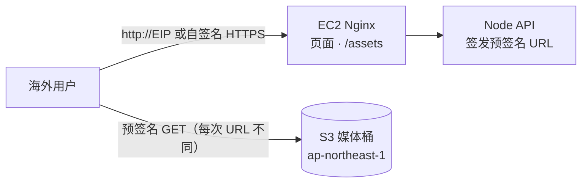

完成后：

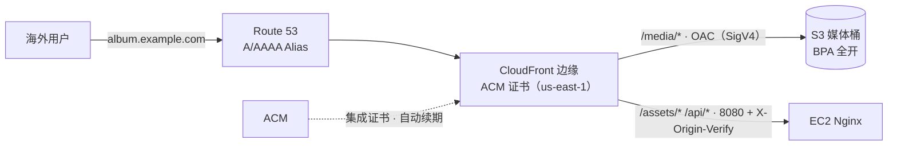

#### 为什么这几个服务要组合在一起

- **协作关系**：S3 提供耐久、无需预置容量的源；CloudFront 在边缘缓存并终止 TLS，OAC 让它以服务身份读取私有桶，所以桶可以保持“四项 BPA 全开”；ACM 为 CloudFront 提供免费、自动续期的证书（必须在 us-east-1）；Route 53 用 Alias 把域名（含根域名）指向分配，并为 ACM 的 DNS 验证自动建记录。四者合起来回答“快、私有、可信、可记住的地址”四个要求。
- **依赖顺序**：dns 的 `cloudfront` 目标需要 tls（备用域名要证书），而 tls 的考试形态（`TLS_ACME=off`）又需要 dns 或外部 DNS（DEP-005 ③）。所以本卡片先让 dns 指向 EIP，签发证书后再把记录切到 CloudFront（附录 B 记录了这个依赖环）。
- **常见错误组合**：
  - 用 S3 静态网站端点作 CloudFront 源：只支持 HTTP、不能配合 OAC，桶必须公开读。
  - 在 ap-northeast-1 申请证书给 CloudFront：控制台里选不到。
  - 在根域名建 CNAME：DNS 规范不允许，应使用 Alias。
  - 用 OAI 访问 SSE-KMS 加密的对象：OAI 不支持，应使用 OAC。
  - 用 S3 Transfer Acceleration 代替 CDN：它加速客户端与桶之间的传输，但不缓存内容；用 Global Accelerator 代替 CDN：它提供静态 Anycast IP 与 TCP/UDP 加速，不缓存，也不能直接以 S3 为端点。

#### 步骤大纲

| # | 步骤 | 类型 | 学员做什么 | 检查（类型：判定要点） |
|---|---|---|---|---|
| 1 | 观察起点 | 观察 + 对比实验 | 应用预览中打开 DevTools，确认缩略图来自 `*.s3.ap-northeast-1.amazonaws.com` 的预签名 URL；工作台执行 `npm run exp -- cdn --label before --scenario media-load --upload`（`TARGET=direct`，看源站负载）；选做 `--scenario ttfb`（只作参考：工作台与实验机同在东京，首字节差别很小；学员边界不放行其他区域的 CloudShell，不做多区域测量，05 §5.1） | experiment：`cdn/media-load` 有一条有效 before；选做 `cdn/ttfb` before（非必需）；capability：storage `driver=s3`、`status=ok`（once） |
| 2 | 创建分配并以 S3 为媒体源站 | 脚本（wire：cdn） | `scripts/module enable cdn --media-origin s3`：三阶段（以 EC2 为源部署 → 注入 `CdnDistributionArn` 生成 OAC 桶策略 → 媒体源站切到 S3）；在控制台对照查看行为、缓存策略与 CloudFront Function | capability：cdn `driver=cloudfront`、`status=ok`；http-header（from: platform，target: cdn，path `/api/health/live`）：200，`x-cloudalbum-path` 以 `entry=cloudfront>nginx` 开头；aws-readonly `cloudfront:GetDistributionConfig`：`/media/*` 行为的源为 S3 且 `OriginAccessControlId` 非空，`ViewerProtocolPolicy=redirect-to-https`；aws-readonly `s3:GetBucketPolicy`（媒体桶）：Principal 为 `cloudfront.amazonaws.com`、条件 `AWS:SourceArn` 等于本分配、资源只到 `variants/*` |
| 3 | 证明桶仍然私有 | CLI | 工作台 `curl -I` 直接请求媒体桶对象 URL（期望 403），再经分配请求两次同一对象（期望 200、第二次 `X-Cache: Hit from cloudfront`） | aws-readonly `s3:GetBucketPolicyStatus`：`IsPublic=false`；`s3:GetPublicAccessBlock`（桶级）：四项均为 true；http-header（from: platform，target: cdn，path `{{ sample.assetPath }}`，repeat 2）：200，第二次 `x-cache` 含 `Hit`（媒体对象路径优先用 04 §4.4 的 `sample.privateMediaPath`；在确认它适用于经 CloudFront 的 `/media/variants/*` 之前，暂以 `/assets` 静态资源代替，附录 B-5） |
| 4 | 对比实验：边缘缓存 | 对比实验 | `--label after --scenario media-load`（`TARGET=cdn`）；在 `/lab` 的 CDN 卡片看“直连 / 经 CloudFront”对照表与源站负载面板；选做 `--label after --scenario ttfb` | experiment：`cdn/media-load` pair（必需，与 svc-cdn 一致：源站请求数与出网字节下降，按 `experiment.json` 的 `expect` 判定）；选做 `cdn/ttfb` after（非必需） |
| 5 | 托管区域与 NS 委派（需域名） | 脚本 + 控制台 | `scripts/module enable dns --domain {{ learner.inputs.domain }} --target eip`；按输出的 NS 在注册商或父域处添加委派，等待生效 | aws-readonly `route53:GetHostedZone`（ownership: session；复用以前会话保留的托管区域时不带 ownership，`keepablePrerequisites: [route53-hosted-zone, acm-certificate]`）；local（`dns-resolve`，on: workstation）：域名解析到实验机 EIP（NS 委派生效前为 pending，等待型） |
| 6 | 签发 us-east-1 集成证书（需域名） | 脚本（wire：tls） | `scripts/module enable tls --domain … --no-acme`（考试形态：只签发挂在 CloudFront 上的集成证书，学员身份在 us-east-1 部署栈 `cloudalbum-<envName>-tls-edge`，验证 CNAME 由托管区域自动创建；Nginx 直连保持自签名。前提：01 §6.5 的 `UsEast1EdgeOnly` 放行 `cloudformation:*`，护栏 `UsEast1LabStacksOnly` 限定 `stack/cloudalbum-*`，附录 B-36） | capability：tls `driver=acm`，`op: healthy`（`TLS_ACME=off` 时直连保持自签名是设计取值，01#tls 的感知器只在 `TLS_ACME=on` 且直连证书不是 Amazon 签发时才降级，所以这里应为 `ok`）；local（`module-state`）：tls 已启用；aws-readonly `acm:DescribeCertificate`（us-east-1）：`Status=ISSUED`（验证中为 pending，等待型）、`InUseBy` 含本分配；aws-readonly `cloudfront:GetDistribution`：`Aliases` 含域名、`MinimumProtocolVersion=TLSv1.2_2021` |
| 7 | 域名切到 CloudFront（需域名） | 脚本（wire：dns） | `scripts/module set dns DNS_TARGET_TYPE=cloudfront`（与 01 中 `scripts/module set waf …` 同一写法，栈更新）；用 `dig` 观察 Alias 直接返回 A 记录；尝试在根域名建 CNAME 并观察被拒绝（只读理解即可） | capability：dns `driver=route53`、`status=ok`；aws-readonly `route53:ListResourceRecordSets`：A/AAAA 为 Alias，`AliasTarget.HostedZoneId=Z2FDTNDATAQYW2`；http-header（from: platform，target: cdn-alias，path `/api/health/live`）：200、证书 SAN 含域名、`x-cloudalbum-path` 以 `entry=cloudfront` 开头 |
| 8 | 失效与版本化 | 对比实验 | `/lab` 依次点击“覆盖同名缩略图 → 创建失效 → 版本化键”，或 `--scenario invalidation` | experiment：`cdn/invalidation` after；aws-readonly `cloudfront:ListInvalidations`：至少一条 `Completed`（drift: once） |

#### 对比实验

| 实验（模块文档） | 没有它 | 有它 | 观察点 |
|---|---|---|---|
| `cdn/media-load`（必需） | 源站请求数与 EC2 / S3 出网字节随访问量线性增长 | 只剩未命中的回源 | `/lab`“源站负载”面板；带 `X-Amz-Cf-Id` 的源站请求占比 |
| `cdn/ttfb`（01#cdn，选做） | 海外用户的每个字节都跨洲回到东京 | 命中时由附近的边缘返回 | `X-Cache`、`Age`、`X-Amz-Cf-Pop`；工作台在东京，首字节差别很小，只作参考（跨洲的差异在手册中讲解，不做多区域测量） |
| `cdn/invalidation` | 直连时覆盖立即生效 | TTL 内仍是旧内容；失效需要数十秒到数分钟；版本化键立即生效 | 失效耗时、消耗的失效路径数 |
| `tls/inspect`、`tls/handshake`（01#tls，需域名） | 自签名，浏览器告警 | Amazon 签发，握手在边缘完成 | 签发者、SAN、远端区域的握手耗时 |
| `dns/ip-change-drill`（01#dns，选做） | IP 一变，带 IP 的链接全部失效 | 改记录后 TTL 内恢复 | 恢复所需时间 |

#### 整体对比

| 指标 | 开始时 | 完成后 |
|---|---|---|
| 媒体 URL | 每次不同的预签名 URL，浏览器缓存利用率低 | 稳定的 `https://<域名>/media/variants/…`，边缘与浏览器都能缓存 |
| 海外首字节时间 | 跨洲往返的数量级（数百毫秒） | 命中缓存时降到数十毫秒量级 |
| 源站负载 | 每个请求都到 EC2 或 S3 | 只剩回源请求 |
| HTTPS | 直连自签名 | ACM 集成证书，在边缘终止，自动续期 |
| 桶的暴露面 | 私有，靠预签名 URL | 私有，只允许本分配经 OAC 读取 `variants/*` |
| 按小时计费的资源 | 实验机 | 不变（新增服务都是按量或按月） |

#### 小测

1. （单选）照片桶使用 SSE-KMS（客户托管密钥）加密，要求用户只能经 CloudFront 读取对象。应该怎么配置？
   A. 创建 OAI，桶策略只允许该 OAI 读取
   B. 创建 OAC，桶策略允许 `cloudfront.amazonaws.com` 读取并用 `AWS:SourceArn` 限定分配，KMS 密钥策略允许该服务主体解密
   C. 开启 S3 静态网站托管，把网站端点作为源站
   D. 把对象 ACL 设为 public-read，再用 CloudFront 地理限制保护
   **答案 B**。OAI 不支持 SSE-KMS；网站端点不能使用 OAC，且要求桶公开；公开 ACL 违背“只能经 CloudFront”的要求，`BucketOwnerEnforced` 下 ACL 也已被禁用。
2. （单选）在 ap-northeast-1 申请的 ACM 证书状态已是 ISSUED，但在 CloudFront 分配的“自定义 SSL 证书”下拉框中选不到。最可能的原因是？
   A. 证书使用了 RSA 2048 密钥
   B. CloudFront 只能使用 us-east-1 区域的 ACM 证书
   C. CloudFront 只接受可导出的证书
   D. 证书必须先上传到 IAM 证书存储
   **答案 B**。CloudFront 是全局服务，只读取 us-east-1 的 ACM 证书；RSA 2048 是受支持的算法；可导出证书与 IAM 证书存储都不是必需条件。
3. （多选，选两项）前端发布新版 `app.js` 后部分用户仍拿到旧文件。哪两项能让新版本尽快生效，并且长期运维成本最低？
   A. 构建时在文件名中加入内容哈希
   B. 每次发布都对 `/*` 创建失效
   C. 把 `/assets/*` 行为的最大 TTL 设为 0
   D. `index.html` 使用 `no-cache`（或很短的 TTL），只在必要时失效它
   E. 关闭 CloudFront 的自动压缩
   **答案 A、D**。带哈希的文件名天然是新对象，`index.html` 不长期缓存就能立即引用新文件。全量失效会让所有对象回源，超出免费额度的失效路径还要收费；TTL 为 0 失去了缓存的意义；压缩与版本无关。

#### 场景题

1. 一家图片社区把图片存放在 us-east-1 的 S3 桶中，全球用户反馈加载慢。要求：降低全球访问延迟；桶不得公开；使用 `media.example.com` 与受信证书；运维工作量最少。哪个方案最合适？
   - A. CloudFront 以 S3 REST 端点为源并使用 OAC；在 us-east-1 申请 ACM 证书；Route 53 创建 Alias 指向分配。**正确**：边缘缓存解决延迟，OAC 让桶保持私有，ACM 免费自动续期，Alias 可以用于任何层级的域名。
   - B. 在多个区域建桶并配置跨区域复制，用 Route 53 延迟路由指向各区域的 S3 网站端点。**错误**：网站端点只支持 HTTP，不能挂自定义证书；桶必须公开；多份存储与复制带来更高成本与运维。
   - C. 开启 S3 Transfer Acceleration，把加速端点 CNAME 到 `media.example.com`。**错误**：Transfer Acceleration 优化的是客户端与桶之间的长距离传输，不缓存内容，也不能为自定义域名提供你的证书。
   - D. 用 AWS Global Accelerator 指向 S3 桶。**错误**：Global Accelerator 的端点是 ALB、NLB、EC2 与弹性 IP，不能直接指向 S3，也不提供缓存。
2. 公司希望根域名 `example.com` 指向 CloudFront 分配，且 DNS 查询不要产生额外费用。应该怎么做？
   - A. 在根域名创建 CNAME 记录指向 `dxxxx.cloudfront.net`。**错误**：根域名（zone apex）不能有 CNAME 记录。
   - B. 在 Route 53 中创建 A/AAAA Alias 记录指向该分配。**正确**：Alias 可用于根域名，指向 AWS 资源的 Alias 查询不收费。
   - C. 创建 A 记录，值为 `dig` 查到的几个 CloudFront 边缘 IP。**错误**：边缘 IP 会变化且按地理位置不同，写死会导致部分用户无法访问。
   - D. 创建两个分配，用加权记录各分 50% 流量。**错误**：同一备用域名同一时刻只能挂在一个分配上，而且与需求无关。

#### 清理说明

- 自动回收会先禁用再删除分配（需要数分钟，回收进度会单独提示），ACM 证书在分配删除后才能删除。
- 托管区域与 ACM 证书属于“可保留的前置资源”：结束对话框中勾选“保留”时会继续按月计费；不保留时一并删除，以后重建托管区域会得到新的 NS，需要重新委派。
- 平台不会修改你在注册商或父域处的 NS 委派：不再使用时请自行删除，避免留下悬空委派（子域被他人接管的风险）。
- 本卡片不开启 HSTS；如果你在练习中手工开启过，浏览器会记住它，务必使用很小的 `max-age`。

#### 对应 SAA 考点

- CloudFront 的边缘站点与区域边缘缓存；缓存策略、源请求策略、响应头策略的分工；TTL 与 `Cache-Control`。
- OAC 与 OAI 的区别；只允许 CloudFront 访问 S3 的桶策略；SSE-KMS 对象需要密钥策略授权 CloudFront。
- 失效与版本化文件名；失效的计费。
- CloudFront 使用的 ACM 证书必须在 us-east-1；ACM 集成证书免费、自动续期（考试结论：ACM 证书不能装到 EC2）。
- Route 53 Alias 与 CNAME、根域名、Alias 查询免费；托管区域与 NS 委派。
- CloudFront、S3 Transfer Acceleration、Global Accelerator 的对比；从 AWS 源站到 CloudFront 的传输免费。

---

### 3.2 `sc-edge-protection` 边缘防护：CloudFront + WAF（+ Shield Standard，GuardDuty 观察）

#### 元数据

| 字段 | 值 |
|---|---|
| id / kind | `sc-edge-protection` / `scenario` |
| 标题 | 边缘防护：CloudFront + WAF |
| 一句话简介 | 把撞库、扫描和恶意载荷挡在 CloudFront 边缘，锁死源站让攻击者无法绕过，并弄清 Shield 与 GuardDuty 各管什么 |
| 涉及的 AWS 服务 | AWS WAF、Amazon CloudFront（主）；AWS Shield Standard（说明）、Amazon GuardDuty（观察，选做）、Amazon CloudWatch Logs（辅） |
| 对应的模块 | 起始：iam；目标：cdn、waf；选做：threat-detection |
| 难度 | 中级 |
| 预计时长 | 90 分钟（其中等待约 15 分钟：分配部署、Web ACL 关联后的再次部署、限速规则的检测延迟） |
| 时间上限 / 可延长 | 150 分钟 / 2 次 × 30 分钟 |
| 起始部署等级 | A |
| startProfile | `atl/sc-edge-protection/default`：iam（②）；预览方案 B 保持开启（锁定源站后预览改用分配域名） |
| 目标模块 | cdn（`CDN_ORIGIN_TYPE=ec2`，`CDN_DIRECT_ACCESS=admin-ip`，`CDN_ADMIN_CIDR`=工作台公网 IP/32：手册中渲染为 `{{ workstation.publicIp }}/32`，即 05 §4.3 中的 `${atl:workstationPublicCidr}`）；waf（`WAF_MODE=aws`，`WAF_SCOPE=CLOUDFRONT`，`WAF_RULE_ACTION` 先 `count` 后 `block`）；threat-detection（`THREAT_DETECTION_MODE=guardduty`，`optional: true`） |
| 费用档位 | 低（选做 → 中）。主要计费来源：WAF Web ACL 与每条规则的按月费用（按时长折算）及请求数、WAF 日志摄取；CloudFront 流量与请求；选做步骤开启的 GuardDuty 是账号级按量服务（按分析的数据量，新账号或新区域有试用期），按 05 目录总则的费用档位算法计入后为“中” |
| 人工前置 | 无。选做的 GuardDuty 步骤需要 `alert-email` 并点击确认订阅；账号中已有 GuardDuty detector 时只读接入 |
| 区域 | ap-northeast-1；`alsoUses: [global, us-east-1]`（CLOUDFRONT 范围的 Web ACL、IP 集合、日志组都在 us-east-1） |
| SAA 考试领域 | 安全架构（主）、弹性架构、成本优化 |
| 推荐的前置卡片 | `svc-cdn`、`svc-waf` |

**startProfile 明细**

| 预置模块 / 取值 | 原因 |
|---|---|
| iam（role） | ②裁决 C3 预置（cdn、waf、threat-detection 都是 `credentials: optional`，第 1 轮把它写成③的教学取舍）：waf 的 BlocklistPort 把 `denylist.conf` 同步到 IP 集合、读取拦截计数，cdn 的失效与控制面探针都靠它 |
| storage 保持本地（不预置） | ③刻意保留：照片经 `/api/storage/upload` 上传，大请求体会触发 CRS 的 `SizeRestrictions_BODY`，这正是本卡片“误杀与调优”的观察点；启用 S3 后上传直达 S3，WAF 看不到 |
| waf 的挂载点选 cdn 而不是 load-balancer | ①waf 依赖 `cdn \| load-balancer`（DEP-006）。选 cdn：CLOUDFRONT 范围在边缘拦截，攻击流量不进入区域；没有按小时计费；与 `l2-edge` 档位一致。ALB（REGIONAL 范围）作为场景题与考点讨论 |

#### 场景故事

相册上线一个月后，登录接口每天收到成千上万次撞库尝试，访问日志里满是 `/wp-login.php`、`/.env` 之类的扫描，偶尔还有一个 IP 用脚本反复刷首页。现在只有一台 t4g.small，Nginx 的 `limit_req` 能挡住一部分，但每个恶意请求都已经消耗了实例的连接、TLS 与带宽。CTO 要求：不扩容服务器，在流量进入东京区域之前就把它挡住，并且要证明攻击者不能直接打 EC2 绕过防护；同时想知道“是不是还要买 Shield Advanced、开 GuardDuty”。

#### 实验简介

- **背景**：起点是 L0：入口是实验机 EIP，防护只有 Nginx 限速、几条正则和一个 `denylist.conf`。
- **你将学到**：WAF 的挂载点与范围（CLOUDFRONT 在 us-east-1）；托管规则组、基于速率的规则、IP 集合；先 Count 再 Block 的上线方式；用托管前缀列表 + 自定义请求头锁定源站；Shield Standard 与 Advanced 的边界；GuardDuty 为什么看不到 Web 攻击。
- **实验资源**：实验机、工作台（它的公网 IP 就是“管理员 IP”，是唯一保留直连权限的地址）、联合登录控制台。你将创建：CloudFront 分配与源站安全组、us-east-1 的 Web ACL（含 IP 集合与日志组）；选做：GuardDuty detector 与安全发现主题。

#### 架构图

开始时：

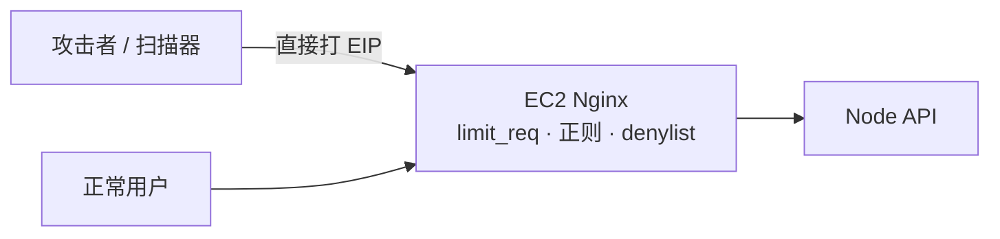

完成后：

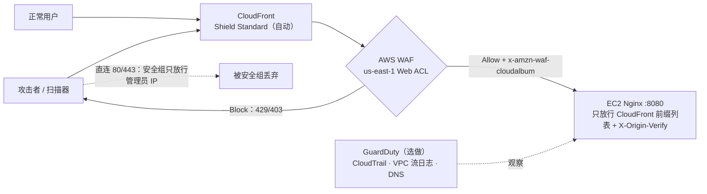

#### 为什么这几个服务要组合在一起

- **协作关系**：WAF 不能挂在 EC2 或 EIP 上，必须依附 CloudFront、ALB 等资源；CloudFront 把 TLS 终止和 WAF 检查都放到边缘，被拦截的请求不会进入区域；源站锁定（托管前缀列表 + `X-Origin-Verify`）保证“只有经过 WAF 的流量才能到达 EC2”；Shield Standard 对所有 CloudFront 分配自动生效，抵御常见的三、四层 DDoS；GuardDuty 分析的是 CloudTrail、VPC 流日志和 DNS 日志，补的是“实例被入侵后对外的异常行为”，与七层过滤互补而不重叠。
- **常见错误组合**：
  - 只开 WAF 不锁源站：攻击者直接打 EIP 就绕过了全部规则（DEP-018 会把 waf 标为 degraded）。
  - 只用前缀列表锁源站：别人的 CloudFront 分配同样来自这些网段，必须再校验自定义请求头。
  - 把 Web ACL 建在 ap-northeast-1 再去关联 CloudFront：CLOUDFRONT 范围只能在 us-east-1。
  - 托管规则不经 Count 观察直接 Block：CRS 会误杀大请求体（照片上传）。
  - 以为 GuardDuty 能挡住 SQL 注入：它只检测、不阻断，也不分析 HTTP 内容。
  - 为了防撞库购买 Shield Advanced：撞库是七层滥用，靠 WAF 的限速与托管规则（必要时 Bot Control）；Shield Advanced 解决的是大规模 DDoS 的响应与成本保护。

#### 步骤大纲

| # | 步骤 | 类型 | 学员做什么 | 检查（类型：判定要点） |
|---|---|---|---|---|
| 1 | 基线攻击 | 对比实验 | 在工作台对直连入口运行 `npm run exp -- waf --label before --scenario flood` 与 `--scenario payloads`（`WAF_LAB_ALLOW_CIDR` 必须为空） | experiment：`waf/flood`、`waf/payloads` 各有一条有效 before；local（`nginx-log-summary`，groupBy entry）：最近窗口内 `entry=nginx` 的 429 数 > 0 |
| 2 | 建分配，入口改走边缘 | 脚本（wire：cdn） | `scripts/module enable cdn --origin ec2`，并设 `CDN_DIRECT_ACCESS=admin-ip`、`CDN_ADMIN_CIDR={{ workstation.publicIp }}/32`（04 §4.4 已登记 `workstation.publicIp`，即工作台的公网出口 IPv4；01#cdn 只定义了这两个 env 键、没有定义对应的命令行选项，写法以 01 为准；不设 `CDN_ADMIN_CIDR` 时会退回 state.json 中的运维 IP） | capability：cdn `driver=cloudfront`、`status=ok`；http-header（from: platform，target: cdn，path `/api/health/live`）：200，`x-cloudalbum-path` 以 `entry=cloudfront>nginx` 开头；佐证：`nginx-log-summary` 中该 nonce 出现在 8080 端口 |
| 3 | 验证源站已锁定 | CLI | 查看实例安全组与 cdn 自带的源站安全组；工作台以外（例如 CloudShell）直连 EIP 的 80/443 观察超时；从工作台请求 EIP 的 8080 同样超时（安全组只放行 CloudFront 前缀列表）；在实验机终端对 `127.0.0.1:8080` 不带密钥头请求，观察 403 | aws-readonly `ec2:DescribeSecurityGroupRules`（实例的全部安全组）：80/443 没有 `0.0.0.0/0` 或 `::/0`，8080 只引用 CloudFront 托管前缀列表；local（`http-probe`，target: cdn-origin，不带校验头）：403 |
| 4 | 挂上 Web ACL（Count） | 脚本（wire：waf） | `scripts/module enable waf`（CLOUDFRONT 范围、`WAF_RULE_ACTION=count`；学员身份在 us-east-1 部署栈 `cloudalbum-<envName>-waf-edge`，前提见附录 B-36）；在 us-east-1 的 WAF 控制台查看规则、WCU 与采样请求 | capability：waf `driver=aws`；http-header（from: platform，target: cdn，path `/api/health/live`）：`x-cloudalbum-path` 以 `entry=cloudfront>waf>nginx` 开头（WAF 自定义请求头已到达源站）；aws-readonly `cloudfront:GetDistributionConfig`：`WebACLId` 等于 `envfile.waf.WAF_WEB_ACL_ARN`；aws-readonly `wafv2:GetWebACL`（us-east-1）：含 `rate-login`、`rate-global`、CRS、KnownBadInputs、SQLi、IpReputation |
| 5 | 观察误杀并调优，再切到 Block | 控制台 + 脚本 | 运行 `--scenario false-positive`，在采样请求 / Logs Insights 中找到命中 `SizeRestrictions_BODY` 的上传请求；`scripts/module set waf WAF_RULE_ACTION=block`（模板已把 `/api/storage/upload` 排除在该子规则之外，学员确认这一点） | aws-readonly `wafv2:GetWebACL`：托管规则组 `OverrideAction` 为 None，`SizeRestrictions_BODY` 有动作覆盖或范围缩小语句；experiment：`waf/false-positive` after（上传成功、含 SQL 关键字的评论未被误杀） |
| 6 | 对比实验：边缘拦截 | 对比实验 | `--label after --scenario flood`、`--scenario payloads`、`--scenario bypass` | experiment：`waf/flood` pair、`waf/payloads` pair、`waf/bypass` after；local（`nginx-log-summary`）：攻击窗口内经 8080 到达源站的请求数没有随攻击上升 |
| 7 | GuardDuty 能看到什么（选做） | 脚本（wire：threat-detection）+ 观察 | `scripts/module enable threat-detection --param AlertEmail={{ learner.inputs.alert-email }}`；在工作台运行 `npm run exp -- threat-detection --label after --scenario sample-findings`；从 CloudShell 对 CloudFront 域名做一次 web-scan（攻击来源不能是工作台，见 2.6） | capability：threat-detection `driver=guardduty`；local（`module-state`）：threat-detection 已启用；aws-readonly `guardduty:GetDetector`：`Status=ENABLED`；experiment：`threat-detection/sample-findings` after；manual：学员记录“web-scan 期间 GuardDuty 是否产生发现”，以及示例发现的严重度分布（期望：web-scan 不产生发现） |
| 8 | Shield Standard 与 Advanced | 观察 | 阅读手册中的对照表，在控制台查看 Shield 页面（不订阅 Advanced） | manual：回答“本场景中哪些防护已自动生效、哪些需要付费订阅” |

#### 对比实验

| 实验（模块文档） | 没有它（Nginx） | 有它（CloudFront + WAF） | 观察点 |
|---|---|---|---|
| `waf/flood`（01#waf） | 几乎立即生效，burst 精确，但每个请求都到达 EC2 | 有检测延迟、按窗口聚合；被拦截的请求不到达源站 | 第一次拦截的时间；攻击期间源站请求数与字节数 |
| `waf/payloads` | 简单正则漏掉二次编码、大小写变体 | 托管规则识别编码变体 | 30 条载荷在两条路径上的状态码对照表 |
| `waf/false-positive` | 正则可能误杀 | CRS 误杀大请求体，需要先 Count 调优 | 上传与评论在 count / block 下的结果 |
| `waf/bypass` | 不适用 | 未锁定时可直连绕过；锁定后被安全组或密钥头拒绝 | 80、8080 端口带 / 不带密钥头的结果 |
| `threat-detection/web-scan`、`sample-findings`（05#threat-detection，选做；web-scan 从 CloudShell 发起，只做观察记录） | fail2ban 发现并封禁 | GuardDuty 不产生发现；示例发现演示发现格式与严重度 | 两边的发现数；“检测层次”的差异 |

#### 整体对比

| 指标 | 开始时 | 完成后 |
|---|---|---|
| 恶意请求在哪里被处理 | EC2 上的 Nginx | CloudFront 边缘的 WAF |
| 攻击期间源站请求数 | 随攻击线性上升 | 基本平稳 |
| 绕过防护的路径 | 不存在“防护层”可绕 | 入口锁定后，只有管理员 IP 能直连 |
| 恶意载荷识别 | 少量正则 | 托管规则组持续更新 |
| 多实例下的限额 | 每实例独立计数（ASG-013） | Web ACL 全局计数 |
| DDoS 基础防护 | 无 | Shield Standard 自动生效 |
| 可观测性 | Nginx 日志汇总 | 采样请求、CloudWatch 指标、WAF 日志 |

#### 小测

1. （单选）以下哪个资源**不能**直接关联 AWS WAF Web ACL？
   A. Application Load Balancer　B. Amazon CloudFront 分配　C. Network Load Balancer　D. Amazon API Gateway REST API
   **答案 C**。WAF 是七层服务，可关联 CloudFront、ALB、API Gateway REST API、AppSync、Cognito User Pool 等；NLB、EC2、弹性 IP 不能关联。
2. （单选）WAF 已挂在 CloudFront 上，但安全团队发现攻击者仍能绕过 WAF 访问应用。最可能的原因与修复是？
   A. Web ACL 建在了错误的区域，应改到 ap-northeast-1
   B. 源站仍对公网开放；应让源站只接受 CloudFront 托管前缀列表，并校验 CloudFront 添加的自定义请求头
   C. 未订阅 Shield Advanced，应立即订阅
   D. CloudFront 的价格等级太低，应改为 PriceClass_All
   **答案 B**。绕过的本质是直连源站。CLOUDFRONT 范围的 Web ACL 本来就必须在 us-east-1；Shield Advanced 与价格等级都与绕过无关。
3. （多选，选两项）关于 GuardDuty，哪两项正确？
   A. 它分析 CloudTrail 管理事件、VPC 流日志与 DNS 日志，无需你自己开启这些日志
   B. 它能检查 HTTP 请求体并阻断 SQL 注入
   C. 它只产生发现，自动响应需要借助 EventBridge 等服务
   D. 它必须先在每台 EC2 上安装代理才能工作
   **答案 A、C**。GuardDuty 独立采集基础数据源，只检测不阻断；不分析 HTTP 内容；基础检测不需要代理（运行时监控等可选保护计划另说）。

#### 场景题

1. 一个电商网站部署在 ALB 后面的 EC2 Auto Scaling 组中，前面有 CloudFront。登录接口遭受大量来自少数 IP 的撞库请求，同时有人直接访问 ALB 的 DNS 名称。要求在边缘限制每个 IP 的登录频率，并确保所有流量都经过防护。最合适的组合是？
   - A. 在 CloudFront 上关联 WAF，添加只作用于登录路径的基于速率的规则；ALB 安全组只允许 CloudFront 托管前缀列表，并用监听器规则校验自定义请求头。**正确**：在边缘按 IP 限速，并封住绕过路径。
   - B. 在 ALB 上关联 REGIONAL Web ACL，速率规则按源 IP 聚合；不修改 ALB 安全组。**错误**：ALB 看到的源 IP 是 CloudFront 节点，应按 `X-Forwarded-For`（FORWARDED_IP）聚合；而且不锁定 ALB 仍可被绕过。
   - C. 在 EC2 安全组中逐个拒绝攻击 IP。**错误**：安全组只有允许规则，不能写拒绝；而且在 CloudFront 后面看到的是代理地址。
   - D. 订阅 Shield Advanced 并启用自动应用层 DDoS 缓解。**错误**：撞库是低速率的应用层滥用，不是 DDoS；Shield Advanced 成本高，且同样无法阻止直连 ALB。
2. 安全审计要求“在不影响用户上传照片的前提下启用 AWS 托管的核心规则集”。上线当天用户反馈大图上传失败，WAF 日志显示命中 `SizeRestrictions_BODY`。正确的处理方式是？
   - A. 删除整个核心规则集。**错误**：放弃了全部 OWASP 类防护，范围过大。
   - B. 先把该规则组设为 Count 观察，再对 `SizeRestrictions_BODY` 做规则动作覆盖或为上传路径添加范围缩小语句，然后恢复 Block。**正确**：精确处理误杀，保留其余规则。
   - C. 把上传改为浏览器经预签名 URL 直传 S3。**部分正确但不是对题目的回答**：这确实能让上传绕开 WAF（S3 不能关联 WAF），但需要改造存储方案，且题目要求的是启用规则集的正确方式。
   - D. 提高 CloudFront 的源站读取超时。**错误**：与请求体检查无关。

#### 清理说明

- 自动回收先解除 Web ACL 与分配的关联，再删除 Web ACL、IP 集合，然后禁用并删除分配；WAF 的日志组按数据保护约定保留到回收器清理阶段。
- `WAF_LAB_ALLOW_CIDR` 若被你临时设置过，结束前清空：它是 Allow 动作，会让该 IP 跳过所有规则。
- 选做步骤开启的 GuardDuty detector 只在“本会话开启”时被回收；如果账号原本就有 detector，平台只读接入、不会删除；示例发现会被归档。
- 账号级的 Shield Advanced 没有被订阅，无需处理；如果你在控制台误点了订阅，它按年承诺计费，请立即联系 AWS 处理，平台无法回收。

#### 对应 SAA 考点

- WAF 的挂载点与两种范围；Web ACL、规则组、托管规则组、基于速率的规则、IP 集合、地理匹配；Count 模式与 WCU。
- 源站保护：CloudFront 托管前缀列表、自定义请求头、OAC（S3 源）与 VPC Origin。
- Shield Standard（自动、免费）与 Shield Advanced（付费、DRT、成本保护）；Firewall Manager 统一管理。
- 安全组 / NACL（三四层）与 WAF（七层）的分工；在 CloudFront 后面获取真实客户端 IP。
- GuardDuty、WAF、Shield、Network Firewall 各管哪一层；GuardDuty 只检测不阻断。

---

### 3.3 `sc-image-pipeline` 无服务器图片流水线：S3 + EventBridge + Lambda + SQS + Rekognition（扩展：Step Functions）

#### 元数据

| 字段 | 值 |
|---|---|
| id / kind | `sc-image-pipeline` / `scenario` |
| 标题 | 无服务器图片流水线：S3 + EventBridge + Lambda + SQS + Rekognition |
| 一句话简介 | 上传到 S3 就自动触发缩略图生成与内容识别，EC2 只签发 URL 和写回结果；扩展练习用 Step Functions 把多个步骤编排成可视化的流程 |
| 涉及的 AWS 服务 | AWS Lambda、Amazon EventBridge、Amazon Rekognition（主）；Amazon S3、Amazon SQS（辅：模块自带的失败队列与结果队列）；AWS Step Functions（扩展） |
| 对应的模块 | 起始：iam、storage；目标：image-processing、tagging；扩展：workflow |
| 难度 | 中级 |
| 预计时长 | 105 分钟（其中等待约 25 分钟：工具链打包、函数部署、冷启动实验的 15 分钟空闲；扩展另加约 20 分钟） |
| 时间上限 / 可延长 | 180 分钟 / 2 次 × 30 分钟 |
| 起始部署等级 | A（含工具链栈） |
| startProfile | `atl/sc-image-pipeline/default`：iam（②）+ storage（①DEP-003、DEP-027） |
| 目标模块 | image-processing（`IMAGE_PROCESSOR=lambda`，`IMAGE_TRIGGER=eventbridge`，`IMAGE_RESULT_CHANNEL=queue`）；tagging（`TAGGER_DRIVER=rekognition`，`TAGGER_INPUT=s3`）；workflow（`WORKFLOW_DRIVER=stepfunctions`，`optional: true`，扩展步骤） |
| 费用档位 | 低。主要计费来源：Lambda 请求数与 GB-秒（含冷启动的 INIT 时长）、Rekognition 按图片计（每张两次调用）、S3 请求、SQS 请求、CloudWatch Logs；扩展：Step Functions 状态转换。无按小时计费资源 |
| 人工前置 | 无（工具链栈由运行器 `base-deploy` 在会话开始时创建，属于平台固定部分） |
| 区域 | ap-northeast-1 |
| SAA 考试领域 | 高性能架构（主）、弹性架构、成本优化 |
| 推荐的前置卡片 | `svc-storage`、`svc-image-processing`、`svc-tagging` |

**startProfile 明细**

| 预置模块 | 原因 |
|---|---|
| iam（role） | ②裁决 C3 预置；image-processing（lambda 档）、tagging、workflow 也都是 `credentials: required`（CRED-001） |
| storage（s3） | ①lambda 档硬依赖 `STORAGE_DRIVER=s3`（DEP-003，Lambda 读不到 EBS）；`TAGGER_INPUT=s3` 同样需要（DEP-027）；扩展的 workflow 也需要（DEP-034） |
| 工具链栈（不是模块） | 平台固定部分：缩略图函数与扩展的状态机任务的部署包放在工具链栈的制品桶，由运行器 `base-deploy` 在会话开始时创建（01 §3.4），DEP-034 的部署检查因此满足 |
| 不预置 queue 模块 | ③本场景中的 SQS 是 image-processing 自带的失败队列与结果队列（registry `auxQueues`），刻意与 queue 模块区分；queue 模块是 `sc-decoupling` 的主题 |

#### 场景故事

用户一次上传几十张手机原图，`complete` 接口要等 sharp 在 EC2 上把每张图压完才返回，期间整个网站都变慢。产品还想要“按内容搜索照片”（搜“狗”“海边”）和自动拦截不当内容。团队希望：上传完成接口立刻返回；处理能力随上传量自动伸缩；失败的图片有地方可查、可重试；EC2 宕机时已经上传的照片也能处理完；不需要为偶发的上传高峰常开大实例。

#### 实验简介

- **背景**：起点是 L0 + S3：原图已直传到 S3，但缩略图仍由 API 进程在请求内生成（`IMAGE_PROCESSOR=inline`），没有内容标签。
- **你将学到**：S3 → EventBridge → Lambda 的事件驱动；Lambda 异步调用的重试、最大事件年龄与失败目标（SQS）；结果经队列写回、EC2 无需入站端口；Rekognition 以调用者权限读取 S3 对象；冷启动、预留并发与限流；编舞（事件驱动）与编排（Step Functions）的区别。
- **实验资源**：实验机、工作台、联合登录控制台。你将创建：缩略图 Lambda（arm64、Node.js 22）、EventBridge 规则、失败队列与结果队列；tagging 的 IAM 策略；扩展：Standard 状态机、状态机内的缩略图函数与结果队列。

#### 架构图

开始时：

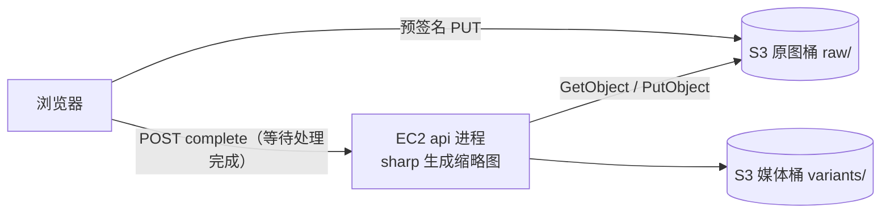

完成后：

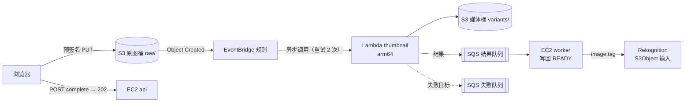

#### 为什么这几个服务要组合在一起

- **协作关系**：S3 是事件源与数据面（Lambda 只能从 S3 读原图）；EventBridge 把“对象已创建”路由给任意多个消费者而互不干扰（同一桶同一事件类型的 S3 事件通知不能有重叠目标，本项目规定桶上只开 EventBridge 投递，MUTEX-004）；Lambda 按事件数自动并行，把 CPU 密集的工作移出 EC2；SQS 在两处兜底——异步调用最终失败的事件进失败队列，处理结果进结果队列，EC2 不需要开放入站端口，宕机期间结果也不会丢；Rekognition 直接读 S3 对象，图片字节不经过 EC2。
- **常见错误组合**：
  - 让 Lambda 把缩略图写回触发它的同一个前缀：递归调用、费用失控。
  - 在桶上直接配 S3 事件通知到 Lambda，后来又想加第二个消费者：前缀重叠的通知会冲突，应统一经 EventBridge。
  - 用 S3 事件通知直接触发 Step Functions：不支持，必须经 EventBridge。
  - 只订阅 `PutObject`：经 CopyObject、分片上传完成的对象不会被处理，应订阅全部 `Object Created`。
  - 让 Lambda 直接写 EC2 上的 SQLite 或依赖 EBS 上的文件：Lambda 读不到实例的磁盘，状态必须外置。
  - 把永久错误（损坏的 JPEG）抛异常让它重试：只会白白耗尽重试次数，应直接写回 FAILED。

#### 步骤大纲

| # | 步骤 | 类型 | 学员做什么 | 检查（类型：判定要点） |
|---|---|---|---|---|
| 1 | 基线：请求内处理 | 对比实验 | `npm run exp -- image-processing --label before --scenario upload-burst --vus 20 --duration 60s`，同时另开终端跑 `neighbor.k6.js` 读 `/api/feed` | experiment：`image-processing/upload-burst` 有效 before；capability：image-processing `driver=inline`（`drift: once`） |
| 2 | 部署事件驱动的缩略图流水线 | 脚本（wire：image-processing） | `scripts/module enable image-processing --param ResultChannel=queue`；在控制台查看 EventBridge 规则的事件模式、函数的异步调用配置 | capability：image-processing `driver=lambda`、`status=ok`；local（`path-seen`，15 分钟）：真实的 complete 请求出现 `image-processing=lambda:async`；aws-readonly `events:DescribeRule`：`detail-type=Object Created`、前缀 `raw/`；`events:ListTargetsByRule`：目标为缩略图函数；`lambda:GetFunctionEventInvokeConfig`：`MaximumRetryAttempts=2`、`OnFailure` 指向失败队列；`s3:GetBucketNotificationConfiguration`（原图桶）：只有 EventBridge 配置 |
| 3 | 接入 Rekognition | 脚本（wire：tagging） | `scripts/module enable tagging --param Input=s3`；上传几张示例图，在相册中用 `/search?tag=Dog` 搜索 | capability：tagging `driver=rekognition`、`status=ok`；local（`path-seen`，15 分钟）：出现 `tagging=rekognition:s3-object`；experiment：`tagging/upload-and-search` after |
| 4 | 对比实验：事件驱动后 | 对比实验 | 用同样参数跑 `--label after`；在 `/lab/m/image-processing` 看 EC2 CPU 与 Lambda 并发曲线 | experiment：`image-processing/upload-burst` pair（after 的 complete 接口 p95 低于 before，方向判断） |
| 5 | 失败路径：永久错误与暂时错误 | CLI | `npx tsx experiments/image-processing/failures.ts`：先传一张损坏的 JPEG，再在 `FAULT_RATE=0.5` 下传 10 张；观察重试、失败队列与对账 | experiment：`image-processing/failures` after；aws-readonly `sqs:GetQueueAttributes`（失败队列）：实验期间 `ApproximateNumberOfMessages` 曾 ≥ 1（drift: once）；aws-readonly `lambda:GetFunctionConfiguration`：`FAULT_RATE` 已还原（must-hold） |
| 6 | 冷启动与限流 | CLI | `cold-start.ts --idle 15m --samples 3`（可在等待时阅读）；`throttle.ts --reserved 0 --hold 120s` 观察 Throttles 与异步重试 | experiment：`image-processing/throttle` after；aws-readonly `lambda:GetFunctionConcurrency`：预留并发已删除（must-hold，防止函数被“暂停”到提交） |
| 7 | 扩展：Step Functions 编排（选做） | 脚本（wire：workflow） | 先 `scripts/module disable image-processing`（回到 inline，避免 MUTEX-005），再 `scripts/module enable workflow`；跑 `npm run exp -- workflow --label after --scenario worker-down` 与 `retry-visibility`，在控制台看执行图 | capability：workflow `driver=stepfunctions`；local（`path-seen`，15 分钟）：出现 `workflow=stepfunctions:started`；aws-readonly `states:ListExecutions`：近 30 分钟内有 `SUCCEEDED` 执行；experiment：`workflow/worker-down` after。本步骤 `supersedes: [2, 5, 6]`：禁用 image-processing 会删除缩略图函数，第 2 步的 capability 与第 5、6 步针对该函数的 must-hold 检查（`FAULT_RATE`、预留并发）都会变成 fail，必须一起降为 once |

#### 对比实验

| 实验（模块文档） | 没有它 | 有它 | 观察点 |
|---|---|---|---|
| `image-processing/upload-burst`（04#image-processing） | inline：接口包含 sharp 时间，EC2 CPU 打满，所有接口一起变慢 | 接口只含一次数据库更新；EC2 CPU 基本不动；缩略图秒级就绪，首批有冷启动 | complete 接口 p95、就绪时间 p95、EC2 CPU、`ConcurrentExecutions` |
| `image-processing/neighbor` | 批量处理期间 `/api/feed` 明显变慢 | 基本不受影响 | 邻居接口 p95 |
| `image-processing/failures` | 对账任务重试或标 FAILED | 永久错误立即 FAILED；暂时错误经异步重试后进失败队列 | 失败队列深度、照片最终状态 |
| `image-processing/throttle`、`cold-start` | 不适用 | 预留并发为 0 时事件被限流后重试；冷启动出现在空闲后的首批调用 | `Throttles`、`Init Duration` |
| `tagging/upload-and-search`（04#tagging） | 只有方向、主色等基础标签，搜不到“狗” | 内容标签与审核结论 | 搜索命中、每张耗时、调用次数 |
| `workflow/worker-down`（06#workflow，扩展） | 进程内编排在 EC2 停机时停在半路 | 状态机照常跑完，结果留在队列，恢复后写回 | 执行历史、Retry/Catch 可视化 |

#### 整体对比

| 指标 | 开始时 | 完成后 |
|---|---|---|
| 上传完成接口 | 秒级，随像素数增长，可能 504 | 几十毫秒量级，返回 202 |
| 批量上传时 EC2 CPU | 打满 | 基本平稳 |
| 处理能力 | 固定为一台实例的 2 个 vCPU | 随事件数并行，受并发配额约束 |
| 失败可见性 | 日志 + 对账 | 失败队列 + 重试记录（扩展：执行图） |
| EC2 宕机时 | 处理停止 | Lambda 照常处理，结果在队列中等待写回 |
| 内容搜索与审核 | 无 | Rekognition 标签与审核 |
| 计费模型 | 包含在实例小时费中 | 按请求与 GB-秒、按图片计费，空闲时接近零 |

#### 小测

1. （单选）Lambda 被 EventBridge 规则异步调用，处理失败后希望保留失败事件并能看到失败原因。最合适的做法是？
   A. 在 EventBridge 规则上设置更长的重试时间
   B. 为函数配置异步调用的失败目标（On-failure destination）指向 SQS 队列
   C. 把函数超时改为 15 分钟
   D. 在函数代码中捕获所有异常并返回成功
   **答案 B**。失败目标会携带调用记录与错误信息；规则的重试只处理“投递给目标失败”的情况；吞掉异常会让失败不可见。
2. （单选）函数从 S3 原图桶 `raw/` 读取图片、生成缩略图。为避免递归调用，最可靠的设计是？
   A. 把缩略图写回同一前缀，靠文件名后缀区分
   B. 把输出写到不同的桶或不重叠的前缀，事件规则只匹配输入前缀
   C. 依赖 Lambda 的递归循环检测自动停止
   D. 把预留并发设为 1
   **答案 B**。从结构上切断循环最可靠；递归检测只覆盖部分服务组合；并发为 1 只会让循环变慢，不会停止。
3. （多选，选两项）关于 Lambda 并发，哪两项正确？
   A. 预留并发既保证该函数可用的并发，也限制它的最大并发
   B. 预置并发用于消除冷启动，并按配置的时长计费
   C. 预留并发可以设置为账号并发配额的全部
   D. 预置并发会自动随流量无限扩展
   **答案 A、B**。预留并发最多到“未预留并发 − 100”；预置并发是预先初始化的固定数量，超出部分按普通按需方式扩展。

#### 场景题

1. 一家保险公司收到大量理赔照片，上传到 S3 后需要依次执行：生成缩略图、识别车辆损伤、根据结果决定转人工还是自动通过，人工复核可能等待数天；要求每一步失败都能重试并可视化，且能在失败处继续。最合适的方案是？
   - A. S3 事件通知直接触发三个 Lambda，彼此用 SNS 串联。**错误**：编舞式串联难以可视化整体流程与失败点，也不支持长时间等待人工复核。
   - B. S3 → EventBridge → Step Functions Standard 工作流：Task 调用 Lambda 与 Rekognition，Choice 分支，`.waitForTaskToken` 等待人工复核，Retry/Catch 处理失败。**正确**：Standard 支持长时间执行、执行历史与从失败步骤重新驱动。
   - C. S3 → EventBridge → Step Functions Express 工作流。**错误**：Express 最长执行时间以分钟计，无法等待数天，也没有服务端执行历史。
   - D. EC2 上的 cron 每分钟扫描 S3 新对象。**错误**：轮询延迟高、需要常开实例，失败处理要自己实现。
2. 图片处理函数偶尔遇到下游回调接口过载。团队希望在突发上传时把函数并发限制在一个较小的值，同时不丢失任何事件。哪个方案最合适？
   - A. EventBridge → SQS 缓冲队列 → Lambda 事件源映射，设置 `MaximumConcurrency`，队列配置 redrive 到 DLQ。**正确**：积压留在队列中，并发被平稳限制，失败消息最终进入 DLQ。
   - B. 把函数的预留并发设为 0。**错误**：等于暂停函数，事件只能在异步重试窗口内等待，超过最大事件年龄会被丢弃或进失败目标。
   - C. 增大函数内存。**错误**：只让单次执行更快，不限制并发。
   - D. 把 EventBridge 规则改为每 5 分钟触发一次。**错误**：规则是事件驱动的，定时触发会改变语义并丢失事件细节。

#### 清理说明

- 自动回收删除 image-processing、tagging（以及扩展的 workflow）栈：函数、规则、队列、角色、日志组；原图与衍生图属于 storage，随会话环境一起删除。
- 如果第 6 步把预留并发设为 0 后中途离开，提交时的 must-hold 检查会提示你还原；回收不受影响。
- 预置并发（若在冷启动实验中手工开启过）按时长计费，实验后立即删除。
- 工具链栈的制品桶由平台在环境拆除时删除；本卡片不在其中留下需要手工清理的内容。

#### 对应 SAA 考点

- Lambda 的三种调用模型；异步调用的重试、最大事件年龄、Destinations 与 DLQ 的区别。
- S3 事件通知、S3 → EventBridge、S3 → SNS 扇出的取舍；避免递归调用。
- 预留并发与预置并发、冷启动、内存与 CPU 成比例、arm64（Graviton）的性价比。
- SQS 作为 Lambda 的缓冲（ESM、`MaximumConcurrency`、可见性超时至少为函数超时的 6 倍）。
- Rekognition 的图像 API、同区域读取 S3 对象、SSE-KMS 需要 `kms:Decrypt`；托管 AI 服务的定位。
- 编排（Step Functions Standard / Express）与编舞的区别；S3 事件不能直接触发 Step Functions。

---

### 3.4 `sc-decoupling` 削峰与重试：SQS + EC2 worker + Lambda + DLQ

#### 元数据

| 字段 | 值 |
|---|---|
| id / kind | `sc-decoupling` / `scenario` |
| 标题 | 削峰与重试：SQS + EC2 worker + Lambda + DLQ |
| 一句话简介 | 用 SQS 把“接收请求”和“处理任务”拆开：重启不丢任务、坏消息进死信队列，再让 Lambda 以受控的并发消费同一类积压 |
| 涉及的 AWS 服务 | Amazon SQS（主，含 DLQ）、AWS Lambda（主，事件源映射）；Amazon EC2（worker 进程）、Amazon S3、Amazon EventBridge（辅） |
| 对应的模块 | 起始：iam、storage（本地档 `QUEUE_DRIVER=memory`、`IMAGE_PROCESSOR=worker`）；目标：queue、image-processing |
| 难度 | 中级 |
| 预计时长 | 90 分钟（其中等待约 15 分钟：可见性超时与重投、坏消息进入 DLQ） |
| 时间上限 / 可延长 | 150 分钟 / 2 次 × 30 分钟 |
| 起始部署等级 | A（含工具链栈） |
| startProfile | `atl/sc-decoupling/default`：iam（②）+ storage（①DEP-003）；本地档 `QUEUE_DRIVER=memory`、`IMAGE_PROCESSOR=worker`（③`kind: local`，即两个目标的 `fromDriver`） |
| 目标模块 | queue（`fromDriver: memory` → `QUEUE_DRIVER=sqs`，`MaxReceiveCount=3`，`VisibilityTimeout=120`）；image-processing（`fromDriver: worker` → `IMAGE_PROCESSOR=lambda`，`IMAGE_TRIGGER=buffer-queue`，`MaxConcurrency=2`，`IMAGE_RESULT_CHANNEL=queue`） |
| 费用档位 | 低。主要计费来源：SQS 请求（长轮询空接收也计请求）、Lambda 请求与 GB-秒、S3 请求、CloudWatch Logs。无按小时计费资源 |
| 人工前置 | 无 |
| 区域 | ap-northeast-1 |
| SAA 考试领域 | 弹性架构（主）、高性能架构 |
| 推荐的前置卡片 | `svc-queue`、`sc-image-pipeline` |

**startProfile 明细**

| 预置模块 / 取值 | 原因 |
|---|---|
| iam（role） | ②裁决 C3 预置；queue 与 image-processing（lambda 档）也都是 `credentials: required`（CRED-001） |
| storage（s3） | ①第二部分的 Lambda 消费者依赖 `STORAGE_DRIVER=s3`（DEP-003）；worker 档在 s3 下照常用 `GetObject` 流式读取原图 |
| `QUEUE_DRIVER=memory` + `IMAGE_PROCESSOR=worker`（本地档） | ③`experiments/queue/experiment.json` 规定主对比的 before 是“memory + worker”，after 是“sqs + worker”；不预置时缩略图仍在请求内生成，批量上传几乎看不出 SQS 的作用（04#queue 第 2 节）。本地档不写 `MODULE_<ID>=on`，不产生 AWS 费用；DEP-004 要求 worker 档时 `QUEUE_DRIVER≠sync`，memory 满足 |

#### 场景故事

节日活动当晚，用户一次上传几百张照片。为了让上传接口快一点，团队把缩略图改成“先放进进程内队列，后台慢慢做”，接口确实快了——直到一次发布重启，几百个排队中的任务连同“上传成功”通知一起消失；还有一张损坏的图片让 worker 反复崩溃、拖住了后面所有任务。运维希望：任务与进程生命周期解耦；坏消息被隔离且可以重放；高峰期间处理能力可以扩展，但不能把下游压垮。

#### 实验简介

- **背景**：起点是“L0 + S3 + 进程内队列”：缩略图任务进入 api 进程内存中的队列，由 api 进程在后台处理。
- **你将学到**：标准队列的至少一次投递与幂等；可见性超时、心跳与退避；`maxReceiveCount` 与 DLQ、DLQ redrive；长轮询；竞争消费者；SQS 作为 Lambda 事件源（批大小、部分批失败、`MaximumConcurrency`）；SQS 与 SNS、EventBridge 的分工。
- **实验资源**：实验机（api 与 worker 两个 systemd 服务）、工作台、联合登录控制台。你将创建：任务队列与 DLQ；缓冲队列、事件源映射、缩略图函数、失败队列与结果队列。

#### 架构图

开始时：

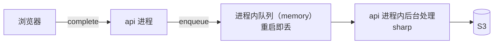

完成后：

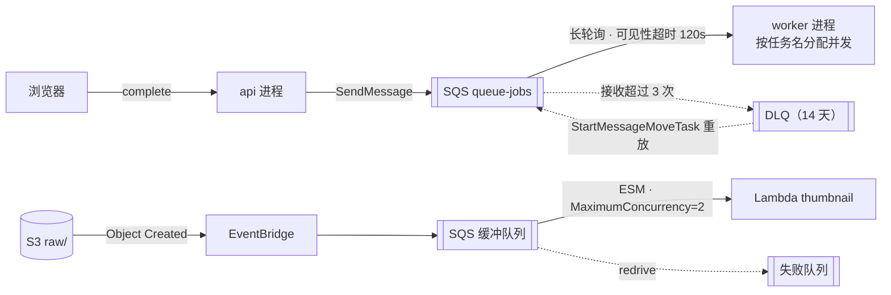

#### 为什么这几个服务要组合在一起

- **协作关系**：SQS 把生产者和消费者在时间上解耦，积压存放在队列里而不是进程内存中；EC2 worker 是可以单独扩缩的消费者，依靠可见性超时和删除确认实现“处理完才算数”；DLQ 隔离反复失败的消息，修好后再重放；Lambda 通过事件源映射消费同一类积压时，并发随队列深度增长，`MaximumConcurrency` 又给它加了上限，保护下游。三者合起来就是“削峰、重试、隔离、受控扩展”。
- **常见错误组合**：
  - 用 SNS 代替 SQS 做削峰：SNS 是推送式扇出，不存放积压，订阅端处理不过来时只能靠重试策略。
  - DLQ 的保留期比源队列短：消息进入 DLQ 时保留的是原入队时间，可能很快过期。
  - 可见性超时短于任务处理时间：消息在处理中途重新可见，被另一个消费者重复处理。
  - 用 FIFO 队列追求吞吐：FIFO 换来的是顺序与去重，吞吐受限；本场景要的是并行。
  - 用 Lambda 预留并发为 0 来“限流”：那等于暂停函数；限制 ESM 并发应使用 `MaximumConcurrency`。
  - 把不同生产者的消息塞进同一条队列：格式、可见性超时、DLQ 策略与权限都会纠缠在一起（本项目各模块自带队列正是为此）。

#### 步骤大纲

| # | 步骤 | 类型 | 学员做什么 | 检查（类型：判定要点） |
|---|---|---|---|---|
| 1 | 基线：进程内队列会丢任务 | 对比实验 | `npm run exp -- queue --label before --scenario upload-burst`（第 30 秒自动执行 `faults/restart-api.sh`）；可选再跑一次 `--label l0`（实验变体 `l0` 在 `experiments[].labels` 中声明为 `baseline`，需先改回 sync + inline）作参照 | experiment：`queue/upload-burst` 有效 before（结果中的 `biz.jobs_lost` 在报告中展示；06 实现 `app-stat --run <runId>`（04 V-12）之前 `app-stat` 只返回累计值，不能按运行区分，所以暂不设 local 检查，附录 B-11） |
| 2 | 启用 SQS | 脚本（wire：queue） | `scripts/module enable queue`（保持 `IMAGE_PROCESSOR=worker`；脚本先排空内存队列，先重启 worker 再重启 api） | capability：queue `driver=sqs`、`status=ok`；local（`path-seen`，15 分钟）：出现 `queue=sqs:queued`；aws-readonly `sqs:GetQueueAttributes`（任务队列）：`RedrivePolicy.maxReceiveCount=3`、死信目标为 DLQ、`VisibilityTimeout=120`、`ReceiveMessageWaitTimeSeconds=20`；`sqs:ListDeadLetterSourceQueues`（DLQ）：包含任务队列 |
| 3 | 杀掉 worker 也不丢 | 对比实验 | `npm run exp -- queue --label after --scenario upload-burst`（第 30 秒 `faults/kill-worker.sh`） | experiment：`queue/upload-burst` pair；manual：学员从报告中抄录 before 与 after 的 `biz.jobs_lost`（期望 before > 0、after = 0；同一累计计数器无法用 `app-stat` 分别判定，附录 B-11） |
| 4 | 毒消息与 DLQ 重放 | CLI | `npx tsx experiments/queue/poison.ts --count 1`，每 10 秒观察源队列与 DLQ；之后 `npx tsx experiments/queue/dlq-replay.ts` 把它移回源队列（handler 未修复时会再次进入 DLQ）。两个脚本都在工作台以学员身份调用 SQS | experiment：`queue/poison` after；aws-readonly `sqs:ListMessageMoveTasks`（DLQ）：存在本步骤开始之后创建、目标为源队列的移动任务（drift: once；第 1 轮用 `cloudtrail:LookupEvents` 查 `StartMessageMoveTask`，有分钟级延迟，04 §5.7 收录本操作后改用它） |
| 5 | 运行时 A/B（选做） | 对比实验 | `--label after --scenario upload-burst --ab`：一半请求带 `X-Compare-Bypass: queue` 当场执行 | experiment：`queue/upload-burst` after（`ab: true`） |
| 6 | Lambda 作为受控的消费者 | 脚本（wire：image-processing） | `scripts/module enable image-processing --param Trigger=buffer-queue --param MaxConcurrency=2 --param ResultChannel=queue`；在控制台查看事件源映射 | capability：image-processing `driver=lambda`、`status=ok`；local（`path-seen`，15 分钟）：出现 `image-processing=lambda:async`；aws-readonly `lambda:ListEventSourceMappings`：`BatchSize=5`、`FunctionResponseTypes` 含 `ReportBatchItemFailures`、`ScalingConfig.MaximumConcurrency=2`；`sqs:GetQueueAttributes`（缓冲队列）：`VisibilityTimeout` ≥ 函数超时的 6 倍、redrive 目标为失败队列 |
| 7 | 观察积压与并发上限 | 对比实验 + 观察 | `npm run exp -- image-processing --label after --scenario upload-burst`；在控制台看缓冲队列深度先升后降、`ConcurrentExecutions` 不超过 2 | experiment：`image-processing/upload-burst` after；aws-readonly `cloudwatch:GetMetricData`（`AWS/Lambda ConcurrentExecutions`，本函数，实验窗口）：最大值 ≤ 2 |

#### 对比实验

| 实验（模块文档） | 没有它 | 有它 | 观察点 |
|---|---|---|---|
| `queue/upload-burst`（04#queue） | memory：重启 api 后排队与在途任务全部丢失，通知真的丢了 | sqs：`kill -9` worker 后，消息在可见性超时后重新出现，不丢；少量重复由去重表吸收 | `biz.jobs_lost`、`biz.jobs_duplicated`、排空时间、CPU 曲线从尖峰变平台 |
| `queue/poison`、`queue/dlq-replay` | 坏任务写 `failed_jobs`，手工处理 | 接收 3 次后进入 DLQ；可重放 | 进入 DLQ 前的接收次数与耗时 |
| `image-processing/upload-burst`（buffer-queue 变体，04#image-processing 第 7 步“限流到 2 个并发”的做法） | EC2 worker 固定并发，积压线性增长 | Lambda 并发被压在 `MaximumConcurrency` 以内，积压先升后降 | `ConcurrentExecutions`、缓冲队列深度 |

#### 整体对比

| 指标 | 开始时 | 完成后 |
|---|---|---|
| 任务存放位置 | api 进程内存 | SQS（与进程生命周期无关） |
| 重启 / 崩溃时 | 排队与在途任务丢失 | 不丢，可见性超时后重投 |
| 坏消息 | 反复失败、拖住队列 | 3 次后隔离到 DLQ，可重放 |
| 处理者 | 与 API 同一进程 | 独立 worker；或 Lambda（受 `MaximumConcurrency` 约束） |
| 削峰 | 积压在内存里 | 积压在队列里，CPU 曲线从尖峰变平台 |
| 投递语义 | 至多一次 | 至少一次（handler 必须幂等） |
| 空闲成本 | 无 | 按请求计费，空闲时接近零 |

#### 小测

1. （单选）worker 处理一条消息通常需要 3 分钟，但队列的可见性超时是 30 秒。会发生什么？
   A. 消息在处理完成前不会被其他消费者看到
   B. 消息会在处理中途重新可见，可能被另一个消费者重复处理
   C. SQS 会自动延长可见性超时
   D. 消息会立即进入 DLQ
   **答案 B**。可见性超时到期后消息重新可见；应把超时设得大于处理时间，或在处理中定期调用 `ChangeMessageVisibility`。只有接收次数超过 `maxReceiveCount` 才进 DLQ。
2. （单选）为 SQS 队列配置 DLQ 时，DLQ 的消息保留期应该？
   A. 比源队列短，节省存储　B. 与源队列完全相同　C. 比源队列长　D. 设为 0
   **答案 C**。消息进入 DLQ 后保留的是原始入队时间，DLQ 保留期太短会导致消息过早过期。
3. （多选，选两项）Lambda 使用事件源映射消费 SQS 时，哪两项做法是正确的？
   A. 队列的可见性超时至少设为函数超时的 6 倍
   B. 开启 `ReportBatchItemFailures`，只让失败的消息重新可见
   C. 在函数上配置异步调用的失败目标来处理 SQS 消息失败
   D. 把批大小设为 1 才能保证不重复处理
   **答案 A、B**。ESM 是同步轮询调用，失败处理靠队列的 redrive 策略，异步调用的失败目标对它不起作用；批大小与是否重复无关，幂等由 handler 保证。

#### 场景题

1. 一个订单系统在促销期间收到的订单量是平时的数十倍，后端库存服务每秒只能处理固定数量的请求，超量时会报错。要求订单一个都不能丢，用户提交后立刻得到“已受理”。最合适的方案是？
   - A. API 把订单写入 SQS 标准队列，消费者以固定并发拉取并调用库存服务，失败的消息经 `maxReceiveCount` 进入 DLQ。**正确**：队列吸收峰值，消费者按下游能力处理，失败可隔离。
   - B. API 发布到 SNS 主题，库存服务订阅 HTTPS 端点。**错误**：SNS 推送不存放积压，下游过载时只能靠有限的重试，峰值仍直接压到库存服务。
   - C. 把 API 后端换成更大的 EC2 实例。**错误**：库存服务才是瓶颈，接口同步等待仍会超时；纵向扩展也解决不了“不丢”的问题。
   - D. 用 Kinesis Data Streams，库存服务每秒读取一次分片。**部分可行但不是最合适**：Kinesis 适合需要按序重放、多消费者的流式数据，单条任务的失败隔离与重试需要自己实现，运维更重。
2. 图片处理改用 SQS 触发的 Lambda 后，突发时函数并发迅速升到数百，把下游数据库连接打满。要求限制处理并发，同时保留积压、不丢消息。应该怎么做？
   - A. 在事件源映射上设置 `MaximumConcurrency`。**正确**：限制该映射驱动的并发，未处理的消息留在队列中。
   - B. 把函数的预留并发设为 0。**错误**：等于暂停函数，事件源映射的调用全部被限流；消息不会被处理，只会在可见性超时后反复回到队列，最终过期或按 `maxReceiveCount` 进入 DLQ。
   - C. 把队列改成 FIFO。**错误**：FIFO 的并发受消息组限制，改变了语义且需要改造生产者，不是控制并发的正确手段。
   - D. 缩短消息保留期。**错误**：会导致积压中的消息过期丢失。

#### 清理说明

- 自动回收删除 queue 与 image-processing 栈。DLQ 中仍有消息时，回收前可执行 `node dist/cli.js queue export-dlq` 把它们导入 `failed_jobs` 留作报告证据（可选）。
- 队列删除后，同名队列要等一段时间才能重新创建（以官方文档为准），紧接着开始下一张使用 SQS 的卡片时，平台会用新的环境名避免冲突。
- 不需要手工清理：实验产生的照片与对象随环境一起删除。

#### 对应 SAA 考点

- 标准队列与 FIFO 队列；至少一次投递与幂等；可见性超时、`ChangeMessageVisibility`、延迟队列。
- DLQ、`maxReceiveCount`、`RedriveAllowPolicy`、DLQ redrive；消息保留期与消息大小上限（更大的负载放 S3）。
- 长轮询与短轮询；竞争消费者；按“每实例积压”伸缩 ASG。
- Lambda ESM：批大小、批处理窗口、部分批失败、`MaximumConcurrency` 与预留并发的区别。
- SQS、SNS、EventBridge、Kinesis 的适用场景对比；松耦合与削峰填谷。

---

### 3.5 `sc-event-fanout` 事件扇出与通知：SNS + SQS + SES

#### 元数据

| 字段 | 值 |
|---|---|
| id / kind | `sc-event-fanout` / `scenario` |
| 标题 | 事件扇出与通知：SNS + SQS + SES |
| 一句话简介 | 一条“有新评论”事件只发布一次，由 SNS 按订阅过滤分发给邮件和队列；事务性邮件改由 SES 真正发出，并把退信与投诉安全地送回应用 |
| 涉及的 AWS 服务 | Amazon SNS、Amazon SES（主）；Amazon SQS（辅：通知收件队列、订阅级 DLQ、SES 反馈队列） |
| 对应的模块 | 起始：iam；目标：email、notification |
| 难度 | 中级（场景卡至少中级；第 1 轮写作初级，tracks-and-catalog §3.3 C-5） |
| 预计时长 | 75 分钟（其中等待约 10 分钟：身份验证、确认订阅邮件） |
| 时间上限 / 可延长 | 120 分钟 / 2 次 × 30 分钟 |
| 起始部署等级 | A |
| startProfile | `atl/sc-event-fanout/default`：iam（②） |
| 目标模块 | email（`EMAIL_DRIVER=ses`，`SES_IDENTITY={{ learner.inputs.ses-identity }}`，`EMAIL_SANDBOX_POLICY=fail`）；notification（`NOTIFY_DRIVER=sns`，按 `userId` 的订阅过滤策略） |
| 费用档位 | 低。主要计费来源：SES 按发送封数；SNS 按发布数与投递数（邮件协议比 SQS 贵）；SQS 请求。无按小时计费资源 |
| 人工前置 | `ses-identity`：已验证（或在步骤 2 中验证）的发件域名或邮箱；`recipient-emails`：两个能收信的邮箱，模拟两位用户（SES 沙盒期收件人也要验证）；点击 AWS 发来的确认订阅邮件 |
| 区域 | ap-northeast-1 |
| SAA 考试领域 | 弹性架构（主）、安全架构 |
| 推荐的前置卡片 | `svc-notification`、`svc-email` |

**startProfile 明细**

| 预置模块 | 原因 |
|---|---|
| iam（role） | ②裁决 C3 预置；email 与 notification 也都是 `credentials: required`（CRED-001） |
| 不预置 queue 模块 | ③SNS → SQS 的扇出用 notification 自带的收件队列，SES 的反馈用 email 自带的反馈队列（registry `auxQueues`）；本卡片要让学员看清“没开 queue 模块也在用 SQS”的边界 |

#### 场景故事

相册新增“有人评论你的照片就通知你”。最初的实现是 EC2 逐个给关注者发邮件：一张热门照片有几十个关注者时，发表评论的接口要等几十次邮件调用；邮件只写进 outbox，用户根本收不到；有人只想要站内信、有人想要邮件，以后还要接短信和数据分析。邮箱验证链接也必须真的发到用户的收件箱里，退信的地址要自动停止发送。

#### 实验简介

- **背景**：起点是 L0：通知写站内信表，并同步调用 EmailPort；邮件只写进 outbox（`/me/outbox` 可预览，页面标注“未真正发信”）。
- **你将学到**：SNS 主题、订阅、订阅过滤策略（按消息属性）；SNS + SQS 扇出与 SQS 竞争消费的区别；邮件订阅需要确认；SES 身份验证、沙盒与生产访问、DKIM；SES 事件（退信、投诉）经 SNS + SQS 回流；SNS 邮件与 SES 事务邮件的区别。
- **实验资源**：实验机、工作台、联合登录控制台。你将创建：SES 发件身份（如尚未验证）、配置集与反馈通道（SNS 主题 + SQS 队列）；通知主题、按用户过滤的邮件订阅、SQS 收件队列与订阅级 DLQ。

#### 架构图

开始时：

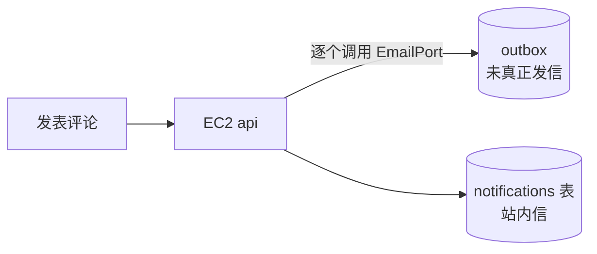

完成后：

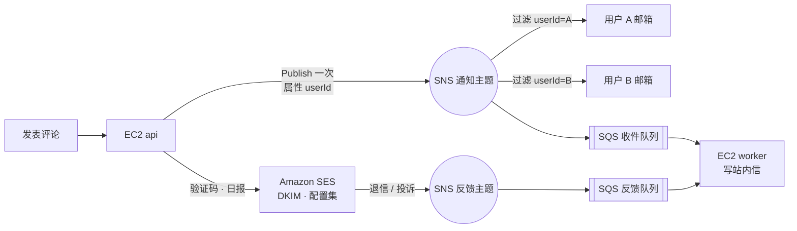

#### 为什么这几个服务要组合在一起

- **协作关系**：SNS 负责“一次发布、多处投递”，接收人数增加时发布方的耗时不变；订阅过滤策略让每个订阅只收到与自己相关的消息；SQS 订阅把推送变成可靠的拉取，让 EC2 不需要开放入站端口也能消费事件，worker 停机时消息在队列中等待；SES 负责需要个性化内容、需要证明邮箱归属的事务邮件，并把退信与投诉事件经 SNS + SQS 送回应用。
- **常见错误组合**：
  - 用 SNS 邮件订阅发送验证码：SNS 邮件是同一条纯文本发给所有订阅者，带退订尾注，还要收件人先确认订阅，不适合事务邮件。
  - 用 SQS 代替 SNS 做“一对多”：SQS 是竞争消费，一条消息只会被一个消费者处理。
  - 在 EC2 上跑 SMTP 直接发信：EC2 默认限制出站 25 端口，也没有发信信誉与退信处理。
  - 让 SES 事件推送到 EC2 的 HTTPS 端点：实例必须暴露入站端口；本项目用 SNS → SQS 拉回。
  - 忽略沙盒：沙盒期只能发给已验证地址，上线前要申请生产访问。

#### 步骤大纲

| # | 步骤 | 类型 | 学员做什么 | 检查（类型：判定要点） |
|---|---|---|---|---|
| 1 | 基线：逐个发、发不出去 | 对比实验 | `npm run exp -- notification --label before --scenario fanout`；在 `/me/outbox` 查看“本地实现，未真正发信” | experiment：`notification/fanout` 有效 before；capability：notification `driver=db`、email `driver=outbox` |
| 2 | 发件身份与沙盒 | 控制台 | 在 SES 控制台验证 `ses-identity`（域名身份需添加 DKIM 记录）并验证两个收件邮箱；查看账户仍处于沙盒 | aws-readonly `ses:GetEmailIdentity`：`VerifiedForSendingStatus=true`（不带 `ownership`：发件身份可能是以前会话保留下来的前置资源，`keepablePrerequisites: [ses-identity]`）；aws-readonly `ses:GetAccount`：记录 `ProductionAccessEnabled`（期望 false，只作观察，`severity: warn`） |
| 3 | 接入 SES | 脚本（wire：email） | `scripts/module enable email`；注册一个新用户，验证码真正到达收件箱；再对一个未验证地址发信，观察沙盒拒绝 | capability：email `driver=ses`；`anyOf`：`op: healthy`，或 `status=degraded` 且 detail 以“沙盒”开头（04#email 的探针结果，不是规则警告，不能写进 `expectedWarnings`；会话内不会离开沙盒）；local（`path-seen`，15 分钟）：出现 `email=ses:sent`；aws-readonly `sns:ListSubscriptionsByTopic`（反馈主题）：订阅者为反馈队列；experiment：`email/sandbox` after |
| 4 | 接入 SNS 并订阅 | 脚本（wire：notification） | `scripts/module enable notification`；两位用户在“通知设置”里开启邮件通知，点击 AWS 的确认订阅邮件 | capability：notification `driver=sns`、`status=ok`（订阅待确认时为 degraded，等待型）；local（`path-seen`，15 分钟）：出现 `notification=sns:published`；aws-readonly `sns:ListSubscriptionsByTopic`（通知主题）：有收件队列的 SQS 订阅，且至少两个邮件订阅已确认（`SubscriptionArn` 不是 `PendingConfirmation`）；aws-readonly `sns:GetSubscriptionAttributes`：邮件订阅带 `FilterPolicy`（键 `userId`） |
| 5 | 订阅过滤 | 对比实验 | `--label after --scenario filter`：用户 B 评论用户 A 的照片，只有 A 收到邮件 | experiment：`notification/filter` after；manual：学员确认“A 收到、B 未收到”并附收件时间 |
| 6 | 扇出耗时对比 | 对比实验 | `--label after --scenario fanout`：接收人从 1 增加到 N，比较发布方耗时 | experiment：`notification/fanout` pair |
| 7 | worker 停机时 | 对比实验 | `--scenario worker-stop`：停掉 worker，邮件照常送达，收件队列积压，恢复后站内信补写；再用 `POST /api/lab/notification/compare` 对比 SNS 邮件与 SES 邮件的内容 | experiment：`notification/worker-stop` after；local（`systemd-unit`，unit `cloudalbum-worker`）：`active=true`（must-hold，确认已恢复） |

#### 对比实验

| 实验（模块文档） | 没有它 | 有它 | 观察点 |
|---|---|---|---|
| `notification/fanout`（04#notification） | EC2 逐个调用，耗时随接收人数线性增长 | 一次 Publish，耗时基本不变 | 评论接口耗时与接收人数的关系 |
| `notification/filter` | 应用代码判断谁该收 | 订阅过滤策略 | 每个邮箱收到的消息 |
| `notification/worker-stop` | queue=sqs 时通知暂停 | 已发布的消息照常投递，只有收件队列积压 | 邮件到达时间、队列深度 |
| `email/sandbox`、`email/compare`（04#email） | 只写 outbox，任何人都能在 `/me/outbox` 看到验证链接 | 只发到真实收件箱；沙盒拒绝未验证地址 | 发送结果、`ses:rejected` 计数 |
| `notification/compare` | — | SNS 邮件：纯文本、所有订阅者相同、带退订尾注；SES：HTML 模板、个性化 | 两封邮件的内容与头部 |

#### 整体对比

| 指标 | 开始时 | 完成后 |
|---|---|---|
| 一次事件的投递方式 | EC2 逐个发送 | 发布一次，SNS 投递 |
| 发布方耗时与人数的关系 | 线性增长 | 基本不变 |
| 用户能否收到邮件 | 不能（只有 outbox） | 能（沙盒期只发给已验证地址） |
| 渠道扩展 | 改应用代码 | 新增订阅（SQS、Lambda、HTTPS、短信等） |
| EC2 需要的入站端口 | 无 | 无（SNS → SQS、SES → SNS → SQS 都由 worker 拉取） |
| 退信与投诉 | 不存在 | 事件回流，自动停止给无效地址发信 |

#### 小测

1. （单选）一条订单事件需要同时被库存服务、积分服务和数据分析服务各处理一次。最合适的是？
   A. 发到一个 SQS 队列，三个服务一起消费
   B. 发布到 SNS 主题，三个服务各自用一个 SQS 队列订阅
   C. 三个服务轮询同一个 DynamoDB 表
   D. 发到一个 SQS FIFO 队列
   **答案 B**。SNS + SQS 扇出让每个服务各拿到一份并独立重试；单个队列是竞争消费，每条消息只会被一个服务处理。
2. （单选）应用需要给注册用户发送包含个性化验证链接的 HTML 邮件，并处理退信。应该使用？
   A. SNS 邮件订阅　B. Amazon SES　C. 在 EC2 上安装 Postfix 直接经 25 端口发信　D. CloudWatch 告警通知
   **答案 B**。SES 用于事务性邮件，支持模板、DKIM 与退信/投诉事件；SNS 邮件是同一条纯文本广播；EC2 的 25 端口默认受限。
3. （多选，选两项）关于 SNS 订阅过滤策略，哪两项正确？
   A. 可以基于消息属性过滤
   B. 可以基于消息体过滤（需设置过滤范围）
   C. 过滤在订阅者收到后由订阅者执行
   D. 使用过滤策略后必须改用 FIFO 主题
   **答案 A、B**。过滤由 SNS 在投递前执行（`FilterPolicyScope` 决定按属性还是消息体），与是否 FIFO 无关。

#### 场景题

1. 一家 SaaS 公司的应用部署在私有子网中，没有任何入站端口。需要接收 SES 的退信与投诉事件，并在应用中把对应地址加入抑制名单，且应用停机期间事件不能丢。最合适的方案是？
   - A. SES 配置集的事件目标为 SNS 主题，主题由 SQS 队列订阅，应用 worker 长轮询该队列。**正确**：应用只发起出站连接，事件在队列中持久保存。
   - B. SES 事件目标为 SNS，SNS 以 HTTPS 订阅应用的公网端点。**错误**：要求应用暴露入站端点，违背约束；停机时依赖重试策略，可能丢失。
   - C. 应用每分钟调用 SES API 读取账号级抑制列表。**错误**：只能看到已被抑制的地址，拿不到每封邮件的投递、退信、投诉事件细节，轮询还带来延迟与额外请求；事件驱动的配置集才是为此设计的。
   - D. 用 CloudWatch 告警监控退信率并发邮件给管理员。**错误**：只能看到比例，拿不到具体地址，无法自动加入抑制名单。
2. 系统要把“有新评论”通知发送给照片主人，用户数量很大，每个用户只能收到与自己相关的通知，并且以后要增加短信与移动推送。哪个设计最合适？
   - A. 每个用户一个 SNS 主题。**错误**：主题数量随用户增长，管理与配额都是问题。
   - B. 一个 SNS 主题，发布时带 `userId` 消息属性，每个订阅设置过滤策略；新增渠道只需新增订阅协议。**正确**：一次发布，按属性过滤，渠道可扩展。
   - C. 一个 SQS 队列，所有用户的客户端轮询并丢弃不属于自己的消息。**错误**：竞争消费会让消息被错误的客户端拿走，且无法推送。
   - D. 应用为每个用户调用一次 SES。**部分可行但不满足扩展要求**：只覆盖邮件，增加短信与推送要改代码，发布方耗时随用户线性增长。

#### 清理说明

- 自动回收删除 email 与 notification 栈（主题、订阅、队列、配置集）。SES 发件身份属于可保留的前置资源：结束对话框中可选择保留（不收费），否则一并删除；如果你在外部 DNS 中添加过 DKIM 记录，需要自己删除。
- 已验证的收件邮箱身份（沙盒用）随会话删除，下次使用需重新验证。
- 申请 SES 生产访问不是本卡片的步骤；如果你申请过，它是账号级、按区域的状态，平台不会回收。

#### 对应 SAA 考点

- SNS 主题、订阅协议、订阅过滤策略（属性 / 消息体）、邮件订阅确认、原始消息传递、订阅级 DLQ。
- SNS + SQS 扇出与 SQS 竞争消费的区别；SNS FIFO + SQS FIFO 用于有序扇出。
- SES 身份验证（域名 / 邮箱）、DKIM、SPF、DMARC、沙盒与生产访问、发送配额。
- SES 配置集与事件目标；用 SNS + SQS 把 AWS 服务的异步事件安全地送回应用。
- SNS、SES、EventBridge 的适用场景；EC2 出站 25 端口限制。

---

### 3.6 `sc-user-identity` 用户身份全链路：Cognito User Pool + Identity Pool + S3 + API Gateway

#### 元数据

| 字段 | 值 |
|---|---|
| id / kind | `sc-user-identity` / `scenario` |
| 标题 | 用户身份全链路：Cognito User Pool + Identity Pool + S3 + API Gateway |
| 一句话简介 | 用户在 Cognito 托管登录页登录，拿到的令牌既能直接调用 API Gateway（网关验签），又能换成只允许写自己 S3 前缀的临时凭证 |
| 涉及的 AWS 服务 | Amazon Cognito User Pool、Amazon Cognito Identity Pool、Amazon API Gateway（主）；Amazon S3、AWS STS、AWS IAM、Amazon CloudFront（辅） |
| 对应的模块 | 起始：iam、storage、cdn；目标：auth、identity-pool、social-api |
| 难度 | 高级 |
| 预计时长 | 120 分钟（其中等待约 10 分钟：用户池域与托管登录、网关部署） |
| 时间上限 / 可延长 | 180 分钟 / 2 次 × 30 分钟 |
| 起始部署等级 | B（含 CloudFront） |
| startProfile | `atl/sc-user-identity/default`：iam（②）+ storage（①DEP-002）+ 背景 cdn（③`contextKind: https-entry`，`CDN_MEDIA_ORIGIN=s3`）；种子 `cognito-test-users`（③`kind: seed`，06 PM-44） |
| 目标模块 | auth（`AUTH_DRIVER=cognito`，`COGNITO_LOGIN_MODE=managed`，`AUTH_MIGRATION=bulk`，`AUTH_MFA=optional`）；identity-pool（设置 `IDENTITY_POOL_ID`，模块自带暂存桶）；social-api（`SOCIAL_API_INTEGRATION=proxy`，`SOCIAL_API_AUTHORIZER=jwt`） |
| 费用档位 | 低。主要计费来源：Cognito 按月活跃用户（学习规模通常在免费额度内，以官方为准）；API Gateway HTTP API 按请求；S3 请求与暂存存储；CloudFront 流量。无按小时计费资源 |
| 人工前置 | `recipient-emails`：至少一个能收信的邮箱（Cognito 默认发件人发送验证码；auth=cognito 且 email 未启用时 DEP-013 会提示“验证码不经过 outbox”） |
| 区域 | ap-northeast-1；`alsoUses: [global]`（CloudFront） |
| SAA 考试领域 | 安全架构（主）、弹性架构 |
| 推荐的前置卡片 | `svc-auth`、`svc-identity-pool`、`sc-static-acceleration` |

**startProfile 明细**

| 预置模块 / 取值 | 原因 |
|---|---|
| iam（role） | ②裁决 C3 预置；auth、identity-pool 也是 `credentials: required`（CRED-001），social-api 的控制面探针也用它 |
| storage（s3） | ①identity-pool 依赖 storage(s3)（DEP-002）：临时凭证的授权目标是 S3 前缀，完成后经 CopyObject 导入原图键 |
| cdn（`CDN_MEDIA_ORIGIN=s3`） | ③背景模块，`contextKind: https-entry`（平台模式下不是硬依赖）：`COGNITO_LOGIN_MODE=managed` 要求受信任 HTTPS（DEP-029：`cdn \| tls \| TLS_MODE=letsencrypt`），而平台默认的方案 B 已让直连入口是 Let's Encrypt IP 证书，DEP-029 在 L0 就满足（03 §6.2）。仍预置 cdn 的理由：IP 证书只有 160 小时、签发失败会回退自签名（03 §6.2），托管登录的回调地址需要一个稳定的受信 HTTPS 来源；`*.cloudfront.net` 默认证书不需要域名，与 `l3-identity` 档位、旧 Lab 8 的起始状态一致；identity-pool 在明文 HTTP 下会触发 DEP-030。`CDN_MEDIA_ORIGIN=s3` 避免 storage=s3 时的 DEP-028 降级 |
| 不预置 auth | auth 是目标模块，也是 identity-pool 的依赖（DEP-002），按步骤顺序先启用 |
| 种子 `cognito-test-users` | ③测试数据：3 个已确认（`email_verified=true`）、密码已知的本地测试用户（邮箱为保留域名，不会真正发信，06 PM-44、PM-46）；第 2 步 bulk 迁移后由 06 的钩子在 Cognito 中设置同样的密码，第 5 步越权前缀测试里的“别人”用其中一个账号，学员不必再注册第二个邮箱 |

#### 场景故事

相册准备开放给合作伙伴的员工使用。安全团队提出四点：应用不应再保存任何密码哈希；登录要支持 MFA，以后还要接企业 SAML；浏览器上传大文件时不应经过 EC2，但只能写自己的目录，绝不能覆盖别人的照片；社交接口要在网关层就拒绝未登录或伪造的令牌，而不是等请求打到服务器上才返回 401。

#### 实验简介

- **背景**：起点是“L0 + S3 + CloudFront”：应用自己保存 argon2id 哈希并签发 ES256 JWT；F14 的多文件直传用应用自签的前缀令牌（每一片都要问 EC2）；点赞评论走 EC2 上的 Express `/social/*`。
- **你将学到**：User Pool（认证）与 Identity Pool（授权换 AWS 凭证）的分工；授权码 + PKCE、ID / access / refresh 令牌；IAM 策略变量 `${cognito-identity.amazonaws.com:sub}`；HTTP API 的 JWT 授权器只支持 RSA 系列算法；“401 在哪一层返回”。
- **实验资源**：实验机、工作台、联合登录控制台、应用预览（经 CloudFront 的 HTTPS）。你将创建：User Pool、App Client（无客户端密钥的 SPA 公共客户端）、用户池域；Identity Pool、已认证角色、暂存桶；HTTP API、JWT 授权器、代理集成。

#### 架构图

开始时：

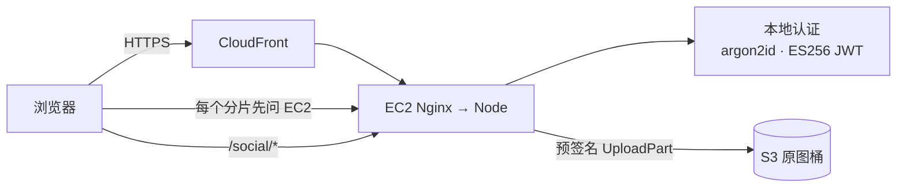

完成后：

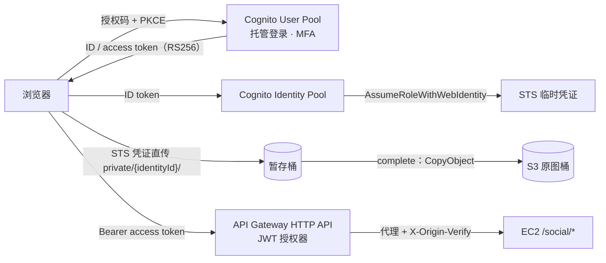

#### 为什么这几个服务要组合在一起

- **协作关系**：User Pool 回答“你是谁”，签发标准的 OIDC 令牌；API Gateway 的 JWT 授权器用 User Pool 的 JWKS 在网关验签，未登录请求根本到不了 EC2；Identity Pool 把同一个身份换成 STS 临时凭证，IAM 策略变量把权限限定在 `private/<identityId>/` 前缀，S3 在服务端执行授权，浏览器直传不经过 EC2；S3 是最终的数据面。四者串起来就是“认证 → 授权 → 访问 AWS 资源 / 调用 API”的全链路。
- **常见错误组合**：
  - 用 User Pool 的 `sub` 写进 S3 前缀策略：策略变量是 Identity Pool 的 Identity ID，不是 User Pool 的 `sub`。
  - 给 SPA 的 App Client 生成客户端密钥：浏览器无法保密，SPA 必须是公共客户端 + PKCE。
  - 用 HTTP API 的 JWT 授权器校验应用自己签发的 ES256 令牌：只支持 RSA 系列算法，本地令牌要用 Lambda 授权器（DEP-023）。
  - 开启未认证（访客）身份并给它写权限：任何人都能拿到凭证。
  - 把长期访问密钥打包进前端：泄露即失控，应使用 Identity Pool 的临时凭证或预签名 URL。
  - 托管登录配 `http://` 回调地址：除 `http://localhost` 外必须 HTTPS，且与 App Client 中的配置逐字一致（DEP-029）。

#### 步骤大纲

| # | 步骤 | 类型 | 学员做什么 | 检查（类型：判定要点） |
|---|---|---|---|---|
| 1 | 基线：自建认证与前缀令牌 | 对比实验 | `npm run exp -- identity-pool --label before --scenario upload-bench`；在 `/lab` 的 auth 卡片查看“本地实现要自己写的功能”清单 | experiment：`identity-pool/upload-bench` 有效 before；capability：auth `driver=local` |
| 2 | 接入 User Pool（托管登录） | 脚本（wire：auth） | `scripts/module enable auth --login-mode managed`（bulk 迁移现有用户，首次登录重置密码）；用托管登录页注册、开启 TOTP MFA | capability：auth `driver=cognito`、`status=ok`；local（`path-seen`，15 分钟）：出现 `auth=cognito:managed`；aws-readonly `cognito-idp:DescribeUserPoolClient`：`CallbackURLs` 含 `https://<分配域名>/api/auth/callback` 且不含任何 `http://` 地址（回调地址由 `AppOrigins` 的全部入口生成，方案 B 下也会含 `https://<EIP>/…`）、`AllowedOAuthFlows` 含 `code`、`GenerateSecret` 为 false；`cognito-idp:DescribeUserPoolDomain`：`Status=ACTIVE`；`cognito-idp:GetUserPoolMfaConfig`：TOTP 可用 |
| 3 | 读懂令牌 | 观察 | 运行 `npm run exp -- auth --label after --scenario token-claims`，对照 ID token 与 access token 的 `token_use`、`aud` / `client_id`、`iss`、签名算法 | experiment：`auth/token-claims` after；manual：学员填写“access token 的签名算法”与“JWT 授权器应校验的 audience 字段”（期望 RS256、`client_id`） |
| 4 | 接入 Identity Pool | 脚本（wire：identity-pool） | `scripts/module enable identity-pool`；上传一组多文件，在 DevTools 中观察浏览器直接向暂存桶发起分片上传 | capability：identity-pool `status=ok`；local（`path-seen`，15 分钟）：出现 `identity-pool=cognito:sts`；aws-readonly `cognito-identity:DescribeIdentityPool`：`AllowUnauthenticatedIdentities=false`、`CognitoIdentityProviders` 含本 User Pool 与 App Client；`cognito-identity:GetIdentityPoolRoles`：只有 authenticated 角色 |
| 5 | 越权测试与直传对比 | 对比实验 | `--label after --scenario cross-prefix`（用自己的临时凭证写别人的前缀，期望 AccessDenied）与 `--scenario upload-bench` | experiment：`identity-pool/cross-prefix` after（越权写入全部被拒）；`identity-pool/upload-bench` pair |
| 6 | API Gateway + JWT 授权器 | 脚本（wire：social-api） | `scripts/module enable social-api --integration proxy --authorizer jwt`；前端社交接口改走 `SOCIAL_API_BASE_URL` | capability：social-api `driver=apigw`、`status=ok`；aws-readonly `apigateway:GetAuthorizers`[白名单+]（`severity: warn`，04 收录前只作辅助）：类型 JWT，`Issuer` 为本 User Pool，`Audience` 含 App Client；http-header（from: platform，target: apigw，path `/social/photos/{{ sample.nonce }}/likes`，不带令牌）：401；佐证：`nginx-log-summary` 中该 nonce 计数为 0 |
| 7 | 401 发生在哪一层 | 对比实验 | `npm run exp -- social-api --label after --scenario unauth` 与 `--scenario compare`：同一批未登录 / 伪造令牌请求分别打向 EC2 `/social` 与网关 | experiment：`social-api/unauth` after；manual：学员记录两条路径上 EC2 收到的请求数 |

#### 对比实验

| 实验（模块文档） | 没有它 | 有它 | 观察点 |
|---|---|---|---|
| `auth/feature-matrix`、`auth/token-claims`（02#auth） | 自己保存哈希、自己实现 MFA 与锁定、ES256 令牌 | 哈希由 AWS 保管，托管登录、MFA、联合身份配置即可；RS256 + JWKS | 本地库是否还有密码哈希；令牌字段 |
| `identity-pool/upload-bench`（02#identity-pool） | 每个分片都要先问 EC2 | 凭证有效期内只换一次凭证，分片直传 S3 | 每个文件对后端的请求数、EC2 入站字节 |
| `identity-pool/cross-prefix` | 授权由应用代码检查键前缀 | IAM 策略变量在 S3 服务端执行授权 | 越权写入的结果 |
| `social-api/unauth`、`social-api/compare`（04#social-api） | EC2 返回 401，请求已经到达实例 | 网关返回 401，EC2 看不到 | EC2 收到的未授权请求数 |

#### 整体对比

| 指标 | 开始时 | 完成后 |
|---|---|---|
| 密码哈希存放 | 应用数据库 | Cognito（应用接触不到） |
| MFA / 联合登录 | 自己实现 / 不支持 | 配置即可（SAML、OIDC、社交登录） |
| 令牌 | ES256，自有密钥 | RS256，JWKS 公开验证 |
| 浏览器直传的授权 | 应用自签令牌，每片经 EC2 | STS 临时凭证 + IAM 策略变量，S3 执行 |
| 未授权请求在哪里被拒 | EC2 | API Gateway |
| 多实例 | 要共享密钥与锁定状态 | 无状态，天然可扩展 |

#### 小测

1. （单选）移动应用的用户登录后，需要直接把照片上传到 S3 中属于自己的目录。最合适的方案是？
   A. 在应用中内置一个 IAM 用户的访问密钥
   B. 用 Cognito Identity Pool 换取临时凭证，IAM 策略用 `${cognito-identity.amazonaws.com:sub}` 限定前缀
   C. 让 S3 桶公开可写，按文件名区分用户
   D. 用 User Pool 的 ID token 直接调用 S3 API
   **答案 B**。临时凭证 + 策略变量由 S3 在服务端执行授权；S3 不接受 User Pool 令牌作为凭证；内置长期密钥与公开写都不安全。
2. （单选）HTTP API 的 JWT 授权器拒绝了应用自签的令牌，错误是签名算法不支持。原因是？
   A. 令牌没有 `exp` 字段　B. JWT 授权器只支持 RSA 系列算法，令牌使用的是 ES256　C. HTTP API 不支持任何授权器　D. 令牌太长
   **答案 B**。这是本项目 DEP-023 的依据（以官方文档为准）；改用 Cognito 签发的 RS256 令牌，或改用 Lambda 授权器。
3. （多选，选两项）关于 Cognito User Pool 与 Identity Pool，哪两项正确？
   A. User Pool 负责认证并签发 JWT
   B. Identity Pool 把已认证身份换成 AWS 临时凭证
   C. Identity Pool 保存用户的密码
   D. 两者必须同时使用
   **答案 A、B**。Identity Pool 不保存密码，它可以信任 User Pool、社交 IdP、SAML 或开发者认证身份；两者可以单独使用。

#### 场景题

1. 一个 SPA 需要让用户登录后调用后端 API，并支持将来接入企业 SAML。团队希望在网关层完成令牌校验，后端尽量不写认证代码，并且费用随请求量变化。最合适的方案是？
   - A. Cognito User Pool（托管登录，授权码 + PKCE，SAML 身份提供商）+ API Gateway HTTP API 的 JWT 授权器。**正确**：网关验签，User Pool 负责联合身份，按请求与 MAU 计费。
   - B. 后端在 EC2 上自己实现 SAML 与会话管理，API 直接暴露在 ALB 上。**错误**：认证代码与运维都在自己身上，不满足“后端尽量不写认证代码”。
   - C. Cognito Identity Pool 签发的临时凭证 + API Gateway IAM 授权。**部分可行但不是最合适**：IAM 授权要求客户端对每个请求做 SigV4 签名，SPA 实现复杂；题目要的是用户登录令牌校验。
   - D. 为每个用户创建 IAM 用户与访问密钥。**错误**：长期凭证分发给终端用户，违背最佳实践。
2. 一个照片应用允许用户从浏览器直接上传到 S3。安全审计发现：用户 A 可以覆盖用户 B 的对象。已知应用使用 Identity Pool 获取临时凭证。最可能的原因与修复是？
   - A. 已认证角色的策略对整个 `private/*` 授权 `s3:PutObject`；改为 `private/${cognito-identity.amazonaws.com:sub}/*`。**正确**：用策略变量把每个身份限制在自己的前缀。
   - B. 桶没有开启版本控制；开启后就不会被覆盖。**错误**：版本控制能保留旧版本，但不能阻止越权写入。
   - C. 应改用 User Pool 的 `sub` 作为前缀。**错误**：IAM 策略变量只能引用 Identity Pool 的 Identity ID。
   - D. 关闭 Identity Pool 的增强认证流程。**错误**：与前缀授权无关。

#### 清理说明

- 自动回收删除 social-api、identity-pool、auth 栈：User Pool 先关闭删除保护再删除，用户池域、暂存桶（含未完成的分片上传）一并删除；应用数据库中 bulk 迁移写入的 `auth_subject` 随实验机删除。
- 托管登录页的用户与你注册时使用的邮箱：Cognito 发出的验证邮件已经送达，平台无法撤回；不再使用该邮箱时无需处理。
- 社交登录或 SAML 身份提供商如果你在控制台额外配置过，平台回收 User Pool 时会一并删除；外部 IdP 一侧（例如 Google 控制台中的 OAuth 客户端）需要你自己删除。

#### 对应 SAA 考点

- User Pool（认证）与 Identity Pool（授权）；ID / access / refresh 令牌的用途；授权码 + PKCE、公共客户端与机密客户端。
- Web 身份联合、`AssumeRoleWithWebIdentity`、IAM 策略变量；访客身份的风险。
- API Gateway HTTP API 的 JWT 授权器、Lambda 授权器、IAM 授权；REST API 的 Cognito 授权器；限流与 429。
- 预签名 URL、应用自签令牌、临时凭证三种直传授权方式的取舍；S3 CORS 与分片上传。
- 托管登录需要 HTTPS 回调；托管登录自定义域名的证书在 us-east-1；Cognito 功能层级与 IAM Identity Center 的区别。

---

### 3.7 `sc-serverless-api` Serverless API：API Gateway + Lambda + DynamoDB

#### 元数据

| 字段 | 值 |
|---|---|
| id / kind | `sc-serverless-api` / `scenario` |
| 标题 | Serverless API：API Gateway + Lambda + DynamoDB |
| 一句话简介 | 把点赞、评论、分享链接整体搬到网关 + 函数 + 按需表上：停掉 EC2 上的 API 进程，社交功能照常可用 |
| 涉及的 AWS 服务 | Amazon API Gateway（HTTP API）、AWS Lambda、Amazon DynamoDB（主）；Amazon SQS（选做，通知路径）、Amazon CloudWatch Logs（辅） |
| 对应的模块 | 起始：iam；目标：social-store、social-api；选做：queue |
| 难度 | 中级 |
| 预计时长 | 90 分钟（其中等待约 5 分钟） |
| 时间上限 / 可延长 | 150 分钟 / 2 次 × 30 分钟 |
| 起始部署等级 | A（含工具链栈） |
| startProfile | `atl/sc-serverless-api/default`：iam（②） |
| 目标模块 | social-store（`SOCIAL_DRIVER=dynamodb`，按需模式、TTL、PITR）；social-api（`SOCIAL_API_INTEGRATION=lambda`，`SOCIAL_API_AUTHORIZER=lambda`）；queue（`QUEUE_DRIVER=sqs`，`optional: true`）；`expectedWarnings: [DEP-025]`（经 Lambda 写入的评论不产生通知，选做第 8 步启用 queue 后消失） |
| 费用档位 | 低。主要计费来源：API Gateway 按请求；Lambda 请求与 GB-秒（含授权器）；DynamoDB 按需读写请求单位与存储、PITR；CloudWatch Logs。无按小时计费资源 |
| 人工前置 | 无 |
| 区域 | ap-northeast-1 |
| SAA 考试领域 | 高性能架构（主）、弹性架构、成本优化 |
| 推荐的前置卡片 | `svc-social-store`、`svc-social-api` |

**startProfile 明细**

| 预置模块 / 取值 | 原因 |
|---|---|
| iam（role） | ②裁决 C3 预置；social-store 也是 `credentials: required`（CRED-001），social-api 的控制面探针也用它 |
| 工具链栈（不是模块） | 平台固定部分（运行器 `base-deploy` 创建）：social-api 的 lambda 集成与 Lambda 授权器的部署包在工具链桶中 |
| 不预置 auth | 授权器选 `lambda`：部署时把 EC2 `/.well-known/jwks.json` 中的 ES256 公钥作为栈参数 `JwksJson` 交给授权器（04#social-api），运行时不回源 EC2，所以第 6 步停掉 api 进程后授权照常；不需要 Cognito（jwt 授权器需要 auth，DEP-023）。身份链路是 `sc-user-identity` 的主题，本卡片专注数据与计算层 |
| 不预置 social-store | 它是目标模块，也是 lambda 集成的依赖（DEP-022），按步骤顺序先启用 |

#### 场景故事

相册的点赞与评论流量在晚上集中爆发，白天几乎没有；每次发布重启 EC2 上的 API 进程，点赞都会失败几秒；热门照片的点赞计数在高并发下偶尔算错；过期的分享链接要靠定时任务清理，任务一停表就越来越大。产品希望社交功能“永不下线”，并且只为实际请求付费。

#### 实验简介

- **背景**：起点是 L0：社交接口是 EC2 上的 Express `/social/*`，数据在 SQLite 的 `likes`、`comments`、`photo_counters`、`share_links` 表中。
- **你将学到**：DynamoDB 的单表设计、条件写入实现幂等、原子计数器、事务写、TTL；按需容量与限流；HTTP API 与 REST API 的取舍；Lambda 代理集成与 Lambda 授权器（结果缓存）；网关层限流返回 429；按请求付费与按小时付费的成本模型。
- **实验资源**：实验机、工作台、联合登录控制台。你将创建：DynamoDB 表（按需、TTL、PITR）；HTTP API、社交后端 Lambda、Lambda 授权器、访问日志组；选做：SQS 任务队列与 DLQ。

#### 架构图

开始时：

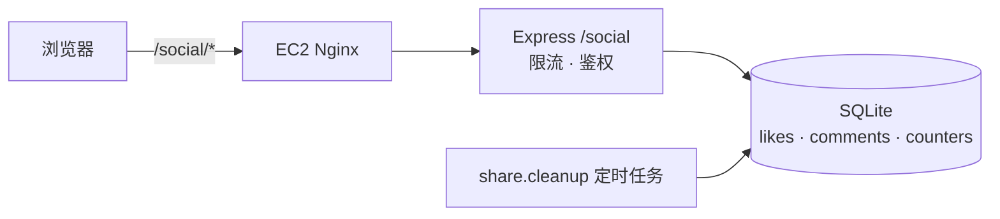

完成后：

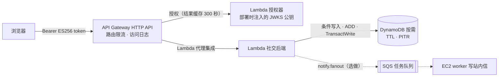

#### 为什么这几个服务要组合在一起

- **协作关系**：API Gateway 承担入口、鉴权（授权器）与限流，未授权和超限的请求不消耗后端；Lambda 只在有请求时运行，并发随流量伸缩；DynamoDB 按需模式不需要容量规划，条件写入与 `ADD` 让“一人一赞”和计数在并发下保持正确，TTL 在后台删除过期分享链接。三者都按请求计费、都不依赖 EC2，所以“停掉 API 进程社交功能照常可用”。
- **常见错误组合**：
  - 让 Lambda 访问 EC2 上的 SQLite：读不到（DEP-022 的依据），数据必须外置。
  - 用 JWT 授权器校验 ES256 令牌：不支持，本项目用 Lambda 授权器。
  - 先读计数再写回：并发下丢失更新，应使用 `ADD` 原子更新。
  - 需要 API Key、使用计划、WAF 或响应缓存却选了 HTTP API：这些只有 REST API 支持。
  - 把 Lambda 放进 VPC 只为访问 DynamoDB：不必要；确需放进 VPC 时要配 DynamoDB Gateway Endpoint。
  - 用 Scan 实现“某照片的评论列表”：按分区键 Query，必要时加 GSI。

#### 步骤大纲

| # | 步骤 | 类型 | 学员做什么 | 检查（类型：判定要点） |
|---|---|---|---|---|
| 1 | 基线：Express + SQLite | 对比实验 | `npm run exp -- social-store --label before --scenario like-storm` 与 `npm run exp -- social-api --label before --scenario mixed` | experiment：`social-store/like-storm` 有效 before；`social-api/mixed` 有效 before |
| 2 | 迁到 DynamoDB | 脚本（wire：social-store） | `scripts/module enable social-store`（迁移时按导出的点赞与评论重新计算计数）；在控制台查看表的分区键 / 排序键与项目 | capability：social-store `driver=dynamodb`、`status=ok`；local（`path-seen`，15 分钟）：真实点赞请求出现 `social-store=dynamodb`；aws-readonly `dynamodb:DescribeTable`：`BillingModeSummary.BillingMode=PAY_PER_REQUEST`；`dynamodb:DescribeTimeToLive`：`ENABLED`；`dynamodb:DescribeContinuousBackups`：PITR 开启 |
| 3 | 幂等与原子计数 | 对比实验 | `--label after --scenario like-storm` 与 `--scenario naive-counter`（故意用“读-改-写”观察丢失更新） | experiment：`social-store/like-storm` pair；`social-store/naive-counter` after |
| 4 | 部署 HTTP API + Lambda | 脚本（wire：social-api） | `scripts/module enable social-api --integration lambda --authorizer lambda`；前端社交接口改走网关 | capability：social-api `driver=apigw`、`status=ok`；http-header（from: platform，target: apigw，path `/social/photos/{{ sample.nonce }}/likes`，不带令牌）：401 且带 `apigw-requestid`（请求在网关被授权器拒绝）；aws-readonly `apigateway:GetIntegrations`[白名单+]：类型 `AWS_PROXY`；`apigateway:GetAuthorizers`[白名单+]：类型 REQUEST、开启结果缓存（这两项在 04 收录前只作 `severity: warn` 的辅助检查，必需判据是网关 401 + `apigw-requestid` 与第 6 步的 `ec2-down`）；`lambda:GetFunctionConfiguration`（社交后端）：`nodejs22.x`、`arm64` |
| 5 | 网关层限流与鉴权 | 对比实验 | `--label after --scenario throttle` 与 `--scenario unauth` | experiment：`social-api/throttle` after（出现网关返回的 429）；`social-api/unauth` after |
| 6 | 停掉 EC2 上的 API 进程 | 对比实验 | `--label after --scenario ec2-down`：脚本经管理通道停止 `cloudalbum-api`，持续点赞评论，结束时恢复 | experiment：`social-api/ec2-down` after（停机期间社交请求成功）；local（`systemd-unit`，unit `cloudalbum-api`）：`active=true`（must-hold，确认已恢复） |
| 7 | 冷启动与成本模型 | 观察 | `--scenario cold-start`；在手册的成本表中按“请求量 × 单价”与“实例小时 × 单价”两种模型填写（单价由学员从官方页抄录） | experiment：`social-api/cold-start` after；manual：学员提交两种成本模型的对比表（金额可留空，只填计费维度） |
| 8 | 补上通知路径（选做） | 脚本（wire：queue） | 观察 capabilities 中的 DEP-025 警告（经 Lambda 写入的评论不产生站内通知），`scripts/module enable queue` 后警告消失 | capability：queue `driver=sqs`、`status=ok`；local（`path-seen`，15 分钟）：出现 `queue=sqs:queued`；capability（module: app，`view: admin`）：`validation.warnings` 不含 `DEP-025` |

#### 对比实验

| 实验（模块文档） | 没有它 | 有它 | 观察点 |
|---|---|---|---|
| `social-store/like-storm`（03#social-store） | SQLite 单写者排队，长尾明显 | 按需模式写入延迟平稳，同一计数项是热点 | 写入 p95、错误率、计数是否正确 |
| `social-store/naive-counter` | — | “读-改-写”在并发下丢失更新；`ADD` 正确 | 最终计数与期望值的差 |
| `social-store/share-ttl`（选做） | 定时任务分批删除 | TTL 后台删除，可能延后，不消耗写容量 | 过期项消失的时间 |
| `social-api/mixed`、`social-api/compare`（04#social-api） | 经 Nginx 到 Express | 热调用与 Express 同一量级，冷启动更慢 | p50 / p95、`IntegrationLatency` |
| `social-api/throttle`、`social-api/unauth` | 请求已经到达 EC2 | 429 / 401 在网关返回 | EC2 收到的请求数 |
| `social-api/ec2-down` | 社交功能不可用 | 照常可用 | 停机期间的成功率 |

#### 整体对比

| 指标 | 开始时 | 完成后 |
|---|---|---|
| 社交接口运行在哪里 | EC2 上的 Express | API Gateway + Lambda |
| 数据 | SQLite（与业务数据同盘） | DynamoDB 按需表 |
| 并发计数正确性 | 依赖事务与行锁 | 条件写入 + `ADD` |
| 过期数据清理 | 定时任务 | TTL |
| EC2 停机时 | 不可用 | 可用 |
| 限流与鉴权 | 请求到达实例后处理 | 网关层处理 |
| 成本模型 | 固定实例小时 | 按请求，空闲时接近零 |

#### 小测

1. （单选）点赞功能要求“同一用户对同一照片只能点赞一次”，在高并发下也不能重复。DynamoDB 中最合适的做法是？
   A. 先 GetItem 检查是否存在，再 PutItem
   B. PutItem 时使用条件表达式 `attribute_not_exists(PK)`
   C. 使用强一致读后再写
   D. 开启 DynamoDB Streams 去重
   **答案 B**。条件写入在服务端原子判断；先读后写有竞态；Streams 是事后通知，不能阻止重复写入。
2. （单选）团队需要为合作伙伴提供 API，并按 API Key 分别限制调用次数与配额，同时要关联 AWS WAF。应该选择？
   A. API Gateway HTTP API　B. API Gateway REST API　C. Application Load Balancer　D. Lambda 函数 URL
   **答案 B**。API Key、使用计划、WAF 关联、响应缓存都只有 REST API 支持；HTTP API 更便宜但功能更少。
3. （多选，选两项）关于 DynamoDB TTL，哪两项正确？
   A. TTL 删除不消耗写容量
   B. 项目过期后会立即从读取结果中消失
   C. TTL 删除会出现在 DynamoDB Streams 中
   D. 必须使用预置容量模式才能开启 TTL
   **答案 A、C**。TTL 是后台异步删除，过期项可能在一段时间内仍可读到，读取时需要自己过滤；与容量模式无关。

#### 场景题

1. 一家初创公司的投票 API 流量极不均匀：活动期间每秒数千请求，平时几乎为零。要求：无需容量规划、为空闲时间付费最少、每个用户每题只能投一次。最合适的架构是？
   - A. API Gateway + Lambda + DynamoDB 按需模式，投票用条件写入。**正确**：全部按请求计费、自动伸缩，条件写入保证一人一票。
   - B. ALB + EC2 Auto Scaling + RDS for PostgreSQL。**错误**：可以工作，但 ALB、实例与 RDS 都按小时计费，空闲期也要付费，扩容有分钟级延迟。
   - C. API Gateway + Lambda + DynamoDB 预置容量（固定较大值）。**错误**：预置容量空闲时也计费，且突发超过预置值会被限流。
   - D. API Gateway + Lambda + ElastiCache 存放投票。**错误**：缓存不是持久化的权威存储，节点按小时计费。
2. 一个 HTTP API 后端 Lambda 在每次请求时都要校验自签的 JWT，团队发现授权逻辑占了大量 Lambda 调用。希望在不改变令牌格式（ES256）的前提下减少授权调用。应该怎么做？
   - A. 改用 JWT 授权器。**错误**：HTTP API 的 JWT 授权器只支持 RSA 系列算法，ES256 令牌无法通过。
   - B. 使用 Lambda 授权器并开启结果缓存（以 `Authorization` 头为身份来源）。**正确**：同一令牌在缓存期内不再调用授权器。
   - C. 把授权逻辑移到前端。**错误**：前端不可信。
   - D. 给授权器 Lambda 配置预置并发。**错误**：减少的是冷启动，不是调用次数。

#### 清理说明

- 自动回收删除 social-api 栈（API、函数、授权器、日志组）与 social-store 表（PITR 备份随表删除）；选做的 queue 栈一并删除。
- 第 6 步若中途离开，`cloudalbum-api` 可能仍处于停止状态：提交时的 must-hold 检查会提示，回收不受影响。
- 如果你把表临时改成预置模式做过限流实验，结束前改回按需（预置模式空闲也按容量计费）；回收时表会被删除，不会持续计费。

#### 对应 SAA 考点

- DynamoDB：分区键与排序键、单表设计、GSI / LSI、条件写入、事务、原子计数器与热点分区、TTL、按需与预置容量、PITR、全局表、DAX。
- API Gateway：HTTP / REST / WebSocket API 的功能差异；Lambda 代理集成；JWT、Lambda、IAM 授权器；限流与 429；集成超时上限。
- Lambda 冷启动、预置并发、别名加权发布；按请求付费与按小时付费的取舍。
- 经 Gateway Endpoint 访问 DynamoDB；API 前面加 CloudFront 与 WAF。

---

### 3.8 `sc-ha-web` 高可用 Web 层：ALB + Auto Scaling + S3 / EFS + RDS Multi-AZ（扩展：EC2 Image Builder 黄金 AMI）

#### 元数据

| 字段 | 值 |
|---|---|
| id / kind | `sc-ha-web` / `scenario` |
| 标题 | 高可用 Web 层：ALB + Auto Scaling + S3 / EFS + RDS Multi-AZ |
| 一句话简介 | 从“一台手工维护的 EC2”走到“跨两个 AZ、坏了自动替换、负载高了自动扩容”的无状态机群，数据层由 S3 与 RDS Multi-AZ 承担；扩展练习用黄金 AMI 缩短扩容时间 |
| 涉及的 AWS 服务 | Elastic Load Balancing（ALB）、Amazon EC2 Auto Scaling（主）；Amazon RDS for PostgreSQL（Multi-AZ）、Amazon S3、启动模板、SSM Parameter Store（引导配置包）、Amazon CloudWatch（目标跟踪告警）（辅）；Amazon EFS（变体）；EC2 Image Builder（扩展） |
| 对应的模块 | 起始：iam、storage、database（`MultiAz=true`）；目标：load-balancer、autoscaling；扩展：ami；变体：shared-fs 替代 storage |
| 难度 | 高级 |
| 预计时长 | 150 分钟（其中等待约 35 分钟：ALB 创建、ASG 实例引导与健康检查、扩容与实例刷新；扩展另加约 40 分钟的镜像构建） |
| 时间上限 / 可延长 | 240 分钟 / 2 次 × 30 分钟 |
| 起始部署等级 | C（含 RDS Multi-AZ） |
| startProfile | `atl/sc-ha-web/default`：iam（②）+ storage（①ASG-001，分支选 storage）+ database（①ASG-002、ASG-003；`MultiAz=true`，③`contextKind: shorten-wait`）；`preview.directHttps: off`（预览方案 B 关）；学员可选的起始变体 `efs`（档位 `atl/sc-ha-web/efs`） |
| 目标模块 | load-balancer（`LB_MODE=alb`，第 4 步后 `LB_LOCK_ORIGIN=on`）；autoscaling（`DEPLOY_MODE=asg`，Min 2 / Desired 2 / Max 4，CPU 目标跟踪；`SECRETS_ORIGIN=bundle` 随它写入）；ami（`AMI_SOURCE=golden`，`optional: true`，扩展）；`expectedWarnings: [SEC-002, ASG-009, ASG-010, ASG-011, ASG-012, ASG-013]`（SEC-002 在第 4 步锁定入口之前出现，第 4 步之后的检查用检查级 `expectedWarnings` 去掉它） |
| 费用档位 | 高。主要计费来源：RDS Multi-AZ（主备两份实例小时与存储）；ALB 小时 + LCU 与每个 AZ 节点的公网 IPv4；ASG 中 2～4 台实例的小时费与 EBS、公网 IPv4；扩展：Image Builder 构建实例的运行时长与 AMI 快照存储 |
| 人工前置 | 无（不需要域名：入口是 ALB 的 DNS 名称，HTTP） |
| 区域 | ap-northeast-1（默认 VPC 中两个 AZ 的默认子网） |
| SAA 考试领域 | 弹性架构（主）、高性能架构、成本优化 |
| 推荐的前置卡片 | `svc-load-balancer`、`svc-autoscaling`、`svc-database` |

**startProfile 明细**

| 预置模块 / 取值 | 原因 |
|---|---|
| iam（role） | ②裁决 C3 预置；它同时满足 autoscaling 的 `IAM_CREDENTIALS=role`（DEP-007：实例用角色拉取引导配置包）与 storage 的凭证要求 |
| storage（s3） | ①autoscaling 要求 storage(s3) 或 shared-fs(efs)（ASG-001：本地盘上的照片只在一台实例上）。默认选 S3：多实例天然安全、无需挂载目标，与 `l8-ha` 一致；EFS 作为变体 |
| database（RDS，`MultiAz=true`） | ①autoscaling 要求 `DB_DRIVER=postgres` 且不在本机（ASG-002/003，不可覆盖）；③Multi-AZ 实例创建是最慢的一步（02 §11.1 的“慢”类），放在起始状态里不占学员计时，学员在第 6 步做故障转移演练 |
| 不预置 network | 默认 VPC 已有多个 AZ 的默认子网，满足 ALB 与 ASG 的“至少两个 AZ”；私有化是 `sc-private-network` 的主题，避免一次引入 NAT 与终端节点的费用 |
| 不预置 secrets / kms / cache | 共享密钥由 autoscaling 的引导配置包分发（`SECRETS_ORIGIN=bundle`，ASG-007/008 满足）；`CACHE_DRIVER=none` 不触发 ASG-004；LockPort 在有 PostgreSQL 时自动用数据库锁，不触发 ASG-006 |
| 预览方案 B 关（必需） | ①平台默认的方案 B 会写入 `TLS_MODE=letsencrypt`，而 `DEPLOY_MODE=asg` 与它同时出现会被 ASG-014 拒绝（不可覆盖），第 3 步将无法启用 autoscaling；与 `svc-autoscaling` 相同。入口是 ALB 的 HTTP 地址，应用预览按 03 §6.2 方案 A 在新标签页打开 |

**变体 `efs`（学员可选的起始变体）**：`startProfile.variants[]` 中的 `{ id: efs, select: learner }`（04 §3.2.3），起始状态用 `shared-fs` 替换 `storage`（二者互斥，MUTEX-001），其余相同，生成档位 `atl/sc-ha-web/efs`；用来对比“EFS 与 S3 作为多实例共享存储”（`shared-fs/cross-instance`、`fs-bench`）。同一张卡、同一个徽章；efs 变体中 EFS 经 `creditBy`（跨实例读写步骤）计入掌握度。第 1 轮“另开会话使用 `x-efs-asg` 档位”的做法撤回：该档位含本卡的目标模块，直接使用会违反 04 DRV-5。

#### 场景故事

相册的日活翻了几倍。现在的 EC2 只有一台：每次发布重启都会有几秒 502；上个月一次底层硬件故障让全站停了四十分钟；晚高峰 CPU 打满时只能停机换更大的实例。业务方给出的目标是：单台实例故障或发布时用户无感；晚高峰自动扩容、深夜自动缩回；数据库主节点故障时自动切换。数据库已经迁到了 RDS（Multi-AZ），照片在 S3，现在轮到 Web 层。

#### 实验简介

- **背景**：起点是“单台 EC2 + S3 + RDS Multi-AZ”：数据层已经共享，但入口仍是一台实例的 EIP，所有请求都由同一台处理。
- **你将学到**：ALB 的监听器、目标组与健康检查（本项目用只检查本实例的 `ready?scope=instance`）；所有目标不健康时的失效开放；ASG 的启动模板、目标跟踪策略、ELB 健康检查与宽限期、生命周期钩子、实例刷新；无状态设计的前提；RDS Multi-AZ 与只读副本的区别；黄金 AMI 与 User Data 的取舍。
- **实验资源**：实验机（L0 实例，最终会从目标组注销、停机保留用于回滚）、工作台、联合登录控制台。你将创建：ALB、目标组、ALB 安全组；启动模板、ASG、目标跟踪策略、生命周期钩子、SSM SecureString 引导配置包；扩展：Image Builder 管道与黄金 AMI。

#### 架构图

开始时：

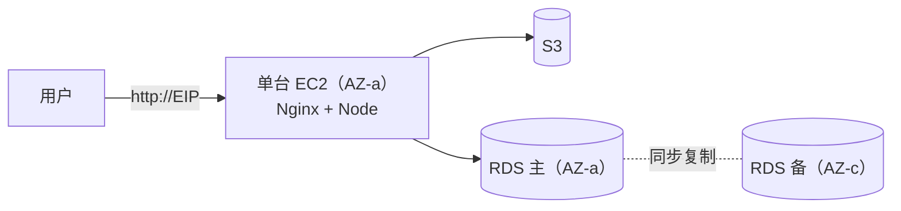

完成后：

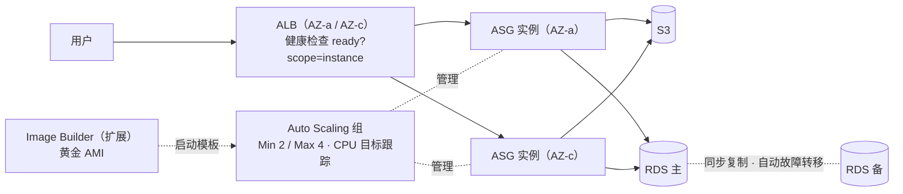

#### 为什么这几个服务要组合在一起

- **协作关系**：ALB 提供跨 AZ 的统一入口和目标健康检查；ASG 保证实例数量、跨 AZ 分布与自动替换，并按 CloudWatch 指标增减；实例能被随意替换的前提是“实例无状态”——照片在 S3（或 EFS），数据在 RDS，共享密钥经引导配置包分发；RDS Multi-AZ 让数据层也没有单点。少了任何一个，高可用都只是局部的：没有 ALB，ASG 的实例没有固定入口；没有共享存储与数据库，扩出来的实例数据各不相同。
- **常见错误组合**：
  - ASG 实例继续用本地 SQLite / 本地上传目录：数据分叉、照片 404（ASG-001/002 会拒绝）。
  - 用粘性会话掩盖缓存或会话不一致：实例被替换时用户仍会掉线。
  - 健康检查打到依赖数据库的深度检查：数据库一抖动，所有实例都被判不健康并被反复替换。
  - 健康检查类型保持 EC2：应用挂了但实例还在运行，ASG 不会替换。
  - 以为 RDS Multi-AZ 的备库能分担读：备库不可读，扩展读要用只读副本（见 `sc-db-performance`）。
  - 健康检查宽限期短于启动 + 安装时间：实例还在安装就被终止，形成替换循环。

#### 步骤大纲

| # | 步骤 | 类型 | 学员做什么 | 检查（类型：判定要点） |
|---|---|---|---|---|
| 1 | 单点基线 | 对比实验 | `npm run exp -- load-balancer --label before --scenario rolling-restart`（第 60 秒重启 api）；`npm run exp -- autoscaling --label before --scenario stateless-check` | experiment：`load-balancer/rolling-restart` 有效 before；`autoscaling/stateless-check` 有效 before |
| 2 | 加上 ALB | 脚本（wire：load-balancer） | `scripts/module enable load-balancer`；L0 实例注册为唯一目标，经 ALB 访问应用 | capability：load-balancer `driver=alb`、`status=ok`；aws-readonly `elasticloadbalancing:DescribeLoadBalancers`：至少两个 AZ；`DescribeTargetGroups`：健康检查路径 `/api/health/ready?scope=instance`；`DescribeTargetHealth`：L0 实例 `healthy`；http-header（from: platform，target: alb，path `/api/health/live`）：`x-cloudalbum-path` 含 `entry=alb>nginx` |
| 3 | 切换到 Auto Scaling 组 | 脚本（wire：autoscaling） | `scripts/module enable autoscaling`（先 Desired=1，健康后注销 L0 实例，再调到 2）；在控制台查看启动模板、活动历史、实例分布 | capability：autoscaling `driver=asg`、`status=ok`；http-header（from: platform，target: alb，path `/api/health/live`，repeat 4）：`x-cloudalbum-path` 含 `entry=alb>nginx`，`inst` 段出现至少 2 个不同值（`severity: warn`）；aws-readonly `autoscaling:DescribeAutoScalingGroups`：`MinSize≥2`、`HealthCheckType=ELB`、实例分布在 ≥2 个 AZ、`TargetGroupARNs` 为本目标组；`autoscaling:DescribeLifecycleHooks`：`terminate-drain`；`autoscaling:DescribePolicies`：目标跟踪 `ASGAverageCPUUtilization`；experiment：`autoscaling/stateless-check` after |
| 4 | 锁定入口 | CLI | `scripts/module set load-balancer LB_LOCK_ORIGIN=on`，确认直连 EIP 不再可达 | aws-readonly `ec2:DescribeSecurityGroupRules`：实例安全组的 80/443 不含 `0.0.0.0/0`；capability（module: app）：`validation.warnings` 不含 `SEC-002` |
| 5 | 终止与扩容演练 | 对比实验 | `--label after --scenario terminate-drill`（第 60 秒终止一台）与 `--scenario scale-out`（从工作台对 `/api/lab/cpu` 逐步加压）。单一 IP 加压会被每台实例的 Nginx `limit_req` 限速：按 01 约定 13 把工作台地址写入 `WAF_LAB_ALLOW_CIDR`（本卡片 waf 保持 nginx 本地实现，只渲染 Nginx 白名单；能否在本地实现下单独设置见附录 B-27），实验后立即清空 | experiment：`autoscaling/terminate-drill` after、`autoscaling/scale-out` after；aws-readonly `autoscaling:DescribeScalingActivities`：实验窗口内有一次替换启动与一次扩容启动（drift: once） |
| 6 | 数据库故障转移 | 对比实验 | `npm run exp -- database --label after --scenario failover`（运行器执行 `reboot-db-instance --force-failover`），观察写失败区间与重连 | experiment：`database/failover` after；aws-readonly `rds:DescribeDBInstances`：`MultiAZ=true`、`SecondaryAvailabilityZone` 与故障前的主 AZ 对调 |
| 7 | 发布：实例刷新 | 对比实验 | `--label after --scenario refresh`：负载下执行 `start-instance-refresh`（先启后停） | experiment：`autoscaling/refresh` after；experiment：`load-balancer/rolling-restart` pair（after 用 ASG 两台目标） |
| 8 | 扩展：黄金 AMI（选做） | 脚本（wire：ami） | `scripts/module enable ami`（内部依次：部署管道栈 → `ami build --arch arm64` 等待镜像 `AVAILABLE` → `ami promote` 满足 DEP-037 → 更新启动模板并触发实例刷新，06#ami）；分别在 userdata 与 golden 下跑 `ami/boot-time` | capability：ami `driver=golden`；local（`module-state`）：ami 已启用；aws-readonly `imagebuilder:GetImagePipeline`：最近一次构建 `AVAILABLE`；experiment：`ami/boot-time` pair |

#### 对比实验

| 实验（模块文档） | 没有它 | 有它 | 观察点 |
|---|---|---|---|
| `load-balancer/rolling-restart`（01#load-balancer） | 单进程重启有数秒 502；ALB + 单目标同样中断 | ALB + 两个以上目标 + 注销延迟，接近零错误 | 恒定负载下非 2xx 的数量与时长 |
| `autoscaling/stateless-check`（01#autoscaling） | 只有一台，谈不上一致 | 请求分布在多台实例上，每台都能读到同一份数据 | 一致性表（配置哈希、密钥指纹、存储与数据库目标） |
| `autoscaling/terminate-drill`、`scale-out`、`refresh` | 实例终止就是全站中断；只能停机换规格 | 分钟级自动替换与扩容；刷新时先启后停 | InService 数、p95、错误数、扩容耗时 |
| `database/failover`（03#database） | 自建库跟着 EC2 一起停摆 | 自动切换，应用短暂写失败后重连 | 写失败区间 |
| `ami/boot-time`（06#ami，扩展） | 启动后现场安装软件包与发布包 | 只剩配置与启动 | 实例从 Pending 到目标健康的耗时 |
| `shared-fs/cross-instance`（03#shared-fs，变体） | — | EFS 与 S3 都能被所有实例看到；EFS 小文件元数据操作更慢 | 跨实例读取、延迟分布 |

#### 整体对比

| 指标 | 开始时 | 完成后 |
|---|---|---|
| 入口 | 单台实例的 EIP | 跨两个 AZ 的 ALB |
| 单实例故障 | 全站中断 | 分钟级自动替换，期间只有少量在途请求出错 |
| 发布 | 重启有短暂 502 | 实例刷新，接近零错误 |
| 负载上升 | 停机换规格 | 目标跟踪自动扩容（分钟级） |
| 实例状态 | 数据卷上保存一切 | 无状态；数据在 S3 与 RDS |
| 数据库主节点故障 | （起点已是 Multi-AZ）自动故障转移 | 同左，演练验证 |
| 按小时计费资源 | 1 台实例 + RDS Multi-AZ | 2～4 台实例 + ALB + RDS Multi-AZ |

#### 小测

1. （单选）ASG 中的实例应用已经崩溃，但 EC2 状态检查仍然正常，ASG 一直没有替换它。最可能的原因是？
   A. 实例类型不支持自动恢复　B. ASG 的健康检查类型是 EC2，没有使用 ELB 健康检查　C. 最小容量设成了 1　D. 没有配置生命周期钩子
   **答案 B**。EC2 健康检查只看实例状态；改为 ELB 后，目标组判定不健康的实例也会被替换。
2. （单选）关于 RDS Multi-AZ（实例部署），哪一项正确？
   A. 备库可以承接只读查询　B. 使用异步复制，可能丢失最近的写入　C. 主库故障时自动切换，应用通过同一个端点重连　D. 备库必须位于另一个区域
   **答案 C**。Multi-AZ 实例部署同步复制到另一个 AZ 的备库，备库不可读；只读副本才是异步复制、可读、可跨区域。
3. （多选，选两项）为了让应用能够放进 Auto Scaling 组水平扩展，哪两项是必要的改造？
   A. 用户上传的文件放到 S3 或 EFS
   B. 会话与缓存放到进程外（例如 ElastiCache 或 DynamoDB），或改为无状态令牌
   C. 在每台实例上运行一份 SQLite
   D. 开启 ALB 粘性会话代替共享会话存储
   **答案 A、B**。本地文件与进程内状态会让实例之间不一致；粘性会话只是掩盖问题，实例被替换时依然会丢失状态。

#### 场景题

1. 一个 Web 应用运行在单台 EC2 上，数据库在同一台实例里。要求：任意单个 AZ 故障时应用仍可用；负载变化时自动调整容量；改造尽量少。哪个方案最合适？
   - A. 数据库迁到 RDS Multi-AZ，上传文件迁到 S3；Web 层用跨两个 AZ 的 ALB + Auto Scaling 组（ELB 健康检查、目标跟踪）。**正确**：数据层与 Web 层都没有单点，容量随负载变化。
   - B. 给实例配置 CloudWatch 告警的 recover 动作，并换成更大的实例类型。**错误**：自动恢复只处理底层硬件问题，仍是单 AZ 单实例，无法应对 AZ 故障，也不能自动扩容。
   - C. 在两个 AZ 各放一台实例，各自运行一份数据库，用 Route 53 加权路由分流。**错误**：两份数据库数据分叉；DNS 加权不感知应用健康（除非配合健康检查），也不能自动扩容。
   - D. 用 ASG 管理实例，数据库仍放在实例内，开启粘性会话。**错误**：每台实例一份数据库，数据分叉；粘性会话不能解决数据一致性。
2. 一个 ASG 在扩容时，新实例需要十几分钟安装依赖才能通过健康检查，导致高峰期扩容跟不上，还偶尔出现实例被反复替换。哪两项改进最有效？（选两项）
   - A. 使用 EC2 Image Builder 定期构建预装依赖的黄金 AMI，启动模板改用它。**正确**：把安装时间移到构建期，扩容更快、实例更一致。
   - B. 把健康检查宽限期设为不短于实际的启动与预热时间（或设置实例预热时间）。**正确**：避免实例尚未就绪就被判不健康并替换。
   - C. 把健康检查类型从 ELB 改回 EC2。**错误**：替换循环消失了，但应用故障也不再被发现。
   - D. 关闭目标跟踪策略，改为手动调整 Desired。**错误**：放弃了自动扩容。
   - E. 把 ALB 的注销延迟调到最大值。**错误**：影响的是缩容时的连接排空，与扩容速度无关。

#### 清理说明

- 自动回收按 02 §7.5 的顺序先强制删除 ASG（连同组内实例）与 ALB、目标组，再删除 RDS（关闭删除保护、跳过最终快照、删除自动备份）与其他资源。保留的 L0 实例与它的数据卷一并删除。
- 扩展步骤产生的黄金 AMI 与快照、Image Builder 构建实例由回收器的派生规则清理；如果构建仍在进行，回收会先等待或终止构建实例。
- SSM 引导配置包参数（SecureString）随 autoscaling 栈的清理一起删除；若使用了高级参数，删除后才停止计费。
- 本卡片按小时计费的资源较多，完成后建议立即提交并结束，不要保留环境。

#### 对应 SAA 考点

- ALB、NLB、GWLB 的区别；监听器、规则、目标组、健康检查、失效开放、注销延迟、慢启动、粘性会话。
- 启动模板；ASG 的 min / desired / max、目标跟踪 / 步进 / 预定 / 预测伸缩、健康检查类型与宽限期、生命周期钩子、实例刷新、暖池、混合实例与 Spot。
- 无状态设计：文件在 S3 / EFS，会话与缓存在 ElastiCache / DynamoDB。
- RDS Multi-AZ 实例部署、Multi-AZ 集群部署、只读副本的区别；故障转移经 DNS 端点完成。
- 黄金 AMI 与 User Data 的取舍；EC2 Image Builder；SSM 公共参数发布 AMI ID。
- EBS、EFS、S3 作为共享存储的取舍（变体）。

---

### 3.9 `sc-db-performance` 数据库提速：RDS 只读副本 + ElastiCache + RDS Proxy

#### 元数据

| 字段 | 值 |
|---|---|
| id / kind | `sc-db-performance` / `scenario` |
| 标题 | 数据库提速：RDS 只读副本 + ElastiCache + RDS Proxy |
| 一句话简介 | 热点读交给缓存，能接受秒级延迟的读交给只读副本，连接风暴交给连接池代理——三种手段各管一段，用路径头看清每个请求走了哪条路 |
| 涉及的 AWS 服务 | Amazon ElastiCache（Valkey / Redis OSS）、Amazon RDS（只读副本）、Amazon RDS Proxy（主）；AWS Secrets Manager、Amazon CloudWatch（辅） |
| 对应的模块 | 起始：iam、secrets、database（单 AZ）；目标：cache、db-proxy、database（改参：`CreateReadReplica=true`） |
| 难度 | 高级 |
| 预计时长 | 150 分钟（其中等待约 50 分钟：ElastiCache 复制组、只读副本、RDS Proxy 依次创建） |
| 时间上限 / 可延长 | 240 分钟 / 2 次 × 30 分钟 |
| 起始部署等级 | C（含 RDS） |
| startProfile | `atl/sc-db-performance/default`：iam（②）+ secrets（①DEP-032）+ database（①DEP-032；单 AZ，`CreateReadReplica=false`）；本地档 `LB_LOCAL_WORKERS=2`（③`kind: local`）；顺序：secrets 先于 database |
| 目标模块 | cache（`CACHE_DRIVER=redis`，`Replicas=0`）；database（`fromDriver: postgres`，`params: { CreateReadReplica: true }`，写入 `DB_READ_HOST`）；db-proxy（`DB_PROXY_MODE=rds-proxy`，`DB_PROXY_AUTH=secrets`） |
| 费用档位 | 高。主要计费来源：RDS 主实例与只读副本各按实例小时、存储；ElastiCache 节点小时；RDS Proxy 按底层实例 vCPU 小时；Secrets Manager 按密钥数与调用。三类按小时计费资源叠加 |
| 人工前置 | 无 |
| 区域 | ap-northeast-1（默认 VPC） |
| SAA 考试领域 | 高性能架构（主）、弹性架构、成本优化 |
| 推荐的前置卡片 | `svc-database`、`svc-cache`、`svc-db-proxy` |

**startProfile 明细**

| 预置模块 / 取值 | 原因 |
|---|---|
| iam（role） | ②裁决 C3 预置；secrets、db-proxy 也是 `credentials: required`（CRED-001） |
| secrets（secretsmanager） | ①`DB_PROXY_MODE=rds-proxy` 且 `DB_PROXY_AUTH=secrets` 需要 `SECRETS_DRIVER=secretsmanager`（DEP-032：RDS Proxy 只从 Secrets Manager 取数据库凭证）。应**先于** database 启用，RDS 一创建就使用托管主密码（`ManageMasterUserPassword: true`）。反过来也能工作（03#database：先 database 后 secrets 时会提示重新 `enable database` 改为托管密码），但要多一次 RDS 栈更新、拉长起始部署；registry 没有 `secrets.orderBefore: [database]`，所以由本卡片在 startProfile 中显式定序，见附录 B-17 |
| database（RDS 单 AZ） | ①db-proxy 依赖 database(RDS)（DEP-032）；③RDS 创建很慢，放在起始状态里；单 AZ 起步，故障转移不是本卡片的主题 |
| `LB_LOCAL_WORKERS=2`（本地档） | ③`db-proxy/conn-storm` 与 `cache/stale-read` 需要多个 api 进程；单机多进程的唯一机制（统一值 C18），不产生 AWS 资源 |
| 只读副本不预置 | 它是学员要启用的“改参”目标（2.3） |

#### 场景故事

时间线页面越来越慢：数据库 CPU 在晚高峰居高不下，大部分是重复的时间线与相册列表查询；运营每天还要跑几条重的统计查询，跑的时候前台也跟着变慢；最近为了应对高峰，团队把 api 进程数翻了一倍，结果数据库报 `too many connections`。DBA 给出三条建议：加缓存、加只读副本、加连接池代理。架构师要搞清楚它们分别解决什么问题、各自的代价，以及哪些请求能走哪条路。

#### 实验简介

- **背景**：起点是“L0 + Secrets Manager + RDS（单 AZ）”：所有读写都打到 RDS 主库；本机两个 api 进程，每个进程一个 Knex 连接池；没有缓存。
- **你将学到**：cache-aside 与 TTL、缓存击穿与 single-flight；ElastiCache 只能在 VPC 内访问、传输加密；只读副本的异步复制与“写后读”问题；RDS Proxy 的连接复用、钉住（pinning）、故障转移期间保持客户端连接、只从 Secrets Manager 取凭证；三者与 Multi-AZ、DAX、CloudFront 缓存的区别。
- **实验资源**：实验机（两个 api 进程）、工作台、联合登录控制台。你将创建：ElastiCache 复制组（单节点）与安全组；RDS 只读副本；RDS Proxy、目标组与安全组（并经注入放行到 RDS 的 5432）。

#### 架构图

开始时：

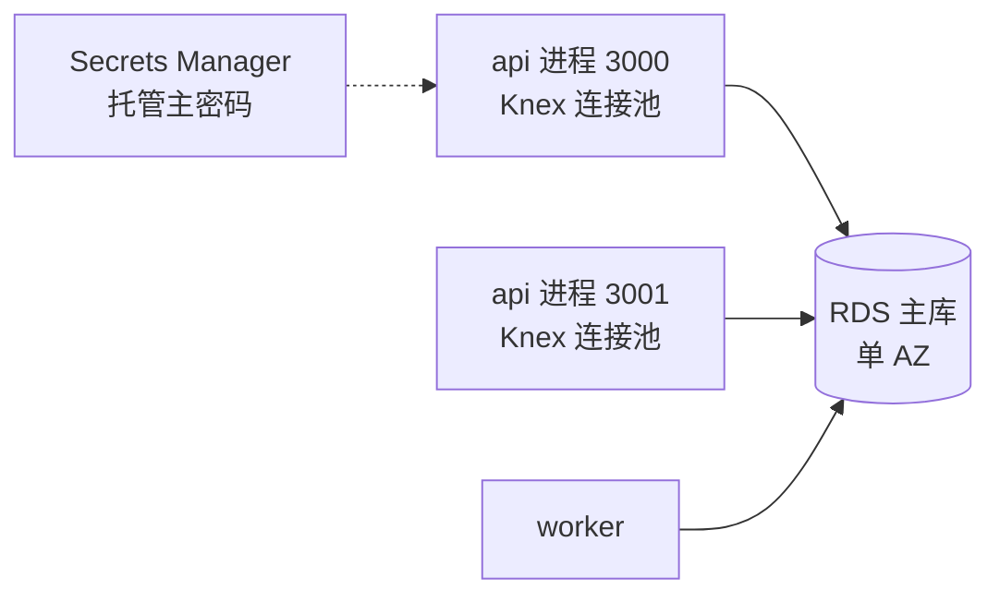

完成后：

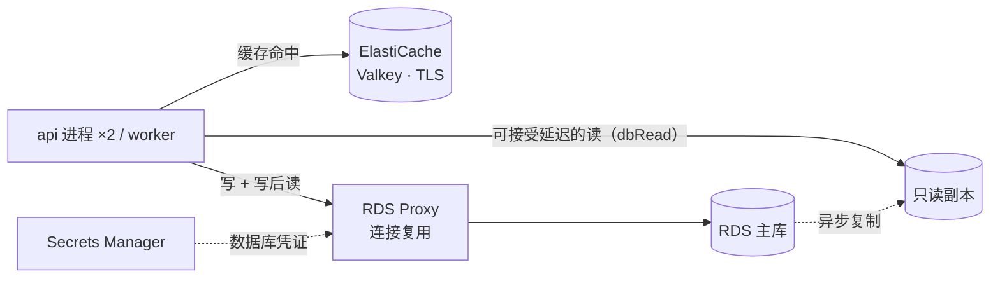

#### 为什么这几个服务要组合在一起

- **协作关系**：三者分担的是数据库的三种不同压力。ElastiCache 吸收重复的热点读，命中时一次查询都不打到数据库；只读副本承接不适合缓存、但能接受秒级延迟的读（列表、统计、报表），扩展的是读计算能力；RDS Proxy 不减少查询量，它把大量客户端连接收拢成少量数据库连接，解决扩容时的连接风暴，并在故障转移时缩短写失败区间。Secrets Manager 是 RDS Proxy 取凭证的唯一来源。
- **常见错误组合**：
  - 用 Multi-AZ 备库分担读：备库不可读。
  - 用只读副本解决“写后立即读”：异步复制，刚写的数据可能读不到；写后读必须走主库（本项目在服务层强制）。
  - 指望 RDS Proxy 降低查询延迟：它多一跳网络，减少的是建连开销与连接数。
  - 把 RDS Proxy 指向只读副本：代理的目标是 RDS 单实例时只有读写端点；只读（reader）端点只适用于 Aurora 集群与 RDS Multi-AZ DB 集群（以官方文档为准）。
  - 缓存 TTL 比数据可接受的陈旧时间长，或在多进程下用进程内缓存（`stale-read` 演示）。
  - 为 DynamoDB 的读加速选 ElastiCache：DynamoDB 有专用的 DAX；为静态内容加速选 ElastiCache：应该用 CloudFront。

#### 步骤大纲

| # | 步骤 | 类型 | 学员做什么 | 检查（类型：判定要点） |
|---|---|---|---|---|
| 1 | 造数据并测基线 | CLI + 对比实验 | `node dist/cli.js lab:seed --users 200 --albums-per-user 5 --photos 20000`；`npm run exp -- cache --label before --scenario feed-read`；`npm run exp -- db-proxy --label before --scenario conn-storm` | experiment：`cache/feed-read` 有效 before、`db-proxy/conn-storm` 有效 before；local（`app-stat`，stat `lab.seed.photos`）：≥ 20000 |
| 2 | 加 ElastiCache | 脚本（wire：cache） | `scripts/module enable cache`（创建期间阅读 cache-aside 与击穿的手册片段） | capability：cache `driver=redis`、`status=ok`、detail 含 `elasticache`；http-header（from: lab，target: self，path `/api/lab/probe/now`，repeat 2）：第 2 次路径段 `cache=redis@elasticache:hit`；aws-readonly `elasticache:DescribeReplicationGroups`：`Status=available`、`TransitEncryptionEnabled=true`、`AtRestEncryptionEnabled=true`；aws-readonly `ec2:DescribeSecurityGroupRules`（缓存安全组）：6379 只允许实例安全组 |
| 3 | 缓存的运行时 A/B | 对比实验 | `--label after --scenario feed-read --ab`（一半请求带 `X-Compare-Bypass: cache`）；`--scenario cache-stampede` | experiment：`cache/feed-read` pair；`cache/cache-stampede` after |
| 4 | 加只读副本 | 脚本（wire：database，改参） | `scripts/module enable database --param CreateReadReplica=true`（栈更新，等待副本可用）；之后 `dbRead` 自动指向副本 | capability：database `driver=postgres`、detail 含只读副本；local（`env-key`，module database，key `DB_READ_HOST`）：present；local（`path-seen`，15 分钟）：时间线请求出现 `database=postgres@rds:replica`；aws-readonly `rds:DescribeDBInstances`：主库 `ReadReplicaDBInstanceIdentifiers` 非空，副本 `DBInstanceStatus=available`（创建中为 pending，等待型 typical 20 / max 45 分钟） |
| 5 | 副本读与复制延迟 | 对比实验 | `npm run exp -- database --label after --scenario replica-read --ab`（`X-Compare-Bypass: replica`）与 `--scenario replica-lag`（写后立即从副本读） | experiment：`database/replica-read` after、`database/replica-lag` after；manual：学员记录“写后从副本读不到”的比例与对应的 `ReplicaLag` |
| 6 | 加 RDS Proxy | 脚本（wire：db-proxy） | `scripts/module enable db-proxy --mode rds-proxy`（database 栈经注入放行代理安全组） | capability：db-proxy `driver=rds-proxy`、`status=ok`；http-header（from: lab，target: self，path `/api/lab/probe/now`）：路径段含 `database=postgres@rds-proxy`；aws-readonly `rds:DescribeDBProxies`：`RequireTLS=true`、`Auth` 使用 Secrets Manager；`rds:DescribeDBProxyTargets`：目标 `TargetHealth.State=AVAILABLE`（等待型 typical 15 / max 30 分钟） |
| 7 | 连接风暴对比 | 对比实验 | `--label after --scenario conn-storm`（逐步调大池上限）；可选 `--scenario pinning` 观察会话状态导致的钉住 | experiment：`db-proxy/conn-storm` pair；aws-readonly `cloudwatch:GetMetricData`（`AWS/RDS DatabaseConnections`，主库，实验窗口）：after 的峰值低于 before（方向判断，`severity: warn`） |
| 8 | 复盘：每个请求走哪条路 | 观察 | 在 `/lab/trace` 中分别抓取“首页时间线”“发表评论后刷新”“统计报表”三个请求，记录 `X-CloudAlbum-Path` 的 `cache=`、`database=` 段 | manual：学员提交三行表格（期望：时间线 `cache=…:hit`；评论后刷新走主库；报表 `database=postgres@rds:replica`） |

#### 对比实验

| 实验（模块文档） | 没有它 | 有它 | 观察点 |
|---|---|---|---|
| `cache/feed-read`、`cache-stampede`（03#cache） | 每次时间线请求都查库 | 命中时 0 次查询；single-flight 合并击穿 | 时间线 p50 / p95、每请求 DB 调用次数、命中率 |
| `cache/stale-read`（选做） | memory 档：两个进程各自缓存，刷新时新旧交替 | Redis 版本号共享，写后的下一次读即为新数据 | 写后读一致性 |
| `database/replica-read`、`replica-lag`（03#database） | 所有读都打主库 | 列表类读走副本，主库 CPU 下降；写后读可能读到旧数据 | 主库 CPU、读 p95、读不到的比例 |
| `db-proxy/conn-storm`、`pinning`（06#db-proxy） | 连接数 = 进程数 × 池大小，超过上限新连接失败 | 代理维持少量连接，超出部分排队 | `DatabaseConnections` 峰值、连接错误数、多一跳的延迟 |
| `db-proxy/failover-proxy`（选做，需要 Multi-AZ） | 每个进程自己发现断连并重连 | 写失败区间更短（以实测为准） | 写失败区间 |

#### 整体对比

| 指标 | 开始时 | 完成后 |
|---|---|---|
| 时间线读 | 每次若干次查询 | 命中缓存时 0 次 |
| 列表 / 报表读 | 打主库 | 走只读副本（秒级陈旧） |
| 写与写后读 | 主库 | 主库（经 RDS Proxy） |
| 数据库连接数 | 随进程数 × 池大小线性增长 | 由代理收拢，基本不随客户端数增长 |
| 单次查询延迟 | 一次网络往返 | 命中缓存更低；经代理多一跳 |
| 按小时计费资源 | RDS 主库 | RDS 主库 + 只读副本 + ElastiCache 节点 + RDS Proxy |

#### 小测

1. （单选）报表查询拖慢了生产库，报表可以接受几秒钟的数据延迟。最合适的做法是？
   A. 开启 RDS Multi-AZ，把报表指向备库　B. 创建只读副本，报表连接副本端点　C. 把实例规格调大一倍　D. 在应用前加 CloudFront
   **答案 B**。只读副本异步复制、可读，适合分担可接受延迟的读；Multi-AZ 备库不可读；纵向扩容能缓解但成本高且不隔离负载；CloudFront 不缓存数据库查询。
2. （单选）Lambda 函数在高峰期大量并发访问 RDS，出现 `too many connections`。最合适的改进是？
   A. 给 Lambda 配置预置并发　B. 在 Lambda 与 RDS 之间加 RDS Proxy　C. 开启 RDS 自动备份　D. 把 RDS 改为 Multi-AZ
   **答案 B**。RDS Proxy 复用连接，避免并发扩展打满 `max_connections`；其余选项都不减少连接数。
3. （多选，选两项）关于缓存策略，哪两项正确？
   A. cache-aside 在未命中时由应用读库并写回缓存
   B. 为热点键设置随机 TTL 或使用 single-flight，可以缓解缓存击穿与雪崩
   C. 写入数据库后应等待 TTL 自然过期，不需要处理缓存
   D. 多进程部署下用进程内缓存，可以保证所有进程看到相同的数据
   **答案 A、B**。写入后应删除缓存或更新版本号；进程内缓存各自为政，会出现新旧交替。

#### 场景题

1. 一个社交应用的个人主页读请求很多、同一用户的主页会被反复访问，数据允许数秒陈旧；数据库是 RDS for PostgreSQL，CPU 长期偏高。团队希望在改动最小的前提下显著降低数据库负载与响应时间。最合适的是？
   - A. 在应用中引入 ElastiCache 做 cache-aside，按用户主页缓存并设置合适的 TTL。**正确**：热点重复读命中缓存，数据库查询显著减少，响应更快。
   - B. 开启 Multi-AZ。**错误**：提升可用性，不分担读。
   - C. 加两个只读副本。**部分可行**：能分担读，但每次仍要执行查询，副本按实例小时计费，对“同一内容被反复读取”的场景不如缓存有效。
   - D. 改用 DynamoDB 并开启 DAX。**错误**：需要重写数据层，不满足“改动最小”。
2. 一个运行在 Auto Scaling 组中的应用，每次扩容到较多实例时数据库连接数打满；主库发生故障转移时，应用有较长时间无法写入。团队希望同时缓解这两个问题，并且不想在应用中保存数据库密码。最合适的是？
   - A. 部署 RDS Proxy，凭证存放在 Secrets Manager，应用连接代理端点（可启用 IAM 认证）。**正确**：连接复用解决风暴，代理在故障转移期间保持客户端连接，凭证不落在应用里。
   - B. 调大数据库的 `max_connections` 参数。**错误**：受实例内存限制，治标不治本，也不改善故障转移。
   - C. 在每台实例上部署 PgBouncer。**部分可行**：能收拢单机连接，但实例数增加时总连接仍线性增长，还要自己运维，也不改善故障转移。
   - D. 给 ASG 配置更小的最大容量。**错误**：牺牲了扩展能力。

#### 清理说明

- 自动回收顺序：RDS Proxy → 只读副本 → 主库（跳过最终快照、删除自动备份）→ ElastiCache → Secrets Manager 密钥（立即删除，不进入恢复窗口）。
- 第 1 步写入的种子数据只在本环境的 RDS 中，随实例删除。
- 三类资源都按小时计费，完成后建议立即提交并结束；不建议保留环境。

#### 对应 SAA 考点

- 只读副本（异步、可读、可跨区域、可提升）与 Multi-AZ（同步、备库不可读）；Aurora 副本与读端点。
- ElastiCache：cache-aside 与 write-through、TTL、击穿与雪崩、Valkey / Redis OSS 与 Memcached、集群模式、只能 VPC 内访问、传输与静态加密；DAX 与 ElastiCache 的分工。
- RDS Proxy：连接池化、故障转移、Secrets Manager 与 IAM 认证、钉住、单实例目标只有读写端点（读端点限 Aurora 与 Multi-AZ DB 集群）、按 vCPU 小时计费。
- 缓存放在哪一层：CloudFront、API Gateway 缓存、ElastiCache、DAX、只读副本。

---

### 3.10 `sc-private-network` 私有网络：VPC + NAT + VPC 终端节点 + Session Manager

#### 元数据

| 字段 | 值 |
|---|---|
| id / kind | `sc-private-network` / `scenario` |
| 标题 | 私有网络：VPC + NAT + VPC 终端节点 + Session Manager |
| 一句话简介 | 把实例搬进没有公网地址的私有子网：入口只剩 ALB，运维不开 22 端口，访问 AWS 服务走终端节点，访问公网走 NAT，全部流量可在 Flow Logs 中追溯 |
| 涉及的 AWS 服务 | Amazon VPC、NAT Gateway、VPC Endpoint（Gateway / Interface）、AWS Systems Manager Session Manager（主）；VPC Flow Logs、Elastic Load Balancing、Amazon CloudWatch Logs、AWS CloudTrail（辅） |
| 对应的模块 | 起始：iam、network（`public`）、load-balancer；目标：shell-access、network（改参：`public → private`） |
| 难度 | 高级 |
| 预计时长 | 120 分钟（其中等待约 20 分钟：NAT 与终端节点创建、实例替换迁入私有子网） |
| 时间上限 / 可延长 | 180 分钟 / 2 次 × 30 分钟 |
| 起始部署等级 | B（实例迁入自定义 VPC + ALB） |
| startProfile | `atl/sc-private-network/default`：iam（②）+ network（前驱 `public`；`NatMode=none`、`InterfaceEndpoints=none`、`FlowLogDestination=cloudwatch`）+ load-balancer（①DEP-009）；`preview.directHttps: off`（预览方案 B 关）；`workstation.sshFromWorkstation: true`（运行器按 03 §4.8 取工作台**公网出口** /32，见明细） |
| 目标模块 | shell-access（`SHELL_ACCESS_MODE=ssm`）；network（`fromDriver: public` → `private`，`set: { NETWORK_NAT_MODE: gateway, NETWORK_INTERFACE_ENDPOINTS: ops }`） |
| 费用档位 | 高。主要计费来源：NAT Gateway 小时 + 处理 GB（没有流量也收小时费）；Interface Endpoint 按“端点 × AZ × 小时”加流量；ALB 小时 + LCU 与公网 IPv4；Flow Logs 摄取；NAT 的弹性 IP |
| 人工前置 | 无 |
| 区域 | ap-northeast-1（自定义 VPC `10.0.0.0/16`，AZ 用 AZ ID 选择） |
| SAA 考试领域 | 安全架构（主）、弹性架构、成本优化 |
| 推荐的前置卡片 | `svc-network`、`svc-shell-access`、`svc-load-balancer` |

**startProfile 明细**

| 预置模块 / 取值 | 原因 |
|---|---|
| iam（role） | ②裁决 C3 预置；它同时满足 shell-access 的 `IAM_CREDENTIALS=role`（DEP-001：SSM Agent 只用实例角色）与 network 控制面感知的凭证要求 |
| network（`public`，无 NAT、无 Interface Endpoint） | 前驱（`basis: precursor`，即目标的 `fromDriver: public`）：从默认 VPC 迁入自定义 VPC 要替换实例（分钟级停机），且必须先于任何 VPC 绑定模块完成（DEP-016、`orderBefore`）；放在起始状态里，学员只做“同一 VPC 内 public → private”，不触发 DEP-016。NAT 与 Interface Endpoint 是按小时计费的，留给学员在卡片里创建 |
| load-balancer | ①`private` 放置必须有入口（DEP-009：load-balancer 或 cdn 的 VPC Origin）；ALB 是 VPC 绑定资源，要在 network(public) 之后、同一 VPC 中创建。选 ALB 而不是 VPC Origin：不依赖 CloudFront，入口语义与 `sc-ha-web` 一致 |
| 不预置 shell-access | 它是目标模块，也是 private 放置的运维通道（DEP-009），按步骤顺序先启用 |
| `workstation.sshFromWorkstation: true`（本卡片取公网出口地址） | 平台把 `SshIngressCidr` 设为工作台地址，使“SSH vs Session Manager”的 before 可测。本卡片的实验机在起始状态就已迁入自定义 VPC，与默认 VPC 中的工作台之间没有私网路由，SSH 只能经实验机的 EIP 到达；运行器按 03 §4.8 比较两者的 `VpcId`，自动取**工作台公网出口地址 /32**，`ssh lab` 经 `atl-lab-proxy` 连接实验机公网 IP（附录 B-24 已由 03、04 解决，第 1 轮写在参数里的 `${atl:workstationCidr}` 删除） |
| 预览方案 B 关 | 切换为 private 放置后实例没有公网 IPv4，Let's Encrypt IP 证书无法续期、直连预览失效；预览改为在新标签页打开 ALB 地址（tracks-and-catalog §3.3 C-9） |

> 平台模式说明：实验机从 L0 起就带只有 SSM 权限的管理通道，平台终端始终可用（03）。shell-access 模块的对比对象是“运维者走 SSH 22 端口”与“运维者走 Session Manager”，它关闭 22 端口并设置会话首选项，不影响平台自己的 Session 文档。

#### 场景故事

一次渗透测试报告指出：应用服务器有公网 IP，80/443 对全网开放，22 端口对运维网段开放，上线后不到一小时就开始收到扫描请求；服务器访问 S3 与 SQS 走的是公网端点；出了问题无法回答“这台机器在某个时间连过哪里”。整改要求：实例不能有公网地址；唯一入口是负载均衡器；运维不开任何入站端口且有审计；访问 AWS 服务尽量不经过公网；保留完整的网络流量记录。同时财务提醒：NAT 和终端节点都按小时收费，要说明取舍。

#### 实验简介

- **背景**：起点是“自定义 VPC、public 放置 + ALB”：实例已经在自定义 VPC 的公有子网，挂着 EIP，ALB 在前面但实例仍可被直连；运维靠 SSH 22。
- **你将学到**：公有子网与私有子网的定义（路由表）；NAT Gateway 与 NAT 实例、单 AZ NAT 的单点；Gateway Endpoint（S3、DynamoDB，免费）与 Interface Endpoint（PrivateLink，按小时）；Session Manager 的三个前提（Agent、实例角色、到 SSM 端点的网络）；安全组与 NACL；VPC Flow Logs 的字段与盲区。
- **实验资源**：实验机、工作台（可 SSH 到实验机，直到第 2 步关闭 22 端口）、联合登录控制台。你将创建：NAT Gateway 与弹性 IP、`InterfaceEndpoints=ops` 的 5 个 Interface Endpoint（ssm、ssmmessages、logs、monitoring、cloudformation，01#network；后者供替换实例时的 `cfn-signal`）及其安全组、会话日志组与会话首选项；实例将被替换到 app 子网。

#### 架构图

开始时：

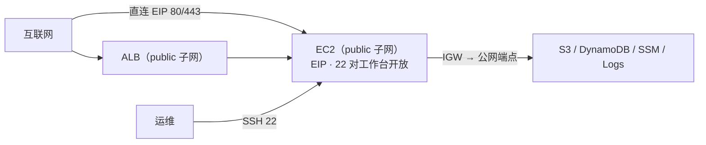

完成后：

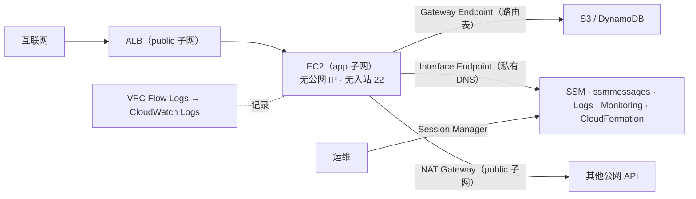

#### 为什么这几个服务要组合在一起

- **协作关系**：VPC 的私有子网去掉了实例的公网可达性，但实例仍要“出得去”：访问 S3 / DynamoDB 用免费的 Gateway Endpoint（加在路由表上）；访问 SSM、CloudWatch 等用 Interface Endpoint（私有 IP + 私有 DNS）；其他公网 API（Cognito JWKS、软件仓库等）用 NAT。入口只能是 ALB（或 CloudFront VPC Origin）。Session Manager 让运维不需要任何入站规则，它恰好依赖实例角色与到 SSM 端点的网络通路——要么经 NAT，要么经 Interface Endpoint。Flow Logs 记录 ENI 级别的接受 / 拒绝，补上“连过哪里”的审计。
- **常见错误组合**：
  - 把实例放进私有子网却没有入口：网站完全不可达（DEP-009 会阻止）。
  - 私有子网没有 NAT 也没有对应的 Interface Endpoint：Session Manager 连不上，Cognito、SES 等调用“随机卡住”直到超时。
  - 用 NAT Gateway 访问同区域 S3：能用但要付 NAT 数据处理费；Gateway Endpoint 免费。
  - 只建一个 NAT 却声称多 AZ 高可用：该 AZ 故障时其他 AZ 的私有实例也无法出网。
  - 为了运维保留堡垒机并开放 22：Session Manager 或 EC2 Instance Connect Endpoint 不需要公网入站。
  - 在 NACL 上忘记放行临时端口：连接挂起而不是被拒绝。
  - Gateway Endpoint 策略写得过严：挡住托管在 S3 上的 AL2023 软件仓库，`dnf install` 失败。

#### 步骤大纲

| # | 步骤 | 类型 | 学员做什么 | 检查（类型：判定要点） |
|---|---|---|---|---|
| 1 | 攻击面与运维通道基线 | 对比实验 | 在工作台运行 `npm run exp -- network --label before --scenario surface-scan --target {{ target.publicIp }}`（工作台在默认 VPC，实验机在自定义 VPC，扫描经公网到达 EIP，相当于外部视角；模块文档中“从 CloudShell 运行”的做法无法上传有效结果，只作选做对照）；`--scenario egress-path`；`npm run exp -- shell-access --label before --scenario probe-port`（工作台 SSH 22 可达） | experiment：`network/surface-scan`、`network/egress-path`、`shell-access/probe-port` 各有一条有效 before |
| 2 | 改用 Session Manager，关闭 22 | 脚本（wire：shell-access） | `scripts/module enable shell-access`（先验证 SSM 通道，再把 `SshIngressCidr` 置空）；用控制台或工作台 `aws ssm start-session` 登录实验机，执行几条命令 | capability：shell-access `driver=ssm`、`status=ok`；local（`module-state`）：shell-access 已启用；aws-readonly `ec2:DescribeSecurityGroupRules`：实例安全组没有 22 端口入站；`ssm:DescribeInstanceInformation`：`PingStatus=Online`；`ssm:DescribeSessions`（`State=History`，目标为本实验机）：存在会话 ID 以 `atl-<sid>-ws-` 或 `atl-<sid>-console-` 开头的学员会话，并排除文档为 `ATL-SessionShell*`、会话 ID 以 `atl-<sid>-term-` 开头的平台终端会话（会话 ID 的前缀规则列入 07 的 PoC；drift: once；第 1 轮用 `cloudtrail:LookupEvents`，有分钟级延迟，04 §5.7 收录本操作后改用它） |
| 3 | 迁入私有子网 | 脚本（wire：network，改参） | `scripts/module enable network --placement private --nat gateway --endpoints ops`（分钟级停机：实例换到 app 子网、ALB 目标更新） | capability：network detail 为“自定义 VPC · 私有子网 · 出网经 NAT”；aws-readonly `ec2:DescribeInstances`（本会话实验机）：无 `PublicIpAddress`，`SubnetId` 属于 app 子网；`ec2:DescribeRouteTables`（app 子网）：`0.0.0.0/0 → nat-…`，并有 S3 / DynamoDB 前缀列表 → `vpce-…`；`ec2:DescribeVpcEndpoints`：ssm、ssmmessages、logs、monitoring、cloudformation 为 `available`；http-header（from: platform，target: alb，path `/api/health/live`）：200 |
| 4 | 攻击面复测 | 对比实验 | `--label after --scenario surface-scan`，目标同时填 ALB DNS 与原 EIP（已释放则跳过） | experiment：`network/surface-scan` pair；manual：学员记录“实例层 24 小时扫描请求数”的变化（`/lab` 网络卡片） |
| 5 | 出网路径 | 对比实验 | `--label after --scenario egress-path`：出网 IP 变为 NAT 的 EIP；S3 / DynamoDB 经 Gateway Endpoint | experiment：`network/egress-path` pair |
| 6 | 拔掉 NAT 路由（选做） | 对比实验 | `--label after --scenario endpoint-only`：第 10 秒删除 app 路由表的 NAT 默认路由，3 分钟后恢复；观察 S3 / DynamoDB 与 Session Manager 仍可用，checkip 超时。本步骤 `requires` 第 3 步的终端节点检查已通过，并声明 `expectedOutage: { channel: lab, maxMinutes: 5 }`（终端节点未就绪时管理通道会断开，04 §3.2.8） | experiment：`network/endpoint-only` after；aws-readonly `ec2:DescribeRouteTables`：NAT 默认路由已恢复（must-hold） |
| 7 | Flow Logs 与会话审计 | 观察 | 在 Logs Insights 中按 `dstport` 统计 REJECT、按 `traffic-path` 统计出站字节（查询见手册）；查看会话日志中自己执行的命令 | aws-readonly `ec2:DescribeFlowLogs`：VPC 级、`ACTIVE`；`logs:DescribeLogGroups`：存在 `/cloudalbum/<env>/vpc-flow`；experiment：`shell-access/session-audit` after；manual：提交一条 REJECT 最多的目标端口 |

> 安全提示：第 6 步依赖第 3 步创建的 Interface Endpoint 维持平台管理通道。如果你把 `InterfaceEndpoints` 改成了 `none` 再拔 NAT 路由，平台终端与检测会一起中断，直到路由恢复。

#### 对比实验

| 实验（模块文档） | 没有它 | 有它 | 观察点 |
|---|---|---|---|
| `network/surface-scan`（01#network） | EIP 直达，80/443 开放 | 实例不可见，只能扫到 ALB | 外部可达端口数 |
| `network/egress-path` | 出网 IP 是实例 EIP；S3 走公网端点 | 出网 IP 是 NAT EIP；S3 / DynamoDB 走 Gateway Endpoint | checkip 结果、端点解析与建连 |
| `network/endpoint-only` | 不适用 | 拔掉 NAT 后 S3 / DynamoDB / SSM 仍可用，公网 API 超时 | 各模块健康状态 |
| `shell-access/probe-port`、`ssh-noise`（05#shell-access） | 22 端口可达，有爆破噪声 | 端口关闭 | 端口状态、journal 中的失败次数 |
| `shell-access/session-audit`、`private-subnet` | journal 中只有“公钥指纹 + IP” | CloudTrail `StartSession` + 会话日志（命令与输出）；私有子网照样能登录 | 审计链完整度 |

#### 整体对比

| 指标 | 开始时 | 完成后 |
|---|---|---|
| 实例公网地址 | 有（EIP） | 无 |
| 外部可达端口 | 实例 80/443，22 对工作台 | 只有 ALB 的 80/443 |
| 运维方式 | SSH 22 + 私钥 | Session Manager，无入站规则 |
| 访问 S3 / DynamoDB | 公网端点 | Gateway Endpoint（不经 NAT） |
| 访问其他公网 API | 实例 EIP | NAT Gateway |
| 流量审计 | Nginx 访问日志 | VPC Flow Logs + 会话日志 + CloudTrail |
| 按小时计费的网络资源 | 公网 IPv4、ALB | ALB、NAT Gateway、5 个 Interface Endpoint × 2 个 AZ |

#### 小测

1. （单选）私有子网中的 EC2 需要从同区域的 S3 下载大量数据，团队希望不经过互联网，且不产生 NAT 数据处理费。最合适的是？
   A. 给实例分配公网 IP　B. 在 VPC 中创建 S3 Gateway Endpoint 并关联私有子网的路由表　C. 在 NAT Gateway 上开启压缩　D. 使用 S3 Transfer Acceleration
   **答案 B**。Gateway Endpoint 免费、加在路由表上，只对同区域生效。
2. （单选）私有子网中的实例在 Systems Manager 中显示为离线，Session Manager 无法连接。实例有 SSM Agent 且没有 NAT。还缺什么？
   A. 安全组放行入站 22　B. 实例配置文件角色，以及 ssm、ssmmessages（以及 ec2messages）的 Interface Endpoint　C. 一个弹性 IP　D. S3 Gateway Endpoint
   **答案 B**。Session Manager 需要 Agent、实例角色、到 SSM 端点的网络通路；它不需要任何入站规则，也不需要公网 IP。
3. （多选，选两项）关于安全组与网络 ACL，哪两项正确？
   A. 安全组是有状态的，回包自动放行
   B. 网络 ACL 是无状态的，需要显式放行返回流量的临时端口
   C. 安全组可以写拒绝规则
   D. 网络 ACL 作用于单个 ENI
   **答案 A、B**。安全组只有允许规则、作用于 ENI；NACL 作用于子网，有允许与拒绝，按编号顺序评估。

#### 场景题

1. 一家金融公司的应用服务器位于两个 AZ 的私有子网中，需要访问第三方支付 API（互联网），第三方要求固定的源 IP 白名单；任何一个 AZ 故障时另一个 AZ 仍能出网。最合适的是？
   - A. 每个 AZ 的公有子网各部署一个 NAT Gateway（各带弹性 IP），每个 AZ 的私有路由表指向本 AZ 的 NAT；把两个弹性 IP 提供给第三方。**正确**：出网 IP 固定，且没有跨 AZ 单点。
   - B. 在一个 AZ 部署一个 NAT Gateway，所有私有子网都指向它。**错误**：该 AZ 故障时全部实例无法出网，还会产生跨 AZ 流量费。
   - C. 给每台实例分配公网 IP。**错误**：违背“私有子网”的要求，实例被替换后 IP 也会变化。
   - D. 为支付 API 创建 Interface Endpoint。**错误**：Interface Endpoint 用于 AWS 服务或 PrivateLink 服务，不能访问任意互联网 API。
2. 安全团队要求取消所有 SSH 端口与堡垒机，同时运维人员仍需登录私有子网中的实例并保留命令审计。VPC 没有 NAT，也不允许增加 NAT。最合适的是？
   - A. 使用 Session Manager：实例角色具备托管节点权限，创建 ssm、ssmmessages（以及 ec2messages）Interface Endpoint，会话日志写入 CloudWatch Logs 或 S3。**正确**：无入站规则、无公网，审计完整。
   - B. 部署 EC2 Instance Connect Endpoint，并在实例安全组放行来自该端点的 22。**部分可行**：不需要公网，但仍是 SSH 22（只对端点开放），且默认没有命令级审计；不满足“取消所有 SSH 端口”。
   - C. 保留堡垒机，但把它放进私有子网。**错误**：运维人员同样无法到达它，且仍是 SSH。
   - D. 在实例上运行 SSM Agent，只依赖 S3 Gateway Endpoint。**错误**：SSM 的控制与会话通道不经过 S3。

#### 清理说明

- 自动回收顺序：ALB → 实例 → NAT Gateway（异步，完成后释放其弹性 IP）→ Interface Endpoint → 子网与路由表 → VPC；Flow Logs 日志组与会话日志组在数据阶段删除。
- 第 2 步修改的是账号级单例 `SSM-SessionManagerRunShell`（会话首选项）：模块启用时把原内容备份到环境状态桶的 `<envName>/backups/`（`cloudalbum-lab-state-<acct>-<region>`，01 §3.11；06 PM-27、PM-M28），回收时恢复，运行器失败时回收器也能读到它兜底复位（02 §7.5 S6、06）；平台终端使用自己的 Session 文档，不受影响。
- NAT Gateway 与 Interface Endpoint 没有流量也按小时计费：完成后尽快提交结束，不要保留环境。

#### 对应 SAA 考点

- 公有 / 私有子网的定义；IGW、NAT Gateway 与 NAT 实例、每 AZ 一个 NAT 的高可用设计；Egress-only IGW（IPv6）。
- Gateway Endpoint 与 Interface Endpoint（PrivateLink）的区别、终端节点策略、`aws:SourceVpce`。
- 安全组与 NACL；VPC Flow Logs 的目标、字段与不记录的流量。
- Session Manager、堡垒机、EC2 Instance Connect、EC2 Instance Connect Endpoint 的对比；SSM 托管节点的前提与所需端点。
- 实例不能在 VPC 之间移动，EBS 卷绑定 AZ；CIDR 规划与每个子网保留的 5 个地址。

---

### 3.11 `sc-security-baseline` 安全基线：IAM + KMS + Secrets Manager + CloudTrail + Config

#### 元数据

| 字段 | 值 |
|---|---|
| id / kind | `sc-security-baseline` / `scenario` |
| 标题 | 安全基线：IAM + KMS + Secrets Manager + CloudTrail + Config |
| 一句话简介 | 从“机密和主密钥都躺在数据卷上”出发，依次建立临时凭证、客户托管密钥、集中的机密管理、不可篡改的操作审计与持续的配置合规检查 |
| 涉及的 AWS 服务 | AWS KMS、AWS Secrets Manager、AWS CloudTrail、AWS Config（主）；AWS IAM（起始状态的实例角色；选做第 9 步的长期密钥反面教材通过时计入 IAM 服务格）、AWS STS、Amazon S3（trail 桶与 Config 交付桶）、Amazon EventBridge、Amazon SNS、AWS Systems Manager Automation（辅） |
| 对应的模块 | 起始：iam（裁决 C3）；目标：kms、secrets、audit、compliance；iam 只在选做第 9 步中经平台动作临时改动 |
| 难度 | 中级 |
| 预计时长 | 120 分钟（其中等待约 15 分钟：Config 记录器首次评估、CloudTrail 首次投递） |
| 时间上限 / 可延长 | 180 分钟 / 2 次 × 30 分钟 |
| 起始部署等级 | A |
| startProfile | `atl/sc-security-baseline/default`：iam（②，裁决 C3） |
| 目标模块 | kms（`KMS_KEY_ID=alias/cloudalbum-{{ session.env }}`——平台模式下别名带环境名，06 PM-M13——`KMS_APPLY_TO=fields`；Secrets Manager 是否用 CMK 由 kms 的 `injects`（`target: "*"`，参数 `KmsKeyArn`）决定，`secrets` 不是 `KMS_APPLY_TO` 的合法取值，02#kms）；secrets（`SECRETS_DRIVER=secretsmanager`，`SECRETS_ORIGIN=aws`）；audit（`AUDIT_MODE=cloudtrail`，日志文件完整性验证）；compliance（`COMPLIANCE_MODE=config`，8 条托管规则，`CanaryRemediation=true`） |
| 费用档位 | 中。主要计费来源：KMS 客户托管密钥月费与请求；Secrets Manager 按密钥数与调用；Config 按配置项与规则评估；CloudTrail 额外副本 / 数据事件（本卡片只开管理事件，第一份免费）与 S3 存储 |
| 人工前置 | `alert-email`：Config 不合规通知需要确认订阅。选做第 9 步使用平台动作 `iam-keys-on`、`iam-keys-off`（keys 模式只能经平台动作执行，01）。账号中已有 trail 或 Config 记录器时，对应模块以只读方式接入（preflight `existing-trail`、`existing-config-recorder`） |
| 区域 | ap-northeast-1；`alsoUses: [global]`（IAM、全局服务事件记录在 us-east-1） |
| SAA 考试领域 | 安全架构（主） |
| 推荐的前置卡片 | `svc-iam`、`svc-kms`、`svc-secrets` |

**startProfile 明细**

| 预置模块 / 取值 | 原因 |
|---|---|
| iam（role） | ②裁决 C3 预置。第 1 轮本卡以 L0 的 `IAM_CREDENTIALS=none` 起步、把 iam 作为第一个目标；C3 只给 svc-ec2、svc-iam 例外，所以改为预置。kms、secrets 是 `credentials: required`，有了 iam 才能启用。“没有凭证 → 实例角色”的对比在 svc-iam 中做；本卡保留“长期密钥 vs 临时凭证”的反面教材，放在选做第 9 步（tracks-and-catalog §3.3 C-14） |
| 顺序约束 | kms 的 `orderBefore` 含 secrets：先启用 kms，Secrets Manager 中的机密从创建起就由 CMK 加密 |
| 不选 `KMS_APPLY_TO` 中的 `ebs` | ③EBS 换 CMK 需要“快照 → 新卷 → 改挂”，有停机窗口且耗时，不适合本卡片的时长；作为手册中的进阶阅读。`KMS_APPLY_TO` 只有 `fields`、`ebs` 两个取值，其余资源（含 Secrets Manager）是否用 CMK 只看目标栈是否声明 `KmsKeyArn`（02#kms） |

#### 场景故事

公司准备接受客户的安全审查，问卷里有五个问题：服务器用什么身份访问 AWS，密钥会不会泄露？数据库密码、JWT 签名密钥放在哪里，多久轮换一次？敏感字段的加密密钥由谁保管，能否一键吊销？谁在什么时候删除了哪个资源，日志能否被篡改？安全组有没有对全网开放 22，发现了多久能知道？目前的答案几乎全是“在服务器上的一个文件里”。

#### 实验简介

- **背景**：起点是 L0 + 实例角色（裁决 C3）：应用已经用临时凭证访问 AWS，但别的安全措施都还没有；机密在数据卷的 `secrets.env`，主密钥 `LOCAL_MASTER_KEY` 与被它加密的数据在同一块盘上；审计只有应用内的 `audit_log`；合规只有本机自检（安全组、加密、trail 等一律“未知”）。
- **你将学到**：实例配置文件与 STS 临时凭证、IMDSv2；最小权限（每个模块一条策略）；信封加密、密钥策略与加密上下文、CloudTrail 中的 KMS 调用；Secrets Manager 的版本标签与不重启轮换；CloudTrail Event History 与 trail、日志文件完整性验证；Config 记录器、托管规则、修复；预防型与检测型控制的区别。
- **实验资源**：实验机、工作台、联合登录控制台。实例角色由平台预置。你将创建：各模块的策略；客户托管密钥与别名；若干 Secrets Manager 机密；trail 与日志桶；Config 记录器、交付桶、8 条托管规则、通知主题、修复配置；一个用完即删的“金丝雀”安全组。

#### 架构图

开始时：

```mermaid
flowchart LR
  APP["EC2 应用<br/>实例角色（平台预置）"] --> VOL[("数据卷<br/>secrets.env · LOCAL_MASTER_KEY<br/>业务数据 · audit_log")]
  CHK["本机自检器"] -->|"安全组 / 加密 / trail：未知"| VOL
```

完成后：

```mermaid
flowchart LR
  APP["EC2 应用"] -->|"IMDSv2 · 实例角色"| STS["STS 临时凭证"]
  APP -->|"GenerateDataKey / Decrypt"| KMS["KMS CMK<br/>alias/cloudalbum-envName"]
  APP -->|"GetSecretValue（缓存）"| SM["Secrets Manager"]
  SM -.->|"CMK 加密"| KMS
  CT["CloudTrail trail<br/>完整性验证"] -->|"记录所有 API 调用"| S3T[("trail 桶")]
  CFG["AWS Config<br/>记录器 + 托管规则"] -->|"不合规"| EB["EventBridge → SNS 邮件"]
  CFG -.->|"修复：SSM Automation"| SG["金丝雀安全组"]
```

#### 为什么这几个服务要组合在一起

- **协作关系**：IAM 角色是一切的起点——没有凭证就用不了 KMS 与 Secrets Manager，有了长期密钥又会成为最大的泄露源；KMS 让主密钥离开数据卷，每次解密都可审计、可吊销；Secrets Manager 把机密集中保存并用 CMK 加密，支持不重启轮换；CloudTrail 记录上述所有 API 调用（谁、何时、用了哪个密钥）并保护日志不被篡改；Config 持续评估资源配置，发现违规并关联到 CloudTrail 中的操作者。前三者是预防与数据保护，后两者是检测与追溯。
- **常见错误组合**：
  - 把访问密钥写进 User Data 或 env 文件：长期凭证会随快照、备份、AMI 扩散。
  - 机密用 KMS 加密后，把明文数据密钥写回磁盘：信封加密的意义消失。
  - 用 Parameter Store 标准参数存数据库主密码并要求自动轮换：SecureString 没有内置轮换，应使用 Secrets Manager（或 RDS 托管主密码）。
  - 以为 Config 能阻止违规：它是检测型控制，预防靠 SCP、IAM、BPA 等。
  - 以为 CloudTrail Event History 就够了：只保留 90 天管理事件、没有完整性验证。
  - 账号里已有 trail 还再建一个：第二份管理事件副本要收费（本模块启用前会检测）。

#### 步骤大纲

| # | 步骤 | 类型 | 学员做什么 | 检查（类型：判定要点） |
|---|---|---|---|---|
| 1 | 基线体检 | 对比实验 | `npm run exp -- compliance --label before --scenario coverage-matrix`（本机自检，记录“未知”项）；`npm run exp -- secrets --label before --scenario leak-scan`；在 `/lab` kms 卡片查看 `key-file-risk` | experiment：`compliance/coverage-matrix` 有效 before、`secrets/leak-scan` 有效 before |
| 2 | 实例角色与临时凭证（起始状态） | 观察 | 在实验机终端用 `aws sts get-caller-identity` 观察 `assumed-role/…` 与 `ASIA` 前缀；阅读手册中“临时凭证从哪里来（IMDSv2）、多久轮换”；长期密钥的反面教材见选做第 9 步 | capability：iam `driver=role`、`op: healthy`（描述起始状态，不计入 IAM 服务格）；local（`aws-cred-source`）：`imdsRole` 为 `CloudAlbumAppRole`、`envHasKeys=false`、`credentialsFile=false`；local（`leaked-keys`）：`count=0`（must-hold）；local（`imds-get`，`checkV1Rejected: true`）：IMDSv1 被拒绝 |
| 3 | 客户托管密钥与信封加密 | 脚本（wire：kms） | `scripts/module enable kms`（默认 `--apply-to fields`；第 4 步启用 secrets 时，secrets 栈经注入自动拿到这把 CMK）；打开几张照片详情，再在 CloudTrail 中查看 `GenerateDataKey` / `Decrypt` 事件及其加密上下文 | capability：kms `status=ok`；local（`path-seen`，15 分钟）：出现以 `kms=kms:` 开头的路径段（`kms:call` 或 `kms:cache-hit`）；aws-readonly `kms:DescribeKey`（`KeyId: {{ stack.kms.InfoKeyArn }}`，不写死别名；平台模式下别名为 `alias/cloudalbum-{{ session.env }}`）：`KeyManager=CUSTOMER`、`Enabled=true`；`kms:GetKeyRotationStatus`（`KeyId: {{ stack.kms.InfoKeyArn }}`，该 API 不接受别名）：`true`；experiment：`kms/decrypt-count` after |
| 4 | 机密集中管理与轮换 | 脚本（wire：secrets） | `scripts/module enable secrets`（机密迁出 `secrets.env`）；运行 `--scenario rotate-under-load`，在压测中轮换 JWT 签名密钥 | capability：secrets `driver=secretsmanager`、`status=ok`；local（`module-state`）：secrets 已启用；aws-readonly `secretsmanager:ListSecrets`（前缀 `cloudalbum/<env>/`）：至少包含 `jwt-signing-key`、`upload-hmac-key`，`KmsKeyId` 为本 CMK；experiment：`secrets/rotate-under-load` after、`secrets/leak-scan` pair |
| 5 | 不可篡改的操作审计 | 脚本（wire：audit） | `scripts/module enable audit`；运行 `--scenario who-deleted`（删除一个测试对象后在 trail 中找到操作者）与 `--scenario validate-logs`（`aws cloudtrail validate-logs`） | capability：audit `driver=cloudtrail`、`status=ok`；local（`module-state`）：audit 已启用；aws-readonly `cloudtrail:DescribeTrails`：`LogFileValidationEnabled=true`、`IsMultiRegionTrail=true`（账号已有 trail、模块只读接入时，这两项改为 `severity: warn`）；`cloudtrail:GetTrailStatus`：`IsLogging=true`；experiment：`audit/who-deleted` after |
| 6 | 持续合规评估 | 脚本（wire：compliance） | `scripts/module enable compliance`；确认通知订阅；等待首次评估，对照 `/lab` 合规卡片中“未知”一列被填满 | capability：compliance `driver=config`（首轮评估完成前为 degraded，等待型 typical 10 / max 30 分钟）；local（`module-state`）：compliance 已启用；aws-readonly `config:DescribeConfigurationRecorderStatus`：`recording=true`；`config:DescribeComplianceByConfigRule`：8 条 `cloudalbum-<env>-` 规则都有评估结果；experiment：`compliance/coverage-matrix` pair |
| 7 | 金丝雀违规、追溯与修复 | 对比实验 | `--scenario ssh-canary`：脚本创建一个对 `0.0.0.0/0` 开放 22 的金丝雀安全组 → 等待 `restricted-ssh` 不合规与邮件 → 在 Config 时间线中跳到 CloudTrail 找到操作者 → 用 `aws configservice start-remediation-execution` 只对金丝雀手动执行修复（`Automatic: false`，06#compliance）→ 合规 → 删除金丝雀 | experiment：`compliance/ssh-canary` after；aws-readonly `ec2:DescribeSecurityGroupRules`（本会话创建的安全组）：没有 `0.0.0.0/0` 的 22 端口规则（must-hold） |
| 8 | 吊销演示（选做） | 对比实验 | `npm run exp -- kms --label after --scenario disable-demo`：禁用 CMK，观察敏感字段读取失败（缓存过期后），再启用恢复 | experiment：`kms/disable-demo` after；aws-readonly `kms:DescribeKey`（`KeyId: {{ stack.kms.InfoKeyArn }}`）：`Enabled=true`（must-hold，确认已重新启用） |
| 9 | 长期密钥反面教材（选做） | 平台动作 + 对比实验 | 点击平台动作“切到长期密钥演示”（`iam-keys-on`：iam 切到 keys 模式，创建带权限边界的演示用户 `cloudalbum-<env>-demo-keys` 与访问密钥，01）→ `npm run exp -- iam leak-scan --label keys`，看 AKIA 落在哪些位置 → 平台动作“恢复实例角色”（`iam-keys-off`：切回 role、删除访问密钥）→ `--label role` | experiment：`iam/leak-scan` pair（变体 `keys` 为 baseline、`role` 为 treatment）；local（`leaked-keys`）：`count=0`（must-hold）；aws-readonly `iam:ListAccessKeys`（演示用户）：没有 `Active` 的访问密钥，或用户已不存在（`expectError: NoSuchEntity`）。本步骤是 IAM 服务格的 `creditBy` |

#### 对比实验

| 实验（模块文档） | 没有它 | 有它 | 观察点 |
|---|---|---|---|
| `iam/leak-scan`（02#iam，选做第 9 步，变体 `keys` / `role`） | keys：AKIA 长期密钥落在 `secrets.env`、同盘备份等多处 | role：ASIA 临时凭证，不落盘，自动轮换 | 凭证前缀、落盘位置、CloudTrail 中的身份 |
| `kms/decrypt-count`、`disable-demo`、`key-file-risk`（02#kms） | 主密钥与密文同盘，无审计，只能整体换钥 | 密钥材料不可导出；每次调用可审计；禁用即吊销 | KMS 调用数、禁用后读取结果 |
| `secrets/leak-scan`、`rotate-under-load`（02#secrets） | 机密在多处明文落盘；轮换要改文件并重启 | 只在进程内存缓存；不重启轮换 | 明文位置数、轮换期间错误数 |
| `audit/who-deleted`、`validate-logs`（05#audit） | 只有 90 天 Event History，无完整性验证 | 长期留存、digest 验证 | 找到操作者的耗时、验证结果 |
| `compliance/coverage-matrix`、`ssh-canary`（06#compliance） | 账号层配置一律“未知” | 分钟级发现违规并通知，可追溯可修复 | “未知”项数量、发现时延 |

#### 整体对比

| 指标 | 开始时 | 完成后 |
|---|---|---|
| 服务器访问 AWS 的身份 | 实例角色（起始状态，裁决 C3；选做第 9 步对照长期密钥） | 同左，按模块最小权限（每个模块一条策略） |
| 主密钥位置 | 数据卷上的 `secrets.env` | KMS（不可导出） |
| 机密存放 | 数据卷明文文件 | Secrets Manager（CMK 加密） |
| 轮换 | 改文件 + 重启 | 新版本 + 版本标签，不重启 |
| 操作审计 | 应用内 `audit_log` | CloudTrail trail + 完整性验证 |
| 账号层配置合规 | 未知 | Config 托管规则持续评估 + 通知 + 修复 |

#### 小测

1. （单选）EC2 上的应用需要读取 S3。安全要求是“不在服务器上保存任何长期凭证”。应该怎么做？
   A. 创建 IAM 用户，把访问密钥写进 `~/.aws/credentials`　B. 为实例附加 IAM 角色（实例配置文件），SDK 自动从 IMDS 获取临时凭证　C. 把访问密钥放进 User Data　D. 把访问密钥存进 Parameter Store，启动时读取
   **答案 B**。D 仍然是长期密钥，只是换了地方存放。
2. （单选）应用需要数据库主密码并且每 30 天自动轮换，轮换期间不能中断。最合适的是？
   A. Parameter Store 标准参数（SecureString）　B. Secrets Manager 机密并开启自动轮换（或 RDS 托管主密码）　C. 写进 KMS 密钥的描述字段　D. 加密后放进 S3
   **答案 B**。Secrets Manager 内置轮换与 AWSCURRENT / AWSPREVIOUS 版本标签；SecureString 没有内置轮换。
3. （多选，选两项）关于 AWS Config 与 CloudTrail，哪两项正确？
   A. Config 记录资源配置随时间的变化，并用规则评估合规
   B. CloudTrail 记录谁在什么时候调用了哪个 API
   C. Config 规则能阻止不合规的资源被创建
   D. CloudTrail 只记录失败的 API 调用
   **答案 A、B**。Config 是检测型控制，预防要靠 SCP、IAM 等；CloudTrail 记录成功与失败的调用。

#### 场景题

1. 审计要求：所有 S3 中的敏感数据必须使用公司自己控制的密钥加密，能够审计每一次解密，并在发生安全事件时立即让所有数据不可读。最合适的是？
   - A. SSE-S3。**错误**：密钥由 AWS 管理，无法单独吊销，也看不到每次解密的审计。
   - B. SSE-KMS，使用客户托管密钥（必要时开启 Bucket Key 降低请求量）。**正确**：密钥策略由公司控制，CloudTrail 记录每次使用，禁用密钥即可让依赖它的读取失败。
   - C. SSE-C。**部分可行但不满足要求**：客户自己提供密钥，AWS 不保存，审计与集中吊销要自己实现，运维负担大。
   - D. 客户端加密，密钥存放在应用服务器上。**错误**：密钥与应用同处，泄露风险高，无法集中审计。
2. 公司希望在有人把任何安全组改成对 `0.0.0.0/0` 开放 22 端口时，几分钟内收到通知，并能看到是谁改的；必要时自动关闭该规则。最合适的组合是？
   - A. AWS Config 托管规则 `restricted-ssh` + EventBridge → SNS 通知 + 关联 CloudTrail 查看操作者 + SSM Automation 修复。**正确**：持续评估、通知、追溯与修复齐全。
   - B. 只开启 CloudTrail，并每天人工检查日志。**错误**：不是自动检测，时效达不到要求。
   - C. GuardDuty。**错误**：GuardDuty 检测威胁行为（异常 API、恶意 IP 通信等），不评估资源配置是否合规。
   - D. 在 IAM 策略中拒绝 `ec2:AuthorizeSecurityGroupIngress`。**部分可行但过度**：属于预防型控制，会阻止所有安全组变更，影响正常运维，也不满足“通知与追溯”。

#### 清理说明

- 回收顺序：Config 修复配置与规则 → 记录器与交付通道（只删除本会话创建的；已有记录器保持只读接入不动）→ trail（同上）→ Secrets Manager 机密（立即删除，不进入恢复窗口）→ 最后安排删除 CMK（等待期取最短值，KMS 放在最后，因为前面的删除可能仍需解密）。
- trail 桶与 Config 交付桶中的日志随桶删除；如需留作证据，提交前在报告中导出。本卡片不启用对象锁；如果你手工开启了合规模式的对象锁，保留期内无法删除。
- 第 7 步的金丝雀安全组必须删除（must-hold 检查会提醒）；第 8 步禁用过的 CMK 必须重新启用后再提交。
- 选做第 9 步的平台动作会创建演示用户与访问密钥：`iam-keys-off` 会删除访问密钥；回收器也会删除本会话创建的演示用户与密钥。

#### 对应 SAA 考点

- IAM 角色、实例配置文件、STS 临时凭证、IMDSv2；最小权限、策略评估逻辑、权限边界与 SCP。
- KMS：AWS 托管密钥与客户托管密钥、信封加密、密钥策略、加密上下文、自动轮换、禁用与删除等待期、多区域密钥。
- Secrets Manager 与 Parameter Store 的区别、轮换与版本标签、RDS 托管主密码。
- CloudTrail：Event History 与 trail、管理事件与数据事件、日志文件完整性验证、S3 对象锁、全局服务事件在 us-east-1。
- AWS Config：记录器、托管规则、一致性包、修复、聚合器；Config / CloudTrail / CloudWatch 的分工；检测型与预防型控制。

---

### 3.12 `sc-observability` 可观测性：CloudWatch Logs + CloudWatch 指标与告警 + X-Ray + SNS

#### 元数据

| 字段 | 值 |
|---|---|
| id / kind | `sc-observability` / `scenario` |
| 标题 | 可观测性：CloudWatch Logs + 指标与告警 + X-Ray + SNS |
| 一句话简介 | 日志、指标、链路三件套各回答一个问题——发生了什么、坏到什么程度、慢在哪一段；告警由 AWS 侧评估、经 SNS 送达，实例宕机也不会沉默 |
| 涉及的 AWS 服务 | Amazon CloudWatch Logs、Amazon CloudWatch（指标、告警、仪表板）、AWS X-Ray、Amazon SNS（主）；CloudWatch Agent、Amazon SQS、Amazon S3（辅） |
| 对应的模块 | 起始：iam、storage、queue（本地档 `IMAGE_PROCESSOR=worker`）；目标：logging、monitoring、tracing |
| 难度 | 中级 |
| 预计时长 | 120 分钟（其中等待约 20 分钟：日志摄取、告警评估周期、`kill-test` 第二阶段停止再启动实例、追踪数据出现） |
| 时间上限 / 可延长 | 180 分钟 / 2 次 × 30 分钟 |
| 起始部署等级 | A |
| startProfile | `atl/sc-observability/default`：iam（②）+ 背景 storage、queue（③`contextKind: realism`）；本地档 `IMAGE_PROCESSOR=worker`（③`kind: local`） |
| 目标模块 | logging（`LOG_DRIVER=cloudwatch`，保留 14 天，错误指标过滤器）；monitoring（`METRICS_DRIVER=cloudwatch`，自带 SNS 主题 `ops-alarms`，心跳与状态检查告警，CloudWatch Agent 采集内存与磁盘）；tracing（`TRACING_DRIVER=xray`） |
| 费用档位 | 低。主要计费来源：CloudWatch Logs 摄取与存储、Logs Insights 扫描量；自定义指标与告警数量；X-Ray 记录与检索的 trace 数（采样决定）；SNS 邮件通知。无按小时计费的托管资源 |
| 人工前置 | `alert-email`：点击 AWS 的确认订阅邮件后才能收到告警 |
| 区域 | ap-northeast-1 |
| SAA 考试领域 | 弹性架构（主）、高性能架构 |
| 推荐的前置卡片 | `svc-logging`、`svc-monitoring`、`svc-tracing` |

**startProfile 明细**

| 预置模块 / 取值 | 原因 |
|---|---|
| iam（role） | ②裁决 C3 预置；三个目标模块也都是 `credentials: required`，CloudWatch Agent 只用实例角色（keys 模式下 Agent 片段不会投放，05 约定 2） |
| storage（s3） + queue（sqs） | ③背景模块，`contextKind: realism`（tracing 的软依赖）：有 S3、SQS 时一次上传的链路跨越 api → S3 → SQS → worker，服务地图才有内容；queue 的 DLQ 也让告警有一个真实的业务指标可监控。两者都是按量计费 |
| `IMAGE_PROCESSOR=worker`（本地档） | ③让上传后的缩略图任务真正经过 SQS 到 worker，形成跨进程的 trace；DEP-004 要求 `QUEUE_DRIVER≠sync`，sqs 满足 |

#### 场景故事

上周五晚上相册有一段时间上传很慢，周一才有人发现：日志在一台已经被替换的实例上找不到了；本地告警评估器跑在出问题的进程里，进程挂了它也跟着沉默；只知道“慢”，不知道慢在数据库、S3 还是队列。值班负责人要求：日志集中保留，实例没了也能查；关键故障几分钟内通过邮件通知到人，与实例是否存活无关；一次慢请求能顺着链路定位到具体的那一段。

#### 实验简介

- **背景**：起点是“L0 + S3 + SQS + worker”：日志写在数据卷的文件里，指标在本地指标库，告警由 worker 进程评估，链路只有单跳的 `Server-Timing`。
- **你将学到**：日志组、保留期、指标过滤器、Logs Insights；EC2 默认没有内存与磁盘指标；告警的周期与评估期、`TreatMissingData`、心跳缺失告警与状态检查告警；告警 → SNS；X-Ray 的 segment / subsegment、annotation 与 metadata、采样规则、服务地图；CloudWatch / CloudTrail / Config / X-Ray 的分工。
- **实验资源**：实验机、工作台、联合登录控制台。你将创建：日志组与指标过滤器；CloudWatch Agent 配置片段、告警、仪表板、SNS 主题与邮件订阅；X-Ray 采样规则与组。

#### 架构图

开始时：

```mermaid
flowchart LR
  APP["api / worker"] -->|"pino JSON"| F[("logs/*.log<br/>数据卷")]
  APP --> LM[("LabMetricsStore")]
  EVAL["worker 内的告警评估器"] --> LM
  EVAL -->|"站内信 / outbox"| ADMIN["管理员"]
  APP -->|"Server-Timing"| B["浏览器"]
```

完成后：

```mermaid
flowchart LR
  APP["api / worker"] -->|"SDK"| CWL["CloudWatch Logs<br/>保留 14 天 · 指标过滤器"]
  AG["CloudWatch Agent"] -->|"内存 · 磁盘"| CWM["CloudWatch 指标"]
  APP -->|"心跳 · 业务指标"| CWM
  CWL -->|"错误数"| CWM
  CWM --> AL["告警<br/>心跳缺失 · 状态检查 · DLQ"]
  AL --> SNS(("SNS ops-alarms")) --> MAIL["值班邮箱"]
  APP -->|"OTLP"| COL["Agent（X-Ray 接收）"] --> XR["X-Ray<br/>服务地图 · 采样规则"]
```

#### 为什么这几个服务要组合在一起

- **协作关系**：CloudWatch Logs 回答“发生了什么”，并通过指标过滤器把日志变成指标；CloudWatch 指标与告警回答“坏到什么程度”，评估在 AWS 侧完成，与被监控的实例解耦；SNS 把告警送到人；X-Ray 回答“慢在哪一段”，按 trace 把 api、S3、SQS、worker 串起来。三者通过同一个请求 ID / trace ID 互相跳转：告警 → 时间窗口内的错误日志 → 对应的 trace。
- **常见错误组合**：
  - 把告警评估放在被监控的实例里：实例一挂，告警也沉默；应该用心跳缺失告警（缺失数据按违规处理）。
  - 以为 EC2 默认有内存指标：需要 CloudWatch Agent。
  - 日志组不设保留期：默认永不过期，存储费只增不减。
  - 把用户 ID 这类高基数字段当作指标维度：指标数量暴涨。
  - 用 CloudTrail 排查应用慢：CloudTrail 记录的是 AWS API 调用，不是应用性能。
  - 期待在 X-Ray 中看到 ALB、CloudFront 或 HTTP API 的段：ALB 只注入追踪头，CloudFront 不产生段，HTTP API 不支持 X-Ray（REST API 支持）。

#### 步骤大纲

| # | 步骤 | 类型 | 学员做什么 | 检查（类型：判定要点） |
|---|---|---|---|---|
| 1 | 基线：本地评估器会沉默 | 对比实验 | `npm run exp -- monitoring --label before --scenario kill-test --phase service`（只做第一阶段：停掉 api 与 worker，观察本地告警是否送达；平台模式下 `--phase` 缺省就是 `service`，06 PM-M30）；`npm run exp -- tracing --label before --scenario walkthrough` | experiment：`monitoring/kill-test` 有效 before、`tracing/walkthrough` 有效 before |
| 2 | 集中日志 | 脚本（wire：logging） | `scripts/module enable logging`；在 Logs Insights 中按 `level`、`route` 统计最近 15 分钟的错误；运行 `--scenario ingest-lag` | capability：logging `driver=cloudwatch`、`status=ok`；local（`module-state`）：logging 已启用；aws-readonly `logs:DescribeLogGroups`（前缀 `/cloudalbum/<env>/`）：`retentionInDays=14`；`logs:DescribeMetricFilters`：存在错误计数过滤器；experiment：`logging/ingest-lag` after |
| 3 | 指标、告警与通知 | 脚本（wire：monitoring） | `scripts/module enable monitoring --param AlertEmail={{ learner.inputs.alert-email }}`；点击确认订阅；在控制台查看告警配置与仪表板 | capability：monitoring `driver=cloudwatch`（订阅确认前为 degraded，最终复核要求 ok）；aws-readonly `cloudwatch:DescribeAlarms`（前缀 `cloudalbum-<env>-`）：`app-heartbeat` 为 `TreatMissingData=breaching`，`ec2-status-system` / `ec2-status-instance` 与 queue 注入后生成的 DLQ 深度告警均存在，动作为 `cloudalbum-<env>-ops-alarms` 主题；`sns:ListSubscriptionsByTopic`：邮件订阅已确认；local（`systemd-unit`，unit `amazon-cloudwatch-agent`）：`active=true` |
| 4 | 告警送达演练 | 对比实验 | `--label after --scenario kill-test --phase service`：与 before 相同，只做第一阶段（停掉 api 与 worker），等待心跳告警邮件；第二阶段“停止再启动实验机”（05#monitoring，EIP 与数据卷不变，脚本结束时自动恢复）用 `--label stop-instance --scenario kill-test --phase instance` 单独运行、记为变体 `stop-instance`（`role: single`），不参与 pair（04 §7.4 要求 pair 两侧场景参数一致）；本步骤声明 `expectedOutage: { channel: lab, maxMinutes: 10 }`，窗口内平台终端与本地检查显示“预期中断”；`--scenario mem-visibility`：注入 `mem` 故障，看内存指标 | experiment：`monitoring/kill-test` pair（第一阶段）、`stop-instance` 一次性记录、`monitoring/mem-visibility` after；manual：学员填写“告警邮件到达时间 − 故障开始时间” |
| 5 | 链路追踪 | 脚本（wire：tracing） | `scripts/module enable tracing --driver xray`；上传几张照片，在 X-Ray 服务地图中找到 api → S3 → SQS → worker | capability：tracing `driver=xray`、`status=ok`；http-header（from: platform，target: public-ip，path `/api/health/ready`）：`x-cloudalbum-path` 含以 `tracing=xray:` 开头的段；aws-readonly `xray:GetTraceSummaries`（最近 15 分钟）：数量 > 0；`xray:GetSamplingRules`：存在 `cloudalbum-<env>` 规则 |
| 6 | 定位慢请求 | 对比实验 | `--label after --scenario slow-hunt`：经 `POST /api/lab/faults` 对 database 注入 300ms 延迟（30% 请求），在 X-Ray 中用注解过滤出慢 trace 并找到慢段 | experiment：`tracing/slow-hunt` after；manual：学员提交“慢段所在的节点名称”（期望 database） |
| 7 | 三件套联动复盘 | 观察 | 从第 4 步的告警时间窗口出发：在 Logs Insights 找到错误日志中的 `traceId`，再在 X-Ray 中打开对应 trace；比较三者各自能回答的问题 | manual：提交一条“告警 → 日志 → trace”的跳转记录（三个链接或 ID） |

#### 对比实验

| 实验（模块文档） | 没有它 | 有它 | 观察点 |
|---|---|---|---|
| `logging/ingest-lag`、`instance-loss`（05#logging） | 日志在数据卷上，实例终止后丢失；只能逐台查看 | 集中保存，有秒到数十秒的摄取延迟 | 摄取延迟、实例丢失后的可查性 |
| `logging/query-compare` | 线性扫描文件 | Logs Insights 聚合查询（按扫描量计费） | 查询耗时与能力 |
| `monitoring/kill-test`、`time-to-alert`（05#monitoring） | 进程或实例宕机时告警沉默 | 心跳缺失告警照常触发并经 SNS 送达 | 告警到达时间 |
| `monitoring/mem-visibility` | 只能在本机读 `/proc` | CWAgent 提供内存与磁盘指标 | 内存曲线 |
| `tracing/walkthrough`、`slow-hunt`（05#tracing） | 只有单跳 `Server-Timing` | 跨进程、跨服务的服务地图与按注解检索 | 定位慢段所需的步骤数 |
| `tracing/overhead`（选做） | — | span 创建与导出的开销 | 有 / 无追踪的 p95 差异（`X-Compare-Bypass: tracing`） |

#### 整体对比

| 指标 | 开始时 | 完成后 |
|---|---|---|
| 日志位置与保留 | 数据卷，logrotate 14 天，实例丢失即丢失 | CloudWatch Logs 14 天，与实例无关 |
| 告警评估 | worker 进程内 | AWS 侧，与实例解耦 |
| 告警送达 | 站内信 / outbox，宕机时沉默 | SNS 邮件，宕机照常送达 |
| 内存、磁盘指标 | 本机读取 | CloudWatch Agent 指标 |
| 链路 | 单跳 `Server-Timing` | X-Ray 服务地图，跨进程与 AWS 服务 |
| 定位慢请求 | 逐台查日志、猜 | 告警 → 日志 → trace 跳转 |

#### 小测

1. （单选）运维希望在 EC2 实例宕机或应用进程停止上报时收到告警。最合适的告警配置是？
   A. 在实例上运行脚本检测进程并发邮件　B. 对应用上报的心跳指标创建告警，`TreatMissingData` 设为 breaching，动作发到 SNS　C. 只依赖 CloudTrail　D. 用 Config 规则检查实例状态
   **答案 B**。评估在 AWS 侧进行，数据缺失视为违规，实例宕机也会触发；A 与被监控对象同生共死。
2. （单选）需要在 CloudWatch 中监控 EC2 的内存使用率。应该？
   A. 开启详细监控　B. 安装并配置 CloudWatch Agent 采集内存指标　C. 查看默认的 `MemoryUtilization` 指标　D. 开启 VPC Flow Logs
   **答案 B**。EC2 默认（含详细监控）没有内存指标。
3. （多选，选两项）关于 X-Ray，哪两项正确？
   A. annotation 会被索引，可用于过滤表达式
   B. 采样规则可以集中修改，不需要重新部署应用
   C. ALB 会在 X-Ray 中生成自己的 segment
   D. metadata 会被索引，适合做过滤
   **答案 A、B**。ALB 只注入 `X-Amzn-Trace-Id` 头，不产生 segment；metadata 不建索引。

#### 场景题

1. 一个微服务应用部署在多台 EC2 与 Lambda 上，用户反馈某些请求偶发变慢，日志分散在各处。团队需要快速定位延迟发生在哪个服务调用上，并且尽量少改代码。最合适的是？
   - A. 启用 AWS X-Ray（EC2 上用 CloudWatch Agent / ADOT 接收，Lambda 开启主动追踪），用服务地图与 trace 定位慢段。**正确**：专门回答“慢在哪一段”，跨服务关联。
   - B. 把所有日志集中到 CloudWatch Logs，用 Logs Insights 搜索。**部分可行**：能查到错误与耗时日志，但跨服务的调用关系需要自己拼接，定位效率低于追踪。
   - C. 开启 CloudTrail 数据事件。**错误**：CloudTrail 记录 AWS API 调用，不记录应用内部的调用延迟。
   - D. 给每台实例开启详细监控。**错误**：只是把主机指标粒度变细，不能定位请求链路中的慢段。
2. 一个 ASG 中的实例随时可能被替换，审计要求应用日志保留 90 天并可按关键字检索，同时希望出现大量 5xx 时自动通知值班人员。最合适的组合是？
   - A. CloudWatch Agent 或 SDK 把日志写入 CloudWatch Logs（保留期 90 天），指标过滤器统计 5xx，基于该指标创建告警，动作发到 SNS。**正确**：集中保存、可检索，日志变指标再告警。
   - B. 日志写在实例本地，每天用 cron 上传到 S3。**错误**：实例被替换时最后一段日志会丢失，也没有实时告警。
   - C. 依赖 ALB 的访问日志。**部分可行**：能统计 5xx，但不包含应用内部日志，审计要求不满足。
   - D. 在日志组上设置订阅过滤器直接发邮件。**错误**：订阅过滤器的目标是 Kinesis、Firehose 或 Lambda，不是邮件；也不做阈值判断。

#### 清理说明

- 自动回收删除 logging、monitoring、tracing 栈：日志组、指标过滤器、告警、仪表板、SNS 主题与订阅、X-Ray 采样规则与组；CloudWatch Agent 片段随实验机删除。
- 第 4 步与第 6 步注入的故障都带 `durationSec`，到期自动解除；提交前确认 `/lab` 顶部没有红色“故障注入中”横幅。
- 如果你在控制台开启过 X-Ray Insights 或 Transaction Search，它们是账号级设置，回收器只关闭本会话开启的部分；请在控制台确认。

#### 对应 SAA 考点

- CloudWatch Logs：日志组、保留期、指标过滤器、Logs Insights、订阅过滤器、导出到 S3；Agent 的作用。
- CloudWatch 指标：基础监控与详细监控、自定义指标与维度、高分辨率指标；告警的周期、评估期、`TreatMissingData`、复合告警；告警动作（SNS、EC2、ASG）。
- X-Ray：trace、segment、subsegment、annotation 与 metadata、采样规则、服务地图；哪些服务支持追踪。
- CloudWatch、CloudTrail、AWS Config、X-Ray 的分工；监控系统与被监控对象解耦。

---

### 3.13 `sc-backup-dr` 备份与灾备：AWS Backup + S3 跨区域复制 + Route 53 故障转移（+ RDS 跨区域只读副本）

#### 元数据

| 字段 | 值 |
|---|---|
| id / kind | `sc-backup-dr` / `scenario` |
| 标题 | 备份与灾备：AWS Backup + S3 跨区域复制 + Route 53 故障转移 |
| 一句话简介 | 东京区域故障时数据还在、入口能切走：按标签集中备份并复制到大阪，原图实时复制到大阪的桶，Route 53 健康检查失败时把用户引到大阪的维护站点 |
| 涉及的 AWS 服务 | AWS Backup、Amazon S3（跨区域复制）、Amazon Route 53（健康检查、故障转移记录）（主）；Amazon RDS（选做：跨区域只读副本）、Amazon EBS 快照、Amazon DynamoDB、AWS IAM（辅） |
| 对应的模块 | 起始：iam、storage、database、social-store；目标：backup、dns；卡片自带 extraStacks（大阪）：`dr-crr-target`、`dr-standby-site`、`dr-rds-replica`（选做），以及主区域的 `dr-crr-role` |
| 难度 | 高级 |
| 预计时长 | 150 分钟（其中等待约 40 分钟：按需备份与跨区域复制作业、跨区域恢复、健康检查状态变化；选做的跨区域只读副本另需较长时间） |
| 时间上限 / 可延长 | 240 分钟 / 2 次 × 30 分钟 |
| 起始部署等级 | C（含 RDS） |
| startProfile | `atl/sc-backup-dr/default`：iam（②）+ 背景 storage、database（单 AZ）、social-store（③`contextKind: protected-data`）；extraStacks `dr-crr-target`、`dr-crr-role`（`deploy: start`） |
| 目标模块 | backup（`BACKUP_MODE=aws`，`DrRegion=${atl:drRegion}`（04 §3.2.3 的平台占位符，取安装参数 `DrRegion`，默认 ap-northeast-3 大阪；下文按默认值书写），`VaultLock=governance` 选做）；dns（`DNS_PROVIDER=route53`，`DNS_TARGET_TYPE=eip`，`DNS_ROUTING_POLICY=failover`，`EnableHealthCheck=true`，需域名；`optional: true`，`when: learner.inputs.domain != ''`）；`acceptedDrift: [storage.RawBucket.ReplicationConfiguration]`（第 3 步学员在控制台写入的复制规则，04 §5.8） |
| 费用档位 | 高（按 05 目录总则的费用档位算法：起始的 RDS 实例 + 第 4 步演练用的克隆实例 `drill-i` + 演练中从恢复点恢复出来的 RDS 实例，至少 3 个按小时计费单位；选做的跨区域副本再加 1 个）。主要计费来源：上述实例小时；两个区域的备份存储；跨区域复制的区域间传输费（AWS Backup 复制与 S3 CRR）；大阪桶的存储；Route 53 健康检查月费与托管区域；演练用 AMI 的快照 |
| 人工前置 | `domain`：Route 53 故障转移必需；没有域名时第 6、7 步自动跳过（卡片仍可完成，故障转移只在手册中讲解）。备份的区域资源类型 opt-in（含 DynamoDB 高级功能）由 preflight 自动执行 |
| 区域 | 主区域 ap-northeast-1；`alsoUses: [global, us-east-1]`（Route 53 健康检查指标在 us-east-1）；`extra: [dr-region]`（灾备区域，04 §3.2.2；01 的 `DrRegionLimited` 与回收器的扫描区域据此放行） |
| SAA 考试领域 | 弹性架构（主）、成本优化、安全架构 |
| 推荐的前置卡片 | `svc-backup`、`svc-database`、`svc-dns`、`sc-ha-web` |

**startProfile 明细**

| 预置模块 / 取值 | 原因 |
|---|---|
| iam（role） | ②裁决 C3 预置；storage、social-store 也是 `credentials: required`（CRED-001），backup 感知器读取恢复点也用它 |
| storage（s3） | ③背景（`protected-data`）：原图桶开启了版本控制、带 `Backup=true`：既是 AWS Backup 的 S3 备份对象，也是 S3 跨区域复制的源（CRR 要求源与目标都开启版本控制） |
| database（RDS 单 AZ） | ③背景（`protected-data`）：RDS 是 SAA 灾备题的核心：自动备份 / PITR、AWS Backup 恢复点与跨区域副本、跨区域只读副本（选做）都要有一个 RDS 实例；创建慢，放在起始状态 |
| social-store（dynamodb） | ③背景（`protected-data`）：让 AWS Backup 覆盖第三类数据源：DynamoDB 的跨区域复制需要开启 AWS Backup 的 DynamoDB 高级功能（preflight 自动开启），这是常见考点 |
| 不预置 backup / dns | 它们是目标模块 |
| 与 Lab 24 的关系 | 02 §11.2 推导的 Lab 24 起始状态含 RDS（C 级）；第 1 轮 05 的 Lab 24 默认不含 RDS（A 级，对应现在的 svc-backup）。本卡片的固定组合包含“RDS 跨区域只读副本”，且 RDS 是灾备题的核心，所以保留 RDS、为 C 级；回收还要扫描灾备区域 |

**现有模块设计的覆盖情况与 extraStacks**

| 灾备能力 | 现有模块是否支持 | 本卡片的做法 |
|---|---|---|
| AWS Backup 跨区域复制 | **支持**：backup 模块自带 `backup-dr` 栈（大阪备份库），计划规则的 `CopyActions` 指向它 | 直接使用模块（目标模块） |
| S3 跨区域复制（CRR） | **不支持**：storage 栈没有复制配置与复制角色参数 | extraStacks `dr-crr-target`（大阪目标桶）+ `dr-crr-role`（复制角色）；复制规则由学员在控制台写到原图桶上（学习目标），见附录 B 的漂移说明 |
| Route 53 故障转移 | **部分支持**：dns 栈有 `RoutingPolicy=failover` 与健康检查，但没有“备用目标”参数，模块文档中的备用目标是同区域的 S3 维护页 | extraStack `dr-standby-site`（大阪的 S3 静态网站维护页），SECONDARY 记录由学员在控制台创建 |
| RDS 跨区域只读副本 | **不支持**：database 栈只有同区域的 `CreateReadReplica` | extraStack `dr-rds-replica`（选做，学员在第 5 步触发部署） |

```yaml
# labs/sc-backup-dr/lab.yaml（节选）
regions: { supported: [ap-northeast-1], alsoUses: [global, us-east-1], extra: [dr-region] }   # dr-region = 安装参数 DrRegion，默认 ap-northeast-3
acceptedDrift: [storage.RawBucket.ReplicationConfiguration]   # 第 3 步学员写入的复制规则（04 §5.8）
extraStacks:
  - id: dr-crr-target            # 大阪：版本控制开启、BPA 全开、SSE-S3 的目标桶
    template: stacks/dr-crr-target.yaml
    region: dr-region
    deploy: start
    outputs: { DrBucketArn: var.drBucketArn, DrBucketName: var.drBucketName }
    reclaim: { phase: before-modules, notes: "清空全部版本与删除标记后删桶" }
  - id: dr-crr-role              # 主区域：s3.amazonaws.com 可代入的复制角色，只允许读原图桶版本、写大阪目标桶
    template: stacks/dr-crr-role.yaml
    region: app
    deploy: start
    params: { SourceBucketArn: "{{ stack.storage.InfoRawBucketArn }}", DestinationBucketArn: "{{ var.drBucketArn }}" }
    outputs: { ReplicationRoleArn: var.replicationRoleArn }
    reclaim: { phase: before-modules }
  - id: dr-standby-site          # 大阪：桶名 = 域名的 S3 静态网站（只读维护页，HTTP）
    template: stacks/dr-standby-site.yaml
    region: dr-region
    deploy: step:failover-records
    when: "learner.inputs.domain != ''"
    params: { SiteBucketName: "{{ learner.inputs.domain }}" }
    outputs: { WebsiteEndpoint: var.drWebsiteEndpoint, WebsiteHostedZoneId: var.drWebsiteZoneId }
    reclaim: { phase: before-modules }
  - id: dr-rds-replica           # 大阪：默认 VPC 子网组 + 无入站安全组 + 跨区域只读副本（加密，目标区域密钥）
    template: stacks/dr-rds-replica.yaml
    region: dr-region
    deploy: step:xr-replica
    optional: true
    params: { SourceDbInstanceId: "{{ stack.database.InfoDbInstanceId }}", SourceRegion: ap-northeast-1 }   # 模板内拼成源库 ARN：跨区域副本必须以 ARN 指定源库
    reclaim: { phase: before-modules, notes: "先删副本（跳过最终快照），再拆主区域的 database 栈，避免源库删除时副本被提升为独立实例继续计费" }
```

#### 场景故事

一家面向全国用户的相册服务被客户问到灾备能力：“如果东京区域整体不可用，你们最多丢多少数据（RPO）、多久能恢复服务（RTO）？”现状是每天凌晨在同一块磁盘上做一次 SQLite 备份，从未演练过恢复。管理层给出的目标是：数据层任何一类数据（EBS、RDS、DynamoDB、S3）都在另一个区域有副本；新上传的原图几分钟内就出现在另一个区域；东京入口故障时，用户至少能看到一个说明情况的维护页而不是超时；整个方案先按“备份与恢复 + 静态降级”实施，成本要可控，并说明往 Pilot Light 演进还缺什么。

#### 实验简介

- **背景**：起点是“L0 + S3 + RDS + DynamoDB”：RDS 有自己的自动备份，DynamoDB 有 PITR，但没有集中计划、没有异地副本；EBS 数据卷（含机密与本地配置）只有同盘的本地备份；入口是实验机的 EIP，没有健康检查。
- **你将学到**：AWS Backup 的计划、规则、备份库、按标签选择资源、跨区域复制、Vault Lock；复制不等于备份（误删和覆盖也会被复制）；S3 CRR 的前提（双方版本控制、复制角色）与限制（默认不复制已有对象）；Route 53 健康检查、故障转移记录与 TTL 对 RTO 的影响；RDS 跨区域只读副本与提升；四种灾备策略的 RPO / RTO / 成本取舍。
- **实验资源**：实验机、工作台、联合登录控制台（可切换到大阪区域）。你将创建：备份库（东京、大阪）、备份计划与资源选择；原图桶的复制规则；托管区域、健康检查、故障转移记录；大阪的维护站点桶；选做：大阪的 RDS 只读副本。

#### 架构图

开始时：

```mermaid
flowchart LR
  U["用户"] -->|"http://EIP"| E["EC2（东京）<br/>数据卷：SQLite 备份在同一块盘"]
  E --> S3[("S3 原图桶（东京）<br/>版本控制")]
  E --> RDS[("RDS（东京）<br/>自动备份 7 天")]
  E --> DDB[("DynamoDB（东京）<br/>PITR")]
```

完成后：

```mermaid
flowchart LR
  U["用户"] --> R53["Route 53<br/>故障转移记录"]
  R53 -->|"PRIMARY · 健康检查"| E["EC2（东京）"]
  R53 -.->|"SECONDARY"| WEB["大阪 S3 维护站点"]
  subgraph TKY ["东京 ap-northeast-1"]
    E
    S3[("原图桶")]
    RDS[("RDS")]
    DDB[("DynamoDB")]
    BV["备份库<br/>EBS · RDS · DDB · S3"]
  end
  subgraph OSA ["大阪 ap-northeast-3"]
    BVD["灾备备份库"]
    S3D[("CRR 目标桶")]
    WEB
    RR[("RDS 只读副本（选做）")]
  end
  BV -->|"CopyActions"| BVD
  S3 -->|"CRR"| S3D
  RDS -.->|"异步复制"| RR
```

#### 为什么这几个服务要组合在一起

- **协作关系**：AWS Backup 负责“时间点副本”——按标签把 EBS、RDS、DynamoDB、S3 集中备份并复制到大阪，能应对误删、勒索与区域故障，RPO 由计划间隔决定；S3 CRR 负责“持续复制”——新对象几分钟内（开启 RTC 时有服务等级承诺）出现在大阪，RPO 更小，但误删与覆盖也会被复制，所以它不能替代备份；RDS 跨区域只读副本让关系库在异地持续同步，必要时提升为主库（Pilot Light 的数据层）；Route 53 健康检查与故障转移记录负责“入口切换”，决定 RTO 的一部分（检查间隔 × 阈值 + TTL + 客户端缓存）。数据层副本 + 入口切换，才构成完整的灾备链路。
- **常见错误组合**：
  - 只开 S3 CRR 或只开 RDS 跨区域副本就宣称“有备份”：逻辑错误（误删、覆盖、坏数据）会被同步复制。
  - 同区域的快照当灾备：区域故障时一起不可用。
  - 开 CRR 后以为已有对象也会复制：默认只复制新对象，存量需要 S3 Batch Replication。
  - 用加密快照 / 恢复点做跨区域复制却没准备目标区域的 KMS 密钥。
  - Route 53 故障转移的备用目标是 S3 网站端点，却要求 HTTPS：网站端点只支持 HTTP，HTTPS 站点应在 CloudFront 层用源站组做故障转移。
  - 学习环境把 Vault Lock 设成 compliance 模式：宽限期过后无法解除，恢复点在保留期内删不掉。

#### 步骤大纲

| # | 步骤 | 类型 | 学员做什么 | 检查（类型：判定要点） |
|---|---|---|---|---|
| 1 | 灾难基线 | 对比实验 | 在克隆实例上执行 `experiments/backup/drill.sh clone` 与 `drill.sh disaster --scenario volume-loss --label before`，只能用手动快照（若有）恢复 | experiment：`backup/drill` 有效 before（记录 RPO、RTO；没有手动快照时结论为“数据全部丢失”） |
| 2 | 集中备份并复制到大阪 | 脚本（wire：backup） | `scripts/module enable backup`（先部署大阪备份库栈，再部署主栈，并立即对数据卷、RDS、DynamoDB 发起按需备份）；在控制台观察备份作业与复制作业 | capability：backup `driver=aws`、`status=ok`；local（`module-state`）：backup 已启用；aws-readonly `backup:GetBackupPlan`：规则含 `CopyActions` 指向大阪库；`backup:GetBackupSelection`：按 `Backup=true` 选择；`backup:ListRecoveryPointsByResource`（数据卷 ARN）：≥ 1；`backup:ListRecoveryPointsByBackupVault`（大阪库，`region: dr-region`）：≥ 1（`wait: { typicalMinutes: 20, maxMinutes: 60 }`） |
| 3 | 原图跨区域复制 | 控制台 | 在原图桶的“管理 → 复制规则”中新建规则：整个桶、目标为 `{{ var.drBucketName }}`、IAM 角色选 `{{ var.replicationRoleArn }}`；上传一张新照片，在工作台用 `aws s3api head-object` 查看源对象的 `ReplicationStatus` | aws-readonly `s3:GetBucketReplication`（原图桶）：规则 `Status=Enabled`、`Destination.Bucket={{ var.drBucketArn }}`、`Role={{ var.replicationRoleArn }}`；aws-readonly `s3:GetBucketVersioning`（大阪目标桶，`region: dr-region`）：`Enabled`；manual：粘贴 `head-object` 输出中的 `ReplicationStatus`（期望 `COMPLETED`） |
| 4 | 区域故障演练（数据层） | 对比实验 | `drill.sh disaster --scenario volume-loss --label after` 后 `drill.sh restore --from aws-backup`（EBS 恢复点 → 新卷挂到东京的演练实例；RDS 恢复为新实例、DynamoDB 恢复为新表，03#backup 第 3 步）；再在大阪用复制过去的恢复点恢复一块 EBS 卷，只确认恢复作业成功、卷为 `available`（大阪没有演练实例，不挂载、不搭整站，03#backup 第 4 步）；最后 `drill.sh cleanup` | experiment：`backup/drill` pair；manual：填写 RPO、RTO 与 `verify --all` 结果，以及大阪恢复作业的 ID 与耗时 |
| 5 | RDS 跨区域只读副本（选做） | 脚本 | 点击“部署 `dr-rds-replica`”，等待副本可用；观察大阪的 `ReplicaLag`；阅读“提升副本”的步骤与影响（不实际提升） | aws-readonly `rds:DescribeDBInstances`（`region: dr-region`）：副本 `available`，`ReadReplicaSourceDBInstanceIdentifier` 为东京主库 ARN；manual：记录大阪副本的 `ReplicaLag`（灾备区域的只读检查只允许 backup、s3、rds、route53 的操作，04 §5.7，所以不用 `cloudwatch:GetMetricData`） |
| 6 | 健康检查与故障转移记录（需域名） | 脚本（wire：dns）+ 控制台 | `scripts/module enable dns --domain … --target eip --routing failover --health-check`（委派 NS）；点击“部署 `dr-standby-site`”；在 Route 53 控制台为同名记录创建 SECONDARY：Alias 指向 `{{ var.drWebsiteEndpoint }}` | capability：dns `driver=route53`；local（`module-state`）：dns 已启用；aws-readonly `route53:ListResourceRecordSets`：同名两条记录，`Failover=PRIMARY`（带 `HealthCheckId`）与 `Failover=SECONDARY`（Alias 指向大阪 S3 网站端点）；aws-readonly `route53:GetHealthCheckStatus`：当前健康 |
| 7 | 入口故障转移演练（需域名） | 对比实验 | 在工作台运行 `npm run exp -- dns --label after --scenario failover-drill`：第 10 秒经管理通道停 Nginx，运行器每 5 秒 `dig` 与 `curl`（模块文档写的是 CloudShell；平台中实验结果必须由工作台运行器上传），记录“检查失败 → 拿到备用记录 → 访问成功”三个时刻，最后恢复 Nginx | experiment：`dns/failover-drill` after；local（`systemd-unit`，unit `nginx`）：`active=true`（must-hold）；local（`dns-resolve`，on: workstation）：域名重新解析到实验机 EIP（must-hold） |
| 8 | RPO / RTO 复盘 | 观察 | 填写手册中的表：每类数据的 RPO、恢复步骤与 RTO、本方案属于哪种灾备策略、演进到 Pilot Light / Warm Standby 还缺什么 | manual：提交复盘表（必填项：EBS、RDS、DynamoDB、S3 四行的 RPO 与 RTO） |

#### 对比实验

| 实验（模块文档） | 没有它 | 有它 | 观察点 |
|---|---|---|---|
| `backup/drill`（03#backup） | 本地备份与数据同盘，卷丢失即全部丢失；RTO 小时级、依赖人工 | 独立备份库与大阪副本；RPO 不超过计划间隔，RTO 分钟到数十分钟（RDS 最慢） | RPO、RTO、数据完整性、能应对的故障清单 |
| 区域故障演练（03#backup 第 4 步） | 无异地副本 | 用大阪的恢复点恢复 EBS 卷 | 复制作业完成时间、恢复耗时 |
| S3 CRR（本卡片） | 原图只在东京 | 新对象复制到大阪；误删也会被复制（删除标记是否复制取决于规则） | `ReplicationStatus`、复制延迟 |
| `dns/failover-drill`（01#dns） | IP 一失效用户就超时 | 健康检查失败后返回备用记录 | 故障转移时间 ≈ 检查间隔 × 阈值 + TTL + 客户端缓存 |
| RDS 跨区域副本（本卡片，选做） | 只有快照可恢复 | 持续异步复制，可提升 | `ReplicaLag` |

#### 整体对比

| 指标 | 开始时 | 完成后 |
|---|---|---|
| EBS 数据卷 | 同盘本地备份 | 东京恢复点 + 大阪副本（日级 RPO） |
| RDS | 同区域自动备份 / PITR | + AWS Backup 恢复点与大阪副本；选做：大阪只读副本（秒到分钟级延迟） |
| DynamoDB | 同区域 PITR | + 大阪副本（高级功能） |
| S3 原图 | 东京一份（版本控制） | + CRR 到大阪（分钟级）+ 备份恢复点 |
| 区域故障时的入口 | 超时 | Route 53 切到大阪维护页 |
| 恢复演练 | 从未做过 | 按场景演练并记录 RPO / RTO |
| 灾备策略 | 无 | 备份与恢复 + 静态降级（数据层具备演进到 Pilot Light 的基础） |

#### 小测

1. （单选）为什么启用了 S3 跨区域复制后，仍然需要备份？
   A. CRR 不支持加密对象　B. 复制会把误删、覆盖和损坏同样同步到目标桶，备份保留的是可回退的时间点　C. CRR 只在同一区域内生效　D. CRR 只复制元数据
   **答案 B**。复制解决“区域不可用”，备份解决“数据被写坏或删掉”；两者目标不同。
2. （单选）在源桶上配置 CRR 后，发现桶中原有的对象没有出现在目标桶。原因是？
   A. 目标桶没有开启版本控制　B. CRR 默认只复制配置之后新写入的对象，已有对象需要 S3 Batch Replication　C. 复制角色缺少 KMS 权限　D. 跨区域复制需要 24 小时才开始
   **答案 B**。A 会让规则无法创建（双方都必须开启版本控制）；C 只影响加密对象。
3. （多选，选两项）关于 AWS Backup，哪两项正确？
   A. 可以按标签把多种服务的资源纳入同一个备份计划
   B. 备份计划规则可以把恢复点复制到另一个区域的备份库
   C. Vault Lock 的 governance 模式在宽限期后任何人都无法删除恢复点
   D. AWS Backup 只能备份 EBS
   **答案 A、B**。不可删除的是 compliance 模式；governance 模式下具有特定权限的身份仍可绕过。

#### 场景题

1. 一家公司要求关键业务的 RPO 为分钟级、RTO 不超过一小时，同时希望灾备区域平时的成本尽量低。应用由 EC2 与 RDS for PostgreSQL 组成。哪种策略最合适？
   - A. Pilot Light：灾备区域保留 RDS 跨区域只读副本（持续复制），应用层用 AMI / 启动模板与基础设施即代码，平时不运行或只保留最小实例；故障时提升副本、拉起应用、切换 DNS。**正确**：数据层分钟级 RPO，计算层按需拉起，满足一小时 RTO，平时成本低。
   - B. 备份与恢复：每天把快照复制到灾备区域。**错误**：RPO 是天级，恢复 RDS 与搭建应用也难以保证一小时内完成。
   - C. 多站点主动 / 主动：两个区域全量运行并同时承担流量。**错误**：能满足指标，但成本最高，不符合“平时成本尽量低”。
   - D. 在同一区域的另一个 AZ 部署 RDS Multi-AZ。**错误**：只能应对 AZ 故障，不能应对区域故障。
2. 公司启用了 S3 跨区域复制和 RDS 跨区域只读副本，认为已经“有灾备”。一次误操作批量删除了 S3 对象并执行了错误的 `UPDATE`。要能恢复到误操作之前的状态，还缺什么？
   - A. 时间点备份：S3 版本控制（误删可恢复非当前版本）+ AWS Backup / RDS PITR 等时间点恢复，并把恢复点复制到另一个区域，必要时开启 Vault Lock。**正确**：复制会同步误操作，只有时间点副本能回到过去。
   - B. 把 CRR 改成同区域复制（SRR）。**错误**：同样会同步误删。
   - C. 再增加一个跨区域只读副本。**错误**：副本同样执行了错误的 `UPDATE`。
   - D. 开启 S3 Transfer Acceleration。**错误**：与恢复无关。

#### 清理说明

- **回收顺序（extraStacks 在模块之前）**：先删 `dr-rds-replica`（跳过最终快照）→ `dr-standby-site`（清空后删桶）→ 删除原图桶上的复制规则所依赖的 `dr-crr-role` 与大阪目标桶 `dr-crr-target`（清空全部版本与删除标记后删桶）→ 再按 02 §7.5 拆除模块：Route 53 记录与健康检查、两个区域备份库中的恢复点（先删恢复点，再删库）、RDS、DynamoDB 表、原图桶。
- 大阪区域在 `regions.extra`（`dr-region`）中声明，回收器会扫描它；如果你在大阪手工创建过其他资源（例如演练时恢复的卷或实例），它们同样会被台账发现并删除。
- 原图桶上的复制规则是你在控制台写入的，storage 栈并不知道它（漂移，已声明为 `acceptedDrift`，漂移检查不判失败）；在本会话中不要再执行 `scripts/module enable storage`，否则复制规则可能被覆盖（以 CloudFormation 的更新行为为准）。
- 选做的 Vault Lock 只允许 governance 模式；托管区域可以在结束对话框中选择保留（按月计费）。

#### 对应 SAA 考点

- AWS Backup：计划、规则、备份库、按标签分配、跨区域与跨账号复制、Vault Lock（governance 与 compliance）、Restore Testing。
- 复制 ≠ 备份：S3 CRR / SRR、RDS 只读副本、DynamoDB 全局表都会同步逻辑错误。
- S3 CRR：双方版本控制、复制角色、默认不复制已有对象（Batch Replication）、删除标记、RTC；加密对象的复制。
- RDS：自动备份与 PITR、手动快照、跨区域复制快照、跨区域只读副本与提升；加密快照跨区域需要目标区域的密钥。
- Route 53：健康检查、故障转移路由、TTL 对切换时间的影响、S3 静态网站作为维护页的限制（HTTP、桶名与域名一致）。
- 四种灾备策略：备份与恢复、Pilot Light、Warm Standby、多站点主动 / 主动；RPO 与 RTO 的取舍。

---

### 3.14 `sc-analytics` 点击流分析：Data Firehose + S3 + Athena（+ Glue）

#### 元数据

| 字段 | 值 |
|---|---|
| id / kind | `sc-analytics` / `scenario` |
| 标题 | 点击流分析：Data Firehose + S3 + Athena（+ Glue） |
| 一句话简介 | 把点击事件从业务库里搬出去：Firehose 按分钟缓冲写入 S3 数据湖，Glue 数据目录描述表结构，Athena 用 SQL 按扫描量计费地查询 |
| 涉及的 AWS 服务 | Amazon Data Firehose、Amazon S3、Amazon Athena（主）；AWS Glue Data Catalog（辅：表与分区投影；选做：爬网程序对照） |
| 对应的模块 | 起始：iam；目标：analytics |
| 难度 | 中级 |
| 预计时长 | 90 分钟（其中等待约 10 分钟：Firehose 缓冲间隔、首次查询；第 8 步改为必做后还要等 Parquet 数据按缓冲间隔落地，时长待实测后校准） |
| 时间上限 / 可延长 | 150 分钟 / 2 次 × 30 分钟 |
| 起始部署等级 | A |
| startProfile | `atl/sc-analytics/default`：iam（②） |
| 目标模块 | analytics（`ANALYTICS_DRIVER=firehose`，先 `OutputFormat=json`，第 8 步（必做）改为 `parquet`；wire 步骤是第 2 步。parquet 必做是为了与 svc-analytics 区分，tracks-and-catalog §3.3 C-6） |
| 费用档位 | 低。主要计费来源：Firehose 按摄入数据量（单条记录按计费单位向上取整）、格式转换另计；S3 存储与请求；Athena 按扫描量（每次查询有最小计费量）；Glue 数据目录在免费额度内通常可以忽略；选做的爬网程序按运行时长计费 |
| 人工前置 | 无 |
| 区域 | ap-northeast-1 |
| SAA 考试领域 | 高性能架构（主）、成本优化 |
| 推荐的前置卡片 | `svc-analytics` |

**startProfile 明细**

| 预置模块 | 原因 |
|---|---|
| iam（role） | ②裁决 C3 预置；analytics 也是 `credentials: required`（CRED-001） |
| 不预置 storage | ③analytics 自带事件桶（不依赖 storage），起点的照片仍在本地也不影响本场景；避免引入与分析无关的资源 |
| 不预置 database（RDS） | ③“分析负载拖慢 OLTP 库”在 SQLite 上同样可见（抢写锁、表与文件增长），不需要为此付 RDS 的小时费 |

#### 场景故事

运营想知道“哪些相册被看得最多、用户在哪一步放弃上传”。现在每次页面浏览都往业务库的 `click_events` 表里插一行：几周后这张表比业务数据还大，每天的统计报表要跑好几分钟，跑的时候前台评论接口变慢，数据库备份也越来越大。数据团队希望：点击流与业务库彻底分开、长期低成本保存、能用 SQL 随时分析，而且不想维护任何服务器或集群。

#### 实验简介

- **背景**：起点是 L0：点击事件写入 SQLite 的 `click_events` 表，报表直接在业务库上跑 SQL。
- **你将学到**：Firehose 的缓冲（大小 / 间隔）、动态前缀与错误前缀、至少一次投递；S3 数据湖的分区布局；Glue Data Catalog 的表、分区投影与爬网程序；Athena 按扫描量计费、分区裁剪、列式格式（Parquet）、工作组的扫描上限与结果复用；Firehose、Kinesis Data Streams、SQS 的选择；OLTP 与 OLAP 的分离。
- **实验资源**：实验机、工作台、联合登录控制台。你将创建：Firehose 投递流、事件桶（含生命周期）、Glue 数据库与表（分区投影）、Athena 工作组；选做：Glue 爬网程序、Parquet 格式转换。

#### 架构图

开始时：

```mermaid
flowchart LR
  B["浏览器"] -->|"点击事件"| API["EC2 api"]
  API -->|"INSERT"| DB[("SQLite 业务库<br/>click_events 持续增长")]
  RPT["每日报表 SQL"] --> DB
```

完成后：

```mermaid
flowchart LR
  B["浏览器"] -->|"点击事件"| API["EC2 api<br/>进程内缓冲"]
  API -->|"PutRecordBatch"| FH["Data Firehose<br/>缓冲 60s / 5MB"]
  FH -->|"events/dt=…/hour=…/"| S3[("S3 事件桶<br/>生命周期")]
  FH -.->|"errors/"| S3
  GL["Glue Data Catalog<br/>表 + 分区投影"] -.-|"表结构"| S3
  ATH["Athena 工作组<br/>扫描上限"] -->|"SQL"| GL
  ATH --> S3
```

#### 为什么这几个服务要组合在一起

- **协作关系**：Firehose 负责“收集与投递”，把大量小事件按时间缓冲成压缩文件写入 S3，不需要管理分片或消费者；S3 是低成本、可长期保存的数据湖；Glue Data Catalog 告诉查询引擎“这些文件是什么表、按什么分区”，分区投影让新分区不需要爬网程序就能被查询；Athena 是无服务器的 SQL 引擎，按扫描量付费，分区条件与列式格式能把扫描量降低几个数量级。四者组合起来，分析负载与业务库完全解耦。
- **常见错误组合**：
  - 用 Kinesis Data Streams 做“只需写入 S3 再分析”的场景：要自己管理分片与消费者，Firehose 更简单。
  - 用 SQS 承载点击流：消息消费后即删除，不能多次分析，也不是为批量落地设计的。
  - 查询不带分区条件：每次扫描全量数据，费用随数据量线性增长。
  - 每条事件不以换行分隔：多个 JSON 粘在一行，Athena 解析失败。
  - 每小时跑一次爬网程序只为发现新分区：分区投影可以直接计算分区，无需爬网。
  - 把 Athena 当作业务库的实时查询：每次查询有秒级固定开销，适合分析不适合在线请求。

#### 步骤大纲

| # | 步骤 | 类型 | 学员做什么 | 检查（类型：判定要点） |
|---|---|---|---|---|
| 1 | 基线：分析负载压在业务库上 | 对比实验 | `npm run exp -- analytics --label before --scenario clickstream-load` 与 `--scenario report-scale`（同时观察评论接口 p95） | experiment：`analytics/clickstream-load`、`analytics/report-scale` 各有一条有效 before |
| 2 | 接入 Firehose | 脚本（wire：analytics） | `scripts/module enable analytics`；在控制台查看投递流的缓冲设置、前缀表达式与错误前缀 | capability：analytics `driver=firehose`、`status=ok`；local（`path-seen`，15 分钟）：`POST /api/events` 出现 `analytics=firehose`；aws-readonly `firehose:DescribeDeliveryStream`（`drift: once`：第 8 步改为 Parquet 后缓冲参数会变）：`BufferingHints` 为 60 秒 / 5 MB、`Prefix` 为 `events/dt=!{timestamp:yyyy-MM-dd}/hour=!{timestamp:HH}/`、`ErrorOutputPrefix` 含 `!{firehose:error-output-type}`；`s3:GetBucketLifecycleConfiguration`（事件桶）：`events/`、`errors/`、`athena-results/` 各有过期规则。本步骤同时是 S3 服务格的 `creditBy`（数据湖的分区前缀与生命周期） |
| 3 | 数据新鲜度 | 对比实验 | `--label after --scenario freshness`：发送带标记的事件，记录它在 S3 中出现、在 Athena 中可查的时间 | experiment：`analytics/freshness` after；manual：学员填写“事件到可查询”的时间，并解释为什么约等于缓冲间隔 |
| 4 | 分区裁剪与扫描量 | 控制台 + 对比实验 | 在 Athena 控制台用本工作组分别执行“带 `dt` 条件”与“不带分区条件”的同一查询，记录扫描量；运行 `--scenario partition-scan` | experiment：`analytics/partition-scan` after；aws-readonly `athena:GetWorkGroup`：`EnforceWorkGroupConfiguration=true`、设置了 `BytesScannedCutoffPerQuery` |
| 5 | 表结构与分区投影 | 控制台 | 在 Glue 控制台查看表 `click_events` 的属性（`projection.*`、`storage.location.template`）；选做：为 `events/` 前缀创建一个爬网程序跑一次，对比它生成的分区与投影的差别 | aws-readonly `glue:GetTable`：`Parameters.projection.enabled=true`；manual：学员回答“投影与爬网程序各自何时发现新分区” |
| 6 | 至少一次与去重 | 对比实验 | `--label after --scenario dedupe`：重复发送同一 `eventId`，在 Athena 中按 `eventId` 去重统计 | experiment：`analytics/dedupe` after |
| 7 | 报表负载对比 | 对比实验 | `--label after --scenario clickstream-load` 与 `--scenario report-scale` | experiment：`analytics/clickstream-load` pair、`analytics/report-scale` pair |
| 8 | 列式格式（必做） | 脚本 | `scripts/module enable analytics --param OutputFormat=parquet`（格式转换要求 `SizeInMBs ≥ 64` 且 `CompressionFormat=UNCOMPRESSED`，低流量下文件按缓冲间隔落地，03#analytics）；等新数据落地后重跑第 4 步的查询，比较扫描量 | aws-readonly `firehose:DescribeDeliveryStream`：`DataFormatConversionConfiguration.Enabled=true`（must-hold）；manual：提交 JSON 与 Parquet 的扫描量对比（可改为 `athena:GetQueryExecution` 的 `DataScannedInBytes` 自动判定） |

#### 对比实验

| 实验（模块文档） | 没有它（db） | 有它（Firehose + S3 + Athena） | 观察点 |
|---|---|---|---|
| `analytics/clickstream-load`（03#analytics） | 抢业务库写锁，表与文件持续增长 | 业务库不受影响 | 评论接口 p95、业务库大小 |
| `analytics/report-scale` | 小数据量毫秒级，随数据量增长变慢 | 每次有秒级固定开销，但随数据量增长很慢 | 报表耗时与数据量的关系 |
| `analytics/freshness` | 写入后立即可查 | 等一个缓冲间隔（分钟级） | 事件到可查询的时间 |
| `analytics/partition-scan` | 不适用 | 带分区条件与列式格式时扫描量下降几个数量级 | `DataScannedInBytes` |
| `analytics/dedupe` | 唯一索引去重 | 至少一次投递，查询时按 `eventId` 去重 | 重复事件的数量 |

#### 整体对比

| 指标 | 开始时 | 完成后 |
|---|---|---|
| 点击事件存放 | 业务库表 | S3 数据湖（按日期 / 小时分区） |
| 对业务库的影响 | 抢写锁、备份变大 | 无 |
| 数据新鲜度 | 立即 | 分钟级（缓冲间隔） |
| 报表 | 在业务库上跑 SQL | Athena，按扫描量计费 |
| 保存期 | 受数据卷限制 | S3 生命周期，可长期低价保存 |
| 运维对象 | 无（但拖累业务库） | 无服务器（投递流、表定义、工作组） |

#### 小测

1. （单选）需要把网站点击流近实时地写入 S3 供后续分析，不想管理分片或消费者程序。最合适的是？
   A. Kinesis Data Streams + 自写消费者　B. Amazon Data Firehose，目标 S3　C. SQS 标准队列　D. 每条事件直接 `PutObject` 到 S3
   **答案 B**。Firehose 全托管、自动缓冲与投递；D 会产生海量小对象与请求费。
2. （单选）Athena 查询费用很高，查询每次只需要最近一天的数据。最有效的优化是？
   A. 增大 Athena 的并发　B. 按日期分区并在查询中加分区条件，数据转为 Parquet 等列式格式　C. 把数据复制到 RDS　D. 开启 S3 Transfer Acceleration
   **答案 B**。Athena 按扫描量计费，分区裁剪与列式格式直接减少扫描量。
3. （多选，选两项）关于 Glue Data Catalog 与分区，哪两项正确？
   A. 分区投影可以在查询时计算分区位置，不需要爬网程序或 `MSCK REPAIR`
   B. 爬网程序可以自动推断表结构并添加分区
   C. Athena 只能查询 Glue 爬网程序创建的表
   D. 分区投影要求每小时运行一次爬网程序
   **答案 A、B**。表也可以由模板或 DDL 直接创建（本项目由 CloudFormation 创建）。

#### 场景题

1. 一家物联网公司每秒产生大量设备读数，需要：多个团队各自实时消费同一份数据（告警、看板），并且能在出错时重放过去 24 小时的数据。最合适的是？
   - A. Kinesis Data Streams：多个消费者（可用增强扇出）独立读取，保留期内可重放；需要落地 S3 时再接 Firehose。**正确**：多消费者与重放是 Data Streams 的特点。
   - B. Data Firehose 直接写 S3。**错误**：Firehose 是投递服务，没有多个实时消费者与重放语义。
   - C. SQS 标准队列。**错误**：消息被一个消费者删除后其他消费者拿不到，也不能按时间重放。
   - D. SNS 主题。**错误**：推送式扇出，不保留数据，无法重放。
2. 数据团队每天对 S3 中数 TB 的 JSON 日志运行 Athena 查询，大多数查询只用到 5 个字段、最近 7 天的数据，费用持续上涨。哪两项改进最有效？（选两项）
   - A. 用 Firehose 的格式转换（或 Glue 作业）把数据写成 Parquet。**正确**：列式存储只读取需要的列。
   - B. 按日期分区并在查询中带上分区条件（分区投影可免去维护分区）。**正确**：只扫描最近 7 天。
   - C. 把 Athena 查询改为在 EC2 上用脚本逐个下载文件处理。**错误**：运维与计算成本更高。
   - D. 给 S3 桶开启版本控制。**错误**：与扫描量无关，反而增加存储。
   - E. 提高工作组的扫描上限。**错误**：只是放宽保护，不降低费用。

#### 清理说明

- 自动回收删除投递流、Glue 数据库与表、Athena 工作组，清空并删除事件桶（含 `athena-results/`）。
- 选做的 Glue 爬网程序与它生成的表由回收器按 CloudTrail 台账删除（`CreateCrawler`、`CreateTable`）；如果爬网程序还在运行，回收会先停止它。
- 查询结果只在本会话的事件桶中，随桶删除；需要留作报告证据时在提交前导出。

#### 对应 SAA 考点

- Data Firehose：缓冲、格式转换、Lambda 转换、动态分区、目标类型；至少一次投递。
- Firehose、Kinesis Data Streams、SQS 的选择；Kinesis 的分片、保留与重放。
- S3 数据湖、分区布局、生命周期；Athena 按扫描量计费、分区与列式格式、工作组与扫描上限；Glue Data Catalog、爬网程序、分区投影；Lake Formation（了解）。
- OLTP 与 OLAP 分离；大规模数仓选 Redshift。

---

### 3.15 `sc-cost-optimization` 成本优化：Budgets + Cost Explorer + S3 生命周期 / Intelligent-Tiering + Spot / Graviton

#### 元数据

| 字段 | 值 |
|---|---|
| id / kind | `sc-cost-optimization` / `scenario` |
| 标题 | 成本优化：Budgets + Cost Explorer + S3 存储类别 + Spot / Graviton |
| 一句话简介 | 先装护栏、再找钱花在哪，然后从存储类别、处理器架构与购买方式三个方向各省一次，并且清楚每种省法的代价 |
| 涉及的 AWS 服务 | AWS Budgets、AWS Cost Explorer（主）；Amazon S3（生命周期、Intelligent-Tiering）、Amazon EC2（Graviton、Spot、启动模板）、Amazon EC2 Auto Scaling（混合实例策略）（主）；成本分配标签、Amazon SNS、AWS Systems Manager Run Command（辅） |
| 对应的模块 | 起始：iam、storage（实验机为 x86 规格）；目标：cost；实例换架构（`rebuild-instance`，不是模块）；卡片自带 extraStack `spot-graviton-bench` |
| 难度 | 中级 |
| 预计时长 | 120 分钟（其中等待约 20 分钟：实例换架构的分阶段替换、Spot 实例启动） |
| 时间上限 / 可延长 | 180 分钟 / 2 次 × 30 分钟 |
| 起始部署等级 | A |
| startProfile | `atl/sc-cost-optimization/default`：iam（②）+ 背景 storage（③`contextKind: protected-data`）；实验机参数 `InstanceType=t3.small`、`Arch=x86_64`（③`contextKind: realism`）；extraStack `spot-graviton-bench`（`deploy: start`，期望容量 0） |
| 目标模块 | cost（`COST_MODE=budgets`，`ProjectBudgetLimit={{ learner.inputs.budget-amounts.project }}`，`AccountBudgetLimit={{ learner.inputs.budget-amounts.account }}`，`AlertEmail={{ learner.inputs.alert-email }}`，`EnableBudgetAction=false`）；基础实例目标状态：`Arch=arm64`、`InstanceType=t4g.small`；`acceptedDrift: [storage.RawBucket.LifecycleConfiguration]`（第 4 步学员新增的生命周期规则，04 §5.8） |
| 费用档位 | 中（选做 → 高）。按 05 目录总则的结构算法，第 6 步必需部分运行 1 台临时 Spot 实例（1 个单位）；选做的第 2 台再加 1 个单位。实际只运行数分钟，第 7 步缩回 0。主要计费来源：Spot 基准实例（数量受 ASG 最大容量 4 约束）；Cost Explorer API 按请求计费（只手动刷新）；S3 少量对象与 Intelligent-Tiering 的监控费；预算的监控与通知免费 |
| 人工前置 | `budget-amounts`（`.project`、`.account`，学员按自己的承受能力填写）；`alert-email` 并确认订阅；账号已启用 Cost Explorer；成本分配标签 `Project`、`Module` 由平台动作 `cost-activate-tags` 激活（路径开始前执行，tracks-and-catalog §4.2.1；平台模式下 `scripts/module enable cost` 不再自行提交激活，06），**生效需要最长约 48 小时**（标签出现约 24 小时 + 激活生效约 24 小时，以官方为准），是否已激活记在 `cost-tags-active`；IAM 身份能查看账单需要账号开启相应设置 |
| 区域 | ap-northeast-1；`alsoUses: [global, us-east-1]`（Budgets、Cost Explorer 走全局端点） |
| SAA 考试领域 | 成本优化（主）、高性能架构 |
| 推荐的前置卡片 | `svc-cost`、`svc-storage` |

**startProfile 明细**

| 预置模块 / 取值 | 原因 |
|---|---|
| iam（role） | ②裁决 C3 预置；storage 也需要凭证，cost 读取预算与手动刷新 Cost Explorer 也用它 |
| storage（s3） | ③背景（`protected-data`）：原图桶是 S3 存储类别练习的对象（已有“30 天转 Standard-IA”等生命周期规则可供解读） |
| `ec2.InstanceType=t3.small`、`ec2.Arch=x86_64` | ③`contextKind: realism`：让“Graviton 前后”有一个 x86 的 before；首次部署时直接以 x86 创建，不需要替换 |
| extraStack `spot-graviton-bench`（期望容量 0） | ③Spot 与 Graviton 依赖启动模板与 ASG 的混合实例策略。**没有使用 autoscaling 模块**：它的硬依赖是 iam(role) + load-balancer + database(RDS) + storage（DEP-007、ASG-001～003），会把起始状态推到 D 级，并让 ALB、RDS 与多台实例在整个会话中持续计费，与成本卡片的目标相悖；Spot 中断对有状态的 L0 实例也不安全。所以卡片自带一个无状态的基准机群（见下），只承载可中断的计算负载 |

```yaml
# labs/sc-cost-optimization/lab.yaml（节选）
extraStacks:
  - id: spot-graviton-bench
    template: stacks/spot-graviton-bench.yaml
    region: app
    deploy: start
    # 两个启动模板（AL2023 arm64 / x86_64，经 SSM 公共参数解析 AMI，IMDSv2，加密 gp3 根卷，无用户数据中的密钥）
    # 实例配置文件只含 SSM 托管节点的最小权限；安全组无入站规则；默认 VPC 两个 AZ 的默认子网
    # ASG：Min 0 / Desired 0 / Max 4；MixedInstancesPolicy：OnDemandBaseCapacity 0、OnDemandPercentageAboveBaseCapacity 0、
    #      SpotAllocationStrategy price-capacity-optimized、CapacityRebalance true；
    #      Overrides：t4g.small、t4g.medium（arm64 模板）、t3.small、t3.medium（x86_64 模板）
    outputs: { AsgName: var.benchAsgName }
    reclaim: { phase: before-modules, notes: "强制删除 ASG（连同实例）→ 启动模板 → 实例配置文件与角色" }
```

#### 场景故事

项目上线三个月后，月账单比预期高出一截，但没人说得清钱花在哪：有人忘了关的实验资源，有人把所有原图都放在 S3 Standard，所有服务器都是 x86 按需实例。CFO 要求两件事：第一，以后超支之前要有人收到通知；第二，在不影响用户的前提下给出三条立竿见影的降本措施，并说明每条措施的风险。

#### 实验简介

- **背景**：起点是“L0（x86 t3.small）+ S3”：只有本地估算的“计费资源清单”（L0 的 cost 本地实现），没有预算告警；原图桶有默认的生命周期规则；没有任何 Spot 或 Graviton。
- **你将学到**：Budgets（实际与预测告警、Budgets Actions）与 Cost Explorer（分析与预测）的区别；成本分配标签的激活与延迟；账单数据的时效（数小时到一天）；S3 存储类别的选择（Standard-IA 的最短存储期与最小计费尺寸、Intelligent-Tiering 的监控费与“小于 128 KB 不分层”）；Graviton 的性价比与架构迁移的代价；Spot 的分配策略、两分钟中断通知、Capacity Rebalance；Savings Plans / 预留实例的适用场景。
- **实验资源**：实验机（x86，第 5 步换成 Graviton）、工作台、联合登录控制台。你将创建：两个月度预算与告警主题；原图桶中 `lab/cost/` 前缀的示例对象与一条生命周期规则；启动 1 台 Spot 基准实例（选做再加 1 台，用完缩回 0）。

#### 架构图

开始时：

```mermaid
flowchart LR
  EC2["实验机<br/>t3.small · x86 · 按需"] --> S3[("原图桶<br/>Standard，30 天转 IA")]
  EST["本地估算<br/>计费资源清单"] -.->|"只看得到本项目模块"| EC2
  BILL["AWS 账单"] -.->|"没人看"| X["（无告警）"]
```

完成后：

```mermaid
flowchart LR
  BILL["AWS 账单数据"] --> BUD["Budgets<br/>项目预算（标签）· 账号预算"]
  BUD -->|"实际 > 80% / 预测 > 100%"| SNS(("SNS")) --> MAIL["邮件"]
  BILL --> CE["Cost Explorer<br/>按 Module 标签分组"]
  EC2["实验机<br/>t4g.small · Graviton"] --> S3[("原图桶<br/>lab/cost/ → Intelligent-Tiering")]
  ASG["基准 ASG（混合实例策略）<br/>Spot · price-capacity-optimized"] --> SP1["Spot t4g"]
  ASG --> SP2["Spot t3"]
```

#### 为什么这几个服务要组合在一起

- **协作关系**：成本优化是“看得见 → 管得住 → 省得下”的循环。Budgets 负责“管得住”：按标签与账号总额设阈值，超支或预测超支时通知（可选 Actions）；Cost Explorer 负责“看得见”：按服务、按标签找出钱花在哪；S3 存储类别、Graviton、Spot 分别对应三类最常见的“省得下”——存储按访问模式分层、计算换更高性价比的架构、可中断负载用折扣容量。成本分配标签把三者串起来：没有标签，预算和 Cost Explorer 都分不清哪些钱属于本项目。
- **常见错误组合**：
  - 用 Budgets 发现“开了一小时忘关”的资源：账单数据有数小时到一天的延迟，Budgets 适合月度护栏，实时提醒要靠资源清单或 CloudWatch。
  - 依赖“预测超支”告警保护新账号：Budgets 需要约 5 周历史数据才生成预测。
  - 把只有几十 KB 的缩略图放进 Intelligent-Tiering：小于 128 KB 的对象不会自动分层，还要付监控费（本项目展示桶保持 Standard 正是这个原因）。
  - 把频繁读取的对象转到 Standard-IA：取回费与最小计费尺寸可能让总成本更高。
  - 把有状态的单实例改成 Spot：中断就是停机；Spot 只适合无状态、可重试、可横向扩展的负载。
  - 只指定一种 Spot 实例类型：容量池少、中断概率高；应跨多个类型与 AZ，并使用 price-capacity-optimized。
  - 直接把 x86 的二进制部署到 Graviton：原生模块（如 sharp）要按 arm64 构建。

#### 步骤大纲

| # | 步骤 | 类型 | 学员做什么 | 检查（类型：判定要点） |
|---|---|---|---|---|
| 1 | 盘点计费资源 | 观察 | 打开 `/lab` 顶栏与 cost 卡片（本地实现），记录当前按小时计费的资源：实验机、EBS、公网 IPv4；查看 Spot 基准 ASG 的期望容量为 0 | capability：cost `driver=local`；manual：提交本地清单中的按小时计费资源列表 |
| 2 | 预算护栏 | 脚本（wire：cost） | `scripts/module enable cost`（填写两个金额与邮箱；平台模式下不提交标签激活，激活走平台动作）；点击确认订阅邮件 | capability：cost `driver=budgets`；`anyOf`：`op: healthy`，或 `status=degraded` 且 detail 只指向“成本分配标签尚未生效”（会话内通常等不到，又不是规则警告，不能写进 `expectedWarnings`）；订阅未确认用 `pendingIf` 等待；local（`module-state`）：cost 已启用；aws-readonly `budgets:DescribeBudgets`（IAM `ViewBudget`）：两个预算存在、`TimeUnit=MONTHLY`；`budgets:DescribeNotificationsForBudget`（IAM `ViewBudget`）：项目预算的通知含“实际 > 80%”与“预测 > 100%”；`sns:ListSubscriptionsByTopic`（cost 主题）：邮件订阅已确认 |
| 3 | 找到钱花在哪 | 控制台 | 在 Cost Explorer 中按服务、按 `Module` 标签（如已生效）查看近一个月；在 `/lab` cost 卡片点一次“刷新 Cost Explorer”（按请求计费，只点一次），观察“无标签”一组 | manual：提交“费用最高的三项服务”与“无标签费用的大致占比”（新账号可以填“暂无数据”，并说明原因）；`ce:GetCostAndUsage` 在验证白名单的禁止列表中（按次计费，04 §5.7），本步不做自动检查 |
| 4 | S3 存储类别 | CLI + 控制台 | 解读原图桶已有的生命周期规则（30 天转 Standard-IA、非当前版本过期、中止未完成分片）；向 `lab/cost/it/` 以 `--storage-class INTELLIGENT_TIERING` 上传几个 MB 级对象；在控制台为前缀 `lab/cost/std/` 新增规则 `cost-lab-it`（转 Intelligent-Tiering）；用 `head-object` 查看对象的存储类别 | aws-readonly `s3:GetBucketLifecycleConfiguration`（原图桶）：存在规则 `cost-lab-it`（前缀 `lab/cost/std/`，转换为 `INTELLIGENT_TIERING`），且原有规则仍在；manual：粘贴 `head-object` 输出中的 `StorageClass`；说明：转换由 S3 异步执行，卡片时长内看不到，`lab/` 前缀的对象 1 天后自动过期。本步骤是 S3 服务格的 `creditBy` |
| 5 | 换成 Graviton | 脚本 + 对比实验 | 先在 x86 上跑 `npm run exp -- image-processing --label x86 --scenario upload-burst`（inline 档，CPU 密集）；执行 `scripts/module rebuild-instance --arch arm64`（分阶段替换，数据卷与 EIP 不变，`InstanceType` 随之改为 t4g.small；本步骤声明 `expectedOutage: { channel: lab, maxMinutes: 15 }`）；再跑 `--label arm64` | aws-readonly `ec2:DescribeInstances`（实验机）：`Architecture=arm64`、`InstanceType=t4g.small`；capability（module: app）：L0 冒烟通过（`ec2` 本地健康 ok）；experiment：`image-processing/upload-burst` pair（变体 `x86` 为 baseline、`arm64` 为 treatment，`compareAcross: [instanceType, arch]`，04 §3.2.10）。本步骤是 EC2 服务格的 `creditBy` |
| 6 | Spot + Graviton 混合机群 | CLI | `aws autoscaling set-desired-capacity --auto-scaling-group-name {{ var.benchAsgName }} --desired-capacity 1`；在控制台看 ASG 选择了哪种实例类型、为什么（price-capacity-optimized）；用 `aws ssm send-command`（`AWS-RunShellScript`，按 `aws:autoscaling:groupName` 标签选择）运行 `openssl speed` 基准；用 `aws ec2 describe-spot-price-history` 对比几种类型的 Spot 价格。选做：调到 2，比较两台（可能是不同架构）的基准结果 | aws-readonly `autoscaling:DescribeAutoScalingGroups`：`MixedInstancesPolicy.InstancesDistribution.SpotAllocationStrategy=price-capacity-optimized`、`CapacityRebalance=true`，`Instances` 中至少 1 台 `InService`；`ec2:DescribeInstances`（过滤 `tag:aws:autoscaling:groupName={{ var.benchAsgName }}`）：至少一台 `InstanceLifecycle=spot`（drift: once；这些实例由 Auto Scaling 服务关联角色启动，经父资源认领：实例标签 `aws:autoscaling:groupName` 指向基准 ASG，ASG 是 `spot-graviton-bench` 栈的成员，04 §5.2.4 第 3 条，附录 B-28 已解决）；manual：提交基准结果与实例类型 |
| 7 | 收尾与复盘 | CLI + 观察 | 把基准 ASG 的期望容量调回 0；填写“三条降本措施”表：节省来源、适用条件、风险与前提（例如 Spot 需要无状态与中断处理、Graviton 需要 arm64 构建、Intelligent-Tiering 对小对象无效） | aws-readonly `autoscaling:DescribeAutoScalingGroups`：基准 ASG `DesiredCapacity=0`（must-hold，`finalChecks`）；manual：提交复盘表 |

#### 对比实验

| 实验（模块文档） | 没有它 | 有它 | 观察点 |
|---|---|---|---|
| `cost/visibility-lag`、`tag-coverage`（06#cost，卡片内只做观察） | 本地清单“快而粗”，只覆盖本项目模块 | Budgets 与 Cost Explorer“准而慢”，覆盖账号全部费用 | 资源出现在清单与账单中的时间差；无标签费用占比 |
| `cost/threshold-alert`（06#cost，异步） | 没有告警 | 实际花费超过阈值时邮件 + SNS | 告警到达时间（受账单刷新节奏影响，可能在会话结束后才到，不计入完成） |
| `image-processing/upload-burst`（变体 `x86` → `arm64`，本卡片用法） | t3.small 上的 sharp 处理耗时与 CPU | t4g.small 上的同一负载 | 每张图处理时间、CPU；结合两者的实例单价（学员抄录）算“每千张成本” |
| Spot 基准（本卡片） | 按需实例 | Spot，多类型、多 AZ | 实际启动的类型、基准分数、Spot 价格历史 |

#### 整体对比

| 指标 | 开始时 | 完成后 |
|---|---|---|
| 超支感知 | 无（只有本地清单） | 项目预算 + 账号预算，邮件与 SNS 告警 |
| 费用可见性 | 不知道钱花在哪 | Cost Explorer 按服务与标签分组（标签生效后） |
| S3 存储 | 原图 30 天转 IA；无其他分层 | 访问模式不确定的数据可用 Intelligent-Tiering；理解 IA 与 IT 的适用边界 |
| 实验机架构 | x86（t3.small） | Graviton（t4g.small） |
| 可中断计算 | 只能按需 | Spot 混合实例策略（price-capacity-optimized、Capacity Rebalance） |
| 风险认知 | — | 每条措施的前提与代价写进复盘表 |

#### 小测

1. （单选）公司希望在本月实际花费超过 1000 美元的 80% 时收到邮件，并在预测会超支时提前收到通知。应该使用？
   A. Cost Explorer 的预测图　B. AWS Budgets 成本预算，配置“实际”与“预测”两个通知阈值　C. CloudWatch 的 `CPUUtilization` 告警　D. Trusted Advisor
   **答案 B**。Cost Explorer 用于分析，不发通知；Budgets 负责阈值告警（预测告警需要一定的历史数据）。
2. （单选）原图上传后第一个月经常被访问，之后很少访问，但用户偶尔会突然打开一张很老的照片，要求立即返回。哪种存储方案最合适？
   A. 30 天后转 Glacier Deep Archive　B. 30 天后转 S3 Standard-IA（或 Glacier Instant Retrieval，看访问频率）　C. 一直保持 Standard　D. 转 One Zone-IA 并关闭版本控制
   **答案 B**。需要毫秒级取回，排除 Deep Archive；One Zone-IA 只存一个 AZ，不适合唯一的原图副本。
3. （多选，选两项）关于 Spot 实例，哪两项正确？
   A. 中断前会有两分钟的通知
   B. 适合无状态、可重试、可水平扩展的负载
   C. 适合运行唯一的、有状态的生产数据库
   D. 指定的实例类型越少，越不容易被中断
   **答案 A、B**。类型与 AZ 越多，可用的容量池越多，越不容易被中断；有状态的单实例不适合 Spot。

#### 场景题

1. 一个视频转码服务：任务可以重试，处理量随白天上传量波动很大；另有一组稳定运行 24 小时的 API 服务器，预计三年不变。哪种购买方式组合成本最低且风险可控？
   - A. 转码用 Auto Scaling 组的混合实例策略（大部分 Spot，多类型多 AZ，price-capacity-optimized），API 服务器用 Compute Savings Plans 或预留实例。**正确**：可中断负载用 Spot，稳定负载用承诺折扣。
   - B. 全部使用按需实例。**错误**：最灵活但最贵。
   - C. 全部使用 Spot。**错误**：API 服务器中断会影响用户。
   - D. 全部购买三年预留实例。**错误**：转码负载波动大，预留容量在低谷期闲置。
2. 财务发现上月账单比预期高很多，想知道是哪个项目、哪个环境花的钱，并在下个月超支前收到通知。资源都已带有 `Project` 与 `Env` 标签，但 Cost Explorer 中无法按这些标签分组。应该先做什么？
   - A. 在 Billing 控制台激活 `Project`、`Env` 为成本分配标签，等待生效后在 Cost Explorer 中按标签分组，并创建按标签筛选的 Budgets。**正确**：用户定义的标签必须激活才能用于成本分析，且只对激活后的费用生效（是否回填以官方为准）。
   - B. 给所有资源重新打一遍标签。**错误**：标签已存在，问题在于未激活。
   - C. 创建 CloudWatch 账单告警。**部分可行但不满足要求**：只能看账号或服务总额，不能按项目区分。
   - D. 开启 Cost and Usage Report 后立即可以按标签筛选。**错误**：同样依赖成本分配标签的激活。

#### 清理说明

- 第 7 步要求把 Spot 基准 ASG 缩回 0（提交时的最终检查）；回收器还会强制删除 ASG、启动模板、实例配置文件与角色。
- 预算、预算告警主题与订阅随 cost 栈删除；**成本分配标签保持激活**（cost 模块的约定：停用会让历史按标签分组出现断档），它不产生费用。
- 第 5 步换架构后，原来的 x86 实例已被替换并删除；数据卷保持不变，随环境一起删除。
- 第 4 步写到原图桶的生命周期规则 `cost-lab-it` 是控制台修改（相对 storage 栈是漂移），随桶删除；`lab/` 前缀的对象 1 天后自动过期。
- Cost Explorer 的手动刷新按请求计费，回收后不会再有调用。

#### 对应 SAA 考点

- AWS Budgets（成本 / 用量 / RI 与 Savings Plans 预算、实际与预测告警、Budgets Actions）与 Cost Explorer、成本与使用情况报告、Cost Anomaly Detection、Pricing Calculator 的区分。
- 成本分配标签：用户定义与 AWS 生成、必须激活、存在延迟；Organizations 中由管理账号激活；合并账单。
- S3 存储类别与生命周期：Standard-IA / One Zone-IA 的最短存储期与最小计费尺寸、Intelligent-Tiering（监控费、无取回费、小于 128 KB 不分层）、Glacier Instant / Flexible / Deep Archive。
- EC2 购买方式：按需、Savings Plans、预留实例、Spot（两分钟中断通知、分配策略、Capacity Rebalance、混合实例策略）；Graviton 的性价比；Compute Optimizer。
- 识别按小时计费的资源：NAT Gateway、Interface Endpoint、公网 IPv4、ALB、RDS、ElastiCache。

---

### 3.16 `sc-threat-compliance` 威胁检测与合规：GuardDuty + Inspector + Config + CloudTrail

#### 元数据

| 字段 | 值 |
|---|---|
| id / kind | `sc-threat-compliance` / `scenario` |
| 标题 | 威胁检测与合规：GuardDuty + Inspector + Config + CloudTrail |
| 一句话简介 | 四个“只检测、不阻断”的服务各看一个方向——异常行为、软件漏洞、配置违规、操作记录——用金丝雀逐个触发，再把发现汇总成一条响应链 |
| 涉及的 AWS 服务 | Amazon GuardDuty、Amazon Inspector、AWS Config、AWS CloudTrail（主）；Amazon EventBridge、Amazon SNS、AWS Systems Manager（托管节点、Automation）、Amazon S3（辅） |
| 对应的模块 | 起始：iam；目标：audit、threat-detection、vuln-scan、compliance |
| 难度 | 中级 |
| 预计时长 | 120 分钟（其中等待约 25 分钟：Inspector 首次扫描、Config 首次评估、GuardDuty 发现生成） |
| 时间上限 / 可延长 | 180 分钟 / 2 次 × 30 分钟 |
| 起始部署等级 | A |
| startProfile | `atl/sc-threat-compliance/default`：iam（②） |
| 目标模块 | audit（`AUDIT_MODE=cloudtrail`）；threat-detection（`THREAT_DETECTION_MODE=guardduty`，发现经 EventBridge → SNS）；vuln-scan（`VULN_SCAN_MODE=inspector`，`VULN_SCAN_RESOURCE_TYPES=ec2`）；compliance（`COMPLIANCE_MODE=config`，`CanaryRemediation=true`） |
| 费用档位 | 中。主要计费来源：GuardDuty 按分析的事件与日志量（新账号 / 新区域有试用期）；Inspector 按扫描的实例（本卡只启用 EC2 扫描类型；账号级激活会覆盖本区域所有实例，包括工作台，有试用期）；Config 按配置项与规则评估；CloudTrail 的 S3 存储（管理事件第一份免费） |
| 人工前置 | `alert-email`：GuardDuty 发现主题与 Config 不合规主题的订阅确认。账号中已有 trail、detector、Config 记录器或已激活 Inspector 时，对应模块只读接入，回收时也不会关闭它们 |
| 区域 | ap-northeast-1；`alsoUses: [global]` |
| SAA 考试领域 | 安全架构（主） |
| 推荐的前置卡片 | `svc-threat-detection`、`svc-vuln-scan`、`svc-compliance`、`sc-security-baseline` |

**startProfile 明细**

| 预置模块 | 原因 |
|---|---|
| iam（role） | ②裁决 C3 预置；它同时满足 vuln-scan 的 `IAM_CREDENTIALS=role`（DEP-035：Inspector 的 EC2 扫描依赖 SSM 托管节点，模块策略自带托管节点所需最小权限）与其余三个模块控制面展示的凭证要求 |
| 平台模式的托管节点 | 平台管理通道让实验机从 L0 起就是 SSM 托管节点，`ssm-managed-node` 前置已满足；vuln-scan 仍需 iam(role) 以附加自己的策略 |
| 与 `sc-security-baseline` 的关系 | 两张卡片共用 audit、compliance 两个模块，但侧重不同：前者是“预防与数据保护 + 基础检测”，本卡片是“检测、追溯与响应”。两张卡片不能以复用环境串联：目标在环境中已经等于目标取值的卡片不能在该环境开始（04 §8.11、02 §8.4，tracks-and-catalog §3.3 C-4），后做的卡片全新开始 |

#### 场景故事

安全团队收到一份客户问卷：“你们如何发现被入侵的服务器？如何管理软件漏洞？如何确保配置不偏离基线？发生事件后如何追溯是谁做的？”团队目前只有 fail2ban 和每天一次的 `dnf updateinfo`，而且它们都跑在被保护的那台服务器上。目标是在一个下午搭起一套账号级、与实例解耦的检测体系，并用演练证明每一类问题都能在可接受的时间内被发现、被通知、被追溯。

#### 实验简介

- **背景**：起点是“L0 + 实例角色”：威胁检测是 fail2ban + 本地分析器，漏洞扫描是 `dnf updateinfo` + `npm audit`，合规是本机自检（账号层配置“未知”），审计是应用内 `audit_log`。
- **你将学到**：GuardDuty 的数据源与发现类型、示例发现、EventBridge 自动响应；Inspector 的持续扫描、对 SSM 托管节点的依赖、网络可达性发现；Config 的记录器、托管规则、时间线与修复；CloudTrail 的追溯；GuardDuty / Inspector / Macie / Config / Detective / Security Hub 的区分。
- **实验资源**：实验机、工作台、联合登录控制台。你将创建：trail 与日志桶；GuardDuty detector、发现主题与 EventBridge 规则；Inspector 激活（只启用 EC2 扫描类型：本卡起始状态没有 CloudAlbum 的 Lambda，开启 Lambda 扫描只会扫描、计费平台自身的函数，与 svc-vuln-scan 一致）；Config 记录器、规则、修复配置；演练用的金丝雀（一次可疑 DNS 查询、一个开放 22 的安全组；选做：一个旧版 npm 包），全部由实验脚本创建并在演练结束时撤销。

#### 架构图

开始时：

```mermaid
flowchart LR
  EC2["EC2（被保护对象）"] --- F2B["fail2ban + 本地分析器"]
  EC2 --- DNF["dnf updateinfo / npm audit"]
  EC2 --- CHK["本机合规自检<br/>账号层：未知"]
  EC2 --- AL["应用 audit_log"]
```

完成后：

```mermaid
flowchart LR
  CT["CloudTrail trail"] --> GD["GuardDuty<br/>CloudTrail · VPC 流日志 · DNS"]
  EC2["EC2（SSM 托管节点）"] -.-> INS["Inspector<br/>持续漏洞扫描"]
  CFG["AWS Config<br/>记录器 + 托管规则"] -.-> SG["安全组 / 卷 / 桶 / trail"]
  GD --> EB["EventBridge"]
  INS --> EB
  CFG --> EB
  EB --> SNS(("SNS")) --> MAIL["安全值班邮箱"]
  CFG -->|"时间线 → 谁改的"| CT
  CFG -.->|"修复"| AUTO["SSM Automation"]
```

#### 为什么这几个服务要组合在一起

- **协作关系**：四个服务都是检测型控制，但观察的对象完全不同。GuardDuty 看“行为”：异常 API 调用、与恶意域名或 IP 的通信、凭证外泄；Inspector 看“软件”：实例与函数里已知漏洞的软件包、从互联网可达的端口；Config 看“配置”：资源当前是否符合规则以及何时被改变；CloudTrail 看“操作”：谁在什么时候调用了什么 API。它们的发现都能经 EventBridge 统一路由到通知或自动化，Config 的时间线又能直接跳到 CloudTrail 找到操作者——组合起来才是“发现 → 通知 → 追溯 → 修复”的完整链。
- **常见错误组合**：
  - 期望 GuardDuty 阻断攻击：它只产生发现，阻断要靠 EventBridge 触发的自动化（例如更新 WAF IP 集合、隔离安全组）。
  - 期望 Inspector 修补漏洞：它只发现；修补由 Systems Manager Patch Manager 完成。
  - 用 Config 回答“是谁改的”：Config 记录配置变化，操作者要到 CloudTrail 查。
  - 用 Inspector 扫描 S3 中的敏感数据：那是 Macie 的职责。
  - 只在一个区域开启 GuardDuty 却以为全账号受保护：GuardDuty 按区域启用。
  - 实例不是 SSM 托管节点却等待 Inspector 的 EC2 发现：基于代理的扫描覆盖不到（无代理扫描方式另说）。

#### 步骤大纲

| # | 步骤 | 类型 | 学员做什么 | 检查（类型：判定要点） |
|---|---|---|---|---|
| 1 | 本地基线 | 对比实验 + CLI | 在工作台运行 `npm run exp -- vuln-scan --label before --scenario coverage-matrix` 与 `npm run exp -- compliance --label before --scenario coverage-matrix`；从 CloudShell 对实验机 EIP 发起一次 web-scan（攻击来源不能是工作台，见 2.6），在 `/lab` threat-detection 卡片查看 fail2ban 的封禁与本地分析器的 `Recon:WebScan` | experiment：两个 coverage-matrix 各有一条有效 before；local（`nginx-log-summary`，`path` 前缀 `/.env`、`/wp-login.php`）：扫描窗口内有 403/404 记录；manual：记录 fail2ban 封禁的时刻 |
| 2 | 操作审计 | 脚本（wire：audit） | `scripts/module enable audit`（已有 trail 时只读接入）；`--scenario who-deleted` | capability：audit `driver=cloudtrail`、`status=ok`；local（`module-state`）：audit 已启用；aws-readonly `cloudtrail:GetTrailStatus`：`IsLogging=true`；experiment：`audit/who-deleted` after |
| 3 | 威胁检测 | 脚本（wire：threat-detection） | `scripts/module enable threat-detection --param AlertEmail={{ learner.inputs.alert-email }}`；确认订阅；运行 `--scenario sample-findings` 与 `--scenario dns-canary`（经管理通道让实验机解析 GuardDuty 官方文档中的测试域名）；再从 CloudShell 重做一次 web-scan | capability：threat-detection `driver=guardduty`；local（`module-state`）：threat-detection 已启用；aws-readonly `guardduty:GetDetector`：`Status=ENABLED`；`events:ListTargetsByRule`（发现规则）：目标为发现主题；experiment：`threat-detection/sample-findings` after；`threat-detection/dns-canary` after（期望出现 DNS 类发现，通常数分钟到十几分钟，等待型）；manual：记录 web-scan 期间 GuardDuty 是否产生发现（期望没有） |
| 4 | 漏洞扫描 | 脚本（wire：vuln-scan） | `scripts/module enable vuln-scan`；等待本实例覆盖状态变为 `ACTIVE` 与首轮扫描结果，再跑 `--label after --scenario coverage-matrix`。选做：`--scenario canary-package`（在 `/opt/cloudalbum-releases/canary/` 安装一个已公开通告存在漏洞的旧版 npm 包，06#vuln-scan）——本地扫描几分钟内发现；Inspector 要等下一次深度检查清单采集（语言包默认每 6 小时一次），会话内通常看不到，不作为完成条件；结束前执行 `faults/remove-canary.sh` | capability：vuln-scan `driver=inspector`（首轮覆盖前为 degraded，等待型 typical 15 / max 45 分钟）；local（`module-state`）：vuln-scan 已启用；aws-readonly `inspector2:BatchGetAccountStatus`：EC2 扫描 `ENABLED`；`ssm:DescribeInstanceInformation`：`PingStatus=Online`；experiment：`vuln-scan/coverage-matrix` pair；`vuln-scan/canary-package` after（选做） |
| 5 | 配置合规 | 脚本（wire：compliance） | `scripts/module enable compliance`；确认订阅；等待首次评估 | capability：compliance `driver=config`（首轮评估前为 degraded，等待型 typical 10 / max 30 分钟）；local（`module-state`）：compliance 已启用；aws-readonly `config:DescribeConfigurationRecorderStatus`：`recording=true`；`config:DescribeComplianceByConfigRule`：规则都有评估结果；experiment：`compliance/coverage-matrix` pair |
| 6 | 违规 → 追溯 → 修复 | 对比实验 | `--scenario timeline`：脚本创建对 `0.0.0.0/0` 开放 22 的金丝雀安全组 → `restricted-ssh` 不合规与邮件 → 在 Config 时间线中跳到 CloudTrail 找到操作者 → 用 `aws configservice start-remediation-execution` 只对金丝雀手动执行修复 → 合规 → 删除金丝雀 | experiment：`compliance/timeline` after；aws-readonly `ec2:DescribeSecurityGroupRules`（本会话创建的安全组）：没有 `0.0.0.0/0` 的 22 端口规则（must-hold） |
| 7 | 发现汇总复盘 | 观察 | 填写“哪个服务发现了哪个金丝雀、用了多久、通知是否送达”的矩阵；阅读手册中 Security Hub 与 Detective 的定位说明（本卡片不启用） | manual：提交矩阵（期望：web-scan → fail2ban（GuardDuty 无发现）；DNS 金丝雀 → GuardDuty；已安装软件包中的已知漏洞 → Inspector 首轮扫描（选做的旧版 npm 包会话内通常只有本地扫描能发现，Inspector 要等语言包的 6 小时采集周期）；开放 22 → Config；操作者 → CloudTrail）；aws-readonly `guardduty:ListFindings`：存在示例发现与 DNS 类发现（drift: once） |

#### 对比实验

| 实验（模块文档） | 没有它（本地） | 有它（AWS） | 观察点 |
|---|---|---|---|
| `threat-detection/web-scan`（从 CloudShell 发起，只做观察记录）、`dns-canary`、`sample-findings`（05#threat-detection） | fail2ban 能发现并封禁 Web 扫描；看不到 DNS 与凭证类威胁 | GuardDuty 看不到 Web 扫描，但能发现可疑 DNS、异常 API；实例宕机也不受影响 | 两边的发现清单 |
| `vuln-scan/coverage-matrix`、`canary-package`（选做）、`time-to-detect`（会话外观察）（06#vuln-scan） | 每天一次，只覆盖本机；手动触发时几分钟内发现金丝雀 | 持续扫描，覆盖本区域实例与函数，附网络可达性（每 12 小时一轮）；语言包清单默认每 6 小时采集一次，所以金丝雀的发现通常在会话结束之后 | 覆盖范围、发现时延 |
| `compliance/coverage-matrix`、`timeline`、`ssh-canary`（06#compliance） | 账号层配置“未知”；看得到 sshd 等主机内配置 | 分钟级发现安全组违规，时间线可追溯；看不到操作系统内部 | “未知”项数量、发现时延 |
| `audit/who-deleted`（05#audit） | 应用 `audit_log` 只知道应用内操作 | trail 记录所有 AWS API 调用 | 找到操作者的耗时 |

#### 整体对比

| 指标 | 开始时 | 完成后 |
|---|---|---|
| 威胁检测 | 实例上的 fail2ban（实例被攻陷即失效） | GuardDuty，账号级、与实例解耦 |
| 漏洞管理 | 每天一次、只看本机 | Inspector 持续扫描 |
| 配置合规 | 本机自检，账号层未知 | Config 持续评估 + 修复 |
| 操作追溯 | 应用内审计 | CloudTrail trail |
| 通知 | 站内信 / 邮件（依赖实例） | EventBridge → SNS（与实例无关） |
| 响应 | 人工 | 可经 EventBridge 驱动自动化（本卡片演示 Config 手动修复） |

#### 小测

1. （单选）安全团队需要持续发现 EC2 实例与 Lambda 函数中已知漏洞的软件包。应该使用？
   A. Amazon GuardDuty　B. Amazon Inspector　C. Amazon Macie　D. AWS Config
   **答案 B**。GuardDuty 检测威胁行为，Macie 发现 S3 中的敏感数据，Config 评估配置合规。
2. （单选）GuardDuty 报告某实例正在与已知的挖矿域名通信，团队希望自动把该实例隔离。最合适的是？
   A. GuardDuty 自动阻断该流量　B. EventBridge 规则匹配该发现类型，触发 Lambda 或 SSM Automation 把实例的安全组替换为隔离安全组　C. 等待 Inspector 修补　D. 在 Config 中添加规则
   **答案 B**。GuardDuty 只检测不阻断，自动响应通过 EventBridge 实现。
3. （多选，选两项）关于 AWS Config 与 CloudTrail，哪两项正确？
   A. Config 可以显示某个安全组在什么时间被改成了什么配置
   B. CloudTrail 可以显示是哪个身份调用了修改安全组的 API
   C. Config 托管规则能阻止违规配置被创建
   D. CloudTrail 只记录控制台操作
   **答案 A、B**。Config 是检测型控制；CloudTrail 记录控制台、CLI、SDK 的调用。

#### 场景题

1. 一家公司有几十个 AWS 账号，安全团队希望在一个地方集中查看 GuardDuty、Inspector、Config 等服务的发现，按严重程度排序，并对照安全最佳实践标准打分。最合适的是？
   - A. AWS Security Hub（配合委派管理员与跨区域聚合）。**正确**：汇总多种安全服务的发现并按标准评估。
   - B. Amazon Detective。**错误**：用于调查分析单个发现背后的关系与时间线，不是汇总与评分。
   - C. 在每个账号中分别查看各服务控制台。**错误**：无法集中、无法统一评分。
   - D. 把所有发现写入一个 CloudWatch 日志组。**部分可行但不是最合适**：能集中存放，但没有标准化格式、严重程度归一与合规评分。
2. 审计要求：任何人把 S3 桶改成公开可读，都要在几分钟内被发现、通知安全团队，并能查到是谁改的；同时希望尽量防止这种情况发生。哪个组合最合适？
   - A. 账号级 S3 阻止公共访问（预防）+ Config 规则 `s3-bucket-public-read-prohibited`（检测）+ EventBridge → SNS 通知 + CloudTrail 追溯。**正确**：预防与检测、通知、追溯齐全。
   - B. 只开启 GuardDuty S3 保护。**错误**：GuardDuty 关注异常访问行为，不评估桶策略是否合规，也不能预防。
   - C. 只使用 Macie。**错误**：Macie 发现敏感数据与部分桶安全状况，但不是配置变更的持续合规与追溯方案。
   - D. 每周人工检查所有桶策略。**错误**：时效达不到“几分钟内”。

#### 清理说明

- **只回收本会话开启的账号级开关**：本会话创建的 trail、GuardDuty detector、Config 记录器与交付通道、Inspector 激活会被关闭或删除；账号原本就有的保持不动（只读接入）。Inspector 在本会话激活时，回收会停用本会话激活的 EC2 扫描类型，避免继续按实例计费。
- 演练金丝雀由实验脚本撤销：选做的旧版 npm 包在第 4 步结束时由 `remove-canary.sh` 删除，金丝雀安全组在第 6 步结束时删除（must-hold 检查兜底）；示例发现与 DNS 金丝雀发现会被归档。
- trail 桶与 Config 交付桶随回收删除；需要作为证据的发现，请在提交前导出到报告。

#### 对应 SAA 考点

- GuardDuty：数据源（CloudTrail、VPC 流日志、DNS 日志）、发现类型与严重度、示例发现、按区域启用、委派管理员、可选保护计划；只检测不阻断。
- Inspector（新版）：基于 SSM 代理与无代理扫描、EC2 / ECR / Lambda 扫描、持续评估、网络可达性；Inspector Classic 已停止支持。
- AWS Config：记录器、托管规则、一致性包、聚合器、修复（SSM Automation）；检测型与预防型控制。
- CloudTrail：trail、管理事件与数据事件、追溯操作者。
- GuardDuty、Inspector、Macie、Config、Detective、Security Hub 的区分；EventBridge 驱动的自动响应。

---

## 附录 A：与旧 Lab 及学习路径的对应（供 Track 设计参考）

本表是第 1 轮的建议，只供对照：原 Lab 0～25 → 卡片 id 的正式映射见 05 §5，学习路径的正式清单（阶段、必修、选修组、可选）见 tracks-and-catalog §4。“领域”列是建议放入的考试领域专项路径（安全 / 弹性 / 高性能 / 成本），加粗为主路径。

| 卡片 | 覆盖的旧 Lab（modular-design §10.3） | 建议的领域路径 |
|---|---|---|
| `sc-static-acceleration` | Lab 4～6 | **高性能**、成本 |
| `sc-edge-protection` | Lab 5、7（GuardDuty 观察取自 Lab 23） | **安全** |
| `sc-image-pipeline` | Lab 11（含 workflow 扩展） | **高性能**、弹性 |
| `sc-decoupling` | Lab 10（含 Lab 11 的 buffer-queue 变体） | **弹性** |
| `sc-event-fanout` | Lab 9 | **弹性** |
| `sc-user-identity` | Lab 8（API Gateway 取自 Lab 17） | **安全** |
| `sc-serverless-api` | Lab 17 | **高性能**、成本 |
| `sc-ha-web` | Lab 19、21（ami 扩展） | **弹性** |
| `sc-db-performance` | Lab 15（db-proxy 扩展）、Lab 16 | **高性能** |
| `sc-private-network` | Lab 2、14、20 | **安全** |
| `sc-security-baseline` | Lab 1、13，以及 Lab 23（audit）、25（compliance） | **安全** |
| `sc-observability` | Lab 3、22 | **弹性** |
| `sc-backup-dr` | Lab 24 | **弹性**、成本 |
| `sc-analytics` | Lab 18 | **高性能**、成本 |
| `sc-cost-optimization` | Lab 1（cost），并补充 Spot / Graviton / S3 存储类别 | **成本** |
| `sc-threat-compliance` | Lab 23、25 | **安全** |

## 附录 B：发现的现有设计问题与需要回写的改动

本文不修改其他文档；下表按“归属文档”整理，供主设计者与对应流程处理。B.1～B.3 是第 1 轮的原文，第 2 轮的处理状态见 B.5，第 2 轮新增的问题见 B.4。

### B.1 平台内容格式（04）与生命周期（02）

| # | 问题 | 影响的卡片 | 建议 |
|---|---|---|---|
| 1 | 04 的 lint 4 规定“目标模块不得出现在起始状态中”，但有的学习对象是已有模块的参数变化，有的起始状态需要目标模块的本地档。05 S4（§7.4 F-5）已提出细化“目标取值不得在起始状态中生效，本地档或另一种放置可以”，`svc-*` 第 1 批附录 B-2 也记录了同一冲突 | `sc-db-performance`、`sc-private-network`（改参）；`sc-decoupling`（queue、image-processing 的本地档） | 按 05 S4 修改 lint 4；另在 `targetModules[]` 增加 `reconfigure: true` 与 `from` / `to`，lint 校验 `from` 与 startProfile 一致、`to` 与之不同（2.3） |
| 2 | 04 没有“卡片自带栈”的字段，02 的 runner 只有 `base-deploy`、`profile-apply`、`destroy` 等命令，回收阶段也不认识卡片栈 | `sc-backup-dr`、`sc-cost-optimization` | 新增 `extraStacks[]`（2.4）、runner 命令 `card-stack deploy\|destroy`、回收阶段 `before-modules`；`region: extra:<区域>` 自动并入扫描区域与权限边界 |
| 3 | `aws-readonly` 的 `region` 只有 `app \| us-east-1 \| global`，无法验证灾备区域的资源 | `sc-backup-dr`（大阪备份库、CRR 目标桶、跨区域副本） | 增加 `extra:<区域>`，取值必须出现在 `regions.extra` 中（04 §3.1 已为 Lab 24 的灾备区域预留了 `regions.extra`）；灾备区域写成 05 S10 的 `${atl:drRegion}` |
| 4 | 只读白名单缺少场景卡片需要的动作 | 见右列 | 新增：`config:DescribeConfigurationRecorderStatus`、`config:DescribeComplianceByConfigRule`（sc-security-baseline、sc-threat-compliance）；`inspector2:BatchGetAccountStatus`（sc-threat-compliance）；`states:ListExecutions`（sc-image-pipeline 扩展）；`glue:GetTable`、`athena:GetWorkGroup`（sc-analytics）；`imagebuilder:GetImagePipeline`（sc-ha-web 扩展）；`route53:GetHealthCheckStatus`（sc-backup-dr）；`sqs:ListMessageMoveTasks`（sc-decoupling，比 `LookupEvents` 更直接，无投递延迟）。另：03 §13 第 16 条说 shell-access 检查用 `ssm:DescribeSessions`，但它不在白名单中——本文暂用 `cloudtrail:LookupEvents` 查 `StartSession`（等待型）。04 §5.7 的 budgets 一行写的是 IAM 动作 `ViewBudget`，代码白名单（`allowlist.ts`）需要的是 API 名 `DescribeBudgets`、`DescribeNotificationsForBudget`，两者的对应要在 `labs:policy` 中写明 |
| 5 | 变量命名空间缺 `workstation.publicIp`（03 §13 第 17 条用的是工作台**私网** IP 设置 `SshIngressCidr`，公网地址目前无处可取，见 B-24）；`sample.*` 没有“公开缩略图路径” | `sc-edge-protection`（`CDN_ADMIN_CIDR`）、`sc-static-acceleration` | `workstation.*` 增加 `publicIp`；需要时增加 `sample.publicMediaPath`。04 §2.4 的映射表列出 http-header 目标 `s3-object`，而 §5.2.3 的目标枚举没有它，两处需统一 |
| 6 | 对比报告要求 before / after 的实例类型相同才算可比，Graviton 前后对比会被拒绝 | `sc-cost-optimization` | `experiments[]` 增加 `compareAcross: [instanceType]`，报告中显著标注“跨实例类型比较” |
| 7 | `difficulty` 只有三档（04 中 `beginner` = 入门），卡片需要入门 / 初级 / 中级 / 高级四档；三个 `svc-*` 文件的写法也不一致（第 1、3 批 `intro \| beginner \| intermediate \| advanced`，第 2 批 `foundational \| beginner \| …`）；Lab id 规则 `lab-NN` 不适用于 `svc-*` / `sc-*` | 全部（本文唯一的“初级”是 `sc-event-fanout`） | 统一为 `intro \| beginner \| intermediate \| advanced`（本文已按此改写 2.1），同时把 04 现有内容中的 `beginner`（入门）改为 `intro`；id 规则改为 `^(lab-\d{2}(-x-[a-z0-9-]+)?\|svc-[a-z0-9-]+\|sc-[a-z0-9-]+)$`；增加 `kind` 字段 |
| 8 | “起始变体”无处表达 | `sc-ha-web`（EFS 变体） | 增加 `variants[]`：同一卡片可选的替代 startProfile，报价与检查按所选变体计算 |
| 9 | 02 §13.5 消费的字段名（`durationMinutes`、`extension.stepMinutes`、`keepAllowed`、`provisionClass`）与 04 §3.1 的 `lab.yaml` 字段名不一致。04 §3.1 已给出对照表并以 04 为准（`timeLimitMinutes`、`extensions.minutesEach`、`retain.allowed`、`provision.class`），缺的只是 02 的回写。`05-lab-catalog.md` 在仓库中（本轮被卡片模型取代），其 §2.7（难度、时长、费用档位）、§4.1（起始状态原则 S1～S10）、§6.6（生成档位）仍被三批 `svc-*` 与本文引用 | 全部 | 02 按 04 §3.1 的对照表回写；卡片目录取代 05 时，把 05 §2.7、§4.1 中仍然有效的规则迁入卡片目录的总则，避免引用悬空 |
| 10 | 学员权限边界需要放行的动作 | 见右列 | `sc-backup-dr`：`s3:PutReplicationConfiguration`、对复制角色的 `iam:PassRole`、大阪区域的控制台读写；`sc-cost-optimization`：对基准 ASG 的 `autoscaling:SetDesiredCapacity`、对基准实例（按 `atl:card-stack` 标签）的 `ssm:SendCommand`（仅 `AWS-RunShellScript`）、`ec2:DescribeSpotPriceHistory`；`sc-threat-compliance` / `sc-security-baseline`：手动执行 Config 修复所需的 `config:StartRemediationExecution`（学员调用的是 Config 的修复执行，SSM Automation 由 compliance 栈中的修复角色代为执行，06#compliance）；`sc-private-network`：`ec2:DeleteRoute` / `CreateRoute` 只在 `endpoint-only` 实验脚本中由学员身份执行时需要（限 app 路由表）。用 `permissions.learner` 声明后由 `labs:lint` 校验 |
| 11 | `app-stat` 的统计名需要登记；而且它只返回当前值，不能按实验运行区分，像 `biz.jobs_lost` 这种“before 应 > 0、after 应 = 0”的判定无法自动化 | `sc-decoupling`（`biz.jobs_lost`，本文改为 manual）、`sc-db-performance`（`lab.seed.photos`） | 登记统计名；为 `app-stat` 增加可选参数 `runId`（读取 `lab_job_ledger` 中该次运行的差值），或允许 `experiment` 检查对结果 JSON 的指标做断言 |
| 12 | （原第 12 条“01 与 03 对平台 Session 文档命名不一致”经核实不成立：01 与 03 都写作 `ATL-SessionShell`，录制版为 `ATL-SessionShell-Logged`，本条撤销） | — | — |

### B.2 模块设计（modular-design 与 docs/modules）

| # | 问题 | 影响的卡片 | 建议 |
|---|---|---|---|
| 13 | storage 栈不支持跨区域复制（无复制配置与复制角色参数），也没有切换生命周期 / Intelligent-Tiering 的参数；卡片只能让学员在控制台改原图桶，形成 CloudFormation 漂移，下一次 storage 栈更新可能覆盖 | `sc-backup-dr`、`sc-cost-optimization` | storage 增加可选参数 `ReplicationDestinationBucketArn`、`ReplicationRoleArn`（由卡片栈或未来的 dr 模块提供）与 `RawLifecycleProfile=ia\|intelligent-tiering\|glacier-ir`；在此之前，卡片手册明确提示“本会话内不要重新 enable storage” |
| 14 | dns 的 failover 只有 PRIMARY 与健康检查，没有备用目标参数，文档中的备用目标是同区域 S3 维护页，不支持跨区域备用 | `sc-backup-dr` | dns 增加 `FailoverSecondaryAliasTarget`、`FailoverSecondaryHostedZoneId`（或允许 extraStack 输出作为注入源）；跨区域备用站点由卡片栈提供 |
| 15 | dns 的 `DNS_TARGET_TYPE=cloudfront` 需要 tls，而 tls 在 `TLS_ACME=off` 时需要 dns（或外部 DNS）与 cdn（DEP-005 ③），`--with-deps` 的拓扑排序解不开这个环 | `sc-static-acceleration` | 文档化固定顺序：dns 先以 `eip` 目标启用（显式 `--target eip`，否则 `scripts/module` 见到 cdn 会自动选 cloudfront 并触发 DEP-041）→ tls → `set dns DNS_TARGET_TYPE=cloudfront`；`l2-edge` 档位的一次性 `profile apply` 同样会遇到这个环；或让 tls 的 DEP-005 ③ 接受“托管区域已存在”即可 |
| 16 | database 只支持同区域只读副本（`CreateReadReplica`），且副本创建是同一栈的更新，会长时间占用 `scripts/module` 的环境操作锁；不支持跨区域只读副本 | `sc-db-performance`、`sc-backup-dr` | 跨区域副本由卡片栈提供（本文已设计）；长时间栈更新在 runner 进度中单独提示 |
| 17 | secrets 与 database 同时出现在档位中时，registry 没有声明 secrets 应先于 database。03#database 已处理反向顺序（先 database 后 secrets 时提示重新 `enable database`，改为托管主密码），所以这不是正确性缺口，而是效率问题：反向顺序会多一次 RDS 栈更新 | `sc-db-performance` | registry 增加 `secrets.orderBefore: [database]`（与 kms 的 `orderBefore` 同一机制）；在此之前由卡片在 startProfile 中显式定序 |
| 18 | autoscaling 文档提到可选的 `MixedInstancesPolicy`（Spot），但没有定义参数名；它的硬依赖（iam + load-balancer + database(RDS) + storage）让任何“只想练 Spot”的卡片都变成 D 级、高费用 | `sc-cost-optimization` | 为 autoscaling 定义 `SpotMix=off\|on`、`InstanceTypeOverrides` 等参数；本文的成本卡片改用卡片自带的无状态基准 ASG |
| 19 | 成本数据的时效与卡片时长冲突：成本分配标签最长约 48 小时才生效，账单数据延迟数小时到一天，预测告警需要约 5 周历史；Cost Explorer API 又在验证白名单的禁止列表中 | `sc-cost-optimization` | 卡片只验证“预算存在、告警已订阅、标签已提交激活”，费用观察用账号历史数据与手动检查；预算告警邮件不作为完成条件 |
| 20 | 慢资源串行：一张卡片内依次创建 ElastiCache、只读副本、RDS Proxy 约需 50 分钟等待；RDS Multi-AZ + ASG + 可选的 Image Builder 构建同理；跨区域复制作业的完成时间不确定 | `sc-db-performance`、`sc-ha-web`、`sc-backup-dr` | 时间上限设为 240 分钟、允许两次延长；慢且非核心的部分（AMI 扩展、跨区域只读副本）设为选做；Multi-AZ 放进起始状态 |
| 21 | GuardDuty、Config 记录器、Inspector 激活、trail 都是账号级单例，两张安全卡片共用 audit、compliance | `sc-security-baseline`、`sc-threat-compliance` | 沿用 02 的规则“只回收本会话开启的”；复用环境时以 additive 方式继承，报告中注明“继承配置” |

### B.3 审稿补充的问题

| # | 问题 | 影响的卡片 | 建议 |
|---|---|---|---|
| 22 | 04 §3.5 lint 3 要求 wire 步骤至少有一项 `capability` 和一项 `http-header` 或 `local` 路径检查；异步路径（complete 之后的 SQS、Lambda、SES、Firehose 等）只能在 LabMetricsStore 中看到路径段，04 §6.4 没有对应的 checkId | 本文约 20 个 wire 步骤 | 采纳 `svc-*` 第 2 批附录 C-3 的 `path-seen`（args：`window`、`segment`、`valuePrefix`、`excludeProbes`、`minCount`）；纯基础设施型模块用 `module-state`，并在 lint 3 中写明“`module-state` 可代替路径检查”的适用范围 |
| 23 | 平台默认的预览方案 B（Let's Encrypt IP 证书，`TLS_MODE=letsencrypt`）与 `DEPLOY_MODE=asg` 冲突（ASG-014，不可覆盖），并让 DEP-029 在 L0 即满足 | `sc-ha-web`（必须关闭）、`sc-static-acceleration`（为叙事关闭）、`sc-user-identity`（cdn 由硬依赖降为教学取舍） | 05 / 卡片目录的 lint 增加：startProfile 或目标模块含 autoscaling 时，`preview.directHttps` 必须为 `off`；`profile apply` 在 ASG-014 命中时给出“关闭方案 B”的修复提示 |
| 24 | `${atl:workstationCidr}` 的语义不一致：05 S10 写“工作台出口地址 /32”，02/03（03 §4、§13 第 17 条）写“工作台私网 IP/32”。私网地址只在工作台与实验机同在默认 VPC 时可用 | `sc-private-network`（实验机起始即在自定义 VPC，必须用公网出口地址）；`sc-edge-protection` 的 `CDN_ADMIN_CIDR`（直连 EIP 时看到的也是公网地址） | 拆成两个占位符：`${atl:workstationPrivateCidr}`、`${atl:workstationPublicCidr}`；`workstation.*` 变量命名空间同步增加 `publicIp`（与 B-5 合并处理） |
| 25 | 攻击类实验与工作台冲突：工作台可能在 fail2ban 的 `ignoreip` 中，或被封禁后影响后续检查；而必需实验只能由工作台运行器上传（`svc-*` 第 3 批附录 B-9） | `sc-edge-protection`（选做）、`sc-threat-compliance` | 本文改为从 CloudShell 发起 web-scan，用 `local` / `manual` 代替实验记录；长期方案是增加 `runner: cloudshell`（带上传凭证）或平台提供受控的“攻击来源” |
| 26 | Inspector 对语言包（npm）的深度检查清单默认每 6 小时采集一次，网络可达性每 12 小时一轮，会话时长内看不到金丝雀发现 | `sc-threat-compliance` | `vuln-scan/canary-package` 设为选做、不计入完成条件；Inspector 的会话内证据改为“覆盖状态 `ACTIVE` + 首轮扫描结果 + coverage-matrix pair” |
| 27 | `scripts/module set <id> <VAR>=<值>` 在 01（waf）与 `svc-*`、本文中使用，但 modular-design §9.2 的子命令列表没有它；`WAF_LAB_ALLOW_CIDR` 由 waf 的 `hostSetup` 渲染，waf 停留在 nginx 本地实现时能否单独设置也没有定义 | `sc-static-acceleration`、`sc-edge-protection`、`sc-ha-web` | §9.2 登记 `set` 子命令（等价于以新参数重新 `enable`，即栈更新）；01 约定 13 写明 `WAF_LAB_ALLOW_CIDR` 在 `WAF_MODE=nginx` 时的设置方式（例如 `scripts/module enable waf --driver nginx --param LabAllowCidr=…`） |
| 28 | 由 Auto Scaling 服务关联角色启动的实例既不是栈成员，也不会以学员或运行器的会话名出现在台账中，04 §5.2.4 的 `ownership` 无法认领 | `sc-cost-optimization`（基准 ASG 的 Spot 实例）；`sc-ha-web` 的 ASG 实例同理 | `ownership` 增加“经父资源认领”：资源带 `aws:autoscaling:groupName` 标签、且该 ASG 通过栈成员快路径认领时视为同一归属 |
| 29 | 费用档位的定义有两套：05 §2.7.3（结构算法，WAF Web ACL、Secrets Manager 属“低”）与本文初稿 2.5（WAF、Secrets Manager 属“中”），初稿还把临时 EC2、演练恢复出来的实例漏算 | 全部（改动：`sc-edge-protection` 中 → 低（选做 → 中）；`sc-cost-optimization` 低 → 中（选做 → 高）；`sc-backup-dr` 维持高，但理由改为演练资源） | 已在 2.5 统一为 05 §2.7.3；卡片目录取代 05 时保留这套算法与 `catalog.yaml` 的 `expect.costTier` 校验 |

### B.4 第 2 轮新增的问题

| # | 问题 | 影响的卡片 | 建议 / 归属 |
|---|---|---|---|
| 30 | **卡片自带栈的名称与学员边界冲突**：02 §4.3 与本文 2.4 写栈名 `atl-<envName>-<card-id>-<stack id>`，而 01 学员边界的 `DenyPlatformByName` 拒绝学员访问 `stack/atl*`、`arn:aws:s3:::atl-*`，灾备区域的 `DrRegionLabStacksOnly` 只放行 `stack/cloudalbum-*`；01 的 `ATL_OP=extra-stack` 仍标“预留” | `sc-backup-dr`（灾备区域栈无法部署；学员无法核对目标桶）、`sc-cost-optimization` | 栈名改为 `cloudalbum-<envName>-x-<stack id>`，模板内显式命名的资源以 `cloudalbum-<envName>-` 开头（本文 2.4 已要求后者）；01 启用 `extra-stack`（01、02） |
| 31 | API Gateway v2 的 `GetIntegrations`、`GetAuthorizers` 不在 04 §5.7 的只读白名单中 | `sc-serverless-api`、`sc-user-identity` | 04 收录；在此之前这两项检查只作 `severity: warn` 的辅助，必需判据用“网关 401 + `apigw-requestid` + 请求未到达 EC2” |
| 32 | 起始档位名与预检型变体写法不一：01、02、05 与本文用 `atl/<card-id>/<variant>`（默认变体 `default`），04 §3.2.3 写默认档位 `atl/<card-id>`；02 §3.6 的字段写 `startProfile.fallbacks`，04 写 `startProfile.variants[]`（`select: preflight`） | 全部（档位文件名、`startProfileResolved`） | 名称按 01（裁决 C1）、字段按 04：04 改档位名，02 改字段名（tracks-and-catalog §8.7 第 1 条） |
| 33 | sc-security-baseline 按裁决 C3 预置 iam 后，“长期密钥 vs 临时凭证”只能用平台动作演示：需要在 registry 的 `platformActions` 中登记 iam 的 `mode: keys` 与“恢复 role 并删除访问密钥”两组参数（01 已规定 keys 模式只能经平台动作执行） | `sc-security-baseline`（选做第 9 步） | 01（registry `platformActions` 白名单；05 §4.7 已为 svc-iam 与本卡列出平台动作 `iam-keys-on`、`iam-keys-off`）、06（`scripts/module enable iam --mode keys` 与回退的平台模式行为）。若主设计者希望本卡保留 none → role 的起点，需要把它加入 C3 的例外并修改 04 §3.5 第 5 条（tracks-and-catalog §3.3 C-14） |
| 34 | `monitoring/kill-test` 的两个阶段需要能分开运行：pair 只比较第一阶段（停 api 与 worker），第二阶段（停止再启动实验机）作为一次性变体 `stop-instance` 单独运行（04 §7.4 要求 pair 两侧场景参数一致） | `sc-observability`（svc-monitoring 同样需要） | 06（`experiments/monitoring/kill-test` 增加 `--phase service \| instance`） |
| 35 | 用 `ssm:DescribeSessions` 区分学员会话与平台终端会话，依赖“会话 ID 以角色会话名开头”（`atl-<sid>-ws-…`、`atl-<sid>-term-…`）这一行为 | `sc-private-network`（svc-shell-access 同样依赖） | 列入 07 的 PoC；不成立时改按 `DocumentName` 与 `Owner`（调用者 ARN）区分 |
| 36 | （第 3 轮新增，**已由 01 第三轮解决**）**`us-east-1` 的 CloudFormation 被学员边界拒绝**：`waf-edge`（CLOUDFRONT 范围的 Web ACL）与 `tls-edge`（CloudFront 集成证书）是 `us-east-1` 的栈，01 §6.5 的 `UsEast1EdgeOnly` 原先不放行 `cloudformation:*`，学员身份的 `CreateStack`/`CreateChangeSet` 与回收器的栈删除都会被拒 | `sc-edge-protection` 第 4 步、`sc-static-acceleration` 第 6 步（以及区域为 `us-east-1` 的卡片自带栈） | 01 已在学员边界与 Provisioner 边界放行 `cloudformation:*`，并以护栏 `UsEast1LabStacksOnly` 把 `us-east-1` 的栈写操作限定为 `stack/cloudalbum-*`；07 V5-2 增加对应用例与 waf 步骤走查 |

### B.5 B-1～B-29 在第 2 轮的处理状态

| # | 状态 | 说明 |
|---|---|---|
| 1 | 已解决 | 04 DRV-5 与 `targetModules[].fromDriver` 取代 lint 4；本文删除 `reconfigure`（2.3） |
| 2 | 部分解决 | 04 §3.2.15 收录 `extraStacks`，02 §4.3、§7 负责部署与回收；名称冲突与 `ATL_OP` 启用见 B-30 |
| 3 | 已解决 | 04 的 `aws-readonly` 增加 `region: dr-region`（只允许 backup、s3、rds、route53 的操作）；本文已改写 |
| 4 | 已解决 | 04 §5.7 收录 config、inspector2、states、glue、athena、imagebuilder、`route53:GetHealthCheckStatus`、`sqs:ListMessageMoveTasks`、`ssm:DescribeSessions`；budgets 统一写 SDK 操作名并由映射表换算 IAM 动作；剩余缺口见 B-31 |
| 5 | 已解决 | 04 §4.4 登记 `workstation.publicIp`、`workstation.privateIp`；04 §5.2.3 增加目标 `s3-object`；`sample.privateMediaPath` 是否适用于经 CloudFront 的媒体路径待 04 实现时确认 |
| 6 | 已解决 | 04 §3.2.10 的 `compareAcross`；sc-cost-optimization 改用变体 `x86` / `arm64` |
| 7 | 已解决 | 04 的 `difficulty` 为四级 `intro \| beginner \| intermediate \| advanced` |
| 8 | 已解决 | 04 `startProfile.variants[]`（`select: learner`）；sc-ha-web 已改写 |
| 9 | 已解决 | 04 §3.1 给出 02 旧字段的对照；05 改写为卡片目录，目录总则在 05 §3；剩余的档位名分歧见 B-32 |
| 10 | 仍待 01 | 学员边界需要放行的动作（复制规则与 `iam:PassRole`、基准 ASG 的 `SetDesiredCapacity`、对基准实例的 `ssm:SendCommand`、`config:StartRemediationExecution`、endpoint-only 实验的路由操作）；卡片在 `permissions.learner` 中声明，04 的 `labs:lint` 按有效权限校验，不放行即构建失败 |
| 11 | 待 06 实现 | 04 V-12 为 `app-stat` 增加 `runId`（04 M-10 归 06）；实现之前 sc-decoupling 的 `biz.jobs_lost` 仍用 manual |
| 12 | 已撤销 | 第 1 轮已撤销 |
| 13 | 仍成立（长期） | storage 没有 CRR 与生命周期参数；当前以 `acceptedDrift`（04 §5.8）声明学员的控制台修改 |
| 14 | 仍成立（长期） | dns 没有跨区域备用目标参数；当前由 extraStack `dr-standby-site` 提供 |
| 15 | 待 06 | `plan --start-of` / `--then` 支持同一模块的两段取值（dns 先 `eip` 后 `cloudfront`），模块文档写明固定顺序 |
| 16 | 仍成立（长期） | 跨区域只读副本由 extraStack 提供 |
| 17 | 待 06 | registry 增加 `secrets.orderBefore: [database]`（04 M-8） |
| 18 | 仍成立（长期） | autoscaling 的 Spot 参数未定名；本卡用 extraStack 基准机群 |
| 19 | 仍成立 | 成本数据的时效是 AWS 行为；卡内只验证配置，复盘历史数据 |
| 20 | 仍成立 | 慢资源串行的实际耗时由 07 实测后校准 |
| 21 | 已调整 | 账号级单例“只回收本会话开启的”沿用 02；复用环境不再“以 additive 继承 wire 检查”，目标已生效的卡片不能在该环境开始（04 §8.11） |
| 22 | 已解决 | 04 §6.4 登记 `path-seen`；04 §3.5 第 3 条写明纯基础设施型模块用 `module-state` + 带 `ownership` 的 `aws-readonly` |
| 23 | 已解决 | 04 §3.5 第 6 条：含 autoscaling 或 tls 的卡片必须关闭方案 B（裁决 C5） |
| 24 | 已解决 | 04 §3.2.3 拆分占位符；03 §4.8 按 `VpcId` 自动选择私网或公网出口地址；sc-private-network 已删除参数中的占位符 |
| 25 | 不采纳长期方案 | 04 不采纳 `runner: cloudshell`（CloudShell 没有本会话的 agent 凭证）；攻击类实验继续用 local / manual，且不作为必需实验 |
| 26 | 已在卡内处理 | `vuln-scan/canary-package` 为选做 |
| 27 | 仍待 | modular-design §9.2 登记 `scripts/module set`；`WAF_LAB_ALLOW_CIDR` 在 `WAF_MODE=nginx` 时的设置方式（经 06 回写 01#waf 与总纲） |
| 28 | 已解决 | 04 §5.2.4 第 3 条“父资源”认领 |
| 29 | 已解决 | 费用档位算法以 05 目录总则为准，`labs:catalog` 复算核对（04 DRV-11） |


### B.6 第 3 轮（跨文档审计）后的状态

| # | 状态 | 说明 |
|---|---|---|
| 2、30 | 已解决 | 01 启用 `ATL_OP=extra-stack`（卡片自带栈的唯一部署者），栈名统一为 `cloudalbum-<envName>-x-<stack id>`；02 §4.3、§7.2、§9.3 与本文 2.4 已同步；06 定义 `PROFILE_EXTRA_STACKS`；`step:<id>` 的栈经平台动作 `xstk-<stack id>` 部署（04 §3.2.15） |
| 32 | 已解决 | 04 统一为 `atl/<card-id>/<variant>`（文件 `profiles/atl/<card-id>/<variant>.env`）；02 改读 `startProfile.variants[]`（`select: preflight`），`startProfileResolved.variant` 取代 `fallbackId` |
| 34 | 已解决 | 06 PM-M30 增加 `kill-test --phase service\|instance\|all`，`stop-instance` 只接受 `--phase instance`；sc-observability 第 1、4 步已写明参数 |
| 36 | 已解决 | 见上表 |

## 审稿修订记录

### 2026-10-13 · 对抗式审稿（第 1 轮）

审稿依据：modular-design §3.2、§5.2、§9.2、§10；docs/modules/00～06 中各目标模块的栈、参数与实验清单；04 §3（lab.yaml）、§5（检查与白名单）、§6.4（checkId）；02 §11；03 §6.2、§13；05 §2.7、§4.1；`svc-*` 三批卡片的约定。AWS 事实中有疑问的两项查了官方文档（见“已核实的 AWS 事实”）。

**A. 已在正文中修正（按严重程度）**

| # | 级别 | 位置 | 问题 | 修正 |
|---|---|---|---|---|
| R1 | 高 | 全部卡片的 wire 步骤 | 约 20 个 wire 步骤只有 `capability` + `aws-readonly`，违反 04 §3.5 lint 3（还需要 `http-header` 或 `local` 路径检查）；选做目标（workflow、threat-detection、ami、sc-serverless-api 的 queue）与改参目标（database 只读副本、network private）没有标 wire，违反“每个目标模块恰好一个 wire 步骤” | 应用适配器型补 `path-seen` / `http-header` 路径段检查，纯基础设施型补 `local（module-state）`（与 `svc-*` 一致）；补齐 6 个 wire 标记；2.3 写明规则（附录 B-22） |
| R2 | 高 | sc-ha-web | 平台默认的预览方案 B 写入 `TLS_MODE=letsencrypt`，与 `DEPLOY_MODE=asg` 同时出现会被 ASG-014 拒绝（不可覆盖），第 3 步无法启用 autoscaling | startProfile 加“预览方案 B 关”，明细给出理由（附录 B-23） |
| R3 | 高 | sc-security-baseline | `KMS_APPLY_TO=fields,secrets` 与 `--apply-to fields,secrets`：`secrets` 已不是合法取值（02#kms 只保留 fields、ebs），Secrets Manager 用 CMK 靠 kms 的 `injects` | 改为默认 `fields`，说明注入机制 |
| R4 | 高 | sc-threat-compliance | ①`vuln-scan/canary-package` 列为必需，但 Inspector 对 npm 语言包的清单默认每 6 小时采集一次，会话内看不到发现；②`threat-detection/web-scan` 从工作台发起，与 fail2ban `ignoreip` 冲突（`svc-*` 第 3 批 B-9） | canary-package 改为选做、不计入完成；Inspector 的会话内证据改为覆盖状态 + 首轮扫描 + coverage-matrix pair；web-scan 改从 CloudShell 发起并用 local / manual 记录；复盘矩阵的期望同步改写（附录 B-25、B-26） |
| R5 | 高 | sc-image-pipeline 第 7 步 | `supersedes: [2, 4]` 漏了第 5、6 步：禁用 image-processing 会删除函数，`lambda:GetFunctionConfiguration`、`GetFunctionConcurrency` 两项 must-hold 检查会变成 fail，提交时判为漂移 | 改为 `supersedes: [2, 5, 6]` 并说明原因 |
| R6 | 高 | sc-decoupling 第 1、3 步 | 用 `app-stat`（`biz.jobs_lost`）分别判定“before > 0”“after = 0”，但该检查只返回累计值，第 1 步之后永远 > 0，第 3 步必然失败 | 去掉这两项 local 检查，改为实验记录 + manual 抄录；附录 B-11 提出 `runId` 参数 |
| R7 | 高 | sc-private-network | `sshFromWorkstation` 按 02/03 取工作台**私网** IP，而本卡片的实验机起始即在自定义 VPC，与工作台（默认 VPC）没有私网路由，SSH 基线不可达 | 明细与 startProfile 写明必须取工作台公网出口 /32，`ssh` 改连 `{{ target.publicIp }}`（附录 B-24） |
| R8 | 高 | sc-private-network | `InterfaceEndpoints=ops` 是 5 个端点（含 `cloudformation`，DEP-009 与 01#network），卡片写成 4 个；第 3 步检查与整体对比中的“4 × 2”同样错误 | 改为 5 个并补进检查与架构图 |
| R9 | 中 | sc-user-identity | ①平台方案 B 下 DEP-029 在 L0 已满足，cdn 不是①硬依赖；②`CallbackURLs` “只有分配域名”的断言错误（回调地址由 `AppOrigins` 的全部入口生成，方案 B 下含 `https://<EIP>`） | cdn 原因改为③并给出理由；断言改为“含分配域名回调且不含 http 地址” |
| R10 | 中 | 2.5 与 3 张卡片 | 费用档位定义与 05 §2.7.3 / `svc-*` 不一致（初稿把 WAF、Secrets Manager 算作“中”，漏算临时 EC2 与演练恢复的实例） | 2.5 改用 05 的结构算法；sc-edge-protection 中 → 低（选做 → 中）；sc-cost-optimization 低 → 中（选做 → 高），第 6 步必需部分改为 1 台 Spot；sc-backup-dr 维持高并改写理由（附录 B-29） |
| R11 | 中 | 2.1 与附录 B-7 | 新增的 `elementary` 与 `svc-*` 第 1、3 批的 `intro \| beginner` 冲突（同一个 `beginner` 在两边分别表示入门与初级） | 改为 `intro \| beginner \| intermediate \| advanced`，记录第 2 批的 `foundational` 待统一 |
| R12 | 中 | 总表与 4 张卡片 | 预计时长 100、110 分钟不是 15 的整数倍（05 §2.7.2）；sc-image-pipeline 的 150 分钟上限在改为 105 后不满足 × 1.5 | sc-static-acceleration 105/180、sc-image-pipeline 105/180、sc-user-identity 120/180、sc-observability 120/180 |
| R13 | 中 | 2.1、2.4、sc-backup-dr | `provisionClass` 不是 04 的字段（04 为 `provision.class`）；额外区域应写进 `regions.extra` 而不是 `alsoUses`；灾备区域写死大阪，未用 05 S10 的 `${atl:drRegion}` | 字段名、区域声明与 extraStacks 的 `region` 全部改写 |
| R14 | 中 | sc-db-performance | “RDS 实例的代理只能关联写实例（Aurora 才有读端点）”不完整：RDS Multi-AZ DB 集群也支持只读端点 | 改写常见错误与 SAA 考点；只读副本改参步骤补 wire 与等待型说明 |
| R15 | 中 | sc-serverless-api | Lambda 授权器“读取应用的 JWKS”：实际是部署时把公钥作为参数 `JwksJson` 注入，运行时不回源 EC2（这也是第 6 步停掉 api 后授权照常的原因） | 改写明细与架构图 |
| R16 | 中 | sc-backup-dr | ①第 4 步“在大阪恢复卷并挂到临时实例”——大阪没有演练实例，03#backup 第 4 步只验证恢复成功；②第 7 步写“CloudShell 每 5 秒 dig”，平台中实验结果只能由工作台上传；③dns 目标缺少条件声明 | 三处改写；dns 标为条件目标 |
| R17 | 中 | sc-edge-protection | ①第 3 步“工作台不带密钥头请求 8080 得 403”——8080 只放行 CloudFront 前缀列表，工作台会超时，403 只能在实验机本机测到；②iam 的原因写成②，但三个目标模块都是 optional；③`{{ workstation.publicIp }}` 不存在 | 改写第 3 步；iam 改为③；改用带 pattern 的 `var.adminCidr`；GuardDuty 选做步骤补 wire |
| R18 | 中 | sc-static-acceleration | ①方案 B 下直连已是受信证书，与“自签名 → ACM”的叙事和 `tls/inspect` 对比矛盾；②tls、dns 依赖域名却未声明为条件目标；③`scripts/module set dns --target cloudfront` 写法与 01 的 `set <id> <VAR>=<值>` 不一致；④保留的托管区域无法通过 `ownership: session` | 关闭方案 B；目标加 `optional` + `when`；改为 `set dns DNS_TARGET_TYPE=cloudfront`；ownership 例外 |
| R19 | 中 | sc-observability、sc-threat-compliance、sc-edge-protection | `--alert-email` 不是 monitoring / threat-detection 的参数写法（05：`--param AlertEmail=`）；`kill-test` 第二阶段会停止实例，未提示平台通道中断 | 改写命令并补提示；monitoring 告警名按 05 写全 |
| R20 | 中 | sc-ha-web | ①第 8 步把 `ami build` / `promote` 写成手工步骤，06#ami 中 `enable ami` 已包含构建与晋升；②第 5 步“`WAF_LAB_ALLOW_CIDR` 不涉及”与 01 约定 13 相反（单一 IP 加压会被 Nginx 限速） | 两处改写（附录 B-27） |
| R21 | 中 | sc-cost-optimization | ①Budgets 检查写成 IAM 动作 `ViewBudget`，应写 API 名；②Spot 实例由 ASG 服务角色启动，04 的 `ownership` 无法认领 | 改为 `DescribeBudgets` / `DescribeNotificationsForBudget`；ownership 经父 ASG 认领（附录 B-28） |
| R22 | 低 | sc-decoupling | `StartMessageMoveTask` 的 `LookupEvents` 检查没有等待；对比表把 `upload-burst` 的 buffer-queue 用法写成 `throttle`；场景题 2 的 B 选项解析遗漏“消息可能按 maxReceiveCount 进入 DLQ” | 补等待型；改实验 id；改解析 |
| R23 | 低 | sc-event-fanout | `recipientEmails` 写“1～2 个”，订阅过滤演示需要 2 个；`ses:GetEmailIdentity` 对保留的发件身份不能带 ownership | 2.7 改写；检查注明不带 ownership |
| R24 | 低 | 2.2、2.3 | 生成档位路径与 05 §6.6 不一致；`reconfigure` 示例中的 `NetworkNatMode` 不是任何模块的 env 键（应为 `NETWORK_NAT_MODE`） | 改为 `profiles/atl/<card-id>.env` 与正确的 env 键 |
| R25 | 低 | sc-security-baseline、sc-threat-compliance | 手动修复的命令未写明（06#compliance 为 `aws configservice start-remediation-execution`）；附录 B-10 把所需权限写成 `ssm:StartAutomationExecution` | 改写步骤与权限（`config:StartRemediationExecution`） |
| R26 | 低 | 附录 B | B-9 的两点不成立（`05-lab-catalog.md` 在仓库中；04 §3.1 已有 `provision.class` 与 02 字段对照表）；B-12 不成立（01 与 03 都写 `ATL-SessionShell`）；B-17 把效率问题写成了缺口；B-1 未引用 05 S4 的既有提案 | 逐条改写，B-12 撤销；新增 B.3（B-22～B-29） |

**B. 逐项核对后未改动的结论**

- startProfile 闭包：16 张卡片逐个对照 §3.2、§5.2、§10.4。①类原因全部成立（storage(s3) 之于 DEP-003 / DEP-010 / DEP-027 / DEP-034 / DEP-002；database 与 load-balancer 之于 DEP-007 与 ASG-002/003；secrets 与 database 之于 DEP-032；load-balancer 与 shell-access 之于 DEP-009；iam(role) 之于 DEP-001 / DEP-007 / DEP-035）；②类凭证前置在每张含 `credentials: required` 模块的卡片中都有；没有遗漏的硬依赖。多出来的预置都已标为③并给出理由（sc-user-identity 的 cdn 经 R9 由①改为③）。
- 对比实验：卡片引用的实验 id 全部存在于各模块 registry 的 `lab.experiments`（cdn、waf、image-processing、queue、notification、email、auth、identity-pool、social-store、social-api、load-balancer、autoscaling、database、cache、db-proxy、network、shell-access、iam、kms、secrets、audit、compliance、vuln-scan、threat-detection、logging、monitoring、tracing、backup、dns、analytics、cost、ami、workflow、tagging、shared-fs）。
- 慢资源与时间上限：sc-db-performance（ElastiCache、只读副本、RDS Proxy 串行）、sc-ha-web（ALB、ASG、实例刷新；AMI 扩展选做）、sc-backup-dr（复制作业、RDS 恢复；跨区域副本选做）在 240 分钟上限内可行；起始部署等级与 02 §11.1 一致。
- 小测与场景题：80 道题（16 张 × 3 道小测 + 2 道场景题）的答案与解析逐题核对，除 R14、R22 外未发现错误；题型符合 SAA 风格（单选、多选“选两项”、带干扰项解析的场景题）。

**C. 已核实的 AWS 事实**

- RDS Proxy 的只读（reader）端点只适用于 Multi-AZ DB 集群（与 Aurora 集群）；代理目标是 RDS 单实例时只有读写端点（[Working with Amazon RDS Proxy endpoints](https://docs.aws.amazon.com/AmazonRDS/latest/UserGuide/rds-proxy-endpoints.html)）。
- Amazon Inspector Classic 的支持已于 2026-05-20 结束（[Amazon Inspector Classic end of support](https://docs.aws.amazon.com/inspector/v1/userguide/inspector-migration.html)），卡片中“Inspector Classic 已停止支持”成立。
- 其余事实（Inspector 语言包每 6 小时采集、网络可达性每 12 小时一轮、Budgets 预测需约 5 周历史、Firehose 格式转换要求缓冲 ≥ 64 MB、`InterfaceEndpoints=ops` 的组成等）取自模块文档中已注明核实日期或官方链接的内容。

## 修订记录

### 2026-10-13 · 第 1 轮

- 新建 16 张场景卡片，并经过一轮对抗式审稿（见上方“审稿修订记录”）。

### 2026-10-13 · 第 2 轮（落实主设计者裁决 C1～C8）

依据：主设计者裁决 C1～C8；平台评审的统一取值（档位名、标签、实例发现键、探测端点等）；本文第 1 轮审稿的 open_issues；tracks-and-catalog §3.3 的裁决；04 第 2 轮定稿的 `atl.lab/v2`。

| # | 位置 | 改动 | 依据 |
|---|---|---|---|
| V2-1 | 文首、§1 | 写明与 05（元数据汇总权威）、tracks-and-catalog、04、01、06 的分工；总表按 C3 改写起始状态列；sc-event-fanout 改为中级；sc-security-baseline 的目标去掉 iam；sc-analytics 的 parquet 改为必做 | C1、C2、C3；tracks C-5、C-6 |
| V2-2 | §2.1～§2.7 | 字段对照改为 04 v2；startProfile 改为“L0 + iam(role) + 闭包”，明细编号 ①②③ 对应 `provisions[].basis`，背景模块四类；档位名 `atl/<card-id>/<variant>`（默认变体 `default`，01 §14）由 `plan --start-of` 推导；SSH 基线由 `workstation.sshFromWorkstation` 驱动、占位符拆分；标签增加 `atl:env-id`、`atl:component=env`；目标改用 `fromDriver`，删除 `reconfigure`；capability 用 `op: healthy` + `expectedWarnings`，before 状态一律 `once`；extraStacks 的 `region: dr-region` 与命名约束；[白名单+] / [区域+] 按 04 §5.7 更新；探测端点统一为 `/api/lab/probe/*`；实验变体标签；手工资源经定向扫描认领；学员输入改为 kebab-case | C1、C3、C4(d)(e)、C5；04 K-1～K-8 |
| V2-3 | 16 张卡片的元数据与明细 | startProfile 一律写成档位名 `atl/<card-id>/default` + 逐项成因；iam 的原因统一为②（C3）；背景模块写 `contextKind`；工具链栈改为运行器 `base-deploy` 创建的平台固定部分 | C3 |
| V2-4 | sc-security-baseline | iam 改为起始状态，目标为 kms → secrets → audit → compliance；第 2 步改为观察；新增选做第 9 步“长期密钥反面教材”（平台动作 + 变体 `keys` / `role`），作为 IAM 服务格的 `creditBy` | C3（tracks C-14、B-33） |
| V2-5 | sc-private-network | 删除参数中的 `${atl:workstationCidr}`，SSH 基线按 03 §4.8 取公网出口 /32；关闭方案 B；目标改用 `fromDriver: public`；第 2 步改用 `ssm:DescribeSessions`；第 6 步改为选做并声明 `expectedOutage`；会话首选项原值备份到环境状态桶的 `<envName>/backups/` | C3、C4(c)；tracks C-9、C-13 |
| V2-6 | sc-observability | `kill-test` 的 pair 只比较第一阶段（before 原来只停 worker，after 多了停实例，两侧不可比），停实例改为一次性变体 `stop-instance` 并声明 `expectedOutage` | 04 §7.4；B-34 |
| V2-7 | sc-backup-dr、sc-cost-optimization | `regions.extra: [dr-region]`、`region: dr-region`；灾备区域不再用 `cloudwatch:GetMetricData`；声明 `acceptedDrift`；SDK 操作名；Spot 实例经父资源认领；Graviton 前后改用变体 `x86` / `arm64` 与 `compareAcross`；标签激活改由平台动作 | C5；04 §5.2.4、§5.7、§5.8 |
| V2-8 | sc-decoupling、sc-db-performance、sc-image-pipeline、sc-user-identity、sc-serverless-api、sc-ha-web、sc-threat-compliance 等 | `sqs:ListMessageMoveTasks` 取代 `LookupEvents`；`/api/lab/probe/now`；`fromDriver`；`s3:GetBucketNotificationConfiguration`；API Gateway 的集成与授权器检查标 [白名单+] 并降为辅助；sc-ha-web 的 efs 改为 `startProfile.variants[]` 并声明 `expectedWarnings`；sc-threat-compliance 删除“复用环境中 wire 检查直接通过”，Inspector 只启用 EC2 扫描 | C2、C3、C5；tracks C-4、C-11 |
| V2-9 | 附录 A、B | 附录 A 改为指向 05 §5 与 tracks-and-catalog §4；新增 B.4（B-30～B-35）与 B.5（B-1～B-29 的处理状态） | C1、C2 |

**未采纳的意见**：第 1 轮 open_issues 中“增加 `runner: cloudshell`”未采纳（04 已说明 CloudShell 没有本会话的 agent 凭证，攻击类实验继续用 local / manual，不作为必需实验）；“storage 增加 CRR 与生命周期参数”“dns 增加备用目标参数”“autoscaling 定义 Spot 参数”属于模块的长期改造，本轮仍用 extraStacks 与 `acceptedDrift`，不在本文展开。

### 2026-10-13 · 第 3 轮（跨文档审计修复）

| # | 审计问题 | 位置 | 修订 |
|---|---|---|---|
| V3-1 | （高，配合）`us-east-1` 的 CloudFormation 被学员边界拒绝 | sc-edge-protection 第 4 步、sc-static-acceleration 第 6 步、附录 B-36 | 01 已放行并加护栏；步骤中注明学员身份在 `us-east-1` 部署 `waf-edge`、`tls-edge` 栈及其前提 |
| V3-2 | （中）卡片自带栈的部署者与栈名未定 | 2.4、附录 B-30、B.6 | 部署者为 `ATL_OP=extra-stack`；栈名 `cloudalbum-<envName>-x-<stack id>`；`step:<id>` 经平台动作 `xstk-<stack id>`；删除由 `destroy` 按 `reclaim.phase` 执行 |
| V3-3 | （中）sc-security-baseline 的 KMS 检查写死 `alias/cloudalbum` | sc-security-baseline 目标模块、架构图、第 3、8 步 | 别名写 `alias/cloudalbum-{{ session.env }}`；`kms:DescribeKey`、`GetKeyRotationStatus` 改用栈输出 `stack.kms.InfoKeyArn` |
| V3-4 | （低）sc-static-acceleration 把 `cdn/ttfb` 成对有效列为必需，并建议多区域 CloudShell | sc-static-acceleration 第 1、4 步、对比实验表 | 与 svc-cdn 一致：必需实验改为 `cdn/media-load` 的 before/after 成对比较，`ttfb` 降为选做；删除“多区域 CloudShell”（学员边界不放行其他区域，05 §5.1） |
| V3-5 | （低）`kill-test` 分阶段 | sc-observability 第 1、4 步、B-34 | 写明 `--phase service` 与 `--label stop-instance --phase instance`（06 PM-M30） |
| V3-6 | （中，配合）sc-security-baseline 的起始状态 | — | 本文 §3.11 已按 C3 字面预置 iam（目标 kms → secrets → audit → compliance），05 §4.3 已在同一轮改为一致 |

**没有采纳的意见**：无。

**仍需其他文件配合**：无新增。B.5 中“仍待 01”的第 10 条（学员边界需放行的动作）不在本轮审计范围，保持原状态。
